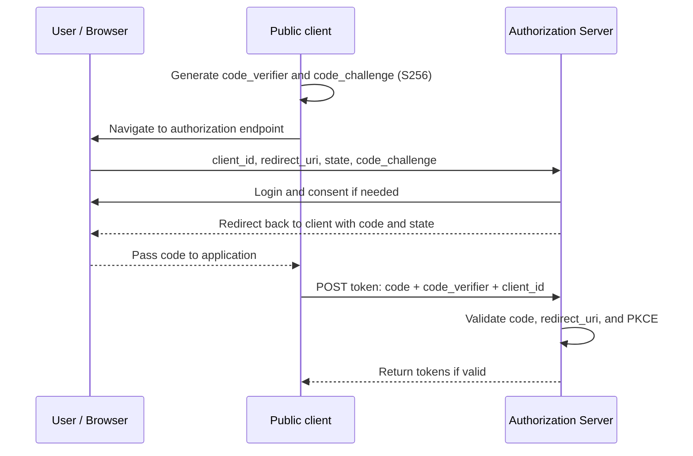
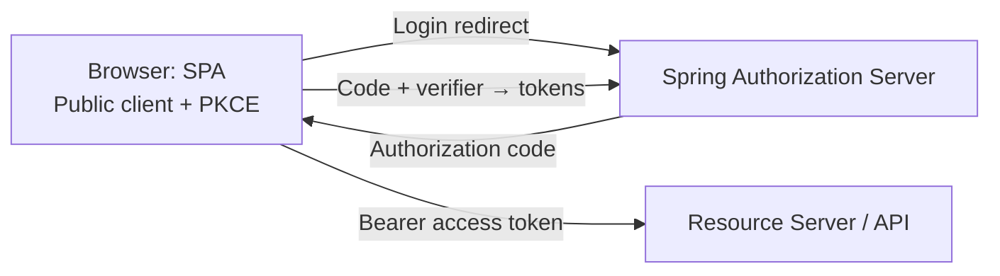
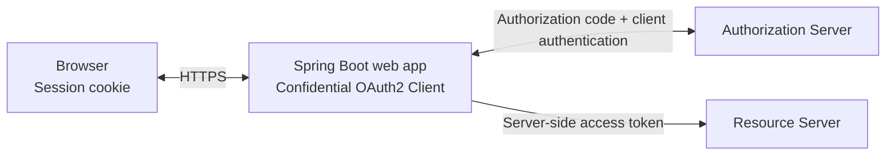
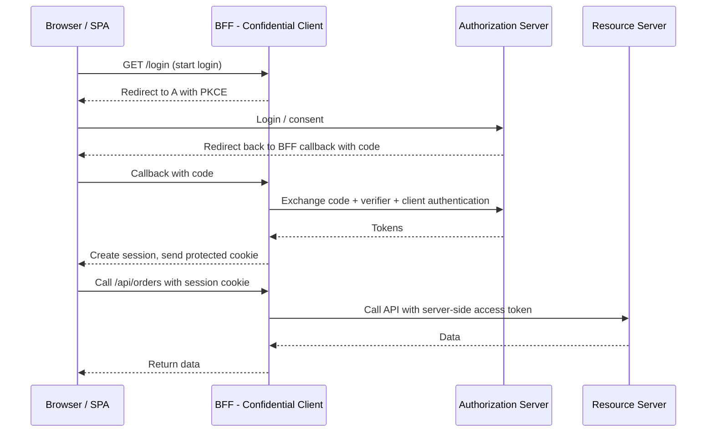

# Public Client, Confidential Client, and Application Deployment Models

In OAuth 2.0 and OpenID Connect (OIDC), a **client** is an application that requests the Authorization Server to grant permissions or issue tokens to access a protected resource. When designing a **Spring Security OAuth2/OIDC Authorization Server** using **Spring Authorization Server** in a Spring Boot application, one of the earliest decisions is whether to register an application as a **public client** or a **confidential client**. This decision governs how the client authenticates at the Token Endpoint, grant flows, PKCE, where tokens are stored, refresh token eligibility, and deployment architecture.

The key principle: **classification is based on the ability to keep the application's own credentials secret in the actual runtime environment**, not on whether the source code is public, whether the app has a login screen, or the number of users.

## 1. Placing the Client in the OAuth 2.0/OIDC Model

Roles to keep distinct:

| Role | Responsibility | Example in Spring |
| --- | --- | --- |
| **Resource Owner / End User** | User who owns the data and authenticates with the identity system. | Person signing in via the login page. |
| **Client** | Requests authorization, receives and uses tokens under an allowed grant. | React SPA, mobile app, Spring Boot web app, or backend job. |
| **Authorization Server (AS)** | Authenticates users (when needed), authenticates clients (when applicable), handles consent, issues authorization codes/tokens, and exposes OIDC endpoints. | Spring Authorization Server. |
| **Resource Server (RS)** | Receives access tokens, validates them, and enforces permissions before returning API data. | Spring Security OAuth2 Resource Server. |

**User authentication differs from client authentication.** A user enters a password or uses a passkey at the Authorization Server; simultaneously, the client may have to prove the *application's* identity using a secret, private key, or certificate. A public client can still send users to log in even though it cannot keep a client secret secure.

In OIDC, the `openid` scope turns a request into OIDC identity authentication and leads to receiving an **ID token** appropriate to the flow. The ID token is for the client to know the user authentication result; the **access token** is for the API/resource server. Never use an ID token as a bearer token to call APIs.

## 2. How Do Public Clients and Confidential Clients Differ?

Under the OAuth 2.0 security model:

- **Public client:** software that cannot protect client credentials from the device user or anyone able to inspect the runtime environment. Examples: JavaScript running in a browser, mobile apps installed on user devices, widely distributed desktop apps, CLIs installed on personal machines.
- **Confidential client:** an application whose execution environment is controlled by the operator and which can store, protect, and rotate client credentials. Examples: Spring Boot backend, server-side OAuth web app, BFF, or internal service.

| Criterion | Public client | Confidential client |
| --- | --- | --- |
| Ability to protect a shared secret | Not trustworthy | Yes, when operated properly |
| Common registration method | `ClientAuthenticationMethod.NONE` | `client_secret_basic`, `private_key_jwt`, mTLS… |
| Client ID | Public; **not** a password | Also can be public; does not substitute for authentication |
| Authorization Code | Combined with **mandatory PKCE** per RFC 9700 | Should combine with PKCE, even when authenticating the client with a secret |
| Client Credentials grant | Inappropriate / not issued under the grant's rules | Suitable for machine-to-machine |
| Where tokens typically reside | On the user's device if using the direct model | In server-controlled backend/session storage |
| Examples | Direct SPA, native mobile, desktop | Web server, BFF, scheduled job, service |

You cannot make an SPA a confidential client by putting `client_secret` in a frontend `.env` file, build-time environment variables, JavaScript bundles, compiled native code, or local storage. Those values still reach the user's device. Conversely, a React UI can still belong to a **confidential model** if all OAuth interactions are performed by a **backend/BFF** and secrets exist only on the server.

Classify by **the component that actually calls the Token Endpoint** and its trust boundary. One product can register multiple `client_id` values: a public SPA, a confidential BFF, and a confidential batch job, each with its own configuration, redirect URIs, grants, and scopes.

## 3. Public Client: Authorization Code + PKCE

A public client cannot provide a shared secret reliable enough for the Authorization Server to authenticate it like a server. For interactive users, the standard choice is the **Authorization Code grant combined with Proof Key for Code Exchange (PKCE)**.

PKCE binds exchanging the authorization code to the session that initiated the request:

1. The app generates a high-entropy random `code_verifier` and retains it only for the current login transaction.
2. The app computes `code_challenge = BASE64URL(SHA256(ASCII(code_verifier)))` and sends `code_challenge_method=S256` in the Authorization Request.
3. The Authorization Server authenticates the user, handles consent if required, and redirects back with a short-lived `authorization_code`.
4. The app calls the Token Endpoint with `code`, `client_id`, `redirect_uri`, and **`code_verifier`**; the Authorization Server checks the stored challenge before issuing tokens.



Simplified HTTP flow example (challenge/verifier values are illustrative only):

```http
GET /oauth2/authorize?response_type=code
  &client_id=spa-app
  &redirect_uri=https%3A%2F%2Fspa.example.com%2Fcallback
  &scope=openid%20profile
  &state=<random-state>
  &code_challenge=<base64url-sha256-verifier>
  &code_challenge_method=S256
```

After redirecting back to `https://spa.example.com/callback?code=...&state=...`, the client matches `state` against the pending transaction and sends:

```http
POST /oauth2/token
Content-Type: application/x-www-form-urlencoded

grant_type=authorization_code&
client_id=spa-app&
code=<authorization-code>&
redirect_uri=https%3A%2F%2Fspa.example.com%2Fcallback&
code_verifier=<original-random-verifier>
```

**PKCE is not a secret-authentication mechanism for public clients.** PKCE prevents another party from exchanging a leaked authorization code without `code_verifier`, but it cannot rescue a scenario where malicious JavaScript running in the same origin steals the access token or makes requests on the user's behalf. Never store a constant verifier, never share a verifier across logins, and never allow bypassing PKCE when a public client is registered as requiring PKCE.

Additional safeguards must be designed together:

- Register and validate **exact redirect URIs**, preferring HTTPS; loopback exceptions for native apps per applicable standards. Never use wildcards or guess redirects from user-supplied URLs.
- Generate and verify `state` per transaction to bind responses to the initiating request; with OIDC, use and validate `nonce` when required by the flow or security profile. PKCE and these mechanisms address related threats and do not automatically replace other checks.
- Use `S256`, and avoid the Implicit grant and Resource Owner Password Credentials grant in new designs.
- Restrict scopes, audience, and access token lifetimes; never log tokens, codes, or verifiers. For browsers, enforce CSP, control third-party scripts, and defend against XSS.
- **Never embed a client secret in a public application**, even as an encrypted string whose decryption key also ships inside the app.

**Note on Spring Authorization Server:** the Spring Authorization Server 1.5.x SPA/PKCE guide explicitly states that it **does not issue refresh tokens to public clients** in the default implementation. Therefore, do not design a long-lived login experience for a direct SPA assuming that adding `refresh_token` to the grant list will make the server issue refresh tokens. Check your version and choose a BFF, re-authentication via the Authorization Server session, or an explicit extension policy with risk assessment. This is an **implementation characteristic of Spring Authorization Server**, not a universal rule forbidding all OAuth authorization servers from issuing refresh tokens to public clients.

## 4. Confidential Client: Authenticating the Application Itself

A confidential client can keep credentials in a backend-managed execution environment. At the Token Endpoint, the server typically requires a **client authentication** method:

| Method | How it works | Use case |
| --- | --- | --- |
| `client_secret_basic` | Sends client ID/secret via HTTP Basic over TLS. | Simple backend integration with a secret store and rotation policy. |
| `client_secret_post` | Sends secret in the form body of the token request. | Only when compatibility requires it; mitigate risk of secret leaking in logs. |
| `private_key_jwt` | Client signs a JWT assertion with a private key; server verifies via public key. | Partner federations and multi-service systems requiring key management. |
| mTLS | Uses a client certificate in the TLS handshake. | Infrastructure with PKI management and strong authentication requirements. |

Secrets and private keys must stay server-side: retrieve them from a secret manager or secure configuration mechanism, never commit them to the repository, never send them to the browser, restrict access, monitor usage, and support rotation/revocation. **Having a secret does not make a client invulnerable**: a compromised backend can still leak credentials and tokens.

Confidential clients commonly perform two kinds of work:

**Web server user login.** The browser redirects the user to the Authorization Server; the backend receives the authorization code and exchanges it for tokens over the back channel using client authentication and **recommended PKCE**. The backend keeps tokens server-side, while the browser holds a protected session cookie. Example: Spring Security `oauth2Login()` in a web application.

**Machine-to-machine (M2M).** A worker or service calls `grant_type=client_credentials` and authenticates itself with a secret/key/certificate to receive an access token for the application itself. **There is no user login and no user ID token** in this flow; the token's permissions depend on the scopes/audience granted to the client.

Do not confuse **client credentials** with a user's service-account password. In modern architectures, services should use an appropriate client authentication method and apply least privilege.

## 5. Application Deployment Models and Token Storage Boundaries

### 5.1. Direct SPA to Authorization Server and API



Pros: the SPA deploys statically on a CDN and calls APIs directly; fewer intermediate backend components. Trade-offs: the browser must manage the access token lifecycle, faces XSS risk, and may require CORS on browser-accessible endpoints. **CORS is a browser policy, not client authentication or a substitute for redirect URI validation.** Restrict specific origins rather than opening CORS indiscriminately. With Spring Authorization Server, keep in mind the public-client refresh token limitation noted above.

### 5.2. Server-Rendered Web Application (Confidential)



The backend handles OAuth, stores tokens in server-managed storage, and the browser receives only a session cookie. Suitable for Spring MVC/Thymeleaf, server-rendered apps, or apps with a dedicated backend. Configure `HttpOnly`, `Secure`, and `SameSite` cookie flags appropriately and enforce CSRF protection for state-changing requests. Sessions and token stores must be designed for multi-instance deployment if the app scales horizontally.

### 5.3. SPA + Backend for Frontend (BFF)

In the BFF model, the UI remains React/Vue/Angular, but **the BFF is the OAuth client**. The BFF holds the secret, performs Authorization Code + PKCE, stores tokens server-side, and calls APIs on behalf of the browser:



A BFF is a strong choice when a web UI needs a stable login session without placing OAuth tokens in JavaScript. A BFF does not eliminate all XSS risks: malicious scripts can still send requests using the active session. You must therefore continue enforcing CSRF protection, origin checks, access control, CSP, and API limits. Crucially, the browser session cookie **is not** an access token used directly against the Resource Server.

### 5.4. Native Mobile, Desktop, and CLI

Apps installed on user devices are typically **public clients** even when written in Swift, Kotlin, Java, or other compiled languages:

- Use the **system browser** for login; avoid collecting passwords directly inside an embedded WebView.
- Use Authorization Code + PKCE; handle callbacks via verified app/universal links or loopback redirects where appropriate for the platform.
- Store tokens using OS-provided secure storage whenever possible, while recognizing that the device itself can be compromised or reverse-engineered. Local secure storage **does not turn the app into a confidential client**.
- Never distribute one hardcoded client secret across all installations.

### 5.5. Service-to-Service and Multi-Component Systems

A scheduled job or Spring Boot service running on controlled infrastructure can be a confidential client using `client_credentials`; the target API acts as a Resource Server validating the access token. If an API Gateway is present, the gateway may act as a Resource Server, an OAuth2 Client, or both depending on the flow, yet each downstream API still needs appropriate permission enforcement. Never assume that because a token passed through a gateway, internal services can skip validation.

## 6. Registering Both Client Types with Spring Authorization Server

Spring Authorization Server represents each application's configuration via `RegisteredClient` and stores it via `RegisteredClientRepository`. The example below focuses solely on **client registration**; it assumes the Authorization Server, issuer, OIDC, and security filter chains are configured separately.

```java
import java.util.UUID;

import org.springframework.context.annotation.Bean;
import org.springframework.context.annotation.Configuration;
import org.springframework.security.crypto.factory.PasswordEncoderFactories;
import org.springframework.security.crypto.password.PasswordEncoder;
import org.springframework.security.oauth2.core.AuthorizationGrantType;
import org.springframework.security.oauth2.core.ClientAuthenticationMethod;
import org.springframework.security.oauth2.core.oidc.OidcScopes;
import org.springframework.security.oauth2.server.authorization.client.InMemoryRegisteredClientRepository;
import org.springframework.security.oauth2.server.authorization.client.RegisteredClient;
import org.springframework.security.oauth2.server.authorization.client.RegisteredClientRepository;
import org.springframework.security.oauth2.server.authorization.settings.ClientSettings;

@Configuration
class OAuthClientsConfig {

    @Bean
    RegisteredClientRepository registeredClientRepository() {
        // Example: secret from runtime/secret manager; never send to the SPA.
        String bffSecret = System.getenv("BFF_CLIENT_SECRET");
        if (bffSecret == null || bffSecret.isBlank()) {
            throw new IllegalStateException("Missing BFF_CLIENT_SECRET");
        }
        PasswordEncoder passwordEncoder =
                PasswordEncoderFactories.createDelegatingPasswordEncoder();

        RegisteredClient spa = RegisteredClient.withId(UUID.randomUUID().toString())
                .clientId("spa-app")
                .clientAuthenticationMethod(ClientAuthenticationMethod.NONE)
                .authorizationGrantType(AuthorizationGrantType.AUTHORIZATION_CODE)
                .redirectUri("https://spa.example.com/callback")
                .scope(OidcScopes.OPENID)
                .scope(OidcScopes.PROFILE)
                .clientSettings(ClientSettings.builder()
                        .requireProofKey(true)
                        .requireAuthorizationConsent(true)
                        .build())
                .build();

        RegisteredClient bff = RegisteredClient.withId(UUID.randomUUID().toString())
                .clientId("web-bff")
                .clientSecret(passwordEncoder.encode(bffSecret))
                .clientAuthenticationMethod(ClientAuthenticationMethod.CLIENT_SECRET_BASIC)
                .authorizationGrantType(AuthorizationGrantType.AUTHORIZATION_CODE)
                .authorizationGrantType(AuthorizationGrantType.REFRESH_TOKEN)
                .redirectUri("https://app.example.com/login/oauth2/code/web-bff")
                .scope(OidcScopes.OPENID)
                .scope(OidcScopes.PROFILE)
                .clientSettings(ClientSettings.builder()
                        .requireProofKey(true)
                        .build())
                .build();

        return new InMemoryRegisteredClientRepository(spa, bff);
    }
}
```

Key points in this configuration:

1. `spa-app` uses `ClientAuthenticationMethod.NONE`, has **no** `clientSecret`, and requires PKCE. The client still sends `client_id` so the server can locate the registration; this is not a secret.
2. `web-bff` uses `CLIENT_SECRET_BASIC`. The secret is read at runtime and hashed when stored in the registration; the plaintext value belongs solely to the authorized backend. `requireProofKey(true)` remains beneficial for confidential clients.
3. `REFRESH_TOKEN` is configured only for the BFF in this example. This **does not guarantee** a refresh token will always be issued: it also depends on grant, scope, policy, and server version. The Spring Authorization Server SPA guide notes specific limitations for public clients.
4. `InMemoryRegisteredClientRepository` is for demonstration and testing. Production should store client registrations in a durable repository, manage credential lifecycles, consider `private_key_jwt`/mTLS, and support operational access control.
5. `example.com` domains are placeholders. Register real redirect URIs per environment; the issuer and external communication must use HTTPS, except where local development exceptions are permitted.

This client **registration** code does not by itself create a login page, OIDC provider, API Resource Server, or BFF session. To make the system work, configure the corresponding components and the OAuth2 client on the consuming application side.

## 7. How to Choose a Model for Real-World Requirements

Suppose you are building an order management system with Spring Boot APIs:

| Requirement | Suitable architecture | Registration at Authorization Server | Reason |
| --- | --- | --- | --- |
| React SPA hosted on CDN, calling APIs from browser | Direct SPA | Public + Authorization Code + PKCE | JavaScript cannot hold a secret. |
| React SPA needing a secure session and server-side tokens | SPA + BFF | Confidential BFF + Authorization Code + PKCE | Tokens do not have to pass through browser JavaScript. |
| Spring MVC app with web session | Server-side web | Confidential + Authorization Code + PKCE | Backend protects credentials and tokens. |
| Customer-facing iOS/Android app | Native | Public + Authorization Code + PKCE | Binaries on devices can be extracted. |
| Order-sync job running inside a cluster | Backend job | Confidential + Client Credentials | Flow has no end user; grants service-level permissions. |

**Selection workflow:** Identify where the OAuth client runs and where tokens are kept; if the client cannot protect credentials, register it as public and enforce PKCE for Authorization Code. If a backend truly owns the credentials, register it as confidential, pick a client authentication method, and still prefer PKCE when using authorization codes. Next, define grants, scopes, redirect URIs, audience, token/session storage, and flow-specific mitigations.

## 8. Common Misconceptions That Lead to Vulnerabilities

| Misconception | Correct understanding and handling |
| --- | --- |
| "Having `client_id` means the client is authenticated." | Client ID is an identifier. Public clients have no shared-secret client authentication. |
| "Hiding `client_secret` in JS code is safe." | Users can inspect bundles/network/devices. Never issue a shared secret to a public runtime. |
| "PKCE replaces client secrets everywhere." | PKCE protects exchanging the **authorization code**; confidential clients still perform client authentication when required. |
| "Only public clients need PKCE." | RFC 9700 **requires** PKCE for public clients and **recommends** it for confidential clients using Authorization Code. |
| "A BFF is also a public SPA client." | If the BFF holds credentials and exchanges codes/tokens on the server, the **BFF** is a confidential client; the browser is just the UI. |
| "Enabling CORS means the client is trusted." | CORS does not prove OAuth client identity, does not control API permissions, and does not replace PKCE. |
| "An ID token is the same as an access token." | ID tokens serve client-side identity authentication; APIs must validate access tokens issued for their resources. |
| "Client Credentials is used to log users in." | This grant serves server applications, not an end user's login session. |
| "Refresh tokens are always issued when the grant is declared." | Issuance depends on server and policy; Spring Authorization Server by default does not issue refresh tokens to public clients per its SPA guide. |

## 9. Verifying Configuration Before Production

In a test environment, verify both valid paths and rejected cases:

1. **Public client:** login with authorization code + `S256` succeeds; missing `code_challenge`, wrong `code_verifier`, or attempting to reuse a code must be rejected per the corresponding rules. Do not attempt to send a secret "hidden in the SPA."
2. **Redirect URI:** any URI differing from registered URIs—including invalid path, port, or scheme—must not be used to receive an authorization code.
3. **Confidential client:** valid authentication exchanges the code; invalid/missing credentials are rejected; unregistered grants/scopes are not accepted.
4. **OIDC and APIs:** applications validate token issuer, audience, lifetime, and required claims per role; APIs reject tokens not intended for that API. When `nonce` is present, the client must verify the exact value bound to the authentication session.
5. **Operations:** ensure HTTPS, encryption at rest, no secrets in logs, token/session revocation or expiration per policy, proper BFF cookie flags, and CSRF protection on state-changing requests.

## 10. References

- [RFC 6749 — The OAuth 2.0 Authorization Framework](https://www.rfc-editor.org/rfc/rfc6749): defines client types, roles, and authorization grants.
- [RFC 7636 — Proof Key for Code Exchange](https://www.rfc-editor.org/rfc/rfc7636): generating verifiers/challenges and PKCE verification.
- [RFC 8252 — OAuth 2.0 for Native Apps](https://www.rfc-editor.org/rfc/rfc8252): guidance for native apps using external user agents and redirects.
- [RFC 9700 — Best Current Practice for OAuth 2.0 Security](https://www.rfc-editor.org/rfc/rfc9700): current security recommendations, including PKCE for public/confidential clients and client authentication.
- [OpenID Connect Core 1.0](https://openid.net/specs/openid-connect-core-1_0.html): distinguishing user authentication, ID tokens, and OIDC flows.
- [Spring Authorization Server — Authenticate using a Single Page Application with PKCE](https://docs.spring.io/spring-authorization-server/reference/guides/how-to-pkce.html): example of `none` + `requireProofKey(true)` and public-client refresh token notes.

When building an Authorization Server with Spring, treat **public/confidential** as a decision about **trust boundaries and where the application runs**. Every subsequent choice—client authentication, PKCE, grants, token storage, BFF, redirects, sessions, and testing—must remain consistent with that boundary.
