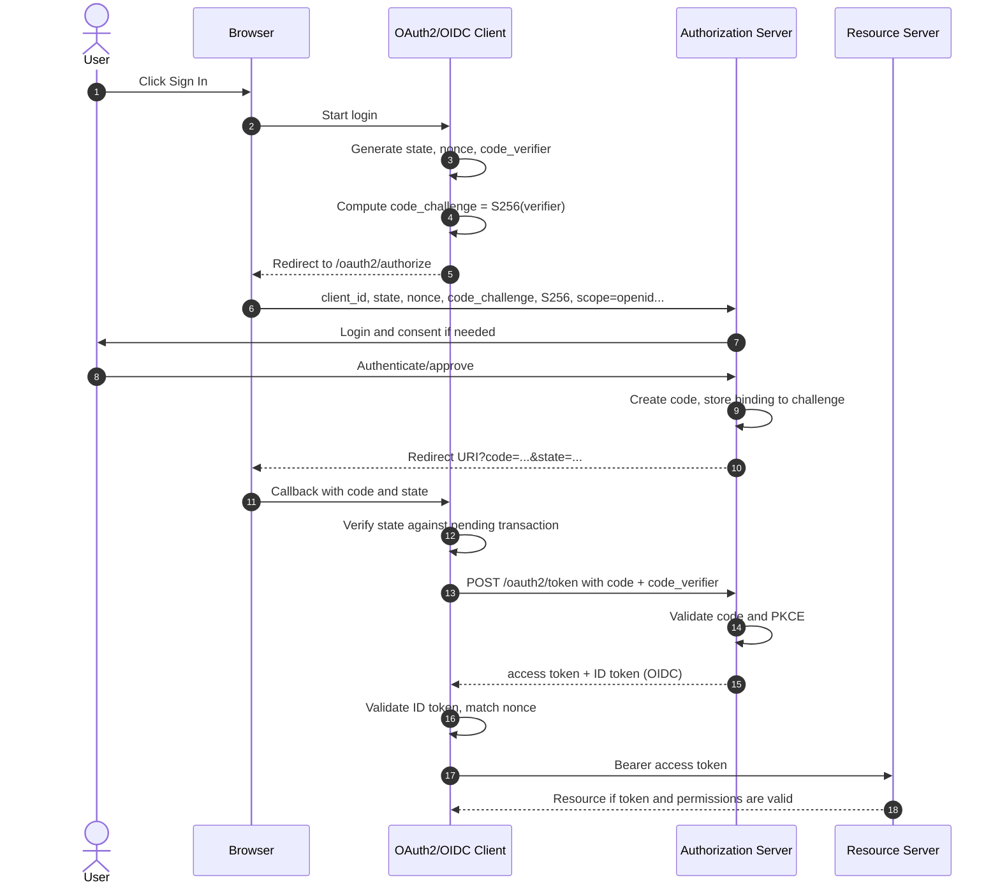

# State, Nonce, and PKCE in Browser-Based Flows

## 1. Context: Why Do Redirect Flows Need Three Mechanisms?

In **OAuth 2.0** and **OpenID Connect (OIDC)**, an application typically does not collect passwords itself. Instead, it redirects the browser to the **Authorization Server** for the user to authenticate and grant authorization, after which the browser is redirected back to the application's callback URL.

The browser is a **front-channel**: it traverses the user's device, URLs, browsing history, intermediate pages, and actors capable of navigating the browser. Consequently, the client must never assume that a response arriving at its callback necessarily belongs to a login request the client itself just initiated. Furthermore, the authorization code appearing during the redirect must be bound to the exact client that started the transaction.

Three mechanisms commonly appear together:

- **`state`** binds the **redirect response** to the client's **initial authorization request**. It is a critical safeguard against login/authorization request forgery via callbacks (CSRF) and cross-transaction mix-ups.
- **OIDC `nonce`** binds the **ID token** to the **initial authentication request**. It helps detect replayed ID tokens or ID tokens injected into the wrong authentication context.
- **PKCE** (*Proof Key for Code Exchange*) binds the **authorization code** to **the party that initiated the request**, via the `code_verifier` and `code_challenge` pair. Anyone who only intercepts the code cannot exchange it for tokens without the matching verifier.

In the **`SPRING_SECURITY_OAUTH2_OIDC_AUTHORIZATION_SERVER`** module, all three concepts are foundational to **designing, configuring, securing, testing, and operating** authorization flows with Spring Security and Spring Authorization Server in a Spring Boot application. It is essential to pinpoint **which party generates the value, which party verifies it, and which attack is mitigated**.

### Learning Objectives

After this lesson, you should be able to:

1. Distinguish `state`, `nonce`, `code_verifier`, and `code_challenge` in terms of purpose, storage location, and verification point.
2. Accurately explain the Authorization Code + PKCE flow, with or without OIDC.
3. Build or configure the required components on **Spring Security OAuth2 Client** and **Spring Authorization Server**.
4. Test forged callback responses, mismatched-nonce ID tokens, stolen authorization codes, and PKCE configuration errors.

## 2. Quick Distinction: State, Nonce, and PKCE

| Mechanism | What does the client send at the start? | Who checks it and when? | Primary protection |
| --- | --- | --- | --- |
| **OAuth 2.0 `state`** | Random `state` value in the `/oauth2/authorize` request | **Client** compares returned `state` at callback with the pending transaction | Prevents callback/response injection, CSRF, and transaction mix-ups |
| **OIDC `nonce`** | Random `nonce` value in the OIDC authentication request | **OIDC Client** compares the `nonce` claim inside the **verified ID token** with the value saved from the request | Detects replayed ID tokens or tokens bound to the wrong authentication session |
| **PKCE** | `code_challenge` and `code_challenge_method=S256`; keeps `code_verifier` secret | **Authorization Server** checks `code_verifier` when exchanging the code at `/oauth2/token` against the challenge attached to the code | Prevents someone who only obtained the authorization code from exchanging it for tokens |

These are three distinct binding layers. **`state` does not replace PKCE**; **`nonce` is not a way to verify an authorization code**; **PKCE does not prove that an ID token belongs to the user's actual login request**.

In a plain OAuth 2.0 flow **without OIDC**, there may be no ID token and no `nonce`. In OIDC, the application must request the `openid` scope and perform ID token validation per specification.

## 3. Overall Flow: Authorization Code + PKCE + OIDC

Suppose an order management app at `https://app.example.com` wants to log users in via an Authorization Server at `https://auth.example.com`. The orders API is protected at `https://api.example.com`.



In this diagram, the Authorization Server **echoes back the `state`** it received and **binds `code_challenge` to the authorization code**. When issuing an ID token for an OIDC request containing a nonce, the server includes the corresponding nonce in the ID token's claims. The client is responsible for storing expected values per transaction and checking them at the right moment.

If the `state` check fails, the client **must stop before the code exchange step**. If the ID token/`nonce` check fails, the client **must not establish a successful login session**, even though the token response arrived over HTTPS. If PKCE does not match, the Authorization Server **must not issue tokens for that code**.

## 4. State: Binding the Callback to the Right Request

### 4.1. How Does State Work?

When starting a login attempt, the client generates an unpredictable value, for example:

```text
state = "V4iLwQfX6q81bmRsY6xNw8fQoMjVz3c8"
```

The client stores this value alongside data for the **pending login transaction**. The redirect request includes `state`:

```http
GET /oauth2/authorize?response_type=code
    &client_id=orders-web
    &redirect_uri=https%3A%2F%2Fapp.example.com%2Flogin%2Foauth2%2Fcode%2Forders
    &scope=openid%20profile%20orders.read
    &state=V4iLwQfX6q81bmRsY6xNw8fQoMjVz3c8
    &code_challenge=EXAMPLE_CODE_CHALLENGE
    &code_challenge_method=S256
    &nonce=EXAMPLE_NONCE
Host: auth.example.com
```

The lines above are wrapped for readability; when actually sent, the parameters belong to **a single properly encoded URL**.

After processing, the Authorization Server redirects:

```http
HTTP/1.1 302 Found
Location: https://app.example.com/login/oauth2/code/orders?code=AUTH_CODE&state=V4iLwQfX6q81bmRsY6xNw8fQoMjVz3c8
```

The client extracts `state` from the callback, looks up the pending transaction, and proceeds only if the values match. Delete or invalidate used transactions, enforce a short expiration, and handle concurrent login attempts (such as multiple browser tabs) independently.

### 4.2. What Happens If State Is Omitted?

An attacker can initiate an authorization flow under **the attacker's own account**, then trick the victim's browser into visiting the callback carrying the code from that flow. If the client cannot tell which response belongs to which transaction, it risks logging the victim into a session under the attacker's account (**login CSRF / authorization response injection**), causing data the victim subsequently enters to be saved into an unintended account.

**State detects responses that do not belong to an initiated transaction.** It must be genuinely bound to the browser session/login flow, not merely included in the URL as a dummy field. A static value like `state=123` or one shared across all users provides no reliable protection.

### 4.3. Rules for Generating and Storing State

- Generate using a **cryptographically secure random number generator (CSPRNG)** with sufficient entropy, fresh for every request; e.g., 16–32 random bytes encoded as Base64URL.
- Store `state` or equivalent binding metadata in the **client's session/transaction**; enforce a short lifetime and prevent reuse.
- Never allow an external party to control or pick a valid `state` value for a transaction.
- If you need to remember a post-login return path, store it server-side and link it via state; if encoding data inside state, guarantee **integrity**, limit lifetime, and validate redirect targets to prevent **open redirects**.
- Do not confuse `state` with the CSRF token used across all HTML forms in an application. Both mitigate CSRF, but they are bound to different interactions.

**Security note:** Strictly implemented PKCE also helps defend against forms of CSRF in code flows per modern OAuth guidance. Even so, keeping `state` to accurately bind session, transaction state, and callback remains practical and easy to test when integrating Spring Security.

## 5. Nonce: Binding the ID Token to the OIDC Request

### 5.1. How Does Nonce Differ from State?

In OIDC, `nonce` (number used once) is a value generated by the **OIDC Client** and sent in the authentication request. When issuing an ID token for a request carrying a nonce, the **OpenID Provider** includes that value in the `nonce` claim. The client checks this claim **after validating the ID token**, alongside signature, issuer, audience, lifetime, and related authentication conditions.

Example payload of an **illustrative ID token**:

```json
{
  "iss": "https://auth.example.com",
  "sub": "user-204",
  "aud": "orders-web",
  "iat": 1780000000,
  "exp": 1780000900,
  "nonce": "rM6t7FSgyYhqzDUGzbo7m5YZVvwUoZA0"
}
```

This is only a payload snippet for learning how to read claims; a client must never trust decoded JSON without **verifying the signature and validity conditions**. The timestamps are illustrative only, not values from an actual login session.

Suppose the client stored the expected nonce `rM6t7FSgyYhqzDUGzbo7m5YZVvwUoZA0`. If the received ID token contains a different nonce, **the client must reject authentication**. An ID token with a valid signature from another transaction must not be allowed to substitute for the current login attempt's ID token.

### 5.2. Is Nonce Required?

According to OIDC Core:

- For the **pure Authorization Code Flow**, the `nonce` parameter is **optional per specification**, though recommended when appropriate to add replay-binding protection. If a nonce was sent, the client **must validate** the nonce value returned in the ID token.
- For OIDC's **Implicit Flow** and **Hybrid Flow**, `nonce` is **required** under the specification's corresponding rules. Those flows have different front-channel risk characteristics and are not preferred choices for building new applications.

In a Spring Boot application using Authorization Code + OIDC, enabling `openid` is the condition for receiving an **ID token**; using PKCE does not turn a pure OAuth flow into OIDC. Conversely, `nonce` does not replace **`iss`, `aud`, `exp`, signature**, and other checks mandated by OIDC.

### 5.3. What Does Nonce Not Solve?

Nonce does **not** prevent an attacker from capturing an authorization code and exchanging it for tokens; that is PKCE's job. Nonce is **not** meant for authorizing API calls; access tokens and Resource Server policies handle that. Nonce also does not replace validating the right **issuer** in architectures with multiple Authorization Servers/OpenID Providers.

## 6. PKCE: Authorization Code Can Only Be Exchanged by the Verifier Holder

### 6.1. Why Was PKCE Created?

In the Authorization Code Flow, the code travels through the browser and callback. An attacker might try to capture the code from the callback URL, a mobile app handling custom URI schemes insecurely, a malicious extension, logs, or redirect bugs. If possessing only the code were enough to exchange for tokens, a public client without a client secret would struggle to prevent unauthorized code redemption.

PKCE adds a short-lived, **per-transaction** secret:

1. The client generates `code_verifier` from a secure random source and **keeps it locally**; it never sends the verifier in the authorization URL.
2. The client computes `code_challenge` from the verifier and sends `code_challenge` with `code_challenge_method=S256` in the `/oauth2/authorize` request.
3. The Authorization Server associates the challenge and method with the corresponding authorization code.
4. When the client sends the code to `/oauth2/token`, it includes `code_verifier` over a **direct TLS-protected connection**.
5. The Authorization Server recomputes the challenge from the verifier and compares. Wrong or missing verifier → token issuance rejected.

### 6.2. Computing `S256` Accurately

RFC 7636 defines:

```text
code_challenge = BASE64URL-ENCODE(
    SHA256(ASCII(code_verifier))
)
```

Here **BASE64URL has no `=` padding**. `code_verifier` is **43–128 characters** long, using the unreserved characters allowed by RFC 7636 (`A–Z`, `a–z`, `0–9`, `-`, `.`, `_`, `~`). A simple approach is generating **32 random bytes** and Base64URL-encoding without padding: the result is **43 characters** long.

Standard example from RFC 7636, Appendix B:

```text
code_verifier:
dBjftJeZ4CVP-mB92K27uhbUJU1p1r_wW1gFWFOEjXk

code_challenge (S256):
E9Melhoa2OwvFrEMTJguCHaoeK1t8URWbuGJSstw-cM
```

Do not confuse `code_challenge` with password hashes stored in a database. The challenge is a **public** value tied to **a single code exchange**, while the verifier must be protected until the transaction completes. Never reuse a static verifier across all users or logins.

The `plain` method allows the challenge to equal the verifier itself, failing to protect against front-channel verifier exposure like `S256`; for new applications, use **`S256`** and configure the server to require it whenever possible.

### 6.3. Example of Exchanging a Code with a Verifier

After the client verifies `state` at the callback:

```http
POST /oauth2/token HTTP/1.1
Host: auth.example.com
Content-Type: application/x-www-form-urlencoded

grant_type=authorization_code&
client_id=orders-web&
code=AUTH_CODE&
redirect_uri=https%3A%2F%2Fapp.example.com%2Flogin%2Foauth2%2Fcode%2Forders&
code_verifier=dBjftJeZ4CVP-mB92K27uhbUJU1p1r_wW1gFWFOEjXk
```

This is a **public client** example using `client_id`, so there is no client secret. For a **confidential client**, the token endpoint also requires client authentication per its registered method, such as `client_secret_basic` or a stronger mechanism. PKCE adds a code-binding layer and **does not replace client authentication**.

If a token request submits an incorrect `code_verifier` or submits a valid verifier paired with a code from a different transaction, the Authorization Server must reject it. The authorization code must also be **short-lived, single-use**, and bound to the right client and redirect URI; do not rely on PKCE to bypass those checks.

### 6.4. What PKCE Does Not Solve

PKCE protects the **authorization code exchange step**, not the entire token lifecycle. If an access token is stolen **after issuance**, PKCE does not automatically revoke that token. PKCE also cannot fix XSS, a compromised client, an invalid redirect URI, a forged ID token, loose issuer/audience validation, or insecure refresh token storage.

## 7. Generating Secure Values in Java

This is a standalone Java example to understand the values a client must generate. In a real application using **Spring Security OAuth2 Client**, prefer the framework-managed generation, storage, and verification mechanisms; write custom code only when special integration needs require it and you fully understand the transaction lifecycle.

```java
import java.nio.charset.StandardCharsets;
import java.security.MessageDigest;
import java.security.NoSuchAlgorithmException;
import java.security.SecureRandom;
import java.util.Base64;

public final class OAuthRequestValues {
    private static final SecureRandom RANDOM = new SecureRandom();
    private static final Base64.Encoder BASE64_URL =
            Base64.getUrlEncoder().withoutPadding();

    private OAuthRequestValues() {}

    // Each value is generated FRESH every time an authorization request starts.
    public static String randomValue(int bytes) {
        byte[] data = new byte[bytes];
        RANDOM.nextBytes(data);
        return BASE64_URL.encodeToString(data);
    }

    public static String pkceS256Challenge(String verifier) {
        try {
            byte[] digest = MessageDigest.getInstance("SHA-256")
                    .digest(verifier.getBytes(StandardCharsets.US_ASCII));
            return BASE64_URL.encodeToString(digest);
        } catch (NoSuchAlgorithmException ex) {
            throw new IllegalStateException("SHA-256 is unavailable", ex);
        }
    }

    public static void main(String[] args) {
        String state = randomValue(24);       // 192 random bits
        String nonce = randomValue(24);       // 192 random bits
        String codeVerifier = randomValue(32); // 43 Base64URL characters
        String codeChallenge = pkceS256Challenge(codeVerifier);

        // Store state/nonce/verifier with the same pending login transaction.
        // Include state, nonce, codeChallenge, and method=S256 in the authorization request.
        // Send codeVerifier only when exchanging the authorization code at the token endpoint.
    }
}
```

The code above illustrates value generation; it **does not implement a complete login transaction**. In real usage, never log these values, never embed the verifier in URLs, and never hold the verifier in a global variable shared across sessions.

## 8. Placing State, Nonce, and PKCE Properly in Spring Security

### 8.1. Spring Security OAuth2 Client Side

Spring Security OAuth2 Client provides components to build authorization requests, store pending transactions, and process callbacks:

- **`OAuth2AuthorizationRequestResolver`** builds the request sent to the Authorization Server, including protocol parameters and PKCE customization when applicable.
- **`AuthorizationRequestRepository`** stores request details between the redirect and the callback return. The common implementation stores them in the HTTP session; when building custom clients, protect the lifecycle and correlation across transactions.
- **`OAuth2LoginAuthenticationFilter`** and OIDC/OAuth2 login components handle the authorization response, exchange the code, and validate the result per configuration.

When using `oauth2Login()`, let Spring Security manage binding `state` to the authorization request. For OIDC login, Spring Security's OIDC components handle `nonce` and ID token verification via framework-provided mechanisms. Avoid writing a custom callback handler that only checks whether the query contains `code`.

PKCE support in Spring Security is available via `OAuth2AuthorizationRequestCustomizers.withPkce()`. Depending on version and client type, PKCE may be added automatically for public clients; for clients where PKCE needs to be enabled explicitly, you can configure the resolver and attach it to the authorization endpoint:

```java
@Bean
OAuth2AuthorizationRequestResolver authorizationRequestResolver(
        ClientRegistrationRepository registrations) {

    DefaultOAuth2AuthorizationRequestResolver resolver =
            new DefaultOAuth2AuthorizationRequestResolver(
                    registrations, "/oauth2/authorization");

    resolver.setAuthorizationRequestCustomizer(
            OAuth2AuthorizationRequestCustomizers.withPkce());
    return resolver;
}

// Attach the resolver to the security filter chain configuration for OAuth2 Login:
// http.oauth2Login(oauth2 -> oauth2
//     .authorizationEndpoint(endpoint -> endpoint
//         .authorizationRequestResolver(authorizationRequestResolver)));
```

This is a configuration example for **a single component**, not a full Spring Boot application. If referencing `authorizationRequestResolver` inside `SecurityFilterChain`, pass the registered bean or method appropriately. A production configuration also requires `ClientRegistration`, endpoints, session persistence, TLS, security filter chains, and proper error handling. Check the exact APIs for the Spring Security version your project uses.

### 8.2. Spring Authorization Server Side

On the server side, PKCE centers on **verifying challenge/verifier against the authorization code and client configuration**. A public client in `RegisteredClientRepository` can be registered as follows:

```java
RegisteredClient client = RegisteredClient.withId(UUID.randomUUID().toString())
        .clientId("orders-web")
        .clientAuthenticationMethod(ClientAuthenticationMethod.NONE)
        .authorizationGrantType(AuthorizationGrantType.AUTHORIZATION_CODE)
        .redirectUri("https://app.example.com/login/oauth2/code/orders")
        .scope(OidcScopes.OPENID)
        .scope("profile")
        .scope("orders.read")
        .clientSettings(ClientSettings.builder()
                .requireProofKey(true)
                .requireAuthorizationConsent(true)
                .build())
        .build();

// Persist the client using an appropriate RegisteredClientRepository.
```

`ClientSettings.requireProofKey(true)` requires PKCE for this client when executing Authorization Code. In a real system, also register the exact grant types, authentication methods, redirect URIs, and scopes needed by the business. If the client is a backend capable of keeping secrets, configure its corresponding client authentication method; you can still require PKCE for the backend as defense in depth.

The Authorization Server is responsible for validating PKCE and issuing ID tokens matching the OIDC request. **The client**, not the Authorization Server, must match the callback's `state` against its own session and match the `nonce` claim inside the verified ID token against the expected nonce.

### 8.3. Data Flow and Storage Locations

| Data | Appears via the browser? | Where to hold between steps | When to delete/expire |
| --- | --- | --- | --- |
| `state` | Yes: authorization request and callback | Client's transaction/session | After callback is matched, rejected, or expired |
| `nonce` | Yes in OIDC authentication request; appears in ID token | OIDC Client's transaction/session | After ID token is verified or transaction ends |
| `code_challenge` | Yes: authorization request | Authorization Server associated with authorization code | Once code is redeemed or expires |
| `code_verifier` | **Never sent in authorization request/front-channel**; sent directly at token endpoint | Client's transaction/session with restricted access | When code is exchanged, transaction canceled, or expired |
| Authorization code | Yes: callback redirect | Managed by Authorization Server; client uses to exchange for tokens | Upon single successful use or expiration |

For a backend/BFF, storing transaction data server-side bound to the browser session is usually easy to control. For an SPA or mobile app, consider XSS risks, deep link/custom scheme handling, and memory/storage exposure of verifiers/tokens; rely on OS-provided mechanisms or reputable OAuth/OIDC libraries and prefer the **system browser** for mobile logins. Never embed long-lived secrets in user-distributed applications.

## 9. Attack Matrix and Defense Layers

| Scenario | Direct control mechanism | Additional layers needed |
| --- | --- | --- |
| Callback carries a `code` from a transaction not started by this browser | `state` binding callback to transaction | Session management, CSRF protection, and issuer validation |
| Someone intercepts the authorization code from the URL without the verifier | PKCE `S256` | TLS, exact redirect URI, short-lived single-use codes |
| Valid ID token issued for a different login attempt | OIDC `nonce` (when used) | Signature verification, `iss`, `aud`, lifetime, and OIDC claims |
| Attacker alters `code_challenge` and tries to exchange the code | PKCE binding; token endpoint verifies verifier | Ensure requests and redirects are not tampered with; protect client-side transaction |
| A client confuses responses from two Authorization Servers | **Issuer identification/validation**; not just `state` | Exact issuer metadata, response `iss` when supported, per-provider callbacks |
| Access token is stolen after issuance | **None of these three mechanisms suffices** | TLS, secure token storage, appropriate lifetimes, revocation/rotation, sender-constrained tokens if needed |
| XSS reads the verifier in an SPA | PKCE **does not prevent XSS on the client itself** | CSP, XSS prevention, BFF architecture where suitable, minimizing token exposure |

Note: a **mix-up attack** happens when a client integrates with multiple Authorization Servers and misidentifies which server issued a response. `state` alone is not sufficient; you must bind the transaction to the **expected issuer** and validate the issuer when handling responses/tokens.

## 10. Integration Testing: Which Side Must Reject?

Test in a Spring Boot environment configured with client, Authorization Server, and OIDC (if using nonce). Clearly separate **client tests** from **Authorization Server token-endpoint tests**:

| Test case | Where to verify | Expected outcome |
| --- | --- | --- |
| Start two concurrent logins in two tabs | OAuth2 Client | Each transaction keeps its own state/verifier/nonce without overwriting each other |
| Callback missing `state` or wrong `state` | OAuth2 Client | Rejects callback; does not exchange code or create login session |
| Callback with expired/already-used `state` | OAuth2 Client | Rejects transaction reuse |
| Token endpoint receives code with wrong verifier | Authorization Server | Returns appropriate protocol error, issues no token |
| Re-exchanging an already-used authorization code | Authorization Server | Rejects the used code |
| Client registered requiring PKCE sends request missing challenge or unsupported method | Authorization Server | Rejects request per PKCE policy |
| ID token carries a nonce different from the sent nonce | OIDC Client | Rejects authentication even if ID token signature is valid |
| ID token has wrong issuer/audience or is expired | OIDC Client | Rejects ID token regardless of matching nonce |
| Redirect URI does not match registered URI | Authorization Server | Rejects related authorization/code-exchange request |
| Resource Server receives access token lacking scope | Resource Server | Denies API access per policy; independent of state/nonce/PKCE |

To test **PKCE**, execute a valid authorization step and intentionally alter `code_verifier` in the code-exchange request. In a separate run, verify that a code can be redeemed only once. To test **state**, simulate a client-side callback or inject a response without a valid transaction; altering `state` at the token endpoint is meaningless because the token endpoint typically does not receive `state`.

To test **nonce**, craft or mock an ID token **with a valid signature in the test environment** whose `nonce` claim mismatches. Simply mutating a string inside a real JWT breaks its signature before nonce validation even runs, failing to exercise the intended defense layer.

Logs on both the client and Authorization Server should record **correlation ID, error type, and timestamp** sufficient for investigation, while **never logging raw `code_verifier`, authorization codes, access tokens, refresh tokens, or client secrets**. Error testing should use synthetic test data to avoid accidentally exposing user information.

## 11. Analysis Examples of Two Common Bugs

**Bug A — PKCE present, but State matching skipped.** A hand-rolled client receives a callback with a code, reads the verifier from a shared variable, and immediately calls the token endpoint. This implementation both loses transaction correlation and risks grabbing another tab's verifier. You must store `state` and `verifier` **for the same authorization request**, look up the right transaction by `state`, and exchange the code only when the callback is valid.

**Bug B — Validly signed ID token, yet mismatched nonce.** The client sent `nonce=A`, but the returned ID token contains `nonce=B`. Some manual implementations verify only the signature/JWK and expiration, missing the binding to the login attempt. Whenever the client sends a nonce in an OIDC request, it must check the `nonce` claim and **reject** it if it does not match the expected value.

## 12. Summary

Remember three questions to identify each defense layer:

1. **Does this callback belong to the exact request I initiated?** → Verify **`state`** at the **OAuth2 Client**.
2. **Does this ID token belong to the exact OIDC request I initiated?** → Verify **`nonce`** in the ID token at the **OIDC Client**.
3. **Does the party exchanging the authorization code hold the secret used to create the challenge?** → **Authorization Server** verifies **PKCE** at the token endpoint.

In a Spring Boot system, use **Spring Security OAuth2 Client** to manage login transactions, **Spring Authorization Server** to enforce PKCE policies and issue tokens, and **Spring Security Resource Server** to validate access tokens and API permissions. Enforcing HTTPS, exact redirect URIs, issuer/audience validation, authorization rules, and secure session/token management remains mandatory in the overall design.

### References

- [RFC 6749 — The OAuth 2.0 Authorization Framework](https://www.rfc-editor.org/rfc/rfc6749)
- [RFC 7636 — Proof Key for Code Exchange (PKCE)](https://www.rfc-editor.org/rfc/rfc7636)
- [RFC 9700 — Best Current Practice for OAuth 2.0 Security](https://www.rfc-editor.org/rfc/rfc9700)
- [OpenID Connect Core 1.0 — Authentication](https://openid.net/specs/openid-connect-core-1_0.html)
- [RFC 9207 — OAuth 2.0 Authorization Server Issuer Identification](https://www.rfc-editor.org/rfc/rfc9207)
- [Spring Security — OAuth 2.0 Client](https://docs.spring.io/spring-security/reference/servlet/oauth2/client/index.html)
- [Spring Authorization Server — Reference](https://docs.spring.io/spring-authorization-server/reference/)
