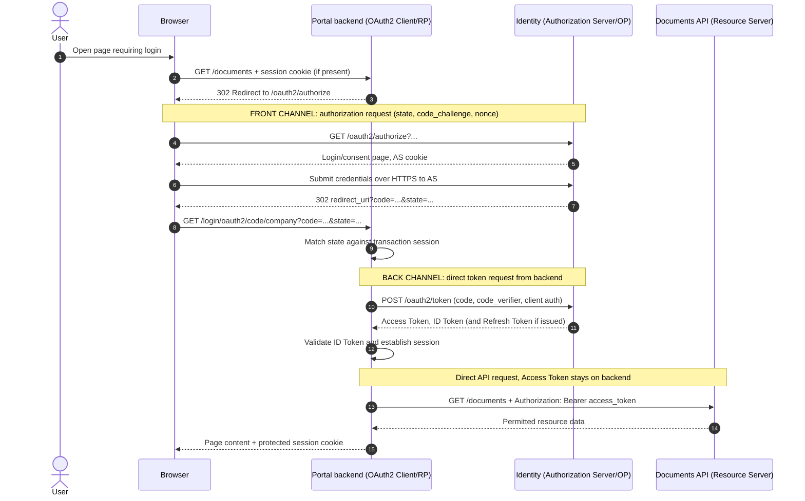

# Front Channel, Back Channel, and Sensitive Data Transmission Points

In OAuth 2.0 and OpenID Connect (OIDC), **Front Channel** and **Back Channel** describe **the transport path of protocol messages** between the application, browser, Authorization Server, and related components. Distinguishing the two channels is foundational to deciding which data may appear in redirect URLs, which data must be sent via direct requests, how to protect tokens, and where to place security checks.

When designing a **Spring Security OAuth2/OIDC Authorization Server** using Spring Boot and Spring Authorization Server, misunderstanding the boundary between the two channels can lead to leaking access tokens, client secrets, authorization codes, login credentials, or personal data via browser history, logs, referrer URLs, and JavaScript code. This lesson in the **Protocol and Terminology** chapter focuses on architecture, sensitive data transmission points, relevant Spring configuration, and testing strategies.

## 1. Exact Definitions of the Two Channels

### 1.1. Front Channel: Path Through the User Agent

**Front Channel** refers to transmitting messages through a **User Agent**, most commonly the user's browser, via navigation, redirects, or HTML forms. In a typical login flow:

1. The OAuth2 Client directs the browser to the Authorization Server's (AS) **authorization endpoint**.
2. The browser interacts with login/consent pages served by the AS.
3. The AS redirects the browser back to the client's **redirect URI** with the authorization result.

The defining characteristic of the Front Channel is that **the browser sits on the message path**. Consequently, URLs, query strings, fragments, forms, and web assets can be exposed to browser history, extensions, scripts, intermediate pages, HTTP logs, and navigation settings.

**Front Channel does not mean unencrypted HTTP.** The Front Channel must still use HTTPS in real environments. HTTPS protects data in transit, yet does not prevent URLs from appearing in browser history, endpoint access logs, or scripts executing inside a compromised origin.

### 1.2. Back Channel: Direct Exchange Between Protocol Components

**Back Channel** refers to exchanges that do not rely on browser redirects to carry messages between parties; typically direct HTTP requests from an OAuth2 Client backend to the AS or from a Client to a Resource Server (RS):

- Client calls the **token endpoint** to exchange an authorization code for tokens.
- Resource Server calls the **introspection endpoint** to verify an opaque access token.
- Application fetches metadata/JWKS or calls the **UserInfo endpoint** per the appropriate mechanism.
- OpenID Provider (OP) sends a **Back-Channel Logout** notification directly to the Relying Party when both support that mechanism.

**The Back Channel must also be protected with TLS, sender authentication when required by protocol, output controls, and logging hygiene.** Just because a request does not pass through a redirect URL does not guarantee tokens or secrets cannot leak at the backend, reverse proxy, log collector, or observability stack.

### 1.3. Caveat to Remember: Back Channel Is Not Always Server-to-Server

For a **confidential web client** backed by a server, token requests typically travel from the backend to the AS, allowing credentials and tokens to stay server-side. However, for an **SPA/public client**, JavaScript inside the browser itself may send requests directly to the token endpoint using Authorization Code + PKCE. That is a **direct exchange with the token endpoint**, often categorized under the protocol's back-channel leg, yet **the returned data still resides inside the browser environment**.

Therefore, separate two questions:

| Question | Meaning |
|---|---|
| **Does the message travel via redirect/User Agent or a direct request?** | Distinguishes **Front Channel / Back Channel** in the protocol flow. |
| **Who can see or store the data at the processing location?** | Identifies **trust boundaries**: backend, browser, JavaScript, proxy, logs, user device. |

The label **Back Channel is not an automatic security property.** When threat modeling, always analyze both dimensions.

## 2. Authorization Code + PKCE with OIDC Diagram

Suppose a system has a web portal `https://portal.example.com`, an Authorization Server / OpenID Provider `https://identity.example.com`, and an API `https://api.example.com`. In this example, `portal` is a **confidential client/BFF** keeping tokens on the backend; the browser holds only an appropriate session cookie.



This diagram deliberately separates **the authorization code's path through the browser** from **the token's path after exchanging the code**. The Authorization Code flow does not place access tokens into redirect URLs in the illustrated backend model. Note: **user login credentials are still entered in the browser** and submitted to the AS login page over HTTPS; there is no blanket rule saying all sensitive data stays outside the Front Channel.

### 2.1. Stage-by-Stage Annotations

| Stage | Transmission form | Core data | Components to protect |
|---|---|---|---|
| Client → AS authorization request | **Front Channel**, browser navigation | `client_id`, `redirect_uri`, `response_type=code`, `scope`, `state`, `code_challenge`, `nonce` if present | URL, personal parameters, transaction session binding |
| Browser ↔ AS login/consent | **Front Channel**, form/cookie | Password, authentication factors, AS session cookie, consent choices | Login page, HTTPS, cookies, CSRF, anti-phishing |
| AS → Client redirect | **Front Channel**, via browser | `code`, `state`, or `error` | Authorization code, session state, and callback URL |
| Client backend → AS token endpoint | **Back Channel**, direct HTTP | `code`, `code_verifier`, client authentication, then tokens | TLS, client authentication, secrets, logs, token response |
| Client → API | Direct HTTP between backend and RS | `Authorization: Bearer <access_token>` | Access token, audience, scope, transport, and logs |
| API → AS introspection if using opaque tokens | **Back Channel**, direct HTTP | Access token, credentials to introspect, status response | TLS, introspection access rights, logs |

Not every step in the table occurs for every grant. For instance, `client_credentials` requires no authorization redirect, login page, or authorization code.

## 3. Where Is Sensitive Data Transmitted?

A common mistake is classifying data solely by "channel" and concluding that everything on the Front Channel is non-sensitive. In reality, you must classify by **value, lifetime, intended recipient, and abuse potential**.

| Data | Where it typically appears | Sensitivity and risk | Primary protection rules |
|---|---|---|---|
| `client_id` | Authorization URL; token request | Client identifier, **not a secret** | Can be public; does not replace client authentication |
| `redirect_uri`, `scope`, `response_type` | Authorization URL | Usually not a secret; may reveal which service/feature the user requested | Accept only registered redirect URIs; limit private data in URLs |
| `state` | Authorization URL and callback | Transaction correlation value; theft/leakage can aid attacks when combined with other flaws | Generate unpredictably, bind to session, verify on callback; do not embed private data |
| OIDC `nonce` | Authorization request; bound to ID Token | Authentication session safeguard; typically appears in Front Channel, not a client secret | Generate unpredictably, store for comparison, and verify `nonce` claim when applicable |
| PKCE `code_challenge` | Authorization URL | Commitment derived from `code_verifier`, designed for Front Channel transmission | Use `S256`; never mistakenly send `code_verifier` here |
| PKCE `code_verifier` | Client → token endpoint | Sensitive value because it redeems the corresponding code | Store bound to transaction; send via token request, keep out of URLs/logs |
| Authorization `code` | Query of redirect URI in standard flows | **Sensitive, short-lived, single-use**; may be intercepted in URLs or logs | Short-lived, single-use, bound to client/redirect URI/PKCE; never log |
| Access Token | Token response; API calls | **Bearer credential**: anyone holding a matching token may gain API access | Never put in URLs; TLS, audience/scope, secure storage, log redaction |
| Refresh Token | Token response; refresh request | Can obtain new access tokens; typically longer-lived | Keep in secure storage; appropriate rotation/revocation and issuance policies |
| ID Token | OIDC token response | Contains authentication details and possibly personal claims; intended for RP | Verify signature, issuer, audience, lifetime, nonce when present; never use instead of access token |
| Client secret/private key | Token endpoint, client auth mechanisms | Long-lived secret or signing key | Keep only in secret-capable environments; secret manager; never in SPA/URL/repo |
| Password, OTP, recovery codes | Authentication forms at AS | Highly sensitive user credentials | Submit only to valid AS over HTTPS; never pass to third-party OAuth2 Clients |
| AS or Client session cookie | `Cookie` header via browser | Grants session access; vulnerable to theft via XSS/CSRF/cookie misconfiguration | Appropriate `Secure`, `HttpOnly`, `SameSite`, session fixation and CSRF protection |
| Claims like `login_hint`, `id_token_hint`, email, `claims` | May appear in authorization request | May contain PII or tokens even alongside public parameters | Avoid putting unnecessary sensitive data in URLs; consider PAR and claim minimization |

**Secrecy in PKCE:** `code_challenge` is safe to expose because an observer cannot feasibly invert an `S256` hash to recover a high-entropy `code_verifier`. Conversely, sending `code_verifier` in the authorization request query defeats binding the authorization code to the client that initiated the transaction.

### 3.1. Front Channel Request Example

```http
GET /oauth2/authorize?response_type=code&client_id=portal-web&redirect_uri=https%3A%2F%2Fportal.example.com%2Flogin%2Foauth2%2Fcode%2Fcompany&scope=openid%20profile%20documents.read&state=STATE_RANDOM&code_challenge=PKCE_CHALLENGE&code_challenge_method=S256&nonce=NONCE_RANDOM HTTP/1.1
Host: identity.example.com
```

Here `client_id`, `state`, `code_challenge`, and `nonce` are placed in the authorization request according to their roles. **Never put `client_secret`, `code_verifier`, access tokens, or refresh tokens into this URL.** Uppercase values are placeholders, not values usable in a real environment.

After authentication and consent, the AS redirects the browser back to the client:

```http
HTTP/1.1 302 Found
Location: https://portal.example.com/login/oauth2/code/company?code=AUTH_CODE&state=STATE_RANDOM
Cache-Control: no-store
```

Because the authorization code travels through the Front Channel, it remains a **point requiring defense**, even though it is not yet an access token. The client must verify `state` before using the code; the AS must verify that the code is active, unused, matches the client/redirect URI, and matches `code_verifier` upon exchange.

### 3.2. Back Channel Request Example

```http
POST /oauth2/token HTTP/1.1
Host: identity.example.com
Content-Type: application/x-www-form-urlencoded
Authorization: Basic <REDACTED_CLIENT_AUTH>

grant_type=authorization_code&code=AUTH_CODE&redirect_uri=https%3A%2F%2Fportal.example.com%2Flogin%2Foauth2%2Fcode%2Fcompany&code_verifier=ORIGINAL_HIGH_ENTROPY_VERIFIER
```

```json
{
  "access_token": "REDACTED_ACCESS_TOKEN",
  "token_type": "Bearer",
  "expires_in": 300,
  "id_token": "REDACTED_ID_TOKEN"
}
```

This is an example for a **confidential OIDC client** authenticating at the token endpoint; the fields in the response vary by grant, scope, and AS policy. `refresh_token` appears only if issued by the AS. None of the values in this example are real tokens or credentials.

A client secret is not automatically safe simply because it sits in the `Authorization` HTTP header: reverse proxies, APM tools, tracing, or logging filters can still accidentally record headers or request bodies. Secret redaction must be enforced across the entire processing pipeline.

## 4. Data Leakage Surfaces

### 4.1. URLs, Query Strings, and Fragments

Front Channel URLs can end up in:

- **Browser history**, bookmarks, address bar, browser sync features, screenshots, and extensions.
- **Access logs** of web servers, reverse proxies, gateways, WAFs, CDNs, and analytics tools if they log raw request targets.
- **`Referer` headers** when a page loads other resources or navigates; how much is sent depends on browser, `Referrer-Policy`, origin/destination, and navigation type.
- **Analytics/tracking scripts**, error reporting, and other JavaScript running on the callback page.
- **Open redirects** or callback pages that render content or load third-party scripts before processing and stripping single-use parameters from the URL.

In certain legacy flows, tokens/ID Tokens could be returned via **URL fragments** (the portion after `#`). Fragments are usually **not** sent in HTTP requests to web servers, yet they remain readable by page JavaScript and the browser environment. Therefore, **fragments are not a vault for bearer tokens**. Avoid the Implicit flow in new designs; prefer Authorization Code + PKCE with proper token handling.

OIDC's `response_mode=form_post` can return parameters via an auto-submitted browser POST form. This reduces some URL exposure, yet **it is still Front Channel**, and parameters still pass through the browser/POST body; it does not replace `state`, PKCE, token validation, or CSRF/cookie protections. Verify support and appropriate `SameSite` policies when using cross-site POST callbacks.

### 4.2. Bodies and Headers in the Back Channel

Moving parameters from query strings to POST bodies only changes where data appears; it does not automatically keep data out of:

- Framework HTTP request/response logging or debug logging.
- Traces/spans and collectors that capture headers, form fields, or response bodies.
- Proxies/gateways that terminate TLS and forward internally.
- Application exceptions, validation errors, or retry logs containing full messages.
- Heap dumps, crash reports, temporary files, and unprotected storage.

For bearer access tokens, **never log the `Authorization` header**. For refresh tokens, secrets, and `code_verifier`, also strip/mask contents when logging request bodies. For ID Tokens, avoid logging unnecessary identity claims because beyond security sensitivity they may constitute personal data.

### 4.3. Browser State, Cookies, and JavaScript

In a **BFF/confidential web client**, the backend can hold tokens server-side and issue a dedicated **session cookie** to the browser. This architecture reduces token exposure to JavaScript, yet the session cookie remains sensitive:

- Set `Secure` so the browser sends the cookie only over HTTPS; set `HttpOnly` when JavaScript does not need to read the cookie.
- Configure `SameSite` according to actual redirect flows; enforce **CSRF** protection for state-changing operations.
- Never place tokens or client secrets into HTML, templates, source maps, client bundles, `localStorage`, or URLs for debugging convenience.
- Mitigate XSS via output encoding, script/CSP controls, dependency auditing, and limiting third-party scripts.
- Rotate session IDs at appropriate login boundaries; limit session lifetimes and handle logout properly.

With an SPA, tokens may live inside the browser runtime when JavaScript executes token requests directly. No client secret stored inside an SPA is truly secret. Authorization Code + PKCE reduces code-interception risk on redirects, yet **does not fully mitigate XSS or token reading inside the browser**.

### 4.4. What Does HTTPS Protect and What Does It Miss?

HTTPS protects confidentiality and integrity **over a TLS-protected connection** and authenticates endpoints via certificates. It does not control how applications handle data once received. Therefore, combine:

1. End-to-end HTTPS matching the architecture; avoid downgrade redirects and misconfiguration when terminating TLS at a proxy.
2. Minimizing data in redirect URLs; never put long-lived credentials/tokens in query strings.
3. Endpoint-level authentication/authorization, validating token issuer and audience as needed.
4. Encryption and access control for stored data, centralized secret management, and log redaction.
5. Browser defenses using secure cookies, anti-XSS/CSRF controls, and strict redirect policies.

## 5. Comparing OAuth2/OIDC Flows by Data Channel

| Flow/architecture | Front Channel | Back Channel/direct exchange | Data to watch carefully |
|---|---|---|---|
| **Authorization Code + PKCE, web backend** | Authorization request; AS login/consent; redirect to client with code | Backend exchanges code for tokens; calls APIs | `code`, `state`, `nonce` in browser; `code_verifier`, secret, tokens on backend |
| **Authorization Code + PKCE, SPA/public client** | Authorization request/redirect with code | JS directly sends token request to AS over network | Access token may live in browser runtime; no safe client secret |
| **Client Credentials** | No browser navigation/user login needed | Client authenticates at token endpoint, gets token, calls API | Client secret/private key, access token; no user-login ID Token |
| **OIDC Implicit/Hybrid (legacy/situational)** | May return ID Token and/or access token through browser | Some hybrid variants also exchange code at token endpoint | Tokens may expose in browser; not a default choice for new systems |
| **Token introspection** | No browser redirect required | Resource Server calls AS directly | Token being checked, introspection credentials, returned metadata |
| **OIDC UserInfo** | Usually no browser redirect needed for UserInfo request | Client calls OP with appropriate access token | Access token and personal attributes from UserInfo |

**Do not equate "access token is a JWT" with "token travels on the Front Channel."** Token type, JWT/opaque format, and transport channel are independent decisions. Both JWTs and opaque tokens can leak if logged or placed in URLs.

### 5.1. OIDC Front-Channel Logout and Back-Channel Logout

OIDC also uses these two terms for **logout notification mechanisms**, distinct from the general transport paths of tokens:

- **Front-Channel Logout:** OP coordinates logout through the browser, potentially using page/iframe loads per supported mechanisms. Depends on browser state, cookies, and third-party content restrictions.
- **Back-Channel Logout:** OP sends a **Logout Token** via a direct request to an endpoint registered by the RP; the RP validates the token and terminates the corresponding session without requiring the browser to navigate for logout notifications.

Both mechanisms are **optional** specifications/capabilities and must actually be supported and configured by both OP and RP. **A Logout Token is neither an access token for API calls nor a normal login ID Token.** If your architecture requires synchronized multi-app logout, explicitly test both mechanisms as well as closed-browser or blocked third-party content scenarios.

## 6. Security Responsibilities per Component

| Component | Front Channel checks | Back Channel checks |
|---|---|---|
| **Authorization Server / OpenID Provider** | `client_id`, `redirect_uri`, grant/scope, consent, login page, session, request forgery protection, response payloads | Confidential client auth, single-use and short-lived codes, PKCE matching, token policies, TLS, secret/JWK protection, log redaction |
| **OAuth2 Client / OIDC Relying Party** | Generate and check `state`, bind transactions to sessions, protect callbacks, avoid leaking codes in pages/logs | Send `code_verifier`, keep client secrets/tokens in proper storage, validate ID Tokens, call APIs with right audience/scopes |
| **Resource Server** | Usually does not participate in authorization redirects; protect API endpoints if separate cookies/web UI exist | Accept access tokens with valid issuer/audience/lifetime/permissions; never accept ID Tokens as access tokens |
| **Browser / User Agent** | Enter credentials only on the genuine AS origin; handle redirects/cookies/sessions | For SPAs, JS may receive tokens directly, making the browser a sensitive data zone |

**The Authorization Server cannot single-handedly fix every Client bug.** The AS controls token issuance and redirect URI validation, while the Client must still manage `state`, transaction sessions, callbacks, and token storage properly. The Resource Server must likewise independently enforce access token validation and API permissions.

## 7. Applying in Spring Security and Spring Authorization Server

### 7.1. Identifying Which Endpoint Typically Belongs to Which Channel

With Spring Authorization Server's common default paths, you can start by classifying as follows:

| Endpoint | Typical usage | Security focus |
|---|---|---|
| `/oauth2/authorize` | **Front Channel**: browser to AS | Redirect URI, `state`, PKCE challenge, scope, authorization code response |
| `/login`, auth/consent pages | **Front Channel**: user interacts with AS | Session cookie, password/MFA, CSRF, anti-phishing, preventing open redirects |
| `/oauth2/token` | **Direct exchange/Back Channel**: client calls AS | Client authentication when needed, code verifier, token response, redaction |
| `/oauth2/introspect` | **Back Channel**: RS or authorized client calls AS | Introspecting caller auth, token being checked, response data |
| `/oauth2/revoke` | **Direct request** from client to AS | Client authentication when applicable, token being revoked, redaction |
| `/oauth2/jwks` | Direct request to fetch public keys; publicly accessible | Publish only **public keys** and required metadata; protect private keys |
| `/.well-known/openid-configuration` | Discovery metadata; fetchable by browser or backend | Accurate issuer and endpoint URLs; public metadata contains no secrets |
| `/userinfo` (if OIDC enabled/supported) | Client calls OP directly with appropriate access token | Protect personal claims, audience/scope/token, and logs |

These are **common protocol patterns**, not a rule that every endpoint only accepts requests from one kind of host. Routes may change via `AuthorizationServerSettings`, Spring Authorization Server version, and OIDC configuration. A public endpoint like JWKS still requires HTTPS and proper signing key operations, even though public keys themselves are not secrets.

### 7.2. Requiring PKCE for Clients Using Authorization Code

In Spring Authorization Server, you can declare PKCE requirements in client metadata:

```java
RegisteredClient portal = RegisteredClient.withId(UUID.randomUUID().toString())
    .clientId("portal-web")
    .clientSecret(passwordEncoder.encode(clientSecretFromSecretStore))
    .clientAuthenticationMethod(ClientAuthenticationMethod.CLIENT_SECRET_BASIC)
    .authorizationGrantType(AuthorizationGrantType.AUTHORIZATION_CODE)
    .redirectUri("https://portal.example.com/login/oauth2/code/company")
    .scope(OidcScopes.OPENID)
    .scope("documents.read")
    .clientSettings(ClientSettings.builder()
        .requireProofKey(true)
        .requireAuthorizationConsent(true)
        .build())
    .build();
```

This snippet illustrates **client registration** (imports/beans and the repository persisting clients are omitted). `clientSecretFromSecretStore` is an illustrative variable representing a secret loaded securely on the backend, not a hardcoded secret string. You must store `RegisteredClient` in a `RegisteredClientRepository` and configure the AS/OP, signing keys, and user login mechanisms for the real system.

`requireProofKey(true)` requires the client to use PKCE when running the Authorization Code flow. It **does not replace** `state` checks on the Client, confidential client authentication at the token endpoint, or `redirect_uri` verification. For an SPA/public client, register the `none` authentication method and do not provision a fake client secret; PKCE remains essential.

### 7.3. OAuth2 Client on Spring Boot

A backend portal application can use a sample configuration like:

```yaml
spring:
  security:
    oauth2:
      client:
        registration:
          company:
            provider: company-identity
            client-id: portal-web
            client-secret: ${PORTAL_OAUTH2_CLIENT_SECRET}
            authorization-grant-type: authorization_code
            redirect-uri: "{baseUrl}/login/oauth2/code/{registrationId}"
            scope: openid, profile, documents.read
        provider:
          company-identity:
            issuer-uri: https://identity.example.com
```

```java
@Bean
SecurityFilterChain portalSecurity(HttpSecurity http) throws Exception {
    http.authorizeHttpRequests(auth -> auth
            .requestMatchers("/", "/public/**").permitAll()
            .anyRequest().authenticated())
        .oauth2Login(Customizer.withDefaults())
        .oauth2Client(Customizer.withDefaults());

    return http.build();
}
```

When using `oauth2Login()`, Spring Security handles redirects/callbacks and binds authorization requests to sessions by default. Check **the actual PKCE configuration of your Spring Security version and client type**, compatibility with the AS's `requireProofKey` policy, reverse proxy paths, and `redirect-uri`. Enabling `oauth2Login()` **does not automatically prove** that all channels are secured, tokens are safely stored, or the Resource Server validates audience properly.

In the backend portal model, keep access/refresh tokens in server-controlled storage whenever feasible. The browser receives only a session cookie; when the portal calls an API, the backend attaches the access token to the direct request. API tokens must carry the proper audience, permissions, and lifetime.

### 7.4. Login Sessions, SameSite, and CSRF

Spring Boot session cookie configuration for a backend model can start with:

```yaml
server:
  servlet:
    session:
      cookie:
        secure: true
        http-only: true
        same-site: lax
```

`SameSite=Lax` is usually compatible with OAuth2 callbacks via top-level GET navigations from the AS back to the client. If using `response_mode=form_post` or cross-site POST/iframe scenarios, **cookie policies must be re-evaluated** because `Lax` may block sending cookies on such requests. Never disable CSRF just to make a callback work; instead inspect the authorization request storage/correlation mechanism, callback receiver, and actual session requirements.

When deploying behind a proxy, ensure the application receives the accurate **external scheme/host** so it constructs the registered HTTPS redirect URI. Trust forwarded headers only from trusted proxies. Scheme/host mismatches can break redirect URIs or create redirect vulnerabilities.

### 7.5. Reducing Data in Authorization URLs

If authorization requests carry personal information or numerous sensitive parameters, evaluate **Pushed Authorization Requests (PAR, RFC 9126)** when supported by the AS/client and runtime version. The client sends authorization request details **directly** to the PAR endpoint first, receives a `request_uri`, and then navigates the browser via Front Channel carrying only that reference. PAR reduces detailed data exposure in browser URLs, yet **does not eliminate all Front Channel risks**, does not replace PKCE/`state`, and still requires protecting `request_uri` against abuse per AS mechanisms.

You can consider signed authorization requests (JAR) and advanced response modes when a stricter threat model demands it, based strictly on **actual support in both client and AS**. Never assume a feature exists merely because it appears in an OAuth/OIDC specification.

## 8. Attack Scenarios and Mitigations

| Scenario | Exploited weakness | Primary mitigation |
|---|---|---|
| Reading callback URL containing `code` from logs | Authorization code traverses Front Channel | Never log sensitive queries; short-lived/single-use codes; PKCE; process callback promptly and redirect to a clean URL |
| Attacker substitutes a user's callback response | Client fails to bind session to authorization request | Generate/verify session-bound `state`, verify exact AS/issuer in multi-AS setups, control redirect URIs |
| Exchanging a stolen authorization code | AS skips PKCE or code binding | `S256` PKCE, single-use codes, enforce client and redirect URI binding throughout flow |
| Token sent in query string | Browser history, referer, proxy logs record credentials | Place tokens only in valid locations such as API Bearer headers; never pass tokens in URLs |
| Third-party script reads token in SPA | XSS, compromised script, or unsafe browser context | Minimize scripts; CSP and XSS hygiene; prefer BFF where suitable; never embed client secrets |
| Refresh token or client secret leaked via tracing | Collector/proxy logs headers/bodies | Redact before exporting logs/traces, restrict access, enforce retention, rotate secrets |
| Client accepts an ID Token intended for another app | Missing `aud`, `iss`, signature, lifetime checks | Validate ID Token per OIDC; verify nonce when present; never use ID Token as access token |
| API accepts an access token intended for another API | Missing audience validation at Resource Server | Verify issuer, signature or introspection, audience, timestamps, and API permissions |
| Redirect URI points to another site | Loose redirect registration / open redirect | Strict exact redirect URI matching; eliminate open redirects; restrict callback URIs |
| Logout only clears local cookie | Lacks proper session/token termination/synchronization | Design client/OP logout, revocation, and Front-/Back-Channel Logout if needed and supported |

### 8.1. Do Not Confuse the Roles of `state`, `nonce`, PKCE, and Client Authentication

| Safeguard | Primary protection | Cannot substitute for |
|---|---|---|
| `state` | Binds authorization response to client transaction; helps prevent CSRF/login CSRF | PKCE, token validation, XSS defense |
| OIDC `nonce` | Binds ID Token to authentication request to mitigate replay/substitution when applied | `state`, PKCE, signature/audience checks |
| PKCE (`S256`) | Ties authorization code to client creating `code_verifier`, reducing unauthorized code exchange | Session correlation, protecting access tokens after issuance |
| Client authentication | Verifies identity of confidential client at protected endpoints | End-user authentication, PKCE, API authorization |
| `redirect_uri` validation | Restricts where the AS sends authorization results | `state` correlation, token checks, cookie/CSRF defenses |
| TLS | Protects data in transit over the connection | Log hygiene, browser runtime safety, secret storage, or app logic |

For clients supporting login across **multiple Authorization Servers**, inspect mechanisms binding the **issuer/AS** in responses to prevent issuer confusion (authorization server mix-up). Do not conclude `state` alone suffices for all multi-AS scenarios; you may need an issuer identification mechanism such as RFC 9207 validated against client configuration.

## 9. Testing Front Channel and Back Channel

The following checks separate protocol verification from data confidentiality checks. Run them in a test environment with **synthetic tokens or test accounts**, ensuring logs never accidentally capture real credentials.

| Check | Action | Expected outcome |
|---|---|---|
| Clean authorization URL | Observe redirect to `/oauth2/authorize` | Contains `state`, `code_challenge_method=S256`, `code_challenge`; no `client_secret`, `code_verifier`, or tokens |
| Authorization callback | Complete login via code flow | Browser receives only `code`/`state` or proper error message; no access/refresh tokens in URL |
| State binding | Tamper with `state` or replay callback from another session | Client rejects transaction and does not establish a login session from invalid callback |
| PKCE | Attempt code exchange with wrong/missing `code_verifier` | Token endpoint rejects when PKCE is required; valid code works only once |
| Redirect URI | Supply a URI different from registered URIs | AS rejects or handles error safely without redirecting code to invalid URI |
| Client authentication | Call token endpoint with invalid confidential client credentials | No token issued |
| Log redaction | Enable test-level logging/tracing and send dummy tokens | Raw client secrets, `Authorization` headers, code verifiers, access/refresh tokens, cookies never appear |
| Browser history / Referer | Inspect callback and third-party resource loads on page | Callback processed promptly, sensitive queries minimized; proper policy prevents leaking private data in Referer |
| Cookies and sessions | Inspect `Set-Cookie`, HTTPS, callback, CSRF | Cookies carry appropriate attributes and login flow operates securely |
| API validation | Call API with wrong `aud`/scope access token, ID Token, expired token | RS rejects per policy; ID Token not accepted as access token |
| SPA/public client (if supported) | Inspect token request in Network/DevTools | No client secret bundled; PKCE enforced; CORS/token policies appropriate |
| Logout (if supported) | Test Front-/Back-Channel Logout and closed browser/blocked cookies | Sessions handled consistently per implemented mechanism; logout token verified |

A valuable manual check is opening **Network** in Developer Tools and marking three points: the `/oauth2/authorize` request, the callback carrying `code`, and the `/oauth2/token` request. With a **backend web client**, the browser typically sees only the first two points; the code-exchange request appears in redacted network/backend logs. With an **SPA**, the token request is visible in DevTools. Observing this confirms the **actual architecture** rather than guessing from endpoint names.

### 9.1. Error Responses Can Also Leak Data

When a token exchange or callback fails, the application must never dump the raw authorization request, HTTP headers, or token response into error HTML. Error pages must also avoid attaching raw sensitive query parameters to analytics/event tracking. Operational logs should record a **credential-free transaction correlation ID** and redacted error details. Consider `Cache-Control: no-store` on responses containing sensitive data and configure an appropriate `Referrer-Policy` for callback/login pages.

## 10. Pre-Deployment Design Checklist

Before writing code or approving Authorization Server and OAuth2 Client configurations, answer:

1. **Which steps pass through the browser?** List authorization, login, consent, callback, and logout URLs; identify queries/forms/cookies sent at each step.
2. **Which steps are direct requests?** List token, introspection, UserInfo, JWKS, API, and back-channel logout endpoints and who actually calls each.
3. **Where do tokens go?** Which API is each access token for, which RP is the ID Token for, where are refresh tokens stored, and which trust boundary owns the client secret?
4. **Are personal data/credentials in URLs?** Remove unnecessary data, avoid sensitive `login_hint` or tokens in query strings; consider PAR when appropriate.
5. **Is transaction binding complete?** Verify `state`, OIDC `nonce` when applicable, PKCE, issuer, redirect URI, client authentication, and token validation requirements.
6. **What do logging systems and proxies see?** Confirm redaction policies for headers, queries, bodies, cookies, responses, and traces.
7. **What is the browser/backend architecture?** BFF/confidential client or SPA/public client; document real data boundaries rather than inferring from Front/Back Channel labels.
8. **Have failure scenarios been tested?** Include reused codes, invalid PKCE, cross-session callbacks, wrong audience, expired tokens, logout, and proxy/cookie failures.

## 11. Summary

- **Front Channel** is the path through the User Agent, typically carrying authorization requests, login UI, consent, authorization responses, and sometimes logout notifications.
- **Back Channel** is a direct exchange, typically covering token requests, introspection, API calls, and back-channel logout; it does not automatically guarantee data secrecy, especially for SPAs.
- **Authorization code, `state`, PKCE challenge, and OIDC nonce** legitimately appear on the Front Channel by design, yet must be properly generated, bound, and verified.
- **Access tokens, refresh tokens, client secrets, and `code_verifier`** must be transmitted/stored within their respective trust boundaries and strictly kept out of redirect URLs and logs.
- In Spring Security and Spring Authorization Server, combine **PKCE, `state`, client authentication, token validation, session/cookie protection, TLS, and log redaction** instead of relying on any single safeguard.

Mastering these boundaries enables safer design, configuration, security hardening, testing, and operation of an Authorization Server/OIDC Provider on Spring Boot, while clarifying the exact responsibilities of OAuth2 Clients and Resource Servers.

## 12. Authoritative References for Further Reading

- [RFC 6749 — The OAuth 2.0 Authorization Framework](https://www.rfc-editor.org/rfc/rfc6749): OAuth 2.0 roles and endpoints.
- [RFC 7636 — Proof Key for Code Exchange (PKCE)](https://www.rfc-editor.org/rfc/rfc7636): binding authorization codes to `code_verifier`.
- [RFC 9700 — Best Current Practice for OAuth 2.0 Security](https://www.rfc-editor.org/rfc/rfc9700): modern OAuth 2.0 security recommendations.
- [RFC 9126 — OAuth 2.0 Pushed Authorization Requests](https://www.rfc-editor.org/rfc/rfc9126): reducing data transmitted via authorization URLs.
- [RFC 9207 — OAuth 2.0 Authorization Server Issuer Identification](https://www.rfc-editor.org/rfc/rfc9207): binding responses to the right AS.
- [OpenID Connect Core 1.0](https://openid.net/specs/openid-connect-core-1_0.html): ID Tokens, `nonce`, OIDC flows, and authentication mechanisms.
- [OpenID Connect Front-Channel Logout 1.0](https://openid.net/specs/openid-connect-frontchannel-1_0.html) and [OpenID Connect Back-Channel Logout 1.0](https://openid.net/specs/openid-connect-backchannel-1_0.html): logout notifications across both channels.
