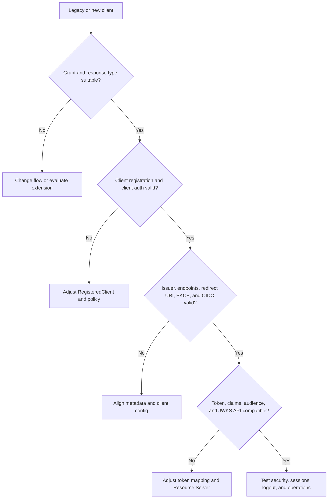

# Legacy Flows, Unsupported Features, and Protocol Compatibility Boundaries

## 1. Why Define Compatibility Boundaries?

In a system using **Spring Security** and **Spring Authorization Server (SAS)**, asking "does it support OAuth 2.0/OpenID Connect?" is not enough to make integration decisions. An existing system in production might use OAuth 2.0 with the **Implicit Grant**, **Resource Owner Password Credentials (ROPC)**, custom login endpoints, proprietary token formats, or provider-specific extensions. SAS provides Authorization Server infrastructure according to the standards and features implemented in the version in use; it does not automatically accept every request once accepted by another "OAuth server."

This lesson in the **Protocol and Terminology** chapter helps learners recognize legacy flows, distinguish default SAS capabilities from features requiring configuration or extension, and identify the **integration contract** that must be agreed upon among the client, Authorization Server, and Resource Server. This forms the foundation before designing, configuring, securing, testing, and operating an OAuth 2.0/OIDC Authorization Server in Spring Boot.

Three principles to keep consistent throughout:

1. **Being defined in an RFC does not mean SAS supports it out of the box.** Always verify the deployed version and configuration.
2. **An accepted grant type does not mean every client is permitted to use that grant.** `RegisteredClient`, client authentication methods, and security policies continue to restrict scope.
3. **Successfully issuing a token does not mean the integration is secure or compatible.** Issuer, token format, audience, scopes, claims, JWKS, logout behavior, and API-side permission checks must also align.

## 2. Terminology: Flow, Grant Type, Client Authentication, Protocol Extension

| Term | Meaning | Example |
| --- | --- | --- |
| **Authorization flow** | Sequence of interactions among browser/user, client, and Authorization Server | Redirecting user to `/oauth2/authorize`, receiving code, exchanging for tokens |
| **Authorization grant** | How the client presents its basis to request a token at the token endpoint | `authorization_code`, `client_credentials`, `refresh_token` |
| **Client authentication method** | How the **client** proves its identity at endpoints requiring client authentication; distinct from **user** login | `client_secret_basic`, `private_key_jwt`, `none` |
| **Response type** | The kind of artifact the client requests from the authorization endpoint | `code` in Authorization Code; `token` in Implicit |
| **OIDC** | Identity authentication layer built on OAuth 2.0, adding concepts such as ID token, `openid` scope, and UserInfo | Client verifies user identity via ID token |
| **Protocol extension** | Standardized or custom extension built atop the base mechanism | Device Authorization, Token Exchange, PAR, custom grant |
| **Interoperability** | Ability of multiple implementations to follow the same protocol contract and work together | Client discovers issuer, fetches JWKS, exchanges code, validates token |

In particular, `grant_type=password` is not "password-based client authentication." It is an **authorization grant** that formerly allowed a client to send a user's username/password to the token endpoint. Conversely, `client_secret_basic` authenticates the **client application**, not the end user.

## 3. Legacy Flows to Identify and Replacement Paths

### 3.1. Implicit Grant: `response_type=token`

In the Implicit Flow, the authorization endpoint returns an access token directly via a browser redirect, usually in the URL fragment:

```http
GET /oauth2/authorize?response_type=token
    &client_id=legacy-spa
    &redirect_uri=https%3A%2F%2Fspa.example.com%2Fcallback
    &scope=orders.read
    &state=opaque-random-value
```

This legacy pattern lacks the step of exchanging an authorization code for tokens with PKCE. Tokens risk exposure to the browser environment, scripts, or redirect handlers, while limiting token protections at the token endpoint. Due to these risks, modern OAuth 2.0 security guidance **discourages the Implicit Grant**. Do not design a new SAS around `response_type=token`; standard SAS deployments focus on the Authorization Code Flow.

**Replacement:** Authorization Code **with PKCE** for SPAs/mobile apps. Where architecture permits, a Backend for Frontend (BFF) model can hold tokens on the backend and use secure session cookies to minimize token exposure in JavaScript.

### 3.2. Resource Owner Password Credentials: `grant_type=password`

ROPC allows the client to collect the user's username/password itself and send them to the token endpoint:

```http
POST /oauth2/token
Content-Type: application/x-www-form-urlencoded

grant_type=password&username=alice&password=example-password
  &client_id=legacy-app
```

The example above is strictly for **recognizing and testing the removal of legacy flows**, not code to implement. This grant couples user authentication directly to the client, exposing passwords to the client; it hinders MFA, WebAuthn, federated login, and context-aware authentication policies. OAuth 2.0 Security Best Current Practice mandates avoiding ROPC. **Spring Authorization Server does not provide the Password Grant as a default grant.**

**Replacement:** User-facing applications should migrate to Authorization Code + PKCE with a login page controlled by the Authorization Server/Identity Provider. For **non-user** service communication, consider Client Credentials with the service's own identity. Never use Client Credentials to impersonate a user to bypass authorization requirements.

### 3.3. OIDC Implicit/Hybrid and Legacy Token Delivery Modes

Some legacy OIDC systems use `response_type` values such as `id_token`, `id_token token`, or `code id_token` to return tokens from the authorization endpoint. A modern OIDC client should prefer the **Authorization Code Flow**, receiving the ID token from the token endpoint upon a valid OIDC request. Do not assume SAS accepts every `response_type` from OIDC Core merely because `oidc()` is enabled.

Audit `response_type`, `response_mode`, PKCE, `nonce`, claims, signing algorithms, and logout behavior in existing clients. These changes must be tested end-to-end, especially with third-party OIDC libraries.

### 3.4. Direct Login Endpoints, Custom Grants, and "Homemade Password Grants"

A legacy API like `POST /login` returning a JWT directly after receiving username/password may be a **proprietary login API**, completely incompatible with the OAuth 2.0 protocol. Do not merely rename the path to `/oauth2/token` and call it an Authorization Server. Similarly, having an extension point for custom grants does not make a grant that accepts raw user passwords safe.

If an extension grant is genuinely needed, there must be a clear business justification, input/output specification, and threat model; implement validators, providers, authorization/token persistence, standard errors, client configuration, and security tests. Such extensions must still respect endpoint constraints and client permissions.

### 3.5. Do Not Confuse "Old" with "Deprecated/Unusable"

**Authorization Code**, **Client Credentials**, and **Refresh Token** continue to play legitimate roles when applied to the right audience, policies, and versions. In particular, `refresh_token` is a mechanism to obtain a new token, not an interactive login method; the server must govern which clients may receive/refresh tokens and how refresh tokens are managed.

## 4. Capability Matrix: Supported, Must Be Enabled, Requires Extension, Out of Scope

The table below describes **conceptual boundaries**. Exact endpoints, options, and extension capabilities must be verified against the documentation of your **actual SAS/Spring Security version** before committing to compatibility.

| Capability | Classification | Proper understanding |
| --- | --- | --- |
| OAuth 2.0 Authorization Code | Core capability | Requires `RegisteredClient`, login, redirect URI, and PKCE policy |
| PKCE | Built-in support | Must be configured/enforced per client type; prefer `S256` |
| OAuth 2.0 Client Credentials | Core capability | For clients/services, without end-user login context |
| Refresh Token | Protocol capability | Not issued by default to every client; depends on grant, client, and policy |
| Token Revocation / Introspection | Standard endpoints available | Verify client authentication method, token status, and how Resource Servers consume it |
| Authorization Server Metadata / JWK Set | Publishing support | Requires configuring issuer, signing keys, and accurate URLs for the deployment environment |
| OIDC ID Token, UserInfo, Discovery | Optional capability | Appears completely only when OIDC is enabled/configured and appropriate principal/claims are supplied |
| OIDC Logout | Version and config dependent | Does not automatically synchronize all sessions across all clients |
| OIDC Dynamic Client Registration | Version/config dependent; should not be publicly open by default | Requires client verification, approval, and management workflows |
| Device Authorization, Token Exchange, PAR, and other extensions | Depends on version capabilities | Confirm endpoints, grant types, policies, and risks before designing |
| Implicit Grant (`response_type=token`) | Legacy flow, not a default SAS deployment target | Migrate clients to Authorization Code + PKCE |
| Resource Owner Password Credentials (`grant_type=password`) | No default grant in SAS | Do not recreate legacy flows accepting user passwords |
| OIDC Implicit/Hybrid `response_type` | Cannot be assumed merely from enabling OIDC | Verify supported response types; prefer Code Flow |
| Proprietary grants/token formats | Requires extension or migration | No automatic compatibility with vendor conventions |
| OAuth 1.0a, SAML 2.0, CAS, WS-Federation | Protocols outside OAuth 2.0 AS scope | Requires an appropriate gateway, broker, or dedicated component |
| User registration, MFA, password reset, account recovery | Identity domain workflows, not provided out of the box by SAS | Build separately or integrate an identity service |
| Role/tenant/resource ownership at API | Resource Server responsibility | Valid tokens can still be denied business access |

**How to read the matrix:** "built-in support" only asserts that an integration point or protocol component exists. It does not guarantee the system is production-ready, the endpoint is enabled, or a specific vendor compatibility profile is supported.

## 5. What Layers Does Protocol Compatibility Encompass?



### 5.1. Capabilities at Endpoints

Common paths in an SAS configuration are `/oauth2/authorize`, `/oauth2/token`, `/oauth2/revoke`, `/oauth2/introspect`, the JWK Set endpoint, OIDC UserInfo, and logout. Paths can be changed via `AuthorizationServerSettings`, and optional endpoints may not be enabled. Clients should not hardcode a legacy provider's URLs without checking current metadata.

### 5.2. Capabilities per Client

`RegisteredClient` describes client identity, `clientAuthenticationMethods`, `authorizationGrantTypes`, redirect URIs, scopes, `ClientSettings`, and `TokenSettings`. Having an endpoint supporting `client_credentials` does not mean a public SPA is allowed to use that grant. A confidential client may need to prove its identity via secret or JWT signature, whereas a public client must rely on PKCE and appropriate safeguards rather than stashing a `client_secret` in JavaScript or a mobile binary.

A common integration mistake is conflating **authorization grant** with **client authentication**. For example, `authorization_code` pairs with `client_secret_basic` in a confidential web app; it can also pair with `none` and PKCE in a public client. These two factors are configured independently.

### 5.3. Token Issuance and Validation Capabilities

The Resource Server needs to know what the token is for, who issued it (`iss`), who it is intended for (`aud`), whether it is unexpired (`exp`), and what permissions the client/user holds (`scope` plus business policies). Never assume an API that used to accept a legacy vendor's JWT will automatically accept JWTs issued by SAS.

- **Self-contained JWT:** API verifies signature and required claims via public keys from JWKS. Plan `kid`, rotation, algorithms, and required claims.
- **Opaque/reference token:** API usually needs introspection or a status lookup component to determine if the token is active and what permissions were granted.
- **ID token:** Used by the OIDC client to verify authentication results. Never use an ID token in place of an access token when calling a Resource Server.
- **Custom claims:** Agree on data types, stability, source of truth, and privacy. Do not treat claims named `roles` or `tenant_id` as mandatory OAuth 2.0 standards.

For example, `scope=orders.read` only states the API boundary the client is allowed to call; the API must still verify whether a user owns order #123. Changing scope, claim, or audience structure changes **the contract with the Resource Server**, even if the token endpoint still returns HTTP 200.

### 5.4. Discovery and OIDC Capabilities

A standard OIDC client reads **Provider Configuration** to learn the issuer, authorization endpoint, token endpoint, `jwks_uri`, supported algorithms, and published capabilities. OAuth 2.0 also has Authorization Server Metadata. The presence of a discovery endpoint does not prove the entire list of algorithms, response types, or extensions is supported.

Remember that the **issuer** URL must match consistently across SAS configuration, `iss` in tokens, the discovery document, and client/API configuration. Behind a reverse proxy, if the published issuer reports the wrong host or scheme, clients may reject tokens even when signatures are valid. That is a deployment configuration error, not a grant error.

### 5.5. Session, Consent, and Logout Capabilities

The Authorization Server may authenticate users via a browser session; the client may maintain its own session; APIs may validate only tokens. Therefore `/connect/logout` (when supported/enabled) does not automatically end all client sessions, invalidate all issued JWTs, or revoke all refresh tokens.

Explicitly define responsibilities for front-channel/back-channel logout if needed by the project, where sessions live, post-logout behavior, and token revocation requirements. For JWTs, revocation does not necessarily take immediate effect at APIs that only check signatures and expiration; design appropriate policies for token TTL, status checks, or alternative controls.

### 5.6. Additional Profiles and Security Extensions

Requirements such as DPoP, mTLS-bound tokens, JWT Authorization Requests, Pushed Authorization Requests, token exchange, specialized logout profiles, FAPI, or financial ecosystem policies are **capabilities requiring individual verification**. A standard name appearing in OAuth 2.0 documentation does not imply your running SAS version supports it, has it configured, or meets compliance certification for that profile.

When implementing an extension, verify: endpoints and HTTP methods, required parameters, client authentication method, algorithms, state storage, error codes, published metadata, replay protection, and interoperability test suites.

## 6. Example: Migrating an SPA from Implicit to Authorization Code + PKCE

Suppose a legacy SPA requested `response_type=token` and an API accepted JWTs carrying a `permissions` claim generated by a legacy system. The goal is to migrate to SAS while preserving access to `orders-api`.

### 6.1. Registering the Client for the New Flow

The Java example below illustrates the **configuration decision**. Exact syntax should be checked against your Spring Authorization Server version; repository imports/beans, authorization/consent stores, signing keys, and login setup are omitted.

```java
RegisteredClient spa = RegisteredClient.withId(UUID.randomUUID().toString())
        .clientId("orders-spa")
        .clientAuthenticationMethod(ClientAuthenticationMethod.NONE)
        .authorizationGrantType(AuthorizationGrantType.AUTHORIZATION_CODE)
        .redirectUri("https://orders.example.com/callback")
        .scope(OidcScopes.OPENID)
        .scope("orders.read")
        .clientSettings(ClientSettings.builder()
                .requireProofKey(true)
                .requireAuthorizationConsent(true)
                .build())
        .tokenSettings(TokenSettings.builder()
                .accessTokenTimeToLive(Duration.ofMinutes(10))
                .build())
        .build();
```

This registration **does not declare** `implicit` or `password`. `ClientAuthenticationMethod.NONE` suits a public client, while `requireProofKey(true)` enforces PKCE. The public redirect URI requires HTTPS and must be registered accurately. Durable registration persistence and client approval workflows must be completed for real deployments.

### 6.2. Authorization Request from the Browser

The client generates a high-entropy `code_verifier`; computes `code_challenge = BASE64URL(SHA256(ASCII(code_verifier)))` without padding; generates a random `state` and `nonce` when the OIDC app needs to bind the login response. Illustrative request:

```http
GET /oauth2/authorize?response_type=code
    &client_id=orders-spa
    &redirect_uri=https%3A%2F%2Forders.example.com%2Fcallback
    &scope=openid%20orders.read
    &state=RANDOM_STATE
    &code_challenge=BASE64URL_SHA256_OF_VERIFIER
    &code_challenge_method=S256
    &nonce=RANDOM_NONCE
```

The `RANDOM_*` and `BASE64URL_*` strings are **illustrative placeholders**, not valid values to execute literally. The client must verify `state` upon receiving the redirect; for OIDC, it must validate the ID token, `nonce` (when used), and claims required by the client.

### 6.3. Exchanging the Code at the Token Endpoint

```http
POST /oauth2/token
Content-Type: application/x-www-form-urlencoded

grant_type=authorization_code
&client_id=orders-spa
&code=AUTHORIZATION_CODE
&redirect_uri=https%3A%2F%2Forders.example.com%2Fcallback
&code_verifier=ORIGINAL_RANDOM_VERIFIER
```

SAS validates the code, client, redirect URI, and PKCE before issuing tokens. The code must be single-use and short-lived. A request missing or supplying an incorrect `code_verifier` must be rejected when the client requires PKCE. For a valid OIDC login, the token response may include an ID token; the access token is what gets sent to `orders-api`.

### 6.4. Verifying API Compatibility

Switching to the new flow solves **how tokens are obtained**. The API team must also configure issuer, signature, audience, scope, claim mapping, and order-level object permissions. If the legacy API relied on a `permissions` claim, design an explicit contract-based mapping, evaluate token size and privacy, or update the API to query an authorization service. Never blindly copy every legacy claim into new tokens without evaluating provenance and read sensitivity.

## 7. Migrating Legacy Systems: Deciding Based on Real Needs

| Legacy state / real requirement | Recommended approach | What to test |
| --- | --- | --- |
| SPA receiving access token from URL fragment | Authorization Code + PKCE; consider BFF | CSRF defense with `state`, callback handling, secure token storage |
| Mobile app sending username/password directly to token endpoint | Browser-based login or system browser + Authorization Code + PKCE | Platform redirect URIs, app-switch handling, PKCE verification |
| Server-to-server system using a technical user's password | Client Credentials with a service identity | Least-privilege scopes, secret/key rotation, no false user-identity attribution |
| Browserless or input-constrained application | Consider Device Authorization if supported by version and fully configured | Code lifetime, polling, verification UI, and anti-phishing |
| Legacy client using a vendor-specific custom grant | Evaluate replacing with standard grants; otherwise write a secure extension spec | Error mapping, client authentication, token semantics, anti-replay |
| Legacy API self-issuing JWTs | Convert API to a Resource Server validating AS-issued tokens | `iss`, `aud`, JWKS, `exp`, `scope`, data permissions |
| Legacy SAML application | Use an appropriate identity broker/federation gateway | Attribute mapping, sessions, logout, assertion signing/verification |
| Requirement to exchange service A's token to call service B | Evaluate Token Exchange per version and policy | Target audience, delegation, actor/subject, preventing privilege escalation |

Every migration roadmap must define **account sources**, **existing client inventory**, **API resources**, **token lifetimes**, **logout mechanisms**, and **compatibility windows**. A parallel-run phase may be necessary, yet you must strictly control which issuers APIs trust and when legacy configurations are retired; never accept tokens from arbitrary issuers just to "avoid integration errors."

## 8. Common Protocol Errors During Integration

OAuth 2.0 uses error codes scoped to endpoint context. Do not equate every error with HTTP 401; for example, errors from the authorization endpoint may travel via redirects, while the token endpoint returns JSON with an appropriate HTTP status. Exact results depend on validation and version.

| Scenario | Error typically investigated | Diagnostic direction |
| --- | --- | --- |
| Client sends `response_type=token` | `unsupported_response_type` or authorization request rejection | Inspect response type; migrate client to `code` |
| Client sends `grant_type=password` | `unsupported_grant_type` or `unauthorized_client` depending on handler | Check grants implemented by AS and registered on client |
| Client uses a supported grant without permission | `unauthorized_client` | Inspect `RegisteredClient.authorizationGrantTypes` |
| Client authenticates with wrong secret | `invalid_client` | Check client authentication method, expiration, and secret storage |
| Wrong, expired, reused authorization code or invalid PKCE | Typically `invalid_grant` | Cross-check code, `code_verifier`, redirect URI, and status |
| Missing required parameter or malformed value | `invalid_request` or specialized error | Check request form encoding, `state`, PKCE, URI |
| Invalid requested scope | `invalid_scope` | Match registered scopes, mapping, and consent policy |
| API rejects token despite token endpoint succeeding | Typically 401/403 at Resource Server | Check `iss`, signature, `aud`, timestamps, scopes, and business permissions |
| OIDC discovery fails | Client/issuer/endpoint configuration error, not necessarily an OAuth grant error | Check public URL, TLS, proxy, and metadata |

**Diagnostic practice:** record correlation ID, client name, endpoint, error code, and deployment version; avoid logging access tokens, refresh tokens, authorization codes, client secrets, and login credentials. `invalid_client` errors should not leak details helping attackers enumerate valid client IDs.

## 9. Compatibility and Security Testing Checklist

### 9.1. Contract Tests Between Client and Authorization Server

- **Metadata:** discovery publishes issuer, authorization/token endpoints, and `jwks_uri` with the right domain/protocol; no mismatch behind a reverse proxy.
- **Flow:** Authorization Code + PKCE `S256` succeeds; clients sending Implicit or ROPC are rejected per policy; reused or expired codes are rejected.
- **Client:** grants, client authentication methods, and scopes stay within `RegisteredClient` limits; public clients neither need nor hold a client secret.
- **Redirect:** registered URIs match strictly per security requirements; unknown URIs never receive codes/tokens; `state` and `nonce` are validated on the client.
- **OIDC:** if enabled, verify ID token, UserInfo, claims, `sub`, `aud`, `iss`, `exp`, signing algorithms, and logout features in use.
- **Refresh and revocation:** verify issuance policy, rotation/reuse per configuration, and actual post-revocation behavior.

### 9.2. Contract Tests Between Authorization Server and Resource Server

- JWTs with tampered signatures, expired timestamps, wrong issuer, or wrong audience must be rejected.
- Access tokens with valid scopes that **lack permission for a specific resource** must still be rejected.
- If APIs use opaque tokens, test successful/failed introspection and Authorization Server connectivity failures.
- Key rotation must not break validation of still-valid tokens during the planned transition window.
- Prevent using an ID token in place of an access token or using API A's token at API B when audiences do not match.

### 9.3. Operational and Migration Testing

- Test restarts and multi-instance runs to catch client, authorization, consent, session, or signing-key data stored only in memory.
- Test issuer/URL changes across environments, impending TLS certificate expiration, and cached discovery endpoints.
- Test logout across multiple clients/devices, token revocation, and session handling per the agreed contract.
- Verify monitoring capability for `invalid_grant`, `invalid_client`, login error rates, token issuance rates, and suspicious behavior without exposing credentials.
- Confirm client libraries and Resource Servers across teams use the exact agreed-upon algorithms, grants, and profiles.

## 10. Scenario Analysis Exercise

A migration team has: (1) an SPA using `response_type=token`; (2) a mobile app using `grant_type=password`; (3) a reporting service using `client_credentials`; (4) an API accepting only JWTs with the legacy system's issuer; (5) an OIDC client needing the user's email from UserInfo.

Design a roadmap in order:

1. Classify which flows must be replaced, which can remain, which components belong to SAS, and which belong to the login application.
2. Propose `RegisteredClient` type, client authentication method, PKCE, redirect URI, and scopes for each client.
3. Identify contract changes needed at the Resource Server: issuer, audience, JWKS, scopes, claims, and business permissions.
4. Define at least one negative test case per client—for example, `grant_type=password` rejected, code with wrong PKCE failing to exchange for a token, and a JWT from an untrusted issuer rejected by the API.
5. Describe how to verify the user's email from a trusted data source and map claims for OIDC UserInfo; distinguish `email` from `email_verified`.

**Suggested answer:** The SPA and mobile app migrate to Authorization Code + PKCE; the reporting service can continue using Client Credentials with least-privilege permissions; the API transitions to validating the new AS's issuer/JWKS/audience per the migration plan; UserInfo exposes only claims backed by an authoritative source and allowed by policy. Never use Client Credentials to impersonate mobile users' identities.

## 11. Authoritative Documents to Reference During Implementation

| Standard / document | What to look up |
| --- | --- |
| RFC 6749 — The OAuth 2.0 Authorization Framework | Grant types, authorization/token endpoints, basic error formats |
| RFC 7636 — Proof Key for Code Exchange | `code_verifier`, `code_challenge`, `S256` |
| RFC 9700 — Best Current Practice for OAuth 2.0 Security | Modern security recommendations, avoiding Implicit and ROPC |
| RFC 8252 — OAuth 2.0 for Native Apps | Integrating native apps with external browsers and redirects |
| RFC 8414 — OAuth 2.0 Authorization Server Metadata | Discovery/metadata for OAuth Authorization Servers |
| RFC 7009, RFC 7662 | Token revocation and token introspection |
| RFC 8628, RFC 8693 | Device Authorization Grant and Token Exchange |
| OpenID Connect Core, Discovery, RP-Initiated Logout | ID tokens, UserInfo, OIDC discovery, and related logout flows |
| Spring Authorization Server Reference (exact version) | Endpoints, grants, extensions, and settings actually available |
| Spring Security Reference (exact version) | How `oauth2Login()` clients and Resource Servers use/configure the protocol |

Standards documents describe protocol behavior; Spring documentation describes what the framework implements. Whenever discrepancies arise, determine **version support**, required compliance levels, and a gap-closing plan before committing to compatibility.

## 12. Key Takeaway

**Spring Authorization Server is a foundation for building an OAuth 2.0/OIDC Authorization Server, not an automatic compatibility layer for every legacy flow or identity provider.** Implicit and ROPC are signals to re-evaluate architecture; extensions must be verified against version and configuration; token formats, issuer, claims, and API-side policies remain a dedicated contract that must be tested. When designing a Spring Boot Authorization Server, choose flows per client type, control token issuance permissions, and then prove compatibility via metadata, contract tests, and secure rejection cases.
