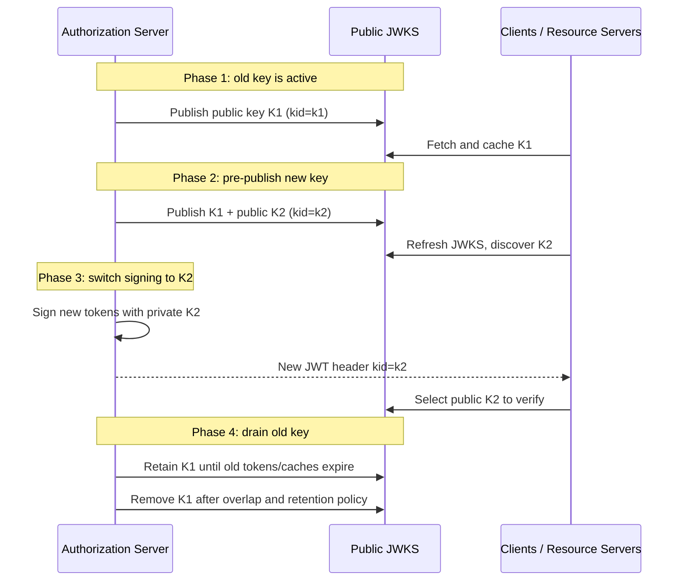

# Choosing RSA, EC, and Client-Compatible Signing Algorithms

## 1. The Problem: How to Sign Tokens So Every Party Can Verify Them?

A Spring Authorization Server issues JWT access tokens and OpenID Connect (OIDC) ID Tokens for many types of clients. A legacy client supports only RSA with `RS256`; a new mobile app supports Elliptic Curve (EC) with `ES256`; an API gateway maintains its own algorithm allowlist. If the Authorization Server changes signing algorithms without checking compatibility, clients may fail to verify tokens, or worse, accidentally accept a weak or unintended algorithm.

Therefore, choosing a signing key is not merely picking a library to generate a key pair. You need to coordinate:

- **Key/JWK type:** RSA or EC, key size or curve, and public/private parameters.
- **JWS signing algorithm:** `RS256`, `PS256`, `ES256`...; the algorithm must be compatible with the key type and policy.
- **Metadata and key discovery:** `kid`, `use`, `key_ops`, JWKS endpoint, and how clients fetch public keys.
- **Client/resource server capabilities:** JOSE library, runtime, crypto provider, FIPS/HSM, and algorithm allowlist.
- **Key lifecycle:** private key storage, rotation, overlap window, JWKS caching, and handling old tokens.

This lesson belongs to the **JWK and Key Management** chapter of the `SPRING_SECURITY_OAUTH2_OIDC_AUTHORIZATION_SERVER` module. The overall goal of the module is **learning how to design, configure, secure, test, and operate an OAuth 2.0/OpenID Connect Authorization Server using Spring Security and Spring Authorization Server in a Spring Boot application**.

### After This Lesson, You Will Be Able To

1. Distinguish between RSA and EC JWKs, public keys and private keys, and JWK and JWK Set.
2. Choose `RS256`, `PS256`, `ES256`, or an appropriate algorithm based on client compatibility and security policy.
3. Verify the relationship between `kty`, `crv`, `alg`, `use`, `key_ops`, and `kid`.
4. Configure `JWKSource<SecurityContext>`, `JwtDecoder`, and `TokenSettings` in Spring Authorization Server.
5. Distinguish ID Token signing algorithms from JWT access token signing algorithms.
6. Plan key rotation with overlap, cache refresh, and signature verification for clients/resource servers.

> **Version scope:** Java examples use common APIs from Spring Authorization Server 1.x and Spring Security 6.x. Check the exact dependencies, Nimbus JOSE/JWT, and crypto provider in your project before applying. The additional lesson notes field was left blank; there are no extra constraints.

## 2. Distinguishing JWK, JWK Set, and JWS

| Term | Meaning | Example |
| --- | --- | --- |
| **Key pair** | A pair of cryptographically related private and public keys | RSA private/public or EC private/public |
| **JWK** | JSON Web Key: JOSE representation of a key | An RSA key with `kty`, `n`, `e`, `kid` |
| **JWK Set (JWKS)** | A collection of one or more JWKs in the `keys` field | `{"keys":[...]}` |
| **JWS** | JSON Web Signature: a signed data structure | JWT signed with `RS256` |
| **JWT** | JSON Web Token: claims format; usually protected by JWS | JWT access token or OIDC ID Token |
| **`kid`** | Key ID: hint for selecting a key in a JWK Set | `rsa-2026-01` |
| **`alg`** | JWS signing/verification algorithm | `RS256`, `ES256` |

**A JWK is a key representation, not a signing algorithm.** A JWK may hold RSA or EC key information; the token's JWS header specifies the signing algorithm. The server and client must verify that they are compatible with each other.

### 2.1. What Is the Structure of a JWS?

A compact JWS JWT typically has three Base64URL parts:

```text
BASE64URL(protected-header).
BASE64URL(payload).
BASE64URL(signature)
```

Example protected header:

```json
{
  "alg": "RS256",
  "kid": "rsa-signing-2026-01",
  "typ": "JWT"
}
```

- `alg` indicates the signature algorithm used.
- `kid` helps the client locate the matching public key in the JWKS.
- `typ` can describe the JWT type; it does not replace checking issuer, audience, token type, and claims.

The header and payload are only Base64URL-encoded, **not encrypted**. Anyone holding the token can read the claims; the signature detects tampering and proves the signer possesses the corresponding private key.

## 3. How Do RSA and EC Differ?

### 3.1. RSA

RSA is a long-established public-key cryptosystem with broad compatibility across TLS, JOSE libraries, API gateways, and enterprise platforms. An RSA public key JWK typically has:

| JWK member | Meaning |
| --- | --- |
| `kty` | `RSA` |
| `n` | Modulus, Base64URLUInt-encoded |
| `e` | Public exponent, Base64URLUInt-encoded |
| `kid` | Key identifier |
| `use` | Usually `sig` when used for signing |
| `alg` | May specify the JWS algorithm used, e.g., `RS256` |

A private JWK may also contain `d`, `p`, `q`, `dp`, `dq`, and `qi`. **Never publish these private parameters in the public JWKS**.

Advantages:

- Very broad compatibility with clients, gateways, and legacy systems.
- The RSA public key can verify signatures without sharing the private key.
- Easy integration with HSM/KMS and key governance workflows in many organizations.

In return, RSA keys and signatures are typically larger than EC at an equivalent security level, and signing operations can be more resource-intensive.

### 3.2. Elliptic Curve (EC)

EC uses elliptic curve mathematics to generate signatures with smaller key and signature sizes than RSA at an equivalent security level. An EC public key JWK typically has:

| JWK member | Meaning |
| --- | --- |
| `kty` | `EC` |
| `crv` | Curve name, e.g., `P-256` |
| `x` | x-coordinate of the public point |
| `y` | y-coordinate of the public point |
| `kid` | Key identifier |
| `use` | Usually `sig` |
| `alg` | E.g., `ES256` if the key is restricted to that algorithm |

A private EC JWK adds `d`. Do not include `d` in the public JWKS.

Advantages:

- Keys and signatures are more compact than equivalent RSA.
- Suitable for systems needing smaller token/JWKS sizes with solid JOSE EC support.
- `ES256` based on P-256 is widely supported across modern libraries.

A trade-off to evaluate is that older clients, HSMs, providers, and compliance environments may have varying EC support. Not every runtime supports all curves/algorithms identically.

### 3.3. Practical Comparison

| Criterion | RSA | EC |
| --- | --- | --- |
| JWK `kty` | `RSA` | `EC` |
| Public key components | `n`, `e` | `crv`, `x`, `y` |
| Typical JWS algorithms | `RS256`, `PS256` | `ES256`, `ES384`, `ES512` |
| Public key/JWS size | Usually larger | Usually smaller |
| Legacy system compatibility | Very broad | Depends on library/runtime |
| Crypto provider evaluation | RSA signing and PSS support | Curve, ECDSA support, signature encoding |
| When to choose | Integrating many legacy/enterprise clients | Modern clients, smaller tokens needed, uniform EC support |

There is no rule that "EC is always more secure than RSA" or "RSA is always better than EC." Choose based on **required security level, client compatibility, organizational standards, and operational capability**.

## 4. Common JWS Algorithms

A JWS algorithm name denotes **hash function + signing scheme**, not the token type name.

| JWS `alg` | Key type | Mechanism | Hash/curve |
| --- | --- | --- | --- |
| `RS256` | RSA | RSASSA-PKCS1-v1_5 | SHA-256 |
| `RS384` | RSA | RSASSA-PKCS1-v1_5 | SHA-384 |
| `RS512` | RSA | RSASSA-PKCS1-v1_5 | SHA-512 |
| `PS256` | RSA | RSASSA-PSS | SHA-256 |
| `PS384` | RSA | RSASSA-PSS | SHA-384 |
| `PS512` | RSA | RSASSA-PSS | SHA-512 |
| `ES256` | EC | ECDSA | P-256 + SHA-256 |
| `ES384` | EC | ECDSA | P-384 + SHA-384 |
| `ES512` | EC | ECDSA | P-521 + SHA-512 |

**Common point of confusion:** `ES512` uses curve **P-521**, not a curve named P-512. The number in the algorithm name refers to the corresponding hash function.

### 4.1. RS256 and PS256

- `RS256` uses RSA with PKCS#1 v1.5 signature padding and SHA-256. It is the choice with the widest compatibility.
- `PS256` uses RSA-PSS and SHA-256. PSS is a probabilistic padding scheme designed for modern RSA signatures; verify that libraries, HSMs, and clients support it.

You cannot change the `alg` header from `RS256` to `PS256` while keeping the same signature bytes. The two algorithms generate and verify signatures differently.

**Spring API compatibility:** JWA defines `PS256`, but do not assume the `org.springframework.security.oauth2.jose.jws.SignatureAlgorithm` enum in every Spring version exposes every JWA algorithm. In particular, before using `PS256` for ID Tokens via `TokenSettings.idTokenSignatureAlgorithm(...)`, check the enum/API of your actual dependency and the capabilities of Nimbus/provider/HSM. If the API does not represent the needed algorithm, design a tested extension or choose an algorithm supported across the entire stack; never pass an arbitrary string into a builder and assume the server is signing with PSS.

### 4.2. ES256, ES384, and ES512

ECDSA produces signatures according to the curve:

- `ES256` → `P-256` + SHA-256.
- `ES384` → `P-384` + SHA-384.
- `ES512` → `P-521` + SHA-512.

JWS encodes an ECDSA signature as two fixed-length integers `R || S` (Base64URL-encoded), whereas some low-level crypto libraries use ASN.1 DER. The JOSE library must convert formats properly. That is why you should not manually sign ECDSA JWTs by concatenating signature bytes from an arbitrary crypto API.

### 4.3. HMAC and Unsuitable Algorithms

`HS256`/`HS384`/`HS512` are symmetric signature algorithms: both signer and verifier hold the same secret. If the public JWKS is published to all clients, **do not put an HMAC secret in it**. Verifiers must not receive the secret used for signing.

For an Authorization Server issuing JWTs to multiple independent Resource Servers/clients, asymmetric RSA/EC signing is usually preferable because only the Authorization Server holds the private key while verifiers receive only the public key.

Do not accept `none` for access tokens/ID Tokens that require signatures. Do not allow clients to select weak algorithms via headers or fall back when the expected algorithm is unsupported.

## 5. Choosing an Algorithm Based on Client Compatibility

### 5.1. Identifying Clients and Verification Libraries

Before choosing a key, list:

| Component | What to verify |
| --- | --- |
| OIDC Web Client | Supported `id_token_signed_response_alg`, OIDC/JWT library, key discovery |
| SPA/mobile | JOSE implementation, runtime/browser support, JWKS fetching and cache refresh capability |
| Spring Resource Server | Nimbus decoder, issuer/JWKS configuration, accepted algorithms |
| API Gateway | `alg` allowlist, JWKS refresh, RSA/EC/PSS support |
| Partner systems | Algorithms and key formats accepted under integration contracts |
| HSM/KMS | Supported algorithms/curves/key sizes, signing API, and throughput |
| Compliance/security baseline | Approved algorithms, key lifetimes, rotation procedures |

Do not choose `ES512` just because the name sounds stronger than `RS256`. An algorithm is only secure when all parties implement it correctly and verification policy actually enforces it.

### 5.2. Suggested Decision Matrix

| Context | Initial candidate | Conditions |
| --- | --- | --- |
| Many legacy clients, gateway supports RSA only | `RS256` | RSA key at least 2048 bits; clients pin/allowlist RS256 |
| Organization requires RSA-PSS | `PS256` | HSM/provider and all clients support PSS |
| Modern clients, strong JOSE EC support | `ES256` | P-256 public key and ECDSA JWS support |
| Policy requires curve P-384 | `ES384` | All clients/resource servers support it |
| System has P-521 profile | `ES512` | Confirm library, HSM, and P-521 performance |
| Clients have heterogeneous support | Choose the intersecting alg set, typically RS256 or ES256 depending on environment | Test against all real consumers before rollout |

These are technical guidelines and do not replace organizational security baselines or regulatory requirements. If a client does not support the chosen algorithm, upgrade the client or design a migration; do not downgrade the entire system to a weak algorithm without assessment.

### 5.3. Can One Issuer Publish Multiple Key Types?

Yes. A JWK Set can contain multiple public keys, for example an old RSA key and a new EC key during migration. However, **publishing multiple keys does not mean the server automatically issues tokens with the right algorithm for each client**. You must define:

- Which token type is signed with which key.
- Which clients are allowed to receive which alg.
- Which `kid` will appear in the JWT header.
- Whether decoders/resource servers have allowlists and pick the right key.
- During rotation, retaining the old key until old tokens expire and caches update.

If an OIDC client registers a specific ID Token algorithm, per-client configuration must align with the key source and generator. Do not merely add an EC key to the JWKS and expect a legacy RS256 client to automatically understand ES256.

## 6. JWK Fields and Public Key Publishing Principles

### 6.1. Public RSA JWK

Illustrative example:

```json
{
  "kty": "RSA",
  "kid": "rsa-signing-2026-01",
  "use": "sig",
  "alg": "RS256",
  "n": "BASE64URL_RSA_MODULUS",
  "e": "AQAB"
}
```

### 6.2. Public EC JWK

Illustrative example:

```json
{
  "kty": "EC",
  "kid": "ec-signing-2026-01",
  "use": "sig",
  "alg": "ES256",
  "crv": "P-256",
  "x": "BASE64URL_PUBLIC_X",
  "y": "BASE64URL_PUBLIC_Y"
}
```

The strings `n`, `x`, `y` are schema placeholders, not valid keys.

### 6.3. Meaning of use, key_ops, alg, and kid

| Member | Meaning | Practice |
| --- | --- | --- |
| `kty` | Key type: `RSA`, `EC`... | Must match algorithm |
| `kid` | Key ID | Unique within the JWKS; do not reuse for different key material |
| `use` | Purpose: `sig` or `enc` | Signing keys should have matching use |
| `key_ops` | Allowed operations: `sign`, `verify`... | Public keys need only `verify`; private keys are not published |
| `alg` | Intended algorithm | If present, must match allowed alg |
| `crv` | EC curve | E.g., `P-256` |
| `n`, `e` | RSA public components | Must not contain private exponent |
| `x`, `y` | EC public coordinates | Must not contain private scalar `d` |

Per JOSE/JWK, some members are optional in certain contexts; you do not need to add every field to every key. However, if `alg` or `use` is specified, those values must be consistent with intended usage. Never publish private parameters such as `d`, `p`, `q`, `dp`, `dq`, or `qi`.

### 6.4. Public JWK Set

A public JWKS has the structure:

```json
{
  "keys": [
    {
      "kty": "RSA",
      "kid": "rsa-signing-2026-01",
      "use": "sig",
      "alg": "RS256",
      "n": "BASE64URL_RSA_MODULUS",
      "e": "AQAB"
    },
    {
      "kty": "EC",
      "kid": "ec-signing-2026-01",
      "use": "sig",
      "alg": "ES256",
      "crv": "P-256",
      "x": "BASE64URL_PUBLIC_X",
      "y": "BASE64URL_PUBLIC_Y"
    }
  ]
}
```

The JWKS publishes only **public keys**. Making the public key public does not weaken token security: signatures can only be produced using the corresponding private key. Conversely, if private material appears on the JWKS endpoint, treat it as a severe key exposure incident and execute incident response/rotation.

## 7. Choosing RSA Key Size and EC Curve

### 7.1. RSA

In modern systems, **RSA 2048-bit** is generally considered the practical baseline minimum for signatures; **3072-bit** can be chosen if security baselines require a longer protection horizon and throughput/latency permit. Do not choose RSA 1024-bit for new signing keys.

Larger sizes increase signing/verification cost and public key/JWT size. Choosing between 2048 and 3072 should consider key lifetime, policy, and HSM/KMS capacity.

### 7.2. EC

| Curve | Typical JWS algorithm | Notes |
| --- | --- | --- |
| `P-256` | `ES256` | Common, balances performance and compatibility |
| `P-384` | `ES384` | Larger curve, verify client/provider support |
| `P-521` | `ES512` | Less common, carefully test HSM/JOSE library |

Do not mix `P-256` with `ES384` or `P-384` with `ES256`. Curve, hash, and algorithm name must match per JWA.

### 7.3. Is EdDSA an Alternative?

`EdDSA`/Ed25519 is a modern JOSE signing option, but support depends on Nimbus version, JCA provider, Spring Security, HSM/KMS, and clients. This lesson focuses on RSA/EC per its scope; **do not assume EdDSA is supported in every version**. Only choose it after verifying full interoperability and policy.

## 8. Configuring JWKSource in Spring Authorization Server

Spring Authorization Server uses **`JWKSource<SecurityContext>`** to supply keys for JWT signing and to publish the JWK Set when endpoints/metadata are appropriately configured. Private keys must remain inside the Authorization Server's trust boundary; clients/resource servers only need public keys.

### 8.1. RSA Key Example for Learning Environments

```java
@Bean
JWKSource<SecurityContext> jwkSource() throws JOSEException {
    RSAKey rsaKey = new RSAKeyGenerator(2048)
            .keyID("rsa-signing-demo-2026")
            .generate();

    JWKSet jwkSet = new JWKSet(rsaKey);

    return (jwkSelector, securityContext) ->
            jwkSelector.select(jwkSet);
}
```

`RSAKeyGenerator` generates a key pair and the `rsaKey` object holds the private key in process memory. This snippet is **for demo/testing only**: every startup generates a new key, making older JWTs unverifiable once the previous key disappears. Production must load durable keys from KMS/HSM/secret store or a protected keystore.

### 8.2. EC P-256 Example

```java
@Bean
JWKSource<SecurityContext> ecJwkSource() throws JOSEException {
    ECKey ecKey = new ECKeyGenerator(Curve.P_256)
            .keyID("ec-signing-demo-2026")
            .generate();

    JWKSet jwkSet = new JWKSet(ecKey);
    return (jwkSelector, securityContext) ->
            jwkSelector.select(jwkSet);
}
```

This is also an example that generates a new key in memory. Do not declare two `JWKSource<SecurityContext>` beans simultaneously as two production configurations without intentionally selecting/composing key sources. In a server needing multiple keys, you normally return **one JWKSource** that can select among multiple JWKs by selector, policy, and `kid`.

### 8.3. Public JWKS and JwtDecoder

With Spring Authorization Server, a properly configured `JWKSource` allows the server to serve the public JWK Set via the configured JWK Set endpoint. To support OIDC features such as UserInfo/introspection depending on configuration, a `JwtDecoder` may be needed:

```java
@Bean
JwtDecoder jwtDecoder(JWKSource<SecurityContext> jwkSource) {
    return OAuth2AuthorizationServerConfiguration.jwtDecoder(jwkSource);
}
```

This is a common configuration in Authorization Server 1.x samples. The JWKS endpoint and discovery must publish a consistent **public issuer URL**. Do not use internal endpoints or URLs derived from untrusted Host headers.

### 8.4. Do Not Let the Public Endpoint Return Private JWKs

When building a JWK Set for publishing, strip private parameters:

```java
JWKSet publicJwkSet = new JWKSet(rsaKey.toPublicJWK());
```

This illustrates obtaining the public projection for an RSA key. If a JWKSource needs to sign tokens, it must hold the private key inside the server's secure boundary; **do not replace the signing source with a public-only JWKSet** if the encoder needs to perform signing.

## 9. Distinguishing ID Token and Access Token Signing Algorithms

An Authorization Server can issue both JWT access tokens and OIDC ID Tokens, but **the two token types have different purposes and configurations**.

| Characteristic | JWT Access Token | OIDC ID Token |
| --- | --- | --- |
| Primary recipient | Resource Server/API | OIDC Client |
| Purpose | Grant access to resources | Prove End-User authentication result |
| Primary checks | Issuer, signature, audience, expiry, scope/claims | Issuer, signature, audience, expiry, nonce when applicable, and OIDC claims |
| Signing algorithm | Determined by JwtEncoder/JwtGenerator and signing-key selection | Configurable per client via token settings/OIDC policy |
| Must not substitute | ID Token must not replace access token for API calls | Access token must not replace ID Token to verify login |

### 9.1. Configuring ID Token Algorithm per RegisteredClient

In Spring Authorization Server 1.x, `TokenSettings` configures the ID Token signing algorithm. Example:

```java
TokenSettings tokenSettings = TokenSettings.builder()
        .idTokenSignatureAlgorithm(SignatureAlgorithm.RS256)
        .build();

RegisteredClient client = RegisteredClient.withId(
                UUID.randomUUID().toString())
        .clientId("orders-oidc")
        .clientSecret(encodedClientSecret)
        .clientAuthenticationMethod(
                ClientAuthenticationMethod.CLIENT_SECRET_BASIC)
        .authorizationGrantType(AuthorizationGrantType.AUTHORIZATION_CODE)
        .redirectUri("https://orders.example.com/login/oauth2/code/orders-oidc")
        .scope(OidcScopes.OPENID)
        .tokenSettings(tokenSettings)
        .build();
```

`SignatureAlgorithm.RS256` is Spring Security JOSE's enum type. The client registration, key source, and OIDC client must all support this algorithm. If choosing `ES256`, an EC P-256 signing key and a client verifier supporting ECDSA JWS are required.

**`idTokenSignatureAlgorithm` only configures the ID Token signature**; it does not automatically change the JWT access token algorithm. The JWT access token algorithm depends on `JwtEncoder`/`JwtGenerator`, the JWS header, and JWK selection/customization. Do not change one setting and assume both tokens switch algorithms together.

### 9.2. Which Algorithm Does a Client Register?

In OIDC Dynamic Client Registration, `id_token_signed_response_alg` represents the ID Token signature algorithm requested by the client. If omitted, OIDC Core defaults to `RS256` in the corresponding case. For manually registered clients in Spring Authorization Server, map the equivalent requirement into the server's `TokenSettings`/policy configuration.

If a client only supports `RS256`, the server should not unexpectedly issue an `ES256` ID Token. If a client requests an algorithm the server does not support, reject the registration/request per policy or select an agreed compatible configuration; **never silently downgrade to a weak alg**.

## 10. Key Selection: kid and alg Must Match

When signing a JWT, the header typically contains `alg` and `kid`. When the JWK Set contains multiple keys, the selector needs to find a matching key:

1. `kid` points to the key being used to sign.
2. `kty` matches `alg` (RSA for RS/PS, EC for ES).
3. `crv` matches the ES algorithm.
4. `use`/`key_ops` permit the respective signing or verification operation.
5. `alg` in the JWK (if present) does not conflict with the JWS header.
6. The key has not been excluded by policy and is within its validity window.

**Do not select a key just because it is the first element in the JWKS.** When multiple keys of the same type exist, there must be an explicit selection rule; if the selector cannot find a matching key, signing should fail safely rather than switching to an unrequested algorithm.

### 10.1. kid Is Not a Secret

`kid` is merely a public identifier. It does not need to be hidden, but it must remain **stable throughout the key's lifecycle** and never be reused for new key material. Using a UUID or key version helps governance; never embed a private key/secret in `kid`.

### 10.2. Avoiding Algorithm Confusion

Clients/resource servers must:

- Allowlist accepted algorithms, e.g., only `RS256`, or `RS256` and `ES256` per policy.
- Verify that `alg` in the protected header matches the allowlist; never trust an algorithm merely claimed by the token.
- Select a key with compatible `kid`/`kty`/`crv`; never treat an RSA public key as an HMAC secret.
- Reject `alg=none` and any unauthorized fallback/downgrade.
- Verify the signature before trusting claims; afterwards still validate `iss`, `aud`, `exp`, and token-type-specific claims.

Do not share the same validator/allowlist across all JWTs without considering token purpose. ID Tokens and access tokens have different audiences and claims.

## 11. Configuring Resource Server to Verify Algorithms

Spring Security Resource Server uses `JwtDecoder` to verify JWTs. You can configure the issuer and expected algorithm, for example RSA:

```java
@Bean
JwtDecoder jwtDecoder() {
    NimbusJwtDecoder decoder = NimbusJwtDecoder
            .withIssuerLocation("https://auth.example.com")
            .jwsAlgorithm(SignatureAlgorithm.RS256)
            .build();

    decoder.setJwtValidator(
            JwtValidators.createDefaultWithIssuer("https://auth.example.com"));
    return decoder;
}
```

This snippet illustrates the idea of **pinning the algorithm and issuer**. Specific builder APIs may vary by Spring Security version; when configuring multiple algorithms, add each allowed algorithm explicitly instead of accepting any `alg`.

If the resource server verifies EC `ES256`, the decoder must be configured accordingly and the public JWKS must contain the corresponding EC key. **Do not switch the signing alg on the Authorization Server before all Resource Servers/consumers have deployed verification support**.

### 11.1. Verifying Audience

A valid issuer and valid signature are still not enough. The `orders-api` service must verify that the token is intended for `orders-api`, not just any token signed by the same issuer. Configure an audience validator as required by the application:

```java
OAuth2TokenValidator<Jwt> audienceValidator = jwt -> {
    if (jwt.getAudience().contains("orders-api")) {
        return OAuth2TokenValidatorResult.success();
    }
    return OAuth2TokenValidatorResult.failure(
            new OAuth2Error("invalid_token", "Invalid audience", null));
};
```

This is an illustrative validator; it must be combined with issuer/timestamp/default validators, not used as a standalone replacement for them.

## 12. Key Rotation: Changing Keys Without Breaking In-Flight Tokens

Rotation is not "create a new key and delete the old key immediately." Clients may be caching the JWKS, while tokens signed by the old key have not yet expired.



### 12.1. Recommended Rotation Workflow

1. **Generate a new key** in a protected KMS/HSM/keystore and assign a new `kid`.
2. **Pre-publish the new public key** in the JWKS before using it to sign tokens.
3. Wait long enough for clients/resource servers to refresh JWKS per cache policy.
4. Switch signing to the new private key; new JWTs carry the new `kid`.
5. Retain the old public key to verify tokens already issued with the old key.
6. Remove the old public key only after old tokens expire, cache overlap elapses, and consumers verify cleanly with the new key.
7. Monitor signature/JWKS refresh errors; keep a safe rollback plan ready.

The overlap duration depends on **max access/ID token lifetime**, consumer cache-control/JWKS caching, clock skew, issuance timing, and operational requirements. There is no single fixed number suitable for every system.

### 12.2. Scheduled Rotation vs. Emergency Rotation

**Scheduled:** allows longer overlap, planned rollout, client notifications, and consumer monitoring.

**Emergency when private key is exposed:** prioritize stopping signing with the compromised key, revoking/removing the key per the incident plan, and considering invalidating old tokens. Keeping a compromised public key in the JWKS allows verifying old tokens, but it may also allow forged tokens signed with the leaked private key to continue passing. The decision must balance verifying old legitimate tokens against the risk of attackers forging new ones; revoking/shortening token validity, blocklists, or introspection may be required depending on architecture.

### 12.3. JWKS Cache and Unknown kid

When a client receives a JWT with a `kid` not yet in its cache, it can refresh the JWKS according to policy. Avoid:

- Re-fetching the JWKS continuously on every forged token request with a random kid (DoS).
- Caching the JWKS indefinitely, rendering key rotation ineffective.
- Storing only one key in cache when the server publishes multiple valid keys.
- Using a fallback key without checking `kid`/`alg`.

Set a reasonable cache TTL and rate-limited/backed-off refresh-on-unknown-kid. When the JWKS endpoint temporarily fails, explicitly decide whether to use valid cached keys or fail closed per security policy.

## 13. Private Key Storage: JWKSource Is Not a Key Store

In-app `RSAKeyGenerator`/`ECKeyGenerator` examples that create keys on every process startup are suitable only for local demos. Production requires:

- **KMS/HSM:** private keys never leave the secure boundary; signing happens via the corresponding API/provider.
- **Encrypted keystore:** minimal filesystem permissions, unlock secret retrieved from a secret manager, backup/restore, and audit logging.
- **Secret manager:** version management, rotation, read access controls, and release procedures.
- **Multi-instance:** every node signs/verifies using a consistent key set/active key; never let each node generate its own random key.

JWKSource is **an abstraction for selecting/providing JWKs to the encoder/endpoint**. It can be backed by files, databases, KMS/HSM, or a custom key store. Do not assume returning a JWK from a bean solves backup, rotation, access control, and auditing.

### 13.1. Separating Signing and Verification Permissions

The Authorization Server needs permission to use the private key to sign. Resource Servers/clients only need the public key. Do not copy a keystore containing the private key to every API solely for JWT verification; the public JWKS is sufficient for asymmetric signatures.

### 13.2. Backup and Recovery

A signing key without backup/restore can leave the server unable to sign or verify tokens after an incident. Backup plans must be encrypted, access-controlled, periodically restore-tested, and must never store private key copies in source control/container images.

## 14. Choosing Algorithms per Token Type

An Authorization Server may handle multiple tokens:

| Token | Purpose | Control recommendations |
| --- | --- | --- |
| JWT access token | Verified by Resource Server | Alg allowlist at Resource Server, issuer/audience/claims |
| OIDC ID Token | Verified by OIDC Client | Algorithm per client registration/policy; validate OIDC claims |
| Client assertion JWT | Authorization Server verifies client | Client's key/alg; audience/expiry/replay |
| Request Object JWT (JAR) | Authorization Server verifies authorization request | Dedicated JAR policy; do not confuse with ID Token signing key/alg |

Do not assume every JWT in the system shares a single signing algorithm/key. A client assertion may be signed with **the client's** private key; ID/access tokens are signed with **the Authorization Server's** private key.

### 14.1. Access Token Signing Algorithm

For JWT access tokens, Spring Authorization Server uses `JwtGenerator` and `JwtEncoder`. The chosen JWS header/key must align with `JWKSource` and the algorithms accepted by Resource Servers. When customizing `OAuth2TokenCustomizer<JwtEncodingContext>`, only modify headers/claims within tested bounds and never let clients send an arbitrary `alg` to dictate signing.

### 14.2. ID Token Signing Algorithm

For OIDC, `TokenSettings.idTokenSignatureAlgorithm(...)` can specify the ID Token signing algorithm per client configuration in Spring Authorization Server 1.x. This is where you cross-check OIDC Client capabilities. If a client requires `ES256`, an EC P-256 key and compatible verifier are required; if a client only supports `RS256`, use the agreed RSA configuration.

If an algorithm is unsupported or the key source has no matching key, token issuance must **fail safely**. Never create an unsigned ID Token for "compatibility."

## 15. JWK Thumbprint, x5c, and Certificates

### 15.1. JWK Thumbprint

**JWK Thumbprint** (RFC 7638) is a fingerprint computed from the required public members of a JWK in canonical order. It identifies key material more stably than an arbitrary label. However:

- A thumbprint is not a private key.
- `kid` is not required to be a thumbprint, though it can be derived from one.
- When key material changes, the thumbprint changes; do not reuse IDs in misleading ways.

### 15.2. x5c and x5t

A JWK can contain `x5c` (certificate chain) and `x5t`/`x5t#S256` (certificate thumbprint) in some profiles. They provide supplemental certificate information and **do not replace JWK, signature, issuer, audience, or trust-chain checks**.

Do not trust a certificate merely because it is embedded in a JWT/JWKS. When using PKI, verify the certificate chain, key usage, validity period, and trust anchor per policy.

## 16. Algorithm and Compatibility Test Matrix

| Test case | Key/token | Expected result |
| --- | --- | --- |
| RSA RS256 | RSA key, header `alg=RS256`, matching `kid` | Client allowing RS256 verifies successfully |
| RSA PS256 | RSA key, PSS signature | Only consumers supporting/allowlisting PS256 accept |
| EC ES256 | EC P-256, header ES256 | JOSE verifier properly verifies raw R||S JWS |
| EC ES384 | EC P-384, header ES384 | Client/provider supports matching curve and hash |
| EC ES512 | EC P-521, header ES512 | Do not confuse P-521 with P-512 |
| Alg/key mismatch | EC key with RS256 header | Rejected, no fallback attempted |
| Nonexistent kid | JWT header has unknown kid | Rate-limited JWKS refresh, then rejected |
| Key removed from JWKS | Token signed by removed key | Consumer handles per overlap/revocation policy |
| Exposed private field | JWKS contains `d` or RSA private params | Security test detects and blocks publish |
| Alg none | Unsigned JWT | Rejected |
| HMAC confusion | HS256 with public RSA key | Rejected |
| Wrong issuer | Valid signature but different `iss` | Rejected |
| Wrong audience | Valid signature but wrong API | Rejected |
| Expired token | `exp` in the past | Rejected per clock skew policy |
| Wrong token type | ID Token used to call API or vice versa | Rejected per token contract |
| Rotation pre-publish | JWKS has K1 + K2, server still signs K1 | Consumers fetch K2 before cutover |
| Rotation cutover | Server signs K2, JWKS keeps K1 + K2 | Consumers verify both new and old tokens |
| Rotation retirement | Remove K1 after overlap | K2 tokens stay valid; K1 tokens expired per policy |
| Multi-node key consistency | Token signed on node A, verified on node B | Shared JWKS/issuer/key state, verifies cleanly |
| KMS unavailable | Signing service down | Fail closed, never issue unsigned tokens |
| Client supports RS256 only | Server configured with ES256 ID Token | Registration/policy blocks incompatibility or client is upgraded |
| JOSE/provider upgrade | Run suite on new dependencies | No silent alg/curve/encoding changes |

### 16.1. Checking Header and JWKS

For each sample token, tests should verify:

1. Header `alg` is in the agreed allowlist.
2. Header `kid` exists in the public JWKS.
3. The key has matching `kty`/`crv`/`use`/`key_ops` and is alg-compatible.
4. The signature verifies using the public key.
5. `iss`, `aud`, `exp`, and token-specific claims are valid.

Do not merely decode the payload to conclude a token is valid. A forged JWT can carry convincing claims while having an invalid signature.

### 16.2. Testing Rotation Without Long Sleeps

Use controllable clocks/test fixtures, mocked JWKS caches, or consumer integration tests. Explicitly test the three milestones: **pre-publish**, **signing cutover**, and **retirement**; test both stale caches and consumers booting for the first time.

## 17. Troubleshooting Common Errors

| Symptom | Possible cause | Resolution |
| --- | --- | --- |
| Client reports unsupported algorithm | Client does not support server's alg | Align allowlist/metadata/TokenSettings, upgrade or pick intersecting alg |
| `kid` not found | Stale JWKS cache, key not published yet, or wrong kid | Check discovery/JWKS, cache refresh, and key rotation |
| RSA verification fails | Wrong key, modulus, signature, or alg mismatch | Match `kid`, `kty`, `alg`, issuer |
| EC verification fails | Wrong curve or ECDSA DER/raw signature encoding | Use compliant JOSE library, verify P-256/P-384/P-521 |
| Old tokens fail after restart | App generates a new key on every startup | Load durable keys; keep old public key in JWKS |
| New tokens fail right after rotation | Consumer has not refreshed JWKS | Pre-publish new key and tune overlap/cache |
| Old tokens fail while still valid | Old public key removed too early | Keep old key until token lifetime + cache overlap pass |
| ID Token alg mismatches client request | Misconfigured `TokenSettings`/client policy or undocumented default | Check `idTokenSignatureAlgorithm` and registration |
| Access Token alg changed unexpectedly | JwtEncoder/JwtGenerator/key selector/customizer | Inspect JWS header and key selection |
| KMS/HSM signing error | Permissions, key version, provider, or quota | Check audit/health, fail closed, execute rollback plan |
| Public JWKS has private params | Serializing JWK containing private key | Publish `toPublicJWK()`/public projection, investigate incident |
| One node verifies, another fails | Inconsistent JWKS/key set/issuer | Synchronize key versions and metadata across nodes |

## 18. End-to-End Scenario: Migrating from RS256 to ES256

An organization currently signs all JWTs with RSA `RS256`. They want to move to EC `ES256` to reduce token size, but some legacy API gateways do not yet support ECDSA.

**Step 1 — Inventory:** list all OIDC clients, Resource Servers, gateways, mobile versions, JWT libraries, and HSM/KMS systems. Record currently allowlisted algorithms.

**Step 2 — Compatibility testing:** generate an EC P-256 key in staging and publish its public JWK with a new `kid`. Test whether each consumer refreshes JWKS and verifies `ES256`.

**Step 3 — Pre-publish:** JWKS returns both public K1 (RSA) and K2 (EC). Do not change the default signing algorithm yet. Monitor cache refreshes and unknown-kid errors.

**Step 4 — Migrate in waves:** switch token/client policy only for groups that already support ES256. Keep RSA for unready consumers if the architecture supports safe separation; never issue tokens with an alg a consumer cannot verify.

**Step 5 — Drain:** once no valid tokens signed by K1 remain and cache overlap ends, remove the public RSA key. Archive/retire private K1 per key-management policy.

**Step 6 — Finalize:** update baselines, test suites, and client contract docs; monitor signature failures, JWKS fetch errors, and token issuance metrics.

If algorithms cannot be selected cleanly per client group, upgrade consumers first and execute a planned cutover. **Do not reuse the same `kid` across distinct RSA and EC keys**, and do not delete the old key immediately upon issuing the first ES256 token.

## 19. Production Readiness Checklist

- [ ] Identified all clients, Resource Servers, gateways, runtimes, and HSM/KMS systems that verify tokens.
- [ ] Selected RSA/EC, key size/curve, and JWS alg per security baseline + intersection of client capabilities.
- [ ] RSA is at least 2048-bit for new signing keys; EC curve and alg match P-256/ES256, P-384/ES384, or P-521/ES512.
- [ ] Public JWKs have accurate `kty`/`kid`/`use`/`key_ops`/`alg`; zero private parameters present.
- [ ] Clients/resource servers pin/allowlist alg and verify signatures; reject `none`/algorithm confusion.
- [ ] ID Token algorithm is configured per OIDC client; not confused with access token signing algorithm.
- [ ] Private keys are stored in KMS/HSM/keystore/secret store, not randomly regenerated on production restarts.
- [ ] JWKS/discovery consistently publish issuer and public keys over HTTPS.
- [ ] Rotation includes pre-publish, overlap, cutover, drain, and emergency compromise procedures.
- [ ] JWKS cache has reasonable TTL/refresh-on-unknown-kid with protection against request spam.
- [ ] Multi-instance deployments share consistent key sets and issuer; backup/restore has been tested.
- [ ] Integration tests cover alg/key mismatch, kid, issuer, audience, expiry, and token type.
- [ ] Metrics/auditing are enabled without logging private keys, secrets, or raw tokens.

## 20. Summary

Choosing the right signing algorithm is an **end-to-end compatibility and key lifecycle governance problem**, not just picking an enum value:

1. **RSA** offers broad compatibility; `RS256` is the common baseline, while `PS256` fits when the entire stack supports RSA-PSS.
2. **EC** makes keys/signatures compact; `ES256` uses P-256, `ES384` uses P-384, and `ES512` uses P-521. Verify JOSE library/provider/HSM support across all consumers.
3. **JWK/JWKS** publishes public keys with a stable `kid`; never expose private parameters. Clients select keys by `kid` and verify alg against an allowlist.
4. **ID Tokens and access tokens** serve different purposes; configuring the ID Token signing algorithm does not automatically change the access token algorithm.
5. **Rotation** must include pre-publish, overlap, cutover, and retirement. Old keys must be retained long enough to verify still-valid tokens, unless an incident requires emergency revocation.

In Spring Authorization Server, `JWKSource`, `JwtEncoder`/`JwtGenerator`, and `TokenSettings` are key configuration points. When replacing RSA with EC or changing JWS algorithms, prove that **every required client/resource server can verify tokens** before switching signing keys in production.

### References

- [RFC 7517 — JSON Web Key (JWK)](https://www.rfc-editor.org/rfc/rfc7517)
- [RFC 7518 — JSON Web Algorithms (JWA)](https://www.rfc-editor.org/rfc/rfc7518)
- [RFC 7515 — JSON Web Signature (JWS)](https://www.rfc-editor.org/rfc/rfc7515)
- [RFC 7519 — JSON Web Token (JWT)](https://www.rfc-editor.org/rfc/rfc7519)
- [RFC 7638 — JSON Web Key (JWK) Thumbprint](https://www.rfc-editor.org/rfc/rfc7638)
- [RFC 8725 — JSON Web Token Best Current Practices](https://www.rfc-editor.org/rfc/rfc8725)
- [OpenID Connect Core 1.0 — ID Token](https://openid.net/specs/openid-connect-core-1_0.html)
- [Spring Authorization Server — Core Model Components](https://docs.spring.io/spring-authorization-server/reference/core-model-components.html)
- [Spring Authorization Server — Configuration Model](https://docs.spring.io/spring-authorization-server/reference/configuration-model.html)
- [Spring Security — OAuth2 Resource Server JWT](https://docs.spring.io/spring-security/reference/servlet/oauth2/resource-server/jwt.html)
- [Nimbus JOSE + JWT — Documentation](https://connect2id.com/products/nimbus-jose-jwt)
