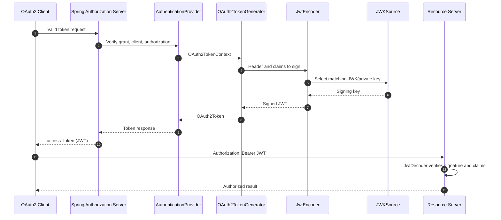
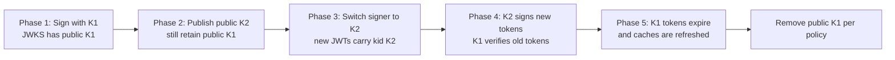

# JwtEncoder and Token Generator Integration

In Spring Boot using **Spring Authorization Server**, issuing JWTs involves several interconnected responsibilities: selecting a signing key, creating claims from the OAuth2/OIDC context, signing the token, publishing the public key so Resource Servers can verify it, and maintaining verifiability throughout key rotation.

Spring Security provides the **`JwtEncoder`** abstraction to encode and sign JWTs. The standard implementation using Nimbus JOSE + JWT is **`NimbusJwtEncoder`**, which takes a **`JWKSource<SecurityContext>`** as its key source. Spring Authorization Server connects the encoder with **`JwtGenerator`** and **`OAuth2TokenGenerator`** to issue JWT access tokens and OIDC ID tokens in their respective grants.

This lesson belongs to the **JWK and Key Management** chapter of the **SPRING_SECURITY_OAUTH2_OIDC_AUTHORIZATION_SERVER** module. The module teaches how to design, configure, secure, test, and operate an OAuth 2.0/OpenID Connect Authorization Server with Spring Security and Spring Authorization Server in a Spring Boot application. The focus of this lesson is **the role of JwtEncoder and how to integrate it with the Authorization Server's token generators**.

> **Core distinction:** `JwtEncoder` signs a JWT from an already prepared header and claims. `JwtGenerator` creates a JWT tailored to an `OAuth2TokenContext`. `DelegatingOAuth2TokenGenerator` coordinates multiple generators to handle JWTs, opaque access tokens, and refresh tokens. `JWKSource` supplies the appropriate key for the signing operation.

**API scope:** Examples use common APIs from Spring Security 6.x and Spring Authorization Server 1.5.x. When a project uses Spring Security 7.x, check the actual packages, configuration styles, and dependencies. Random RSA key generation code is for learning/testing only; production requires a durable key store or a governed KMS/HSM.

## 1. Where Are JWTs Created in the Authorization Server?

When a client completes a valid grant, the Authorization Server builds a token response. For self-contained access tokens, the token can be a JWT signed with the Authorization Server's private key. The Resource Server uses the corresponding public key to verify the signature without calling back to the Token Endpoint on every request.



The actual flow also includes client authentication, authorization checks, consent, scopes, token persistence, and potentially issuing refresh tokens/ID tokens. The diagram focuses on the JWT creation path.

### 1.1. Role of Each Component

| Component | Responsibility | Not responsible for |
|---|---|---|
| `JWK` / `JWKSet` | Represents keys per JSON Web Key, with metadata such as `kid`, `use`, `alg` | Does not issue tokens itself |
| `JWKSource<SecurityContext>` | Supplies JWKs matching selection criteria | Does not decide OAuth permissions |
| `JwtEncoder` | Encodes/signs JWTs from headers and claims | Does not authenticate clients or consent |
| `NimbusJwtEncoder` | `JwtEncoder` implementation based on Nimbus JOSE + JWT | Does not replace token grant providers |
| `JwtGenerator` | Generates JWTs based on `OAuth2TokenContext`, including JWT access tokens or OIDC ID tokens | Does not store private keys in place of JWKSource |
| `OAuth2AccessTokenGenerator` | Generates opaque/reference access tokens | Does not create JWTs |
| `OAuth2RefreshTokenGenerator` | Generates refresh tokens | Does not create JWT access tokens |
| `DelegatingOAuth2TokenGenerator` | Combines the generators and picks the right generator for the token type | Does not replace grant logic |
| `JwtDecoder` | Verifies/decodes JWTs at Resource Servers or verifying components | Does not sign tokens |

### 1.2. An Encoder Is Not a Generator

`JwtEncoder` accepts `JwtEncoderParameters` containing a JWS header and claims set, and returns an encoded/signed `Jwt`. It does not know which grant, subject, scope, or TTL an access token is for, or whether the request has been authorized.

`JwtGenerator` receives an `OAuth2TokenContext`, from which it knows the token type, client, principal, authorization grant, scopes, and token settings. It builds the appropriate claims and then calls the encoder. Therefore, in Spring Authorization Server, **you should not call JwtEncoder directly from a controller to replace the standard token issuance flow**.

## 2. JWK, JWKSet, and JWKSource

### 2.1. JWK Describes Keys in a Standard Format

**JSON Web Key (JWK)** is a JSON structure representing cryptographic keys. For an RSA signing key, important attributes include:

| Attribute | Meaning |
|---|---|
| `kty` | Key type, e.g., `RSA` |
| `kid` | Key ID, identifying the key within a key set |
| `use` | Key purpose, typically `sig` for signing/verification |
| `alg` | Intended algorithm, e.g., `RS256` |
| `n`, `e` | Public components of an RSA key |
| `d` and CRT components | Private components; must be protected and never published |

`JWKSet` contains one or more JWKs. When publishing the JWKS for Resource Servers, the Authorization Server must expose only the **public components** of asymmetric keys. Private keys must never be exposed in public endpoints, logs, browsers, or clients.

### 2.2. JWKSource Is the Key Source Used by the Encoder

`JWKSource<SecurityContext>` is Nimbus JOSE + JWT's abstraction for selecting JWKs based on a `JWKSelector` and a `SecurityContext`. `NimbusJwtEncoder` uses this source to locate a signing key compatible with the JWT's JWS header.

```text
JwtGenerator
    |
    | OAuth2TokenContext -> claims/header
    v
JwtEncoder
    |
    | JWKSelector (alg, kid, use, key type...)
    v
JWKSource
    |
    +--> active private signing key
    +--> public keys used for verification/JWKS
```

In a simple configuration, `JWKSource` can use `ImmutableJWKSet`. In production, this source should read from a protected key store or integrate with a KMS/HSM. Never store private keys directly in source code or Git repositories.

### 2.3. Key ID and the JWT Header kid

A JWT is signed with a specific key. The JWS header typically includes `alg` and `kid`:

```json
{
  "alg": "RS256",
  "kid": "as-signing-2026-01",
  "typ": "JWT"
}
```

The Resource Server uses `kid` to select the corresponding public key in the JWKS. When multiple keys exist, `kid` makes rollover unambiguous. Never reuse a single `kid` for two different keys; if the public key changes while `kid` stays the same, Resource Server caches may select the wrong key.

## 3. Creating an RSA JWKSource for Learning Environments

### 3.1. Generating an RSA Key Pair

Example generating an in-memory 2048-bit RSA key:

```java
import java.security.KeyPair;
import java.security.KeyPairGenerator;
import java.security.interfaces.RSAPrivateKey;
import java.security.interfaces.RSAPublicKey;
import java.util.UUID;

import com.nimbusds.jose.JWSAlgorithm;
import com.nimbusds.jose.jwk.JWKSet;
import com.nimbusds.jose.jwk.KeyUse;
import com.nimbusds.jose.jwk.RSAKey;
import com.nimbusds.jose.jwk.source.ImmutableJWKSet;
import com.nimbusds.jose.jwk.source.JWKSource;
import com.nimbusds.jose.proc.SecurityContext;

import org.springframework.context.annotation.Bean;
import org.springframework.context.annotation.Configuration;

@Configuration(proxyBeanMethods = false)
public class SigningKeyConfiguration {

    @Bean
    JWKSource<SecurityContext> jwkSource() throws Exception {
        KeyPairGenerator generator = KeyPairGenerator.getInstance("RSA");
        generator.initialize(2048);

        KeyPair pair = generator.generateKeyPair();
        RSAPublicKey publicKey = (RSAPublicKey) pair.getPublic();
        RSAPrivateKey privateKey = (RSAPrivateKey) pair.getPrivate();

        RSAKey signingKey = new RSAKey.Builder(publicKey)
                .privateKey(privateKey)
                .keyID("as-signing-" + UUID.randomUUID())
                .keyUse(KeyUse.SIGNATURE)
                .algorithm(JWSAlgorithm.RS256)
                .build();

        JWKSet jwkSet = new JWKSet(signingKey);
        return new ImmutableJWKSet<>(jwkSet);
    }
}
```

This snippet generates a new key on every startup. It is suitable for **local development or testing**, illustrating how to wire an `RSAKey` into `JWKSource`. Upon restart, both the key and `kid` change; older JWTs may fail verification if Resource Servers no longer have the old public key.

**Do not use random key generation on every startup as a production configuration.** Production must load managed keys with backup/rotation, restricted access permissions, and recovery procedures. When using a KMS/HSM, private keys may not be exportable; compatible integration with the chosen signer/encoder is required.

### 3.2. Multi-Key JWKSet

During rollover, a JWKSet can contain:

- The current key with public and private components for signing;
- Previous keys with only public components to verify previously issued tokens.

Example public JWKS structure:

```json
{
  "keys": [
    {
      "kty": "RSA",
      "kid": "as-signing-2026-02",
      "use": "sig",
      "alg": "RS256",
      "n": "PUBLIC_MODULUS_NEW",
      "e": "AQAB"
    },
    {
      "kty": "RSA",
      "kid": "as-signing-2026-01",
      "use": "sig",
      "alg": "RS256",
      "n": "PUBLIC_MODULUS_OLD",
      "e": "AQAB"
    }
  ]
}
```

The JSON above illustrates only the **public JWKS**. Never include private fields such as `d`, `p`, `q`, or private CRT parameters in the public JWKS. When signing, the encoder must select exactly **one** active private key; old keys need only public keys during the old-token verification window.

### 3.3. Durable Key Storage

| Storage location | Characteristics | Notes |
|---|---|---|
| PKCS#12/JKS | Stores protected private keys in a keystore | Manage passwords, file permissions, backups, and rotation |
| Secret manager/Vault | Separates secrets from application artifacts | Manage read permissions, auditing, and versioning |
| KMS/HSM | Private key never has to leave the secure device | Requires compatible signer/encoder and algorithm testing |
| Cloud key management | Integrates IAM, auditing, and rotation | Do not grant workloads broader signing permissions than necessary |

Never store plaintext private keys in YAML, Docker images, unprotected environment variables, or source control. A secret manager alone also does not guarantee security if every service has permission to sign with the same key.

## 4. Integrating NimbusJwtEncoder with JWKSource

### 4.1. Declaring the JwtEncoder Bean

Once you have a `JWKSource`, create `NimbusJwtEncoder`:

```java
import com.nimbusds.jose.proc.SecurityContext;
import com.nimbusds.jose.jwk.source.JWKSource;

import org.springframework.context.annotation.Bean;
import org.springframework.context.annotation.Configuration;
import org.springframework.security.oauth2.jwt.JwtEncoder;
import org.springframework.security.oauth2.jwt.NimbusJwtEncoder;

@Configuration(proxyBeanMethods = false)
public class JwtEncoderConfiguration {

    @Bean
    JwtEncoder jwtEncoder(JWKSource<SecurityContext> jwkSource) {
        return new NimbusJwtEncoder(jwkSource);
    }
}
```

`NimbusJwtEncoder` is the `JwtEncoder` implementation using Nimbus JOSE + JWT. It accepts `JWKSource` to select a key matching the JWS header. With the RSA key from the previous example, the declared algorithm is `RS256`.

Do not confuse `JwtEncoder` with `JwtDecoder`. The encoder uses the private signing key to sign; the decoder uses the public key to verify. Having an encoder does not automatically guarantee the JWKS endpoint is exposed, and having a JWKS does not automatically configure every Resource Server to trust the issuer.

### 4.2. The Encoder Must Resolve Exactly One Signing Key

When multiple JWKs match the selector, the encoder needs a deterministic key selection strategy. Production configurations should ensure:

- The signing key has a private component and `use=sig`;
- `alg` is compatible with the JWS algorithm requested by the token generator;
- `kid` is stable and unique per key version;
- Exactly one active private signing key is selected for a given criterion;
- Previous public keys remain available to verify older tokens for as long as required.

If `NimbusJwtEncoder` finds no matching key or finds multiple ambiguous keys, encoding can fail with `JwtEncodingException`. Never work around this by returning an arbitrary key without checking `alg`/`kid`.

### 4.3. JwtDecoder for Verification

Inside the Authorization Server, a decoder can be declared from the same `JWKSource`:

```java
import com.nimbusds.jose.proc.SecurityContext;
import com.nimbusds.jose.jwk.source.JWKSource;

import org.springframework.context.annotation.Bean;
import org.springframework.security.oauth2.jwt.JwtDecoder;
import org.springframework.security.oauth2.server.authorization.config.annotation.web.configuration.OAuth2AuthorizationServerConfiguration;

@Bean
JwtDecoder jwtDecoder(JWKSource<SecurityContext> jwkSource) {
    return OAuth2AuthorizationServerConfiguration.jwtDecoder(jwkSource);
}
```

A decoder is typically needed for features such as OIDC UserInfo or application components that verify JWTs. Independent Resource Servers can use issuer metadata or the public JWKS URI to configure their own decoder.

**Do not use a decoder to verify tokens with a private key or skip claims validation.** A valid signature only proves the token was signed by a trusted key; you must still validate issuer, audience, expiry, token type, and API permissions.

## 5. Integrating JwtEncoder into the Default Token Generator

### 5.1. OAuth2TokenGenerator Is the Central Abstraction

Spring Authorization Server uses `OAuth2TokenGenerator` to create token types based on `OAuth2TokenContext`:

| Generator | Token type |
|---|---|
| `JwtGenerator` | Self-contained JWT access tokens and OIDC ID tokens |
| `OAuth2AccessTokenGenerator` | Opaque/reference access tokens |
| `OAuth2RefreshTokenGenerator` | Refresh tokens |
| `DelegatingOAuth2TokenGenerator` | Combines the generators above |

`JwtGenerator` requires a `JwtEncoder`. Upon receiving a context, it inspects the token type and token settings, constructs the appropriate header/claims, and invokes the encoder. If the token type is unsupported, the generator returns `null` so `DelegatingOAuth2TokenGenerator` tries the next generator.

### 5.2. Default Configuration When a JwtEncoder or JWKSource Bean Is Present

Under Spring Authorization Server's default mechanism:

- `OAuth2TokenGenerator` can be configured explicitly or created by default by the framework.
- The default generator is a `DelegatingOAuth2TokenGenerator` containing `OAuth2AccessTokenGenerator` and `OAuth2RefreshTokenGenerator`.
- When a `JwtEncoder` bean or `JWKSource<SecurityContext>` bean is registered, `JwtGenerator` is added to the default generator set.
- When `TokenSettings.getAccessTokenFormat()` is `SELF_CONTAINED` (the default), access tokens are generated as JWTs.
- With `OAuth2TokenFormat.REFERENCE`, access tokens are generated as opaque/reference tokens.

Therefore, **simply configuring an appropriate JWKSource may be enough for the framework to produce JWTs by default**. If you want to customize how generators are composed or attach customizers manually, configure them explicitly and retest every grant.

### 5.3. TokenSettings Selects the Access Token Format

Example configuring a client to receive JWT access tokens:

```java
RegisteredClient apiClient = RegisteredClient
        .withId("orders-client-registration")
        .clientId("orders-client")
        .clientAuthenticationMethod(
                ClientAuthenticationMethod.CLIENT_SECRET_BASIC)
        .authorizationGrantType(AuthorizationGrantType.CLIENT_CREDENTIALS)
        .scope("orders.read")
        .tokenSettings(TokenSettings.builder()
                .accessTokenFormat(OAuth2TokenFormat.SELF_CONTAINED)
                .accessTokenTimeToLive(Duration.ofMinutes(5))
                .build())
        .build();
```

`SELF_CONTAINED` produces a JWT carrying self-contained claims; Resource Servers can verify signatures using the public key. When configured as `REFERENCE`, opaque access tokens are not signed like JWTs; Resource Servers typically rely on introspection or a trusted state-lookup mechanism.

Do not confuse access token format with refresh tokens. Having `JwtGenerator` does not mean every token in a token response is a JWT; refresh tokens are still produced by their own generator per policy.

## 6. Creating an Explicit OAuth2TokenGenerator

### 6.1. When Should You Declare Your Own Generator?

You can rely on the default generator if you only need standard JWTs and a working JWKSource. Declare a custom `OAuth2TokenGenerator` when you:

- Want explicit control over the generator types;
- Need to attach an `OAuth2TokenCustomizer` directly to `JwtGenerator`;
- Have a custom token format or custom generation rules;
- Want explicit wiring for review and testing.

Common configuration:

```java
import org.springframework.context.annotation.Bean;
import org.springframework.context.annotation.Configuration;
import org.springframework.security.oauth2.jwt.JwtEncoder;
import org.springframework.security.oauth2.server.authorization.token.DelegatingOAuth2TokenGenerator;
import org.springframework.security.oauth2.server.authorization.token.JwtGenerator;
import org.springframework.security.oauth2.server.authorization.token.OAuth2AccessTokenGenerator;
import org.springframework.security.oauth2.server.authorization.token.OAuth2RefreshTokenGenerator;
import org.springframework.security.oauth2.server.authorization.token.OAuth2TokenGenerator;

@Configuration(proxyBeanMethods = false)
public class TokenGeneratorConfiguration {

    @Bean
    OAuth2TokenGenerator<?> tokenGenerator(JwtEncoder jwtEncoder) {
        JwtGenerator jwtGenerator = new JwtGenerator(jwtEncoder);
        OAuth2AccessTokenGenerator accessTokenGenerator =
                new OAuth2AccessTokenGenerator();
        OAuth2RefreshTokenGenerator refreshTokenGenerator =
                new OAuth2RefreshTokenGenerator();

        return new DelegatingOAuth2TokenGenerator(
                jwtGenerator,
                accessTokenGenerator,
                refreshTokenGenerator);
    }
}
```

`DelegatingOAuth2TokenGenerator` tries each generator in order; the one matching `OAuth2TokenContext.getTokenType()` generates the token. For example, keeping both JWT and opaque access token generators ensures clients with different `TokenSettings` still receive their respective formats.

### 6.2. Wiring the Generator into OAuth2AuthorizationServerConfigurer

You can pass the generator into the Authorization Server configurer:

```java
@Bean
@Order(1)
SecurityFilterChain authorizationServerSecurityFilterChain(
        HttpSecurity http,
        OAuth2TokenGenerator<?> tokenGenerator) throws Exception {

    OAuth2AuthorizationServerConfigurer authorizationServer =
            OAuth2AuthorizationServerConfigurer.authorizationServer();

    http
        .securityMatcher(authorizationServer.getEndpointsMatcher())
        .with(authorizationServer, server -> server
            .tokenGenerator(tokenGenerator))
        .authorizeHttpRequests(authorize -> authorize
            .anyRequest().authenticated());

    return http.build();
}
```

This illustrates the protocol filter chain; the application also needs a client repository, authorization service, user authentication, issuer, JWK source, and an appropriate login chain. `OAuth2AuthorizationServerConfigurer` also lets you coordinate other endpoint settings.

**Do not configure two independent token generator setups without knowing which one providers are using.** If you both declare a generator bean and call the configurer setter, pass the single tested bean. If you let the framework build the default generator, there is no need to replace it solely to "get JWTs."

### 6.3. Do Not Omit the Refresh Token Generator

A common mistake when creating a custom generator is returning only `new JwtGenerator(jwtEncoder)`. In that case, grants needing refresh tokens no longer have a generator capable of issuing them. If your application uses the `refresh_token` grant, keep `OAuth2RefreshTokenGenerator` in `DelegatingOAuth2TokenGenerator` and test the refresh flow.

Similarly, if some clients use opaque access tokens, keep `OAuth2AccessTokenGenerator`. Do not assume `JwtGenerator` can replace every generator.

## 7. Customizing JWTs with OAuth2TokenCustomizer

### 7.1. JwtEncodingContext Provides Token Issuance Context

`OAuth2TokenCustomizer<JwtEncodingContext>` allows adding or adjusting JWS headers and JWT claims before signing. `JwtEncodingContext` provides context such as:

- The `RegisteredClient` requesting the token;
- The authenticated `Principal`;
- `AuthorizationGrantType`;
- `OAuth2TokenType`;
- Granted scopes;
- The current authorization and related metadata.

Example adding `tenant_id` to an access token when the principal is an application type carrying tenant information:

```java
public interface TenantAwarePrincipal {
    String getTenantId();
}

@Bean
OAuth2TokenCustomizer<JwtEncodingContext> jwtCustomizer() {
    return context -> {
        if (!OAuth2TokenType.ACCESS_TOKEN.equals(context.getTokenType())) {
            return;
        }

        Object principal = context.getPrincipal().getPrincipal();
        if (principal instanceof TenantAwarePrincipal tenantPrincipal) {
            context.getClaims().claim(
                    "tenant_id", tenantPrincipal.getTenantId());
        }
    };
}
```

This is an example for applications with a custom principal. If the principal does not implement `TenantAwarePrincipal`, the claim is not added. In production, the tenant must come from a **verified context**; never take `tenant_id` from an unverified query parameter or client-supplied header.

### 7.2. Distinguishing Access Tokens and ID Tokens

`JwtGenerator` can also create OIDC ID tokens. A customizer applied to both should branch on `tokenType`:

```java
@Bean
OAuth2TokenCustomizer<JwtEncodingContext> jwtCustomizer() {
    return context -> {
        String tokenType = context.getTokenType().getValue();

        if (OAuth2TokenType.ACCESS_TOKEN.getValue().equals(tokenType)) {
            // Claims intended for the Resource Server/API.
            context.getClaims().claim("token_use", "access");
        } else if (OidcParameterNames.ID_TOKEN.equals(tokenType)) {
            // Add only claims truly intended for the OIDC client.
            // Do not put all API permissions into the ID token.
        }
    };
}
```

Access tokens are for Resource Servers; ID tokens are for OIDC clients verifying login events and identity claims. Never use an ID token as a Bearer token to call APIs, and never put unnecessary internal scopes/permissions into an ID token.

### 7.3. Standard Claims vs. Application Claims

| Claim | Source/meaning | Notes |
|---|---|---|
| `iss` | Authorization Server issuer | Must be consistent with metadata and Resource Servers |
| `sub` | Token subject | Do not overwrite blindly with client ID |
| `aud` | Token recipients | Must reflect the target Resource Server |
| `iat` / `exp` | Issued-at and expiration timestamps | Must align with TokenSettings and policy |
| `jti` | Token identifier | Can support auditing/revocation by design |
| `scope` | Granted scopes | Do not escalate permissions from unverified requests |
| `tenant_id` | Example application claim | Populate only from trusted identity/authorization context |
| `roles` | Roles/authorities if required by policy | Do not copy all roles indiscriminately |

Do not replace framework-generated claims without a clear reason. Overwriting `iss`, `sub`, or `exp` manually can violate issuer semantics or bypass token settings TTLs. Additional claims should be minimal, stable, and documented for Resource Servers.

### 7.4. Customizers Must Have Explicit Conditions

Do not write a customizer like "for any token, copy all authorities into a `roles` claim." That can leak internal details, cause unintended privilege escalation, or produce inconsistent tokens without a clear contract. Check grant, client ID, token type, granted scopes, and principal context before adding a claim.

Example adding a claim only for a specific client:

```java
@Bean
OAuth2TokenCustomizer<JwtEncodingContext> ordersTokenCustomizer() {
    return context -> {
        if (!OAuth2TokenType.ACCESS_TOKEN.equals(context.getTokenType())) {
            return;
        }

        if (!"orders-client".equals(
                context.getRegisteredClient().getClientId())) {
            return;
        }

        if (context.getAuthorizedScopes().contains("orders.read")) {
            context.getClaims().claim("api_domain", "orders");
        }
    };
}
```

The `api_domain` claim is illustrative metadata only and does not replace `aud` or `scope`. The Orders API must still verify audience and resource permissions.

## 8. When Using a Custom Token Generator, Wire the Customizer Explicitly

When letting the framework create the default generator, an `OAuth2TokenCustomizer<JwtEncodingContext>` bean can be wired automatically to the appropriate `JwtGenerator`. However, when **constructing `JwtGenerator` yourself**, you must call `setJwtCustomizer`:

```java
@Bean
OAuth2TokenGenerator<?> tokenGenerator(
        JwtEncoder jwtEncoder,
        OAuth2TokenCustomizer<JwtEncodingContext> jwtCustomizer) {

    JwtGenerator jwtGenerator = new JwtGenerator(jwtEncoder);
    jwtGenerator.setJwtCustomizer(jwtCustomizer);

    OAuth2AccessTokenGenerator accessTokenGenerator =
            new OAuth2AccessTokenGenerator();
    OAuth2RefreshTokenGenerator refreshTokenGenerator =
            new OAuth2RefreshTokenGenerator();

    return new DelegatingOAuth2TokenGenerator(
            jwtGenerator,
            accessTokenGenerator,
            refreshTokenGenerator);
}
```

If the customizer is not attached, the application can issue JWTs missing expected application claims even though the customizer bean exists. This is a common wiring mistake when replacing the default generator.

### 8.1. Opaque Tokens Use a Different Customizer

`OAuth2TokenCustomizer<JwtEncodingContext>` applies only to JWTs. When a client uses `OAuth2TokenFormat.REFERENCE`, access tokens are created by `OAuth2AccessTokenGenerator` and can use `OAuth2TokenCustomizer<OAuth2TokenClaimsContext>`:

```java
@Bean
OAuth2TokenCustomizer<OAuth2TokenClaimsContext> opaqueAccessTokenCustomizer() {
    return context -> {
        if (OAuth2TokenType.ACCESS_TOKEN.equals(context.getTokenType())) {
            context.getClaims().claim("token_use", "opaque_access");
        }
    };
}
```

When constructing `OAuth2AccessTokenGenerator` manually, call `setAccessTokenCustomizer(opaqueAccessTokenCustomizer)`. If the token generator is created by default by the framework, a customizer bean of type `OAuth2TokenClaimsContext` can be wired automatically per supported configuration.

Do not try to use `JwtEncodingContext` to modify an opaque token; it does not pass through `JwtGenerator`.

### 8.2. Do Not Declare Multiple Customizers of the Same Type Assuming Auto-Composition

If multiple `OAuth2TokenCustomizer<JwtEncodingContext>` beans exist, do not assume the framework executes all of them in your desired order. Depending on configuration and generators, you may need a single composite customizer or deliberate composition. When multiple policies exist (tenant, audience, client-specific claims), consolidate logic into a clear component and test claim conditions.

## 9. Low-Level JwtEncoder: Manually Creating a JWT in Tests

In an Authorization Server application, let `JwtGenerator` create tokens from `OAuth2TokenContext`. However, understanding the direct encoder API is useful when writing unit tests or standalone test utilities:

```java
import java.time.Instant;
import java.util.List;

import org.springframework.security.oauth2.jose.jws.SignatureAlgorithm;
import org.springframework.security.oauth2.jwt.JwsHeader;
import org.springframework.security.oauth2.jwt.Jwt;
import org.springframework.security.oauth2.jwt.JwtClaimsSet;
import org.springframework.security.oauth2.jwt.JwtEncoder;
import org.springframework.security.oauth2.jwt.JwtEncoderParameters;

Instant now = Instant.now();

JwtClaimsSet claims = JwtClaimsSet.builder()
        .issuer("https://login.example.com")
        .subject("user-123")
        .audience(List.of("orders-api"))
        .issuedAt(now)
        .expiresAt(now.plusSeconds(300))
        .claim("scope", "orders.read")
        .build();

JwsHeader header = JwsHeader.with(SignatureAlgorithm.RS256)
        .keyId("as-signing-2026-01")
        .build();

Jwt jwt = jwtEncoder.encode(
        JwtEncoderParameters.from(header, claims));

String compactToken = jwt.getTokenValue();
```

This snippet creates a signed JWT using `JwtEncoder`. In production, **never build a token response manually in a controller** using this code, because you would have to enforce authorization grants, client authentication, token persistence, metadata, revocation, and response semantics yourself. To issue OAuth tokens properly, use `OAuth2TokenGenerator` integrated with the Authorization Server.

### 9.1. Encoding Does Not Replace Authorization

If a caller sets `sub=user-123`, `aud=orders-api`, and `scope=orders.read` in `JwtClaimsSet`, a successful signature **does not prove the caller was authorized to grant those claims**. The encoder only performs the cryptographic operation on the data provided. Authorization decisions must happen earlier in the grant provider and system policies.

## 10. JWKS Endpoint and Resource Server JWT Verification

### 10.1. Publishing Public Keys

When `JWKSource<SecurityContext>` is present in the Authorization Server configuration, Spring Authorization Server can expose the **JWK Set Endpoint**, typically `/oauth2/jwks`. The endpoint returns public JWKs so Resource Servers can fetch keys to verify JWTs.

Example public JWKS structure:

```json
{
  "keys": [
    {
      "kty": "RSA",
      "kid": "as-signing-2026-01",
      "use": "sig",
      "alg": "RS256",
      "n": "PUBLIC_MODULUS",
      "e": "AQAB"
    }
  ]
}
```

This is illustrative public data. Private key parameters such as `d`, `p`, `q`, or private CRT values must never be exposed. Inspect the actual `/oauth2/jwks` response to ensure the endpoint publishes only public keys.

### 10.2. Resource Server Issuer/JWKS Configuration

A Resource Server can be configured with an issuer URI:

```yaml
spring:
  security:
    oauth2:
      resourceserver:
        jwt:
          issuer-uri: https://login.example.com
```

Spring Security uses the issuer's metadata to discover the JWKS URI and configure JWT verification via discovery. An alternative is configuring `jwk-set-uri` explicitly, though you must still validate the expected issuer.

### 10.3. A Valid Signature Still Requires Audience Validation

A JWT with a valid Authorization Server signature **does not mean every API should accept it**. The Orders API must verify the token was issued for the right audience:

```java
@Bean
JwtDecoder ordersJwtDecoder() {
    String issuer = "https://login.example.com";
    String jwksUri = "https://login.example.com/oauth2/jwks";

    NimbusJwtDecoder decoder =
            NimbusJwtDecoder.withJwkSetUri(jwksUri).build();

    OAuth2TokenValidator<Jwt> issuerValidator =
            JwtValidators.createDefaultWithIssuer(issuer);

    OAuth2TokenValidator<Jwt> audienceValidator = jwt ->
            jwt.getAudience().contains("orders-api")
                ? OAuth2TokenValidatorResult.success()
                : OAuth2TokenValidatorResult.failure(
                    new OAuth2Error(
                        "invalid_token",
                        "Token is not intended for Orders API",
                        null));

    decoder.setJwtValidator(new DelegatingOAuth2TokenValidator<>(
            issuerValidator, audienceValidator));

    return decoder;
}
```

The Resource Server also needs to check scopes/authorities, such as `SCOPE_orders.read`, as well as per-order/tenant permissions. A signature only verifies integrity and signing origin; it does not enforce business authorization.

## 11. Signing Algorithms and Key Selection

### 11.1. RS256 in the Examples

`RS256` is RSASSA-PKCS1-v1_5 using SHA-256. It is a broadly compatible choice across the OAuth/OIDC ecosystem. Other asymmetric algorithms such as ECDSA or RSA-PSS can be used if the issuer, encoder, JWKS consumer, and Resource Server support them per policy.

Never accept the `none` algorithm for signed access tokens. Never let a verifier accept an algorithm solely based on the token's self-declared header; allowed algorithms must be constrained by configuration and trust policy.

### 11.2. Do Not Reuse One Key Arbitrarily Across All Purposes

If the same JWK is used across multiple protocols, clearly define key use, algorithm, issuer, and audience. Avoid sharing a symmetric HMAC secret across multiple clients/resource servers because any party holding the secret to verify tokens could also sign tokens. For JWT access tokens published via JWKS, an asymmetric model cleanly separates signing authority from verification.

### 11.3. Key Size and Algorithms per Policy

RSA 2048-bit in the examples is a common baseline for illustration. Organizations may require RSA 3072-bit or other algorithms per internal cryptographic standards. Evaluate performance, client/resource server compatibility, HSM/KMS support, and key lifecycles before changing algorithms.

Do not switch from RS256 to ES256/PS256 merely by changing the `alg` string in a JWK; key type, encoder, selector, JWT decoder, and dependent clients must all support it.

## 12. Signing Key Rotation and Lifecycle

### 12.1. Purpose of Rotation

Signing keys must be rotated periodically and whenever compromise is suspected. When changing keys, the Authorization Server begins signing new JWTs with a new key ID; Resource Servers need the new public key to verify them. Previously issued tokens remain valid until expiration or explicit revocation, so old public keys must be retained long enough.



The rollover workflow may require pre-publishing the new public key before signing with it, giving Resource Servers time to refresh their JWKS caches. Do not remove the old public key immediately upon switching signers while old tokens remain valid.

### 12.2. Retention Window for Old Public Keys

The retention duration for an old public key must account for:

- Maximum TTL of access tokens signed with the old key;
- Allowed clock skew at Resource Servers;
- JWKS cache TTL and key refresh frequency;
- Resource Server deployment/synchronization lag;
- Rollback procedures and old token handling.

A common operational rule is to retain the old public key at least **until after the last token signed by that key expires**, plus a safety margin for clock skew and caching. Exact numbers must be derived from real configuration.

### 12.3. Unique kid and Active Signer

When multiple JWKs exist:

- The active private signing key must be selected deterministically;
- Previous public keys remain present in the JWKS;
- `kid` must be unique and immutable throughout a key's lifecycle;
- The JWT header must accurately identify the key ID;
- Resource Servers must safely refresh the JWKS when encountering a new `kid`.

Do not let the encoder pick arbitrarily among multiple private keys matching a selector. If multiple keys share the same `alg`, configure the key source/selector explicitly so JWTs are never issued with an unexpected `kid`.

### 12.4. Key Compromise Requires an Emergency Procedure

If a private key is exposed, scheduled rotation alone is insufficient. You must:

1. Stop signing with the compromised key and switch to a new key;
2. Determine the scope of JWTs that could have been forged;
3. Update the JWKS and cache/invalidation mechanisms;
4. Evaluate token/authorization revocation and TTL reductions;
5. Notify Resource Servers to update their trust state;
6. Audit access, restrict signer permissions, and remediate the root cause;
7. Remove the old public key only after assessing risk and impact.

Self-contained JWTs have no built-in instant revocation simply because a key was rotated. If a Resource Server caches the old public key and still trusts it, forged JWTs signed by the leaked private key can still verify until trust/key state is updated.

## 13. Testing JwtEncoder and Token Generators

### 13.1. Testing JWKSource and the Encoder

| Test case | Condition | Expectation |
|---|---|---|
| JWKSource has signing key | Valid RSA private/public key, use=sig, matching alg | Encoder selects the key |
| Missing private key | Only public JWK provided for signing | Does not produce JWT |
| Wrong algorithm | RS256 header but source lacks compatible key | Encoding fails |
| No matching key | JWKSource returns empty list | `JwtEncodingException` or equivalent error |
| Multiple ambiguous keys | Multiple private keys match selector | Explicit key selection; never random |
| kid | JWK has key ID | JWT header identifies the right key |
| Valid signature | Decode with corresponding public key | Verification succeeds |
| Tampered token | Alter payload/signature | Decoder rejects |
| Public JWKS | Call `/oauth2/jwks` | Contains public key material only |
| Private key leakage | Inspect responses/logs/artifacts | Zero private parameters exposed |

### 13.2. Testing Generators by Token Type

| Token type/client setting | Expected generator | What to verify |
|---|---|---|
| Access token `SELF_CONTAINED` | `JwtGenerator` | Result is a signed JWT |
| Access token `REFERENCE` | `OAuth2AccessTokenGenerator` | Opaque token, do not assume JWT |
| OIDC ID token | `JwtGenerator` | Present only in OIDC flow under matching conditions |
| Refresh token | `OAuth2RefreshTokenGenerator` | Not altered by JWT customizer |
| Custom JWT claims | `JwtGenerator` + JWT customizer | Claims added only for intended token type/client |
| Custom opaque claims | `OAuth2AccessTokenGenerator` + claims customizer | Claims persisted/introspected accurately |
| Explicit generator | `DelegatingOAuth2TokenGenerator` | Opaque/refresh generators not lost |

### 13.3. Unit Test Verifying a JWT with a Public Key

Conceptual test example once `JwtEncoder` and `JwtDecoder` are configured:

```java
@Test
void jwtCanBeEncodedAndVerified() {
    JwtClaimsSet claims = JwtClaimsSet.builder()
            .issuer("https://login.example.com")
            .subject("user-123")
            .audience(List.of("orders-api"))
            .issuedAt(Instant.now())
            .expiresAt(Instant.now().plusSeconds(120))
            .claim("scope", "orders.read")
            .build();

    JwsHeader header = JwsHeader.with(SignatureAlgorithm.RS256).build();

    Jwt encoded = jwtEncoder.encode(
            JwtEncoderParameters.from(header, claims));

    Jwt decoded = jwtDecoder.decode(encoded.getTokenValue());

    assertThat(decoded.getSubject()).isEqualTo("user-123");
    assertThat(decoded.getAudience()).contains("orders-api");
    assertThat(decoded.getClaimAsString("scope")).isEqualTo("orders.read");
}
```

Test fixtures need JWKSource and decoder trusting the same key. When testing TTLs, use a Clock/controllable fixture rather than `sleep`. A passing encode/decode test does not yet prove the Authorization Endpoint, grant providers, token persistence, or Resource Server audience policy are correct.

### 13.4. Integration Test Through the Token Endpoint

An important integration test should:

1. Register a `RegisteredClient` with `SELF_CONTAINED` access token.
2. Call an allowed grant, such as Client Credentials or Authorization Code.
3. Receive the token response and verify the access token is a JWT.
4. Read `kid`, fetch the corresponding public JWK from JWKS, and verify the signature.
5. Check `iss`, `aud`, `exp`, `scope`, and custom claims.
6. Switch a client to `REFERENCE` in a separate test, verifying opaque tokens and the other customizer type.
7. Run the refresh grant if used by the app to confirm the refresh token generator still works.
8. Perform a key rollover test with both old and new tokens.

Do not test only `JwtEncoder` directly and conclude the token generator stack is integrated properly. Have at least one test **exercising the grant provider and Token Endpoint**.

## 14. Common Errors and Troubleshooting

| Symptom | Possible cause | Resolution |
|---|---|---|
| No JWT access token despite JWKSource | Client uses `REFERENCE` or generator not wired | Check `TokenSettings.accessTokenFormat` and token generator |
| `JwtEncodingException` key not found | JWKSource returns no key with matching private component/alg | Check `kty`, `use`, `alg`, private key |
| Multiple matching keys | Selector cannot uniquely resolve signing key | Restrict selector, `kid`, and active signer |
| JWT missing custom claim | Customizer not wired into manually created generator | Call `JwtGenerator.setJwtCustomizer` or use proper auto-wiring |
| Custom claim appears unexpectedly in ID token | Customizer does not branch on token type | Check `OAuth2TokenType` and OIDC token type |
| Refresh tokens no longer issued | Delegating generator omitted `OAuth2RefreshTokenGenerator` | Restore generator and test refresh grant |
| Opaque token missing claims | Only JwtEncodingContext customizer configured | Use `OAuth2TokenClaimsContext` for opaque tokens |
| JWKS endpoint 404 | Missing JWKSource or misconfigured protocol chain/endpoint settings | Check JWKSource bean and `/oauth2/jwks` |
| Resource Server cannot verify token | Wrong JWKS URI/issuer, stale cache, missing kid | Check discovery, JWKS, `kid`, and clock |
| Invalid JWT signature after restart | Keys generated randomly on every startup | Load durable keys, retain old public key |
| JWT signed with unexpected kid | Multiple active signers or ambiguous JWK selection | Manage active key and selector |
| Token rejected despite valid signature | Wrong issuer, audience, expiry, or scope | Check validators and API policy |
| Customizer overwrote exp | Token exceeds configured TTL | Never overwrite standard claims arbitrarily |
| Multiple nodes issue inconsistent JWTs | Different JWKSource or skewed key rollout | Synchronize key registry, active key, and JWKS |
| Private key leaked | JWKS/logs/config/artifacts contain private parameters | Revoke key, emergency rotate, audit access |

## 15. Production Operations and Security Checklist

### 15.1. Deployment Checklist

1. **Key source:** JWKSource uses a durable key store or KMS/HSM; never generate new keys on every production restart.
2. **Access control:** Only token-issuing components have signing permissions; Resource Servers need only public keys.
3. **Algorithms:** Restrict JWS algorithms per policy; never accept `none` or algorithms outside the allowlist.
4. **Key ID:** Every key version has a unique `kid`; JWT headers and JWKS stay in sync.
5. **Token generator:** Retain `JwtGenerator`, `OAuth2AccessTokenGenerator`, and `OAuth2RefreshTokenGenerator` as needed by client formats.
6. **Customizers:** Branch by grant/token type/client; add minimal claims strictly from trusted context.
7. **Claims:** Validate `iss`, `sub`, `aud`, `iat`, `exp`, and scope; never overwrite standard claims unintentionally.
8. **Resource Server:** Verify signature, issuer, audience, expiration, scope, and business permissions.
9. **JWKS:** Publish only public material; keep old public keys long enough after rollover.
10. **Rotation:** Pre-publish new keys, perform controlled signer switch, monitor caches, and keep a rollback plan.
11. **Incident response:** Maintain procedures for private key compromise and evaluating issued tokens.
12. **Observability:** Monitor signing/decoder errors, unknown kids, rejected tokens, and key drift across nodes; never log tokens/private keys.

### 15.2. Data That Must Never Be Logged

Do not log:

- Private keys, JWK private parameters, keystore passwords, or KMS credentials;
- Full access tokens, refresh tokens, or ID tokens;
- Authorization codes, client secrets, or client assertions;
- Full claims containing sensitive personal data without approved justification.

You may log `kid`, verified client ID, token type, grant type, correlation ID, and error codes. If token tracing is needed, use safe identifiers/hashes per policy rather than storing raw bearer credentials.

### 15.3. Key Compromise Scenarios

When a private signing key is suspected of exposure, treat it as a trust incident affecting all tokens signed by that key. Simply swapping the `JwtEncoder` bean or creating a new key is insufficient if Resource Servers still trust the old public key. You must coordinate issuer, JWKS caches, Resource Servers, token TTL/revocation, auditing, and revocation workflows.

## 16. Hands-On Exercise

**Prompt:** Build an Authorization Server for the Orders API that issues JWT access tokens with `aud=orders-api` and scope `orders.read`. Use an RSA signing key with a stable `kid`, publish a public JWKS, and add a `tenant_id` claim from an authenticated principal.

**Implementation requirements:**

1. Create a `JWKSource<SecurityContext>` from an RSA key for local/test environments.
2. Create a `NimbusJwtEncoder` from the JWKSource.
3. Create a `JwtGenerator` and integrate it via `DelegatingOAuth2TokenGenerator`, retaining opaque and refresh generators if needed by the system.
4. Configure `OAuth2AuthorizationServerConfigurer.tokenGenerator(...)` when using an explicit generator.
5. Register a client with `TokenSettings.accessTokenFormat(SELF_CONTAINED)`.
6. Write an `OAuth2TokenCustomizer<JwtEncodingContext>` that adds `tenant_id` only when the principal actually carries tenant information.
7. Verify the JWT header contains `kid`, the signature is valid, and claims are accurate.
8. Call `/oauth2/jwks` to confirm only public key material is exposed.
9. Configure the Resource Server to validate issuer, audience `orders-api`, and scope.
10. Perform a rollover test: issue a token with K1, publish K2, switch signer to K2, verify both old and new tokens, and only then remove public K1 after a safe window.

**Acceptance criteria:** Tokens are issued only through valid grants; the encoder selects the right private key; JWTs contain `kid` and policy-compliant claims; the Resource Server validates public key/issuer/audience/scope properly; opaque/refresh flows remain intact; no private keys appear in JWKS/logs/source control.

## 17. Self-Assessment Questions

1. How does `JwtEncoder` differ from `JwtGenerator` in responsibility?
2. Why does `NimbusJwtEncoder` require a `JWKSource<SecurityContext>`?
3. How do `JWK`, `JWKSet`, and `JWKSource` differ in role?
4. Which key does `kid` help the Resource Server select, and what happens if a kid is reused?
5. When `TokenSettings.accessTokenFormat` is `SELF_CONTAINED` vs. `REFERENCE`, which generator is used?
6. Why must `DelegatingOAuth2TokenGenerator` retain both access token generators and the refresh token generator?
7. When does Spring Authorization Server automatically create `JwtGenerator` from a `JwtEncoder`/`JWKSource` bean?
8. When constructing `JwtGenerator` manually, why must you attach `OAuth2TokenCustomizer<JwtEncodingContext>`?
9. Why must a customizer distinguish between access tokens and ID tokens?
10. Why should a customizer not blindly copy all roles/claims from the principal?
11. Why does successful signing by the encoder not prove that claims were properly authorized?
12. What must a Resource Server validate in addition to the JWT signature?
13. Why must the public JWKS contain only public key material?
14. During rotation, why must the old public key be retained after switching signers?
15. If random keys are generated on every restart, what problem can unexpired tokens encounter?
16. When a private key is compromised, why is simply switching to a new key not enough to invalidate forged/old tokens?
17. When should you use a custom `JwtEncoder`/KMS signer instead of the default `NimbusJwtEncoder`?
18. How do you test the encoder, generator, token endpoint, and Resource Server in a single end-to-end flow?

## 18. Official References

- [Spring Authorization Server — Core Model / Components](https://docs.spring.io/spring-authorization-server/reference/core-model-components.html): `OAuth2TokenGenerator`, `JwtGenerator`, `OAuth2TokenCustomizer`, `DelegatingOAuth2TokenGenerator`, and generator wiring.
- [Spring Authorization Server — Configuration Model](https://docs.spring.io/spring-authorization-server/reference/configuration-model.html): protocol endpoint configuration, JWK Set Endpoint, and Authorization Server components.
- [Spring Authorization Server — JwtGenerator API](https://docs.spring.io/spring-authorization-server/reference/api/java/org/springframework/security/oauth2/server/authorization/token/JwtGenerator.html): constructor taking `JwtEncoder`, `generate`, and `setJwtCustomizer`.
- [Spring Security — NimbusJwtEncoder API](https://docs.spring.io/spring-security/reference/api/java/org/springframework/security/oauth2/jwt/NimbusJwtEncoder.html): `JwtEncoder` implementation using `JWKSource`.
- [Spring Security — OAuth2 Resource Server JWT](https://docs.spring.io/spring-security/reference/servlet/oauth2/resource-server/jwt.html): decoder configuration, issuer, and JWT verification.
- [RFC 7517 — JSON Web Key (JWK)](https://www.rfc-editor.org/rfc/rfc7517): JWK/JWK Set structure and key properties.
- [RFC 7515 — JSON Web Signature (JWS)](https://www.rfc-editor.org/rfc/rfc7515): headers, algorithms, and compact serialization of signed JWTs.
- [RFC 7519 — JSON Web Token (JWT)](https://www.rfc-editor.org/rfc/rfc7519): JWT claims and structure.
- [RFC 9068 — JWT Profile for OAuth 2.0 Access Tokens](https://www.rfc-editor.org/rfc/rfc9068): JWT access token profile, issuer, audience, and validation requirements.

**Key takeaway:** `NimbusJwtEncoder` signs JWTs with an appropriate JWK; `JwtGenerator` turns `OAuth2TokenContext` into a JWT; `DelegatingOAuth2TokenGenerator` coordinates JWTs, opaque access tokens, and refresh tokens by token type/format. For secure integration, manage JWKs durably, select `kid`/algorithms deterministically, add claims only from verified contexts, publish a public JWKS, and validate issuer/audience/scope at the Resource Server. During rotation, retain old public keys long enough to verify unexpired tokens and maintain an emergency procedure for private key compromise.
