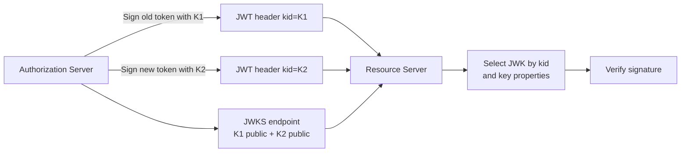
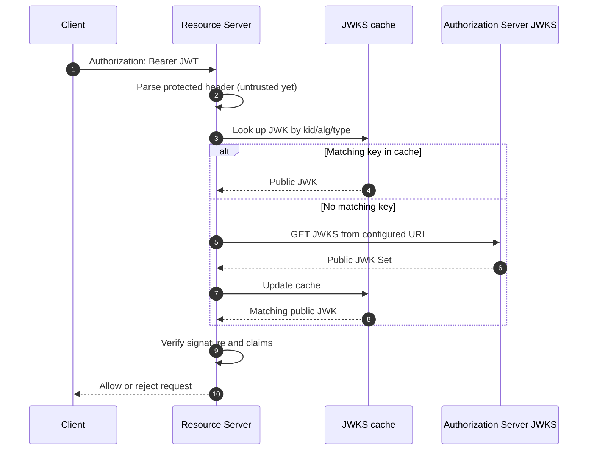
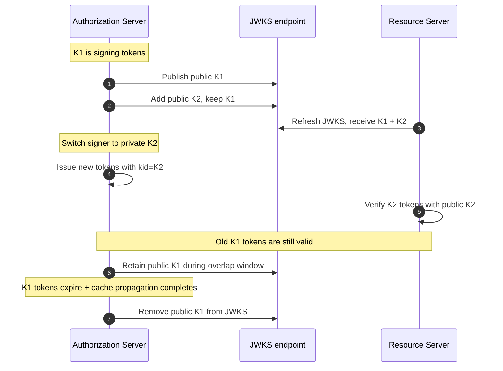

# kid and How the Resource Server Selects a Verification Key

In OAuth 2.0/OpenID Connect, the Authorization Server typically signs JWT access tokens with a **private key** and publishes the corresponding public key via a **JSON Web Key Set (JWKS)**. The Resource Server receives a JWT from a client and needs to identify the right public key to verify the signature before trusting the claims inside the token.

The **`kid` (Key ID)** field in the JWT's protected header helps the Resource Server identify which key in the JWK Set was likely used to sign the token. It is especially important when the Authorization Server has multiple coexisting keys during key rotation. However, `kid` is only a **key selection hint**, not cryptographic proof, not a secret, and not a substitute for signature verification.

This lesson belongs to the **JWK and Key Management** chapter of the **SPRING_SECURITY_OAUTH2_OIDC_AUTHORIZATION_SERVER** module, with the goal of teaching how to design, configure, secure, test, and operate an OAuth 2.0/OpenID Connect Authorization Server using Spring Security and Spring Authorization Server in Spring Boot.

After this lesson, you will be able to:

- Explain the relationship between the JWT `kid` header, JWK, JWKS endpoint, and the Authorization Server's signing key.
- Describe the steps a Resource Server takes to select an appropriate JWK and verify a JWT signature.
- Distinguish `kid` from `alg`, `kty`, `use`, and `key_ops`.
- Configure Spring Authorization Server to publish public JWKs and sign JWTs with the corresponding private key.
- Configure Spring Resource Server to fetch JWKS via an issuer or configured URI, while validating issuer, audience, and algorithm.
- Design key rotation with an overlap window so old tokens continue to verify while new tokens use the new key.
- Test unknown kid, key caching, invalid signatures, disallowed algorithms, and emergency scenarios when a key is compromised.

## 1. Why Does the Resource Server Need kid?

Suppose the Authorization Server signs access tokens for `orders-api` using RSA. When only one key exists, the Resource Server can verify every token with that single public key. However, production systems must rotate keys periodically, replace keys on suspected compromise, or support multiple keys during parallel rollouts.

During a transition period, the JWKS can simultaneously contain both old and new public keys:



Without a key identifier, the Resource Server might have to try multiple matching keys until finding one that verifies the signature. With many keys, this adds overhead, makes selection less predictable, and increases misconfiguration risk. `kid` allows JOSE/JWT libraries to filter candidate keys before verifying.

**Example:** an old token signed by private key K1 has header `kid` set to `as-signing-2026-01`. A new token signed with K2 has `kid` set to `as-signing-2026-07`. The JWKS publishes both public keys K1 and K2 during the transition period. The Resource Server uses `kid` in the JWT header to locate the right public JWK, and still must verify the signature.

## 2. JWK, JWKS, and kid

### 2.1. JWK — JSON Web Key

A **JWK** is a JSON object describing a cryptographic key. For an RSA public key, common fields include:

| Field | Meaning |
| --- | --- |
| `kty` | Key type, e.g., `RSA` or `EC`. |
| `kid` | Key ID, identifying the key for matching against the JWT header. |
| `use` | Intended use, e.g., `sig` for signing/verification or `enc` for encryption. |
| `key_ops` | Permitted operations, e.g., `verify` or `sign`. |
| `alg` | Intended JOSE algorithm for the key, e.g., `RS256`. |
| `n`, `e` | Modulus and public exponent components of an RSA public key. |
| `crv`, `x`, `y` | Curve and public key coordinates for EC. |

An illustrative public RSA JWK:

```json
{
  "kty": "RSA",
  "use": "sig",
  "key_ops": ["verify"],
  "kid": "as-signing-2026-01",
  "alg": "RS256",
  "n": "<BASE64URL_RSA_MODULUS>",
  "e": "AQAB"
}
```

The `n` and `e` values are placeholders. A public JWK **does not contain the private exponent `d`** or other RSA private components. Never publish a JWK containing private material at a public JWKS endpoint.

### 2.2. JWKS — JSON Web Key Set

A **JWKS** is a JSON object containing a `keys` array, where each element is a JWK:

```json
{
  "keys": [
    {
      "kty": "RSA",
      "use": "sig",
      "key_ops": ["verify"],
      "kid": "as-signing-2026-01",
      "alg": "RS256",
      "n": "<PUBLIC_MODULUS_K1>",
      "e": "AQAB"
    },
    {
      "kty": "RSA",
      "use": "sig",
      "key_ops": ["verify"],
      "kid": "as-signing-2026-07",
      "alg": "RS256",
      "n": "<PUBLIC_MODULUS_K2>",
      "e": "AQAB"
    }
  ]
}
```

The JWKS endpoint is typically advertised in Authorization Server metadata via the `jwks_uri` field. In standard Spring Authorization Server configurations, the default JWK Set endpoint is usually `/oauth2/jwks`, unless overridden via `AuthorizationServerSettings`.

The Resource Server must fetch the JWKS from **trusted issuer metadata** or an explicitly configured URI. Never take a JWKS URI from an untrusted JWT header and fetch keys from that URL.

### 2.3. kid in the JWT Protected Header

A JWS JWT has a header like:

```json
{
  "alg": "RS256",
  "kid": "as-signing-2026-01",
  "typ": "JWT"
}
```

- `alg` indicates the signature algorithm declared by the token.
- `kid` hints at the corresponding key in the JWK Set.
- `typ` can indicate the token type if set by the application.

The header is read before the signature is verified. Therefore, **never trust `alg` or `kid` merely because they appear in the JWT**. The Resource Server uses them to select a candidate from already-trusted configured keys and algorithms, and must then verify the signature.

`kid` is not a secret. Do not place passwords, private keys, user details, or sensitive internal data into this value.

## 3. How Does the Resource Server Select a Verification Key?

Conceptual workflow when a Resource Server receives a JWT:

1. Read trust configuration: which issuer is accepted and where to fetch the JWKS.
2. Parse the protected header to read `alg` and `kid`. At this point, the header and payload are **not yet verified**.
3. Obtain the JWK Set from the configured source or existing JWKS cache.
4. Filter candidate JWKs based on compatible attributes: `kid`, `kty`, `use`, `key_ops`, and `alg`.
5. Use the matching public key to verify the JWS signature.
6. After the signature is valid, validate claims such as `iss`, `exp`, `nbf`, `aud`, and application policies.
7. Only after these steps does the Resource Server create an authentication principal and evaluate scopes/authorities.



This diagram shows typical behavior of libraries supporting remote JWK Sets. Caching behavior, when JWKS is reloaded, and retry counts upon encountering an unknown `kid` depend on the implementation/version. **Do not assume every Resource Server immediately fetches a fresh JWKS for every token with an unknown kid.**

### 3.1. kid Is a Filter Criterion, Not Verification

Suppose a token header claims:

```json
{
  "alg": "RS256",
  "kid": "as-signing-2026-01"
}
```

The Resource Server looks up the public JWK with matching `kid` and compatible key attributes. If found, it still must verify the signature. An attacker can craft a JWT with a `kid` matching a real key name, but without the corresponding private key they cannot forge a valid signature when algorithms and keys are enforced properly.

- **Matching kid + invalid signature** → invalid token.
- **kid missing from trusted JWKS** → no candidate key; token is rejected.
- **Matching kid but incompatible alg/kty/use/key_ops** → key is not a valid candidate.
- **Matching kid and valid signature but wrong iss/aud/exp** → token is still rejected during claims validation.

### 3.2. JWK Attributes Involved in Selection

| Attribute | How it affects key selection |
| --- | --- |
| `kid` | Identifies the key referenced by the JWT; essential when multiple keys exist. |
| `alg` | The algorithm declared by the token must be in the Resource Server's allowlist and compatible with the JWK. |
| `kty` | Key type must match the algorithm, e.g., RSA with RS256 or EC with ES256. |
| `use` | If present, a key used for signatures must match `sig`. |
| `key_ops` | If present, the required operation is `verify`; a public key should not be used for signing. |
| `crv` | For EC, the curve must match the algorithm and policy. |

Not every JWK is required to include all optional fields. However, issuance and verification configurations must be **consistent and unambiguous**. In systems with multiple concurrent signing keys, assign each key a distinct, stable `kid`.

### 3.3. What If a JWT Has No kid?

`kid` is an optional header parameter in JWS/JWK. Without `kid`, libraries may try selecting keys based on remaining attributes. If only one matching key exists it may work, but when the JWKS contains multiple keys of the same type/algorithm, selection becomes ambiguous or fails.

**Recommendation:** always include `kid` in signed JWTs in systems that rotate keys or have multiple coexisting keys. Never write a custom fallback like "try every key regardless of algorithm and issuer until one signature passes."

## 4. What kid Does Not Do

| Misconception | Reality |
| --- | --- |
| `kid` proves the token was issued by the AS. | No. Only a valid signature verified with a trusted public key proves integrity and signing origin per trust config. |
| `kid` is a secret. | No. It appears in the JWT header and public JWKS. |
| `kid` identifies the user or client. | No. Subject and client are represented by other claims/context after verification. |
| `kid` replaces `iss`. | No. Issuer must still be validated independently. |
| `kid` replaces `aud`. | No. The token must be intended for the target Resource Server. |
| You can fetch a URL in the header to locate keys. | Never trust token-supplied `jku`/`x5u` by default; use configured JWKS URI/trusted metadata. |
| A matching kid alone means the token is valid. | No. Signature and all validations must still succeed. |
| Removing a key from JWKS immediately invalidates all old tokens. | Not necessarily. Resource Servers may cache keys; issued JWTs remain valid per validation/cache policy until rejected. |

`kid` is also not a token revocation mechanism. Removing a public key from the JWKS affects verification of tokens signed by that key, but actual effect depends on caches, propagation delay, and other key sources.

## 5. Configuring JWK and JWKS in Spring Authorization Server

Spring Authorization Server uses `JWKSource<SecurityContext>` to supply keys to the token generator and the JWK Set endpoint. For JWT access tokens, `JwtGenerator`/`JwtEncoder` uses the private key to sign; the JWKS endpoint publishes the corresponding public key for Resource Servers.

The following example assumes the application already has a `KeyPair signingKeyPair` securely loaded from a keystore, HSM, or KMS. Never generate a fresh ephemeral key pair on every application startup in production.

### 5.1. Creating a JWK from a Managed Key Pair

```java
package com.example.authserver.config;

import java.security.KeyPair;
import java.security.interfaces.RSAPrivateKey;
import java.security.interfaces.RSAPublicKey;

import com.nimbusds.jose.JWSAlgorithm;
import com.nimbusds.jose.jwk.JWKSet;
import com.nimbusds.jose.jwk.KeyUse;
import com.nimbusds.jose.jwk.RSAKey;
import com.nimbusds.jose.jwk.source.ImmutableJWKSet;
import com.nimbusds.jose.jwk.source.JWKSource;
import com.nimbusds.jose.proc.SecurityContext;

import org.springframework.context.annotation.Bean;
import org.springframework.context.annotation.Configuration;

@Configuration(proxyBeanMethods = false)
public class SigningJwkConfig {

    @Bean
    JWKSource<SecurityContext> jwkSource(KeyPair signingKeyPair) {
        RSAKey signingJwk = new RSAKey.Builder(
                (RSAPublicKey) signingKeyPair.getPublic())
            .privateKey((RSAPrivateKey) signingKeyPair.getPrivate())
            .keyUse(KeyUse.SIGNATURE)
            .algorithm(JWSAlgorithm.RS256)
            .keyID("as-signing-2026-01")
            .build();

        return new ImmutableJWKSet<>(new JWKSet(signingJwk));
    }
}
```

This is an example using RSA and RS256. `signingKeyPair` is an application-managed dependency; this lesson does not create or store private keys in source code. In production:

- The private key must be protected by a KMS/HSM or access-controlled keystore.
- The public key can be published via JWKS; private parameters must never appear in the response.
- `kid` must remain stable throughout the key's lifetime and unique within the key set the Resource Server differentiates.
- When changing keys, create a new `kid`; never reuse an old `kid` for a different key pair.
- All Authorization Server instances must use consistent signing key sets and synchronized rotation state.

### 5.2. Exposing the JWKS Endpoint

In Spring Authorization Server, the default JWK Set endpoint is typically `/oauth2/jwks`. If you need to configure the endpoint explicitly:

```java
@Bean
AuthorizationServerSettings authorizationServerSettings() {
    return AuthorizationServerSettings.builder()
        .issuer("https://login.example.com")
        .jwkSetEndpoint("/oauth2/jwks")
        .build();
}
```

This is an endpoint settings example; the application must maintain one `AuthorizationServerSettings` bean consistent with the actual issuer. When calling the JWKS endpoint, the response must contain only **public JWK material**. Inspect the actual JSON response and ensure no private RSA fields such as `d`, `p`, `q`, `dp`, `dq`, `qi` or private EC parameters exist.

If the application uses multiple key categories (signing JWTs, encrypting JWEs, signing other data), do not lump everything into one key set without explicit policy. Use appropriate `use`, `key_ops`, `alg`, and key types; separate key sets/endpoints when trust boundaries require it.

### 5.3. How Is the JWT Header with kid Created?

When the token generator selects a signing JWK with a `keyID`, the JOSE encoder can place that `kid` into the JWT's protected header. The Resource Server later uses that header to filter verification keys from the JWKS.

Never set an arbitrary `kid` string in the header without guaranteeing the selected private key actually corresponds to it. If the header says K2 while the signature was created with K1, the Resource Server will select public key K2 and fail verification.

## 6. Configuring Spring Resource Server to Fetch JWKS

The Resource Server must know the **trusted issuer** and the JWK Set source. There are two common approaches.

### 6.1. Using issuer-uri and Discovery

Configuration:

```yaml
spring:
  security:
    oauth2:
      resourceserver:
        jwt:
          issuer-uri: https://login.example.com
```

Spring Security can discover Authorization Server metadata, retrieve `jwks_uri`, and configure a decoder to verify JWTs. This binds trust to the issuer and its metadata; ensure the discovery endpoint, TLS, and metadata genuinely belong to the expected issuer.

### 6.2. Explicitly Configuring jwk-set-uri

If you want to configure the JWKS endpoint directly:

```yaml
spring:
  security:
    oauth2:
      resourceserver:
        jwt:
          issuer-uri: https://login.example.com
          jwk-set-uri: https://login.example.com/oauth2/jwks
```

Combining both can preserve issuer validation while avoiding startup-time discovery dependency, depending on Spring Security configuration. Never drop issuer validation just because you already know the JWK Set URI.

### 6.3. Restricting Signature Algorithms

The Resource Server should explicitly allow only signing algorithms matching the key set and policy. For example, when using the Nimbus decoder, you can configure accepted JWS algorithms using the API of your Spring Security version:

```java
NimbusJwtDecoder decoder = NimbusJwtDecoder
    .withJwkSetUri("https://login.example.com/oauth2/jwks")
    .jwsAlgorithm(SignatureAlgorithm.RS256)
    .build();
```

This is an example restricting to RS256; imports and builder APIs must match your version. Never accept an algorithm merely because the JWT header declares it. Reject `none`, never mix HMAC and RSA/ECDSA arbitrarily, and never let a public key be misinterpreted in role.

### 6.4. Validating Audience in Addition to Issuer

Issuer validation confirms the token came from the expected Authorization Server. The Resource Server also needs to check that `aud` contains its own API. Example validator:

```java
OAuth2TokenValidator<Jwt> audienceValidator = jwt -> {
    if (jwt.getAudience().contains("orders-api")) {
        return OAuth2TokenValidatorResult.success();
    }

    OAuth2Error error = new OAuth2Error(
        "invalid_token",
        "Required audience is missing",
        null
    );
    return OAuth2TokenValidatorResult.failure(error);
};
```

Combine the audience validator with default validators checking issuer/timestamps using `DelegatingOAuth2TokenValidator` per the corresponding Spring Security API. Do not replace all default validators just to add audience if doing so inadvertently drops `iss`, `exp`, or `nbf` checks.

`kid` helps select the key; the **audience validator** confirms which API the token is meant for. The two steps serve different goals.

## 7. Key Selection Process When Multiple JWKs Exist

Suppose the JWKS contains three keys:

| kid | kty | use | alg | Status |
| --- | --- | --- | --- | --- |
| `as-rsa-2025-01` | RSA | sig | RS256 | Old key, public half kept to verify unexpired tokens. |
| `as-rsa-2026-01` | RSA | sig | RS256 | Active key for signing new tokens. |
| `as-ec-2026-01` | EC | sig | ES256 | Signing key for another token/issuer policy group if configured. |

JWT header:

```json
{
  "alg": "RS256",
  "kid": "as-rsa-2026-01",
  "typ": "JWT"
}
```

The Resource Server looks up the JWK matching `kid` and the allowed algorithm/key type. The EC key is not a valid candidate for RS256; the old RSA key with a different `kid` is also not the matching choice when the header requests K2.

### 7.1. kid Must Be Unique and Never Reused

When K1 is retired and K2 becomes the new key, never reassign the name `as-rsa-2025-01` to K3. A Resource Server with an old cache may still map that `kid` to public key K1, while another server with a fresh JWKS maps the same `kid` to K3. The result can be inconsistent verification errors or dangerous misconfiguration.

**Operational rule:** each signing key pair has a stable `kid`, distinct from other keys in the key set and never reused for new key material.

### 7.2. Unknown kid

If a JWT declares a `kid` for which the Resource Server finds no matching JWK:

- The decoder may ask the remote JWK source to refresh its cache per library behavior.
- If no matching key is found after refreshing, the token must be rejected.
- Never fall back to an arbitrary key just because it shares the same `kty`.
- Never fetch keys from a URL supplied in the JWT header unless a special, pinned, independently controlled trust design exists.

An unknown `kid` can occur during a legitimate rollout when a Resource Server has not yet fetched the new JWKS, or it can indicate a forged token. Monitor occurrences, JWKS update lag, and request sources; **never fail open** when no key is found.

### 7.3. JWT Without kid or Duplicate kid

For JWTs without `kid`, libraries can search for keys using other criteria. If multiple candidates exist, verification may fail or require trying multiple keys. This is why attaching `kid` is strongly recommended in rotating environments.

A JWKS with multiple keys sharing the same `kid` is an ambiguous configuration. Eliminate duplicates and validate the key set before publishing. Never rely on `keys` array order to determine the key.

## 8. Key Rotation: Retaining Old Keys Long Enough to Verify Old Tokens

A safe rotation process typically has an **overlap window** between old and new public keys. Resource Servers can cache JWKS, so the new public key must be published before signing tokens with the new private key.



Recommended steps:

1. **Prepare K2:** create a new private/public key pair in KMS/HSM or the key management system.
2. **Publish public K2:** add JWK K2 with a new `kid` to the JWKS while retaining public K1.
3. **Wait for distribution:** give Resource Servers time to fetch the updated JWKS; monitor caches/metadata and confirm the endpoint serves K2.
4. **Switch signing:** the Authorization Server begins issuing tokens with private K2 and sets `kid=K2`.
5. **Retain public K1:** keep publishing K1 until every JWT signed with K1 has expired, plus clock skew and required propagation/cache margins.
6. **Remove public K1:** only when no valid tokens need verification with K1 and policy allows.
7. **Archive/retire private K1:** the old private key is no longer used for signing; archive or destroy it per key governance policy.

### 8.1. Calculating the Overlap Window

A conservative planning rule:

```text
overlap >= maximum lifetime of tokens signed by K1
           + accepted clock skew
           + JWKS cache / propagation margin
```

For example, if access tokens have a 15-minute max TTL, allowed clock skew is 1 minute, and 5 minutes are needed for caches/replicas to update, the minimum overlap under those assumptions is 21 minutes. Real environments may require longer due to intermittently active Resource Servers or proxies/caches with long TTLs.

Do not look only at the `exp` of newly issued tokens. Account for when the **last** old token was signed by K1, all JWT types still using K1, and how Resource Servers refresh JWKS.

### 8.2. Do Not Remove Private and Public Keys Simultaneously

Once the AS stops signing with K1, private K1 can be removed from the active signer and archived/destroyed per policy. However, public K1 still needs to remain in the JWKS so Resource Servers can verify unexpired K1 tokens.

Private keys and public keys have different operational lifecycles:

- Private key: accessed only by AS/KMS/HSM authorized to sign; retired from signing once rotation completes.
- Public key: shared with verifiers; retained until no tokens still need verification with that key.

### 8.3. How JWKS Caching Affects Rotation

Resource Servers typically cache the JWK Set so they do not call the AS on every request. Therefore:

- Public K2 must be published early enough for verifiers to fetch it.
- Caches may hold the old JWKS until TTL expiry or until the library detects an unknown `kid`.
- Caching too long slows rollout; caching too short increases JWKS load and AS dependency.
- CDNs/reverse proxies may cache JWKS independently; factor in this layer too.
- If the AS publishes the new JWKS while some replicas still serve stale data, verification outcomes can become inconsistent.

Cache configuration must align with SLAs and library behavior in use. Never assume updating the JWKS endpoint means every Resource Server immediately has the new key.

## 9. Emergency Handling When a Private Key Is Compromised

If private signing key K1 shows signs of compromise, this is no longer a scheduled rotation. An attacker could use the private key to sign forged JWTs bearing K1's `kid`. Having a matching `kid` in the header does not make such a token trustworthy.

Response requires coordinated steps:

1. **Stop signing with K1 immediately:** remove K1 from the signing key selector or disable the key in KMS/HSM.
2. **Create new key K2:** generate a key inside the trust boundary, assign a new `kid`, and publish its public key.
3. **Remove K1 from JWKS:** after assessing impact, prioritize preventing verifiers from fetching the compromised public key. This may break verification of legitimate unexpired K1 tokens; during a compromise, that can be a necessary trade-off.
4. **Refresh caches:** instruct Resource Servers/edge caches to purge the old JWK using deployed mechanisms; do not wait for natural TTL expiry if risk is high.
5. **Review affected tokens and sessions:** revoke corresponding authorizations/sessions, require re-authentication, or issue new tokens.
6. **Investigate:** determine when the key could have been exposed, forged tokens, unusual issuers/audiences/subjects, and systems with access to the private key.
7. **Restore trust:** verify the new key, issuer metadata, JWKS, and all Resource Servers before restoring full traffic.

**Removing K1 from JWKS does not guarantee all verifiers stop trusting K1 instantly** if they are caching the public key or have another key source. Cache invalidation mechanisms and a plan for already-issued tokens are essential. Do not keep K1 public merely to keep old JWTs working if that key itself is compromised.

## 10. Common Errors When Resource Servers Select Keys

### 10.1. Unknown kid After Rotation

Possible causes include the AS signing with K2 before publishing K2, stale JWKS caches, proxies serving stale cached responses, or tokens arriving from the wrong issuer/environment. Inspect the JWT header, issuer, live JWKS endpoint, and key publication timing. Fix rotation ordering and cache propagation.

### 10.2. Matching kid but Invalid Signature

The private key used for signing may not pair with the published public JWK, `kid` may have been reused, key pairs may have been loaded into the wrong environment, or the token was tampered with. Check internal key fingerprints/key IDs and signer configuration; never disable signature validation.

### 10.3. JWKS Endpoint Returns the Private Key

This is a critical incident. Inspect the JWK Set response and ensure public projection strips private parameters. Shut down the faulty endpoint, rotate/revoke the exposed private key, purge caches, and audit access. Never assume HTTPS makes a private key safe once returned in a response.

### 10.4. K1 Tokens Rejected Immediately After Switching to K2

The AS may have removed public K1 too early, or a Resource Server instance fetched a new JWKS lacking K1 while old tokens were still unexpired. Maintain overlap covering TTL + skew + cache margin, or proactively terminate old tokens under an explicit policy.

### 10.5. Some Instances Verify While Others Return 401

Check JWKS caches, DNS/load balancers, proxy caches, system clocks, issuers, and configuration versions. Ensure all instances use identical issuer/JWKS trust and algorithms. Never fix this by accepting any key from any issuer.

### 10.6. Tokens with Unknown kid Cause JWKS Load Spikes

An attacker may send floods of forged JWTs with random `kid` values to trigger JWKS refreshes or cache misses. Implement rate limiting, proper cache behavior, bounded JWKS fetching, and monitor unknown-kid metrics. Never let every unknown-kid request trigger an unbounded network fetch.

### 10.7. Right JWK Selected but API Still Returns 401/403

After selecting the right key, the Resource Server still validates issuer, audience, expiration, not-before, scopes, and application policies. A valid `kid` only identifies the key; it does not prove the token is meant for the API or that the user is authorized to access the resource.

## 11. Testing kid and Key Selection

Tests should use test key pairs managed in test fixtures, never production private keys.

| Scenario | Expected result |
| --- | --- |
| JWT signed with K1, `kid=K1`, and JWKS has public K1 | Signature verifies if claims/policy are valid. |
| JWT signed with K2, `kid=K2`, and JWKS has public K2 | Signature verifies. |
| K1 JWT while JWKS contains both K1/K2 | K1 is still selected and valid old tokens verify. |
| JWT declares nonexistent `kid` | Key not found; token rejected after supported refresh/cache behavior. |
| JWT declares `kid=K2` but signed with private K1 | Signature check fails. |
| JWT has valid `kid` but disallowed `alg` | Rejected. |
| JWK has `kty` incompatible with algorithm | Not selected as a valid key. |
| JWK has non-sig `use` or `key_ops` without verify | Not used for signature verification. |
| JWT without `kid` and JWKS has one matching key | Test library behavior; do not rely on this for multi-key rotation. |
| JWKS has duplicate kid | Configuration detected and blocked from publishing; independent of keys order. |
| JWT invalid signature with existing kid | Rejected; payload claims not trusted. |
| JWT valid signature but wrong `iss` | Rejected. |
| JWT valid signature but missing API `aud` | Rejected. |
| JWT valid signature but expired `exp` | Rejected. |
| JWKS cache still holds K1, AS switches to signing K2 | K2 handled via refresh/cache mechanism; K1 continues verifying during overlap. |
| K1 removed after K1 tokens expire | K1 tokens are no longer accepted. |
| K1 compromised and removed urgently | Caches/replicas refreshed per incident plan; forged K1 tokens rejected. |
| JWKS endpoint temporarily unavailable | Resource Server follows cache/fail-closed policy, never accepts unverified signatures. |
| JWT header contains `jku` pointing to attacker host | Resource Server does not fetch keys from untrusted URLs. |

### 11.1. Integration Test for Rotation

An integration test can simulate the lifecycle:

1. Create test-only RSA key pairs K1 and K2.
2. Publish JWKS containing public K1.
3. Issue a JWT signed with K1, header `kid=K1`; Resource Server verifies successfully.
4. Update JWKS to contain public K1 and K2.
5. Switch signer to K2; issue a JWT with `kid=K2`.
6. Verify both the old K1 JWT and new K2 JWT succeed during the overlap window.
7. Advance/control the clock so the K1 JWT expires, then remove K1 from JWKS.
8. Confirm the K2 token remains valid and the K1 token is no longer accepted.
9. Test a token with an unknown kid and a badly signed token to confirm fail-closed behavior.

Use a mock clock or short lifetimes in tests instead of sleeping for minutes. If the decoder caches JWKS, ensure the test controls the cache or creates fresh instances to accurately verify key update behavior.

### 11.2. Verifying JWKS Endpoint Exposes No Private Material

Test `/oauth2/jwks` and assert:

- Response has a `keys` field containing an array of JWKs.
- Each key has a stable `kid`, `kty`, and appropriate usage metadata.
- RSA public keys have `n` and `e`; EC public keys have `crv`, `x`, and `y`.
- No private parameters such as `d`, `p`, `q`, `dp`, `dq`, `qi`, `oth` are present.
- No private keys appear in logs, metrics, or error bodies.

## 12. JWKS Operations and Key Selection Observability

### 12.1. Useful Metrics and Audits

| Event/metric | Purpose |
| --- | --- |
| `jwt_signature_validation_failure_total` | Track tokens with invalid signatures. |
| `jwks_refresh_total` | Observe how often Resource Servers fetch new JWKS. |
| `jwks_refresh_failure_total` | Detect failing JWKS endpoint/network paths. |
| `jwt_unknown_kid_total` | Spot unknown-kid tokens, broken rollouts, or attacks. |
| `jwt_issuer_validation_failure_total` | Detect tokens from wrong issuer/environment. |
| `jwt_audience_validation_failure_total` | Detect tokens sent to the wrong API. |
| `active_signing_kid` | Know which key the AS is currently using to sign. |
| `jwks_published_kids` | Track the list of published key IDs. |

Do not log full JWTs or private keys for investigation. Logs can record `kid`, issuer, request ID, and validation outcomes at appropriate levels. `kid` is normally not a secret, though cardinality controls are still needed if attackers can send arbitrary values.

### 12.2. JWKS Endpoint Must Be Available and Consistent

Resource Servers may need to fetch the JWKS at startup or when caches refresh. Therefore:

- The endpoint must be reachable over HTTPS via the canonical hostname/issuer.
- Every Authorization Server replica must publish the exact same set of public keys for the current rotation stage.
- Reverse proxies/CDNs must use sensible cache TTLs and never serve a stale key set beyond allowed limits.
- When multiple issuers exist, each issuer must have separate trust/JWKS configurations; never mix staging and production key sets.
- Track timestamps for publishing new keys and switching signers; alert if a signer uses a kid not yet in the JWKS.

### 12.3. Private Key Governance

Private signing keys must:

- Be stored in a KMS/HSM or protected keystore with least-privilege permissions.
- Grant signing access only to required components; Resource Servers receive only public keys.
- Have policy-compliant backup/escrow, rotation, and incident response procedures.
- Audit who/which application used the key and when.
- Never reside in source control, container images, logs, or the public JWKS.
- Have scheduled and emergency key rotation procedures, including verifier cache updates.

## 13. Key Rotation Design Exercise

The Authorization Server currently signs JWTs with RSA key K1, `kid=as-rsa-01`. Access tokens have a 10-minute max TTL. Resource Servers cache JWKS for up to 15 minutes and accept 1 minute of clock skew. The operations team wants to rotate to K2.

Design and answer:

1. Why must public K2 be published before the AS signs tokens with K2?
2. During the overlap period, should JWKS contain K1, K2, or only K2?
3. With a 10-minute TTL, 15-minute cache, and 1-minute clock skew, what is the minimum expected overlap under simplified assumptions? What additional factors are needed in a real environment?
4. If the AS issues a JWT with `kid=as-rsa-02` before K2 is in the JWKS, how might the Resource Server react?
5. If a token header claims the right `kid` but the signature was created with another key K1, is the token valid?
6. Why must `kid=as-rsa-01` never be reused for a new key pair?
7. When K1 is compromised, why must JWKS caches and already-issued tokens be addressed together?
8. Does `kid` replace issuer/audience validation?
9. When JWKS contains both public K1 and K2, how does the Resource Server verify an old K1 JWT?
10. How do you test to prove the JWKS endpoint does not expose private parameters?

**Hints:** publish K2 first, wait for verifiers to update, and only then switch the signer. Keep K1 public at least until the last K1 token expires plus clock skew and cache/propagation margins. On key compromise, prioritize halting trust in the exposed key, accepting impact to old tokens, and refreshing caches in a controlled way.

## 14. kid and Key Selection Implementation Checklist

- [ ] Every signing key has a stable, unique `kid` that is never reused for new key material.
- [ ] The JWT protected header contains the `kid` corresponding to the private key actually used to sign.
- [ ] `alg` is restricted by server-side policy; algorithms self-declared by JWTs are never blindly trusted.
- [ ] JWKS publishes only public JWKs; no private RSA/EC parameters are exposed.
- [ ] JWKs have `kty`, `use`, `key_ops`, and `alg` consistent with signing/verification usage.
- [ ] Resource Servers fetch JWKS from trusted issuer metadata or an explicitly configured URI.
- [ ] Keys are never fetched from arbitrary `jku`/`x5u` URLs in JWT headers.
- [ ] Resource Servers verify signatures before trusting claims, then validate `iss`, `exp`, `nbf`, `aud`, and scopes.
- [ ] JWTs missing kid or carrying unknown kid fail closed per tested decoder behavior.
- [ ] Key rotation publishes the new key before signing, retains the old public key during overlap, and removes it at the right time.
- [ ] Overlap accounts for max token TTL, clock skew, JWKS caching, CDN/proxies, and offline verifier durations.
- [ ] Private keys are managed via KMS/HSM/keystore, not generated ephemerally on every production restart.
- [ ] All AS replicas share consistent signer state and JWKS publication.
- [ ] Plans exist for emergency rotation, cache invalidation, revocation/re-auth, and key compromise investigation.
- [ ] Integration tests cover K1/K2, unknown kid, invalid signatures, wrong issuer/audience, and JWKS private-material exposure.
- [ ] Metrics track active kid, published kids, JWKS refreshes, unknown kids, and signature failures.

**Key takeaway:** `kid` helps the Resource Server **select a candidate public key** in the JWKS to verify a JWT signature. It does not prove a token is valid, nor does it replace algorithm allowlists, issuer, audience, expiration, or authorization checks. During key rotation, publish the new public key before signing with the new private key and retain the old public key long enough for older tokens and JWKS caches; on key compromise, halt trust in the exposed key and handle caches/tokens per the incident plan.

**References:**

- [RFC 7515 — JSON Web Signature (JWS)](https://www.rfc-editor.org/rfc/rfc7515.html): protected header, `kid`, and signature verification.
- [RFC 7517 — JSON Web Key (JWK)](https://www.rfc-editor.org/rfc/rfc7517.html): JWK, JWKS, `kid`, `use`, and `key_ops`.
- [RFC 7519 — JSON Web Token (JWT)](https://www.rfc-editor.org/rfc/rfc7519.html): JWT claims and token structure.
- [RFC 7638 — JSON Web Key (JWK) Thumbprint](https://www.rfc-editor.org/rfc/rfc7638.html): generating stable thumbprints from public JWKs when identifiers are needed.
- [Spring Authorization Server — Core Model and Components](https://docs.spring.io/spring-authorization-server/reference/core-model-components.html): `JWKSource`, token generators, and authorization server components.
- [Spring Authorization Server — Configuration Model](https://docs.spring.io/spring-authorization-server/reference/configuration-model.html): `AuthorizationServerSettings` and endpoint configuration.
- [Spring Security — OAuth2 Resource Server JWT](https://docs.spring.io/spring-security/reference/servlet/oauth2/resource-server/jwt.html): issuer discovery, JWK Set URI, JWT decoder, and validation.
