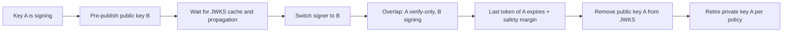

# Key Rotation with an Overlap Window for Unexpired Tokens

## 1. Why Is an Overlap Window Needed?

In the **JWK and Key Management** chapter of the **SPRING_SECURITY_OAUTH2_OIDC_AUTHORIZATION_SERVER** module, we learn how to design, configure, secure, test, and operate an OAuth 2.0/OpenID Connect Authorization Server using Spring Security and Spring Authorization Server in a Spring Boot application.

The Authorization Server uses a private key to sign JWT Access Tokens. The Resource Server receives the token, finds the corresponding public key in the **JSON Web Key Set (JWKS)**, and verifies the signature. An issued JWT can continue to be used until it expires. Therefore, when rotating signing keys, the system must coordinate when it starts signing with the new key and when it stops publishing the old public key.

If you switch the signer to the new key and immediately delete the old public key, unexpired old tokens may be rejected by Resource Servers. If you keep the old key in the JWKS indefinitely, the system retains an obsolete key inside its trusted set.

A scheduled key rotation workflow has four phases:

1. **Generate and pre-publish the new public key** so Resource Servers refresh their JWKS caches.
2. **Switch the signer to the new private key** and begin issuing JWTs with the new key ID.
3. **Retain the old public key in the JWKS** to verify unexpired old tokens.
4. **Remove the old public key** after the last token signed with the old key expires, plus clock skew and distribution/cache safety margins.

The period during which both new and old public keys are published together for verification is called the **overlap window**. During this window, the signer uses only the new key; the old key serves strictly for verification.

After this lesson, you will be able to explain JWK/JWKS/key IDs, design the pre-publish → activate → overlap → retire sequence, calculate when to remove the old key, configure JWK Source in Spring Authorization Server, test old/new tokens, and distinguish scheduled rotation from private key compromise response.

## 2. JWK, JWKS, and Key ID

### 2.1. Private Key Signs, Public Key Verifies

With asymmetric signatures such as RS256 or ES256:

- The Authorization Server keeps the **private key** in a protected environment and uses it to sign JWTs.
- Resource Servers fetch the **public key** from the JWKS to verify signatures.
- Public keys can be published; private keys must never be published.

A public RSA JWK typically has these fields:

| Field | Meaning |
| --- | --- |
| kty | Key type, e.g., RSA. |
| kid | Key ID, identifying the key in the JWK Set. |
| use | Purpose, e.g., sig for signatures. |
| alg | Intended algorithm, e.g., RS256. |
| n, e | Public key components of RSA. |

An RSA private JWK may also contain d, p, q, dp, dq, qi, and other private fields. Those fields **must not appear in the public JWKS**.

### 2.2. Key ID Links Tokens to Keys

A signed JWT typically carries a protected header:

```json
{
  "alg": "RS256",
  "kid": "rsa-signing-2026-11-b",
  "typ": "JWT"
}
```

The Resource Server reads kid to locate the matching JWK in the JWKS and verifies the signature using an allowlisted algorithm. Key ID is a **public identifier**, not a secret and not proof that a token is valid.

Key ID governance rules:

- Each key has a unique ID within the currently published key set.
- Never reuse an ID for another key while old tokens carrying that ID might still be presented.
- Use versioned IDs or sufficiently distinct random values; persist the mapping between IDs and key records.
- Never trust the algorithm or key ID in a token independently; verifiers must enforce an algorithm allowlist and look up keys only from a trusted issuer/JWKS.

### 2.3. JWKS Is the Published Set of Public Keys

Example JWKS with two keys:

```json
{
  "keys": [
    {
      "kty": "RSA",
      "kid": "rsa-signing-2026-11-a",
      "use": "sig",
      "alg": "RS256",
      "n": "<base64url-modulus-a>",
      "e": "AQAB"
    },
    {
      "kty": "RSA",
      "kid": "rsa-signing-2026-11-b",
      "use": "sig",
      "alg": "RS256",
      "n": "<base64url-modulus-b>",
      "e": "AQAB"
    }
  ]
}
```

Two public keys coexist to verify tokens signed at two different times. A proper JWKS endpoint returns only the public representation, never private key material.

In Spring Authorization Server, the default JWK Set Endpoint is typically /oauth2/jwks when a JWKSource bean is present and the endpoint is enabled. Consumers should obtain the endpoint from metadata/issuer configuration instead of hardcoding when the architecture supports discovery.

## 3. Four Phases of a Key Rotation

### 3.1. Key Ring States

| State | Private key | Public key in JWKS | Role |
| --- | --- | --- | --- |
| CANDIDATE | Generated/stored in KMS or HSM | Not yet published or about to pre-publish | Preparing for the next rotation. |
| ACTIVE_SIGNING | Used by signer | Published | Signs new JWTs. |
| VERIFY_ONLY | Removed from signing pool | Still published | Verifies unexpired old tokens. |
| RETIRED | Disabled/deleted per retention policy | Removed from JWKS | No longer used for signing or routine verification. |
| REVOKED/COMPROMISED | Locked or revoked urgently | Removed/marked untrusted per incident plan | Incident response. |

VERIFY_ONLY is the core state of the overlap window: the old private key is no longer used to sign, while the old public key must still be discoverable by Resource Servers.

### 3.2. Timeline



This sequence applies to **scheduled rotation while the old key remains safe**. If a private key is compromised, do not keep it in overlap as a trusted key; see the incident response section.

### 3.3. Phase 1 — Generate New Key and Pre-Publish Public Key

1. Generate a new key pair in a KMS/HSM or approved key management system.
2. Assign a new key ID, algorithm, key type, and explicit signing purpose.
3. Verify the new public key is compatible with Resource Servers.
4. Add the **new public JWK** to the JWKS while the signer continues using the old private key.
5. Wait for JWKS consumers to refresh caches and verify the new key has propagated.

Pre-publishing prevents the server from signing JWTs with a new key ID while Resource Servers still hold a JWKS cache lacking that key.

### 3.4. Phase 2 — Switch Signer to the New Key

Once the new public key has propagated widely:

- Update the key ring so the new private key becomes ACTIVE_SIGNING.
- Authorization Server nodes must transition to the same new key ID per plan.
- Stop using the old private key to sign new tokens.
- Issue a test token and verify the JWT header carries the new key ID.
- Confirm the JWKS still contains both the new key and the old key.

Do not delete the old public key in this step. Tokens already issued with the old key still need verification until expiration.

### 3.5. Phase 3 — Overlap to Verify Unexpired Tokens

```text
JWT signed before switch:
    header.kid = key-A
    verifier finds public key-A in JWKS

JWT signed after switch:
    header.kid = key-B
    verifier finds public key-B in JWKS

JWKS:
    public key-A (VERIFY_ONLY)
    public key-B (ACTIVE_SIGNING)
```

The Authorization Server signs only with B. Resource Servers can still verify token A **if the token is unexpired and passes all other validations**.

### 3.6. Phase 4 — Remove Old Public Key and Retire

After every JWT that could have been signed with A has expired, plus clock skew and safety margin:

1. Remove public key A from the JWKS.
2. Confirm every Authorization Server node publishes the same updated JWKS.
3. Verify Resource Servers have refreshed caches and no longer depend on A.
4. Disable/delete private key A from the signing system per retention policy and audit requirements.
5. Record metadata/audit logs covering key IDs, switch timestamp, and retirement; never log private keys.

## 4. Calculating the Overlap Window

### 4.1. Formula for When to Remove the Old Public Key

Let:

- lastOldSigningTime: the timestamp when **the last node** stopped signing with the old key.
- maxOldTokenLifetime: the largest TTL of any JWT that could be signed with the old key (Access Token, ID Token, and other tokens if sharing the key).
- maxClockSkew: the maximum clock skew tolerated by Resource Servers.
- distributionMargin: safety margin for rollout, caches, network, and operations.

The earliest time to consider removing the old public key:

```text
removeOldPublicKeyAt >=
    lastOldSigningTime
    + maxOldTokenLifetime
    + maxClockSkew
    + distributionMargin
```

This is a **planning formula**, not a substitute for observing real tokens. If tokens were issued with custom TTLs, use the maximum actual exp or the maximum issuable TTL limit, not just a default value in a bean.

### 4.2. Example

| Parameter | Value |
| --- | --- |
| Last node stopped signing with A | 2026-11-16 10:00:00 UTC |
| Maximum allowed JWT TTL | 30 minutes |
| Maximum clock skew | 2 minutes |
| Distribution/operational margin | 5 minutes |

Calculation:

```text
10:00 + 30 minutes + 2 minutes + 5 minutes = 10:37 UTC
```

Do not remove public key A before **10:37 UTC** in this example. If the system has 60-minute TTL tokens, recalculate using at least 60 minutes.

### 4.3. Using Actual exp When Telemetry Is Available

If you have token inventory by key ID and expiration:

```text
latestOldTokenExpiry =
    max(exp of all JWTs that may still be presented, signed by key-A)

removeOldPublicKeyAt >=
    latestOldTokenExpiry + maxClockSkew + distributionMargin
```

The system must track key ID and exp without recording raw tokens. If exact remaining tokens are unknown, use the configured maximum TTL and ensure no issuance path can exceed that cap.

### 4.4. Tokens Without exp or Unbounded TTL

If the system accepts JWTs without exp, or tokens were signed by A with unbounded lifetimes, **you cannot compute a safe finite overlap** from default TTLs alone.

Before scheduled rotation:

- Stop issuing token types lacking expiration.
- Define a policy for handling old tokens without expiry (revocation/denylist or a separate plan).
- Ensure every JWT issuance path enforces exp and a TTL cap.
- Check both ID Tokens and internal JWTs if they share the signing key.

## 5. JWKS Caching and Public Key Distribution

### 5.1. Why Pre-Publish?

Resource Servers typically cache the JWKS to avoid calling the Authorization Server on every request. If a cache still holds the old JWKS when the Authorization Server starts signing with B, Resource Servers may fail to find key ID B.

Some libraries automatically refresh JWKS upon seeing an unknown key ID; others rate-limit refreshes, cache failures, or behave differently. **Do not rely solely on unknown-key-ID refresh** when you can pre-publish the key beforehand.

### 5.2. Calculating the Pre-Publish Duration

Let:

- maxJwksCacheAge: maximum JWKS cache age consumers are allowed to retain.
- propagationDelay: rollout time across CDNs, proxies, network zones, and nodes.
- safetyMargin: operational safety margin.

```text
prePublishDuration >=
    maxJwksCacheAge + propagationDelay + safetyMargin
```

This is a planning threshold. In practice, check Cache-Control headers, each Resource Server's cache configuration, proxies/CDNs, and refresh behavior on unknown key IDs.

### 5.3. Stale Caches Can Persist After Key Removal

Removing A from the JWKS endpoint does not mean every Resource Server immediately forgets A. Caches can continue holding public key A until TTL expiration or manual purge. Therefore:

- Plan caching and retirement timings upfront.
- Maintain a managed cache refresh/purge mechanism when needed.
- Monitor unknown key ID errors, signature validation failures, and JWKS update latency.
- For emergency revocation needs, use token/key ID blocking at Resource Servers or online state checks; removing from JWKS alone does not guarantee instant invalidation.

### 5.4. JWKS Contains Only Public Keys

Verify the response:

- RSA public JWKs have n, e, kid, kty, and appropriate signing metadata.
- EC public JWKs have crv, x, y, kid, kty.
- No d, p, q, dp, dq, qi, private octet keys, or secrets are present.
- Key IDs do not collide across different keys.
- Algorithms and intended uses match verifier configurations.

You do not need to guard the public JWKS with a client secret; publishing public keys is part of the protocol. **Protect the private key**, do not try to hide the public key.

## 6. JWKS Shape Before, During, and After Overlap

### 6.1. Before Switching Keys

JWKS has only A:

```json
{
  "keys": [
    { "kid": "key-A", "kty": "RSA", "use": "sig", "alg": "RS256", "n": "...", "e": "AQAB" }
  ]
}
```

New JWTs carry header key ID A.

### 6.2. Pre-Publish: A Still Signs, B Verifies Only

JWKS has both A and B:

```json
{
  "keys": [
    { "kid": "key-A", "kty": "RSA", "use": "sig", "alg": "RS256", "n": "...", "e": "AQAB" },
    { "kid": "key-B", "kty": "RSA", "use": "sig", "alg": "RS256", "n": "...", "e": "AQAB" }
  ]
}
```

During this phase, new JWTs still carry key ID A. Seeing B in the JWKS **does not mean** the server has begun signing with B.

### 6.3. After Switch: B Signs, A Is Verify-Only

JWKS still holds both public keys, while new tokens have header:

```json
{
  "alg": "RS256",
  "kid": "key-B",
  "typ": "JWT"
}
```

Resource Servers verify old tokens with A and new tokens with B. Private key A has left the signer pool; only public key A remains published.

### 6.4. After Retiring A

JWKS contains only B (and any other active keys):

```json
{
  "keys": [
    { "kid": "key-B", "kty": "RSA", "use": "sig", "alg": "RS256", "n": "...", "e": "AQAB" }
  ]
}
```

A token A presented after A is retired will no longer verify on consumers that have refreshed JWKS. This is expected behavior **only once token A has expired or been handled per revocation plan**.

## 7. Spring Authorization Server: JWKSource and the Active Key

### 7.1. Role of JWKSource

In Spring Authorization Server, the JWKSource bean supplies keys for JWT signing and the JWK Set Endpoint. NimbusJwtEncoder uses the JWK Source to select a key matching the signing algorithm; the JWKS endpoint publishes public representations of available keys.

When multiple keys share the same type and algorithm, the application must ensure **the active key is chosen for signing**, while old/candidate keys are published only for verification. Never simply put all JWKs into a list and assume the signer knows which key is active.

### 7.2. SigningKeyProvider Model

An application-level abstraction can provide:

```java
import java.util.List;
import com.nimbusds.jose.jwk.JWK;
import com.nimbusds.jose.jwk.RSAKey;

public interface SigningKeyProvider {
    RSAKey activeSigningKey();
    List<JWK> additionalPublishedPublicKeys();
}
```

During pre-publish, activeSigningKey returns private/public key A and the additional public keys list contains public-only key B. After switching, activeSigningKey returns private/public key B and the additional list contains public-only key A. Thus JWKS always holds both A and B during overlap, while the signer has only one active private key.

### 7.3. Illustrative JWKSource Configuration

```java
import java.util.ArrayList;
import java.util.List;

import com.nimbusds.jose.jwk.JWK;
import com.nimbusds.jose.jwk.JWKSet;
import com.nimbusds.jose.jwk.source.ImmutableJWKSet;
import com.nimbusds.jose.jwk.source.JWKSource;
import com.nimbusds.jose.proc.SecurityContext;

import org.springframework.context.annotation.Bean;
import org.springframework.context.annotation.Configuration;

@Configuration(proxyBeanMethods = false)
public class SigningKeysConfiguration {

    @Bean
    JWKSource<SecurityContext> jwkSource(SigningKeyProvider keyProvider) {
        List<JWK> publishedKeys = new ArrayList<>();
        publishedKeys.add(keyProvider.activeSigningKey());
        publishedKeys.addAll(keyProvider.additionalPublishedPublicKeys());
        return new ImmutableJWKSet<>(new JWKSet(publishedKeys));
    }
}
```

**This is a wiring example for an already-loaded key ring**, not a complete production KMS/HSM or reload implementation. With default NimbusJwtEncoder and ImmutableJWKSet, when multiple matching JWKs exist, the application must guarantee the encoder picks the right key. One way is setting the active key ID in the JWS header via OAuth2TokenCustomizer<JwtEncodingContext>, then verifying real JWTs carry the right key ID. If using a custom encoder, KMS signer, or another JWKSource, implement explicit active key selection rather than relying on list ordering.

Spring Authorization Server's JWK Set Endpoint must publish only public representations. Inspect actual HTTP responses to guarantee **no private parameters exist**. Never return internal key ring objects directly from a custom controller.

### 7.4. Setting the Active Key ID on the JWT

Example customizer reading from the same active key configuration source:

```java
import org.springframework.context.annotation.Bean;
import org.springframework.security.oauth2.server.authorization.token.JwtEncodingContext;
import org.springframework.security.oauth2.server.authorization.token.OAuth2TokenCustomizer;

@Bean
OAuth2TokenCustomizer<JwtEncodingContext> activeKeyIdCustomizer(
        SigningKeyProvider keyProvider) {
    return context -> context.getJwsHeader()
            .keyId(keyProvider.activeSigningKey().getKeyID());
}
```

This illustrates setting the key ID; it must operate against the same consistent key snapshot as JWKSource. If the key ring changes concurrently between when the customizer reads the ID and when the encoder picks a key, a mismatch can occur. A simple approach is updating the key ring via controlled rolling deployments rather than hot-swapping two independent beans mid-issuance. When dynamic reloading is needed, use an immutable snapshot/version and synchronization so header and signer read the same version.

### 7.5. Representing RSA JWK and KMS/HSM

Example representing an RSA key loaded from a secure key store:

```java
import com.nimbusds.jose.JWSAlgorithm;
import com.nimbusds.jose.jwk.KeyUse;
import com.nimbusds.jose.jwk.RSAKey;
import java.security.interfaces.RSAPrivateKey;
import java.security.interfaces.RSAPublicKey;

RSAKey active = new RSAKey.Builder((RSAPublicKey) publicKeyFromKeyStore)
        .privateKey((RSAPrivateKey) privateKeyFromKeyStore)
        .keyID("rsa-signing-2026-11-b")
        .algorithm(JWSAlgorithm.RS256)
        .keyUse(KeyUse.SIGNATURE)
        .build();

RSAKey oldPublicOnly = oldPrivateJwk.toPublicJWK();
```

This shows JWK representation when the private key can be provided as a key object. With non-exportable KMS/HSM keys, the private key may exist only as a handle/signer abstraction; integration must support signing inside the KMS/HSM instead of exporting private bytes to the application.

### 7.6. ImmutableJWKSet and Reloading

ImmutableJWKSet is suitable for static configurations or startup examples. It does not automatically re-read the key ring when files/databases/KMS change. Production needs controlled dynamic key ring distribution, such as rolling deployments or a custom JWKSource reading a fresh snapshot.

You can use AtomicReference<JWKSet> to swap the entire snapshot atomically after validation. Never mutate a JWK list in place while concurrent requests read a half-old, half-new state.

```java
import java.util.List;
import java.util.concurrent.atomic.AtomicReference;

import com.nimbusds.jose.jwk.JWK;
import com.nimbusds.jose.jwk.JWKSelector;
import com.nimbusds.jose.jwk.JWKSet;
import com.nimbusds.jose.jwk.source.JWKSource;
import com.nimbusds.jose.jwk.source.KeySourceException;
import com.nimbusds.jose.proc.SecurityContext;

public final class RotatingJwkSource implements JWKSource<SecurityContext> {

    private final AtomicReference<JWKSet> current;

    public RotatingJwkSource(JWKSet initial) {
        this.current = new AtomicReference<>(initial);
    }

    @Override
    public List<JWK> get(
            JWKSelector selector,
            SecurityContext context) throws KeySourceException {
        return selector.select(current.get());
    }

    public void replaceSnapshot(JWKSet validatedNextSnapshot) {
        current.set(validatedNextSnapshot);
    }
}
```

Before calling replaceSnapshot, the key manager must validate that there is exactly one active signing key, the active key holds private signing material, verify-only keys hold only public material, key IDs are unique, and the key list matches the pre-publish/overlap/retire stage.

AtomicReference guarantees atomicity within **one process**, not across different nodes. When updating JWKSource and active key ID together, use a consistent version/snapshot or controlled rolling deployments so no request picks an ID from the new snapshot while the signer reads the old snapshot.

## 8. Deploying Key Rotation in a Multi-Node Environment

### 8.1. Preparation

Before rotation day:

1. Inventory every JWT type signed by A: Access Tokens, ID Tokens, and internal tokens if sharing the key.
2. Determine max TTL, max clock skew, JWKS cache max-age, and rollout duration.
3. List all Resource Servers, API gateways, service meshes, batch consumers, and apps caching JWKS.
4. Generate key B in KMS/HSM, assign a new key ID, and verify signing capability.
5. Prepare a rollback plan, per-key-ID metrics, and the operator responsible for triggering steps.

### 8.2. Uniform Pre-Publish

- Publish public key B on the JWKS of every Authorization Server node.
- Keep A as the active signer.
- Verify all nodes return the exact same set of key IDs and public key thumbprints.
- Wait long enough for caching/propagation.
- Confirm consumers can fetch public key B before any B tokens are issued.

Never let one node publish B while another node lacks B if a load balancer can serve JWKS from any node.

### 8.3. Switching the Signer

Roll out the active key change synchronously or in a rolling manner ensuring:

- Every node has both public A and B in JWKS.
- Each node signs with B only after loading private key B.
- Nodes still signing with A are identified and drained/stopped before recording the last A signing timestamp.
- New tokens issued by every node carry key ID B.

During a multi-node rollout, nodes signing with A and nodes signing with B may coexist briefly; this is acceptable **only once public keys A and B are widely published**. Overlap begins from the timestamp when the last node stops signing with A.

### 8.4. Monitoring Overlap

Observe:

- New token share by key ID (never log raw tokens).
- Unknown key ID, signature validation, and issuer mismatch errors.
- Resource Server JWKS fetch/refresh health.
- Whether all Authorization Server nodes agree on the active key.
- Whether any consumer holds a stale JWKS cache longer than expected.

Do not remove A merely because deployment finished. Retire it only after reaching the safe expiry threshold and verifying live metrics.

### 8.5. Removing the Old Key

1. Update the key ring to drop public key A.
2. Sync the new JWKS snapshot to all nodes.
3. Verify JWKS contains only active/still-needed verification keys.
4. Monitor unexpected A-token verification failures; investigate consumers with out-of-policy token TTLs or stale caches.
5. Disable private key A in KMS/HSM and handle retention per policy.

## 9. Checking JWKS and Tokens in Spring Authorization Server

### 9.1. Checking the JWKS Endpoint

In a development environment:

```powershell
curl.exe -i 'https://auth.example.com/oauth2/jwks'
```

Actual addresses should come from metadata/issuer configuration. Inspect the response:

- keys contains the active key ID and old key IDs within overlap.
- Each key ID represents a single public key.
- Zero private key fields exist.
- Cache-Control aligns with pre-publish and retirement strategies.

### 9.2. Checking the Key ID of New Tokens

After switching the signer to B, obtain a test token from a real flow and read its header:

```json
{
  "alg": "RS256",
  "kid": "rsa-signing-2026-11-b",
  "typ": "JWT"
}
```

Do not inspect bean configurations alone. Verify a real JWT carries the expected key ID, then verify its signature using public key B from JWKS. Old tokens carrying key ID A must still verify during overlap.

### 9.3. Resource Servers Should Not Hard-Pin a Single Key ID

Resource Servers typically configure a trusted issuer or JWKS URI and let the decoder select the public key by key ID. If an application hard-pins a fixed public key in code, rotation requires redeploying every consumer; that is a different operational constraint from JWKS discovery.

Example issuer configuration:

```yaml
spring:
  security:
    oauth2:
      resourceserver:
        jwt:
          issuer-uri: https://auth.example.com
```

Issuer validation, audience validation, allowed algorithms, and claim validations must still be configured properly. JWKS rotation only solves public key lookup; it does not replace verifying issuer, audience, expiry, not-before, scopes, or business policies.

### 9.4. Unknown Key ID and Refresh

When a decoder encounters a token whose key ID is absent from cache, the library may refresh JWKS per its built-in rules. Test:

- The new JWKS already contains B before B tokens are issued.
- Consumers can refresh upon seeing B.
- Caches do not suffer a refresh storm if an attacker sends many fake key IDs.
- If the JWKS endpoint temporarily errors, consumers do not skip signature validation.

Never configure a verifier to accept tokens just because JWKS could not be fetched. If a signature cannot be verified, requests must fail safely.

## 10. Rollback During Scheduled Key Rotation

### 10.1. Before Switch

If pre-publishing B causes issues, public B can be removed while A continues signing. Verify no B tokens were issued outside test environments.

### 10.2. After Switch

If B encounters signing errors or consumer incompatibilities after issuing tokens:

- You may switch the signer back to A **only if private key A remains secure and permitted for use**.
- Retain public key B in JWKS for already-issued unexpired B tokens.
- Retain public key A to verify A tokens.
- Record the last timestamp any node signed with B before retiring B.
- After resolving issues, execute a new switch with clear pre-publish/overlap.

Rollback does not mean deleting the public key of the key just tried. Tokens already signed with B may still be in use by consumers.

### 10.3. When Rollback Is Forbidden

If A's private key is exposed or shows signs of compromise, never roll back to signing with A. That is a compromise incident, not a routine rollback. Execute incident response and decide on blocking A tokens based on risk.

## 11. Emergency Rotation When a Private Key Is Compromised

### 11.1. Routine Overlap Is Unsuitable for Compromised Keys

In scheduled rotation, A remains trustworthy so public key A stays published to verify unexpired tokens. When private key A is leaked, an attacker can sign fresh JWTs carrying key ID A; leaving public key A in JWKS causes verifiers to continue trusting signatures forged by the attacker.

Therefore, do not mechanically apply normal overlap:

1. Stop signing with A and isolate/disable private key A in KMS/HSM.
2. Activate clean key B and publish public key B.
3. Evaluate **removing A from trust immediately**, even if some legitimate pre-incident A tokens remain unexpired.
4. Coordinate Resource Servers to purge caches/block key ID A or check online token state.
5. Consider revoking/denylisting tokens, reducing TTLs, rotating related credentials, and investigating impact scope.

### 11.2. Removing from JWKS Does Not Mean Instant Revocation

Resource Servers caching public key A can continue verifying JWTs signed with A until caches expire or are purged. If immediate blocking is needed, you may need to:

- Emit an emergency event instructing Resource Servers to reject key ID A.
- Purge JWKS caches or refresh verifiers via operational tooling.
- Use introspection/denylists or online token status if supported by the architecture.
- Invalidate affected tokens/sessions and investigate attacker-signed tokens.

No endpoint key-removal action guarantees offline consumers immediately stop trusting a key if they still hold the public key in memory.

### 11.3. Trade-Off When Blocking Old Tokens

Upon emergency removal of A, legitimate pre-incident tokens may also be rejected. This causes service disruption or forces users/clients to obtain fresh tokens. That is a security trade-off decided by compromise severity; never keep trusting an exposed private key merely for compatibility.

## 12. Testing Rotation and Overlap

| Phase | Test | Expectation |
| --- | --- | --- |
| Baseline | Issue token with A, verify with current JWKS. | Succeeds, key ID A. |
| Pre-publish | Publish B without switching signer. | JWKS has A and B; new tokens still carry key ID A. |
| Pre-publish | Resource Server refreshes JWKS. | Public B available before B tokens are issued. |
| Switch | Issue token after activation. | New JWT carries key ID B. |
| Overlap | Verify unexpired token A. | Succeeds with public A. |
| Overlap | Verify new token B. | Succeeds with public B. |
| Private-key exposure | Fetch JWKS endpoint. | Zero RSA/EC/octet private parameters. |
| Retire | Remove A after expiry + skew + margin. | Token B remains valid; token A fails on refreshed consumers. |
| Unknown key ID | Send token with nonexistent ID. | Rejected; signature validation not skipped. |
| Cache | Consumer still holds stale JWKS during pre-publish. | Do not switch before cache/distribution window satisfies requirement. |
| Multi-node | Issue tokens through every node after switch. | All new tokens use key ID B. |
| Rolling deploy | Last node still signing with A is drained. | Last A signing timestamp recorded only after this point. |
| Rollback | Switch back to A after B issued tokens. | JWKS keeps both A and B; both token sets verify. |
| Emergency | Key A compromised, consumers instructed to deny key ID A. | Token A blocked per incident policy even if unexpired. |
| TTL boundary | Token A has maximum allowed TTL. | A is not retired before exp + skew + margin. |
| Clock skew | Resource Server tolerates maximum skew. | Retire deadline includes full skew. |

### 12.1. Checking Header and Signature

Integration tests should verify:

1. The new JWT header carries the right key ID.
2. The JWT signature verifies with the public JWK matching that key ID.
3. Old tokens continue verifying during overlap.
4. Expired tokens are still rejected even while the old public key remains in JWKS.
5. Tokens with wrong issuer/audience/scope are still rejected despite a valid signature.

Do not merely decode the header and declare rotation successful; perform actual signature verification.

### 12.2. Time-Based Testing with Clock

```text
lastOldSigningTime = 10:00
maxOldTokenLifetime = 30m
maxClockSkew = 2m
distributionMargin = 5m

10:36 -> not ready to retire yet
10:37 -> planned threshold reached, still confirm rollout/cache
```

Also test the case where the last token was signed on a lagging node; the deadline must shift according to **the latest A signature**, not when the first node switched.

## 13. Common Operational Pitfalls

| Symptom | Possible cause | Resolution |
| --- | --- | --- |
| New tokens get unknown key ID | Started signing B before public B was distributed/cached. | Pre-publish, wait for cache/propagation, verify JWKS from consumers. |
| Old tokens fail signatures right after deploy | Removed A too early or one node failed to publish A. | Restore public A if uncompromised; recalculate overlap. |
| Some nodes sign A, others sign B longer than expected | Out-of-sync key ring/rollout. | Inventory every node, drain stale nodes, update last A signing time. |
| JWKS endpoint has private fields | Exposed private JWK via custom endpoint or skipped public projection. | Shut down faulty endpoint, assess key leak, publish public JWKs only. |
| Duplicate key ID with different public keys | Reused ID or broken key inventory. | Assign a new ID, clear caches and trust state. |
| New tokens still signed with A | Signer picked wrong key due to ordering/selector/config. | Inspect key selection, active key, and actual token headers. |
| Resource Server fails to refresh JWKS | Cache policy or library refresh differs from expectations. | Check cache headers, decoder, and refresh strategy. |
| Token A remains valid after retirement | Actual TTL longer than planned or another token type also uses A. | Identify all token types, expiries, and key IDs; never skip validation. |
| New tokens fail verification after restart | Demo generated random keys on every startup. | Use durable key store/KMS/HSM and consistent JWKS. |
| API still accepts compromised token | Consumer still caches A or lacks denylist/key ID block. | Run incident response, purge caches, and block key ID A. |

## 14. Protecting Private Keys and Lifecycle Governance

### 14.1. KMS/HSM and Access Permissions

In production:

- Prefer non-exportable private keys in an HSM/KMS if architecture permits.
- Only the Authorization Server's service identity has permission to sign with the active key.
- Separate permissions to create keys, approve activation, sign, and retire.
- Audit who creates, activates, transitions, and disables keys.
- Encrypt backups and restrict who can restore private keys.
- Verify backup/DR never unexpectedly returns an old key to the signer pool.

### 14.2. Algorithms and Key Strength

Choose algorithms supported by the consumer ecosystem and permitted by organizational policy. RS256 uses RSA; ES256 uses elliptic curve P-256. Changing algorithms (e.g., RS256 to ES256) is an **algorithm migration** beyond rotating keys within the same algorithm; test decoder, KMS, and client library compatibility separately.

Verifiers need an algorithm allowlist. Never treat the algorithm in a JWT header as an unrestricted directive to try every algorithm or switch between HMAC and RSA. Never accept none for signed Access Tokens.

### 14.3. Scheduling Rotation

Rotation cadence depends on policy requirements, token lifetimes, Resource Server pre-publish/refresh capabilities, KMS/HSM protection levels, approval workflows, and audit requirements. No single day count fits every system. What matters is that rotation can be rehearsed, measured, and safely rolled back.

### 14.4. Minimum Audit Record

| Audit field | Example |
| --- | --- |
| Old/new key ID | key-A → key-B |
| Key fingerprint/thumbprint | Verified public key identifier |
| Creation/pre-publish timestamp | UTC timestamp |
| Activation timestamp | UTC timestamp |
| Last node stopped signing old key | UTC timestamp |
| Max TTL used for overlap calculation | Duration |
| Clock skew and cache margin | Duration/config version |
| Old public key removal timestamp | UTC timestamp |
| Approving person/system | Identity/audit reference |
| Test verification results | Test run/reference |

Never record private keys, secrets, or tokens in audit records.

## 15. Hands-On Exercises and Checklist

### Exercise 1 — Calculating Overlap

Key A was used for signing until 14:00 UTC. Access Token max TTL is 20 minutes, ID Token max TTL is 15 minutes, clock skew is 90 seconds, and distribution margin is 4 minutes. Calculate the earliest time to consider removing public key A. Explain why you must use the largest TTL of all JWTs signed with A.

### Exercise 2 — Pre-Publishing Before Switch

Simulate a JWKS with A active. Add public B without switching the signer. Issue a new token and verify key ID is still A. Then switch the signer to B, issue a new token, and verify key ID B, while old token A continues verifying.

### Exercise 3 — JWKS Caching

Simulate a Resource Server caching the old JWKS. Attempt signing with B before pre-publishing and observe the failure. Then pre-publish B, wait for cache refresh, switch the signer, and compare outcomes.

### Exercise 4 — Multiple Nodes

Deploy two Authorization Server nodes. Switch one node's signer before the other; confirm both JWKS endpoints carry A/B and determine when the last node stopped signing A. Design snapshot synchronization so no node signs with an unpublished key.

### Exercise 5 — Compromised Key

Assume private key A is exposed during overlap. Plan stopping signing, rotating to B, removing A, purging caches or denying key ID A, handling unexpired tokens, and communicating consumer impact. Distinguish this from routine rotation.

### Exercise 6 — Key Selection in Spring

Use JWKSource with an active private key and public-only verification keys. Write an integration test proving NimbusJwtEncoder selects the active key ID, the JWK Set Endpoint returns only public keys, and tokens signed with the old key still verify during overlap.

### Completion Checklist

- [ ] Distinguished private signing keys, public verification keys, JWK, JWKS, and key IDs.
- [ ] Understood old JWTs still require the old public key until expiration.
- [ ] Pre-published the new public key before starting to sign with it.
- [ ] After switch, only the new private key is used for signing; the old private key left the signer pool.
- [ ] Retained the old public key throughout the overlap window.
- [ ] Computed retirement deadline from last old signing timestamp, max TTL, clock skew, and distribution margin.
- [ ] Verified JWKS caching/refresh across all Resource Servers.
- [ ] Configured Spring Authorization Server so the active key is selected properly and JWKS publishes only public keys.
- [ ] Synchronized key ring, issuer, and JWKS across all nodes.
- [ ] Distinguished routine rollback from private key compromise incidents.
- [ ] Tested key ID, signature, expiry, unknown key, cache, overlap, and retirement.
- [ ] Protected private keys with KMS/HSM, auditing, and retirement procedures.

## 16. References

- [RFC 7517 — JSON Web Key (JWK)](https://www.rfc-editor.org/rfc/rfc7517) — JWK/JWKS format and public/private key parameters.
- [RFC 7515 — JSON Web Signature (JWS)](https://www.rfc-editor.org/rfc/rfc7515) — JWT/JWS signatures and protected headers.
- [RFC 7519 — JSON Web Token (JWT)](https://www.rfc-editor.org/rfc/rfc7519) — token claims and lifetimes.
- [RFC 7518 — JSON Web Algorithms (JWA)](https://www.rfc-editor.org/rfc/rfc7518) — signature algorithms and key types.
- [RFC 8725 — JSON Web Token Best Current Practices](https://www.rfc-editor.org/rfc/rfc8725) — algorithm verification, key use, and secure JWT practices.
- [RFC 9068 — JWT Profile for OAuth 2.0 Access Tokens](https://www.rfc-editor.org/rfc/rfc9068) — JWT Access Token profile.
- [Spring Authorization Server Reference](https://docs.spring.io/spring-authorization-server/reference/) — token generation, JWK Source, and protocol endpoints.
- [Spring Authorization Server — Core Model Components](https://docs.spring.io/spring-authorization-server/reference/core-model-components.html) — token issuance components and configuration.
- [Spring Security — OAuth2 Resource Server JWT](https://docs.spring.io/spring-security/reference/servlet/oauth2/resource-server/jwt.html) — JWT decoder, JWKS, and token verification.
- [Nimbus JOSE + JWT](https://connect2id.com/products/nimbus-jose-jwt) — JWK, JWKSet, JWKSource, and JWT signing/verification.

**Core takeaway:** Safe key rotation requires **publishing the new public key before using it**, switching the signer to the new private key, retaining the old public key to verify unexpired tokens, and retiring the old key only after the last old signing timestamp plus max TTL, clock skew, and distribution/cache margin. Spring Authorization Server provides JWK Source and token generation primitives; the application must manage the key ring, JWKS caches, multi-node synchronization, and emergency procedures for private key compromise.
