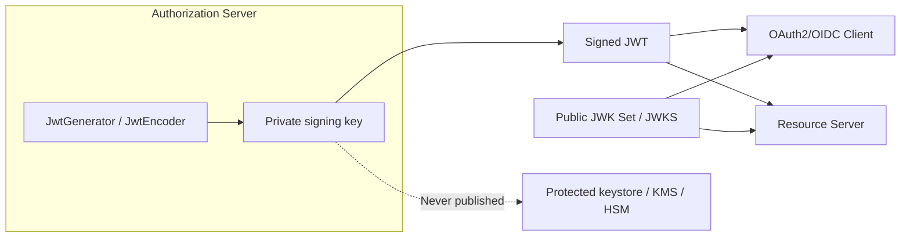
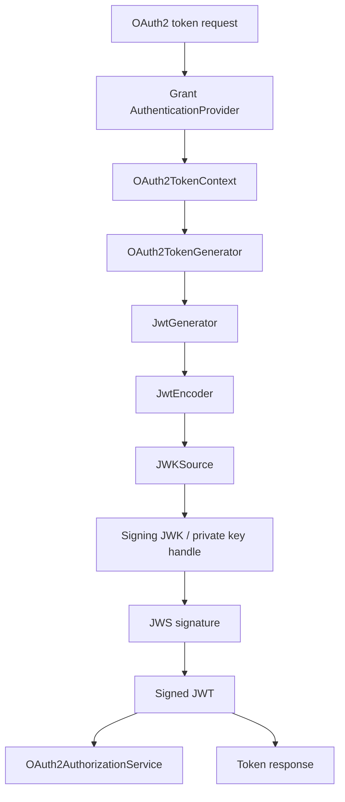
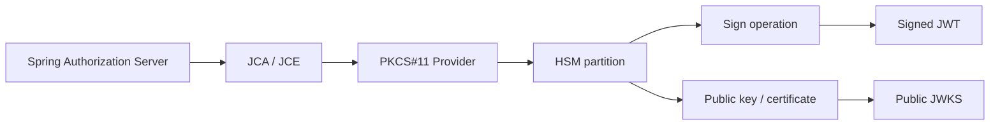
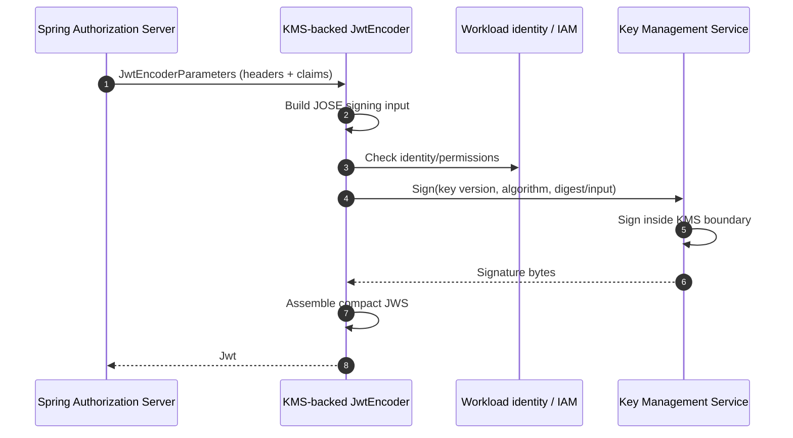
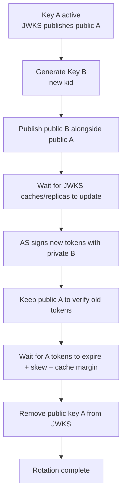
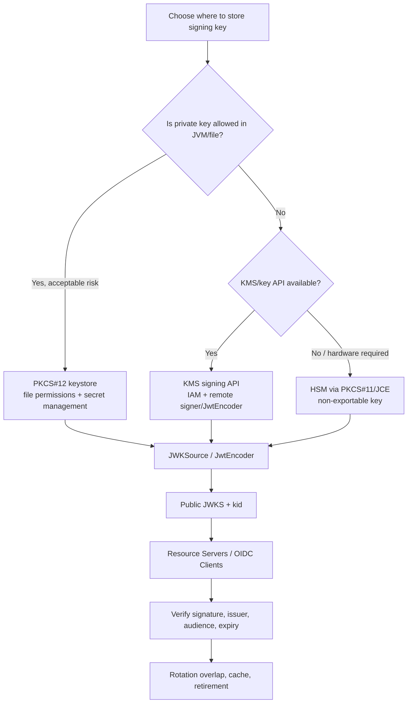

# Integrating Keystore, KMS, or HSM Based on Deployment Requirements

## 1. Objectives and Context

In the **JWK and Key Management** chapter of the **SPRING_SECURITY_OAUTH2_OIDC_AUTHORIZATION_SERVER** module, signing keys are the core security asset of an Authorization Server. With **Spring Security**, **Spring Authorization Server (SAS)**, and **Spring Boot**, the application must choose how to hold and use private keys according to the deployment environment: a Java keystore, a centralized Key Management Service (KMS), or a Hardware Security Module (HSM).

A signing key's lifecycle includes creation, storage, usage authorization, public key publication, rotation, revocation, backup/recovery, and incident handling. If a private key leaks, an attacker can mint JWTs carrying forged issuer, subject, audience, and scopes. If rotation is done improperly, Resource Servers may reject valid tokens or continue trusting a revoked key.

After this lesson, you will be able to:

- Distinguish Java KeyStore, KMS, and HSM, selecting a solution based on threat model and operational requirements.
- Understand how SAS uses `JWKSource<SecurityContext>`, `NimbusJwtEncoder`, and the JWK Set Endpoint.
- Load RSA keys from PKCS#12, validate certificates/key pairs, and build appropriate JWKs.
- Integrate an HSM via PKCS#11 or a KMS via a remote signing adapter without exporting private keys.
- Manage `kid`, `alg`, `use`, `key_ops`, JWKS caching, and overlap windows during rotation.
- Test signatures, JWKS, key mismatches, key outages, and key access permissions.
- Design access controls, auditing, backups, disaster recovery, and key-compromise response procedures.

**Version scope:** Examples target **Spring Authorization Server 1.x / Spring Security 6.x / Spring Boot 3.x**, Nimbus JOSE JWT, and modern Java. Specific APIs depend on dependency versions, Java providers, and KMS/HSM vendors. PKCS#12 examples use RSA/RS256; production must choose algorithms per internal standards and the capabilities of all Resource Servers/clients.

## 2. Why Does an Authorization Server Need Dedicated Key Management?

When SAS issues a JWT access token or OIDC ID Token, it signs the JWT with a **private signing key**. Resource Servers and OIDC clients fetch the **public key** from the JWKS to verify the signature. Public keys can be published; private keys must be used only by authorized signing components.



If an attacker obtains the private signing key, they can craft tokens with arbitrary claims and sign them just like the real AS. Resource Servers checking only the signature will trust forged tokens as long as they still trust the corresponding public key.

Five properties must be protected:

- **Confidentiality:** private keys cannot be read/exported by unauthorized humans or processes.
- **Integrity:** keys, certificates, or `kid` mappings cannot be altered without authorization.
- **Availability:** the AS can still sign tokens under anticipated failure modes and has recovery plans.
- **Authenticity:** Resource Servers fetch public keys from the right trusted issuer/JWKS.
- **Lifecycle:** rotation does not unexpectedly break unexpired tokens and does not leave old keys signing indefinitely.

## 3. Choosing Keystore, KMS, or HSM?

These three concepts are related but not synonymous:

- **Keystore** is a storage container/interface for keys and certificates. PKCS#12 is the common format; JKS is an older Java format. The file is usually password-encrypted, yet once the application loads the private key, the key can reside in JVM memory.
- **KMS (Key Management Service)** manages keys centrally via APIs, policies, and auditing. Depending on the service, private keys may be non-exportable; the application calls APIs to sign or uses a JCA provider integration.
- **HSM (Hardware Security Module)** performs cryptographic operations inside dedicated security hardware. Private keys can be generated and kept inside hardware, never leaving the HSM boundary. Applications usually access it via PKCS#11, a JCE provider, or a vendor SDK.

| Criterion | PKCS#12/JKS keystore | KMS | HSM |
| --- | --- | --- | --- |
| Storage | Protected file or volume | Centralized managed service | Dedicated hardware or cluster |
| Private key | Usually exportable with permissions/password | May be non-exportable depending on key type | Usually non-exportable by policy |
| Signing tokens | JCA key object in JVM | Remote signing API or JCA integration | PKCS#11/JCE or vendor integration |
| Access control | File permissions, OS identity, password | IAM/workload identity and key policy | HSM roles, partitions, PIN, client identity |
| Auditing | OS/app logs, typically limited | Usually audits API operations | Per device/cluster capabilities |
| Complexity | Low to medium | Medium, depends on provider | Higher; requires HA, backup/restore, and device administration |
| Signing latency | Typically low | Includes network latency | Depends on device/provider/connectivity |
| Best suited for | Labs, small systems, well-controlled file environments | Cloud/microservices needing central policy | High compliance or hardware key-custody requirements |

**How to choose:**

- Use **PKCS#12** for local/dev or systems with clear file protection, access controls, and rotation processes.
- Use **KMS** when centralized governance, auditing, workload-based authorization, and remote signing are needed.
- Use **HSM** when key custody, non-exportability, dedicated hardware, or strict compliance standards require it.
- You can combine KMS with an HSM-backed key store.

Do not pick an HSM merely because it sounds "more secure" without preparing HA, backup/restore, monitoring, and incident handling. A misconfigured or poorly operated HSM can still cause outages or be abused via application credentials.

## 4. JWT Signing Flow in Spring Authorization Server

SAS uses abstractions to decouple token issuance from where private keys live:



| Component | Role |
| --- | --- |
| `OAuth2TokenGenerator<?>` | Generates access tokens, refresh tokens, or related tokens by grant and token context. |
| `JwtGenerator` | Generates JWTs when token format and token type require JWT. |
| `JwtEncoder` | Encodes claims and signs JWTs. |
| `NimbusJwtEncoder` | Common `JwtEncoder` implementation using Nimbus JOSE and a JWK source. |
| `JWKSource<SecurityContext>` | Supplies matching JWKs for signing or retrieving the JWK Set. |
| `JWKSetEndpointFilter` | Serves the public JWK Set at the AS-configured JWKS endpoint. |
| `AuthorizationServerSettings` | Configures issuer and endpoint paths, including the JWK Set endpoint. |

SAS does not need to know whether the private key lives in a file, HSM, or KMS API as long as the `JwtEncoder`/JWK integration fulfills the contract. This boundary lets you swap key backends without rewriting grant providers.

### 4.1. JWK Is the Key Representation

An RSA JWK may contain:

| Field | Meaning | Publish in public JWKS? |
| --- | --- | --- |
| `kty` | Key type, e.g., `RSA` | Yes |
| `kid` | Key identifier | Yes |
| `use` | Purpose, e.g., `sig` | Yes |
| `alg` | Intended algorithm, e.g., `RS256` | Yes |
| `n`, `e` | RSA modulus and public exponent | Yes |
| `d` | Private exponent | **No** |
| `p`, `q`, `dp`, `dq`, `qi` | RSA private parameters | **No** |
| `key_ops` | Permitted operations | Publishable per policy |

The public JWK Set contains only public key material. Never return `d`, `p`, `q`, or private parameters via the JWKS endpoint. For EC JWKs, never publish private scalar `d`; for symmetric JWKs, never publish secret `k`.

### 4.2. `kid`, `alg`, `use`, and `key_ops`

- `kid` identifies a specific key so Resource Servers select the right public key. It should be unique within the JWKS and stable across the key's lifetime.
- `alg` indicates the signing algorithm, e.g., `RS256` or `ES256`.
- `use=sig` indicates the key is used for signatures.
- `key_ops` can constrain operations such as `sign` or `verify`.

Never reuse the same `kid` for a different key. If the public key changes while `kid` stays identical, JWKS caches may keep using the old key. Never let clients pick `alg` arbitrarily; both the AS and Resource Servers must enforce an algorithm allowlist.

## 5. Using a PKCS#12 Keystore in Simple Environments

PKCS#12 is suitable for labs or small deployments where the organization can protect files, passwords, and access permissions. The file can hold both the private key and its corresponding certificate.

### 5.1. Creating a Keystore for Test Environments

You can generate an RSA key pair and self-signed certificate locally with `keytool`:

```bash
keytool -genkeypair \
  -alias as-signing-2026 \
  -keyalg RSA \
  -keysize 3072 \
  -sigalg SHA256withRSA \
  -validity 365 \
  -storetype PKCS12 \
  -keystore as-signing-dev.p12 \
  -dname "CN=Local Authorization Server Signing Key"
```

This command is only for creating fixture/dev keys. The self-signed certificate holds the public key, yet **it does not by itself prove** to a Resource Server that the issuer is trusted. Resource Servers must still fetch JWKS from a configured HTTPS issuer and validate tokens per the trust model.

Never put keystore files or passwords in Git. Production should provision keys via a proper key management process and store them in least-privilege volumes/secret stores.

### 5.2. Externalized Application Configuration

Example application properties:

```yaml
security:
  signing:
    keystore:
      location: file:/run/secrets/as-signing.p12
      type: PKCS12
      alias: as-signing-2026
      store-password: ${AS_KEYSTORE_PASSWORD}
      key-password: ${AS_SIGNING_KEY_PASSWORD}
      kid: as-rsa-2026-01
      algorithm: RS256
```

This is an illustrative configuration bound by the application; issuer and endpoint settings are configured separately according to your AS version/setup. Never put plaintext passwords in committed files. Secrets should come from a secret manager, mounted secrets, or managed environment variables.

### 5.3. Loading Private Key and Certificate

Illustrative example for an RSA private key in PKCS#12. Imports are omitted to focus on key handling:

```java
@Configuration(proxyBeanMethods = false)
public class Pkcs12JwkConfiguration {

    @Bean
    JWKSource<SecurityContext> jwkSource(
            @Value("${security.signing.keystore.location}")
            Resource keyStoreResource,
            @Value("${security.signing.keystore.store-password}")
            String storePassword,
            @Value("${security.signing.keystore.key-password}")
            String keyPassword,
            @Value("${security.signing.keystore.alias}")
            String alias,
            @Value("${security.signing.keystore.kid}")
            String kid) throws Exception {

        KeyStore keyStore = KeyStore.getInstance("PKCS12");

        try (InputStream input = keyStoreResource.getInputStream()) {
            keyStore.load(input, storePassword.toCharArray());
        }

        Key key = keyStore.getKey(alias, keyPassword.toCharArray());
        Certificate certificate = keyStore.getCertificate(alias);

        if (!(key instanceof RSAPrivateKey privateKey)) {
            throw new IllegalStateException(
                    "Configured alias does not contain an RSA private key");
        }

        if (!(certificate instanceof X509Certificate x509)) {
            throw new IllegalStateException(
                    "Configured alias does not contain an X.509 certificate");
        }

        x509.checkValidity();

        if (!(x509.getPublicKey() instanceof RSAPublicKey publicKey)) {
            throw new IllegalStateException(
                    "Certificate does not contain an RSA public key");
        }

        if (!privateKey.getModulus().equals(publicKey.getModulus())) {
            throw new IllegalStateException(
                    "Private key does not match certificate public key");
        }

        if (publicKey.getModulus().bitLength() < 2048) {
            throw new IllegalStateException(
                    "RSA signing key is below the configured minimum size");
        }

        boolean[] keyUsage = x509.getKeyUsage();
        if (keyUsage != null && keyUsage.length > 0
                && !keyUsage[0]) {
            throw new IllegalStateException(
                    "Certificate does not permit digital signatures");
        }

        RSAKey signingJwk = new RSAKey.Builder(publicKey)
                .privateKey(privateKey)
                .keyID(kid)
                .algorithm(JWSAlgorithm.RS256)
                .keyUse(KeyUse.SIGNATURE)
                .build();

        JWKSet jwkSet = new JWKSet(signingJwk);
        return (selector, context) -> selector.select(jwkSet);
    }

    @Bean
    JwtEncoder jwtEncoder(JWKSource<SecurityContext> jwkSource) {
        return new NimbusJwtEncoder(jwkSource);
    }
}
```

**What this code validates:**

- The alias holds an RSA private key and an X.509 certificate.
- The certificate is within its validity window.
- The public key in the certificate matches the private key's modulus.
- The RSA key meets the configured minimum size.
- If the certificate includes a Key Usage extension, the `digitalSignature` bit permits signing.
- The JWK has a stable `kid`, `alg=RS256`, and `use=sig`.

The example uses RSA for key pair verification. For EC or other algorithms, validate the key pair per that algorithm and choose the corresponding JWK builder and JOSE algorithm.

### 5.4. Security Limitations of Keystores

After calling `keyStore.getKey(...)`, the private key can be loaded into JVM memory as a JCA key object. Encrypting the keystore file **does not** mean the private key stays outside the process.

- Restrict OS identities permitted to read the file.
- Use minimal file permissions, filesystem encryption, and secure secret delivery.
- Never place passwords on command lines, in logs, in source code, or in exception messages.
- Never mount the keystore into containers that do not need to sign tokens.
- Restrict heap dumps and sensitive debug logging in production.
- Build a rotation workflow instead of overwriting the file in place without changing `kid`.
- Use KMS/HSM if policy requires private keys never to be exportable from the process/hardware boundary.

**Do not reuse a TLS server private key as a JWT signing key out of habit.** TLS keys and JWT signing keys have different purposes, rotation cadences, access scopes, and compromise impacts; keep them separate.

## 6. Connecting JWKSource with Spring Authorization Server

`JWKSource<SecurityContext>` is the abstraction SAS/Nimbus uses to locate matching JWKs for signing and to serve the public key set. In the keystore example, the `jwkSource` bean returns the loaded JWK.

```java
@Bean
JwtEncoder jwtEncoder(
        JWKSource<SecurityContext> jwkSource) {
    return new NimbusJwtEncoder(jwkSource);
}
```

If the application configures `OAuth2TokenGenerator<?>` itself, `JwtGenerator` uses this `JwtEncoder` to sign JWTs. In many SAS setups, the framework creates the token generator or the application registers one as needed; **do not add an extra generator bean merely because you switched keystores** if the default generator is working.

### 6.1. Configuring the JWK Set Endpoint

In `AuthorizationServerSettings`, the JWKS endpoint is typically configured at `/oauth2/jwks`:

```java
@Bean
AuthorizationServerSettings authorizationServerSettings() {
    return AuthorizationServerSettings.builder()
            .issuer("https://auth.example.com")
            .jwkSetEndpoint("/oauth2/jwks")
            .build();
}
```

SAS publishes the public portion of JWKs via the JWK Set Endpoint. Test the live response and ensure zero private parameters appear. Never write a custom controller that serializes a `JWKSet` containing private keys.

Example public JWKS response:

```json
{
  "keys": [
    {
      "kty": "RSA",
      "kid": "as-rsa-2026-01",
      "use": "sig",
      "alg": "RS256",
      "n": "<BASE64URL_MODULUS>",
      "e": "AQAB"
    }
  ]
}
```

Neither `d`, `p`, `q`, `dp`, `dq`, nor `qi` appears. Clients need only the public key to verify.

### 6.2. Separating Signing Source and Public Source When Needed

An advanced design can separate:

- **Signing key source:** returns only the active key with private signing capability.
- **Verification/public key source:** holds current and recently retired public keys so Resource Servers can verify unexpired tokens.

If sharing a single `JWKSource`, ensure the signing selector picks **exactly one matching private key** by `kid`/`alg`; the JWK Set Endpoint publishes only public components. Never allow multiple private signing keys to match a selector lacking an explicit `kid`, as Nimbus encoder may fail to resolve a unique key.

## 7. Integrating an HSM via PKCS#11

### 7.1. Model

The HSM keeps private keys inside the device; the application receives a provider-supplied key handle/object. Signing executes via a PKCS#11/JCA provider without exporting private keys to files.



### 7.2. Configuring the Provider

On modern Java, you can configure a PKCS#11 provider per vendor instructions. Illustrative example:

```java
Provider baseProvider = Security.getProvider("SunPKCS11");
Provider pkcs11Provider =
        baseProvider.configure("/etc/security/pkcs11.cfg");

Security.addProvider(pkcs11Provider);

KeyStore hsmKeyStore =
        KeyStore.getInstance("PKCS11", pkcs11Provider);

// Retrieve PIN from secret manager or HSM login mechanism.
// Never hardcode and never log.
hsmKeyStore.load(null, hsmPin);
```

This is a skeleton; the `pkcs11.cfg` file, provider name, slot/token, PIN callback, and alias depend on OS, HSM vendor, Java runtime, and PKCS#11 library. Some providers require dedicated login/session configuration.

Once loaded, the application retrieves the private key handle and certificate/public key by alias. If the provider returns a non-exportable key object, do not call `getEncoded()` expecting private key bytes; the HSM may deny export, and that is a protective feature.

### 7.3. Using Key Handles with JCA/Nimbus

If the HSM provider returns a JCA-compatible private key object supporting the needed algorithm, a Nimbus/JCA signer can execute signatures via that provider. Verify:

- The key object supports `Signature.initSign(privateKey)` with the intended provider.
- The JOSE algorithm, e.g., RS256, is supported by the provider/HSM.
- `kid` in the JWT matches the published public JWK.
- The certificate/public key matches the private key handle.
- Threading/session behavior of the HSM provider handles concurrent signing throughput.
- PIN/session lifecycles and reconnects are managed safely.

If the default Nimbus encoder is not directly compatible with the key handle/provider, build a signer adapter or custom `JwtEncoder`. Never cast keys arbitrarily to `RSAPrivateKey` if the vendor object does not implement that interface.

### 7.4. HSM HA and Backups

An HSM does not guarantee high availability by itself. Production designs need:

- Redundant clusters/partitions and failover routing when a node drops.
- Vendor-supported key backup/restore workflows, with quorum/dual control if required.
- Failover testing without exposing private keys.
- Monitoring for session exhaustion, PIN errors, latency, and signing quotas.
- Recovery procedures for lost devices/partitions.
- Verification that public JWKS still reflects restored key pairs.

If a private signing key is lost without a valid backup, the AS may be unable to sign new tokens. If public keys/JWKS fall out of sync, Resource Servers may reject unexpired tokens.

## 8. Integrating KMS via Remote Signing API

### 8.1. Model

A KMS typically allows authorized workloads to invoke a `Sign` operation on a specific key/version. The private key never needs to leave the service; the AS sends the signing input or digest per the KMS contract and receives signature bytes.



### 8.2. Two Integration Patterns

| Pattern | How it works | When suitable |
| --- | --- | --- |
| KMS via JCA/PKCS#11 provider | KMS/HSM is mapped as a JCA provider and key handle; Nimbus uses signer/JCA | Provider supports standard JCA and desired algorithms |
| KMS via remote signing API | Adapter calls KMS SDK/API; integrated via custom signer or custom `JwtEncoder` | KMS does not expose a JCA-compatible private key object |

**Important note:** Standard `NimbusJwtEncoder` expects `JWKSource` to supply key material/handles compatible with its signer. A remote KMS key that has only an ID/version and a `sign` API **does not automatically become an in-JVM `PrivateKey`**. In that case, use an appropriate provider/adapter or implement a custom `JwtEncoder`—never fabricate a fake private key.

### 8.3. Contract of a KMS Signing Adapter

An application interface can model the signing operation:

```java
public interface RemoteSigningService {

    byte[] sign(
            String keyVersion,
            String algorithm,
            byte[] signingInput);
}
```

`RemoteSigningService` is an application-defined interface. A custom encoder must:

1. Construct the JWS header with allowlisted `alg` and `kid`.
2. Serialize header and claims per JOSE/JWT standards.
3. Build the signing input as `BASE64URL(header).BASE64URL(payload)`.
4. Call the KMS with the right key version and algorithm, obeying whether the API expects raw signing input or a precomputed digest.
5. Convert the signature into the proper JWS encoding.
6. Assemble the compact JWS and return `Jwt` with signed headers/claims.
7. Handle timeouts, retries, disabled keys, and KMS errors safely.

This is a **design contract**, not a complete `JwtEncoder`. Hand-rolling JWT serialization or signing bytes can fail if the wrong hash mode, double-hashing, or incorrect signature conversion is used.

### 8.4. Notes on ECDSA

Some KMS providers return ECDSA signatures in ASN.1 DER format (`SEQUENCE(r,s)`), whereas JWS requires raw fixed-width `R || S`. The adapter must convert to the exact curve byte length and handle leading zeros. For RSA, signature bytes are usually used directly per the corresponding JOSE algorithm, though you must still verify the KMS uses the exact padding/hash.

Do not merely test that KMS returns HTTP 200. Sign real JWTs, verify the compact JWS with the corresponding public JWK, and run validation from real Resource Servers/clients.

### 8.5. Least-Privilege IAM Permissions

The AS workload typically needs only:

- **Sign** permission on authorized keys/versions.
- Permission to read public keys/metadata needed to publish JWKS.
- Access to secrets/configs required for connectivity.

Never grant default permissions to create/delete keys, alter policies, export private keys, administer the entire KMS project, or decrypt application data to the JWT signing process. Separate **runtime signer** permissions from **key administrator** permissions; prefer workload identity over static credentials when supported by the platform.

## 9. JWK Set Management and Public Key Publication

### 9.1. Publishing Public Keys Properly

Resource Servers typically discover the JWKS via Authorization Server metadata or direct `jwk-set-uri` configuration. The JWK Set must include the public keys needed to verify still-valid tokens.

A public key entry should carry `kid`, `kty`, `alg`, and `use`/`key_ops` per profile. For RSA, `n` and `e` are the public parameters.

**Never**:

- Return full private-key JWKs in the JWKS.
- Allow the JWKS endpoint to pick arbitrary aliases via query parameters.
- Serve symmetric secret keys in a public JWKS.
- Publish public keys from untrusted issuers/KMS accounts.
- Keep one `kid` while swapping the underlying public key.
- Let clients choose weak algorithms or `alg=none`.

### 9.2. Metadata Discovery

The issuer and JWKS URI must align consistently with discovery metadata, such as `jwks_uri`. Do not hardcode a public key in one API while letting other clients fetch JWKS from another issuer without a trust agreement. Behind reverse proxies, trust forwarded headers only from controlled proxies so the issuer is never derived from a spoofed Host header.

### 9.3. Caching and Unknown `kid`

Resource Servers typically cache JWKS. When a new token carries a `kid` not in cache, the decoder may refresh JWKS per library mechanics. However:

- Do not rotate keys so frequently that every request triggers a refresh.
- Never reuse the same `kid` across multiple keys.
- Retain old keys long enough for already-issued tokens.
- Monitor unknown-kid spikes to detect misconfigurations or forged tokens.
- Bound caching/refreshes so attackers crafting JWTs with endless `kid` values cannot trigger a request storm to the JWKS endpoint.

## 10. Signing Key Rotation

Rotation must coordinate **the AS, KMS/HSM, JWKS caches, and Resource Servers**. Do not simply overwrite a keystore file in place while running.

### 10.1. Safe Overlap Workflow



Recommended sequence:

1. Generate key B in keystore/KMS/HSM via secure workflow; assign a new `kid`.
2. Add **public key B** to the JWKS alongside active public key A.
3. Wait for Resource Servers/JWKS caches and replicas to pick up public B.
4. Switch AS to sign new tokens with private key B and header `kid=B`.
5. Keep public key A to verify unexpired tokens signed by A.
6. Wait at least the maximum lifetime of A tokens plus clock skew, JWKS cache propagation, and a safety margin.
7. Remove public key A from JWKS once no valid tokens need it.
8. Revoke/manage private key A per policy; ensure it can no longer be picked as a signing key.

For rollback, determine upfront whether reverting to key A is safe and how B-signed tokens will still verify. Do not delete private key A before completing necessary recovery planning.

### 10.2. Selecting the Active Key by `kid`

When multiple keys appear in JWKS, the signer must pick exactly one private key. You can set `kid` explicitly in the JWS header/token customizer if encoder config requires it:

```java
@Bean
OAuth2TokenCustomizer<JwtEncodingContext> activeSigningKeyHeader(
        @Value("${security.signing.active-kid}") String activeKid) {

    return context ->
            context.getJwsHeader().keyId(activeKid);
}
```

This illustrates setting the header; exact key selection depends on `JWKSource`/`NimbusJwtEncoder` and version. Ensure the selector returns only the matching private key for `kid` and `alg`. If another customizer also modifies `kid`, consolidate policies to avoid conflicts.

### 10.3. When Can the Old Public Key Be Deleted?

Calculate at minimum:

```text
retirement_time >=
    last_issue_time_with_old_key
    + maximum_access_token_lifetime
    + maximum_id_token_lifetime
    + accepted_clock_skew
    + JWKS_cache_and_propagation_margin
```

If any token type has a longer TTL or clients cache JWKS longer, calculate against real lifetimes. Opaque tokens that do not rely on JWT signatures follow different policies; for JWTs signed by the old key, Resource Servers need the old public key until old tokens are no longer accepted.

## 11. Algorithm Selection and Key Policies

### 11.1. Signing Algorithms

| JOSE alg | Key type | Notes |
| --- | --- | --- |
| `RS256` | RSA | Broad compatibility; ensure key size meets policy |
| `PS256` | RSA-PSS | Verify HSM/KMS and consumer support |
| `ES256` | EC P-256 | Smaller tokens/signatures; check DER-to-JWS with remote signers |
| `EdDSA` | Ed25519/Ed448 per profile | Choose only when runtime, KMS/HSM, and consumers support it |

Choose an explicit set of algorithms matching system capabilities. Never accept an algorithm from a token header as a trusted directive; verifiers must maintain an allowlist and key types must match algorithms.

Avoid `alg=none` and weak/unapproved algorithms. Never share a single HMAC secret broadly across multiple Resource Servers if the goal is that only the AS can issue tokens: with symmetric MACs, any party holding the verification secret can also forge signatures.

### 11.2. Key Usage and Separation of Duties

- Signing keys are authorized solely to sign tokens per policy.
- HTTPS TLS certificates/private keys should stay separate from token signing keys.
- Database/backup encryption keys must not be used as JWS signing keys.
- The AS runtime can only sign, not delete keys or alter rotation policies unnecessarily.
- Key administrators do not necessarily need read access to client secrets or token databases.
- Resource Servers need only public keys/JWKS, never access to KMS private keys.

### 11.3. Validating Keys Before Activation

Before placing a key into the active signing set:

- Check algorithm/key type and key size/curve.
- Check certificate validity if certificates are used.
- Verify the public/private key pair via a sign/verify challenge or provider check.
- Verify `kid` does not collide with another key.
- Verify the key is permitted for `sign` and not disabled/destroyed.
- Verify the exported public JWK is accurate and contains no private parameters.
- Sign a test JWT in a controlled environment and verify it with the public key.
- Confirm AS replicas and Resource Servers can use the new key/JWKS.

Do not activate a new key merely because key creation succeeded in KMS/HSM; prove the end-to-end signing and verification path works.

## 12. Operational Protection and Access Control

### 12.1. Runtime Access Control

| Task | AS Runtime | Key Administrator | Resource Server |
| --- | --- | --- | --- |
| Sign access token/ID Token | Yes, on granted key/version | May test/administer per procedure | No |
| Read public key | Yes if needed | Yes | Yes via JWKS |
| Export private key | Should not | Only via special policy-approved workflow | No |
| Create key version | Not by default | Yes | No |
| Delete/disable key | Not by default | With approval | No |
| Modify IAM/key policy | No | Per separation of duties | No |
| Verify JWT | Possible | Possible | Yes with public key |

### 12.2. Secrets and Credentials

- Never store keystore passwords, KMS API keys, or HSM PINs in source code, Git, images, or logs.
- Prefer workload identity, IAM roles, managed identities, or equivalent mechanisms.
- If static secrets are required, restrict scope/permissions and rotate them.
- Never pass secrets via command lines or uncontrolled environment dumps.
- Restrict read permissions on mounted keystores solely to the AS process.
- Never expose public actuator/config endpoints that could leak key paths, aliases, or secrets.
- Never serialize `PrivateKey`/private JWKs into caches or distributed stores.
- Control heap dumps, crash dumps, and support bundles as they may contain key objects in memory.

### 12.3. Auditing and Anomaly Detection

Monitor:

- Key version creation/disabling/rotation.
- IAM/key policy or HSM partition role changes.
- Signing failures, KMS throttling, and HSM session exhaustion.
- Changes to active `kid`.
- Unknown-kid spikes at Resource Servers.
- Token signature validation failures by issuer/algorithm/key ID.
- JWK Set changes outside deployment windows.

Never record private keys, passwords, PINs, access tokens, or raw signature inputs with sensitive claims in audit logs. Audit trails must show **who did what to which key, when, and with what outcome** without storing credentials.

## 13. Integration Testing Keystore/KMS/HSM

### 13.1. Key Test Matrix

| Test case | Expectation |
| --- | --- |
| Valid keystore, right alias | AS starts and signs JWTs successfully |
| Wrong keystore password | Startup fails clearly; no fallback to weak default key |
| Wrong key password/alias | Startup fails; no unsigned tokens issued |
| Expired certificate | Rejected per policy when certificate validity is enforced |
| Public/private key mismatch | Startup/tests fail before serving requests |
| RSA key below minimum size | Not activated |
| Key does not support signing | Not activated |
| Public JWKS | Public parameters only |
| JWT signed with private key | Verifies cleanly with matching public JWK |
| Wrong `kid` | Decoder does not pick the wrong key |
| Wrong algorithm/key type | Verification fails |
| Missing KMS permission | Sign operation fails, alert fires; no out-of-policy fallback |
| KMS timeout/throttling | Bounded timeout/backoff; endpoint never hangs indefinitely |
| HSM connection lost | AS fails closed with controlled operational error |
| Key disabled/destroyed | Stops issuing tokens with that key |
| Rotation overlap | Both old and new tokens verify during overlap |
| After retiring old key | Old tokens expire before public key removal |
| Stale JWKS cache | Refreshes key per policy without causing request storms |
| Multi-replica AS | All replicas sign with the agreed active key |
| Key rollback | Tokens from both periods verify per plan |

### 13.2. Testing That JWKS Exposes No Private Material

When calling the JWKS endpoint, verify each JWK has only appropriate public fields. For RSA, the response must never contain:

```json
{
  "d": "...",
  "p": "...",
  "q": "...",
  "dp": "...",
  "dq": "...",
  "qi": "..."
}
```

These fields are a **list that must be absent**, not a response structure to return. For EC, verify no private scalar `d` exists; for octet/symmetric keys, never publish `k`.

### 13.3. End-to-End JWT Testing

An integration test should:

1. Start the AS with a test keystore or KMS sandbox/HSM test partition.
2. Send a valid grant token request.
3. Receive the JWT and inspect header `kid`/`alg` (structural check only; do not treat decoding as verification).
4. Fetch the public JWK from the JWKS endpoint.
5. Verify the signature using the corresponding public key.
6. Check `iss`, `aud`, `exp`, and scope.
7. Rotate to a new key and verify old tokens stay valid during overlap.
8. Remove the old key after TTL and verify new tokens stay valid while old tokens are rejected per policy.

Do not merely mock `JwtEncoder` and conclude keystore/HSM/KMS integration works. For KMS, test permission errors, timeouts, disabled key versions, and signature formats too.

### 13.4. Concurrency and Performance Testing

- Measure signing latency P50/P95/P99 at expected load.
- Measure concurrent HSM sessions and connection pool usage.
- Measure KMS throttling/quotas during peak token issuance.
- Verify timeouts and retries do not amplify work excessively.
- Verify multiple AS nodes never select different active keys.
- Test rotation while token requests are running concurrently.
- Test JWKS cache refreshes when a new `kid` appears.

Signing retries must be bounded; never retry infinitely or fall back to an old private key outside policy.

## 14. Common Troubleshooting

| Symptom | Possible cause | Resolution |
| --- | --- | --- |
| AS fails to start after keystore config | Wrong path, password, alias, or format | Check mounted file, PKCS#12 type, secret delivery; never print password |
| `UnrecoverableKeyException` | Wrong key password or inaccessible key | Check alias/credentials/provider |
| `NoSuchAlgorithmException` | JCA provider lacks algorithm support | Check provider/runtime/HSM capabilities |
| `InvalidKeyException` on sign | Incompatible key type, usage, or provider | Check key pair, algorithm, and sign permissions |
| JWKS returns empty | Selector mismatch, wrong key use/alg, or broken endpoint wiring | Check `kid`, `use`, JWKSource, and endpoint |
| JWKS exposes private parameters | Public endpoint improperly serializing private JWK | Halt issuance, run compromise response, publish public JWKs only |
| New tokens rejected by Resource Server | Public key not yet published/cached or wrong `kid` | Check JWKS propagation, caches, and headers |
| Old tokens rejected after rotation | Old public key removed too early | Restore old public key if safe and recalculate overlap |
| Nimbus reports multiple matching JWKs | Selector does not uniquely identify signing key | Set `kid` and filter properly by key/alg/use |
| KMS returns signature but JWT fails verification | Wrong signing input, digest mode, padding, or ECDSA DER conversion | Inspect adapter and test with public key |
| KMS returns access denied | IAM/workload identity lacks permissions | Grant least-privilege sign/read public key permissions |
| KMS throttling | Overload/quota or sudden token request spike | Scale/adjust quotas and use bounded backoff |
| HSM session exhausted | Sessions not closed/reused properly | Check provider pooling and vendor guidance |
| Replicas sign with different keys unexpectedly | Inconsistent active kid | Synchronize config/rollout and check readiness |
| Token uses `alg` outside allowlist | Custom header or loose policy | Pin algorithms at AS and Resource Servers |
| Private key appears in heap dump | Key loaded into JVM memory | Restrict dumps/access; consider non-exportable keys |

## 15. Environment-Based Solution Checklist

### Local development

- [ ] Use dedicated local keys; never reuse production keys.
- [ ] PKCS#12 with a password may be used in a controlled local setup.
- [ ] Never commit keystores/passwords.
- [ ] Include tests signing and verifying with the public key.
- [ ] Use a stable `kid` if testing JWKS/caching.

### Staging / integration

- [ ] Use a KMS/HSM sandbox or separately managed keystore.
- [ ] Runtime permissions separated from key administration permissions.
- [ ] Test JWKS discovery, caching, rotation, and provider errors.
- [ ] Run load/concurrency tests and simulate KMS/HSM outages.
- [ ] Never use production private keys for testing convenience.

### Production

- [ ] Choose keystore/KMS/HSM per threat model and compliance.
- [ ] Private keys protected, non-exportable when required.
- [ ] Workload identity and least-privilege IAM.
- [ ] Signing algorithms and key sizes pinned by policy.
- [ ] Public JWKS contains public material only.
- [ ] Rotation includes overlap and a rollback plan.
- [ ] Backup/restore and disaster recovery rehearsed.
- [ ] Key lifecycle auditing and alerts for signing failures/unknown kids.
- [ ] Control heap dumps, logs, secret files, and operator access.
- [ ] All AS replicas agree on active `kid`, issuer, and JWKS.
- [ ] Compromise response and key/token revocation procedures ready.

## 16. Decision Map



**Integrating a keystore, KMS, or HSM is more than swapping a snippet that loads a private key.** Spring Authorization Server needs a trustworthy JWT signing path, a consistent public JWKS, and a disciplined key lifecycle workflow. Keystores fit when the organization accepts file/process protection; KMS provides centralized governance and remote signing; HSM protects signing operations in hardware. Whichever option you choose, keep private keys out of the public JWKS, pin algorithms and `kid`, test signatures end-to-end, rotate keys with overlap, and prepare for outages and compromises before operating the Authorization Server.
