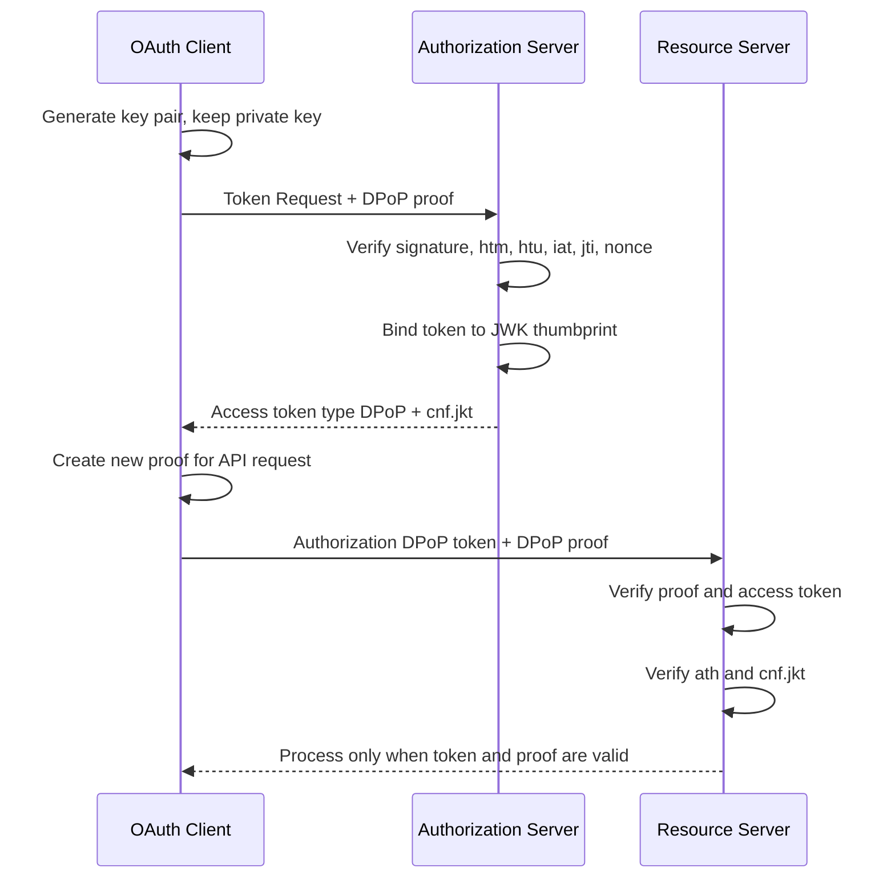
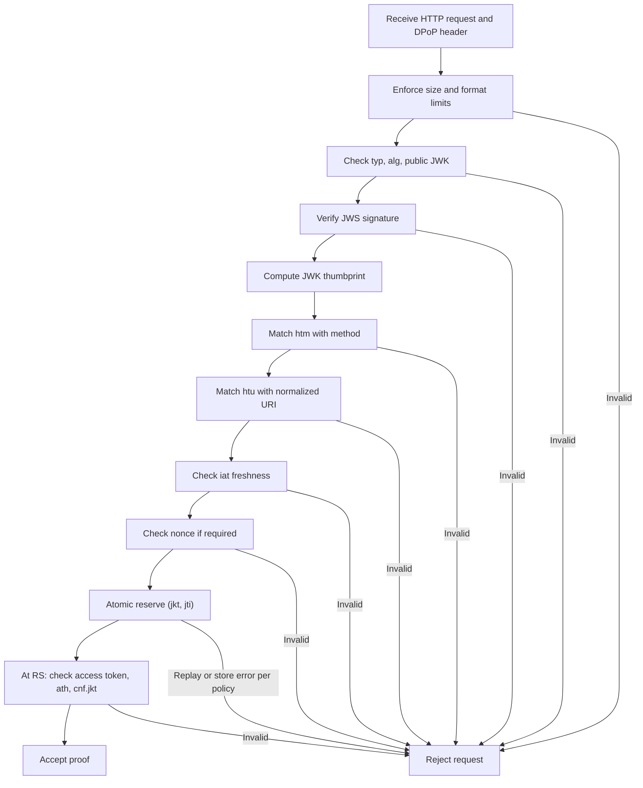

# Verifying `htm`, `htu`, `iat`, `jti`, and the Signature of a DPoP Proof

## 1. Context: Access Tokens Must Be Bound to the Key Holder

In an OAuth 2.0/OpenID Connect system using **Spring Security**, **Spring Authorization Server**, and Spring Boot, Bearer access tokens share one characteristic: any party possessing the token can present it to a Resource Server while the token remains valid.

If an access token is leaked through logs, browser storage, a proxy, or a compromised device, an attacker can reuse the token from another machine. A short TTL reduces the exposure window, but does not prevent using a stolen token during that window.

**Demonstrating Proof of Possession (DPoP)** is standardized in **RFC 9449**. DPoP adds a proof JWT signed by the client using a private key the client holds. When calling the Token Endpoint or a Resource Server, the client sends the proof in the `DPoP` HTTP header. The server verifies the signature and claims binding the proof to the current request.

This lesson focuses on five core checks: **`htm`** (HTTP method), **`htu`** (target URI), **`iat`** (proof creation time), **`jti`** (proof identifier used for replay detection), and **signature/public JWK** (proving the sender holds the corresponding private key).

For example, `booking-bff` receives a DPoP-bound access token for `booking-api`. Every API request must carry a new proof signed by the same private key bound to the token. An attacker who steals only the access token cannot generate a valid proof without the private key.

After this lesson, you will be able to explain DPoP proofs, verify the JOSE header and signature, validate `htm`/`htu`/`iat`/`jti`, implement replay detection, distinguish between the Token Endpoint and Resource Server, and test attack scenarios in a Spring application.

## 2. What Is a DPoP Proof?

A DPoP proof is a **signed JWT (JWS)** created by an OAuth client for a specific request. It is not an access token and does not by itself grant API access. The proof demonstrates that the client holds the private key corresponding to the public key embedded in the JOSE header.

A proof has the compact JWS structure:

```text
BASE64URL(protected-header).
BASE64URL(payload-claims).
BASE64URL(signature)
```

The client sends the JWT in the header:

```http
DPoP: eyJ0eXAiOiJkcG9wK2p3dCIsImFsZyI6IkVTMjU2Iiw...
```

A decodable JWT **does not prove a valid signature**. The server must verify the JWS using the public key and then validate the claims against the actual request.

### 2.1. How Does DPoP Differ from a Bearer Token?

| Aspect | Bearer access token | DPoP-bound access token |
|---|---|---|
| Proof of usage | Sender presents the token | Sender presents the token and a proof |
| Key binding | Not required | Token bound to a public key thumbprint |
| Authorization header | `Authorization: Bearer ...` | `Authorization: DPoP ...` |
| Separate proof | No | `DPoP: <proof-jwt>` |
| Token theft alone | Usable within lifetime | Missing private key to generate a valid proof |
| Replay | Token can be reused | Proof must pass freshness and replay checks |

DPoP reduces the risk of a token being used by a party that does not hold the key. It does not protect when an attacker obtains both the access token and private key, when XSS can ask the client to sign proofs, or when the client device is compromised.

### 2.2. Overall Flow



The diagram shows the overall flow. The Authorization Server may require a nonce; in that case, the client generates a new proof per the challenge.

## 3. JOSE Header and Proof Signature

RFC 9449 requires the proof JWT to use a JOSE header identifying DPoP:

```json
{
  "typ": "dpop+jwt",
  "alg": "ES256",
  "jwk": {
    "kty": "EC",
    "crv": "P-256",
    "x": "PUBLIC_KEY_X",
    "y": "PUBLIC_KEY_Y"
  }
}
```

| Header | Role | Rule |
|---|---|---|
| `typ` | Identifies a DPoP proof JWT | Profile value `dpop+jwt` |
| `alg` | Signing algorithm | Asymmetric signature on the allowlist |
| `jwk` | Public key for verifying the proof | Contains only public key material, no private material |

### 3.1. Algorithm Allowlist

The server must not blindly trust the `alg` declared by the client. Configure an allowlist of asymmetric signature algorithms supported by your library and deployment.

Reject `alg=none`, symmetric algorithms like HS256, algorithms outside the allowlist, incompatible key types/curves, or malformed JOSE structures. RFC 9449 recommends ES256 for interoperability; other algorithms should only be accepted if supported by the server and permitted by policy.

### 3.2. Public JWK

The proof carries a public JWK so the server can verify the signature. The JWK must not contain private key parameters. For an EC public key, fields typically include `kty`, `crv`, `x`, and `y`; the `d` field is the private scalar and must not appear.

The server must parse the JWK using a trusted JOSE library, validate the key type/curve, verify the signature, and compute the JWK thumbprint per RFC 7638.

Do not fetch keys from `jku` or `x5u` specified by the proof. A DPoP proof embeds the public key in the header; fetching arbitrary URLs can introduce SSRF or trust injection.

### 3.3. A Valid Signature Is Not Enough

A validly signed proof can still have the wrong method, wrong URI, a stale `iat`, a reused `jti`, or an invalid nonce. At the Resource Server, the proof must also be bound to the access token via `ath` and `cnf.jkt`.

## 4. Claims of a DPoP Proof

A proof at the Resource Server may contain:

```json
{
  "jti": "unique-proof-id-7b6a",
  "htm": "GET",
  "htu": "https://booking-api.example.com/bookings/42",
  "iat": 1794825300,
  "ath": "BASE64URL_SHA256_OF_ACCESS_TOKEN"
}
```

| Claim | Meaning | Condition |
|---|---|---|
| `jti` | Unique identifier of the proof | Required |
| `htm` | HTTP method of the request | Required |
| `htu` | Target HTTP URI, excluding query/fragment | Required |
| `iat` | Time the proof was created (NumericDate) | Required |
| `ath` | Hash of the accompanying access token | Required for proofs at the Resource Server sent with an access token |
| `nonce` | Server-issued nonce | When required by the server |

Proofs at the Token Endpoint and proofs at the Resource Server have different conditions. The `ath` claim binds the proof to the access token in an API request; do not mechanically enforce it on proofs at the Token Endpoint.

## 5. Verifying the Signature and JWK Thumbprint

A validator should execute:

1. Check that the compact JWS is well-formed and within size limits.
2. Parse the protected header.
3. Require `typ=dpop+jwt`.
4. Verify `alg` is in the asymmetric allowlist.
5. Parse `jwk` and verify it is a valid public-only key.
6. Verify the JWS signature using the public key.
7. Compute the RFC 7638 thumbprint of the JWK.
8. Only after the signature is valid should `htm`, `htu`, `iat`, and `jti` claims be trusted.

Do not record `jti` in the replay cache before verifying the signature. Otherwise, an attacker could send a forged proof to pre-occupy the ID of a legitimate proof.

### 5.1. Computing the JWK Thumbprint

DPoP uses the thumbprint of the public key to bind the access token. The thumbprint is computed from the canonical required JWK members per RFC 7638, not by hashing an arbitrary full JSON object or hashing the compact JWT string.

```text
Public JWK
   |
   v
RFC 7638 canonical required members
   |
   v
UTF-8 JSON representation
   |
   v
SHA-256
   |
   v
Base64url without padding
   |
   v
jkt
```

Use an RFC 7638 implementation from a vetted JOSE library; do not serialize a JWK with arbitrary member ordering and hash raw JSON yourself.

### 5.2. Binding the Access Token with `cnf.jkt`

When the AS issues a DPoP-bound access token, the token includes a confirmation claim:

```json
{
  "cnf": {
    "jkt": "JWK_THUMBPRINT_OF_CLIENT_PUBLIC_KEY"
  }
}
```

The Resource Server verifies that the thumbprint of the public key in the current proof matches `cnf.jkt` in the access token. The token can only be used with the bound key pair.

If the access token is a JWT, the RS verifies the access token's signature/issuer/audience/expiry **separately** from the DPoP proof signature. If the token is opaque, the RS may need introspection to retrieve its status and confirmation claim. Proof verification does not replace access token verification.

## 6. The `htm` Claim: Binding the HTTP Method

`htm` is the HTTP method for which the client created the proof, such as GET, POST, PUT, or DELETE.

Request:

```http
GET /bookings/42 HTTP/1.1
Host: booking-api.example.com
Authorization: DPoP ACCESS_TOKEN
DPoP: SIGNED_DPOP_PROOF
```

The proof must contain:

```json
{
  "htm": "GET"
}
```

The server compares `htm` against the actual HTTP method of the request. A client cannot sign a proof for GET and then send a DELETE request.

Invalid example:

```text
Actual request method: POST
Proof htm: GET
Result: reject
```

Do not infer the method from a route or query parameter. Use the actual method processed by the application behind the proxy under a trusted contract.

### 6.1. Testing `htm`

- GET proof with GET request: passes the method check if other checks succeed.
- GET proof with POST request: reject.
- POST proof with DELETE request: reject.
- Method rewritten by proxy: check the method the application actually handles.
- Malformed method: reject per standard handling rules.

Method binding prevents a proof from being redirected to a different HTTP operation; it does not replace route-based or scope-based authorization.

## 7. The `htu` Claim: Binding the Target URI

`htu` contains the HTTP URI of the target endpoint, **excluding query and fragment components**.

Example:

```text
Request URI:
https://booking-api.example.com/bookings/42?expand=items#section

htu:
https://booking-api.example.com/bookings/42
```

### 7.1. Full URI Comparison

Checking only the `/bookings/42` path is insufficient. A URI also includes scheme, host, port, and path. A proof for:

```text
https://booking-api.example.com/bookings/42
```

must not be accepted for:

```text
https://attacker.example.net/bookings/42
```

The server strips query/fragment and compares according to URI normalization per RFC 3986. Pay attention to hostname casing, default ports, dot segments, percent-encoding, and authority. Only apply normalization steps permitted by the RFC; do not normalize paths in a way that collapses two distinct resources into one.

### 7.2. Reverse Proxies and Public URIs

Example:

```text
Client-visible URL:
https://api.example.com/oauth/resource

Internal upstream:
http://booking-api-service:8080/oauth/resource
```

The client constructs `htu` from the public URL, whereas the application may see an internal HTTP scheme and host. If the validator compares against the internal URI, valid proofs may be rejected; if the validator accepts URIs from untrusted headers, an attacker can manipulate the target URI.

You must define the public/canonical URI; trust forwarded headers only from authenticated reverse proxies; require proxies to strip caller-supplied headers and inject canonical values; build the target URI from the normalized request context; and test directly, through the proxy, and under host/path rewrites.

Do not take raw `X-Forwarded-Host` or `Forwarded` headers from the Internet as a source of truth.

### 7.3. Queries Are Not Bound by `htu`

Because queries are stripped from `htu`, two requests with the same method/path but different query parameters can have the same `htm`/`htu`. DPoP is not a signature over the entire HTTP message/body.

If business logic depends on query parameters, body, tenant, idempotency key, or other headers, the application needs separate validation/authorization. Do not claim that a DPoP proof signs the entire request payload.

## 8. The `iat` Claim: Freshness and Clock Skew

`iat` is the proof creation time as a NumericDate. The server determines whether the proof is sufficiently fresh.

An illustrative policy:

```text
now - maxProofAge <= iat <= now + allowedClockSkew
```

Illustrative configuration example:

```yaml
dpop:
  proof:
    max-age: 5m
    allowed-clock-skew: 30s
```

These values are illustrative only, not Spring defaults or mandatory numbers in RFC 9449. Choose the smallest window that real clients, networks, and system clocks can reliably meet.

### 8.1. Rejecting Proofs Too Old or Too Far in the Future

| Case | Outcome |
|---|---|
| `iat` within valid window | Continue verification |
| `iat` older than max age | Reject |
| `iat` in the future beyond clock skew | Reject |
| `iat` missing or wrong NumericDate type | Reject |
| `iat` causes parse/overflow error | Reject safely |

Do not use client-supplied time as the reference clock. The client only asserts `iat`; the server compares against the server's clock.

### 8.2. Clock Synchronization

If the AS, RS, and client clocks drift too far apart, valid proofs can be rejected. Synchronize clocks using NTP/clock services, monitor clock drift, keep allowed skew small and consistent, and do not widen the window to hours to mask infrastructure issues.

**Freshness alone does not prevent replay.** An attacker can resend a proof within the still-valid window. You need `jti` and replay detection.

## 9. The `jti` Claim: Replay Detection

`jti` is the unique identifier of each DPoP proof. The client must generate a new `jti` for every proof; the server uses it to detect previously accepted proofs.

```text
Request A:
jkt = thumbprint(K)
jti = proof-001

Request B:
jkt = thumbprint(K)
jti = proof-002

Replay Request A:
jkt = thumbprint(K)
jti = proof-001  -> reject
```

### 9.1. Replay Cache Key

A replay cache can use a logical key:

```text
replayKey = (jwkThumbprint, jti)
```

An issuer/client/endpoint namespace can be added as needed by design. The same key pair cannot reuse the same `jti` during the window in which the server still accepts the proof.

### 9.2. Recording Replay State Must Be Atomic

Flow:

1. Verify signature and basic claims.
2. Compute the JWK thumbprint.
3. Verify `iat` is within the window.
4. Perform an atomic **put-if-absent** operation with `(jkt, jti)`.
5. If the key already exists, reject the replayed proof.
6. If the key is new, continue processing the request under an appropriate transaction.

If you perform a separate GET followed by a SET, two concurrent requests can both observe the key as absent and both be accepted.

### 9.3. Replay Cache TTL

Retain the replay entry long enough so that the proof cannot be accepted again while still inside the freshness window, including clock skew and processing margins. The TTL must be calculated from proof receipt time and actual policy so entries are not evicted prematurely.

Do not delete `jti` immediately after the API response completes if the proof could still be replayed within the acceptance window.

### 9.4. Multiple Instances Must Share Replay Detection

If an initial request arrives at node A and is accepted, an attacker can replay the proof to node B. If A and B maintain independent replay caches, B may accept it again.

In multi-node environments, use a shared store or a consistent, atomic replay detection mechanism. If the store is unavailable, deciding between fail-closed or degraded mode must be based on the threat model; do not silently skip replay detection and continue accepting proofs.

### 9.5. Do Not Record `jti` Before Verifying the Signature

If an attacker sends a forged JWT with the `jti` of an upcoming valid proof, the server could be tricked into marking that ID as used. Verify the signature and type/key before recording replay state. Order validation so invalid proofs cannot burn the `jti` of a valid proof.

## 10. Nonce: Server-Issued Freshness Challenge

RFC 9449 allows a server to require the client to send a server-issued nonce in the next proof. A nonce mitigates the risk of an attacker pre-generating a proof and waiting before replaying it.

The server can return:

```http
DPoP-Nonce: SERVER_ISSUED_NONCE
```

The client builds the next proof with the claim:

```json
{
  "nonce": "SERVER_ISSUED_NONCE"
}
```

### 10.1. Nonce Does Not Replace `iat` and `jti`

- `iat` checks when the proof was created.
- `jti` detects whether the same proof/ID was already used.
- `nonce` binds the proof to a recent server challenge.

These three mechanisms complement one another. Do not drop freshness or the replay cache merely because a nonce is required.

### 10.2. Retrying After a Nonce Challenge

If the server requires a nonce and the proof lacks a valid nonce, the server can return the `use_dpop_nonce` error and the `DPoP-Nonce` header. The client must take the nonce, create a new proof with a new `jti` and a new `iat`, embed the nonce, and re-sign.

Do not resend the old proof merely by changing headers; the signature would be invalid. A nonce is not a long-lived bearer secret; the server must manage expiry and enforce binding per policy.

## 11. `ath` and Linking the Proof to the Access Token

At the Resource Server, the proof must be bound to the access token sent in the request. The `ath` claim is the hash of the access token:

```text
ath = BASE64URL(
        SHA-256(ASCII(access_token))
      )
```

Unpadded Base64url. The hash is computed over the exact presented access token string, not the decoded JWT payload or token ID.

### 11.1. Why Is `ath` Needed?

If a proof only bound method/URI and key, an attacker could try pairing the proof with a different access token. `ath` binds the proof to the exact access token in the request.

The server recomputes the hash from the received access token and compares it with `ath` after the proof has been verified.

### 11.2. Headers to the Resource Server

```http
GET /bookings/42 HTTP/1.1
Host: booking-api.example.com
Authorization: DPoP ACCESS_TOKEN_VALUE
DPoP: SIGNED_PROOF_WITH_ATH
```

When using a DPoP-bound token, the scheme in the Authorization header is `DPoP`, not `Bearer`. The `DPoP` header holds the proof JWT. The RS verifies both and checks that they match properly.

### 11.3. Comparing `ath` and `cnf.jkt`

| Check | Binding |
|---|---|
| `ath` | This proof was created for the specific access token being sent |
| `cnf.jkt` | The public key in the proof matches the key bound to the token |
| `htm`/`htu` | The proof was created for the current method and URI |
| `iat`/`jti` | The proof is fresh and has not been replayed |

A request is valid only when all required checks succeed.

## 12. Token Endpoint and Resource Server Have Different Contexts

DPoP is used both when the client calls the Token Endpoint and when it calls the Resource Server. Signature, `typ`, `htm`, `htu`, `iat`, and `jti` checks are similar, but additional claims differ.

| Check | Token Endpoint | Resource Server |
|---|---|---|
| HTTP method/URI | Token Endpoint method and URI, typically POST | API method and URI |
| `htm`/`htu` | Matches Token Endpoint request | Matches resource request |
| Proof signature | Public JWK in proof | Public JWK in proof |
| `iat`/`jti` | Freshness and replay | Freshness and replay |
| Nonce | AS may require | RS may require |
| `ath` | Does not apply like an API access token proof | Binds proof to access token |
| `cnf.jkt` | AS binds issued token to proof key | RS matches proof key with token binding |
| Client authentication | Still follows registration/method | Not replaced by client authentication at the API |

### 12.1. DPoP Does Not Replace Client Authentication

At the Token Endpoint, the AS still authenticates the client according to its registered method if the client requires authentication. A DPoP proof proves possession of the key used for sender constraining; it does not automatically replace `client_secret_basic`, `private_key_jwt`, or mTLS for all client types.

### 12.2. Do Not Require `ath` at the Token Endpoint

When requesting an access token, the client does not yet have an output access token to hash into `ath`. Therefore, do not apply the Resource Server's `ath` rule to Token Endpoint proofs.

Conversely, the Resource Server receives both the access token and proof in the same request, so it must verify `ath`.

## 13. Recommended Validation Order



The exact order can be tuned for cost optimization, but two principles hold: **never trust claims before verifying the signature**, and **never perform business side effects before both proof and access token are verified**.

If a replay entry is recorded before final steps like `ath`/`cnf.jkt`, an invalid proof could consume a `jti`. Order validation or design reservation/commit to avoid this scenario.

## 14. Building a Validator in a Spring Application

Exact APIs and packages depend on your Spring Security/Spring Authorization Server version. Before integrating, check whether your version has built-in DPoP support and use the proper public APIs. If extensions are needed, keep logic in dedicated services rather than scattering it across controllers.

A service interface might look like:

```java
public interface DPoPProofValidator {

    DPoPProofValidationResult validate(
        String compactProof,
        HttpServletRequest request,
        DPoPValidationContext context);
}
```

The context can hold endpoint role, public URI normalized per trusted proxies, access token (RS only), nonce policy, clock/freshness window, replay store, and allowed asymmetric algorithms.

### 14.1. Pseudocode

```text
validate(proof, request, context):
    enforce proof size and compact-JWS structure

    header = parse protected header
    require header.typ == "dpop+jwt"
    require header.alg in allowed asymmetric algorithms
    jwk = parse public-only JWK from header
    require key type and algorithm are compatible

    verify JWS signature using jwk
    jkt = RFC7638 thumbprint(jwk)

    claims = read verified payload
    require jti is non-empty
    require htm matches actual HTTP method
    require htu matches normalized target URI
    require iat is within freshness window
    require nonce when policy demands it

    if Resource Server:
        require ath matches SHA256(access_token)
        require jkt matches access_token.cnf.jkt

    atomically reserve (jkt, jti) in replay store
    reject if already reserved

    return validated proof context
```

This is pseudocode, not a production implementation. Replay reservation and final checks must be designed so invalid proofs do not burn the ID of valid proofs.

### 14.2. Do Not Accept `htm`/`htu` from the Caller as Expected Values

The validator must derive method/target itself from the HTTP request and trusted proxy configuration. Never accept both values from the caller and compare them against themselves.

If a proxy alters scheme/host/path, an adapter is needed to determine the external URI. Never allow callers to control that adapter through unfiltered forwarded headers.

### 14.3. Atomic Replay Store

An abstraction:

```java
public interface DPoPReplayStore {

    boolean reserveIfAbsent(
        String jwkThumbprint,
        String proofJti,
        Duration retention);
}
```

`true` means the key was just reserved; `false` means the key already existed. A Redis implementation can use an atomic set-if-absent with TTL. A database can use an appropriate unique constraint/transaction.

Do not return `true` on store timeout simply to keep requests flowing, unless a risk-assessed degraded policy is in place. DPoP replay resistance relies on recording used proofs.

### 14.4. Integrating with Spring Authorization Server

At the Token Endpoint, the DPoP proof must be verified in the pipeline before issuing the token and creating the `cnf.jkt` binding. Use built-in support if your version provides it; if customizing, consider public extension points of the Token Endpoint, authentication converter/provider, and token customizer.

Do not write a custom controller that issues tokens after merely checking the `DPoP` header. That can bypass client authentication, grant validation, scopes, token persistence, and OAuth error handling.

A token customizer can take the verified thumbprint from a trusted context to add `cnf.jkt` to the access token. Never compute a thumbprint from an unverified header and write it into a token.

### 14.5. Integrating with Spring Security Resource Server

At the Resource Server, verify the access token via JWT decoder or introspection; then check the DPoP proof, `ath`, and `cnf.jkt`. If your version lacks full DPoP support, a custom authentication filter/provider must handle the `Authorization: DPoP` scheme and `DPoP` header.

Do not merely swap the Bearer token resolver to accept the `DPoP` scheme while skipping proof validation.

## 15. Error Handling and Nonce Challenge

When a proof is invalid, the server returns an error per RFC 9449 and the endpoint contract. Common cases:

| Error | Handling approach |
|---|---|
| Missing/malformed proof | Reject request |
| Invalid signature | Reject; do not trust claims |
| `htm`/`htu` mismatch | Reject proof |
| `iat` too old/in the future | Reject proof |
| `jti` already used | Reject replay |
| Missing/invalid nonce when required | Challenge with `use_dpop_nonce` and `DPoP-Nonce` when appropriate |
| `ath` mismatch with token | Reject at RS |
| `cnf.jkt` mismatch | Reject because token is bound to another key |

Example Resource Server response:

```http
HTTP/1.1 401 Unauthorized
WWW-Authenticate: DPoP error="invalid_dpop_proof"
Cache-Control: no-store
```

When requiring a nonce, the server supplies `DPoP-Nonce` and the appropriate error. At the Token Endpoint, return an OAuth Token Error Response; do not redirect M2M clients to an HTML login page.

Do not return raw proofs, access tokens, sensitive subject claims, stack traces, or internal network topology details in public errors. Use correlation IDs and redacted internal error codes.

## 16. Common Implementation Mistakes

| Mistake | Consequence | Resolution |
|---|---|---|
| Parsing JWT only, skipping signature verification | Accepts forged proofs | Verify JWS with public JWK |
| Accepting `alg=none` or HMAC | Bypasses asymmetric proof | Allowlist asymmetric algorithms |
| JWK contains private members | Invalid/leaked key material | Accept only public JWKs |
| Trusting `jku`/`x5u` | SSRF/trust injection | Never fetch URLs from proof |
| Ignoring `typ` | Confuses other JWTs with DPoP | Require `dpop+jwt` |
| Not comparing `htm` | GET proof used for DELETE | Match actual method |
| Comparing only `htu` path | Different host/scheme still passes | Compare full normalized URI |
| Comparing wrong internal URI | Valid proofs rejected | Use canonical external URI |
| Trusting raw forwarded headers | Caller controls target | Trust only authenticated proxies |
| Keeping query in `htu` | Non-compliant with RFC | Strip query and fragment |
| Accepting overly old `iat` | Extended replay window | Keep freshness window small |
| Using `iat` only, ignoring `jti` | Replay within freshness window | Use an atomic replay cache |
| Per-pod local replay cache | Replay across other pods | Use a shared/consistent store |
| Recording `jti` before signature | Attacker burns legitimate IDs | Verify signature before side effects |
| Using the same `jti` for all requests | Subsequent requests flagged as replay | Generate a fresh `jti` per proof |
| Skipping `ath` check | Proof paired with a different token | Hash access token and compare |
| Skipping `cnf.jkt` check | Token used with a different key | Compare thumbprints |
| Using Bearer for DPoP-bound token | Loses sender constraint | Use `Authorization: DPoP` |
| Replacing client authentication with DPoP | Skips client verification | Keep client auth separate |
| Logging proofs/access tokens | Credential leakage | Redact and audit safely |

## 17. DPoP Proof Test Matrix

### 17.1. JOSE Header and Signature

| Case | Input | Expected Result |
|---|---|---|
| Valid header | `typ=dpop+jwt`, allowed alg, valid public JWK | Passes header step |
| Wrong typ | `typ=JWT` | Reject |
| Missing typ | No `typ` | Reject |
| `alg=none` | No signature | Reject |
| HMAC | `alg=HS256` | Reject |
| Invalid signature | Tampered payload/header | Reject |
| JWK missing coordinate | EC key missing `x` or `y` | Reject |
| JWK contains private `d` | Private material present | Reject |
| Key/alg mismatch | RSA JWK with ES256 | Reject |
| Arbitrary JWK URL | Untrusted `jku`/`x5u` | Do not fetch that URL |

### 17.2. Claims

| Case | Request/proof | Expected Result |
|---|---|---|
| Method matches | GET request, `htm=GET` | Passes method check |
| Method mismatch | POST request, `htm=GET` | Reject |
| URI matches | `htu` matches canonical target | Passes URI check |
| Wrong host | `htu` points to another host | Reject |
| Wrong scheme | HTTPS proof for HTTP target | Reject |
| Query/fragment | `htu` omits query/fragment | Normalized per RFC |
| Fresh `iat` | Within freshness window | Passes time check |
| Stale `iat` | Beyond max age | Reject |
| Future `iat` | Beyond clock skew | Reject |
| Missing `jti` | No ID | Reject |
| Fresh JTI | Not in replay store | Can be reserved |
| Replay same JTI/key | Resend already-used proof | Reject |
| Valid nonce | Nonce still valid | Passes nonce check |
| Wrong/expired nonce | Does not match challenge | Reject/re-challenge |

### 17.3. Resource Server Binding

| Case | Token/proof | Expected Result |
|---|---|---|
| Token and proof share key | `cnf.jkt` matches proof JWK | Passes binding |
| Different proof key | Thumbprint mismatch | Reject |
| Valid `ath` | Hash of the exact access token | Passes token binding |
| Wrong `ath` | Hash of a different token | Reject |
| Missing `ath` | Proof not bound to token | Reject |
| Authorization Bearer | Using Bearer with DPoP-bound token | Not accepted under DPoP policy |
| Authorization DPoP | Correct scheme, valid proof | Can proceed |
| Expired access token | Valid proof but expired token | Reject |
| Wrong audience | Token meant for another API | Reject |
| Replay on another node | Proof used at pod A sent to pod B | Shared store rejects |

## 18. Testing in Spring Security and Spring Authorization Server

### 18.1. Unit Testing Validators

Split components for independent testing: header validator (`typ`, `alg`, public-only JWK); signature verifier; URI validator; method validator; time validator with a fake `Clock`; atomic reserve/TTL replay store; nonce validator; and access token binding (`ath` and `cnf.jkt`).

Use test keys to sign real proofs; do not mock the verifier to always return success and conclude signature validation works.

### 18.2. Token Endpoint Integration Tests

Send Token Requests through the actual `SecurityFilterChain`:

1. Valid client authentication per registration.
2. Allowed grant type.
3. `DPoP` header contains a proof with `htm=POST` and `htu` matching the public Token Endpoint URI.
4. AS verifies signature, `iat`, `jti`, and nonce.
5. AS issues token type `DPoP` with the proper `cnf.jkt`.
6. Test invalid signature, method, URI, freshness, and replay proofs.
7. Test missing nonce when AS requires one; verify challenge response.
8. Verify DPoP errors do not bypass client authentication or grant policy.

### 18.3. Resource Server Integration Tests

Send a request with `Authorization: DPoP <access_token>` and a fresh `DPoP` proof with matching method/URI. The `ath` claim must be computed from the exact access token and `jkt` must match `cnf.jkt`.

Then mutate one component at a time to prove the API rejects invalid inputs. Tests must go through the real authentication filter/decoder, not just call the validator service directly.

### 18.4. Multi-Instance Tests

Start at least two instances sharing a replay store:

1. Send a valid proof to node A.
2. Resend the same compact proof to node B within the freshness window.
3. Verify node B rejects the replay.
4. Make the replay store unavailable and verify the fail policy.
5. Send the same proof concurrently and verify at most one request reserves it successfully.

Unit tests using an in-memory map do not prove replay protection in a distributed system.

## 19. Operations and Key Lifecycle

### 19.1. Time Synchronization

Monitor clock offset across clients, AS, RS, and replay store. If nodes have diverging clocks, the same proof may be accepted on one node and rejected on another.

Use NTP/clock services, drift metrics, and alerts. Do not widen the freshness window indefinitely to reduce support tickets.

### 19.2. Replay Store

Monitor duplicate `jti` rates, reservation success/failure, Redis/database latency/errors, evictions, replication lag, and requests rejected when the store is unavailable.

Never put raw proofs, tokens, or public JWK JSON into metric labels.

### 19.3. Client Key Rotation

A DPoP-bound access token carries the `cnf.jkt` of a specific public key. When the client rotates its key pair, old tokens remain bound to the old thumbprint; proofs signed with the new key will not match `cnf.jkt` of old tokens. The client must obtain new tokens bound to the new key before discarding the old key. If the old key is compromised, prioritize revoking affected tokens per policy.

### 19.4. Data Never to Log

Never log raw DPoP proof JWTs, access/refresh tokens, private keys/private JWKs, `Authorization` headers, or `DPoP` headers. You may log correlation IDs, client registration IDs, public JWK thumbprints, endpoints, methods, error categories, and timestamps per retention/access policy.

## 20. Implementation Checklist

- [ ] DPoP proof is a signed JWT with `typ=dpop+jwt`.
- [ ] `alg` is an asymmetric signature algorithm on the allowlist.
- [ ] `jwk` contains only public key material and matches the algorithm.
- [ ] Signature is verified before trusting claims.
- [ ] JWK thumbprint is computed per RFC 7638.
- [ ] `htm` matches the actual HTTP method.
- [ ] `htu` matches the target URI after stripping query/fragment and normalizing per RFC.
- [ ] Forwarded headers are trusted only from authenticated proxies.
- [ ] `iat` falls within the freshness window; clocks are synchronized.
- [ ] `jti` is fresh and atomically reserved in the replay store.
- [ ] Replay cache is consistent across instances.
- [ ] Nonce is verified when required by the server.
- [ ] Resource Server verifies `ath` of the exact access token.
- [ ] Resource Server compares `cnf.jkt` with the proof thumbprint.
- [ ] DPoP-bound tokens use the `Authorization: DPoP` scheme.
- [ ] Client authentication at the Token Endpoint is still enforced separately.
- [ ] Access tokens also undergo issuer, audience, expiry, and scope verification.
- [ ] Key rotation accounts for old tokens bound to old thumbprints.
- [ ] Tests cover signature, `htm`, `htu`, `iat`, `jti`, nonce, `ath`, `cnf`, and multi-instance replay.
- [ ] Never log proofs, tokens, or private keys.

### Core Knowledge

DPoP proves that the client possesses the private key corresponding to the public key bound to the access token. The **signature** verifies the proof was created by that key; **`htm` and `htu`** bind the proof to the method/URI; **`iat`** limits proof lifetime; **`jti`** together with a replay store prevents proof reuse; **`ath` and `cnf.jkt`** link the proof to the exact issued access token and key.

In Spring Security/Spring Authorization Server, use built-in DPoP support for your version if available; if extensions are required, integrate into the authentication/Token Endpoint pipeline and Resource Server via public extension points. Do not merely parse JWTs, trust arbitrary forwarded headers, use local-only replay caches for multi-node deployments, or treat DPoP as a replacement for client authentication, TLS, or scope/audience authorization.

## References

- [RFC 9449 — OAuth 2.0 Demonstrating Proof of Possession (DPoP)](https://www.rfc-editor.org/rfc/rfc9449)
- [RFC 7638 — JSON Web Key (JWK) Thumbprint](https://www.rfc-editor.org/rfc/rfc7638)
- [RFC 7515 — JSON Web Signature (JWS)](https://www.rfc-editor.org/rfc/rfc7515)
- [RFC 7517 — JSON Web Key (JWK)](https://www.rfc-editor.org/rfc/rfc7517)
- [RFC 7519 — JSON Web Token (JWT)](https://www.rfc-editor.org/rfc/rfc7519)
- [RFC 3986 — Uniform Resource Identifier (URI): Generic Syntax](https://www.rfc-editor.org/rfc/rfc3986)
- [RFC 6749 — The OAuth 2.0 Authorization Framework](https://www.rfc-editor.org/rfc/rfc6749)
- [RFC 6750 — OAuth 2.0 Bearer Token Usage](https://www.rfc-editor.org/rfc/rfc6750)
- [RFC 8705 — OAuth 2.0 Mutual-TLS Client Authentication and Certificate-Bound Access Tokens](https://www.rfc-editor.org/rfc/rfc8705)
- [Spring Authorization Server — Protocol Endpoints](https://docs.spring.io/spring-authorization-server/reference/protocol-endpoints.html)
- [Spring Authorization Server — Core Model / Components](https://docs.spring.io/spring-authorization-server/reference/core-model-components.html)
- [Spring Security — OAuth 2.0 Resource Server](https://docs.spring.io/spring-security/reference/servlet/oauth2/resource-server/index.html)
- [Spring Security — Servlet Architecture](https://docs.spring.io/spring-security/reference/servlet/architecture.html)
