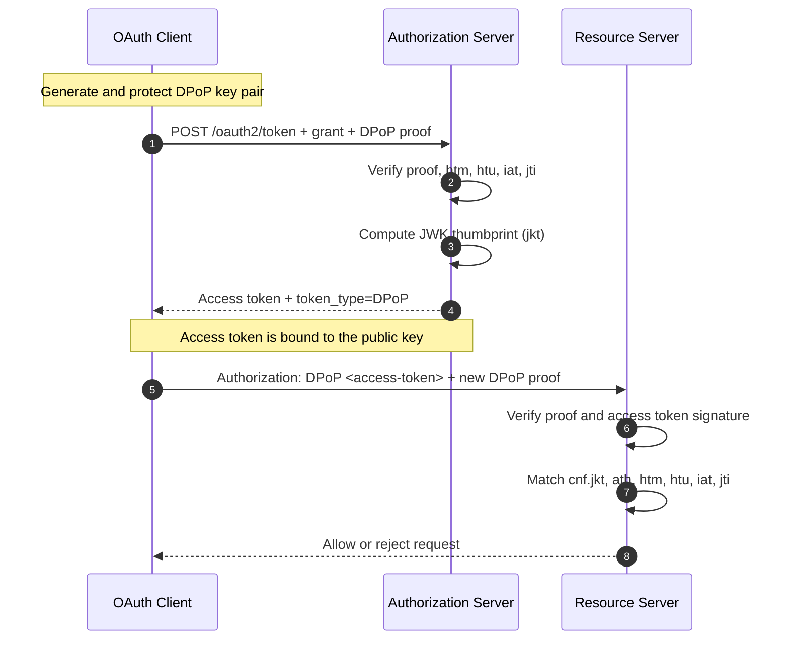

# Configuring DPoP Support at the Token Endpoint by Spring Version

## 1. Objective: Issuing an Access Token Bound to the Client's Key

In the **SPRING_SECURITY_OAUTH2_OIDC_AUTHORIZATION_SERVER** module, we learn how to design, configure, secure, test, and operate an OAuth 2.0/OpenID Connect Authorization Server using **Spring Security**, **Spring Authorization Server**, and **Spring Boot**. This lesson focuses on enabling and verifying **DPoP support at the Token Endpoint** according to your Spring version.

Bearer access tokens share a weakness: anyone who obtains the token can use it until it expires or is revoked. The server does not know whether the request sender is the client that originally received the token.

**DPoP (Demonstrating Proof of Possession, RFC 9449)** adds proof of key possession. The client generates a private/public key pair, signs a proof JWT for each HTTP request, and sends the proof in the `DPoP` header. When issuing an access token, the Authorization Server extracts the public key from the proof, computes its thumbprint, and binds the token to that key. When calling the Resource Server, the client must continue proving possession of the corresponding private key.



DPoP produces a **sender-constrained access token**: only the client holding the bound private key can validly use the token. This mechanism reduces the risk of a standalone stolen token being reused, but does not replace client authentication, PKCE, TLS, scopes, audience, or business permission checks.

### Lesson Scope

After this lesson, you will be able to:

1. Identify which Spring Authorization Server version supports DPoP at the Token Endpoint.
2. Distinguish Authorization Server Token Endpoint configuration from DPoP verification at the Resource Server.
3. Understand the DPoP proof JWT structure and required claims when calling the Token Endpoint.
4. Configure Spring Authorization Server to accept DPoP proofs and issue DPoP-bound access tokens.
5. Inspect `token_type=DPoP`, the `cnf.jkt` claim, and signing algorithm metadata.
6. Design tests for invalid proofs, replay, wrong keys, nonces, and different grants.

## 2. Identifying Support by Spring Version

The first thing to check is the version of **Spring Authorization Server** and **Spring Security** in your dependency graph. Both sides have different DPoP milestones:

| Component | Support Milestone | Meaning |
| --- | --- | --- |
| Spring Authorization Server **1.5+** | Supports DPoP-bound access tokens at the Authorization Server; 1.5 GA released 2025-05-20 | Token Endpoint can receive DPoP proofs, verify proofs, and bind access tokens to public keys |
| Spring Authorization Server **1.5.8** | Current stable release described in reference docs | Provides `dpop_signing_alg_values_supported` metadata API and `OAuth2TokenContext.DPOP_PROOF_KEY` |
| Spring Authorization Server **pre-1.5** | No built-in DPoP support via the APIs above | Must upgrade or implement full RFC 9449 handling yourself; merely reading the `DPoP` header is not enough |
| Spring Security **6.5+** | Includes Resource Server components such as `DPoPAuthenticationProvider` and `DPoPAuthenticationToken` | Provides the foundation for verifying DPoP proofs on protected resource access |
| Spring Security **7.1+** | Includes Java DSL `oauth2ResourceServer(...).dPoP(...)` | Provides a convenient DSL to enable DPoP on the Resource Server |

**Distinguish the two sides:** Spring Authorization Server handles DPoP proofs when the client requests an access token. Spring Security Resource Server verifies proofs when the client uses the token to call an API. Upgrading the Authorization Server does not automatically make older Resource Servers verify DPoP.

In Spring Authorization Server 1.5.x, DPoP is already integrated into the default Token Endpoint processing flow. You do not need to add a new grant type or build a separate `/dpop/token` endpoint. Customizing `OAuth2TokenEndpointConfigurer` is only necessary when your application has custom requirements for converters, providers, responses, or error handlers.

### Checking Running Dependencies

With Maven:

```bash
mvn dependency:tree -Dincludes=org.springframework.security,org.springframework.security:spring-security-oauth2-authorization-server
```

With Gradle:

```bash
./gradlew dependencyInsight --dependency spring-security-oauth2-resource-server
./gradlew dependencyInsight --dependency spring-security-oauth2-authorization-server
```

Verify the actual resolved versions managed by the Spring Boot BOM. Do not bump a single Spring Security or Spring Authorization Server module to another branch without checking the compatibility matrix.

**If running a version prior to SAS 1.5:** the most maintainable option is upgrading to a DPoP-capable release line. Rolling your own requires handling proof signatures, JWKs, thumbprints, replay, token binding, responses, and Resource Server compatibility; adding a filter that reads the `DPoP` header is insufficient.

## 3. DPoP Proofs Sent to the Token Endpoint

The client generates one proof JWT for **each request to the Token Endpoint**. This JWT is distinct from the access token: it is short-lived proof showing the client holds the private key corresponding to the public key embedded in its header.

### 3.1. JOSE Header

A valid DPoP proof has these key header fields:

| Field | Value/Rule |
| --- | --- |
| `typ` | Must be `dpop+jwt` |
| `alg` | Asymmetric signature algorithm accepted by the server; never `none` or HMAC |
| `jwk` | Public JWK corresponding to the private key used to sign the proof; must not contain private key material |

Example header structure:

```json
{
  "typ": "dpop+jwt",
  "alg": "ES256",
  "jwk": {
    "kty": "EC",
    "crv": "P-256",
    "x": "PUBLIC_KEY_X",
    "y": "PUBLIC_KEY_Y"
  }
}
```

`PUBLIC_KEY_X` and `PUBLIC_KEY_Y` are placeholders. The client keeps the private key in appropriate local secure storage, a keystore, or an HSM; only the public key is sent in the proof.

### 3.2. JWT Claims at the Token Endpoint

A DPoP proof for a token request requires these claims:

| Claim | Meaning |
| --- | --- |
| `htm` | HTTP method of the request, typically `POST` for the Token Endpoint |
| `htu` | Target URI of the Token Endpoint; matched per RFC 9449 rules, excluding query and fragment |
| `iat` | Time the proof was created |
| `jti` | Unique ID of the proof, enabling identification and replay protection |
| `nonce` | Present only when the Authorization Server requires a nonce per RFC 9449 |

Example payload:

```json
{
  "htm": "POST",
  "htu": "https://auth.example.com/oauth2/token",
  "iat": 1800000000,
  "jti": "2c6f7d15-9a77-4b8d-a9b2-6a42b01f54d3"
}
```

**Do not add `ath` to Token Endpoint proofs out of habit.** `ath` is the hash of the access token sent inside proofs when calling Protected Resources. When requesting an access token, the client does not yet have the resulting token to hash. Subsequent resource requests must include `ath`.

### 3.3. Why Does Every Request Need a New Proof?

A DPoP proof is bound to an HTTP method, URI, and timestamp. If a client reuses the same JWT for another request, `htm`, `htu`, `jti`, or the `iat` window may no longer be valid. Therefore:

- generate a new proof for each call to the Token Endpoint;
- never reuse an old proof on retries;
- use a unique, sufficiently random `jti`;
- synchronize clocks between client and server;
- keep the private key secure and stable for as long as the access token needs to be used.

A DPoP proof is not a second access token. It is only valid in connection with a specific request and the public key presented inside the proof.

## 4. Flow for Issuing a DPoP-Bound Access Token

Suppose a client executes the Authorization Code Flow. After receiving the authorization code, the client calls the Token Endpoint and sends a DPoP proof:

```http
POST /oauth2/token HTTP/1.1
Host: auth.example.com
Content-Type: application/x-www-form-urlencoded
Authorization: Basic <client-credentials>
DPoP: <signed-dpop-proof-jwt>

grant_type=authorization_code
&client_id=orders-web
&code=AUTHORIZATION_CODE
&redirect_uri=https%3A%2F%2Forders.example.com%2Fcallback
&code_verifier=PKCE_VERIFIER
```

The `Authorization` header in the example above serves **client authentication** per registration. The `DPoP` header holds the proof demonstrating possession of the private key. These two mechanisms serve different purposes; DPoP does not automatically replace `client_secret_basic`, `private_key_jwt`, or mTLS.

The Authorization Server:

1. Authenticates the client and processes the grant per registration.
2. Reads the proof JWT from the `DPoP` header.
3. Verifies the signature using the public JWK in the proof and validates `typ`, `alg`, `htm`, `htu`, `iat`, and `jti`.
4. Validates the nonce if required by server policy.
5. Extracts the public key and computes the JWK SHA-256 thumbprint.
6. Binds the thumbprint to the issued access token.
7. Returns a token response containing `token_type=DPoP`.

Example response:

```http
HTTP/1.1 200 OK
Content-Type: application/json
Cache-Control: no-store
Pragma: no-cache

{
  "access_token": "DPoP_BOUND_ACCESS_TOKEN",
  "token_type": "DPoP",
  "expires_in": 300,
  "scope": "orders.read"
}
```

Token values and lifetimes in the example are illustrative only. The client must read `token_type` from the response. If the server returns `Bearer`, the client must not assume the token was bound to the DPoP key.

### Key Confirmation Claim in the JWT Access Token

For a JWT access token, the public key binding is typically represented in the `cnf.jkt` claim:

```json
{
  "iss": "https://auth.example.com",
  "sub": "user-1042",
  "aud": ["orders-api"],
  "scope": "orders.read",
  "cnf": {
    "jkt": "BASE64URL_SHA256_JWK_THUMBPRINT"
  }
}
```

`jkt` is the JWK SHA-256 thumbprint of the public key in the DPoP proof. The Resource Server compares this thumbprint against the key of the proof sent when calling the API. For opaque/reference tokens, binding metadata must be retrievable by the Resource Server via Token Introspection or another trusted sharing mechanism.

**Do not manually inject or overwrite `cnf.jkt` using a client-supplied claim.** Binding must be produced by the Authorization Server from a verified proof. If the application customizes the token generator, preserve this key binding.

## 5. Configuring the Token Endpoint in Spring Authorization Server 1.5+

### 5.1. Using the Default Security Chain

In Spring Authorization Server 1.5.x, DPoP is already integrated into the Token Endpoint's access token request path. Standard Authorization Server configuration still uses `OAuth2AuthorizationServerConfigurer` and `getEndpointsMatcher()`:

```java
package com.example.authserver;

import org.springframework.context.annotation.Bean;
import org.springframework.context.annotation.Configuration;
import org.springframework.core.annotation.Order;
import org.springframework.security.config.Customizer;
import org.springframework.security.config.annotation.web.builders.HttpSecurity;
import org.springframework.security.oauth2.server.authorization.config.annotation.web.configurers.OAuth2AuthorizationServerConfigurer;
import org.springframework.security.web.SecurityFilterChain;

@Configuration
public class AuthorizationServerSecurityConfig {

    @Bean
    @Order(1)
    SecurityFilterChain authorizationServerSecurityFilterChain(HttpSecurity http)
            throws Exception {

        OAuth2AuthorizationServerConfigurer authorizationServerConfigurer =
                OAuth2AuthorizationServerConfigurer.authorizationServer();

        http
            .securityMatcher(authorizationServerConfigurer.getEndpointsMatcher())
            .with(authorizationServerConfigurer, Customizer.withDefaults())
            .authorizeHttpRequests(authorize -> authorize.anyRequest().authenticated());

        return http.build();
    }
}
```

This is a filter chain configuration skeleton. The application still requires foundational beans such as `RegisteredClientRepository`, `AuthorizationServerSettings`, `OAuth2AuthorizationService`, JWK source/token generator, and user authentication components if supporting the Authorization Code Flow.

**There is no separate DPoP flag like `enableDpop(true)` on the Token Endpoint in standard 1.5.x configuration.** DPoP proofs are processed in the default pipeline when the client sends a valid `DPoP` header. You do not need to add a new grant type, a header-reading filter, or a custom endpoint to receive proofs.

### 5.2. Role of `OAuth2TokenEndpointConfigurer`

`OAuth2TokenEndpointConfigurer` lets you extend steps before, during, and after token request processing:

| Extension point | Role |
| --- | --- |
| `accessTokenRequestConverter(...)` | Adds a converter to read the HTTP request |
| `accessTokenRequestConverters(...)` | Accesses the default converter list to add or customize |
| `authenticationProvider(...)` | Adds a provider to process grants |
| `authenticationProviders(...)` | Accesses the default provider list |
| `accessTokenResponseHandler(...)` | Customizes successful responses |
| `errorResponseHandler(...)` | Customizes OAuth error responses |

The default Token Endpoint already includes converters/providers for supported grants and built-in DPoP handling. If your application customizes the provider list, **do not inadvertently remove or replace default providers**. Doing so can break handling for a grant or for DPoP verification.

If you need additional business validators, use `authenticationProviders(...)` to inspect and configure the relevant provider in the default list. Only replace a provider when you fully understand its responsibilities and have tests covering all grants. Never call `providers.clear()` or replace the entire list with a custom provider just to inspect the `DPoP` header; doing so can drop default handling for Authorization Code, Refresh Token, Client Credentials, or DPoP.

### 5.3. Which Grants Does DPoP Apply To?

Spring documentation notes that a DPoP proof must be sent in the `DPoP` header on any access token request, regardless of grant type. Examples include:

| Grant | Token Endpoint Request | DPoP Requirement |
| --- | --- | --- |
| Authorization Code | `grant_type=authorization_code` | Send proof if you want a key-bound access token |
| Refresh Token | `grant_type=refresh_token` | Send a new proof; enforce refresh token key binding per policy |
| Client Credentials | `grant_type=client_credentials` | Send proof if you want a service token bound to the client key |
| Device Code | `grant_type=urn:ietf:params:oauth:grant-type:device_code` | Send proof if you want a key-bound access token |
| Extension grant | Per installed extension | Supported only when the extension's pipeline and policy are DPoP-compatible |

A request with a valid DPoP proof can receive a DPoP-bound access token. If the client omits the proof and the server does not enforce a mandatory DPoP policy, the request can follow the regular Bearer flow. **Supporting DPoP does not automatically force every client to use DPoP.**

If your organization wants to mandate DPoP for one client or a group of clients, enforce an explicit policy on the server and test requests missing the proof header. Do not assume that RFC 9449 support alone makes the server reject all token requests lacking DPoP.

## 6. Metadata and Token Context for DPoP

### 6.1. Advertising Supported Proof Algorithms

Authorization Server Metadata includes the `dpop_signing_alg_values_supported` claim to advertise accepted JWS algorithms for signing DPoP proofs. Spring Authorization Server 1.5 provides the corresponding metadata constant and builder APIs `dPoPSigningAlgorithm(...)` / `dPoPSigningAlgorithms(...)`.

Example adding algorithms that the server actually accepts:

```java
// Inside OAuth2AuthorizationServerConfigurer configuration:
authorizationServer.authorizationServerMetadataEndpoint(metadata ->
        metadata.authorizationServerMetadataCustomizer(builder -> {
            builder.dPoPSigningAlgorithm("ES256");
            builder.dPoPSigningAlgorithm("RS256");
        }));
```

This snippet is **added to** your existing Authorization Server configuration. The algorithm list in metadata must match the active proof verifier; never advertise an algorithm the server cannot verify. DPoP requires asymmetric signatures; never include `none` or HMAC algorithms in the list.

After configuring, inspect metadata at the Authorization Server's discovery endpoint, typically:

```http
GET /.well-known/oauth-authorization-server HTTP/1.1
Host: auth.example.com
```

The metadata response may contain:

```json
{
  "issuer": "https://auth.example.com",
  "token_endpoint": "https://auth.example.com/oauth2/token",
  "dpop_signing_alg_values_supported": [
    "ES256",
    "RS256"
  ]
}
```

The response above is abbreviated for illustration. Other metadata claims remain per server configuration. Clients should discover metadata from a trusted issuer rather than guessing algorithms or hardcoding endpoints.

### 6.2. `OAuth2TokenContext.DPOP_PROOF_KEY`

Spring Authorization Server 1.5 provides the `OAuth2TokenContext.DPOP_PROOF_KEY` key to access the DPoP proof JWT inside the token context when a proof is present. This is useful if your application has a custom `OAuth2TokenCustomizer` or token generator.

If your application has an `OAuth2TokenCustomizer<JwtEncodingContext>` or custom token generator, it can check `context.hasKey(OAuth2TokenContext.DPOP_PROOF_KEY)` and read the proof JWT placed into the context by the framework. Use only the data needed for internal logic; never log raw proofs or private keys. If the application already has an access token customizer, merge logic into the existing bean to avoid multiple beans competing for the same token customization.

**Do not re-create `cnf.jkt` manually if you are using the default token generator.** Let Spring Authorization Server build the binding from the verified proof. Only when replacing the token generator or issuing a custom token format do you need to ensure the equivalent confirmation claim is properly generated and verifiable by the Resource Server.

### 6.3. Distinguishing Authorization Server and Resource Server Configuration

| Component | Responsibility |
| --- | --- |
| Spring Authorization Server 1.5+ | Verifies proofs on the Token Endpoint and binds the key to the access token |
| Spring Security Resource Server 6.5+ | Provides providers/tokens to verify DPoP-bound tokens on protected resource calls |
| Spring Security Resource Server 7.1+ | Provides the `oauth2ResourceServer(...).dPoP(...)` DSL for convenient integration |
| OAuth Client | Manages private keys, generates new proofs, and sends proper headers |

If you configure only the Token Endpoint while the Resource Server still accepts tokens as ordinary Bearer tokens, sender-constraining is not enforced where data is protected.

## 7. Generating a DPoP Proof in Java and Calling the Token Endpoint

### 7.1. Generating a Proof JWT with Nimbus and Spring Security

The following snippet illustrates signing a proof for `POST /oauth2/token`. The RSA key here is just an example; production should use EC or RSA matching mutually agreed algorithms, store private keys in a keystore/HSM, and never include a private JWK in the header.

```java
import java.time.Instant;
import java.util.UUID;

import com.nimbusds.jose.jwk.JWKSet;
import com.nimbusds.jose.jwk.RSAKey;
import com.nimbusds.jose.jwk.source.JWKSource;
import com.nimbusds.jose.proc.SecurityContext;

import org.springframework.security.oauth2.jose.jws.SignatureAlgorithm;
import org.springframework.security.oauth2.jwt.JwsHeader;
import org.springframework.security.oauth2.jwt.Jwt;
import org.springframework.security.oauth2.jwt.JwtClaimsSet;
import org.springframework.security.oauth2.jwt.JwtEncoder;
import org.springframework.security.oauth2.jwt.JwtEncoderParameters;
import org.springframework.security.oauth2.jwt.NimbusJwtEncoder;

public final class DPoPProofFactory {

    private final JwtEncoder jwtEncoder;
    private final RSAKey signingKey;

    public DPoPProofFactory(RSAKey signingKey) {
        this.signingKey = signingKey;

        JWKSource<SecurityContext> jwkSource =
                (selector, context) -> selector.select(new JWKSet(signingKey));
        this.jwtEncoder = new NimbusJwtEncoder(jwkSource);
    }

    public String createTokenEndpointProof(String tokenEndpointUri) {
        JwsHeader header = JwsHeader.with(SignatureAlgorithm.RS256)
                .type("dpop+jwt")
                .jwk(signingKey.toPublicJWK().toJSONObject())
                .build();

        JwtClaimsSet claims = JwtClaimsSet.builder()
                .issuedAt(Instant.now())
                .claim("htm", "POST")
                .claim("htu", tokenEndpointUri)
                .id(UUID.randomUUID().toString())
                .build();

        Jwt proof = this.jwtEncoder.encode(
                JwtEncoderParameters.from(header, claims));
        return proof.getTokenValue();
    }
}
```

In the example, `signingKey` must contain the private key for signing; `toPublicJWK()` exports only the public key into the header. Never store private keys in source code, never log proof JWTs, and never reuse `jti` across requests.

If the server requires a nonce, the client must insert the newly received nonce into the `nonce` claim before signing the proof. When retrying a token request, generate a **new proof JWT** with a fresh `jti`; never resend the old proof.

### 7.2. Sending the Token Request

Example calling the Token Endpoint with an HTTP client:

```http
POST /oauth2/token HTTP/1.1
Host: auth.example.com
Authorization: Basic <base64-client-id-and-secret>
Content-Type: application/x-www-form-urlencoded
DPoP: <signed-proof-jwt>

grant_type=client_credentials
&scope=inventory.read
```

This example uses `client_credentials` to highlight that DPoP is independent of grant type. If the client needs an access token on behalf of a user, the body uses `authorization_code` and the corresponding `code`/`redirect_uri`/`code_verifier`; the proof is still sent via the `DPoP` header.

### 7.3. Inspecting the Response and Token

When the server successfully verifies the proof and issues a key-bound token, the response must report:

```json
{
  "access_token": "DPoP_BOUND_ACCESS_TOKEN",
  "token_type": "DPoP",
  "expires_in": 300,
  "scope": "inventory.read"
}
```

If the access token is a JWT, inspect the `cnf.jkt` claim in the signature-verified payload. This thumbprint must equal the JWK SHA-256 thumbprint of the proof's public key. Merely decoding the payload to inspect claims is not proof of a trustworthy token; verify signature, issuer, audience, and expiry.

## 8. Configuring the Resource Server to Enforce Proofs on API Calls

The Token Endpoint can issue DPoP-bound access tokens, but the target API must check both token and proof. If the Resource Server only enables default JWT Bearer validation, DPoP requests may not be fully validated per RFC 9449.

### 8.1. Spring Security 7.1+

Starting with Spring Security 7.1, the Java DSL provides `.dPoP(...)` to enable DPoP-bound access token support:

```java
package com.example.ordersapi;

import org.springframework.context.annotation.Bean;
import org.springframework.context.annotation.Configuration;
import org.springframework.security.config.Customizer;
import org.springframework.security.config.annotation.web.builders.HttpSecurity;
import org.springframework.security.web.SecurityFilterChain;

@Configuration
public class ResourceServerSecurityConfig {

    @Bean
    SecurityFilterChain apiSecurityFilterChain(HttpSecurity http)
            throws Exception {

        return http
                .authorizeHttpRequests(authorize -> authorize
                        .requestMatchers("/api/orders/**").hasAuthority("SCOPE_orders.read")
                        .anyRequest().authenticated())
                .oauth2ResourceServer(resourceServer -> resourceServer
                        .jwt(Customizer.withDefaults())
                        .dPoP(Customizer.withDefaults()))
                .build();
    }
}
```

The example assumes a `JwtDecoder` or `issuer-uri` configuration is already present to verify access tokens. `dPoP(...)` enables the DPoP authentication path; scopes and business authorization must still be checked separately.

Example issuer configuration:

```yaml
spring:
  security:
    oauth2:
      resourceserver:
        jwt:
          issuer-uri: https://auth.example.com
```

### 8.2. Spring Security 6.5 through 7.0

`DPoPAuthenticationToken` and `DPoPAuthenticationProvider` exist starting in Spring Security 6.5, whereas the `.dPoP(...)` Java DSL was added in 7.1. For 6.5–7.0, if you need to verify DPoP-bound tokens on the Resource Server, integrate the provider/converter components according to your exact version's APIs or upgrade to 7.1+ to use the built-in DSL.

Do not write a custom filter that only checks the `DPoP` header and lets the request proceed. The Resource Server must verify at minimum:

- the access token is valid for issuer, audience, signature/status, and expiry;
- the proof JWT has a valid signature, `typ=dpop+jwt`, an asymmetric algorithm, and a valid public JWK;
- `htm` and `htu` match the actual request;
- `iat` falls within the accepted window and `jti` has not been used;
- `ath` equals `base64url(SHA-256(access_token))`;
- the thumbprint of the proof's public key matches `cnf.jkt` of the token;
- the access token is sent using the `DPoP` scheme, not `Bearer`.

### 8.3. Request to the Protected Resource

Unlike the Token Endpoint, when calling an API the client must send the access token in the `Authorization` header with the `DPoP` scheme and send a new proof JWT containing the `ath` claim:

```http
GET /api/orders/42 HTTP/1.1
Host: orders-api.example.com
Authorization: DPoP <DPoP_BOUND_ACCESS_TOKEN>
DPoP: <fresh-proof-jwt-with-ath>
```

The resource request proof adds:

```json
{
  "htm": "GET",
  "htu": "https://orders-api.example.com/api/orders/42",
  "ath": "BASE64URL_SHA256_OF_ACCESS_TOKEN",
  "iat": 1800000010,
  "jti": "b1c3e7f5-2d4a-49b7-8d2a-6f3c5e7a9b10"
}
```

The client must generate a new proof for every HTTP request. Never send a DPoP-bound token with `Authorization: Bearer`; the Resource Server must reject that presentation to avoid downgrading sender-constraining.

## 9. Nonce, DPoP Errors, and Retry Behavior

### 9.1. Nonce Is an Optional RFC 9449 Mechanism

The Authorization Server or Resource Server **may** require the client to include a server-issued nonce in the proof. When requiring a nonce:

1. The server returns a `use_dpop_nonce` error response and a `DPoP-Nonce` header.
2. The client reads the fresh nonce.
3. The client creates a new proof JWT, adding the `nonce` claim containing the server-supplied value.
4. The client resends the original request with the new proof.

Example challenge at the Token Endpoint:

```http
HTTP/1.1 400 Bad Request
Content-Type: application/json
Cache-Control: no-store
DPoP-Nonce: SERVER_NONCE_VALUE

{
  "error": "use_dpop_nonce",
  "error_description": "A fresh DPoP nonce is required"
}
```

Nonces strengthen replay resistance by forcing the proof to tie to a recent challenge near processing time. This is an **optional mechanism**; not every DPoP server enforces nonces. Spring Authorization Server's DPoP documentation covers proofs and token binding; if server-provided nonces are required, verify your deployed version's capabilities or add support per RFC 9449. Do not assume nonces are always active merely because the Token Endpoint supports DPoP.

When a client receives a nonce challenge, never resend the old proof JWT. Generate a fresh `jti`, update `iat`, embed the nonce, and sign a new proof. Keep grant parameters and client authentication consistent with client retry rules.

### 9.2. Distinguishing Errors at the Token Endpoint and Resource Server

| Location | Error | Meaning | Action |
| --- | --- | --- | --- |
| Token Endpoint | `invalid_dpop_proof` | Proof missing claims, invalid signature, wrong `htm`/`htu`, disallowed algorithm, or invalid proof | Generate a request-accurate proof and resend after fixing the root cause |
| Token Endpoint | `use_dpop_nonce` | Server requires a nonce | Capture `DPoP-Nonce`, generate a new proof with `nonce`, and retry |
| Token Endpoint | `invalid_client` | OAuth client authentication failed | Check client ID, secret, assertion, or mTLS; DPoP does not fix this |
| Token Endpoint | `invalid_grant` | Authorization code/refresh token is invalid or no longer active | Inspect the grant and original token |
| Resource Server | `invalid_dpop_proof` | Proof is invalid or does not match HTTP request | Generate a new proof with accurate method/URI |
| Resource Server | `invalid_token` | Access token is invalid or key binding mismatches | Check token, issuer, audience, expiry, and key pair |
| Resource Server | `use_dpop_nonce` | Resource Server requires a nonce | Include the nonce in the next request's proof |

Per RFC 9449, proof errors at the Token Endpoint are returned as HTTP 400 OAuth error responses; at Protected Resources, authentication errors are typically returned as HTTP 401 with `WWW-Authenticate: DPoP`. Exact error codes and status codes must be tested against your deployed server version.

### 9.3. Do Not Confuse DPoP with Client Authentication

A single request can carry both:

- `Authorization: Basic ...` or client assertion/mTLS to authenticate the OAuth client;
- `DPoP: ...` to prove possession of the private key used to bind the access token.

If the Basic header is wrong, the server can still return `invalid_client` even with a valid DPoP proof. If client authentication succeeds but the proof is invalid, the server can return `invalid_dpop_proof`. Do not collapse these two error layers into one, and never disable client authentication to work around a DPoP error.

## 10. Security and Operations for DPoP at the Token Endpoint

### 10.1. Client Key Management

- Generate dedicated DPoP keys per client or security context according to policy.
- Store private keys in an OS keystore, secure enclave, HSM, or suitable secret storage.
- Never send private keys in the `jwk` header; send only the public JWK.
- Never write private keys, DPoP proofs, access tokens, or refresh tokens to logs.
- Maintain access to the same key pair while the token/refresh token remains valid.
- When a key is lost or suspected compromised, revoke affected tokens and re-run authorization/token issuance with a new key per policy.

DPoP reduces the risk of standalone access token exposure. If an attacker obtains both the access token and the private key, or compromises the client process, sender-constraining can no longer protect that session.

### 10.2. Algorithm Restrictions and Proof Verification

The server accepts only configured asymmetric signature algorithms. Reject `none`, HMAC algorithms, or public JWKs containing private material. `dpop_signing_alg_values_supported` metadata must accurately reflect the algorithms the proof verifier can handle.

Checks to guarantee:

- `typ` is strictly `dpop+jwt`;
- `alg` is on the allowlist and is asymmetric;
- signature is valid against the public JWK in the proof;
- JWK contains no private key material;
- `htm`/`htu` match the actual request;
- `iat` falls within the accepted time window;
- `jti` is unique and tracked by replay protection;
- `nonce` matches if the server required a nonce.

### 10.3. Reverse Proxy Configuration and External URIs

When the Authorization Server runs behind an ingress, load balancer, or reverse proxy, the `htu` signed by the client must match the public URL the server uses for verification. For example, the client calls `https://auth.example.com/oauth2/token` while the internal app sees `http://auth-service:8080/oauth2/token`; if proxy headers and the forwarded-header strategy are not configured securely, valid proofs may be rejected or validation bypassed.

Trust forwarded headers only from controlled proxies. Never let external clients supply `X-Forwarded-Host`/`X-Forwarded-Proto` directly for DPoP verification.

### 10.4. Replay Protection and Clock Synchronization

`jti` must be checked for uniqueness within the proof's validity window. With multiple Authorization Server instances, the replay cache or state store must be shared so the same proof cannot be accepted on two different nodes. Consider TTLs, atomic inserts, and cleanup.

Clocks across the client, Authorization Server, and Resource Server must be synchronized. Too wide an `iat` window increases replay exposure; too narrow a window causes failures for clients with clock skew. Set sensible bounds and test clock drift.

### 10.5. Token Lifecycle and Client Policy

DPoP-bound access tokens still require short TTLs, appropriate audiences, least-privilege scopes, and revocation policies. For refresh tokens, verify that new tokens remain bound to the right key per RFC 9449 and your version's configuration.

If only certain clients must use DPoP, manage policy per registration/owner and enforce it on the server. RFC 9449 defines the `dpop_bound_access_tokens` client metadata; do not assume every Spring Authorization Server version has a matching builder field on `RegisteredClient`. If your current registration API lacks this flag, use a controlled application attribute/policy and inspect token requests lacking proofs before issuing Bearer tokens.

### 10.6. Logs and Metrics

You may log correlation IDs, authenticated client IDs, grant types, validation outcomes, proof algorithms, categorized rejection reasons, and whether tokens were issued as DPoP or Bearer. Avoid logging raw proof JWTs, access tokens, refresh tokens, private keys, or secrets.

Track:

- ratio of token requests with DPoP proofs vs. without proofs;
- counts of `invalid_dpop_proof`, `use_dpop_nonce`, `invalid_client`;
- proofs with mismatched `htm`/`htu`, out-of-window `iat`, or replayed `jti`;
- count of issued tokens with `token_type=DPoP`;
- Resource Server rejection rates due to `cnf.jkt` mismatch;
- compatibility errors when clients/Resource Servers upgrade versions.

## 11. Testing DPoP Support at the Token Endpoint

Tests must validate **both token issuance and token usage**. Merely receiving HTTP 200 from the Token Endpoint does not prove the access token was properly key-bound.

### 11.1. Test Matrix

| ID | Scenario | Expected Result |
| --- | --- | --- |
| DPOP-01 | Spring Authorization Server 1.5+ receives token request with valid proof | Issues DPoP-bound access token |
| DPOP-02 | Authorization Code request with valid proof | Token response has `token_type=DPoP` |
| DPOP-03 | Client Credentials request with valid proof | Token is bound to the proof's public key |
| DPOP-04 | Refresh Token request with valid proof and matching key per policy | New token retains the same key binding |
| DPOP-05 | Request without proof in a deployment allowing Bearer | Can issue Bearer token per policy |
| DPOP-06 | Client subject to mandatory DPoP omits proof | Rejected; does not issue Bearer outside policy |
| DPOP-07 | `typ` header is not `dpop+jwt` | Reject proof |
| DPOP-08 | Algorithm `none` or HMAC | Reject proof |
| DPOP-09 | Invalid proof signature | Reject proof |
| DPOP-10 | JWK in proof contains private key | Reject proof |
| DPOP-11 | `htm` is not `POST` at Token Endpoint | Reject proof |
| DPOP-12 | `htu` does not match public Token Endpoint URL | Reject proof |
| DPOP-13 | Missing `iat`, `jti`, `htm`, or `htu` | Reject proof |
| DPOP-14 | `iat` too old or future beyond window | Reject proof |
| DPOP-15 | Resending the same proof/`jti` | Blocked by replay protection |
| DPOP-16 | Server requires nonce but proof lacks or has wrong nonce | Returns `use_dpop_nonce` and `DPoP-Nonce` per config |
| DPOP-17 | Client retries with a new proof containing the nonce | Request processed if all other checks pass |
| DPOP-18 | Token response for a request with proof | `token_type=DPoP` |
| DPOP-19 | JWT access token has `cnf.jkt` | Thumbprint matches proof's public JWK |
| DPOP-20 | Resource Server receives token with `DPoP` scheme and proof with valid `ath` | Request authenticated if issuer/audience/scope are valid |
| DPOP-21 | DPoP-bound token sent with `Bearer` scheme | Resource Server rejects |
| DPOP-22 | Proof at Resource Server uses a key different from `cnf.jkt` | Resource Server rejects |
| DPOP-23 | Resource request proof missing or invalid `ath` | Resource Server rejects |
| DPOP-24 | Resource request proof has wrong `htu` or `htm` | Resource Server rejects |
| DPOP-25 | Metadata advertises an algorithm not accepted by server | Tests detect metadata/verifier inconsistency |
| DPOP-26 | Token issued as opaque/reference | Resource Server retrieves binding via introspection or equivalent |
| DPOP-27 | Multiple AS instances verify the same proof simultaneously | Shared replay store prevents accepting duplicate proof |
| DPOP-28 | Proxy misconfigures scheme/host rewrite | Proof is not falsely accepted; logs indicate URL binding error |

### 11.2. Checking the Thumbprint

After receiving the JWT token, take the public JWK from the DPoP proof and compute the JWK SHA-256 thumbprint per RFC 7638. Compare it with `cnf.jkt` in the signature-verified access token:

```text
public JWK from DPoP proof
        |
        v
RFC 7638 JWK SHA-256 thumbprint
        |
        v
base64url thumbprint = access_token.cnf.jkt ?
        |
        +-- YES --> Valid key binding
        |
        +-- NO  --> Reject token/proof pair
```

Do not compare raw JWK JSON strings because field ordering and JSON formatting can differ. Compute the thumbprint from the canonical member set for the corresponding key type.

### 11.3. Version-Specific Testing

- For pre-1.5 SAS: tests must confirm built-in DPoP is not supported; do not mark passing simply because the request carries a `DPoP` header.
- For SAS 1.5+: test Token Endpoint, `token_type`, `cnf.jkt`, grant coverage, and metadata.
- For Spring Security Resource Server 6.5–7.0: test provider/converter integration per application configuration.
- For Spring Security 7.1+: test the `dPoP(...)` DSL configuration and real DPoP-bound requests.
- When upgrading the BOM, re-run both positive and negative tests to catch changes in proof validation, token responses, or metadata.

## 12. Exercise and Production Checklist

### 12.1. Implementation Exercise

An `orders-web` application uses Authorization Code + PKCE to obtain a token for calling `orders-api`. Do the following:

1. Identify the Spring Authorization Server and Spring Security versions in the dependency graph.
2. Upgrade if the server is running a version prior to SAS 1.5.
3. Generate a dedicated DPoP key pair for the client and protect the private key.
4. Create a proof for `POST /oauth2/token` with `typ`, `alg`, `jwk`, `htm`, `htu`, `iat`, and `jti`.
5. Send the proof in the `DPoP` header when exchanging the authorization code.
6. Verify the response contains `token_type=DPoP`.
7. Verify `cnf.jkt` in the JWT access token matches the public key.
8. Configure a compatible Resource Server to verify proofs on API calls.
9. Send requests with no proof, wrong-key proof, old proof, and wrong-`ath` proof.
10. Document test results and the token/key handling policy if a client device is lost.

### 12.2. Self-Check Questions

**Question 1.** Does DPoP replace `client_secret_basic` or `private_key_jwt`?  
**Answer:** No. DPoP proves possession of the key bound to the access token; client authentication verifies the OAuth client. Both mechanisms can coexist.

**Question 2.** From which version does Spring Authorization Server provide built-in DPoP support?  
**Answer:** Spring Authorization Server 1.5.

**Question 3.** Does a Token Endpoint proof require the `ath` claim?  
**Answer:** No. `ath` is used for DPoP proofs when calling Protected Resources to bind the proof to the sent access token.

**Question 4.** What does `token_type=DPoP` signify?  
**Answer:** The access token is bound to the DPoP proof's public key; the client must use the `DPoP` scheme and a fresh proof when calling the Resource Server.

**Question 5.** Can a DPoP-bound token be sent with `Authorization: Bearer`?  
**Answer:** No. The Resource Server expects the `DPoP` scheme and a corresponding proof.

**Question 6.** Does Spring Security 6.5 include the DPoP Resource Server DSL `.dPoP(...)`?  
**Answer:** Providers/tokens were introduced in 6.5; the convenient `.dPoP(...)` Java DSL arrived in Spring Security 7.1.

**Question 7.** Can a DPoP proof be reused across multiple requests?  
**Answer:** No. Generate a new proof with appropriate `jti`, `iat`, `htm`, `htu`, and `ath` for each request.

### 12.3. Pre-Production Checklist

- [ ] Spring Authorization Server is on a DPoP-capable version (1.5+).
- [ ] Spring Security Resource Server supports matching DPoP verification (6.5+; Java DSL 7.1+).
- [ ] Client generates and protects its own DPoP private key.
- [ ] Proofs use `typ=dpop+jwt`, an allowed asymmetric algorithm, and a public JWK containing no private material.
- [ ] Token Endpoint validates `htm`, `htu`, `iat`, `jti`, and nonces if required.
- [ ] Client still performs OAuth client authentication per its registration.
- [ ] Token response returns `token_type=DPoP` when the access token is sender-constrained.
- [ ] JWT access tokens contain `cnf.jkt` matching the public key thumbprint; opaque tokens expose binding via introspection.
- [ ] Metadata accurately advertises `dpop_signing_alg_values_supported`.
- [ ] Token Endpoint and Resource Server use consistent public URLs when validating `htu`.
- [ ] Resource Server requires the `DPoP` scheme, fresh proofs, and the `ath` claim.
- [ ] Shared replay protection is in place for multi-instance deployments.
- [ ] Nonce policy is implemented and tested if required by the system.
- [ ] Tests cover bad signatures, wrong method/URI, wrong key, proof replay, Bearer token downgrade, and nonces.
- [ ] Logs contain no private keys, proof JWTs, access tokens, refresh tokens, or client secrets.
- [ ] Procedures exist to revoke tokens and rotate keys if a client device is lost or suspected compromised.

### Memory Map

```text
Spring Authorization Server < 1.5
  -> No built-in DPoP support at Token Endpoint

Spring Authorization Server >= 1.5
  -> POST /oauth2/token + DPoP proof
  -> Verify proof
  -> Bind public-key thumbprint to access token
  -> token_type = DPoP
  -> JWT access token: cnf.jkt

Spring Security Resource Server:
  6.5+ -> DPoPAuthenticationProvider / DPoPAuthenticationToken
  7.1+ -> oauth2ResourceServer(...).dPoP(...)

Protected Resource request:
  Authorization: DPoP <access-token>
  New DPoP proof + ath = BASE64URL(SHA-256(access-token))
  -> verify cnf.jkt, ath, htm, htu, iat, jti
```

**Key takeaway:** To configure DPoP support at the Token Endpoint, confirm Spring Authorization Server **1.5 or later** and preserve the default Token Endpoint pipeline so the framework verifies proofs, binds the public key to the access token, and returns `token_type=DPoP`. The Resource Server needs a matching version and configuration to validate proofs when tokens are used. DPoP achieves sender-constraining only when both ends properly verify keys, requests, and token lifecycles.

## Reference Standards

- [RFC 9449 — OAuth 2.0 Demonstrating Proof of Possession (DPoP)](https://www.rfc-editor.org/rfc/rfc9449): proof JWT, token binding, nonces, protected resource requests, and security considerations.
- [Spring Authorization Server 1.5 goes GA](https://spring.io/blog/2025/05/20/spring-authorization-server-1-5-goes-ga/): announcement of DPoP support in Spring Authorization Server 1.5.
- [Spring Authorization Server — Protocol Endpoints](https://docs.spring.io/spring-authorization-server/reference/protocol-endpoints.html): DPoP-bound access tokens at the Token Endpoint and extension points.
- [Spring Authorization Server — OAuth2TokenContext API](https://docs.spring.io/spring-authorization-server/reference/api/java/org/springframework/security/oauth2/server/authorization/token/OAuth2TokenContext.html): `DPOP_PROOF_KEY` in token context.
- [Spring Authorization Server — Authorization Server Metadata Claim Names](https://docs.spring.io/spring-authorization-server/reference/api/java/org/springframework/security/oauth2/server/authorization/OAuth2AuthorizationServerMetadataClaimNames.html): `dpop_signing_alg_values_supported` metadata.
- [Spring Security — OAuth 2.0 DPoP-bound Access Tokens](https://docs.spring.io/spring-security/reference/servlet/oauth2/resource-server/dpop-tokens.html): proofs during token issuance, `cnf.jkt`, `ath`, and requests to the Resource Server.
- [Spring Security — DPoPAuthenticationProvider API](https://docs.spring.io/spring-security/reference/api/java/org/springframework/security/oauth2/server/resource/authentication/DPoPAuthenticationProvider.html): provider verifying DPoP-bound access tokens.
- [Spring Security — OAuth2ResourceServerConfigurer API](https://docs.spring.io/spring-security/reference/api/java/org/springframework/security/config/annotation/web/configurers/oauth2/server/resource/OAuth2ResourceServerConfigurer.html): `dPoP(...)` Java DSL from Spring Security 7.1.
