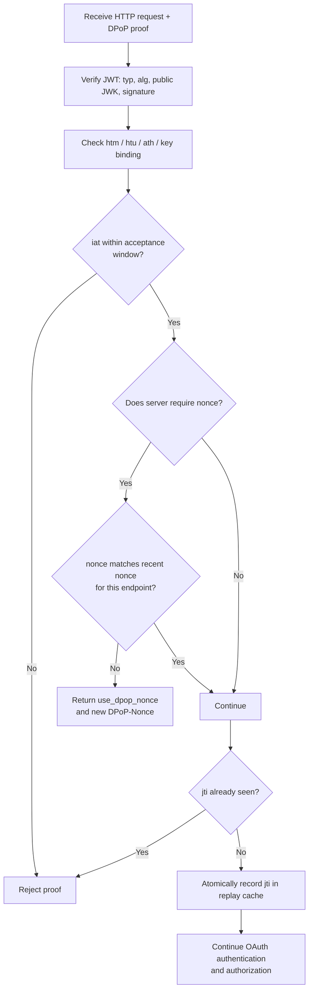
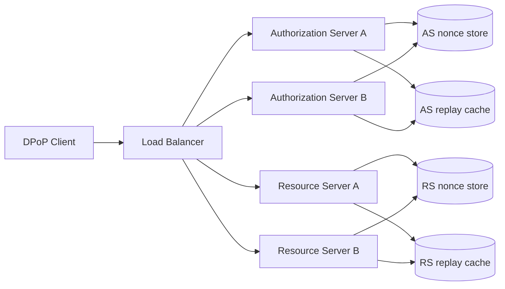
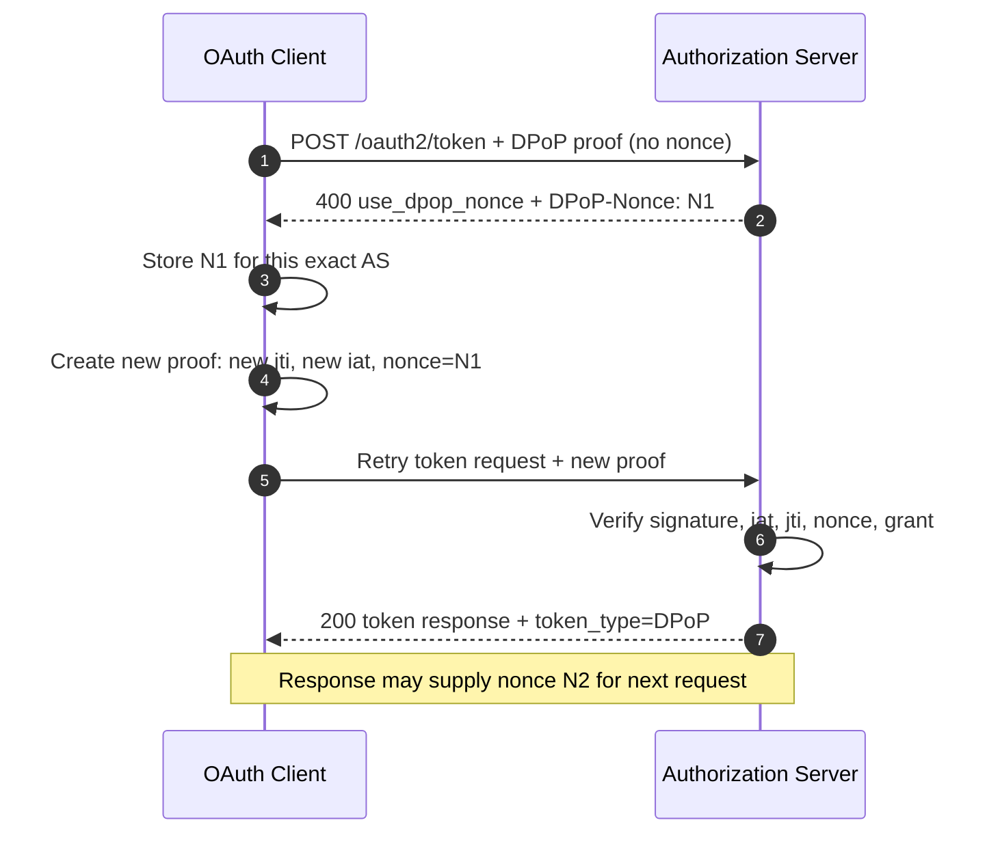
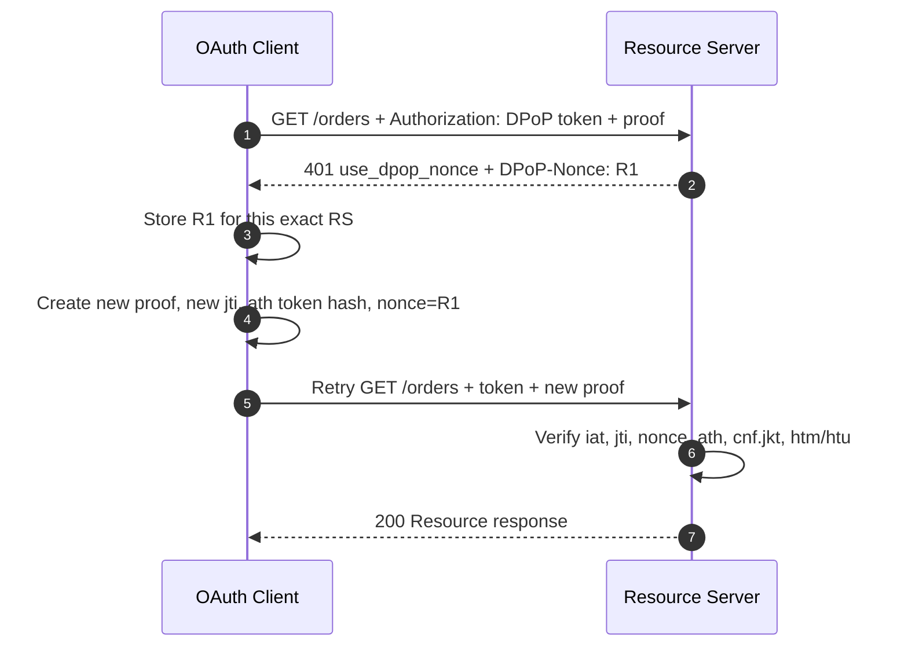

# Nonce, Replay Cache, and Proof Acceptance Time Limits

## 1. Why Does DPoP Need Nonces, a Replay Cache, and Time Limits?

**DPoP (Demonstrating Proof of Possession)** is an OAuth 2.0 sender-constraining mechanism standardized in **RFC 9449**. Rather than relying solely on the client holding a bearer access token, DPoP requires the client to sign a proof JWT with its private key and send the proof in the `DPoP` HTTP header. The Authorization Server binds the access token to the corresponding public key; the Resource Server verifies the proof and key binding when the token is used.

DPoP reduces the risk of an attacker stealing an access token and using it on another device. However, if an attacker captures **the signed proof JWT as well**, they can attempt to replay that proof to the same endpoint while the proof remains acceptable. A compromised client could also pre-generate a proof for a future timestamp and transfer it to another device. Therefore, verifying the signature and `htm`/`htu` alone is insufficient to stop all forms of replay.

In the **SPRING_SECURITY_OAUTH2_OIDC_AUTHORIZATION_SERVER** module, we learn how to design, configure, secure, test, and operate an OAuth 2.0/OpenID Connect Authorization Server using **Spring Security and Spring Authorization Server in Spring Boot**. This lesson belongs to the **DPoP** chapter and focuses on three coordinated controls:

1. **Proof acceptance time limits:** accept `iat` only within a server-controlled time window.
2. **Replay cache for `jti`:** record used proofs and reject reuse while the proof remains valid.
3. **Server-provided nonce:** the server issues a challenge via `DPoP-Nonce`; the client embeds the nonce in the next proof so the server restricts proofs generated long in advance.

These three mechanisms play different roles. `iat` bounds proof age, `jti` distinguishes individual proofs and enables replay detection, and `nonce` binds the proof to a recent challenge issued by that exact server. **A nonce is not inherently single-use**; RFC 9449 allows the client and server to reuse the same nonce while it remains valid, provided the server still tracks `jti` and rejects duplicate proofs.

### Learning Outcomes

After this lesson, you will be able to:

- Accurately describe `iat`, `jti`, `nonce`, `htm`, `htu`, `ath`, and their relationship with the public key.
- Choose proof acceptance windows, clock skew, and replay record retention times.
- Design a cache with atomic writes, bounded size, and cross-node sharing.
- Distinguish Authorization Server nonces from Resource Server nonces and OIDC `nonce`.
- Handle `use_dpop_nonce`, the `DPoP-Nonce` header, retries with fresh proofs, and cache headers properly.
- Integrate Spring Security's built-in DPoP validators, recognize the limitations of default caches, and test multi-instance deployments.

**Version scope:** Spring sections reference Spring Security 6.5.x/7.1.x and Spring Authorization Server 1.5.x or the integrated Authorization Server line in Spring Security 7.x. DPoP APIs and replay validator customization vary across versions; inspect the dependencies and Javadoc of your exact running line. Resource Server configuration examples use the Spring Security 7.1+ DPoP DSL.

## 2. Which Claims Appear in a Proof JWT?

A DPoP proof is a JWT signed by the client using its private key. The minimal header contains:

| Header | Meaning |
| --- | --- |
| `typ` | Must be `dpop+jwt`, distinguishing proofs from other JWTs |
| `alg` | Supported asymmetric signature algorithm; must not be `none` or symmetric MAC |
| `jwk` | Public JWK used to verify the signature; must never contain a private key |

Basic payload:

| Claim | Meaning | Requirement |
| --- | --- | --- |
| `jti` | Unique ID of the proof JWT | Required; collision probability must be negligible within the same context and validity window |
| `htm` | HTTP method of the request protected by the proof | Required; must match the actual method |
| `htu` | Target HTTP URI of the request, excluding query and fragment | Required; must match the actual URI per normalization rules |
| `iat` | Time the proof was created | Required; must fall within the server's acceptance window |
| `ath` | SHA-256 hash of the access token | Required when the proof is sent alongside an access token to a Protected Resource |
| `nonce` | Recent nonce issued by the AS or RS | Required when the corresponding server has supplied a nonce and requires its use |

Illustrative payload for a request to a Resource Server:

```json
{
  "jti": "5b8d5c17-9d2a-4f4e-9f80-1dceab4b1201",
  "htm": "GET",
  "htu": "https://orders.example.com/api/orders",
  "iat": 1794820200,
  "ath": "BASE64URL_SHA256_OF_ACCESS_TOKEN",
  "nonce": "OPAQUE_SERVER_NONCE"
}
```

These values are illustrative only. `ath` is the unpadded base64url encoding of the SHA-256 hash over the ASCII bytes of the access token. Never include query strings or fragments in `htu`. The nonce is an opaque server-issued string; clients must not fabricate it or decode it to infer server time.

### 2.1. `jti` Must Be Fresh for Every HTTP Request

RFC 9449 requires `jti` to be generated such that collision probability with another proof in the same context and validity window is negligible. The specification suggests at least **96 bits of pseudorandom data** or a version 4 UUID.

A proof JWT is not reusable across multiple requests. The client must generate a new proof for each request, including when:

- Two requests call the same endpoint.
- The client retries an idempotent request after a network failure.
- The client resends the same access token.
- The client receives `use_dpop_nonce` and must resend the request after receiving a new nonce.

Every retry needs a fresh `jti`, fresh `iat`, and fresh signature. If the server received the first request but the response was lost, resending the old proof can be rejected by the replay cache. The client must generate a new proof; for non-idempotent business requests, the client also needs a separate idempotency mechanism to avoid executing the action twice.

**Distinguishing RFC requirements from deployment hardening:** RFC 9449 requires the server to bound proof acceptance time. The specification notes that servers *may* store `jti` within that window to prevent the same proof from being used multiple times; strict single-use checking creates strong replay resistance, though it can be harder to deploy across servers without shared state. This lesson designs the replay cache as a strong control for systems needing cross-instance replay protection, without claiming the RFC mandates a distributed cache for every deployment.

### 2.2. `nonce` Does Not Replace `jti`

`nonce` is a server challenge that can be retained and reused across multiple proofs until the server provides a newer nonce. `jti` identifies **one specific proof**. Therefore:

- Multiple distinct proofs may carry the same still-valid nonce.
- Each proof must still have a distinct `jti`.
- If the exact same proof JWT is resent, the server rejects it via replay detection even if the nonce is still valid.
- If the nonce is stale or not issued by that exact server, the server rejects the proof even if `jti` has never been seen.

Do not delete a nonce from the store merely because a first request used it; doing so causes concurrent requests or valid subsequent proofs to be falsely rejected.

## 3. The Three Controls and Their Relationship

| Control | Question Answered | Mechanism | Does Not Solve |
| --- | --- | --- | --- |
| **Time `iat`** | Was the proof created within the server's accepted time range? | Compares `iat` against server clock and clock skew | Does not detect a valid proof sent twice |
| **Replay cache `jti`** | Has this proof ID already been accepted? | Atomically records `jti` and rejects duplicates | Does not prevent a client from pre-generating proofs hours ahead if `iat` is set in a valid future window or no nonce policy applies |
| **Server nonce** | Does the proof include a recent challenge issued by that exact endpoint? | `DPoP-Nonce` response header and `nonce` claim in proof | Does not replace `jti` replay cache; nonces can be reused |



The diagram shows the conceptual validation groups. Internal ordering may differ by framework; what matters is that the request must not proceed if the proof has an invalid signature, mismatched request binding, excessive age, missing required nonce, or replay.

## 4. Proof Acceptance Time Limits (`iat`)

### 4.1. Why Must Proofs Be Short-Lived?

If a server verifies only signature, `htm`, and `htu`, a stolen proof JWT can still be replayed against the same endpoint/method. `iat` enables the server to limit how long a proof is accepted. **RFC 9449 §11.1 requires servers to accept DPoP proofs only for a limited time after creation**, recommending a relatively short window on the order of seconds or minutes.

A DPoP proof is not required to include an `exp` claim under the minimal RFC 9449 structure. Servers typically use `iat` plus an acceptance time window to decide whether the proof is still valid. Therefore, never assume that omitting `exp` gives a proof an infinite lifetime.

### 4.2. Time Window Formula

A common policy uses a symmetric clock skew `S`:

```text
now - S <= iat <= now + S
```

Where:

- `now` is the current time according to the server's clock.
- `S` is the allowed clock skew.
- Proofs with `iat` older than `now - S` are rejected.
- Proofs with `iat` farther in the future than `now + S` are rejected.

Example with `S = 30 seconds` and current server time 12:00:00:

| Proof `iat` | Result |
| --- | --- |
| 11:59:20 | Reject: older than 30-second window |
| 11:59:35 | Accepted for time check |
| 12:00:00 | Accepted for time check |
| 12:00:20 | Acceptable within future clock skew |
| 12:01:00 | Reject: too far in the future |

This is an illustrative example only. A system can configure asymmetric past and future windows if the validator supports it; not every deployment needs a symmetric value.

### 4.3. There Is No Single Number Suitable for All Systems

Choose the window based on:

- Actual clock drift across clients, gateways, AS, and RS.
- p95/p99 network latency, geographic regions, and retries.
- Request volume, API sensitivity, and impact of a stolen proof.
- Ability to use server-provided nonces to rely on server time rather than trusting client clocks completely.
- Time synchronization via NTP or infrastructure clock management.

Too wide a window increases the period during which an attacker can replay a proof. Too narrow a window causes legitimate clients to fail due to clock drift or network jitter. Do not set several minutes just to mask clock issues when better clock synchronization is possible.

### 4.4. Clock Skew Is Not the Access Token Lifetime

Three distinct durations must be separated:

| Duration | Applies to | Purpose |
| --- | --- | --- |
| DPoP proof acceptance window | Proof JWT (`iat`) | Limits how long a proof can be used |
| Nonce validity window | Nonce issued by an AS/RS | Limits proofs generated before the server issued a challenge |
| Access token lifetime | Access token | Limits how long APIs accept the token per token policy |

A valid access token does not permit an expired proof to be used. A fresh proof does not shorten an access token's expiry. A valid nonce does not extend the lifetime of a proof whose `iat` is too old.

### 4.5. Future `iat` and Clock Offset

RFC 9449 permits servers to accept `iat` slightly in the future (on the order of seconds or minutes) to tolerate clock offset. However, a malicious client could craft proofs with `iat` far in the future, sign them with its private key, and store them for later use. If a server accepts a wide `iat` window, an attacker can exploit it to pre-generate proofs.

Server-provided nonces reduce reliance on client clocks. The server can encode or store the server-side issuance timestamp of the nonce and use it to bound the proof. The client treats the nonce solely as an opaque string; only the server interprets and verifies issuance time/context.

## 5. Replay Cache for `jti`

### 5.1. Single-Use Flow

Once a proof passes structure, signature, request binding, and time validation:

1. Extract `jti` from the verified payload.
2. Construct a properly namespaced cache key, usually based on a hash of `jti` and/or proof context.
3. Perform an **atomic insert-if-absent** operation.
4. If the key already exists, reject the proof as a likely replay.
5. If insertion succeeds, proceed with processing the request.
6. Retain the record until the proof is no longer within the acceptable time window.

Crucially, checking and recording must be **atomic**. If two nodes receive the same proof nearly simultaneously, both must never read "absent" and both allow the request through.

### 5.2. Record Retention Time

The replay cache must retain `jti` for at least the entire duration the server could still accept the corresponding proof. If an entry is deleted too early, an old proof could be resent while still within its acceptance window.

Example:

```text
Proof iat:             12:00:00
Proof acceptance ends: 12:00:30
Replay cache expiry:   no earlier than 12:00:30
```

If the server accepts proofs with a future `iat`, cache expiration must account for that policy as well. Do not hardcode a 5-second cache TTL when the proof window can be 30 or 60 seconds.

Spring Security's `DPoPProofReplayValidator` keeps `jti` in the cache until the proof expires; the Javadoc describes the cache expiration time as `iat + clockSkew`. The validator's default `clockSkew` is **30 seconds**. This is the class default, not a mandatory RFC value, and may not fit every deployment.

### 5.3. Cache Must Support Atomic Writes

Operations must guarantee:

- `putIfAbsent` or an equivalent operation with atomic semantics.
- A `jti` can only be inserted successfully once within the check namespace.
- Records have explicit expiration and are not purged prematurely.
- Multiple instances observe the same state.
- Cache errors must not turn into "no replay found so allow" if the system requires fail-closed replay protection.

If the cache loses data on restart or evicts entries when full, previously used proofs could be accepted again. Therefore, capacity/eviction policies and behavior when the cache is unavailable are part of security design.

With a distributed cache adapter for `DPoPProofReplayValidator`, read the expiration metadata attached to the cache value and set the TTL accordingly; do not leave entries immortal and do not delete them before the proof leaves the acceptance window. Spring's `Cache` abstraction does not automatically guarantee identical TTL or atomicity semantics across all providers, so verify the actual implementation.

### 5.4. Memory Bounds and Cache Flooding Defense

An attacker could send huge numbers of proofs with distinct `jti` values to fill the cache. You must:

- Reject overly long or malformed `jti` values.
- Store a hash of `jti` rather than arbitrary oversized strings.
- Bound cache size and request counts per key thumbprint/client where appropriate.
- Set TTL based on how long a proof can remain valid.
- Monitor cache hits, replay rejections, evictions, capacity, and write failures.
- Apply complementary rate limiting to stop clients from generating proofs at abnormal rates.

Never mitigate flooding by randomly evicting `jti` entries that are still inside the validity window, as evicted entries could allow replays.

## 6. Nonces Issued by the Authorization Server or Resource Server

### 6.1. Purpose of a Nonce Challenge

A server-provided nonce forces the client to prove the proof was created **after receiving a challenge issued by the server**. This prevents a client from pre-generating proofs hours or days in advance and transferring them to another device for later use.

The nonce is an opaque value and **must be unpredictable**. The server may issue a nonce when:

- The client sends a DPoP proof without a nonce when the server requires one.
- The nonce in the proof does not match any currently accepted nonce.
- The server decides to rotate nonces per policy.

RFC 9449 lets the server decide when to issue a fresh nonce. There is no single mandatory frequency or TTL across all deployments.

### 6.2. Challenge from the Authorization Server

When the Token Endpoint requires a nonce and the proof lacks a valid nonce, the Authorization Server returns an OAuth error:

```http
HTTP/1.1 400 Bad Request
Content-Type: application/json
Cache-Control: no-store
DPoP-Nonce: AS_NONCE_VALUE

{
  "error": "use_dpop_nonce",
  "error_description": "Authorization server requires a recent DPoP nonce"
}
```

The client must:

1. Read `DPoP-Nonce` from the response header.
2. Store the nonce scoped to the exact Authorization Server/issuer.
3. Generate a **new proof JWT** with the `nonce` claim containing the received value.
4. Use a fresh `jti` and fresh `iat`.
5. Retry the Token Endpoint request under a safe retry policy.

Never resend the exact old proof after receiving a challenge; the old proof lacks the nonce or carries a mismatched nonce, and the old `jti` may already be recorded in the replay cache.

### 6.3. Challenge from the Resource Server

The Resource Server can require a nonce independently of the Authorization Server. Per RFC 9449, the Resource Server returns HTTP 401 and specifies the challenge in `WWW-Authenticate`:

```http
HTTP/1.1 401 Unauthorized
WWW-Authenticate: DPoP error="use_dpop_nonce", error_description="Resource server requires a recent nonce"
DPoP-Nonce: RS_NONCE_VALUE
Cache-Control: no-store
```

The client generates a new proof containing the nonce issued by **that Resource Server** and resends the request. Never take an Authorization Server's nonce and embed it into a proof for a Resource Server.

### 6.4. AS and RS Nonces Are Two Separate Spaces

| Attribute | Authorization Server nonce | Resource Server nonce |
| --- | --- | --- |
| Issuing server | Authorization Server | Resource Server |
| Subsequent request | Token Endpoint | Protected Resource Endpoint |
| Challenge response | HTTP 400 + OAuth `use_dpop_nonce` + `DPoP-Nonce` | HTTP 401 + `WWW-Authenticate: DPoP error="use_dpop_nonce"` + `DPoP-Nonce` |
| Usage scope | Only at the issuing AS | Only at the issuing RS |
| Purpose | Limits proof pre-generation for token requests | Limits proof pre-generation/replay for API requests |

If a client talks to multiple AS/RS endpoints, store nonces per endpoint/issuer. Never use a single global `currentNonce` variable across all hosts.

Once a server has supplied a nonce to a client, the server **MUST NOT accept proofs omitting the `nonce` claim**. Allowing the nonce to be dropped on a later request lets an attacker downgrade the client back to challenge-less proofs and bypass pre-generation protections.

### 6.5. Client Receiving a New Nonce in a Successful Response

A server can also send `DPoP-Nonce` in an HTTP 200 response instead of forcing the client through an extra round trip for a challenge. When a successful response carries a new nonce:

- The client **MUST** use the new nonce on the next request to that server and continue using it on subsequent requests until a newer nonce is received.
- Responses containing `DPoP-Nonce` should not be cached, e.g., using `Cache-Control: no-store`, so clients do not receive stale nonces from HTTP caches.
- The server must not emit more than one `DPoP-Nonce` header in the same response.

Example:

```http
HTTP/1.1 200 OK
Content-Type: application/json
Cache-Control: no-store
DPoP-Nonce: NEXT_NONCE_VALUE

{
  "access_token": "ACCESS_TOKEN_PLACEHOLDER",
  "token_type": "DPoP",
  "expires_in": 600
}
```

### 6.6. CORS and Browser-Based Clients

Browser JavaScript cannot read all response headers by default. If an SPA needs to read `DPoP-Nonce`, the server must expose the header:

```http
Access-Control-Expose-Headers: DPoP-Nonce
```

Also configure CORS with explicit origins, required methods/headers, and appropriate credential policies. For a Resource Server, browser clients may need to read both `DPoP-Nonce` and `WWW-Authenticate`, so expose those exact headers. Never open CORS to `*` just to let clients read nonces. DPoP nonces do not replace `state`, PKCE, or CSRF protection.

## 7. Is a Nonce Single-Use?

**No. This is very easy to implement incorrectly.**

RFC 9449 distinguishes server-provided nonces from cryptographic one-time challenges. A client can reuse the same nonce across multiple proofs, and the server can accept the same nonce multiple times. The condition is that the server still tracks `jti` and rejects used proofs while that nonce remains valid.

Example:

| Request | Nonce | `jti` | Result |
| --- | --- | --- | --- |
| Request A | `N1` | `J1` | Accepted; record `J1` |
| Request B | `N1` | `J2` | Accepted; `J2` is new, `N1` still valid |
| Replay A | `N1` | `J1` | Rejected because `J1` already appeared |
| Request C | `N1` | `J3` | Accepted if `N1` is still within nonce window |
| Request D | Stale `N0` | `J4` | Rejected because nonce is no longer accepted |
| Request E | New `N2` | `J5` | Accepted after client received `N2` from server |

If `N1` were deleted immediately after Request A, Request B could be rejected despite being completely valid. If `N1` were kept indefinitely, pre-generated proofs could keep working; hence nonces need a validity window or controlled rotation.

### 7.1. Retaining a Window of Recent Nonces

The RFC notes that clients typically only need to retain **one current nonce**, while servers keep a **window of recent nonces** to handle brief client/server desynchronization. When the server issues a new nonce, the client updates its current value; the server can continue accepting a few prior nonces during a policy-defined overlap period.

An implementation policy might:

- Issue a new nonce after a number of requests, after a time interval, or based on risk.
- Accept the most recently issued nonce plus a few recent nonces briefly to handle concurrent requests.
- Scope nonces to the exact AS/RS and optionally to the key thumbprint/client context.
- Reject nonces that were never issued, are too old, or belong to the wrong endpoint or context.
- Purge nonce state once the window expires; never treat nonces as long-lived session credentials.

Overlap duration should reflect real latency and concurrency. Do not blindly enforce one specific TTL from a documentation example across all systems.

### 7.2. How Nonce and `jti` Cooperate Against Two Attack Types

| Scenario | How does Nonce help? | How does Replay cache help? |
| --- | --- | --- |
| Attacker pre-generates proofs hours ahead | Server can require a recently issued nonce; old proofs lack a matching challenge | If `jti` is fresh the cache has not seen it, so replay cache alone does not stop pre-generation |
| Attacker captures a current proof and replays it | Nonce may still be valid and allowed for reuse | Cache detects `jti` was already used |
| Client sends a valid proof with an old nonce | Rejects nonce no longer in window | `jti` may be unseen; replay cache does not replace nonce checking |
| Two valid requests use the same nonce | Accepted if nonce is still valid | Distinct `jti` values allow both requests |

## 8. Designing Nonce Stores and Replay Caches in Multi-Node Environments

### 8.1. Two Distinct Types of State

| State | Data to store | Retention time |
| --- | --- | --- |
| Nonce store | Issued nonces, endpoint/issuer, issuance/expiration timestamps, and context binding if any | Within the recent nonce window |
| Replay cache | Used `jti`, proof `iat`, expiration time, and required key thumbprint/context | Until the proof is no longer acceptable |

Do not merge both state stores into a single nonce set. Nonces can be reused; `jti` must distinguish individual proofs. If one cache record represents both concepts without clear semantics, it is easy to purge nonces too early or fail to block replays.

### 8.2. Multi-Instance Model



If node A accepts a proof and stores `jti` in local memory, and node B later receives a replay, B does not know the proof was used. Similarly, if node A issues a nonce that node B does not recognize, the client faces repeated challenges or valid requests get rejected.

For clusters:

- Use a shared store/cache for nodes belonging to the same AS or the same RS.
- Ensure `putIfAbsent` is atomic cluster-wide.
- Use separate namespaces for the AS issuer and each RS/resource origin.
- Store expiration timestamps and clean up entries once proofs/nonces are no longer valid.
- Handle cache connectivity errors fail-closed if policy demands strict replay resistance.
- Test Request A hitting node 1 followed by replaying the same proof to node 2.

**AS and RS do not share a nonce namespace.** They can share the same Redis/cluster infrastructure, but keyspaces, issuers/endpoints, and policies must remain separate.

### 8.3. Choosing a Race-Safe Cache

A distributed cache needs semantics equivalent to:

```text
insertIfAbsent(key, value, expiresAt)

if inserted:
    accept proof
else:
    reject replay
```

Do not implement this as a separate `GET` followed by `PUT`; two nodes could both observe the key as absent. Redis can use an operation equivalent to `SET NX` with expiration; other stores must provide an equivalent transaction/atomic compare-and-set. This illustrates the required semantics, not a verbatim command for every cache provider.

## 9. Spring Security and Spring Authorization Server

### 9.1. DPoP Support in Spring

Spring Security 6.5 and Spring Authorization Server 1.5 support DPoP-bound access tokens. In the flow, the client sends a DPoP proof in the `DPoP` header to the Token Endpoint; the Authorization Server verifies the proof and binds the access token to the public key via the `cnf.jkt` confirmation claim. Successful responses use `token_type: DPoP`.

On the Resource Server, Spring Security 7.1 provides the `dPoP()` DSL to verify proofs and bindings of DPoP-bound access tokens. Do not assume that merely enabling JWT Resource Server enables DPoP validation.

### 9.2. Spring's Proof Replay Validator

Spring Security provides `org.springframework.security.oauth2.jwt.DPoPProofReplayValidator` to:

- Require the proof to have `iat` within a configured time window.
- Require the proof to have an unused `jti`.
- Use a Spring `Cache` to store `jti` and related metadata.
- Retain `jti` until the proof expires per `iat + clockSkew`.

The Javadoc notes this class exists since Spring Security **6.5.12**; the default `clockSkew` is **30 seconds**. For `InMemoryCache`, current docs specify defaults of up to **100,000 entries** and **1,000 requests per JWK thumbprint**. These numbers are implementation defaults, not RFC mandates.

### 9.3. Example Validator Configuration

The following example shows creating the validator with a cache:

```java
import java.time.Duration;

import org.springframework.cache.Cache;
import org.springframework.security.oauth2.jwt.DPoPProofReplayValidator;

public final class DPoPReplayConfiguration {

    private DPoPReplayConfiguration() {
    }

    public static DPoPProofReplayValidator replayValidator(Cache sharedCache) {
        DPoPProofReplayValidator validator =
                new DPoPProofReplayValidator(sharedCache);
        validator.setClockSkew(Duration.ofSeconds(30));
        return validator;
    }
}
```

`sharedCache` must be an implementation with atomic write semantics and proper expiration. When running a single node for learning or testing, you can use:

```java
import org.springframework.security.oauth2.jwt.DPoPProofReplayValidator;

var localCache = new DPoPProofReplayValidator.InMemoryCache();
localCache.setMaxSize(100_000);
localCache.setMaxRequestsPerKey(1_000);
```

**Do not use the default `InMemoryCache` in a production cluster.** The Javadoc explicitly states this cache only works for a single node; clustered deployments require a distributed `Cache` such as Redis or Hazelcast. When using a distributed cache, the adapter must preserve the `putIfAbsent`/expiry semantics expected by the validator.

### 9.4. Wiring the Validator into the Proof Decoder Factory

`DPoPProofJwtDecoderFactory` provides the default decoder and validators for request binding claims, timestamps, key thumbprint, access token hash, and `jti`. When adding a custom replay cache, preserve the default checks and add the validator backed by the shared cache:

```java
import java.util.List;

import org.springframework.cache.Cache;
import org.springframework.security.oauth2.jwt.DPoPProofJwtDecoderFactory;
import org.springframework.security.oauth2.jwt.DPoPProofReplayValidator;

public final class DPoPProofDecoderConfiguration {

    private DPoPProofDecoderConfiguration() {
    }

    public static DPoPProofJwtDecoderFactory decoderFactory(Cache sharedCache) {
        DPoPProofReplayValidator replayValidator =
                new DPoPProofReplayValidator(sharedCache);

        DPoPProofJwtDecoderFactory factory = new DPoPProofJwtDecoderFactory();
        factory.setJwtValidatorFactory(
                DPoPProofJwtDecoderFactory.createDefaultJwtValidatorFactory(
                        List.of(replayValidator)));
        return factory;
    }
}
```

This is a validator wiring pattern per the Spring Security API available since 6.5.12. Check your exact version because the default validator chain and internal cache can change across patch releases. The goal is **not to lose the default `htm`, `htu`, `iat`, `jkt`, `ath`, and `jti` checks**, while ensuring a shared replay check across nodes. If your version already includes a default replay validator, adding a shared validator may introduce an extra local check; optimize the chain only after verifying the exact behavior of your version.

### 9.5. Resource Server DSL in Spring Security 7.1+

Configuration example:

```java
import org.springframework.context.annotation.Bean;
import org.springframework.context.annotation.Configuration;
import org.springframework.security.config.Customizer;
import org.springframework.security.config.annotation.web.builders.HttpSecurity;
import org.springframework.security.oauth2.jwt.DPoPProofContext;
import org.springframework.security.oauth2.jwt.JwtDecoderFactory;
import org.springframework.security.web.SecurityFilterChain;

@Configuration
public class DPoPResourceServerConfiguration {

    @Bean
    SecurityFilterChain apiSecurity(
            HttpSecurity http,
            JwtDecoderFactory<DPoPProofContext> dPoPProofDecoderFactory)
            throws Exception {

        http
            .authorizeHttpRequests(authorize ->
                    authorize.anyRequest().authenticated())
            .oauth2ResourceServer(oauth2 -> oauth2
                .jwt(Customizer.withDefaults())
                .dPoP(dPoP -> dPoP.dPoPProofVerifierFactory(
                        dPoPProofDecoderFactory)));

        return http.build();
    }
}
```

The `.dPoP(...)` DSL here follows Spring Security 7.1.x documentation. Do not copy this configuration verbatim to Spring Security 6.5 if that version's API lacks the same DSL; check your specific version. This configuration illustrates the Resource Server; the Authorization Server has its own proof verification pipeline at the Token Endpoint.

### 9.6. Does Spring Automatically Implement Nonce Challenges?

Do not assume DPoP support automatically includes the entire nonce protocol. Current Spring Security documentation describes proof verification and default validators for `htm`, `htu`, `iat`, `jkt`, `ath`, and `jti`; that list does not describe a built-in mechanism to emit `DPoP-Nonce`, handle `use_dpop_nonce`, or store/validate nonces.

If your threat model requires server-provided nonces, you must add:

1. A nonce issuer/store at the Authorization Server and/or Resource Server.
2. Logic returning `DPoP-Nonce` with `use_dpop_nonce` and proper HTTP status/headers.
3. A validator verifying `nonce` in the proof against the exact issuer/endpoint and recent nonce window.
4. Client retry logic creating a new proof with a fresh `jti`.
5. Cache headers, CORS expose headers, and integration tests.

Specific extension points depend on your version and filter/provider pipeline. Do not add a standalone controller outside DPoP validation and treat it as a complete implementation; nonces must be checked in the same request context that verified signature, client/key binding, and endpoint.

## 10. Nonce Service Implementation Pattern

### 10.1. Service Interface

A nonce service can be designed around these operations:

```java
import java.time.Instant;

public interface DPoPNonceService {

    String issueNonce(
            String issuerOrResourceId,
            String jwkThumbprint,
            Instant issuedAt,
            Instant expiresAt);

    boolean isRecentlyIssued(
            String issuerOrResourceId,
            String jwkThumbprint,
            String nonce,
            Instant now);
}
```

This interface is an architectural example, not a built-in Spring interface. An implementation must:

- Generate nonces with a CSPRNG, never a counter or raw predictable timestamp.
- Store mapping of nonce → issuer/resource, issuance time, expiration time, and context binding.
- Retain a window of recent nonces to handle concurrency/rotation.
- Not consume the nonce on first use.
- Purge nonce state upon expiration.
- Never write raw nonces to logs or metrics.

If the nonce encodes a server timestamp protected by a MAC or maps to server-side state, only the server can verify issuance time. The client simply stores and echoes back the opaque string.

### 10.2. Nonce Validation Pseudocode

```text
function validateProofNonce(proof, endpointContext):
    if endpointContext.dpopNonceRequired is false:
        return ACCEPT_NONCE_CHECK

    if proof.nonce is missing:
        return CHALLENGE_WITH_NEW_NONCE

    if nonceStore.wasIssuedRecently(
            endpointContext.issuerOrResource,
            proof.jwkThumbprint,
            proof.nonce):
        return ACCEPT_NONCE_CHECK

    return CHALLENGE_WITH_NEW_NONCE

function challengeClient():
    nonce = nonceService.issueNewUnpredictableNonce()
    return OAuth error use_dpop_nonce + DPoP-Nonce header
```

This is only the nonce check step; the request must still pass signature, `typ`, `alg`, `jwk`, `htm`, `htu`, `iat`, `ath`, key binding, and replay cache checks. Do not return `use_dpop_nonce` for a request with invalid client authentication or a malformed proof if doing so creates an unnecessary side channel.

### 10.3. Rotation and Concurrent Requests

Suppose a client sends 4 concurrent requests, all using nonce `N1`. The server might receive the first request and emit nonce `N2` in the response. The remaining three requests carrying `N1` may already be in flight.

If the server deletes `N1` immediately, the remaining requests will be challenged again even though they were created while `N1` was valid. A short nonce window allows the server to accept `N1` during the overlap period while the client transitions to `N2` for subsequent requests.

To avoid races:

- The client updates its nonce from the latest response from that exact endpoint.
- The server retains recent nonces per policy rather than overwriting a single value instantaneously.
- Each request still uses its own `jti`.
- Upon receiving `use_dpop_nonce`, the client creates a new proof and retries within a bounded retry limit.
- Do not retry infinitely if the server keeps returning nonce mismatches; record a metric and fail per policy.

## 11. Client Handling of Nonce Challenges and Retries

### 11.1. Token Endpoint Flow



### 11.2. Protected Resource Flow



### 11.3. Never Reuse a Proof on Retry

Incorrect retry pattern:

```text
1. Send proof P1 with jti=J1, no nonce.
2. Server returns use_dpop_nonce.
3. Client adds nonce to the request but resends JWT P1.
```

Correct pattern:

```text
1. Send proof P1 with jti=J1.
2. Server returns use_dpop_nonce and nonce N1.
3. Client creates proof P2:
       jti = J2 (fresh)
       iat = current timestamp
       nonce = N1
       htm / htu = outgoing request
       ath = access token hash if calling Resource Server
4. Sign P2 with corresponding private key and retry.
```

If a prior request might have been executed but the response was lost, business-level retries must consider idempotency keys. DPoP `jti` only prevents proof replay; it does not guarantee a business operation executes only once.

## 12. Common Implementation Mistakes

| Mistake | Consequence | Fix |
| --- | --- | --- |
| Verifying signature only, ignoring `iat` | Stolen proofs can be reused longer than needed | Short proof window, check clock skew |
| Not storing used `jti` | Same proof can be replayed within the time window | Single-use replay cache |
| Local cache in multi-node setup | Replays to another node do not see prior entries | Shared distributed cache, atomic inserts |
| Separate `GET` then `PUT` | Two nodes can both accept the same proof | Atomic `putIfAbsent`/CAS |
| Cache TTL shorter than proof acceptance window | Entry vanishes while proof is still valid | Retain `jti` until acceptance window ends |
| Evicting live entries when cache fills | Old proofs can be replayed | Capacity planning, bounded input, never evict live entries arbitrarily |
| One global nonce across all servers | AS nonce may be sent mistakenly to RS | Namespace by issuer/resource endpoint |
| Treating nonce as one-time-use | Concurrent requests with valid nonce get rejected | Nonce window; `jti` is the single-use identifier |
| Reusing `jti` on retry | Retry request rejected by replay validator | Generate a new proof with a fresh `jti` |
| Overly wide `iat` window | Increases replay/pre-generation window | Tighten clock skew, sync clocks, consider nonces |
| Overly narrow `iat` window | Legitimate clients fail due to clock drift/network | Measure real clock skew and latency |
| Trusting far-future `iat` | Proofs can be pre-generated | Limit future skew, use server nonces |
| Dropping nonce after one use | Next valid request gets challenged unnecessarily | Keep nonce for server-allowed lifetime |
| Caching responses containing `DPoP-Nonce` | Client receives stale nonce and retries fail | `Cache-Control: no-store` |
| Forgetting to expose `DPoP-Nonce` via CORS | SPA cannot read nonce challenge | `Access-Control-Expose-Headers: DPoP-Nonce` |
| Using OIDC `nonce` instead of DPoP `nonce` | Mixes up two protocols and scopes | DPoP nonces are issued only by AS/RS |
| Skipping `ath` check at Resource Server | Proof can be paired with another access token | Compare token hash with `ath` |
| Enabling only JWT decoder without DPoP filter/provider | DPoP tokens may be treated as bearer depending on config | Use your version's Resource Server DPoP support |

## 13. Testing Nonces, Replay Caches, and Time Limits

### 13.1. Required Test Matrix

| ID | Scenario | Expected Result |
| --- | --- | --- |
| D01 | Proof with `iat` inside valid window, fresh `jti` | Passes time/replay checks |
| D02 | Proof too old | Rejected |
| D03 | Proof with `iat` too far in the future | Rejected |
| D04 | Proof with small future `iat` inside clock skew | Result per configured policy |
| D05 | Same proof sent twice to same endpoint | First may succeed; second rejected by replay cache |
| D06 | Same `jti` sent concurrently to two nodes | Only one request succeeds in inserting |
| D07 | Same nonce but distinct `jti` values | Accepted if nonce is still valid and other checks pass |
| D08 | Same nonce and same proof/`jti` resent | Rejected as replay |
| D09 | Missing nonce when server requires one | AS returns `use_dpop_nonce` + `DPoP-Nonce` |
| D10 | Wrong or server-unissued nonce | Rejected and may issue a new nonce |
| D11 | Nonce too old | Rejected |
| D12 | AS-issued nonce sent to RS | RS rejects as outside RS nonce namespace |
| D13 | Nonce issued by RS A sent to RS B | RS B rejects |
| D14 | Successful response contains a new nonce | Client uses new nonce on next request |
| D15 | Client retries with old proof | Rejected; client must generate a fresh `jti` |
| D16 | Client retries with new proof and valid nonce | Accepted if grant/token are valid |
| D17 | CORS SPA reads challenge response | `DPoP-Nonce` header is exposed |
| D18 | Response with `DPoP-Nonce` is cached | Test catches missing `no-store` |
| D19 | Cache full/eviction | Does not arbitrarily drop still-valid proof entries |
| D20 | Replay cache unavailable | Fail-closed or incident behavior per policy |
| D21 | Multi-node AS | Nonce and replay state consistent across AS nodes |
| D22 | Multi-node RS | Replay on another node is still detected |
| D23 | Client uses two AS instances | Nonces do not leak across issuers |
| D24 | Proof missing `ath` when calling Resource Server | Rejected |
| D25 | `ath` does not match access token | Rejected |
| D26 | `htm` or `htu` mismatch | Rejected |
| D27 | JWK contains private key or uses disallowed algorithm | Rejected |
| D28 | Overly long/malformed `jti` | Rejected before consuming excessive cache space |
| D29 | Cache restart mid-replay window | Assess replay state loss risk and recovery policy |
| D30 | Clock drift across nodes | Nodes enforce consistent window and clock policy |

### 13.2. Testing with a Controllable Clock

Do not use real `Thread.sleep()` for every time-based test. Use a fake `Clock` or `Clock.fixed(...)` where supported by the validator to test:

- Proofs well inside the window.
- Proofs right on the boundary.
- Proofs one second past the limit.
- Future proofs inside and outside clock skew.
- Cache entries expiring right when proofs become unacceptable.

`DPoPProofReplayValidator` provides `setClock(...)` and `setClockSkew(...)`, making deterministic tests easy to write. When testing the replay cache, also test two requests in parallel rather than only calling the validator sequentially.

### 13.3. Testing Race Conditions

An important test:

1. Create a single valid proof.
2. Send that same proof concurrently to two Resource Server instances.
3. Assert that at most one request passes the replay check.
4. Repeat when both instances share a distributed cache.

If both requests succeed, the cache is not atomic or the nodes do not share state. This is a security defect that must be fixed before production.

## 14. Operations and Observability

### 14.1. Useful Metrics

Track per endpoint/server and application version:

- Counts of accepted and rejected proofs.
- Rejection rates for overly old/future `iat`.
- Replay rejections by `jti`.
- `use_dpop_nonce` challenge counts.
- Retry success rate after nonce challenges.
- Nonce mismatches/stale nonces.
- Replay cache hits/misses/size/evictions/put-if-absent failures.
- Cache latency and distributed cache connection errors.
- Proof rejection rates for `ath`, `htm`, `htu`, and key thumbprint.

Never log raw proof JWTs, access tokens, private keys, or nonces. Use safe correlation IDs, endpoint IDs, and error categories.

### 14.2. Alerts to Have

- Replay cache grows abnormally fast or hits capacity.
- Sudden spike in `use_dpop_nonce` rate after a rollout.
- Nonce mismatches concentrated on one node or one region.
- Clock skew distribution exceeds policy thresholds.
- Distributed cache timeouts or lost connectivity.
- Many requests reusing the same `jti` or unusually long `jti` values.
- Clients repeatedly retrying the exact same proof instead of generating fresh proofs.

### 14.3. When the Cache Loses Data

If the replay cache is flushed or loses state, proofs still within the valid window could be replayed without an entry to detect them. You must:

- Restrict cache clear operations during active traffic.
- Configure persistence/replication matching your replay-protection SLA.
- After a cache incident, assess proofs still inside the acceptance window; consider temporarily rejecting DPoP requests or requiring clients to generate fresh proofs via the nonce workflow.
- Never increase clock skew to "reduce errors" while the cache is missing state.
- Record the incident and test recovery.

## 15. Production Checklist

**Proof validation**

- [ ] Check `typ=dpop+jwt`, asymmetric `alg`, public JWK, and signature.
- [ ] Check `htm`, `htu`, `iat`, and `ath` when the request carries an access token.
- [ ] Access token key binding `cnf.jkt` matches the thumbprint of the proof's public key.
- [ ] Each HTTP request carries a new proof and a unique `jti`.
- [ ] `iat` window is short, with appropriate clock skew and clock sync.

**Replay cache**

- [ ] Replay cache uses atomic insert-if-absent.
- [ ] `jti` entries are retained for the full proof validity window.
- [ ] Cache bounds size, `jti` input, and evictions.
- [ ] Clusters use a distributed cache; do not rely on local in-memory caches.
- [ ] Cache failures follow fail-closed behavior or an approved incident policy.

**Nonce**

- [ ] Nonces are generated with a CSPRNG and are unpredictable.
- [ ] AS and each RS have separate nonce namespaces.
- [ ] Nonces are bound to the proper issuer/endpoint and context.
- [ ] Nonce window allows concurrency/rotation; never delete on first use.
- [ ] `use_dpop_nonce` and `DPoP-Nonce` responses follow proper HTTP semantics.
- [ ] Clients retry with a new proof, fresh `jti`, and fresh `iat`.
- [ ] Responses containing new nonces are not cached; CORS exposes headers if needed.

**Spring and operations**

- [ ] Spring Security/SAS versions and DPoP APIs are verified as supported.
- [ ] Default validators are preserved; custom replay validators/caches are integrated and tested.
- [ ] Resource Server genuinely enables DPoP authentication.
- [ ] Never log proofs/tokens/nonces/private keys.
- [ ] Tests cover multi-node, concurrency, clock drift, cache failures, and nonce rotation.

## 16. References

- [RFC 9449 — OAuth 2.0 Demonstrating Proof of Possession (DPoP), §4.2–4.3](https://www.rfc-editor.org/rfc/rfc9449#section-4.2): proof JWT structure, `jti`, `htm`, `htu`, `iat`, `ath`, `nonce`, and validation.
- [RFC 9449 §8 — Authorization Server-Provided Nonce](https://www.rfc-editor.org/rfc/rfc9449#section-8): `DPoP-Nonce`, `use_dpop_nonce`, nonce windows, and rotation.
- [RFC 9449 §9 — Resource Server-Provided Nonce](https://www.rfc-editor.org/rfc/rfc9449#section-9): nonce challenges at Protected Resources.
- [RFC 9449 §11.1–11.3 — Replay, Pre-generation and Nonce Downgrade](https://www.rfc-editor.org/rfc/rfc9449#section-11.1): proof time limits, replay caches, and server-provided nonces.
- [Spring Security — OAuth 2.0 DPoP-bound Access Tokens](https://docs.spring.io/spring-security/reference/servlet/oauth2/resource-server/dpop-tokens.html): DPoP proofs, token binding, and Resource Server.
- [Spring Security API — DPoPProofReplayValidator](https://docs.spring.io/spring-security/reference/api/java/org/springframework/security/oauth2/jwt/DPoPProofReplayValidator.html): `iat`, `jti`, cache, clock skew, and entry expiration time.
- [Spring Security API — DPoPProofReplayValidator.InMemoryCache](https://docs.spring.io/spring-security/reference/api/java/org/springframework/security/oauth2/jwt/DPoPProofReplayValidator.InMemoryCache.html): single-node limitation, max size, and max requests per key.
- [Spring Security API — DPoPProofJwtDecoderFactory](https://docs.spring.io/spring-security/reference/api/java/org/springframework/security/oauth2/jwt/DPoPProofJwtDecoderFactory.html): validator factory and adding validators.
- [Spring Security — Protocol Endpoints](https://docs.spring.io/spring-security/reference/servlet/oauth2/authorization-server/protocol-endpoints.html): DPoP-bound access token requests at the Authorization Server.

**Conclusion:** DPoP is stronger when the server simultaneously bounds proof age, tracks `jti` to catch reused proofs, and requires recent nonces to limit pre-generated proofs. **Nonces can be reused; `jti` must be fresh for every proof.** The replay cache must retain state for the entire acceptance window and be shared across nodes. In Spring Security, `DPoPProofReplayValidator` provides the foundation for `iat`/`jti` checks, but its default cache is single-node only; server-provided nonces must be implemented and tested per RFC 9449 rather than assumed to be automatically active just because the system supports DPoP.
