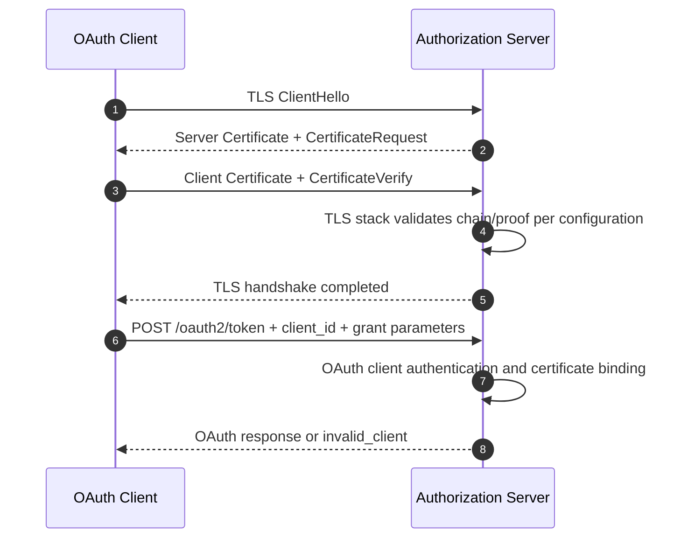

# Configuring tls_client_auth and self_signed_tls_client_auth

## 1. Problem: Authenticating OAuth Clients with Certificates

A `billing-worker` service needs to call the Token Endpoint to obtain an access token for a payment API. The familiar approach is sending `client_id` and `client_secret` via HTTP Basic. Shared secrets must be distributed, stored, rotated, and protected across multiple environments; if a secret is leaked, an attacker can impersonate the client until the credential is revoked.

**Mutual TLS (mTLS)** adds two-way authentication at the TLS layer: the client verifies the Authorization Server's certificate, and the server requests the client's certificate and checks proof of possession of the corresponding private key. OAuth 2.0 Mutual-TLS Client Authentication is standardized in **RFC 8705**.

RFC 8705 defines two client authentication methods using certificates:

- **`tls_client_auth`**: the PKI method, based on a certificate chain verified by a trusted CA and certificate subject information bound to the client.
- **`self_signed_tls_client_auth`**: the self-signed method, which does not rely on a CA chain; the Authorization Server compares the certificate in the TLS handshake against a certificate registered for the client via a JWK Set.

In Spring Authorization Server, these two methods are handled by the OAuth client authentication filter and `X509ClientCertificateAuthenticationProvider`. This lesson focuses on how to register clients, configure TLS, verify certificates, and operate securely in Spring Boot.

This lesson belongs to the **mTLS** chapter of the `SPRING_SECURITY_OAUTH2_OIDC_AUTHORIZATION_SERVER` module. The module's goal is **to learn how to design, configure, secure, test, and operate an OAuth 2.0/OpenID Connect Authorization Server using Spring Security and Spring Authorization Server in a Spring Boot application**.

### After this lesson, you will be able to

1. Distinguish between the TLS handshake, OAuth client authentication, and certificate-bound access tokens.
2. Choose `tls_client_auth` or `self_signed_tls_client_auth` based on the PKI model.
3. Configure `RegisteredClient` with `ClientSettings.x509CertificateSubjectDN` or `ClientSettings.jwkSetUrl`.
4. Set up TLS listeners, trust stores, and trust boundaries when terminating TLS at a reverse proxy.
5. Verify certificate chains, subject/SAN, validity, and the binding between client ID and certificate.
6. Enable certificate-bound access tokens and verify proof-of-possession at the Resource Server.
7. Test valid certificates, invalid certificates, rotation, revocation, and proxy forwarding.

> **Version scope:** Examples use APIs from Spring Authorization Server **1.5.8** and Spring Security 6.x. APIs may differ in other versions; verify against your deployed dependencies. The lesson's additional notes were left blank, with no special constraints.

## 2. What Protection Layers Does mTLS Provide?

In standard one-way TLS, the client verifies the server's certificate. In **mutual TLS**, the server also requests the client's certificate and checks proof of possession of the corresponding private key via the TLS handshake.



The TLS handshake happens **before the HTTP request**. The client certificate is not a JSON/form body field, not an Authorization header, and not an authorization grant. The server retrieves the certificate from the TLS connection provided by the web server/container, and then the OAuth authentication provider associates the certificate with `client_id`.

| Concept | Question Answered | Example |
| --- | --- | --- |
| **TLS server authentication** | Is the client connecting to the right Authorization Server? | Client verifies server certificate and hostname |
| **mTLS client authentication** | Does the connecting party possess the private key of the registered certificate? | Server receives certificate and verifies binding to the client |
| **Certificate-bound access token** | Does the caller to the Resource Server hold the exact certificate bound to the token? | Resource Server compares thumbprint in `cnf` |

OAuth client authentication and certificate-bound access tokens **can be used independently or combined** per RFC 8705. Enabling mTLS client authentication at the Token Endpoint does not automatically mean the Resource Server verifies certificate-bound access tokens.

## 3. Comparing the Two mTLS Methods

| Criterion | `tls_client_auth` (PKI) | `self_signed_tls_client_auth` |
| --- | --- | --- |
| Certificate | Issued within a PKI, typically by an internal/enterprise CA | Self-signed certificate managed by the client |
| Chain verification | TLS stack verifies chain up to a CA/trust anchor | Does not rely on a CA chain; application matches registered certificate |
| Client binding | Registered Subject DN or certificate attributes | Certificate in the client's JWK Set, represented via `x5c` |
| Primary Spring setting | `ClientSettings.x509CertificateSubjectDN` | `ClientSettings.jwkSetUrl` |
| Trust management | CA, intermediates, CRL/OCSP, or PKI procedures | Certificate registration/JWKS rotation and removing old certificates |
| Best suited for | Enterprises with a CA and centralized certificate lifecycle | Service-to-service setups managing their own keys/certs without running a full CA |
| Primary risks | Misconfigured CA/trust store, overly broad subject mapping, slow revocation | Hijacked JWKS URI, old certs still trusted, unsafe caching |

**Self-signed does not mean trusting every self-signed certificate.** The server still must compare the received certificate against the certificate registered for the exact client. If you simply disable CA chain validation without application-layer certificate binding, any party can generate a certificate to try impersonating the client.

### 3.1. When to choose PKI?

Choose `tls_client_auth` when the organization has an internal/enterprise CA, certificate issuance and revocation workflows, centrally managed trust stores, and service identities that can be stably represented via Subject DN or SAN.

### 3.2. When to choose self-signed?

Choose `self_signed_tls_client_auth` when clients manage their own certificates and can register public certificates via `jwks` or `jwks_uri`. This method reduces CA dependency but shifts trust responsibility to the certificate/JWKS registration workflow. You must protect the JWKS URL, its contents, and the certificate update process.

### 3.3. Do not choose a method solely by name

A self-signed certificate can be used within a private PKI model if trusted by an appropriate trust anchor. Conversely, a CA-signed certificate does not automatically become a valid credential for every OAuth client. **What decides is the registration method and binding verification that the Authorization Server applies to the client.**

## 4. client_id Is Still Required When Authenticating with mTLS

RFC 8705 requires requests using mTLS client authentication to include the `client_id` parameter. The server needs to identify the client first, then check whether the presented TLS certificate matches the certificate/identity registered for that client.

Example:

```http
POST /oauth2/token HTTP/1.1
Host: auth.example.com
Content-Type: application/x-www-form-urlencoded

client_id=billing-worker&
grant_type=client_credentials&
scope=billing.read
```

- The certificate is sent during the **TLS handshake**, not in the body.
- `client_id` identifies the registration to check.
- `grant_type` and `scope` describe the OAuth permissions the client wants to use.
- No `client_secret` or HTTP Basic is needed when the registration uses mTLS.

If there is no certificate, the certificate does not match the client, or the client ID does not exist, the Authorization Server rejects client authentication with an appropriate OAuth error, typically `invalid_client`. No access token is issued.

## 5. TLS Listener: How to Request Client Certificates

The Authorization Server must run on a TLS listener capable of **requesting client certificates** during the handshake. If you only enable the OAuth method in `RegisteredClient` without the TLS listener requesting/forwarding the certificate to the application, the OAuth provider has no data to verify.

### 5.1. Optional or mandatory client certificates?

An Authorization Server can simultaneously serve clients using `tls_client_auth`, `self_signed_tls_client_auth`, `client_secret_basic`, `private_key_jwt`, and public clients using `none`.

When multiple methods coexist on one listener, TLS usually needs to **request a certificate while allowing the handshake to continue if the client does not send one**. With a Spring Boot embedded server, the corresponding configuration is typically `server.ssl.client-auth: want`; the exact property/behavior depends on the web server/container.

After the handshake, the OAuth layer decides which clients **must** have a certificate based on `RegisteredClient.clientAuthenticationMethods`. A client registered with `tls_client_auth` without a certificate is still rejected, even if the TLS listener allows connections without a certificate.

If all clients on the listener must use mTLS, you can consider mandatory certificate mode (e.g., `need`) depending on the container. In that case, clients not sending a certificate are rejected by TLS before reaching the OAuth filter. Separate listeners/hostnames if you need to serve client groups with different policies.

### 5.2. Illustrative TLS configuration with Spring Boot

Example configuration skeleton for a PKI model:

```yaml
server:
  port: 9000
  ssl:
    enabled: true
    key-store: file:/etc/auth-server/server.p12
    key-store-type: PKCS12
    # Load password via secret manager or the environment's secret injection mechanism.
    trust-store: file:/etc/auth-server/client-ca-trust.p12
    trust-store-type: PKCS12
    # Load trust-store password via secret manager.
    client-auth: want
```

This is an example for the **PKI trust model**; check the specific configuration of embedded Tomcat/Jetty/Undertow and how the server uses the trust store. Do not commit passwords, private keys, or keystores to source control. Use a secret manager, least-privilege file permissions, and controlled certificate rotation.

`want` allows the handshake to complete without a client certificate on servers/containers that support optional mode. With the self-signed method, the TLS stack must be configured appropriately so it does not reject a certificate merely because it does not chain to a trusted CA; the certificate must then be matched by the application against the registered JWK Set. **Do not use a global trust-all setting for a PKI system** just to make self-signed certificates work.

### 5.3. PKI and self-signed on the same listener

This requires careful design: PKI requires TLS trust chain validation, whereas the self-signed method relies on certificate matching in a JWK Set rather than a CA chain. If the TLS listener drops self-signed certificates before the HTTP request reaches Spring, the provider cannot check the JWK Set.

Options:

- Use separate listeners/hostnames with the corresponding trust policy for each method.
- Use TLS termination/a proxy designed to forward verified certificates securely with a clear trust mechanism.
- Deploy only one method on the listener if combining both trust models is unnecessary.

Do not disable certificate verification globally on a PKI listener just to accept one self-signed client.

## 6. What Should Be Checked on an X.509 Certificate?

An X.509 certificate contains a public key and identity attributes, validity period, issuer, subject, and extensions. The TLS handshake also proves the client possesses the corresponding private key via CertificateVerify.

| Check | Meaning |
| --- | --- |
| Certificate chain | Whether the chain reaches an allowed CA/trust anchor (PKI method) |
| Validity | Whether `notBefore` and `notAfter` cover the current time |
| Subject DN | Whether the subject matches the client's registration |
| Subject Alternative Name (SAN) | Whether DNS/URI/IP/email identity conforms to policy |
| Key Usage / Extended Key Usage | Whether the certificate is permitted for client authentication |
| Signature algorithm/key strength | Whether the CA signature and key size/curve meet the baseline |
| Revocation | Whether the certificate has been revoked via CRL/OCSP or an internal registry |
| Proof of possession | Client proves possession of the private key during the TLS handshake |
| Client binding | Whether the actual certificate belongs to the exact `client_id` sent in the request |

Do not check Subject DN alone if the system needs unique per-workload identification. Subject DN may be issued from a shared template; SAN URI/DNS or a custom certificate verifier may be more appropriate.

## 7. Configuring tls_client_auth in RegisteredClient

Spring Authorization Server 1.5.8 supports `ClientAuthenticationMethod.TLS_CLIENT_AUTH`. The default certificate verifier for the PKI method checks the client certificate's **Subject Distinguished Name** against `ClientSettings.x509CertificateSubjectDN`.

Example:

```java
RegisteredClient billingWorker = RegisteredClient.withId(
                UUID.randomUUID().toString())
        .clientId("billing-worker")
        .clientAuthenticationMethod(ClientAuthenticationMethod.TLS_CLIENT_AUTH)
        .authorizationGrantType(AuthorizationGrantType.CLIENT_CREDENTIALS)
        .scope("billing.read")
        .clientSettings(ClientSettings.builder()
                .x509CertificateSubjectDN(
                    "CN=billing-worker,OU=Platform,O=Example,C=VN")
                .build())
        .build();
```

This is an illustrative registration. The Subject DN must match the actual certificate value in the way the provider checks it. Avoid guessing RDN ordering, escaping, or canonicalization; inspect the actual certificate and write integration tests with real certificates.

### 7.1. PKI authentication flow

1. The client opens a TLS connection and sends its certificate chain.
2. The TLS stack verifies the chain up to a CA/trust anchor.
3. The client sends a token request with `client_id` and grant parameters.
4. `OAuth2ClientAuthenticationFilter` receives the X.509 information from the TLS connection.
5. `X509ClientCertificateAuthenticationProvider` resolves the registration and invokes the certificate verifier.
6. The default verifier compares the subject DN against `x509CertificateSubjectDN`.
7. If valid, OAuth client authentication succeeds; the grant provider proceeds to check scopes/authorization.

**TLS chain validation and OAuth client binding are two distinct checks.** A valid certificate chain only proves the certificate was issued by a trusted CA; it still must be bound to the exact client ID.

## 8. Configuring self_signed_tls_client_auth with Client JWKS

For the self-signed method, Spring Authorization Server 1.5.8 uses `ClientSettings.jwkSetUrl` to retrieve the client's JWK Set. A JWK represents the certificate through the **`x5c`** field. The default provider locates the certificate from the TLS handshake and matches it against the registered certificate.

Example registration:

```java
RegisteredClient inventoryWorker = RegisteredClient.withId(
                UUID.randomUUID().toString())
        .clientId("inventory-worker")
        .clientAuthenticationMethod(
                ClientAuthenticationMethod.SELF_SIGNED_TLS_CLIENT_AUTH)
        .authorizationGrantType(AuthorizationGrantType.CLIENT_CREDENTIALS)
        .scope("inventory.read")
        .clientSettings(ClientSettings.builder()
                .jwkSetUrl("https://inventory.example.com/.well-known/mtls-jwks.json")
                .build())
        .build();
```

The JWKS URL must belong to a source trusted by the Authorization Server and be registered/governed per policy. Never take an arbitrary URL from the token request or a client-declared header.

### 8.1. How does a JWK Set contain a certificate?

Illustrative JWK Set example:

```json
{
  "keys": [
    {
      "kty": "RSA",
      "kid": "inventory-client-cert-2026-01",
      "use": "sig",
      "x5c": [
        "BASE64_DER_ENCODED_X509_CERTIFICATE"
      ],
      "n": "BASE64URL_RSA_MODULUS",
      "e": "AQAB"
    }
  ]
}
```

`x5c` is an array of Base64-encoded DER certificates per the JWK format; it is **not** Base64URL of a PEM containing `-----BEGIN CERTIFICATE-----`. For RSA, public key parameters `n`/`e` are still required and must match the public key in the first certificate of `x5c` per JWK rules. For EC, the corresponding public key components are `crv`, `x`, and `y`.

The JWK Set above is a placeholder, not a real certificate. Never put private key parameters into a JWKS.

### 8.2. Why is a JWKS URL needed?

The JWKS URL lets the Authorization Server fetch the current certificate published by the client. When a certificate is rotated, the client can update its JWK Set; the server reloads and matches the new certificate without directly modifying the entire registration if policy/caching allows.

This is a **trusted data source**: you must protect DNS/TLS/host, restrict egress, and configure timeouts, caching, and update workflows. If the JWKS endpoint is compromised, an attacker could attempt to register their own certificate into the list trusted for the client.

## 9. Spring Security and Spring Authorization Server Configuration

### 9.1. OAuth client authentication filter

In Spring Authorization Server 1.5.8, `OAuth2ClientAuthenticationFilter` handles client authentication in the Authorization Server `SecurityFilterChain`. Default converters include `X509ClientCertificateAuthenticationConverter` alongside converters for JWT assertion, Basic, form secret, and public clients. The corresponding provider is `X509ClientCertificateAuthenticationProvider`.

Configuration skeleton example:

```java
@Configuration
class AuthorizationServerSecurityConfig {

    @Bean
    @Order(1)
    SecurityFilterChain authorizationServerSecurityFilterChain(HttpSecurity http)
            throws Exception {

        OAuth2AuthorizationServerConfigurer authorizationServer =
                OAuth2AuthorizationServerConfigurer.authorizationServer();

        http
            .securityMatcher(authorizationServer.getEndpointsMatcher())
            .with(authorizationServer, Customizer.withDefaults())
            .authorizeHttpRequests(authorize ->
                authorize.anyRequest().authenticated());

        return http.build();
    }
}
```

This is a filter chain skeleton, not a standalone application. You must also add `RegisteredClientRepository`, `OAuth2AuthorizationService`, `AuthorizationServerSettings`, token generator/key source, and required beans. The TLS listener must also be configured separately; this SecurityFilterChain snippet does not by itself create a server certificate, trust store, or require client certificates during the handshake.

### 9.2. When is a custom certificate verifier needed?

The default PKI verifier of Spring Authorization Server 1.5.8 checks Subject DN. If policy requires checking SAN URI, SAN DNS, serial number, or other attributes, you can configure `X509ClientCertificateAuthenticationProvider` with a custom certificate verifier via `clientAuthentication(...).authenticationProviders(...)`.

Skeleton example per the documented API:

```java
private Consumer<List<AuthenticationProvider>> configureCertificateVerifier() {
    return providers -> providers.forEach(provider -> {
        if (provider instanceof X509ClientCertificateAuthenticationProvider x509) {
            Consumer<OAuth2ClientAuthenticationContext> verifier = context -> {
                OAuth2ClientAuthenticationToken authentication =
                        context.getAuthentication();
                RegisteredClient registeredClient = context.getRegisteredClient();

                X509Certificate[] chain =
                        (X509Certificate[]) authentication.getCredentials();
                X509Certificate certificate = chain[0];

                // TODO:
                // 1. Extract SAN/subject from the certificate already verified by the TLS stack.
                // 2. Match against the identity registered for registeredClient.
                // 3. Throw OAuth2AuthenticationException if the binding is invalid.
            };
            x509.setCertificateVerifier(verifier);
        }
    });
}
```

This is a **skeleton**, not a complete production verifier. You must check for null/empty chains, certificate validity, expected identity, and protocol errors. Never merely log a mismatch and continue. If replacing providers/converters, preserve default handling needed for other client authentication methods.

## 10. Client Sending an mTLS Request to the Token Endpoint

### 10.1. The HTTP request does not contain a certificate field

The client sends:

```http
POST /oauth2/token HTTP/1.1
Host: auth.example.com
Content-Type: application/x-www-form-urlencoded

client_id=billing-worker&
grant_type=client_credentials&
scope=billing.read
```

The certificate and proof-of-possession are exchanged **during the TLS handshake** before HTTP. The request body still follows the OAuth 2.0 Token Endpoint specification; mTLS changes how the server authenticates the client.

### 10.2. Using curl in a test environment

With a PKI client certificate:

```bash
curl --request POST "https://auth.example.com/oauth2/token" \
  --cert ./billing-worker-chain.pem \
  --key ./billing-worker-private-key.pem \
  --cacert ./authorization-server-ca.pem \
  --header "Content-Type: application/x-www-form-urlencoded" \
  --data-urlencode "client_id=billing-worker" \
  --data-urlencode "grant_type=client_credentials" \
  --data-urlencode "scope=billing.read"
```

- `--cert` sends the client certificate/chain in the TLS handshake.
- `--key` provides the corresponding private key so the client proves possession.
- `--cacert` verifies the **Authorization Server's** certificate; it is not how you register a client certificate with the OAuth server.
- Never use `--insecure` to bypass server certificate verification in production.

With a self-signed client certificate, `--cacert` is still used to verify the **server certificate**. The self-signed client certificate is matched by the server via JWKS registration; the two directions of trust should not be confused.

### 10.3. Successful OAuth response

If client authentication and the grant are valid, the response may look like:

```http
HTTP/1.1 200 OK
Content-Type: application/json
Cache-Control: no-store
Pragma: no-cache

{
  "access_token": "ACCESS_TOKEN_EXAMPLE",
  "token_type": "Bearer",
  "expires_in": 600,
  "scope": "billing.read"
}
```

mTLS does not change the OAuth response format. The client must still check `access_token`, `token_type`, expiration, and scopes; never log raw tokens.

## 11. Certificate-Bound Access Tokens: Binding at the Resource Server Layer

RFC 8705 also defines how to **bind an access token to a client certificate**. When enabled, the Authorization Server computes the certificate's SHA-256 thumbprint and embeds it in the token.

Example JWT access token with the claim:

```json
{
  "iss": "https://auth.example.com",
  "aud": ["billing-api"],
  "scope": ["billing.read"],
  "cnf": {
    "x5t#S256": "BASE64URL_SHA256_CERTIFICATE_THUMBPRINT"
  }
}
```

`cnf` is the confirmation claim. `x5t#S256` represents the SHA-256 thumbprint of the X.509 certificate in unpadded Base64URL form. When calling the Resource Server, the client must use the **same certificate/private key** bound to the token to establish the mTLS connection.

### 11.1. Enabling in Spring Authorization Server

Example client configuration:

```java
RegisteredClient mtlsClient = RegisteredClient.withId(
                UUID.randomUUID().toString())
        .clientId("mtls-client")
        .clientAuthenticationMethod(ClientAuthenticationMethod.TLS_CLIENT_AUTH)
        .authorizationGrantType(AuthorizationGrantType.CLIENT_CREDENTIALS)
        .scope("billing.read")
        .clientSettings(ClientSettings.builder()
                .x509CertificateSubjectDN(
                    "CN=mtls-client,OU=Platform,O=Example,C=VN")
                .build())
        .tokenSettings(TokenSettings.builder()
                .x509CertificateBoundAccessTokens(true)
                .build())
        .build();
```

In Spring Authorization Server 1.5.8, `TokenSettings.x509CertificateBoundAccessTokens(true)` enables binding for issued access tokens. This example also uses `tls_client_auth`; however, **mTLS client authentication and certificate-bound tokens are two complementary mechanisms**, not the same flag.

### 11.2. The Resource Server must verify the certificate

The Resource Server must:

1. Require clients to establish mTLS per API policy.
2. Retrieve the client certificate from a trusted TLS layer.
3. Verify signature/issuer/audience/expiry/scopes of the access token.
4. Compute the SHA-256 thumbprint of the actual certificate.
5. Compare against `cnf.x5t#S256` in the token.
6. Reject the token with `401 invalid_token` if the certificate does not match or is absent when the token requires binding.

**Verifying only the JWT signature is not enough.** If the API ignores `cnf`, an attacker can use a stolen bearer token without possessing the certificate's private key.

Spring Resource Server may require custom validation/filters or gateway-level integration to extract the TLS connection certificate and match it against the claim. Do not assume the default `JwtDecoder` automatically reads the HTTP request's certificate and completes proof-of-possession.

### 11.3. Calling the Resource Server with the same certificate

```bash
curl "https://billing-api.example.com/invoices" \
  --cert ./billing-worker-chain.pem \
  --key ./billing-worker-private-key.pem \
  --cacert ./billing-api-ca.pem \
  --header "Authorization: Bearer $ACCESS_TOKEN"
```

If a different certificate is used, even if the access token is unexpired and has a valid signature, the Resource Server must reject it due to a thumbprint mismatch.

## 12. Certificate Rotation and Revocation

Certificates have expiration dates. When a certificate expires or is replaced, the client must transition to the new certificate and update the binding according to the chosen method.

### 12.1. Rotation with PKI

1. Request the CA to issue a new certificate for the client.
2. Register the new identity/subject/SAN with the Authorization Server per procedure.
3. Update the trust store if the CA/intermediate changed.
4. Transition the client to the new certificate on schedule.
5. Revoke the old certificate via CRL/OCSP or the corresponding registry/policy.
6. Monitor client auth failures and remove the old mapping once migration is complete.

If a certificate-bound access token is using the old certificate, that token cannot be used with the new certificate because the thumbprints differ. The client must acquire a new access token bound to the new certificate; the Resource Server rejects certificate mismatches.

### 12.2. Rotation with self-signed JWKS

1. The client generates a new certificate/key pair and keeps the private key in a secret store/HSM.
2. Publish the new certificate in the registered JWK Set.
3. Wait for the Authorization Server to refresh the JWKS/cache per policy.
4. Switch the client to the new certificate and verify authentication succeeds.
5. Remove the old certificate from the JWKS after migration/overlap completes.
6. If the old private key was compromised, remove the old certificate immediately and assess affected tokens/authorizations.

Do not reuse a `kid` for a different certificate. `kid` should stably identify each key/certificate version.

### 12.3. Revocation is not just expiration

A certificate may be revoked before `notAfter` due to private key compromise, workload deletion, or changed client permissions. PKI can use CRL/OCSP; the self-signed method requires updating the JWK Set/registration and caches. Define maximum revocation latency and how to handle unreachable CA/OCSP/JWKS endpoints.

## 13. Reverse Proxies and TLS Termination: Trust Boundaries

In production, TLS is often terminated at a load balancer, ingress, or API gateway in front of Spring Boot. In that case, the backend no longer has the original TLS session and cannot see the client certificate directly.

If the proxy forwards certificate identity to the application:

- The proxy must actually request and verify the client certificate during the TLS handshake.
- Proxy-to-application must be a protected internal connection, preferably mTLS.
- The proxy must **strip any certificate headers sent by external clients** before adding verified metadata.
- The backend must trust metadata only from proxies inside the trust boundary; block direct paths that bypass the proxy.
- Standardize encoding/PEM/header format per a tested contract; limit header/certificate chain sizes.
- Never blindly trust `X-Client-Cert` or `X-SSL-Client-Cert` without proving the header's origin.

RFC 8705 treats passing certificate metadata through an intermediary as a deployment concern that must be secured. If the proxy does not forward the certificate in a way the Servlet container/Spring recognizes, `X509ClientCertificateAuthenticationProvider` may have no certificate to verify.

### 13.1. Two TLS hops do not automatically form one mTLS session

The client → proxy and proxy → Spring connections are **two separate TLS sessions**. The client's certificate is only meaningful to the backend if the proxy verified it and forwarded proof authentically. The proxy's certificate on the second hop does not replace the OAuth client's certificate.

### 13.2. Forwarded headers do not prove identity

`Forwarded`, `X-Forwarded-Proto`, and `X-Forwarded-For` describe proxy/network metadata; they do not prove a client certificate. Use your infrastructure's proper TLS/client certificate propagation mechanism and configure trusted proxies separately.

## 14. Common Authentication Failures

| Symptom | Possible Cause | Investigation Direction |
| --- | --- | --- |
| TLS handshake rejected before HTTP | Client sent no certificate when listener requires one, untrusted chain, expired certificate | TLS logs, trust store, client-auth mode, clock |
| HTTP reaches Token Endpoint but returns `invalid_client` | No certificate in request attribute, or client ID/certificate mismatch | TLS termination, client_id, X509 provider/verifier |
| PKI client rejected | Subject DN differs from registration, missing CA/intermediate, SAN policy | Inspect actual certificate, trust chain, DN setting |
| Self-signed client rejected | Wrong JWKS URL, missing `x5c`, or certificate mismatch | JWK Set response, cache, certificate DER, client binding |
| Valid certificate but wrong client | Shared subject/certificate mapping or misconfigured registration | Registration uniqueness, subject/SAN/JWK match |
| Authentication fails after rotation | Stale JWKS cache, outdated trust store, client not switched | Rotation timeline and caches |
| API returns 401 despite valid JWT signature | Certificate thumbprint does not match `cnf` | Certificate on API handshake, `x5t#S256` |
| Works with direct TLS, fails behind ingress | Client certificate not securely forwarded to backend | Ingress config, servlet request attribute, trusted header |
| Secret-based clients fail with TLS errors | Listener enforces certificates globally | `want`/`need` and listener separation |
| SAN URI not checked | Default verifier only checks Subject DN | Configure custom certificate verifier |

## 15. mTLS Test Matrix

| Test Case | Setup | Expected Result |
| --- | --- | --- |
| Valid PKI certificate | Chain to trusted CA, subject DN matches registration | Client authentication succeeds |
| PKI missing intermediate | Chain cannot be built | TLS handshake or trust validation fails |
| Expired PKI certificate | `notAfter` is in the past | Certificate rejected |
| Not-yet-valid PKI certificate | `notBefore` is in the future | Certificate rejected |
| PKI subject DN mismatch | Valid certificate but DN does not match client | `invalid_client` |
| PKI SAN mismatch | Custom verifier requires SAN that does not match | `invalid_client` |
| Revoked PKI certificate | CRL/OCSP/registry reports revoked | Rejected per revocation policy |
| Valid self-signed certificate | Certificate present in client JWKS `x5c` | Client authentication succeeds |
| Unknown self-signed certificate | Self-signed certificate not in JWKS | `invalid_client` |
| Broken self-signed JWKS URL | Cannot fetch JWK Set | Fails per policy; do not trust arbitrary certs |
| Self-signed JWKS missing x5c | JWK has only public key without certificate to match | Rejected |
| Client ID differs from certificate binding | Client A's certificate sent with client_id B | `invalid_client` |
| No client certificate sent | Client registered for mTLS | Rejected at TLS or OAuth layer |
| Basic used instead of mTLS | Client only allows tls_client_auth | `invalid_client` |
| Wrong certificate private key | Cannot prove possession | TLS handshake fails |
| Certificate rotation | Add new cert, switch client, remove old cert | Only currently registered certs accepted per policy |
| Valid certificate-bound token | API handshake uses same cert, `cnf` matches | Resource Server accepts |
| Certificate-bound token wrong cert | Valid token but different certificate | `401 invalid_token` |
| Bearer token without cnf | API policy requires certificate-bound | Rejected per resource policy |
| TLS terminated at proxy | Proxy verifies and securely forwards certificate | Backend receives correct certificate identity |
| Spoofed header from Internet | Client sends fake `X-Client-Cert` header | Proxy strips header; backend rejects fake data |
| Direct backend bypass | Bypass ingress/proxy | Blocked by network policy |
| Mixed client authentication | Listener optional cert; Basic client sends no cert | Basic client continues working per registration |
| mTLS-only listener | Listener requires cert | Client without cert blocked at TLS |
| Multiple instances | Shared registration/JWKS, requests hit different nodes | Consistent certificate binding |

### 15.1. Layered testing

**TLS tests:** verify handshake, chain, key possession, hostname, protocol/cipher policy, and certificate request mode.

**OAuth integration tests:** verify client ID, authentication method, registration, subject DN/JWKS matching, and OAuth errors.

**Resource Server tests:** verify signature/issuer/audience/scopes along with certificate thumbprint if tokens are bound.

**Infrastructure tests:** verify ingress, proxy header spoofing, direct bypass, certificate rotation, and multi-node behavior.

Do not merely mock `X509Certificate` in a unit test and conclude mTLS works. You must have at least one real TLS test between the client and the listener/proxy.

## 16. Operational Security

### 16.1. Protecting private keys

Client certificate private keys must be stored in an appropriate keystore/secret manager/HSM. Never package production private keys into container images, repositories, frontends, or committed configuration files. Restrict read permissions, audit access, and maintain rotation procedures when workloads change.

### 16.2. Monitoring certificate lifecycle

Monitor upcoming certificate expirations, `invalid_client` counts, trust chain errors, JWKS fetch errors, certificate mismatches, and key/certificate changes. Alert early enough before expiration so CAs/clients can rotate safely.

### 16.3. Revocation and key compromise incidents

When a private key is compromised:

1. Block the affected certificate/client credential per incident policy.
2. Revoke the PKI certificate or remove the certificate from the self-signed JWKS.
3. Consider revoking associated access/refresh tokens and authorizations.
4. Evaluate Resource Server policy if certificate-bound tokens could be abused.
5. Generate a new key pair, register the new certificate, and verify end-to-end.
6. Audit token issuance/access during the suspected compromise window.

Simply removing a certificate from a JWKS may not immediately revoke already-issued bearer access tokens. If tokens are not certificate-bound, an attacker can continue using a stolen token until it expires or is revoked via server-supported mechanisms.

### 16.4. TLS version and cipher policy

Prefer TLS 1.2/1.3 per current baselines, disable weak protocols/cipher suites, use appropriate certificates/keys, and test client compatibility. Do not enable legacy TLS merely to support an un-upgraded workload without a risk assessment and migration plan.

## 17. End-to-End Scenario: Two Workloads, Two Certificate Methods

An enterprise has two services:

**Billing Worker** resides within an internal PKI. The CA issues a certificate with a stable Subject DN. The registration uses `tls_client_auth` and `x509CertificateSubjectDN`. The ingress/Authorization Server verifies the chain; the Spring provider matches the DN against the client ID. The worker obtains access tokens via Client Credentials.

**Inventory Worker** runs in a partner environment that does not share a CA. The client generates its own certificate and publishes a JWK Set over HTTPS. The registration uses `self_signed_tls_client_auth` and `jwkSetUrl`. The Authorization Server fetches the JWK Set and matches the `x5c` certificate from the TLS handshake against the certificate registered for that exact client.

If both workloads require proof-of-possession when calling APIs, the organization enables `x509CertificateBoundAccessTokens(true)` for the appropriate registrations and configures the Resource Server to verify `cnf.x5t#S256`. When Inventory Worker rotates its certificate, tokens bound to the old certificate cannot be used with the new certificate; the worker must fetch a new token after the registration/JWKS updates.

The operations team keeps PKI trust stores, JWKS caches, certificate lifecycles, ingress propagation, and token validation under a unified audit process. As a result, mTLS does not merely work on a single handshake, but maintains proper binding across OAuth token issuance and API access.

## 18. Pre-Production Checklist

- [ ] Clearly choose `tls_client_auth` or `self_signed_tls_client_auth` for each client.
- [ ] TLS listener requests client certificates in the right mode; mixed authentication does not accidentally force every client to have a cert.
- [ ] PKI trust store has the proper CAs/intermediates; certificate chain, validity, key usage, and revocation are checked.
- [ ] `RegisteredClient` uses the right method; `client_id` is required and certificate binding is verified.
- [ ] PKI registration has `x509CertificateSubjectDN` or a custom verifier for the appropriate SAN/identity.
- [ ] Self-signed registration has a trusted `jwkSetUrl`, HTTPS JWKS, certificate `x5c` matching public key, and caching/rotation policies.
- [ ] TLS termination/proxy passes certificate metadata across a secure trust boundary; header spoofing and direct bypass are blocked.
- [ ] Do not use trust-all or globally disable chain validation for PKI just to support self-signed.
- [ ] Client private keys are protected, have rotation/backup/auditing, and are absent from source control.
- [ ] If certificate-bound access tokens are enabled, the Resource Server checks `cnf.x5t#S256` against the actual certificate.
- [ ] Test valid, invalid, expired, revoked certificates, mismatched client IDs, rotation, and proxy behavior.
- [ ] Have metrics/alerts for expiry, invalid_client, JWKS failures, and certificate mismatches.

## 19. Summary

**`tls_client_auth` and `self_signed_tls_client_auth` both authenticate OAuth clients using X.509 certificates over an mTLS handshake, but differ in how trust in the certificate is established:**

1. **PKI (`tls_client_auth`):** The TLS stack verifies the certificate chain up to a trusted CA; Spring Authorization Server 1.5.8 by default matches Subject DN against `ClientSettings.x509CertificateSubjectDN`.
2. **Self-signed (`self_signed_tls_client_auth`):** The server does not rely on a CA chain; it compares the certificate in the handshake against the `x5c` certificate in the JWK Set fetched from `ClientSettings.jwkSetUrl`.
3. **Client binding:** Both require `client_id` and must prove the certificate belongs to the exact registration; missing certificates or mismatches fail with `invalid_client`.
4. **Certificate-bound access tokens:** An additional proof-of-possession layer. If enabled, the Resource Server must compare the actual certificate thumbprint against `cnf.x5t#S256`; mTLS client authentication alone does not complete this check.
5. **Operations:** Trust stores/JWKS, private keys, rotation, revocation, TLS termination, and proxy trust boundaries must be managed coherently.

In Spring Authorization Server, `X509ClientCertificateAuthenticationProvider` along with `RegisteredClient` configuration forms the OAuth authentication part; the TLS server/container and ingress infrastructure form the handshake part. Both must be configured and tested as a complete trust chain.

### References

- [RFC 8705 — OAuth 2.0 Mutual-TLS Client Authentication and Certificate-Bound Access Tokens](https://www.rfc-editor.org/rfc/rfc8705)
- [RFC 8446 — The Transport Layer Security (TLS) Protocol Version 1.3](https://www.rfc-editor.org/rfc/rfc8446)
- [RFC 5280 — Internet X.509 Public Key Infrastructure Certificate and CRL Profile](https://www.rfc-editor.org/rfc/rfc5280)
- [RFC 7517 — JSON Web Key (JWK), including x5c](https://www.rfc-editor.org/rfc/rfc7517)
- [RFC 6749 — OAuth 2.0 Authorization Framework](https://www.rfc-editor.org/rfc/rfc6749)
- [Spring Authorization Server 1.5.8 — Configuration Model: Mutual-TLS Client Authentication](https://docs.spring.io/spring-authorization-server/reference/configuration-model.html)
- [Spring Authorization Server — Core Model Components](https://docs.spring.io/spring-authorization-server/reference/core-model-components.html)
- [Spring Security — Servlet Authentication Architecture](https://docs.spring.io/spring-security/reference/servlet/authentication/architecture.html)
