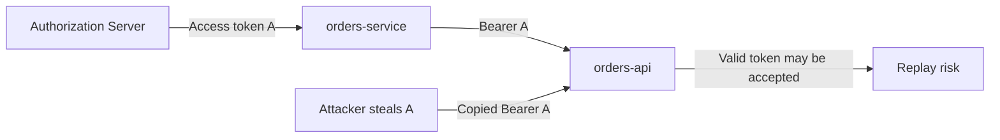
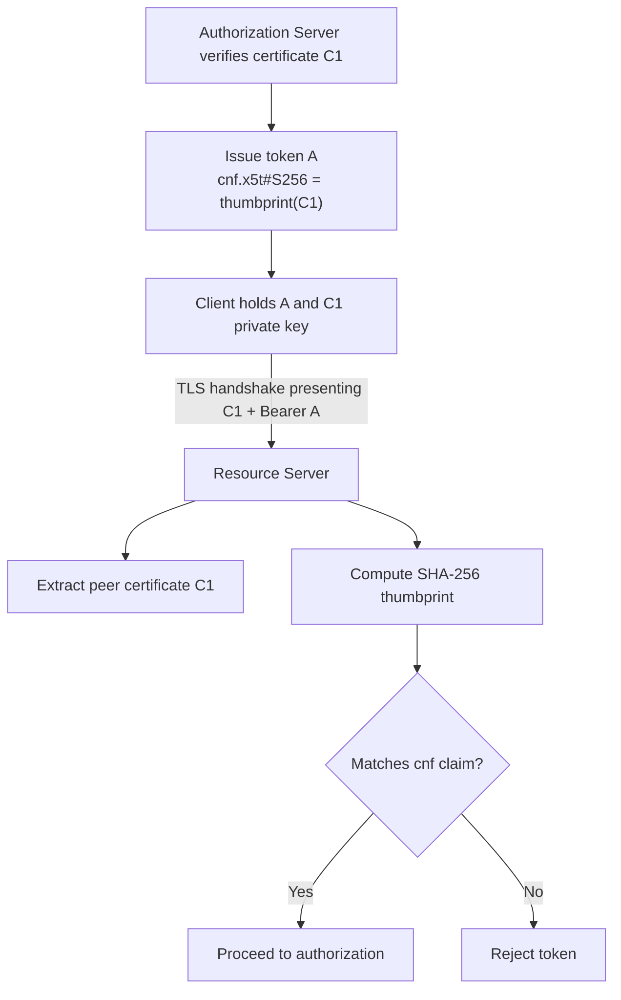
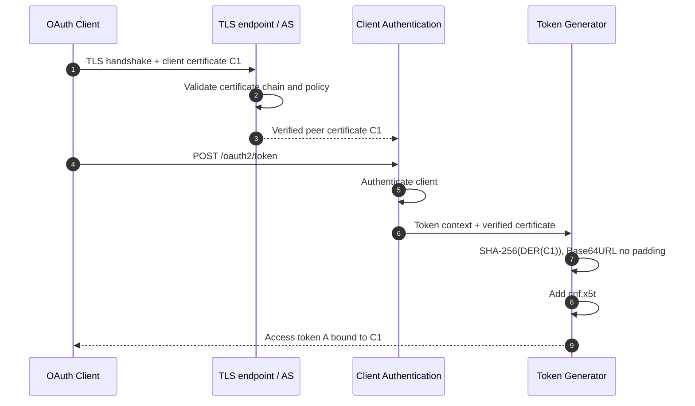
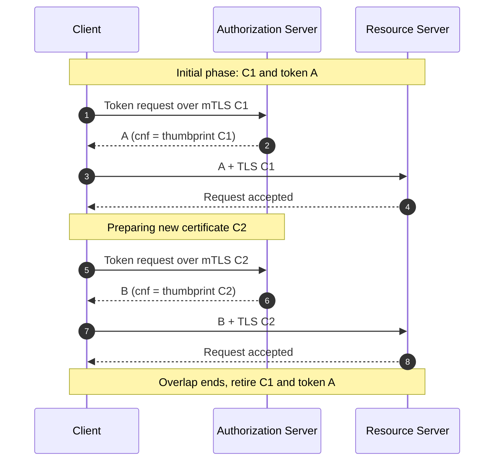

# Claim cnf.x5t#S256 and Certificate Binding Verification

In OAuth 2.0, Bearer access tokens can generally be used by any party holding the token. If a token is copied from logs, memory, or a compromised client machine, an attacker can send that token to the Resource Server for as long as the token remains valid.

**Mutual TLS certificate-bound access tokens** reduce this risk by binding the access token to the X.509 certificate the client presented on the TLS connection. The Authorization Server records the certificate's fingerprint in the **`cnf.x5t#S256`** claim. When calling the Resource Server, the client must establish a TLS connection using that exact corresponding certificate; the Resource Server recomputes the thumbprint from the peer certificate and compares it against the verified claim in the token.

The `cnf` claim is a **confirmation claim**: it describes the key/certificate proof that the party presenting the token must possess. For mTLS, the `x5t#S256` member holds the SHA-256 thumbprint of the X.509 certificate. It is not the subject DN name, serial number, standalone public key thumbprint, or an arbitrarily hashed PEM string.

This lesson belongs to the **mTLS** chapter of the **SPRING_SECURITY_OAUTH2_OIDC_AUTHORIZATION_SERVER** module, aimed at learning how to design, configure, secure, test, and operate an OAuth 2.0/OpenID Connect Authorization Server with Spring Security and Spring Authorization Server in Spring Boot.

After this lesson, you will be able to:

- Explain the meaning of `cnf` and `x5t#S256` according to RFC 8705.
- Correctly compute the certificate thumbprint from a DER-encoded X.509 certificate.
- Distinguish mTLS client authentication from certificate-bound access tokens.
- Issue JWT or reference tokens with certificate binding from a verified TLS certificate.
- Inspect client certificates at the Resource Server and compare thumbprints against token claims/introspection metadata.
- Define trust boundaries when TLS terminates at a reverse proxy or API gateway.
- Design certificate rotation, handle old tokens, and test cases for missing certificates, wrong certificates, or stolen tokens.

## 1. Problem: Bearer Tokens Can Be Replayed When Stolen

Suppose the `orders-service` application is issued access token A to call `orders-api`. If token A is an ordinary bearer token, the Resource Server only requires a valid token; the sender does not have to prove possession of a specific key or certificate.



If the token is bound to certificate C1, requests are accepted only when the TLS connection to the API presents certificate C1 and the token contains the matching thumbprint:



An attacker who obtains only token string A without the private key corresponding to C1 cannot complete TLS client authentication with that certificate. Thus, a stolen token is difficult to replay on another connection.

**Certificate binding does not eliminate all risks:** if an attacker steals both the token and the private key, takes control of the client process, or exploits a trusted proxy to spoof peer certificate information, they can still use the token. mTLS adds proof-of-possession to the bearer-token flow; it does not replace user authentication, scope/audience authorization, endpoint protection, or key management.

## 2. Two Concepts to Distinguish: mTLS Client Authentication and Certificate-Bound Tokens

Both use a client certificate in TLS, yet the two mechanisms serve different purposes.

| Mechanism | Where is it verified? | Question Answered |
| --- | --- | --- |
| **mTLS client authentication** | When the client connects to the Authorization Server/token endpoint. | Which client is calling the token endpoint, and is the certificate trusted by the AS for that client? |
| **Certificate-bound access token** | When the client presents an access token at the Resource Server. | Is the party using the access token presenting the exact certificate bound to the token? |

The two mechanisms can be used together. For example, a confidential client uses `tls_client_auth` at the token endpoint, the AS verifies certificate C1, and then issues access token A with `cnf.x5t#S256` matching C1. When calling the API, the client must present C1 again during the TLS handshake.

However, they are not identical:

- A client can authenticate with mTLS at the token endpoint while the issued token is **not bound** to the certificate if policy/implementation does not enable binding.
- An access token can be bound to the certificate presented on the token request even if client authentication at the token endpoint uses another method, provided the AS has a trusted mechanism to identify the TLS certificate and policy permits it.
- Certificate binding must be checked at the Resource Server. Authenticating the client at the AS alone is insufficient to prevent token replay at the API.
- The Subject DN registered for a client may remain unchanged when a certificate is re-issued. The new certificate's thumbprint will still differ from the old thumbprint.

**Design rule:** Define the client authentication policy at the AS separately from the proof-of-possession policy at the Resource Server. Do not infer that because a party used mTLS, all access tokens are automatically certificate-bound.

## 3. Claim cnf.x5t#S256 per RFC 8705

RFC 8705 defines how to bind OAuth access tokens to client certificates. For JWT access tokens, the confirmation claim has the structure:

```json
{
  "iss": "https://login.example.com",
  "sub": "orders-service",
  "aud": ["orders-api"],
  "scope": "orders.read",
  "cnf": {
    "x5t#S256": "<BASE64URL_SHA256_CERT_THUMBPRINT>"
  },
  "exp": 1980000300
}
```

This is an illustrative payload, not a signed token. The `cnf` claim is a JSON object; `x5t#S256` is the member describing the certificate thumbprint. The member name includes `#` and is case-sensitive; do not change it to `x5t`, `x5t-S256`, or `x5t#sha256`.

### 3.1. How to compute the thumbprint

The `x5t#S256` value is computed by:

1. Obtaining the client X.509 certificate in DER (binary certificate encoding) form.
2. Computing SHA-256 over all DER bytes.
3. Encoding the digest using Base64URL.
4. Stripping trailing `=` padding characters.

Formula:

```text
thumbprint = BASE64URL_NOPAD(SHA-256(certificate.getEncoded()))
```

Do not hash the PEM string, subject DN, serial number, public key bytes, or an arbitrarily concatenated certificate chain. The thumbprint identifies **the entire certificate**. Two certificates sharing the same public key but re-issued with different serial/validity/issuer fields will have different thumbprints because their DER encodings differ.

### 3.2. Example thumbprint calculation in Java

```java
package com.example.security.mtls;

import java.security.MessageDigest;
import java.security.NoSuchAlgorithmException;
import java.security.cert.CertificateEncodingException;
import java.security.cert.X509Certificate;
import java.util.Base64;

public final class CertificateThumbprints {

    private CertificateThumbprints() {
    }

    public static String x5tS256(X509Certificate certificate) {
        try {
            byte[] der = certificate.getEncoded();
            byte[] digest = MessageDigest.getInstance("SHA-256")
                .digest(der);

            return Base64.getUrlEncoder()
                .withoutPadding()
                .encodeToString(digest);
        } catch (CertificateEncodingException
                 | NoSuchAlgorithmException ex) {
            throw new IllegalStateException(
                "Cannot calculate X.509 certificate thumbprint", ex);
        }
    }
}
```

SHA-256 is supported out of the box by the Java runtime. `certificate.getEncoded()` returns the DER encoding of the certificate. The unpadded Base64URL output is typically 43 characters for a 256-bit digest.

Do not log certificates/private keys merely to debug thumbprints. If correlation is needed in operations, log internal `kid`s, managed certificate serials/fingerprints, or correlation IDs per data policy.

### 3.3. Example thumbprint calculation with OpenSSL

In a shell environment with OpenSSL, you can compute it from a PEM certificate file using a pipeline converting to DER and then SHA-256/Base64URL. Exact syntax differs between GNU/Linux and PowerShell; Bash example:

```bash
openssl x509 -in client-cert.pem -outform DER \
  | openssl dgst -sha256 -binary \
  | openssl base64 -A \
  | tr '+/' '-_' \
  | tr -d '='
```

The input is the **public certificate**, not the private key. This command only illustrates the thumbprint calculation; in an application, use the X.509 API rather than spawning a shell process per request.

## 4. Certificate Binding Is Created at the Authorization Server

The AS must only attach the thumbprint of a certificate it received and verified over a trusted TLS connection. Never take an `x5t#S256` self-submitted by the client in a form or header and copy it into the token.

Conceptual issuance flow:

1. The client establishes TLS to the token endpoint and presents a client certificate if requested by the connection.
2. The TLS stack verifies the chain, validity, key usage, trust anchor, and required certificate policies.
3. The AS identifies the actual peer certificate of the connection.
4. Client authentication runs per configuration, e.g., `tls_client_auth`; or the AS applies another policy while still having trusted TLS certificate proof.
5. When issuing the access token, the AS computes the thumbprint from the verified certificate.
6. The AS adds `cnf: { "x5t#S256": ... }` to the token claims/metadata.
7. The client receives the token and uses the matching certificate/private key when calling the Resource Server.



**The sensitive point is the certificate source:** the object used to compute the thumbprint must be the certificate authenticated by the TLS layer. An HTTP header like `X-Client-Cert` sent directly by an Internet client is not TLS peer proof.

### 4.1. If TLS terminates at a reverse proxy

In production, TLS may terminate at a load balancer/API gateway before reaching Spring Boot. In that case, the backend servlet container may not directly see the original client certificate.

There are two options:

- **TLS passthrough/termination at the application:** Spring/Tomcat handles the TLS handshake and can read the peer certificate from the servlet request attribute.
- **TLS termination at a trusted proxy:** the proxy authenticates the client certificate, strips any certificate headers sent from the Internet, and forwards verified certificate information to the application over a protected proxy-to-app channel. The application trusts that header only when the request is guaranteed to come from an authenticated proxy.

Never enable trust for a forwarded certificate header on an endpoint directly reachable from the Internet. If an attacker can set the header themselves, they could request the AS to issue a token bound to a forged certificate.

### 4.2. Do not use Subject DN in place of a thumbprint

A client registration may check a certificate Subject DN such as `CN=orders-service,O=Example`. This is useful information for identifying a client per policy, but it does not prove it is the exact certificate bound to the access token.

Two different certificates can share the same Subject DN yet have different thumbprints. Certificate binding must use `x5t#S256` computed from the specific certificate, not merely DN comparison.

## 5. Configuring Certificate-Bound Access Tokens in Spring Authorization Server

In Spring Authorization Server **1.3 and above**, certificate-bound access tokens have built-in configuration support via `TokenSettings.x509CertificateBoundAccessTokens(true)`. When a client uses `tls_client_auth` or `self_signed_tls_client_auth`, the AS can take the certificate verified during client authentication, compute the SHA-256 thumbprint, and attach it to the access token under the `cnf.x5t#S256` claim. This is the preferred choice for standard use cases.

`OAuth2TokenCustomizer` is only needed when you have extra requirements or a custom issuance flow that the built-in setting does not cover, or when working with an older version lacking this setting. If customizing manually, the critical part remains obtaining the exact certificate from the verified client authentication/TLS context, not from a client-supplied thumbprint value.

### 5.1. Enabling certificate-bound access tokens with TokenSettings

With Spring Authorization Server 1.3+, configure `x509CertificateBoundAccessTokens(true)` on the client's `TokenSettings`. The client authentication method must be `tls_client_auth` or `self_signed_tls_client_auth` so the AS obtains the certificate from client authentication.

```java
RegisteredClient mtlsClient = RegisteredClient
    .withId("mtls-client-internal-id")
    .clientId("mtls-client")
    .clientAuthenticationMethod(ClientAuthenticationMethod.TLS_CLIENT_AUTH)
    .authorizationGrantType(AuthorizationGrantType.CLIENT_CREDENTIALS)
    .scope("orders.read")
    .clientSettings(ClientSettings.builder()
        .x509CertificateSubjectDN(
            "CN=mtls-client,OU=Platform,O=Example,C=VN")
        .build())
    .tokenSettings(TokenSettings.builder()
        .x509CertificateBoundAccessTokens(true)
        .accessTokenTimeToLive(Duration.ofMinutes(5))
        .build())
    .build();
```

In this configuration:

- `ClientAuthenticationMethod.TLS_CLIENT_AUTH` requires the client to authenticate at the token endpoint with a certificate using PKI mTLS.
- `x509CertificateSubjectDN(...)` declares the Subject DN the AS expects for the client certificate; it is the client authentication step, not thumbprint binding.
- `x509CertificateBoundAccessTokens(true)` tells the AS to bind the access token to the certificate received during client authentication. SAS computes the SHA-256 thumbprint and puts it in the confirmation claim.
- `accessTokenTimeToLive(...)` limits how long the token can be used; binding does not replace expiration.
- The setting lives on each `RegisteredClient`, so only clients with the policy enabled require certificate-bound access tokens.

If using `SELF_SIGNED_TLS_CLIENT_AUTH`, the client certificate is verified against the corresponding JWK Set/client registration; specific configuration differs from PKI mTLS. Check your application's version and certificate verifier policy before enabling.

**This is the built-in mechanism to use for standard flows.** Do not add another customizer to overwrite `cnf` simultaneously without a clear reason; two places writing the claim can conflict or produce an incorrect thumbprint.


### 5.2. Preparing a customizer when the built-in mechanism cannot be used

Define an application abstraction to retrieve the thumbprint from the verified client authentication context:

```java
package com.example.authserver.mtls;

import java.util.Optional;

import org.springframework.security.oauth2.core.AuthorizationGrantType;
import org.springframework.security.oauth2.server.authorization.client.RegisteredClient;

public interface VerifiedClientCertificateResolver {

    Optional<String> resolveX5tS256(
        RegisteredClient registeredClient,
        AuthorizationGrantType grantType
    );
}
```

This is an application-defined interface, not a built-in Spring Authorization Server API. The implementation must obtain the certificate from the TLS peer context or data verified by a trusted proxy. Do not implement it by reading an arbitrary request parameter. A resolver typically needs a request-scoped or request-bound context to get the peer certificate of the exact token request; do not assume `JwtEncodingContext.getPrincipal()` is always the client authentication object or holds the certificate. If the system handles token generation asynchronously, propagate the certificate context safely per request rather than using a ThreadLocal that could leak across requests.

### 5.3. JWT customizer for custom issuance

Example customizer that adds binding only for access tokens and only for clients whose policy requires certificate-bound tokens:

```java
package com.example.authserver.mtls;

import java.util.Map;

import org.springframework.context.annotation.Bean;
import org.springframework.context.annotation.Configuration;
import org.springframework.security.oauth2.server.authorization.OAuth2TokenType;
import org.springframework.security.oauth2.server.authorization.token.JwtEncodingContext;
import org.springframework.security.oauth2.server.authorization.token.OAuth2TokenCustomizer;

@Configuration(proxyBeanMethods = false)
public class MtlsBoundJwtCustomizerConfig {

    @Bean
    OAuth2TokenCustomizer<JwtEncodingContext> mtlsJwtCustomizer(
            VerifiedClientCertificateResolver certificateResolver,
            CertificateBindingPolicy bindingPolicy) {

        return context -> {
            if (!OAuth2TokenType.ACCESS_TOKEN.equals(
                    context.getTokenType())) {
                return;
            }

            if (!bindingPolicy.requiresCertificateBinding(
                    context.getRegisteredClient(),
                    context.getAuthorizationGrantType())) {
                return;
            }

            String thumbprint = certificateResolver.resolveX5tS256(
                    context.getRegisteredClient(),
                    context.getAuthorizationGrantType()
                )
                .orElseThrow(() -> new IllegalStateException(
                    "Required verified client certificate is missing"));

            context.getClaims().claim(
                "cnf",
                Map.of("x5t#S256", thumbprint)
            );
        };
    }
}
```

`CertificateBindingPolicy` is also an application business service. How the client authentication object is identified and how the TLS certificate is accessed depend on the Spring Authorization Server version, client authentication method, and how TLS is terminated. Implement the resolver to match your actual infrastructure; the example above illustrates **where to attach the claim**, and does not claim the certificate is automatically available in every `context.getPrincipal()`.

If binding is mandatory and the resolver cannot find a certificate, you must **fail closed**. Do not issue a token lacking `cnf` hoping the Resource Server will infer the certificate on its own.

### 5.4. Do not accidentally attach cnf to ID tokens

`JwtGenerator` can produce multiple JWT types depending on grants and OIDC configuration. When the customizer is invoked for an ID token, do not inadvertently attach a certificate-bound access token claim to the ID token. The `OAuth2TokenType.ACCESS_TOKEN` check restricts the logic to access tokens.

Do not add `cnf` to every token merely because the client used mTLS. Policy must determine which tokens are actually bound and which Resource Servers will verify them.

### 5.5. Verifying the client certificate per policy

For PKI-based `tls_client_auth`, Spring Authorization Server uses `X509ClientCertificateAuthenticationProvider` to validate the certificate chain received during the TLS handshake. The default certificate verifier compares the certificate's subject DN against the registered `ClientSettings.x509CertificateSubjectDN` value.

If the system needs to check additional attributes, such as Subject Alternative Name (SAN), you can customize the certificate verifier through the provider. This customization belongs to the **client authentication** step. It does not replace the `TokenSettings.x509CertificateBoundAccessTokens(true)` setting responsible for binding the access token to the certificate.

For `self_signed_tls_client_auth`, the AS verifies the certificate against the JWK Set URL registered for the client, and the certificate in the JWK can be represented via `x5c`. Choose PKI mTLS or self-signed mTLS according to your organization's CA/key governance model.


## 6. Reference Access Tokens and Introspection

With reference/opaque access tokens, the Resource Server does not read JWT claims directly. The Authorization Server needs to store certificate confirmation metadata alongside token state and return it via introspection when permitted.

When using `TokenSettings.x509CertificateBoundAccessTokens(true)`, run an integration test on your Spring Authorization Server version to verify that `cnf` is persisted and returned in the introspection response for reference tokens. An opaque-token Resource Server can verify binding only if the nested `cnf.x5t#S256` is preserved in the attributes returned by introspection.

`OAuth2TokenCustomizer<OAuth2TokenClaimsContext>` is the extension point when an application manages reference token generation itself or needs custom claims. Do not add a second customizer merely to duplicate the certificate binding already handled by the built-in setting. The following example is a fallback pattern for custom issuance:

```java
package com.example.authserver.mtls;

import java.util.Map;

import org.springframework.context.annotation.Bean;
import org.springframework.context.annotation.Configuration;
import org.springframework.security.oauth2.server.authorization.OAuth2TokenType;
import org.springframework.security.oauth2.server.authorization.token.OAuth2TokenClaimsContext;
import org.springframework.security.oauth2.server.authorization.token.OAuth2TokenCustomizer;

@Configuration(proxyBeanMethods = false)
public class MtlsBoundReferenceCustomizerConfig {

    @Bean
    OAuth2TokenCustomizer<OAuth2TokenClaimsContext>
            mtlsReferenceCustomizer(
                VerifiedClientCertificateResolver certificateResolver,
                CertificateBindingPolicy bindingPolicy) {

        return context -> {
            if (!OAuth2TokenType.ACCESS_TOKEN.equals(
                    context.getTokenType())) {
                return;
            }

            if (!bindingPolicy.requiresCertificateBinding(
                    context.getRegisteredClient(),
                    context.getAuthorizationGrantType())) {
                return;
            }

            String thumbprint = certificateResolver.resolveX5tS256(
                    context.getRegisteredClient(),
                    context.getAuthorizationGrantType()
                )
                .orElseThrow(() -> new IllegalStateException(
                    "Required verified client certificate is missing"));

            context.getClaims().claims(claims ->
                claims.put("cnf", Map.of("x5t#S256", thumbprint))
            );
        };
    }
}
```

Verify with an integration test that your Spring Authorization Server version persists the custom claim and returns `cnf` properly in the introspection response. Do not assume that adding a claim to the builder guarantees every persistence/serialization configuration retains it.

Illustrative introspection response:

```json
{
  "active": true,
  "client_id": "orders-service",
  "scope": "orders.read",
  "token_type": "Bearer",
  "cnf": {
    "x5t#S256": "<BASE64URL_SHA256_CERT_THUMBPRINT>"
  }
}
```

Opaque-token Resource Server integration must extract the `cnf` attribute from the introspection principal and perform certificate comparison just like with JWTs. If a custom introspector transforms or drops nested claims, adjust the mapping to preserve the `cnf` structure.

## 7. Resource Server Verification of Certificate Binding

When a request arrives at the Resource Server, all of the following must be verified simultaneously:

1. The TLS handshake succeeds and the peer certificate is trusted per policy.
2. The access token is valid: signature/introspection, issuer, expiration, audience, and scopes.
3. The token contains the `cnf.x5t#S256` claim if the endpoint requires certificate-bound tokens.
4. The thumbprint of the peer certificate on **that exact TLS connection** matches the value in the token.
5. Business authorization still permits the principal to perform the action on the resource.

If the token lacks `cnf`, an endpoint requiring mTLS-bound tokens must reject it. If the token has `cnf` but the request presents no certificate, it must also be rejected. If a certificate is present but the thumbprint differs, never fall back to treating the token as a standard bearer token.

### 7.1. Thumbprint verification function for JWT

Example service verifying the claim:

```java
package com.example.resourceserver.mtls;

import java.nio.charset.StandardCharsets;
import java.security.MessageDigest;
import java.security.cert.X509Certificate;
import java.util.Map;

import org.springframework.security.oauth2.jwt.Jwt;
import org.springframework.security.oauth2.server.resource.InvalidBearerTokenException;

public final class CertificateBindingVerifier {

    public void verify(Jwt jwt, X509Certificate peerCertificate) {
        Map<String, Object> cnf = jwt.getClaimAsMap("cnf");
        Object value = cnf == null ? null : cnf.get("x5t#S256");

        if (!(value instanceof String expected) || expected.isBlank()) {
            throw new InvalidBearerTokenException(
                "Certificate confirmation claim is missing");
        }

        if (peerCertificate == null) {
            throw new InvalidBearerTokenException(
                "Client certificate is required");
        }

        String actual =
            CertificateThumbprints.x5tS256(peerCertificate);

        boolean matches = MessageDigest.isEqual(
            expected.getBytes(StandardCharsets.US_ASCII),
            actual.getBytes(StandardCharsets.US_ASCII)
        );

        if (!matches) {
            throw new InvalidBearerTokenException(
                "Client certificate does not match access token");
        }
    }
}
```

`CertificateThumbprints` is the thumbprint utility shown in section 3. Comparing with `MessageDigest.isEqual` avoids certain timing differences in string comparisons. While thumbprints are not secrets, this comparison practice remains appropriate.

This snippet illustrates the verifier for JWTs. For opaque tokens, replace reading `cnf` from `Jwt` with attributes from `OAuth2AuthenticatedPrincipal` after introspection; the certificate thumbprint comparison algorithm stays the same.

### 7.2. Extracting the peer certificate in a servlet application

When TLS terminates directly at the Servlet container, the Servlet API provides the certificate chain via a request attribute:

```java
X509Certificate[] chain = (X509Certificate[]) request.getAttribute(
    "jakarta.servlet.request.X509Certificate");

X509Certificate peerCertificate =
    chain != null && chain.length > 0 ? chain[0] : null;
```

The first element is the peer's certificate (the client leaf certificate) in the chain provided by the servlet container. Verify the exact attribute name for your Jakarta Servlet/container version. If TLS terminates at a proxy and the container does not receive the original client certificate, this attribute may be absent; in that case, you need a certificate forwarding mechanism from an authenticated proxy.

Do not read the certificate from a client-sent request header. If a gateway forwards a PEM or fingerprint, the gateway must strip inbound headers of the same name from the Internet, validate the client certificate at the TLS layer, and pass verified metadata over a protected proxy-to-app connection.

### 7.3. Attaching the verifier after bearer authentication

The certificate-binding check must run **after the access token has been verified and an Authentication has been created**, yet before the controller processes the request. In Spring Security, you can implement a custom filter and place it after `BearerTokenAuthenticationFilter`:

```java
http.addFilterAfter(
    certificateBindingFilter,
    BearerTokenAuthenticationFilter.class
);
```

The filter must:

- Apply only to routes/APIs requiring certificate-bound access tokens.
- Retrieve the JWT/opaque principal verified by the authentication filter.
- Retrieve the peer certificate from the TLS connection or authenticated proxy metadata.
- Check `cnf.x5t#S256` and reject if missing/mismatched.
- Return an appropriate authentication error, typically `401 invalid_token`, without letting the request proceed.
- Never log raw access tokens, certificate private keys, or full certificates.

This is an architectural integration point; how the authentication principal is extracted and how exception handling is configured must match your specific token type, servlet stack, and Spring Security version.

## 8. TLS Termination and Proxies Are Critical Security Boundaries

Certificate binding is trustworthy only if the Resource Server knows which certificate the client actually presented during the TLS handshake. When there is a load balancer, ingress controller, or API gateway, you must clearly define which party terminates TLS and which party is responsible for validating the certificate.

| Architecture | Certificate Source the Resource Server Can Trust |
| --- | --- |
| Direct client TLS to Spring/Tomcat | Peer certificate supplied by the TLS connector/container. |
| Client TLS to gateway; gateway calls app over separate TLS | Certificate metadata verified by gateway and forwarded over a protected gateway-to-app channel. |
| Client TLS to gateway, but app is directly reachable from Internet | Never trust forwarded certificate headers unless direct access is blocked and the gateway is authenticated. |
| Gateway forwards header without stripping inbound headers | Unsafe: attackers can send forged headers themselves. |
| Multiple proxies in a chain | Must define which proxy is trusted, hop ordering, and where certificate metadata is normalized. |

A secure proxy design generally requires:

1. The gateway requests and verifies the client certificate using its trust store, chain validation, and policies.
2. The gateway strips all certificate headers supplied by external requests.
3. The gateway creates an internal header containing the verified certificate or thumbprint.
4. The gateway calls the Resource Server over internal mTLS or a network with restricted access.
5. The Resource Server accepts certificate metadata only when the peer connection is genuinely the trusted gateway.
6. Tests prove that direct requests to the app cannot spoof certificate headers.

If possible, terminating mTLS directly at the Resource Server makes the verification boundary clearer. If using a proxy, treat certificate forwarding as an authenticated internal protocol, not an ordinary HTTP header.

## 9. Certificate Chain Validation and Trust Policies

Thumbprint matching **does not replace certificate validation**. Before comparing thumbprints, the TLS stack must verify that the presented certificate can be trusted under the system's trust store and policies.

Typical checks include:

- The certificate chain leads to a configured trust anchor.
- The certificate is within its validity period (`notBefore`/`notAfter`).
- Key Usage and Extended Key Usage match the client authentication role.
- The certificate is not revoked per CRL/OCSP or the deployed revocation policy mechanism.
- Host/service/client identity matches registration and policy.
- Algorithms, key lengths, and CAs are on the allowed list.
- The certificate was presented on the exact TLS connection used for the API request.

**The thumbprint only answers:** "Is this certificate the exact certificate bound to the token?" It does not answer: "Is this certificate trustworthy?" Both questions must be verified independently.

## 10. Certificate Rotation and Already-Bound Tokens

A certificate-bound token is tied to **one specific certificate**. When a client replaces certificate C1 with C2, token A containing C1's `cnf.x5t#S256` will not match C2 even if C2 was issued to the same client with the same Subject DN.

### 10.1. Routine rotation

A rotation plan with overlap:

1. Register and trust certificate C2.
2. Authorize the client to use C2 at the token endpoint and Resource Server.
3. The client authenticates with C2 and acquires a new token B, where `cnf` contains C2's thumbprint.
4. The client shifts traffic to B + C2.
5. Keep C1 trusted while tokens A remain valid if policy allows.
6. Once tokens A expire/are revoked and the client no longer uses C1, remove C1 from trust/registration.
7. Monitor mismatch errors to detect clients still holding old tokens or unsynchronized rollouts.



### 10.2. Emergency certificate compromise

If C1's private key is compromised:

- Stop issuing new tokens bound to C1.
- Revoke the certificate at the PKI/CA per procedure; configure TLS endpoints to check revocation appropriately.
- Remove C1 from client trust/registration.
- Consider revoking authorizations/tokens bound to C1.
- Ensure the Resource Server no longer accepts TLS handshakes with C1.
- Issue C2, mint new tokens, and monitor mismatches/replays.
- Investigate whether token A and C1's private key might have been stolen together.

If the Resource Server still trusts C1 and only checks the thumbprint, an attacker holding both A and C1 can continue using the token. Therefore, you must **revoke the certificate at the TLS trust layer** and manage token state as required, rather than merely waiting for the access token to expire.

### 10.3. Do not rotate the certificate while keeping old tokens

When a certificate expires, tokens bound to that certificate must not be migrated to the new certificate by altering claims at the Resource Server. The client needs to request a new token bound by the AS to certificate C2. Never allow a different certificate to use an old token merely because the Subject DN/client ID matches.

## 11. JWT and Opaque Tokens: Where the Resource Server Reads cnf

| Token Format | Where `cnf` Is Obtained | What the Resource Server Must Do |
| --- | --- | --- |
| JWT access token | JWT claim after signature and claims verification. | Read `cnf.x5t#S256`, extract peer certificate, and compare thumbprints. |
| Reference/opaque access token | Introspection response from the AS. | Read `cnf.x5t#S256` from the authenticated principal, extract peer certificate, and compare. |

For JWTs, never read claims before the decoder verifies the signature. For opaque tokens, never parse the token string yourself; trust introspection metadata only when the connection and client authentication to the AS are valid.

In both cases, `active=true` from introspection or a valid JWT signature is **not enough** to let the request proceed if the route requires an mTLS-bound token. Certificate comparison at the Resource Server is required.

If the system supports both bound and unbound tokens, define policy per route/resource/client. One API may accept only tokens with `cnf`; another may accept both types. Never fall back from a bound-token mismatch to bearer-token acceptance.

## 12. Common Errors and How to Handle Them

### 12.1. Token has cnf, but the request lacks a client certificate

The TLS connector/gateway did not request a certificate, the client did not configure a keystore, or certificate forwarding is not working. If the route requires binding, reject the request; fix TLS configuration/client certificate provisioning. Never ignore the claim to let the request pass.

### 12.2. Thumbprint mismatch despite identical Subject DN

The client was issued a new certificate, or the Resource Server picked the wrong certificate from the proxy chain. Compare the thumbprint computed from the actual DER certificate, inspect the leaf certificate, and verify which certificate the active token was issued for. Matching DNs do not mean identical certificates.

### 12.3. Claim cnf does not appear in the JWT

Check whether the customizer runs for `ACCESS_TOKEN`, whether the client/grant satisfies the binding policy, whether the resolver obtained the verified peer certificate, and whether the token generator has the customizer attached. If mTLS is mandatory, a missing certificate must fail issuance.

### 12.4. Claim cnf does not appear in introspection

Check the reference-token customizer, authorization state persistence/serialization, and the introspection endpoint response. Confirm that your SAS version persists custom claims and that mapping does not strip the nested `cnf` object.

### 12.5. Resource Server sees the certificate header yet still rejects

Check whether the proxy stripped inbound headers, whether the servlet attribute exists, whether the gateway forwarded the exact leaf certificate, whether the app receives requests from a trusted gateway, and whether the DER certificate is reconstructed accurately. Do not hash a PEM string or URL-encoded header if DER hashing is required.

### 12.6. Some instances pass while others fail

Instances may have different trust stores, certificate revocation data, proxy configurations, or policies. Synchronize trust anchors, CA bundles, certificate metadata, TLS settings, and customizers. Check whether the load balancer routes to an instance not receiving forwarded certificates.

### 12.7. Client keeps using the old token after rotating certificates

The old token carries C1's thumbprint; the client is sending token A alongside C2. The client must request a new token B using C2 and update its token store synchronously. Never alter the thumbprint inside an already-issued token.

### 12.8. TLS handshake succeeds, yet certificate binding fails

The TLS handshake only verifies that the certificate is accepted under TLS policy; it does not automatically compare the certificate against the access token's claims. You must maintain a dedicated binding verifier step at the Resource Server.

## 13. Certificate Binding Test Matrix

| Scenario | Expected Result |
| --- | --- |
| Token A has cnf for C1; request presents valid C1 | Binding passes; proceed to scope/audience/resource checks. |
| Token A has cnf for C1; request presents C2 | Reject with invalid token/binding mismatch. |
| Token A has cnf; request presents no certificate | Reject on routes requiring mTLS-bound tokens. |
| Token lacks cnf on a route requiring binding | Reject; do not fall back to bearer token. |
| JWT has tampered cnf with invalid signature | JWT decoder rejects before using claims. |
| JWT has valid cnf but wrong issuer | Rejected by issuer validation. |
| JWT has valid cnf but wrong audience | Rejected by audience validation. |
| Certificate C1 is expired or chain untrusted | Rejected by TLS handshake/policy. |
| Certificate C1 is revoked and revocation checking enabled | Rejected by TLS/client certificate validation per policy. |
| Certificates C1 and C2 share Subject DN but differ in DER | Thumbprints differ; C1 token does not match C2. |
| Client sends forged X-Client-Cert header | Stripped/ignored; does not affect verified certificate. |
| Gateway forwards valid certificate over trusted channel | Resource Server reconstructs leaf certificate and compares. |
| App accessed directly, bypassing gateway | Cannot spoof forwarded certificate; request blocked or lacks trust metadata. |
| Reference token introspection returns cnf of C1 | Resource Server compares C1 and accepts only on match. |
| Introspection returns active=false | Reject token; no need to proceed with binding. |
| Client switches from C1 to C2 and gets a new token | New token has C2 thumbprint; C2 request is accepted. |
| Old token A used with C1 during overlap | May be accepted if token is still active and C1 remains trusted. |
| Old token A used with C2 | Rejected due to mismatch. |
| C1 compromised and removed from trust | TLS handshake with C1 rejected; token A can no longer be used via C1. |
| Token has wrong-typed cnf or missing x5t#S256 member | Rejected per validation policy. |
| Certificate chain has multiple certs | Use leaf peer certificate for thumbprint, not the whole chain. |
| Multiple instances use different trust policies | Tests detect inconsistent results before rollout. |

### 13.1. Testing thumbprint calculation

With a certificate test fixture:

1. Load the X.509 certificate via `CertificateFactory`.
2. Compute the thumbprint via `CertificateThumbprints.x5tS256`.
3. Independently compute it with OpenSSL from the same DER certificate.
4. Assert both outputs are identical.
5. Switch to another certificate sharing the Subject DN but with a different serial/key/validity; assert the thumbprint differs.
6. Confirm the output is unpadded Base64URL with no `+`, `/`, or `=` characters.

### 13.2. End-to-end integration tests

An integration test should:

1. Create a test CA and client certificates C1/C2.
2. Configure the Authorization Server to accept mTLS and verify client certificates.
3. Acquire access token A over TLS using C1.
4. Decode the JWT after verifying its signature, or introspect the reference token; assert `cnf.x5t#S256` equals C1's thumbprint.
5. Call the Resource Server with A + C1; assert success.
6. Call the Resource Server with A + C2; assert rejection.
7. Call with A without a certificate; assert rejection.
8. Acquire token B over C2; assert B + C2 succeeds.
9. Test untrusted, expired, and revoked certificates as well as forged forwarded headers.
10. Check that logs/traces contain no private keys or raw tokens.

Do not merely mock the `cnf` claim in controller tests. You must verify real certificates passing through the TLS stack/proxy and tokens passing through the authentication filter.

## 14. Hands-on Exercise: Binding Tokens to orders-service's Certificate

A system has `orders-service` as a confidential client and `orders-api` as the Resource Server. The AS authenticates the client using mTLS. Access tokens carry scope `orders.read` and a 5-minute TTL.

Scenario:

- `09:00`: the client connects with certificate C1 and receives token A.
- `09:01`: token A contains `cnf.x5t#S256` equal to C1's thumbprint.
- `09:02`: another process steals token A's string but only holds certificate C2.
- `09:03`: orders-service is issued a new certificate C2 with the same Subject DN as C1.
- `09:04`: the client sends token A over TLS using C2.
- `09:05`: the client requests token B over TLS using C2.

Answer the following:

1. Why cannot the process holding token A without C1's private key use the token as an ordinary bearer token?
2. How must the Resource Server handle token A + C2 at `09:04`?
3. Why does sharing the same Subject DN not make C1 and C2's thumbprints equal?
4. Is `x5t#S256` computed from the DER certificate, PEM string, or public key?
5. If the AS authenticates the client with mTLS without attaching `cnf`, is the token certificate-bound?
6. Where must the Resource Server obtain the peer certificate from when TLS terminates at an API gateway?
7. Why can an `X-Client-Cert` header sent directly from the Internet not be trusted?
8. When token A is leaked along with C1's private key, what does mTLS binding still protect?
9. If C1 is revoked, which layers must be updated to stop accepting token A?
10. If the token is opaque, how does the Resource Server obtain `cnf`?
11. During certificate rotation, how should overlap and token refresh be handled?
12. Why is a valid JWT signature not enough to conclude certificate binding passed?

**Hint:** Token A is bound to specific certificate C1. C2 sharing the same DN still has a different thumbprint; the client must request a new token B bound to C2's thumbprint. The Resource Server inspects the TLS connection's peer certificate, the verified claims, and standard authorization conditions.

## 15. cnf.x5t#S256 Implementation Checklist

- [ ] Identified which clients and APIs require certificate-bound access tokens.
- [ ] Distinguished mTLS client authentication at the AS from certificate binding at the Resource Server.
- [ ] For Spring Authorization Server 1.3+, clients using `tls_client_auth`/`self_signed_tls_client_auth` are configured with `TokenSettings.x509CertificateBoundAccessTokens(true)` when binding is needed.
- [ ] AS extracts the certificate from a verified TLS peer or proxy metadata with a clear trust chain.
- [ ] Never reads certificate thumbprints from client-supplied request parameters/headers.
- [ ] Thumbprint is computed from the DER-encoded X.509 certificate using SHA-256 and unpadded Base64URL.
- [ ] JWT/reference access tokens contain the `cnf` claim with exact member `x5t#S256`.
- [ ] If binding is mandatory and no verified certificate is obtained, the AS fails closed and does not issue an unbound token.
- [ ] JWT Resource Server verifies signature, issuer, audience, expiration, and scopes before using claims.
- [ ] Opaque Resource Server introspects tokens via an authenticated endpoint and preserves nested `cnf` metadata.
- [ ] Resource Server obtains the peer certificate from the TLS connection or an authenticated proxy and compares thumbprints.
- [ ] Tokens missing `cnf` or failing certificate match are rejected; never falls back to bearer acceptance.
- [ ] TLS proxy strips client-sent certificate headers and forwards metadata only over a trusted channel.
- [ ] Certificate chain, validity, key usage, and revocation are checked independently of thumbprint matching.
- [ ] Certificate rotation mints new tokens bound to C2; old tokens are only usable with C1 during overlap if policy allows.
- [ ] Emergency compromise has procedures to halt token issuance, revoke certificates, update trust/caches, and revoke related tokens.
- [ ] Tests cover matching certificates, different certificates, missing certificates, invalid chains, forged proxy headers, JWTs, and opaque tokens.
- [ ] Logs never contain private keys, raw tokens, or unnecessary certificate material.
- [ ] All Resource Server instances enforce the same certificate trust and binding policies.

**Key takeaway:** `cnf.x5t#S256` binds an access token to **one specific X.509 client certificate** via the SHA-256 thumbprint of the DER certificate. The Resource Server must compare the verified claim against the peer certificate on the TLS connection. mTLS client authentication, certificate chain validation, and certificate-bound token verification are related steps with distinct responsibilities; only when combined properly does a standalone stolen token become resistant to replay.

**References:**

- [RFC 8705 — OAuth 2.0 Mutual-TLS Client Authentication and Certificate-Bound Access Tokens](https://www.rfc-editor.org/rfc/rfc8705.html): mTLS client authentication, certificate-bound access tokens, and `x5t#S256`.
- [RFC 7800 — Proof-of-Possession Key Semantics for JWTs](https://www.rfc-editor.org/rfc/rfc7800.html): confirmation claim `cnf` and proof-of-possession semantics.
- [RFC 7519 — JSON Web Token (JWT)](https://www.rfc-editor.org/rfc/rfc7519.html): JWT structure and claims.
- [RFC 7662 — OAuth 2.0 Token Introspection](https://www.rfc-editor.org/rfc/rfc7662.html): introspection response and token status.
- [RFC 5280 — Internet X.509 Public Key Infrastructure Certificate and CRL Profile](https://www.rfc-editor.org/rfc/rfc5280.html): certificate path validation and CRL.
- [Spring Authorization Server — Core Model and Components](https://docs.spring.io/spring-authorization-server/reference/core-model-components.html): RegisteredClient, token generator, and authorization state.
- [Spring Authorization Server — Configuration Model](https://docs.spring.io/spring-authorization-server/reference/configuration-model.html): mTLS client authentication and certificate-bound access tokens via `TokenSettings.x509CertificateBoundAccessTokens(true)`.
- [Spring Authorization Server — TokenSettings API](https://docs.spring.io/spring-authorization-server/reference/api/java/org/springframework/security/oauth2/server/authorization/settings/TokenSettings.Builder.html): API and supported versions for configuring certificate-bound access tokens.
- [Spring Authorization Server — Protocol Endpoints](https://docs.spring.io/spring-authorization-server/reference/protocol-endpoints.html): token endpoint and custom token generation.
- [Spring Security — OAuth2 Resource Server](https://docs.spring.io/spring-security/reference/servlet/oauth2/resource-server/index.html): JWT/opaque token verification and filter chain integration.
- [Jakarta Servlet Specification](https://jakarta.ee/specifications/servlet/): request attributes and client certificate exposure when TLS terminates at the servlet container.

