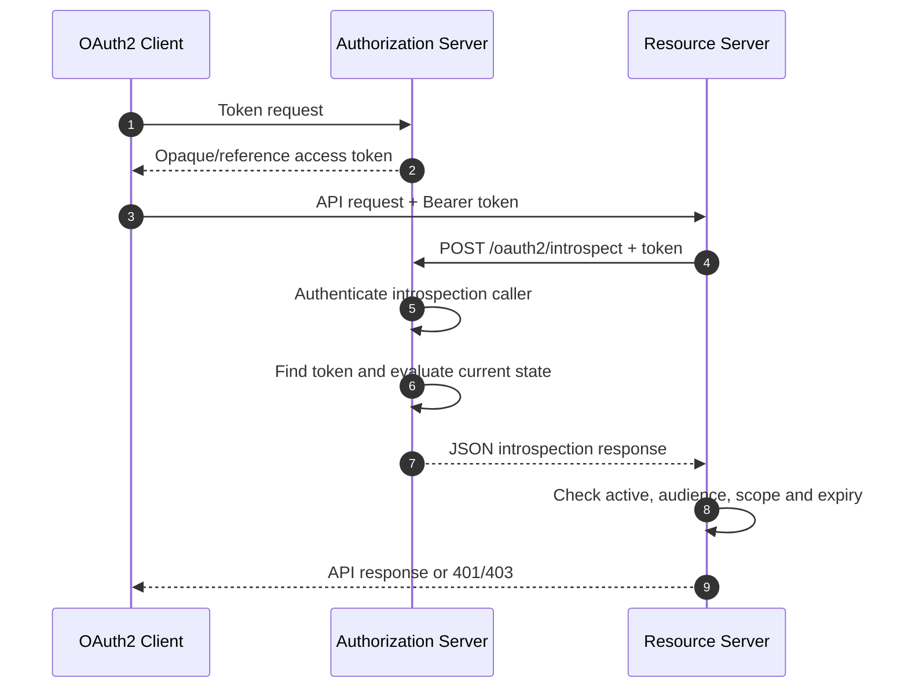
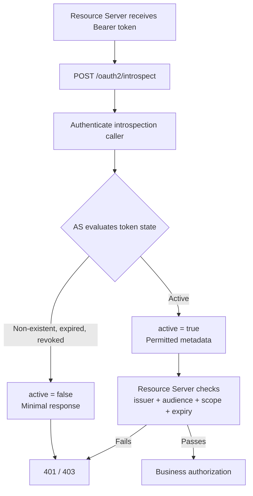

# Meaning of active and Returned Information

## 1. Objectives and Context

In the **Introspection** chapter of the **SPRING_SECURITY_OAUTH2_OIDC_AUTHORIZATION_SERVER** module, OAuth 2.0 Token Introspection under **RFC 7662** allows a protected resource to ask the Authorization Server (AS) whether a token is currently active and retrieve the metadata needed to decide whether to accept a request.

With **Spring Security**, **Spring Authorization Server (SAS)**, and **Spring Boot**, introspection is especially useful when the access token is an opaque/reference token or when the Resource Server needs up-to-date token state from the AS. The typical endpoint is `POST /oauth2/introspect`. The caller must be authenticated according to the AS policy; the response can reveal sensitive information, so it is not a public API for arbitrary clients.

This lesson focuses on the question **what does `active` mean and what information can the AS return**. After this lesson, you will be able to:

- Explain the meaning of `active: true` and `active: false` according to RFC 7662.
- Distinguish a syntactically/signature-valid token from a token that is currently active according to the AS.
- Interpret `scope`, `client_id`, `username`, `token_type`, `exp`, `iat`, `nbf`, `sub`, `aud`, `iss`, `jti`, and `cnf`.
- Understand why an active token response may contain different fields depending on token type and policy.
- Know why an inactive token response generally should not disclose specific reasons.
- Design responses based on data minimization to protect callers and Resource Servers.
- Integrate introspection with SAS, Spring Security Resource Server, and opaque tokens.
- Test revocation/expiration, client binding, audience, caching, privacy, and endpoint errors.

**Version scope:** Examples target **Spring Authorization Server 1.x / Spring Security 6.x / Spring Boot 3.x**. Introspection endpoint APIs, token storage, and extension points depend on the version. RFC 7662 is the underlying protocol standard; optional attributes appear only when the AS has the data and policy permits.

## 2. Introspection in OAuth 2.0 Architecture

An access token is a credential sent by a client to a Resource Server. The Resource Server needs to know whether the token is recognized by the AS, is still valid, and has sufficient permissions for the resource being accessed. If the token is a JWT, the Resource Server can verify the signature, issuer, expiry, audience, and claims locally. If the token is opaque, the Resource Server cannot read its internal state itself; it can call the introspection endpoint.



Introspection is not the Token Endpoint and does not issue new tokens. It is a **status and metadata query** for an existing token. Nor is the response a user profile endpoint; it only returns token-related data per the RFC and policy.

### 2.1. JWT vs. Opaque Token

| Characteristic | JWT/self-contained access token | Opaque/reference access token |
| --- | --- | --- |
| Typical verification method | Resource Server verifies signature and claims locally | Resource Server calls introspection or a trusted lookup mechanism |
| Revocation status | Can be hard to reflect immediately with offline verification alone | AS can reflect current state via introspection |
| Token data | Claims are readable if JWS is unencrypted | Cannot infer contents from the token string |
| Network dependency on AS | May not be needed on every request | Usually needed, unless cached |
| Cache | JWKS/metadata and token policy | Cache introspection responses per TTL/policy |

An opaque token does not mean "no claims." Metadata is still stored at the AS or token store; the introspection endpoint returns a subset of metadata to an authorized Resource Server.

## 3. Exact Meaning of active

RFC 7662 defines `active` as a boolean attribute indicating whether the token submitted in the introspection request is currently **active**. This is the result of the AS's evaluation, not merely parsing the token.

### 3.1. When Can a Token Be Active?

An access token is typically active when the AS determines that:

- The token exists and is recognized by the AS.
- The token has not expired.
- The token has not been revoked or invalidated.
- The token has not been invalidated by authorization/client state under policy.

Exact conditions depend on token type, grant, AS, and policy. For example, a token may be invalidated when a user revokes consent, an administrator revokes an authorization, a client is disabled, or a security event invalidates tokens. Not all AS implementations apply the same list of causes.

Caller permission is a separate check at the endpoint. If the caller is not allowed to introspect, the AS must reject the caller; do not turn a caller authorization error into a conclusion that the token is inactive.

**`active=true` does not mean the API request is guaranteed to be permitted.** The Resource Server must still check audience/resource, scope/authority, tenant, ownership, business rules, and other policies.

### 3.2. When Is a Token Inactive?

A token is normally reported as inactive if:

- It does not exist or is not recognized by the AS.
- It has expired.
- It has been revoked.
- It is no longer valid according to authorization or client state.
- The AS cannot consider the token active under its policy.

Example:

```json
{
  "active": false
}
```

According to RFC 7662, for an inactive token, the AS **should** return only `active: false` and not disclose additional metadata. This reduces the risk of callers using the endpoint to probe tokens or discover the user, client, scope, or expiration of invalid credentials.

Do not rely on distinguishing "token does not exist", "token expired", and "token revoked" via the response. If diagnostics are needed, use controlled internal auditing/telemetry.

### 3.3. active Is Not the Final Authorization Decision

A token can be active yet:

- Lack the scope needed for the endpoint.
- Have an audience that does not include the API receiving the request.
- Have been issued to a client different from the client permitted by the API.
- Lack the appropriate tenant/subject context.
- Be blocked by a business policy at the application layer.

Example:

```json
{
  "active": true,
  "scope": "orders.read",
  "client_id": "mobile-app",
  "sub": "user-482",
  "aud": ["orders-api"],
  "iss": "https://auth.example.com",
  "exp": 1790000300
}
```

Orders API can proceed with handling a GET if audience and scope match; this token lacks permission for write operations or calling Billing API.

### 3.4. Active Is Not Login Session State

An active access token does not prove the user currently has a browser open or an active login session at the time of the request. A token can remain valid after the browser closes. Conversely, an existing browser session does not make a revoked access token active.

With Client Credentials, an active token typically represents a workload/client; there is no end-user login to infer from `active`. Do not interpret every active token as "the user is online."

## 4. Response Attributes Under RFC 7662

RFC 7662 defines several standard response attributes. `active` is required; the rest are optional and depend on what information the AS can safely return.

| Attribute | Typical Data Type | Meaning |
| --- | --- | --- |
| `active` | Boolean | Whether the token is active |
| `scope` | String | Granted scopes, typically space-delimited |
| `client_id` | String | Client to which the token was issued |
| `username` | String | Username represented by the token, if applicable |
| `token_type` | String | Token type, e.g., `Bearer` |
| `exp` | Number (Unix time) | Timestamp when the token expires |
| `iat` | Number (Unix time) | Timestamp when the token was issued |
| `nbf` | Number (Unix time) | Timestamp when the token becomes valid |
| `sub` | String | Subject represented by the token |
| `aud` | String or array | Audience/resource the token is intended for |
| `iss` | String | Issuer of the token |
| `jti` | String | Unique identifier of the token |

The response may add attributes according to profiles or extensions. Not every AS is required to return all attributes for every token.

### 4.1. scope

`scope` describes the permissions granted to the token:

```json
{
  "active": true,
  "scope": "orders.read orders.export"
}
```

The Resource Server can map scopes to authorities, such as `SCOPE_orders.read` and `SCOPE_orders.export`. Distinguish **requested scopes** from **actually granted scopes**: the Resource Server uses only the introspection response confirmed by the AS, not the scopes self-reported by the client in the original request.

Scopes alone do not express complete business authorization. The API still needs to check ownership, tenant, and business conditions.

### 4.2. client_id

`client_id` identifies the OAuth2 client associated with the token by the AS. It is useful for the Resource Server to enforce policies by application type, workload, or integration partner.

Do not confuse `client_id` with `sub`:

- `client_id` is the OAuth2 client.
- `sub` is the subject of the token.
- With delegated/user grants, the subject may be the user and the client is the application acting on the user's behalf.
- With Client Credentials, the subject may represent the client/service account depending on the AS model.

If an API only permits certain clients to call it, match `client_id` against an allowlist configured on the Resource Server; do not trust values self-declared by the caller outside the token/introspection response.

### 4.3. username and sub

`username` is a human-readable username that may be returned if the token represents a user and policy permits. It is not a stable identifier to use as a primary data key.

`sub` is generally more appropriate for linking subjects scoped by issuer. The Resource Server should use the `iss` + `sub` pair when identifying subjects across issuers; the same `sub` string from two different issuers does not automatically mean the same person.

Do not return `username` if the API only needs `sub` or a subject identifier. Usernames may contain PII, change over time, and help callers infer account information.

### 4.4. token_type

`token_type` usually has the value `Bearer` for bearer tokens. It describes how the token is used; it is **not** an indicator distinguishing access tokens from refresh tokens. `token_type_hint` in the introspection request is likewise only a hint to help the AS look up more efficiently, not proof of the token type.

The Resource Server must have a contract accepting only access tokens for APIs. The AS can restrict which token types may be introspected by caller/resource or return metadata per policy. Never use a refresh token as a Bearer access token simply because introspection reported active and `token_type=Bearer`.

### 4.5. exp, iat, and nbf

These three time attributes are typically Unix timestamps in seconds:

- `exp`: after this time, the token is no longer accepted.
- `iat`: time at which the AS issued the token.
- `nbf`: the token is not accepted before this time.

Example:

```json
{
  "active": true,
  "iat": 1789999700,
  "nbf": 1789999700,
  "exp": 1790000300
}
```

The Resource Server should validate time values according to policy and reasonable clock skew. Even when the AS has computed `active`, the Resource Server must still respect expiry/metadata and never cache a response past the token's expiration time.

### 4.6. aud and iss

`aud` indicates the resource or audience for which the token was issued. `iss` identifies the AS that issued the token.

The Resource Server must verify that `iss` belongs to a trusted issuer and `aud` matches the current API. An active token intended for `billing-api` must not be automatically accepted at `orders-api`.

Do not take the audience from client-sent request headers. Audience must come from AS-verified token metadata and be checked against the Resource Server's configuration.

### 4.7. jti

`jti` is the unique identifier of the token, useful for auditing, correlation, and certain denylist/revocation strategies. Do not use `jti` as a secret or treat knowledge of `jti` as proof of token possession. If logging `jti`, still evaluate user linkability and retention policies.

## 5. Extension Attributes and Token Binding

RFC 7662 allows introspection responses to include additional attributes beyond standard fields. Extensions must have a clear contract between the AS and the Resource Server.

### 5.1. cnf and Sender-Constrained Tokens

For tokens bound to a client key or sender-constrained mechanism, the response may contain a `cnf` claim describing confirmation/key binding:

```json
{
  "active": true,
  "cnf": {
    "jkt": "BASE64URL_THUMBPRINT_OF_CLIENT_PUBLIC_KEY"
  }
}
```

`cnf` does not mean the introspection endpoint itself verified that the API request proved possession of the private key. The Resource Server needs to verify the corresponding sender constraint, such as a DPoP proof or mTLS certificate binding according to the deployment profile.

Do not ignore `cnf` when the API requires proof-of-possession; an active token must still be rejected if the request fails to prove the bound key.

### 5.2. Tenant, Roles, and Permissions

The AS can return extension fields such as `tenant_id`, `roles`, or `permissions` when the Resource Server genuinely needs them. However, you must establish:

- The authoritative source of the data.
- The relationship between tenant and client/resource.
- Whether permissions are global or scoped to a single API.
- When the data was snapshotted into the token and the impact when permissions change.
- Which clients are allowed to see the extension.
- How the schema is versioned and how missing fields are handled.

Do not return full profiles or internal permission lists to every introspection caller. If an API needs fine-grained permissions, consider a separate policy endpoint rather than turning introspection into a directory API.

### 5.3. Do Not Confuse the Introspection Response with a JWT Payload

The introspection response is a **JSON contract** between the AS and the protected resource. It may contain fields similar to JWT claims, but it does not have to match the token's payload or format verbatim. For opaque tokens, the response is how the AS publishes permitted metadata; for JWTs, the AS can also introspect if the endpoint/policy supports it, but the Resource Server should not assume the response is identical to the raw JWT payload.

## 6. Why Should Inactive Responses Be Minimal?

Suppose a caller submits an invalid token string. If the AS returns:

```json
{
  "active": false,
  "reason": "token_expired",
  "username": "alice@example.com",
  "client_id": "payroll-portal",
  "scope": "salary.read",
  "exp": 1790000000
}
```

this response leaks that the token once belonged to a specific user/client, what scopes it had, and when it expired. It can help an attacker probe credentials or gather internal information.

A better response:

```json
{
  "active": false
}
```

RFC 7662 recommends returning no additional metadata when a token is inactive. The AS can still log detailed reasons to internal audits with restricted access. The caller only needs to know the token is inactive so it can reject the request.

### 6.1. Do Not Silently Turn System Errors into Inactive

Distinguish:

- Token checked and determined inactive -> JSON response `active=false`.
- Caller unauthenticated/unauthorized to introspect -> endpoint authentication/authorization error.
- AS unable to reach token store or dependency failure -> appropriate server-side failure; do not pretend the token was verified as inactive.
- Malformed introspection request -> request error per contract.

If a database timeout causes the AS to return `active=false`, Resource Servers might treat all valid credentials as revoked. Conversely, returning `active=true` from a stale cache for too long can allow revoked tokens to continue working.

## 7. Client Authentication and Metadata Visibility

The introspection endpoint is typically protected by **client authentication**. Only authorized protected resources or clients should be able to query token state. Arbitrary clients must not use the endpoint to inspect any user's token.

### 7.1. Who Is the Caller?

In a typical model, the Resource Server has a dedicated client identity to call introspection. This credential is distinct from the access token that a user/client sends to the API:

- **Inbound bearer token:** the token being inspected.
- **Introspection client credential:** proves the Resource Server is allowed to query the AS.

Do not use the token being introspected as the endpoint authentication credential unless a profile explicitly defines that.

### 7.2. Authentication Methods

Depending on client registration and SAS version, the AS can support:

- `client_secret_basic`.
- `client_secret_post`.
- `private_key_jwt`.
- `tls_client_auth` or mTLS-based methods when configured.

Use a method suited to your threat model; prefer asymmetric/workload identity when possible. Never send client secrets in query strings or logs.

### 7.3. Authorizing Introspection Callers

You can restrict:

- Which clients may call introspection.
- Which tokens a caller is permitted to inspect.
- Which metadata a caller may see.
- Which audiences/resources fall within the caller's scope.
- Rate limits, auditing, and quotas per client.

For example, the `orders-api` Resource Server should only introspect tokens it has a legitimate reason to inspect, and only receive metadata relevant to Orders API. Do not return username/email to services that do not need them.

## 8. Configuring Token Introspection in Spring Authorization Server

SAS provides the introspection endpoint in the Authorization Server configuration. The endpoint is usually `/oauth2/introspect`, though the actual path depends on `AuthorizationServerSettings`.

### 8.1. SecurityFilterChain Skeleton

```java
@Configuration(proxyBeanMethods = false)
@EnableWebSecurity
public class AuthorizationServerSecurityConfig {

    @Bean
    @Order(1)
    SecurityFilterChain authorizationServerChain(
            HttpSecurity http) throws Exception {

        OAuth2AuthorizationServerConfigurer as =
                OAuth2AuthorizationServerConfigurer.authorizationServer();

        http
            .securityMatcher(as.getEndpointsMatcher())
            .with(as, Customizer.withDefaults())
            .authorizeHttpRequests(authorize ->
                    authorize.anyRequest().authenticated());

        return http.build();
    }

    @Bean
    @Order(2)
    SecurityFilterChain applicationChain(
            HttpSecurity http) throws Exception {

        http
            .authorizeHttpRequests(authorize ->
                    authorize.anyRequest().authenticated())
            .formLogin(Customizer.withDefaults());

        return http.build();
    }
}
```

This is a security filter chain skeleton, not a complete AS configuration. You still need `RegisteredClientRepository`, `OAuth2AuthorizationService`, token generator/signing key, and required beans. Client authentication for introspection is handled by the AS's client authentication configuration.

### 8.2. Registering a Resource Server Client

Example of registering a Resource Server confidential client:

```java
RegisteredClient ordersResource = RegisteredClient
        .withId("orders-resource-001")
        .clientId("orders-resource")
        .clientSecret(passwordEncoder.encode(
                resourceServerClientSecret))
        .clientAuthenticationMethod(
                ClientAuthenticationMethod.CLIENT_SECRET_BASIC)
        .authorizationGrantType(
                AuthorizationGrantType.CLIENT_CREDENTIALS)
        .build();
```

This snippet illustrates client structure; introspection permissions must be restricted by AS policy and verified against your SAS version. Do not assume that merely registering a scope named `token.introspect` causes the framework to enforce all authorization rules automatically. The AS must control the authenticated caller and the scope of tokens/metadata the caller may view.

### 8.3. The Token Store Is the Source of Truth

For opaque access tokens, `OAuth2AuthorizationService` stores authorizations and token metadata. The introspection provider uses that state to determine if a token is active and build the response. Therefore:

- In-memory service is suitable for demos/tests, not automatically suitable for production/HA.
- JDBC or persistent storage implementations are suitable for multi-instance systems.
- Revocation/expiration state must be reflected consistently.
- If a token is deleted/invalidated, introspection must follow the defined policy.
- Node clocks and cleanup jobs must be consistent.

Do not build a custom introspection controller reading a separate ad-hoc table different from SAS's token source; two divergent state sources easily lead to APIs accepting revoked tokens.

## 9. Introspection Response Data in SAS

SAS's default provider builds the response from authorization/token state and available information. Actual fields depend on token type, grant, principal, scopes, token format, and framework version.

Example response for an opaque access token:

```json
{
  "active": true,
  "client_id": "mobile-app",
  "scope": "orders.read",
  "token_type": "Bearer",
  "exp": 1790000300,
  "iat": 1790000000,
  "sub": "user-482",
  "aud": ["orders-api"],
  "iss": "https://auth.example.com"
}
```

Do not treat the JSON above as a fixed snapshot of SAS. Verify the actual response via integration tests on your exact version and configured policy.

### 9.1. Useful Fields for Access Tokens

Commonly useful information:

- `active` to know token status.
- `scope` to enforce permissions.
- `client_id` to enforce client policies.
- `sub` to link the subject.
- `aud` to restrict APIs.
- `iss` and timestamps to verify source/validity.
- `token_type` to identify usage type.
- `cnf` or corresponding extensions if sender-constrained.

### 9.2. Do Not Use a Refresh Token as an Access Token

`token_type` may be `Bearer` for bearer credentials alike; it does not replace determining token type by contract. A Resource Server should only accept access tokens. The AS should restrict callers and introspectable token types per use case; if the endpoint allows inspecting multiple token types, the Resource Server must have a contract-based way to verify accepted tokens rather than relying on `token_type` alone.

## 10. Customizing Returned Information and Data Minimization

RFC 7662 allows extending the response, but adding fields must have a clear rationale and protection. Before returning an attribute, ask:

1. Does the Resource Server genuinely need this field for authentication/authorization?
2. Which callers are allowed to see the field?
3. Does the field contain PII, tenant data, or internal security details?
4. Can the field become stale when user/client/permissions change?
5. How will the Resource Server fail closed if the field is absent or the schema version changes?
6. Could the data be fetched via a separate API with clearer authorization?

### 10.1. Minimal Response

Orders API only needs status, scope, audience, and expiry:

```json
{
  "active": true,
  "scope": "orders.read",
  "aud": ["orders-api"],
  "exp": 1790000300,
  "iss": "https://auth.example.com"
}
```

If username, email, display name, or full role lists are not needed, do not return them just because the AS has the data.

### 10.2. Controlled Extended Response

An internal service might need tenant context and token confirmation:

```json
{
  "active": true,
  "scope": "orders.read",
  "aud": ["orders-api"],
  "iss": "https://auth.example.com",
  "exp": 1790000300,
  "tenant_id": "tenant-42",
  "cnf": {
    "jkt": "PUBLIC_KEY_THUMBPRINT"
  }
}
```

This is an application extension contract, not a mandatory field for every introspection response. The Resource Server needs to validate schema, data types, and issuer; do not treat `tenant_id` as proof that the user has permission to access all data in the tenant.

### 10.3. Do Not Serialize the Entire Authorization Object

`OAuth2Authorization` can contain internal metadata and token state. Never serialize this object directly to JSON. Select only permitted fields, strip private metadata, and never expose token values, refresh tokens, or authorization codes in the response.

## 11. Resource Server Consuming the Introspection Response

Spring Security Resource Server has opaque token support to call the introspection endpoint and convert the result into authentication. Configuration requires the endpoint and Resource Server credentials:

```yaml
spring:
  security:
    oauth2:
      resourceserver:
        opaquetoken:
          introspection-uri: https://auth.example.com/oauth2/introspect
          client-id: orders-resource
          client-secret: RESOURCE_SERVER_INTROSPECTION_SECRET
```

These are common properties; the secret must be injected from a secret manager/environment and never stored in plaintext in Git. Verify property names and configuration syntax for your Spring Security version.

### 11.1. Scope-Based Authorization

```java
@Bean
SecurityFilterChain resourceServerChain(HttpSecurity http)
        throws Exception {

    http
        .authorizeHttpRequests(authorize -> authorize
                .requestMatchers(HttpMethod.GET, "/orders/**")
                .hasAuthority("SCOPE_orders.read")
                .requestMatchers(HttpMethod.POST, "/orders/**")
                .hasAuthority("SCOPE_orders.write")
                .anyRequest().denyAll())
        .oauth2ResourceServer(resourceServer ->
                resourceServer.opaqueToken(Customizer.withDefaults()));

    return http.build();
}
```

Spring Security uses the introspection result to create the principal/authorities via the default or configured converter. Check how scopes are mapped in the running version. **Active is only the first condition**; endpoints still require scope and business authorization.

### 11.2. Custom OpaqueTokenIntrospector

If the response includes extension fields or custom policies, you can implement `OpaqueTokenIntrospector` or decorate the default introspector:

```java
public final class OrdersTokenIntrospector
        implements OpaqueTokenIntrospector {

    private final OpaqueTokenIntrospector delegate;

    public OrdersTokenIntrospector(
            OpaqueTokenIntrospector delegate) {
        this.delegate = delegate;
    }

    @Override
    public OAuth2AuthenticatedPrincipal introspect(String token) {
        OAuth2AuthenticatedPrincipal principal =
                delegate.introspect(token);

        Object aud = principal.getAttribute("aud");
        boolean intendedForOrders =
                aud instanceof String value
                        ? "orders-api".equals(value)
                        : aud instanceof Collection<?> values
                                && values.contains("orders-api");

        if (!intendedForOrders) {
            throw new BadOpaqueTokenException(
                    "Token is not intended for Orders API");
        }

        return principal;
    }
}
```

This is a decorator example. The data type of `aud` must be confirmed against actual responses; the code handles both string and collection. Exception messages sent to clients should be neutral; never include tokens or sensitive claims in error responses.

### 11.3. Distinguishing 401 and 403

| Case | Typical Result |
| --- | --- |
| Non-existent/expired/revoked token, `active=false` | 401 Unauthorized |
| Introspection endpoint unreachable | Per availability/fail policy; request is not considered authenticated |
| Active token missing scope | 403 Forbidden |
| Active token with unsuitable audience | Reject authentication/authorization per policy |
| Active token and valid scope, wrong ownership/tenant | 403 or business-specific denial |

Do not convert introspection network errors into `active=true` to boost availability. Doing so could accept tokens whose status the AS could not confirm.

## 12. Caching Introspection Responses

Calling the AS on every API request increases latency and load. Caching reduces cost but creates a delay window when a token is revoked.

### 12.1. TTL Rules

For active responses, cache TTL should be capped by:

- Remaining time until `exp`.
- Revocation policy and acceptable stale authorization window.
- Cache-control/TTL published by the AS, if any.
- Risk level of the API and token.
- Clock skew and propagation delay.

Never cache an active response beyond the token's expiration time. For sensitive APIs, TTL can be short or caching disabled to reflect revocations faster.

For `active=false`, you may cache briefly to avoid repeatedly looking up invalid tokens, without leaking results to other callers or using raw tokens as log keys.

### 12.2. Cache Keys and Credential Protection

A token is a secret. Cache keys must be protected and never appear in metrics/logs. You can use a keyed hash/HMAC of the token as the cache key if you need to hide raw values, with a separately managed key. Protect cache storage, backups, and access controls; do not retain responses containing PII longer than necessary.

### 12.3. Revocation During the Cache Window

If the AS revokes a token right after the Resource Server caches `active=true`, the Resource Server may continue accepting it until the cache entry expires. This is a trade-off between availability/latency and state freshness. Choose TTL based on actual risk and provide a purge/invalidation mechanism if the system supports it.

## 13. Introspection Errors and Failure Behavior Policies

Categorize into at least four groups:

| Error Group | Example | Behavior |
| --- | --- | --- |
| Token inactive | Non-existent, expired, revoked token | Reject credential |
| Caller invalid | Wrong introspection client secret | Protect endpoint, audit, do not disclose metadata |
| Request malformed | Missing `token` or invalid parameter | Return request error per endpoint contract |
| Dependency/server failure | Database/KMS/network timeout | Do not pretend token is verified; apply fail policy and telemetry |

### 13.1. Fail Closed

For sensitive APIs, when the introspection endpoint is unreachable and no valid cached response exists, the safe choice is usually **not accepting the request**. This is fail closed: trading availability to avoid granting access when status is unverified.

### 13.2. Cache Assisting Availability

If policy permits using recently verified results, the cache can serve within an approved stale window. Never extend TTL just because the AS is in an outage. A cache entry must not become an indefinite pass.

### 13.3. Timeouts, Retries, and Circuit Breakers

- Set connect/read timeouts matching your latency budget.
- Bounded retries for transient errors with backoff/jitter.
- Do not repeatedly retry `active=false` or `invalid_client`.
- Use circuit breakers/bulkheads so an AS outage does not exhaust API thread pools.
- Monitor timeouts, 5xx, 401/403, and cache hits.
- Never log token request/response bodies.

## 14. Protecting the Introspection Endpoint

### 14.1. Rate Limiting and Anti-Enumeration

The endpoint can be abused to probe tokens. Protect it with:

- Policy-based client authentication.
- Allowlist of Resource Servers/clients permitted to introspect.
- Rate limits per authenticated client and network source.
- Request body size/parameter limits.
- Generic inactive responses.
- Auditing callers, request counts, error rates, and unusual spikes.
- Mandatory TLS on all connections.

Do not rely solely on per-IP rate limiting if NAT or shared egress is used by multiple services. Never let callers self-declare `client_id` and apply quotas based on unauthenticated identity.

### 14.2. Protecting Tokens in Transit

- Use HTTPS/TLS between Resource Server and AS.
- Never send tokens in URLs/query strings.
- Never write raw tokens to access logs, tracing, or exceptions.
- Protect introspection client credentials as production secrets.
- Restrict the endpoint by appropriate network/workload controls, though network location never replaces client authentication.

## 15. Testing active Meaning and Response Metadata

### 15.1. Token Status Matrix

| Scenario | Expected Response |
| --- | --- |
| Existing opaque token, unexpired, unrevoked | `active=true` |
| Non-existent token | `active=false` |
| Expired token | `active=false` |
| Revoked token | `active=false` |
| Token invalidated by client/user policy | `active=false` if defined by AS policy |
| Caller not permitted to introspect | Endpoint rejects caller; does not return active |
| Introspection store unavailable | Server-side failure, do not assume inactive/active |
| Refresh token sent to resource accepting only access tokens | Rejected per token-type policy |
| Active token with wrong audience | Rejected by Resource Server |
| Active token missing scope | Resource Server returns 403 |
| Active token, valid scope/audience | Request can proceed to business authorization |

### 15.2. Claims Matrix

| Test case | What to verify |
| --- | --- |
| `scope` with multiple values | Scope string parsed properly and authorities mapped correctly |
| `client_id` | Matches the client the AS bound to the token |
| `sub`/`username` | Correct semantics per grant, no unnecessary PII leakage |
| `aud` | Matches resource/API |
| `iss` | Matches trusted issuer |
| `exp`/`iat`/`nbf` | Unix time and boundary/clock skew handled properly |
| `token_type` | Resource Server enforces token type policy |
| `cnf` | Sender constraint verified at API when required |
| Extension fields | Correct schema/type/version and caller visibility |
| Inactive response | Does not disclose token metadata |
| Active response | Returns only policy-permitted fields |

### 15.3. Testing with MockMvc

Example testing a non-existent token via the endpoint:

```java
@Test
void unknownTokenIsReportedInactive() throws Exception {
    mockMvc.perform(post("/oauth2/introspect")
            .contentType(MediaType.APPLICATION_FORM_URLENCODED)
            .with(httpBasic(
                    "orders-resource",
                    resourceServerClientSecret))
            .param("token", "UNKNOWN_OPAQUE_TOKEN"))
        .andExpect(status().isOk())
        .andExpect(jsonPath("$.active").value(false))
        .andExpect(jsonPath("$.scope").doesNotExist())
        .andExpect(jsonPath("$.sub").doesNotExist());
}
```

This is a skeleton; the test context must have a valid introspection client, authorization/token service, and proper endpoint filter chain. Actual status/headers may depend on configuration and version; the primary goal is verifying inactive responses do not leak metadata.

### 15.4. End-to-End Revocation Testing

1. Create a valid opaque access token.
2. Call introspection using the Resource Server client; confirm `active=true`.
3. Revoke the token/authorization per the system's endpoint and policy.
4. Call introspection again after the state is updated.
5. Confirm `active=false` and sensitive metadata no longer appears.
6. Repeat across multiple AS instances to verify persistence/replication.
7. If the Resource Server caches, verify TTL/invalidation matches the chosen trade-off.

Do not merely mock the introspection response in a Resource Server test and conclude AS revocation state works.

## 16. Common Mistakes

| Symptom | Cause | Resolution |
| --- | --- | --- |
| Token is inactive yet API grants access | Resource Server ignores `active` or caches too long | Check introspector, cache TTL, and fail behavior |
| Token is active yet API rejects | Audience/scope/tenant policy mismatch | Check metadata and authority mapping |
| Inactive response discloses username/client | Custom response handler adds unnecessary metadata | Return only `active=false` for inactive |
| All tokens report inactive | Wrong token store, issuer, token format, or state replication | Check `OAuth2AuthorizationService` and token record |
| Introspection 401 | Wrong caller client authentication | Check registered client/method/credential |
| Introspection 404 | Wrong endpoint path or security chain | Check `AuthorizationServerSettings` |
| Resource Server does not send client authentication | Opaque token properties misconfigured | Check introspection URI/client ID/secret |
| AS outage slows API/exhausts threads | Unbounded timeouts/retries | Timeouts, bulkhead, circuit breaker, and cache policy |
| Token revocation does not take effect immediately | Cached active response still valid | Lower TTL or use invalidation |
| Refresh token accepted as access token | Missing token type/usage check | Allow only access tokens per API contract |
| Audience missing from response | AS did not provide it or response mapper dropped field | Verify token metadata and policy |
| Wrong scope mapping | Scope format/custom converter differs from default | Inspect actual response and authority converter |
| Raw token appears in logs | Logging form body/headers | Redact gateway, tracing, and application logs |

## 17. Acceptance Checklist

- [ ] Understand `active` is a status evaluated by the AS from token store/policy.
- [ ] Do not treat `active=true` as final authorization.
- [ ] Inactive responses are minimal and do not leak reasons/unnecessary token metadata.
- [ ] Distinguish inactive tokens from invalid introspection callers and server failures.
- [ ] Only authorized clients/resources may call the introspection endpoint.
- [ ] Protected by client authentication and HTTPS.
- [ ] Resource Server checks audience, scope, issuer, and token usage per policy.
- [ ] Interpret `sub`, `client_id`, and `username` accurately per grant.
- [ ] Handle `exp`, `iat`, `nbf` as Unix time with clock policy.
- [ ] Return extension fields only with clear use case, contract, and visibility permissions.
- [ ] Verify `cnf` when using sender-constrained tokens.
- [ ] Never serialize the entire `OAuth2Authorization` into the response.
- [ ] Cache of active responses does not exceed expiry or approved stale window.
- [ ] Timeouts/retries/circuit breakers do not cause unintended fail-open behavior.
- [ ] Never log tokens, introspection credentials, or sensitive raw responses.
- [ ] Tests cover unknown/expired/revoked tokens, wrong audience, missing scope, and AS outages.
- [ ] Integration tests verify revocation across storage and multiple AS instances.
- [ ] Metrics track active/inactive/error/latency/cache without using raw tokens as labels.

## 18. Memory Map



**`active` answers the question "Does the AS still recognize this token as active?"; the remaining attributes provide context for the Resource Server to make decisions.** The Resource Server must combine that status with audience, scope, issuer, token usage, and business authorization. In Spring Authorization Server, the token store is a critical source of truth; the introspection caller must be authenticated, inactive responses must be minimal, and caching must balance revocation freshness with availability. Designing these boundaries properly ensures opaque tokens are verified safely and consistently across OAuth2/OIDC systems.
