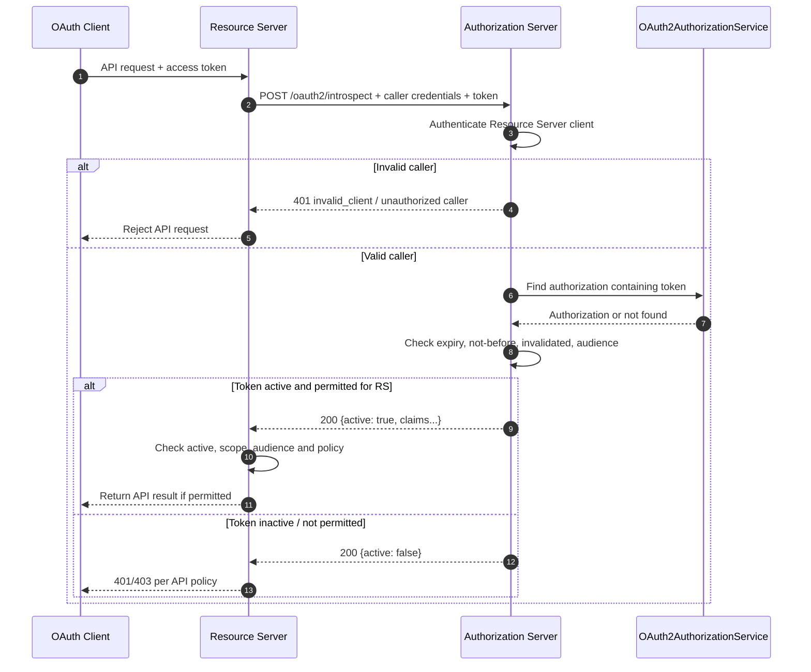

# Looking Up Expired, Revoked, or Non-Existent Tokens

## 1. Why Does the Resource Server Need Introspection?

In the **SPRING_SECURITY_OAUTH2_OIDC_AUTHORIZATION_SERVER** module, we learn how to design, configure, secure, test, and operate an OAuth 2.0/OpenID Connect Authorization Server using **Spring Security**, **Spring Authorization Server**, and **Spring Boot**. This lesson focuses on looking up token status when a token is expired, revoked, or non-existent using **OAuth 2.0 Token Introspection (RFC 7662)**.

A Resource Server receives an access token from a client when the client calls an API. If the token is an opaque string, the Resource Server cannot read claims itself to know whom the token represents, which scopes it has, or whether it is still valid. Even with a JWT, verifying the signature and `exp` does not itself tell whether the token has been revoked at the Authorization Server after issuance.

**Token Introspection** provides a protocol for a Resource Server to ask the Authorization Server about the current status and metadata of a token. The Authorization Server returns JSON containing the required `active` field, along with optional information such as `scope`, `client_id`, `sub`, `aud`, `iss`, `exp`, and `iat`.

An access token is typically considered active when:

- the token was issued by this Authorization Server or can be verified under trust policy;
- its validity window has started and the token has not expired;
- the token has not been revoked or invalidated;
- the token is permitted to be used at the querying Resource Server.

RFC 7662 leaves detailed active-state determination to the Authorization Server, while requiring the server to perform all relevant state checks before returning a result. The Resource Server relies on that answer to decide whether to allow or reject the request.

### Learning Objectives

After this lesson, you will be able to:

1. Distinguish expired tokens, revoked tokens, non-existent tokens, and tokens not permitted for use at a Resource Server.
2. Understand why inactive token cases are returned as `active: false`, typically with HTTP 200.
3. Distinguish inactive token results from authentication failures of the client calling the Introspection Endpoint.
4. Configure the Token Introspection Endpoint in Spring Authorization Server.
5. Understand the role of `OAuth2AuthorizationService`, `OAuth2TokenIntrospectionAuthenticationProvider`, and token state.
6. Send introspection requests, read responses, and check token status at the Resource Server.
7. Design caching, network error handling, testing, and secure introspection operations.

## 2. Three Lookup Cases and Standard Results

This topic focuses on three common scenarios. From the Resource Server's perspective, all three produce the same protocol outcome:

| Token status | What happens at the Authorization Server | Introspection response |
| --- | --- | --- |
| **Expired** | `exp` has passed or the validity window is no longer within the allowed period | `{"active": false}` |
| **Revoked/invalidated** | The token has been revoked or marked invalidated in the authorization state | `{"active": false}` |
| **Non-existent** | The Authorization Server cannot find the token or cannot verify the submitted token | `{"active": false}` |

RFC 7662 requires the Authorization Server not to disclose the specific reason why a token is inactive. An inactive response should contain only the required `active=false` claim. This prevents a third party from using the Introspection Endpoint to probe whether a string was ever issued as a token, whether it expired, or whether it was revoked.

Example:

```http
HTTP/1.1 200 OK
Content-Type: application/json
Cache-Control: no-store

{
  "active": false
}
```

**This is not a protocol error.** The Resource Server authenticated successfully, sent a valid query, and received the conclusion that the token must not be used. The Resource Server must reject the corresponding API request.

### Distinguishing from Introspection Caller Errors

| Situation | Typical HTTP/OAuth response | Meaning |
| --- | --- | --- |
| Queried token is expired, revoked, or non-existent | `200 OK`, `active=false` | Valid query; token is not active |
| Resource Server client credentials are wrong | `401 Unauthorized`, often with `invalid_client` | Resource Server is not authorized to call the endpoint |
| Bearer credential protecting the endpoint lacks permissions or is invalid | `401 Unauthorized` | Caller is not permitted to introspect |
| Missing `token` parameter or malformed request | `400 Bad Request`, `invalid_request` | Invalid introspection request |
| Endpoint unreachable or times out | No valid introspection response | Infrastructure/connection error; cannot conclude the token is active |

Do not turn every HTTP 401 into `active=false`, and do not treat every HTTP 200 as an active token. The Resource Server must read the boolean `active` in the response and handle connection errors separately.

## 3. Introspection Flow Under RFC 7662

The Resource Server calls the Introspection Endpoint via HTTP POST with an `application/x-www-form-urlencoded` body. The request must be protected with TLS and the caller must be authenticated/authorized.



The flow has two independent decisions:

1. **Caller authorization:** Does the Resource Server have permission to ask the Authorization Server about token status?
2. **Token status:** Is the queried token active and permitted for use at this Resource Server?

Only when the caller is valid does the Authorization Server process the token query. If the token is inactive, the server returns `active=false`; if the caller is invalid, the server returns the corresponding OAuth error.

In Spring Authorization Server, the default provider looks up the authorization record and token state. If the system needs to restrict which Resource Server may query which tokens, or apply per-caller audience policies, implement the corresponding policy via an extension point. Do not assume that just because a token has `active=true`, every Resource Server is allowed to accept that token.

### 3.1. Introspection Request

Two main parameters:

| Parameter | Required | Meaning |
| --- | --- | --- |
| `token` | Yes | The token string to check |
| `token_type_hint` | No | Hint whether the token is `access_token` or `refresh_token`, helping optimize lookup |

`token_type_hint` is only a **hint**, not proof of the token type. If the server does not find the token using the hint, the RFC requires continuing to search across supported token types. The server may also ignore the hint if it can identify the token itself.

Example:

```http
POST /oauth2/introspect HTTP/1.1
Host: auth.example.com
Authorization: Basic <base64-resource-server-client-id-and-secret>
Accept: application/json
Content-Type: application/x-www-form-urlencoded

token=ACCESS_TOKEN_TO_CHECK
&token_type_hint=access_token
```

Do not place the token in the query string. HTTP POST helps avoid putting token values into URLs, browser history, proxy logs, and request URL logging systems.

### 3.2. Response When Token Is Active

```json
{
  "active": true,
  "scope": "orders.read orders.write",
  "client_id": "orders-web",
  "username": "alice",
  "sub": "user-1042",
  "aud": [
    "orders-api"
  ],
  "iss": "https://auth.example.com",
  "exp": 1800000300,
  "iat": 1800000000,
  "token_type": "Bearer"
}
```

`active` is the required claim. The remaining claims are optional under RFC 7662 and Authorization Server policy. The Resource Server must not assume the response always includes `username`, `sub`, `aud`, or `scope`; required claims must be explicitly defined in the integration contract.

### 3.3. Response When Token Is Inactive

```json
{
  "active": false
}
```

Do not ask the Authorization Server to return `reason=expired`, `reason=revoked`, or `reason=not_found`. If the Resource Server needs telemetry, record that the introspection result was inactive without inferring a specific cause from the response.

## 4. Understanding Expiry, Revocation, and Non-Existent Tokens

### 4.1. Expired Tokens

An access token has a validity lifetime. If the introspection response contains `exp`, it is the token's expiration time as a Unix timestamp. The Authorization Server must evaluate expiration before returning `active=true`.

A token may remain in the database after expiration for auditing, inspection, or refresh handling. The record's continued presence in the store does not make the token active again. Validity state is determined by time and token metadata.

Example:

```text
issued_at = 10:00:00
expires_at = 10:05:00
current_time = 10:06:30

token record exists = true
token expired      = true
token active       = false
```

Do not use finding a token record as the sole condition for returning `active=true`.

### 4.2. Revoked or Invalidated Tokens

A token can be revoked before `exp`, for example:

- The Resource Owner revokes granted permissions;
- a user logs out of a session that requires invalidating tokens;
- an administrator detects a compromised credential and revokes it;
- a refresh token family is revoked per policy;
- the Authorization Server proactively invalidates an authorization or token.

RFC 7009 defines the Token Revocation Endpoint for clients to request token revocation. Once revocation state is recorded, the Introspection Endpoint must reflect that state by returning `active=false`.

In Spring Authorization Server, `OAuth2Authorization.Token` has metadata for invalidated state and the methods `isInvalidated()`, `isExpired()`, `isBeforeUse()`, and `isActive()`. `OAuth2Authorization.Builder.invalidate(token)` is part of the API for marking a token as invalidated in authorization state. When an application uses the default revocation flow, let the provider and `OAuth2AuthorizationService` manage state updates.

### 4.3. Non-Existent or Unrecognized Tokens

Possible causes include:

- the token was never issued by this Authorization Server;
- the token was mistyped or truncated;
- the token belongs to another issuer that this server does not trust;
- the authorization record was purged by retention/cleanup;
- the token is not among the token types supported for introspection by this server.

If the Authorization Server does not find the token, the response is still `active=false`. Do not return `invalid_token` as an OAuth error merely because the token is absent from the store. A valid query for an unrecognized token is a normal introspection outcome.

### 4.4. Valid Token Not Intended for This Resource Server

A token may be properly signed, unexpired, and unrevoked, yet carry an audience for a different API. According to RFC 7662, the Authorization Server must determine whether the token may be used at the Resource Server calling introspection. If not, return `active=false`.

This prevents `billing-api` from accepting a token meant only for `orders-api`. The Resource Server should also check audience in the response if the contract requires it, even when the Authorization Server already enforces an audience policy.

### Decision Summary Table

| Check | Result | `active` |
| --- | --- | --- |
| Token recognized, within validity window, unrevoked, and matching audience | Allow continuing scope/policy checks | `true` |
| `exp` has passed | Inactive | `false` |
| `nbf` not yet reached | Inactive | `false` |
| Token revoked/invalidated | Inactive | `false` |
| Token not found | Inactive | `false` |
| Token not permitted for the Resource Server calling introspection | Inactive | `false` |

**Key point:** An API returning `active=true` does not automatically mean every request is allowed. The Resource Server still has to check scope, audience, tenant, business permissions, and other access conditions.

## 5. How Does Spring Authorization Server Process Introspection?

Spring Authorization Server includes the Token Introspection Endpoint out of the box in its default Authorization Server configuration. Main components:

| Component | Responsibility |
| --- | --- |
| `AuthorizationServerSettings` | Declares the Introspection Endpoint path |
| `OAuth2TokenIntrospectionEndpointConfigurer` | Customizes converter, provider, response handler, and error handler |
| `OAuth2TokenIntrospectionEndpointFilter` | Handles HTTP POST requests at the endpoint |
| `OAuth2TokenIntrospectionAuthenticationConverter` | Converts the HTTP request into an introspection authentication request |
| `OAuth2TokenIntrospectionAuthenticationProvider` | Authenticates the caller and processes the token query |
| `OAuth2AuthorizationService` | Looks up and manages authorization/token state |
| `OAuth2Authorization.Token` | Holds the token along with expiry/invalidated metadata and active status |

### 5.1. Default Endpoint and Provider

`OAuth2AuthorizationServerConfiguration` provides default configuration for protocol endpoints, including the Token Introspection Endpoint. The default path is:

```text
/oauth2/introspect
```

By default, `OAuth2TokenIntrospectionEndpointFilter` uses:

- `OAuth2TokenIntrospectionAuthenticationConverter` to read requests;
- `OAuth2TokenIntrospectionAuthenticationProvider` to process authentication;
- an internal success handler to return `OAuth2TokenIntrospection`;
- `OAuth2ErrorAuthenticationFailureHandler` to return OAuth errors when the caller/request is invalid.

The default provider accepts `RegisteredClientRepository` and `OAuth2AuthorizationService`. The authorization store lets the server find the token; token metadata determines whether the token is valid, expired, or invalidated. The `OAuth2Authorization.Token.isActive()` API provides the combined status result alongside `isExpired()`, `isBeforeUse()`, and `isInvalidated()`.

### 5.2. Configuring the Endpoint in AuthorizationServerSettings

If the application has not declared a custom `AuthorizationServerSettings`, the default configuration already uses `/oauth2/introspect`. You can explicitly declare the path and issuer:

```java
package com.example.authserver;

import org.springframework.context.annotation.Bean;
import org.springframework.context.annotation.Configuration;
import org.springframework.security.oauth2.server.authorization.settings.AuthorizationServerSettings;

@Configuration
public class AuthorizationServerEndpointConfig {

    @Bean
    AuthorizationServerSettings authorizationServerSettings() {
        return AuthorizationServerSettings.builder()
                .issuer("https://auth.example.com")
                .tokenIntrospectionEndpoint("/oauth2/introspect")
                .build();
    }
}
```

If the project already has an `AuthorizationServerSettings` bean configuring issuer, token endpoint, revocation endpoint, or PAR endpoint, add `tokenIntrospectionEndpoint(...)` to the existing bean. Do not create two competing settings beans.

### 5.3. Registering the Endpoint in SecurityFilterChain

Configuration example with Spring Authorization Server 1.5.x API:

```java
package com.example.authserver;

import org.springframework.context.annotation.Bean;
import org.springframework.context.annotation.Configuration;
import org.springframework.core.annotation.Order;
import org.springframework.security.config.Customizer;
import org.springframework.security.config.annotation.web.builders.HttpSecurity;
import org.springframework.security.oauth2.server.authorization.config.annotation.web.configurers.OAuth2AuthorizationServerConfigurer;
import org.springframework.security.web.SecurityFilterChain;

@Configuration
public class AuthorizationServerSecurityConfig {

    @Bean
    @Order(1)
    SecurityFilterChain authorizationServerSecurityFilterChain(HttpSecurity http)
            throws Exception {

        OAuth2AuthorizationServerConfigurer authorizationServerConfigurer =
                OAuth2AuthorizationServerConfigurer.authorizationServer();

        http
            .securityMatcher(authorizationServerConfigurer.getEndpointsMatcher())
            .with(authorizationServerConfigurer, authorizationServer ->
                authorizationServer
                    .tokenIntrospectionEndpoint(Customizer.withDefaults())
            );

        return http.build();
    }
}
```

This is the endpoint configuration within the Authorization Server filter chain. The application still needs foundational beans such as `RegisteredClientRepository`, `AuthorizationServerSettings`, `OAuth2AuthorizationService`, token generator/JWK, and application filter chains if applicable.

**Do not create a separate REST controller for `/oauth2/introspect`.** The default endpoint filter already wires together client authentication, converter, provider, and response handler. A hand-rolled controller could inadvertently bypass caller authentication, token lookup, or error formatting rules.

### 5.4. Role of OAuth2AuthorizationService

`OAuth2AuthorizationService` manages authorization records and provides a method to look up tokens:

```java
OAuth2Authorization authorization =
        authorizationService.findByToken(token, tokenType);
```

The result is the authorization containing the token, or `null` if not found. Two common implementations are:

| Implementation | Characteristics |
| --- | --- |
| `InMemoryOAuth2AuthorizationService` | Used for single-node demos/tests; data is lost on restart and not shared across instances |
| `JdbcOAuth2AuthorizationService` | Stores authorization state in a database; suitable for systems needing persistent state and multiple nodes when schema is properly configured |

If the server issues tokens without persisting or being able to recover their state, introspection cannot simply rely on a token "looking like a JWT" to conclude it was issued and unrevoked. For self-contained JWTs, you can design a custom provider to verify signature/claims and check a revocation store; with the default Spring Authorization Server model, keep authorization state queryable.

### 5.5. Token State in Spring Authorization Server

`OAuth2Authorization.Token` is a wrapper holding the token and metadata. Important states:

| API | Meaning |
| --- | --- |
| `isExpired()` | The token has passed its expiration time |
| `isBeforeUse()` | The token has not yet reached its valid-from time |
| `isInvalidated()` | The token has been marked invalidated, e.g., after revocation |
| `isActive()` | Combined result indicating whether the token is active at evaluation time |

When a token is revoked via the default Revocation Endpoint, the provider updates the authorization state so the token is no longer considered active. When introspection looks up the same authorization record, the invalidated status is used to return `active=false`.

**Do not delete the token record immediately on revocation if business logic or auditing needs to preserve authorization state.** The invalidated status allows distinguishing internally between a token that was recorded and revoked versus one that was never stored. Externally, both still return `active=false` under RFC 7662.

## 6. Authenticating the Resource Server Calling the Introspection Endpoint

The Introspection Endpoint accepts tokens that an attacker might try to guess. Therefore RFC 7662 requires protecting the endpoint with TLS and requiring the caller to be authenticated or hold an authorized credential. Typically, the caller is a Resource Server registered at the Authorization Server.

### 6.1. Registering a Resource Server Client

Example registering the `orders-api` service as a confidential client to call the Introspection Endpoint using `client_secret_basic`:

```java
import java.util.UUID;

import org.springframework.context.annotation.Bean;
import org.springframework.security.crypto.password.PasswordEncoder;
import org.springframework.security.oauth2.core.AuthorizationGrantType;
import org.springframework.security.oauth2.core.ClientAuthenticationMethod;
import org.springframework.security.oauth2.server.authorization.client.InMemoryRegisteredClientRepository;
import org.springframework.security.oauth2.server.authorization.client.RegisteredClient;
import org.springframework.security.oauth2.server.authorization.client.RegisteredClientRepository;

@Bean
RegisteredClientRepository registeredClientRepository(PasswordEncoder passwordEncoder) {
    // Demo has only one Resource Server client; production requires a persistent repository
    // and retaining the system's other client registrations.
    RegisteredClient ordersApi = RegisteredClient
            .withId(UUID.randomUUID().toString())
            .clientId("orders-api")
            .clientSecret(passwordEncoder.encode("lab-only-change-this-secret"))
            .clientAuthenticationMethod(ClientAuthenticationMethod.CLIENT_SECRET_BASIC)
            .authorizationGrantType(AuthorizationGrantType.CLIENT_CREDENTIALS)
            .build();

    return new InMemoryRegisteredClientRepository(ordersApi);
}
```

Place this `@Bean` method in a `@Configuration` class; the example assumes the application already defines a `PasswordEncoder` bean. Persist registrations via `RegisteredClientRepository`. The secret is for lab use only; production requires a secret manager and hashed storage via `PasswordEncoder`. You can use `private_key_jwt` or mTLS instead of a shared secret if policy requires.

`CLIENT_CREDENTIALS` in the example indicates the type of service client usable in the system. It is not a parameter of the introspection request and does not mean the Resource Server must obtain a new access token for each introspection call.

### 6.2. Client Authentication Differs from the Queried Token

An introspection request carries two distinct credentials:

- **Caller credential:** authenticates the Resource Server calling the endpoint, e.g., `orders-api`'s Basic credentials.
- **Token parameter:** the access token that the Resource Server received from a client and wants to check.

Never use the access token being inspected as the client secret or Basic credential to introspect itself. The caller credential must belong to a Resource Server authorized to access the endpoint.

Example:

```http
POST /oauth2/introspect HTTP/1.1
Host: auth.example.com
Authorization: Basic <orders-api-client-credentials>
Content-Type: application/x-www-form-urlencoded

token=TOKEN_RECEIVED_FROM_CLIENT
&token_type_hint=access_token
```

### 6.3. Restricting Which Resource Servers May Introspect

Successful client authentication only proves the caller is a registered client. The application still needs a policy determining which Resource Servers may introspect tokens and which tokens are allowed at that Resource Server.

RFC 7662 requires that if a Resource Server is not permitted to introspect a particular token, the Authorization Server must return `active=false` just as for an invalid token. Do not return additional reasons, as that could disclose information about the token or system structure.

Spring Authorization Server provides the `authenticationProviders(...)` extension point on `OAuth2TokenIntrospectionEndpointConfigurer` to add or customize providers. If you need a client allowlist, audience binding, or per-Resource-Server claim filtering, implement the policy at the appropriate provider/response path while preserving default checks. Do not merely check a `client_id` from the request body, because caller identity must come from the Spring-authenticated client principal.

### 6.4. Never Expose the Introspection Endpoint Publicly

Do not allow browsers or public SPAs to call this endpoint directly with user tokens. Backend Resource Servers need dedicated authentication, and the endpoint should be exposed only over HTTPS with appropriate network policies and rate limits. If the client credential is wrong, the server returns an authentication error; if the queried token does not exist, the server returns `active=false`.

## 7. Connecting Spring Security Resource Server to the Introspection Endpoint

When a Resource Server uses opaque tokens, Spring Security can call the Introspection Endpoint to verify the token and extract authorities/claims. This is the Resource Server side; this configuration does not replace the endpoint and provider on the Authorization Server.

### 7.1. Configuration via Spring Boot

Example configuration in `application.yml`:

```yaml
spring:
  security:
    oauth2:
      resourceserver:
        opaquetoken:
          introspection-uri: https://auth.example.com/oauth2/introspect
          client-id: orders-api
          client-secret: ${ORDERS_API_INTROSPECTION_SECRET}
```

The `client-id` and `client-secret` values are the Resource Server's credentials used to authenticate against the Introspection Endpoint. Store the secret in environment variables/secret manager; never commit it to the repository.

### 7.2. Enabling Opaque Token Support in SecurityFilterChain

```java
package com.example.ordersapi;

import org.springframework.context.annotation.Bean;
import org.springframework.context.annotation.Configuration;
import org.springframework.security.config.Customizer;
import org.springframework.security.config.annotation.web.builders.HttpSecurity;
import org.springframework.security.web.SecurityFilterChain;

@Configuration
public class ResourceServerSecurityConfig {

    @Bean
    SecurityFilterChain apiSecurityFilterChain(HttpSecurity http)
            throws Exception {

        return http
                .authorizeHttpRequests(authorize -> authorize
                        .requestMatchers("/api/orders/**")
                            .hasAuthority("SCOPE_orders.read")
                        .anyRequest().authenticated())
                .oauth2ResourceServer(resourceServer ->
                        resourceServer.opaqueToken(Customizer.withDefaults()))
                .build();
    }
}
```

With opaque token configured, Spring Security uses an introspector to call the configured URI, authenticate the caller with client credentials, read the `active` claim, and convert necessary claims into an `OAuth2AuthenticatedPrincipal`. Inactive tokens are never accepted as successful authentication.

### 7.3. Comparing Opaque Token Introspection vs. JWT Offline Validation

| Verification Approach | What does the Resource Server do? | Immediate revocation visibility? |
| --- | --- | --- |
| JWT + `JwtDecoder` | Verifies signature, issuer, audience, expiry, and claims locally | Does not automatically detect revocations without extra state/checks |
| Opaque token + introspection | Sends token to Authorization Server to query status | Can detect revocations once state updates, depending on cache |
| JWT + introspection | Sends the JWT itself to the endpoint for centralized status check | Can detect revocations if the Authorization Server stores/looks up the token and applies policy |

Not every JWT is automatically introspectable merely because it can be decoded. The Authorization Server must have a way to recognize, verify, and evaluate that token's status. With default Spring Authorization Server, authorization records are stored in `OAuth2AuthorizationService`, allowing the endpoint to look up the token against persisted state.

### 7.4. Resource Server Response Handling

| Introspection result | Decision at Resource Server |
| --- | --- |
| `active=true`, valid audience, required scope present | Allow request processing per business policy |
| `active=true`, but missing scope | Deny permission, typically HTTP 403 |
| `active=false` | Do not authenticate token; typically return HTTP 401 with `invalid_token` |
| Invalid caller credentials at endpoint | Cannot complete introspection; handle as inter-service configuration/authorization failure |
| Authorization Server timeout/unreachable | No proof token is active; reject request or apply explicitly designed outage policy |

Do not turn a network error into `active=true`. If the Resource Server continues using stale cache entries during an outage, the maximum stale acceptance window must be bounded and evaluated against API sensitivity.

## 8. Hands-On Token Lookup

### 8.1. Sending an HTTP Request

Example of a Resource Server querying a token:

```http
POST /oauth2/introspect HTTP/1.1
Host: auth.example.com
Authorization: Basic <base64-orders-api-credentials>
Accept: application/json
Content-Type: application/x-www-form-urlencoded

token=eyJhbGciOiJSUzI1NiJ9.ACCESS_TOKEN_PAYLOAD.SIGNATURE
&token_type_hint=access_token
```

The sample token is illustrative only. In real environments, never paste real tokens into tickets, chats, or logs.

### 8.2. Testing with PowerShell

Set the token and client secret into lab environment variables before running:

```powershell
$token = $env:LAB_ACCESS_TOKEN
$clientSecret = $env:LAB_INTROSPECTION_SECRET

if ([string]::IsNullOrWhiteSpace($token) -or
        [string]::IsNullOrWhiteSpace($clientSecret)) {
    throw "LAB_ACCESS_TOKEN and LAB_INTROSPECTION_SECRET must be configured"
}

$responseJson = curl.exe -sS `
    -u ("orders-api:" + $clientSecret) `
    -H "Accept: application/json" `
    -H "Content-Type: application/x-www-form-urlencoded" `
    --data-urlencode "token=$token" `
    --data-urlencode "token_type_hint=access_token" `
    "https://auth.example.com/oauth2/introspect"

$result = $responseJson | ConvertFrom-Json
if ($result.active -eq $true) {
    "Token is active"
    $result | Select-Object active, client_id, sub, aud, scope, exp
}
else {
    "Token is inactive"
}
```

The script prints only selected metadata when the token is active and does not print the input token. In production, ensure `curl.exe -u` does not expose credentials via process arguments or shell diagnostics; prefer HTTP clients with safer secret handling. Do not enable verbose mode or write raw responses containing identifying information to unprotected logs.

### 8.3. Testing the Three Cases

In your test environment, prepare three values:

1. An unexpired, unrevoked access token.
2. A token that has expired or was revoked via the Revocation Endpoint.
3. A random string that is not an issued token.

Expected results:

| Token | Introspection HTTP status | Body |
| --- | --- | --- |
| Active | `200 OK` | `active=true` with permitted metadata |
| Expired | `200 OK` | Only `active=false` |
| Revoked | `200 OK` | Only `active=false` |
| Unknown/random | `200 OK` | Only `active=false` |

Next, retry with an invalid client secret. This time the server must reject the **caller** (typically `401 invalid_client`), rather than returning `active=false` for the token.

### 8.4. Checking Discovery Metadata

Authorization Server Metadata under RFC 8414 may publish:

```json
{
  "issuer": "https://auth.example.com",
  "introspection_endpoint": "https://auth.example.com/oauth2/introspect",
  "introspection_endpoint_auth_methods_supported": [
    "client_secret_basic"
  ]
}
```

This is a condensed illustrative response. Clients should discover metadata from a trusted issuer, verify the endpoint URL, and check supported authentication methods. When changing the introspection path or client authentication methods, update metadata and test client discovery.

## 9. Caching, Revocation Delay, and Error Handling

Introspection adds a network call to the API authentication flow. The Resource Server can cache responses to reduce load, but caching delays when a revoked token is noticed.

### 9.1. Choosing Cache TTL

RFC 7662 allows Resource Servers to cache responses and requires weighing the trade-off between performance and token state freshness. If the response includes an `exp` claim, the cache **must not live longer than that expiration time**.

A practical policy:

| Result | Caching Approach |
| --- | --- |
| `active=true` | Short TTL; further capped by remaining time until `exp` and acceptable revocation delay |
| `active=false` | May cache briefly to reduce repeated lookups; do not hold too long if lookup state synchronization might lag |
| Caller `401` | Do not cache as token status; this is a Resource Server credential error |
| Timeout/5xx/network error | Do not cache as `active=true` or `active=false`; this is an infrastructure failure |

Example:

```text
token exp has 20 seconds left
cache policy max is 30 seconds
=> effective cache TTL must not exceed 20 seconds

token can be revoked at any time
=> a 30-second TTL can create a post-revocation usage window of up to nearly 30 seconds
```

If an API handles sensitive data or requires near-instantaneous revocation, sharply reduce the TTL or disable caching. For less sensitive APIs, a short TTL can be a reasonable balance between latency and system load.

### 9.2. Cache Keys and Sensitive Data

- Use a secure hash of the token as the cache key if there is no need to retain the raw token in the cache.
- Never write raw tokens to cache diagnostics, metric labels, or distributed tracing.
- Key cached responses by both token and Resource Server context if the Authorization Server returns different results per caller/audience.
- When a token is revoked, proactively invalidate cache entries via events or a message bus if the system supports synchronization.
- When a cache entry expires, re-query the Authorization Server; never extend active status automatically.

If introspection responses filter claims per Resource Server, never share a single cache entry across multiple Resource Servers with different claim visibility permissions.

### 9.3. When the Authorization Server Is Unreachable

Introspection endpoint timeouts, TLS failures, DNS failures, or HTTP 5xx responses are neither proof that a token is inactive nor proof that it is active.

The Resource Server should apply **fail closed** for requests requiring online state verification: do not grant access without a trustworthy answer. Some systems may continue serving from positive cache within a very short window to preserve availability; if chosen, document the maximum stale window, which APIs allow it, and the revocation risk during that window.

Do not convert infrastructure errors into an `active=false` response to callers as if the token had been revoked. Log dependency failures separately so operations teams can distinguish an Authorization Server outage from clients sending expired tokens.

## 10. Troubleshooting and Diagnostics

| Symptom | Common Cause | What to Check |
| --- | --- | --- |
| `200 OK`, `active=false` | Token expired, revoked, non-existent, or not intended for caller | Check the token in the issuing environment; do not ask the server to reveal reasons in responses |
| `401 invalid_client` | Wrong Basic secret/assertion/mTLS or unregistered client | Check `RegisteredClient`, authentication method, and credentials |
| `400 invalid_request` | Missing `token`, wrong body content type, or invalid request parameter | Check POST form body and encoding |
| `404` at `/oauth2/introspect` | Wrong path, settings, or filter chain missing the endpoint | Check `AuthorizationServerSettings` and `getEndpointsMatcher()` |
| `401` at Resource Server | Inactive token or unauthenticated introspection caller | Inspect categorized logs on Resource Server and Authorization Server |
| `403` at Resource Server | Active token missing required scope/business permission | Check scope mapping and authorization rules |
| Revoked token still accepted by API | Valid positive cache entry remains or authorization state out of sync | Check cache TTL, revocation updates, and shared repository |
| Unexpired token returns `active=false` | Token before `nbf`, invalidated, wrong audience, or missing authorization record | Check token metadata and caller/target policy |
| Unknown token returns 401 | Custom implementation treats token lookup miss as an OAuth error | Fix behavior so valid callers receive `200 active=false` |
| Introspection timeout | Authorization Server, database, or network failure | Check latency, health, connection pools, and retry budget |
| Resource Server misses `scope` claim | Response omits claim or mapper does not map it properly | Check `OAuth2TokenIntrospection` and authority converter |

### 10.1. Distinguishing Three Error Classes

1. **Caller authentication failure:** The Resource Server failed to prove its identity to the Authorization Server; return an OAuth error such as `invalid_client`.
2. **Token inactive:** Valid caller, unusable token; return `200` with `active=false`.
3. **Infrastructure failure:** No valid response received; the Resource Server treats it as a dependency error without assuming token status.

If these three classes are conflated, investigations become harder and you risk accidentally accepting tokens when the Authorization Server is failing.

### 10.2. Unsafe Fixes to Avoid

- Do not disable client authentication to work around `401 invalid_client`.
- Do not flip `active=false` to `active=true` when the Resource Server cannot reach the endpoint.
- Do not increase cache TTL indefinitely to reduce database load.
- Do not return `expired`, `revoked`, or `unknown` reasons to callers not authorized to know them.
- Do not log full tokens to debug a failing request.
- Do not skip audience or scope checks just because introspection returned `active=true`.

## 11. Testing Token Expiry, Revocation, and Unknown Tokens

Tests must verify both protocol results at the Authorization Server and access decisions at the Resource Server.

### 11.1. Test Matrix

| ID | Scenario | Expected Result |
| --- | --- | --- |
| INT-01 | Authenticated Resource Server caller, active token | `200`, `active=true` and permitted metadata |
| INT-02 | Expired token | `200`, only `active=false` |
| INT-03 | Token revoked via Revocation Endpoint | `200`, only `active=false` |
| INT-04 | Non-existent token string | `200`, only `active=false` |
| INT-05 | Token from untrusted issuer | Inactive or rejected per trust policy; no access granted |
| INT-06 | Token before `nbf` | `200`, `active=false` |
| INT-07 | Active token whose audience is not for this Resource Server | `200`, `active=false` |
| INT-08 | Wrong caller client secret | `401`, `invalid_client` |
| INT-09 | Unregistered caller | Caller authentication rejected |
| INT-10 | Missing `token` parameter | `400`, `invalid_request` |
| INT-11 | `token_type_hint=access_token`, token is a refresh token | Server searches other supported token types per RFC |
| INT-12 | Active token with insufficient scope | Introspection may return `active=true`; API returns 403 |
| INT-13 | Resource Server calls endpoint over plain HTTP | Rejected by TLS/network policy |
| INT-14 | Token revoked while positive cache is still valid | Behavior matches configured TTL; verify stale window |
| INT-15 | Token revoked and cache expired | Next introspection returns `active=false` |
| INT-16 | Authorization Server timeout | Resource Server never grants access based on an assumed active state |
| INT-17 | Authorization Server returns 5xx | Handled as dependency failure, not treated as `active=false` |
| INT-18 | Introspection request puts raw token in query string | Endpoint rejects GET/query; accepts only POST form |
| INT-19 | Caller not allowed to view another Resource Server's token | `active=false` with no additional metadata |
| INT-20 | Unknown token queried repeatedly | Rate limiting/monitoring prevents token scanning |
| INT-21 | Introspection response missing `active` claim | Resource Server treats response as invalid and rejects |
| INT-22 | `active=true` but response missing scope claim required by API | Access denied per policy |
| INT-23 | Multiple Authorization Server instances serving introspection | All nodes observe consistent revocation/expiry state |
| INT-24 | Cleanup deletes old authorization records | Token is no longer found and still returns `active=false` |

### 11.2. End-to-End Revocation Testing

An integration test can proceed in sequence:

1. Obtain a valid access token for a test client.
2. Call the Introspection Endpoint and confirm `active=true`.
3. Call the Revocation Endpoint to revoke the access token using client authentication.
4. Call the Introspection Endpoint again with the same token.
5. Confirm `active=false` and no extra metadata is returned.
6. Call the protected API; the Resource Server must reject the token once the test's cache/TTL window has elapsed.

Do not only test the HTTP response of the Revocation Endpoint. Test the observable state at the Introspection Endpoint and target API, because caching or separate authorization stores can leave state out of sync.

### 11.3. Testing Unknown Tokens

Generate a random string absent from test fixtures, then call introspection with valid caller credentials. The result must be `200` and `active=false`. Next, repeat with invalid caller credentials to prove the two cases produce distinct responses.

## 12. Operations, Exercises, and Production Checklist

### 12.1. Protecting the Endpoint and Data

- Enforce TLS and verify server certificates at the Resource Server.
- Allow only registered Resource Servers to call the Introspection Endpoint.
- Use strong client authentication; consider `private_key_jwt` or mTLS for critical services.
- Rate limit by caller client, IP/network identity, and error request counts.
- Cap request body size and `token` parameter length.
- Never log raw tokens, client secrets, or full responses containing identifying data.
- Return only the token metadata that the specific Resource Server needs to make decisions.

### 12.2. State Storage and Synchronization

In a multi-instance environment, all Authorization Server nodes must share an authorization store capable of sharing token state. When a token is revoked on node A, introspection on node B must observe the invalidation once the transaction commits.

Verify:

- `OAuth2AuthorizationService` is shared across all nodes;
- transactions persisting revocation state commit before reporting completion;
- Authorization Server caches do not retain stale token statuses;
- cleanup jobs do not delete records still needed for auditing or refresh handling;
- backup/restore does not resurrect revoked tokens;
- node clocks are synchronized for consistent `exp` and `nbf` evaluation.

### 12.3. Metrics and Auditing

Monitor these metrics:

- successful introspection requests per caller client;
- ratio of `active=true` vs. `active=false`;
- counts of `invalid_client`, `invalid_request`, timeouts, and 5xx errors;
- p50/p95/p99 latency of the endpoint and authorization store;
- unknown token queries and rate-limited requests;
- time from revocation until Resource Servers observe `active=false`;
- cache hits/misses and remaining TTL of positive responses.

Never attach raw tokens or unbounded token hashes to metric labels, as that creates very high cardinality. Use correlation IDs and authenticated client IDs for investigation.

### 12.4. Hands-On Exercise

Set up an Authorization Server and the `orders-api` Resource Server:

1. Configure the `/oauth2/introspect` endpoint.
2. Register the Resource Server client with `client_secret_basic` in the lab environment.
3. Configure Spring Security Resource Server to use opaque token introspection.
4. Issue an unexpired access token and confirm `active=true`.
5. Revoke the token via the Revocation Endpoint, then verify `active=false`.
6. Wait for another access token to expire and check again.
7. Send a random token string and confirm `active=false`.
8. Send an introspection request with a wrong secret and confirm the caller error is `401`.
9. Test a short cache TTL and observe the revocation detection delay.
10. Run tests across two Authorization Server instances to confirm consistent state.

### 12.5. Self-Check Questions

**Question 1.** Does an expired token return HTTP 401 from the Introspection Endpoint?  
**Answer:** No, assuming the caller is authenticated and the request is valid. The endpoint returns `200` with `active=false`.

**Question 2.** Is a non-existent token an OAuth error?  
**Answer:** No. It is an inactive token outcome; the response should not disclose the reason.

**Question 3.** Why is a wrong client secret different from a revoked token?  
**Answer:** A wrong secret is a caller authentication failure; a revoked token is a valid query outcome about token status.

**Question 4.** Does `token_type_hint` dictate the token type?  
**Answer:** No. It is only a hint; the server must search other supported token types if not found under the hint.

**Question 5.** Is a JWT with `exp` in the future guaranteed to be active?  
**Answer:** No. It could still be revoked, before `nbf`, from the wrong issuer, have the wrong audience, or not be permitted for the Resource Server.

**Question 6.** Can a Resource Server cache `active=true` indefinitely?  
**Answer:** No. Caching creates a post-revocation usage window; if the response contains `exp`, the cache must not exceed that timestamp.

**Question 7.** When the Authorization Server times out, should the Resource Server default tokens to active or inactive?  
**Answer:** There is no trustworthy response to conclude either. For requests requiring online introspection, reject or apply a bounded outage policy—never default to active.

### 12.6. Pre-Production Checklist

- [ ] Introspection Endpoint operates strictly over HTTPS.
- [ ] Resource Server callers are registered and authenticated via an appropriate method.
- [ ] Only approved Resource Servers may query tokens.
- [ ] The `token` parameter is sent in the POST form body, never in the URL.
- [ ] Non-existent, expired, revoked, or wrong-audience tokens return `active=false`.
- [ ] Inactive responses do not disclose reasons or extra metadata.
- [ ] Invalid caller credentials return an appropriate OAuth error, never `active=false`.
- [ ] Authorization Server checks expiry, not-before, revocation, signature, and audience per token type.
- [ ] `token_type_hint` is treated as a hint, not a trusted assertion.
- [ ] Resource Server checks `active`, scope, audience, and business policies.
- [ ] Cache TTL is bounded by `exp` and acceptable revocation delay.
- [ ] Network/5xx errors are separated from inactive token state and handled fail closed.
- [ ] Multiple Authorization Server instances share authorization state.
- [ ] End-to-end tests cover active, expired, revoked, unknown, invalid caller, and outage cases.
- [ ] Logs/metrics contain no raw tokens or client secrets.

### Memory Map

```text
Resource Server
   |
   | POST /oauth2/introspect
   | caller authentication + token parameter
   v
Authorization Server
   |
   +--> Invalid caller
   |       -> 401 invalid_client / unauthorized caller
   |
   +--> Valid caller
           |
           v
       OAuth2AuthorizationService.findByToken(...)
           |
           +--> Not found
           |       -> 200 { active: false }
           |
           +--> Found
                   |
                   +--> expired / before-use / invalidated / wrong audience
                   |       -> 200 { active: false }
                   |
                   +--> active and permitted for Resource Server
                           -> 200 { active: true, metadata... }

Resource Server:
   active=false -> reject token
   active=true  -> continue checking scope/audience/business policy
   timeout/5xx  -> do not assume active
```

**Key takeaway:** For a valid introspection request and authenticated caller, expired, revoked, non-existent, or unauthorized-for-Resource-Server tokens are all represented by `200 OK` and `active=false`. `401 invalid_client` is reserved for caller authentication errors. Spring Authorization Server connects the Introspection Endpoint to `OAuth2AuthorizationService` and token state; the Resource Server must read `active`, enforce scope/audience policies, and keep caches short enough not to continue accepting revoked tokens.

## Authoritative References

- [RFC 7662 — OAuth 2.0 Token Introspection](https://www.rfc-editor.org/rfc/rfc7662.html): request/response, active status, caller errors, caching, and security considerations.
- [RFC 7009 — OAuth 2.0 Token Revocation](https://www.rfc-editor.org/rfc/rfc7009.html): how clients request revocation of access tokens and refresh tokens.
- [Spring Authorization Server — Protocol Endpoints](https://docs.spring.io/spring-authorization-server/reference/protocol-endpoints.html): Introspection Endpoint configurer, converter, provider, response handler, and error handler.
- [Spring Authorization Server — Configuration Model](https://docs.spring.io/spring-authorization-server/reference/configuration-model.html): default endpoints and `AuthorizationServerSettings`.
- [Spring Authorization Server — OAuth2TokenIntrospectionAuthenticationProvider API](https://docs.spring.io/spring-authorization-server/reference/api/java/org/springframework/security/oauth2/server/authorization/authentication/OAuth2TokenIntrospectionAuthenticationProvider.html): default provider handling introspection.
- [Spring Authorization Server — OAuth2Authorization.Token API](https://docs.spring.io/spring-authorization-server/reference/api/java/org/springframework/security/oauth2/server/authorization/OAuth2Authorization.Token.html): expired, before-use, invalidated, and active states.
- [Spring Authorization Server — JdbcOAuth2AuthorizationService API](https://docs.spring.io/spring-authorization-server/reference/api/java/org/springframework/security/oauth2/server/authorization/JdbcOAuth2AuthorizationService.html): looking up authorizations by token.
- [Spring Security — OAuth 2.0 Resource Server Opaque Tokens](https://docs.spring.io/spring-security/reference/servlet/oauth2/resource-server/opaque-token.html): configuring the Resource Server to call the Introspection Endpoint.
