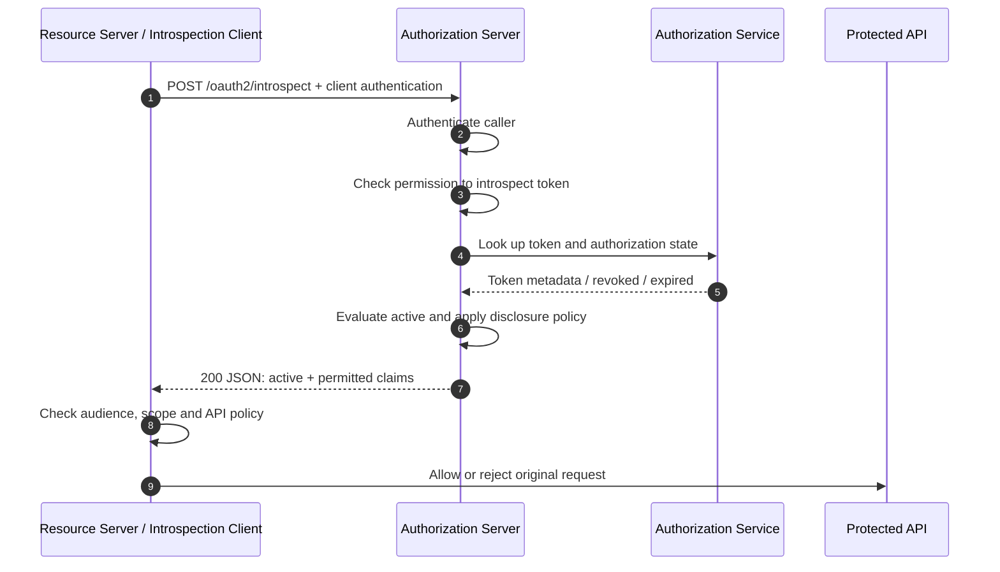

# Filtering Claims and Limiting Token Data Disclosure to Introspection Callers

## 1. Why Does Introspection Need a Data Disclosure Policy?

An API gateway receives access tokens from many clients and calls the Authorization Server's **Token Introspection Endpoint** to check whether each token is still valid. An introspection response can contain `active`, `scope`, `client_id`, `sub`, `username`, `aud`, `iss`, expiration timestamps, and extension claims. If the server returns all data to every caller, an API that only needs to know whether a token has `orders.read` permission may inadvertently receive the user's username, internal identifiers, tenant, permissions of other services, or sensitive business data.

**RFC 7662 allows the Authorization Server to return different metadata sets to different protected resources.** For example, `orders-api` only needs to know that the token is active, its scopes, and its audience; `audit-service` might need subject and token ID per approved permissions. There is no reason for both to receive the same broad set of claims.

The core idea of this lesson is separating three decisions:

1. **Client authentication:** who is calling the introspection endpoint?
2. **Introspection authorization:** is the caller allowed to query this specific token, and is the token valid for that resource?
3. **Claim disclosure:** which metadata fields is the caller allowed to see in the response?

A client authenticating successfully does not mean it has permission to introspect every token or read every claim. Restricting response fields is part of access control and privacy protection.

This lesson belongs to the **Introspection** chapter of the `SPRING_SECURITY_OAUTH2_OIDC_AUTHORIZATION_SERVER` module. The overall goal of the module is **learning how to design, configure, secure, test, and operate an OAuth 2.0/OpenID Connect Authorization Server using Spring Security and Spring Authorization Server in a Spring Boot application**.

### After This Lesson, You Will Be Able To

1. Read RFC 7662 responses accurately and distinguish `active` from optional metadata claims.
2. Explain why responses for invalid tokens or unauthorized callers must contain only `active: false`.
3. Build claim allowlists per introspection client, protected resource, audience, and scope.
4. Configure `OAuth2TokenIntrospectionEndpointConfigurer` in Spring Authorization Server 1.5.x.
5. Customize `introspectionResponseHandler` to filter claims while keeping the JSON response protocol-compliant.
6. Avoid leaking PII, raw tokens, revocation reasons, and internal metadata via endpoints, logs, caches, or metrics.
7. Test active/inactive tokens, unauthorized callers, scope disclosure, and extension claims.

> **Version scope:** Java examples use Spring Authorization Server 1.5.8 and Spring Security 6.x APIs. Verify your project's exact dependencies before applying. Additional lesson notes are left blank, with no special constraints.

## 2. What Does the Introspection Endpoint Do?

Token Introspection lets a **protected resource** ask the Authorization Server about the current status and metadata of a received token. This is useful when a resource server uses opaque/reference tokens, needs centralized revocation state, or needs authorization information not embedded in the token.



The introspection response helps the resource server make an authorization decision; **it does not automatically permit the business request**. The resource server still has to verify the token is intended for the right audience, has the required scopes, and meets endpoint policies.

### 2.1. Introspection Differs from JWT Local Validation

| Verification Approach | What does the Resource Server do? | Strengths | Trade-offs |
| --- | --- | --- | --- |
| **JWT local validation** | Fetches public keys, verifies signature and claims locally | No need to call Authorization Server on each request; low latency | Revocation status may not update immediately without extra mechanisms |
| **Opaque token + introspection** | Sends token to the endpoint to query status | Centralized state, suited for reference tokens | Creates network dependency, endpoint load, and response data to protect |
| **JWT + introspection** | Uses both local signature verification and centralized state | Can add dynamic revocation/metadata checks | Increases complexity and operational cost |

Not every JWT must be introspected; nor is an opaque token automatically more secure than a JWT. Choose based on revocation, latency, availability, privacy, and operational requirements.

### 2.2. Who May Call the Endpoint?

RFC 7662 requires the introspection endpoint to be protected by transport security and **must require some form of authorization** to prevent token scanning. The method can be OAuth client authentication or a separate access token authorized to call the endpoint.

In Spring Authorization Server, client authentication is required by default for the Token Introspection Endpoint. Usable client authentication methods depend on `RegisteredClient` and server configuration, such as `client_secret_basic`, `private_key_jwt`, or mTLS. After this step, the server still needs a policy determining which clients may introspect which tokens.

**Do not expose the endpoint publicly so anyone can submit a token string and ask whether it exists.** That creates an oracle for token enumeration and credential scanning.

## 3. Request and Response Format Under RFC 7662

### 3.1. Request

An introspection request uses HTTP POST with an `application/x-www-form-urlencoded` body. The `token` parameter is required; `token_type_hint` is optional.

Example of a protected resource authenticating with HTTP Basic:

```http
POST /oauth2/introspect HTTP/1.1
Host: auth.example.com
Authorization: Basic <BASE64_CLIENT_CREDENTIALS>
Content-Type: application/x-www-form-urlencoded
Accept: application/json

token=OPAQUE_ACCESS_TOKEN&
token_type_hint=access_token
```

Meaning:

- `token`: the access token or refresh token value to introspect.
- `token_type_hint`: hint of the token type to optimize lookup; not proof the token is of that type.
- `Authorization`: authenticates the endpoint caller; this is the introspection client's credential, not the token being queried.

If the server does not find the token under the hint, the RFC requires broadening the lookup across supported token types. The server may ignore the hint if it identifies the token itself.

### 3.2. Response When Token Is Active

The response is JSON. `active` is a required field; remaining metadata fields are optional under RFC 7662 and server policy.

```http
HTTP/1.1 200 OK
Content-Type: application/json
Cache-Control: no-store
Pragma: no-cache

{
  "active": true,
  "client_id": "orders-web",
  "scope": "orders.read",
  "sub": "user-4821",
  "aud": ["orders-api"],
  "iss": "https://auth.example.com",
  "exp": 1794003600,
  "iat": 1794000000
}
```

This is an illustrative response. The server may return fewer fields; there is no requirement to disclose all claims present in a JWT or authorization record.

### 3.3. Response When Token Is Inactive

When a token does not exist, is expired, is revoked, or the caller is not allowed to introspect that specific token, RFC 7662 requires returning a response with `active: false`. To avoid leaking internal state, the server **should not return additional information** about an inactive token, including the reason it is inactive.

```http
HTTP/1.1 200 OK
Content-Type: application/json
Cache-Control: no-store
Pragma: no-cache

{
  "active": false
}
```

Do not return:

```json
{
  "active": false,
  "reason": "refresh_token_revoked",
  "username": "alice@example.com",
  "client_id": "orders-web",
  "revoked_at": "2026-11-16T08:30:00Z"
}
```

Such details can help callers deduce which users exist, which client issued the token, or when a token was revoked. When a validly authenticated introspection request encounters an inactive token or a token the caller is not permitted to see, it is **not an OAuth protocol error**; the response remains HTTP 200 with `active: false`.

### 3.4. Caller Authentication Errors Differ from Inactive Tokens

| Situation | Result |
| --- | --- |
| Caller authenticates validly, token is active and caller is permitted | HTTP 200, `active: true` + permitted claims |
| Caller authenticates validly, token does not exist/expired/revoked | HTTP 200, only `active: false` |
| Caller authenticates validly, but is not permitted to introspect this token | HTTP 200, only `active: false` |
| Wrong client credentials | HTTP 401 or appropriate OAuth client-auth error |
| Invalid/insufficient Bearer credential used to call introspection | HTTP 401 per that authorization mechanism |
| Request missing `token` or malformed | OAuth error/HTTP status per protocol handler |

Do not turn every inactive token into HTTP 401. Returning different status codes for "token does not exist", "token revoked", and "token belongs to another resource" turns the endpoint into a state-leaking oracle.

## 4. Common Introspection Claims

RFC 7662 defines several standard response members. Apart from `active`, all members below are optional.

| Claim | Type/Meaning | Where Can It Be Sensitive? |
| --- | --- | --- |
| `active` | Boolean: whether the token is active per policy | Status itself is data to protect from unauthorized callers |
| `scope` | Space-delimited string of scopes | Can reveal APIs, features, or internal permissions |
| `client_id` | OAuth client that requested the token | Can reveal application/partner architecture |
| `username` | Human-readable identifier of the resource owner | May be PII or email |
| `token_type` | Token type, e.g., Bearer | Can help callers infer authentication mechanisms |
| `exp` | Expiration timestamp, Unix seconds | Reveals token lifetime |
| `iat` | Issued-at timestamp | Can expose activity history |
| `nbf` | Not-before timestamp | Timing metadata |
| `sub` | Subject of the token, usually resource owner ID | May be internal ID/PII |
| `aud` | Resource/audience the token is intended for | Can reveal topology/APIs |
| `iss` | Issuer of the token | Usually needed to identify trust domain |
| `jti` | Token ID | Can correlate logs or user events |
| Extension claims | Service-specific extended metadata | Can contain tenant, roles, email, entitlements, or sensitive info |

### 4.1. Scope Is a String, Not a JSON Array

According to RFC 7662, `scope` in an introspection response is a JSON string with space-delimited scopes:

```json
{
  "active": true,
  "scope": "orders.read orders.write"
}
```

Do not change it to:

```json
{
  "active": true,
  "scope": ["orders.read", "orders.write"]
}
```

The Resource Server must parse scopes in the proper response format and check required scopes for the API. Do not rely on the scope string from the initial client request; the introspection response is the server-confirmed state.

### 4.2. client_id Has Two Different Roles

In a single introspection call there are two client identities:

- **Introspection caller:** the Resource Server/client authenticating to call `/oauth2/introspect`.
- **Token owner client (`client_id` in the response):** the OAuth client that was issued the queried token.

For example, `billing-api` is the introspection caller, while `orders-web` is the client that requested the access token. If the `client_id` claim is returned, its value is normally `orders-web`, not `billing-api`.

Do not confuse these two identities when building an allowlist. The caller `billing-api` is used to select the disclosure policy; the `client_id` claim in token metadata describes the token's origin.

### 4.3. sub and username Are Not Synonymous

`sub` is a subject identifier, usually machine-readable; `username` is a human-readable identifier. Do not include email, full name, or username in every introspection response if the API only needs a stable subject ID.

If an API needs to correlate users, prefer an appropriate opaque/pseudonymous identifier rather than direct PII. Mapping a subject to a user profile can happen in a system with appropriate privileges.

## 5. Claim Disclosure Principle: Return Only What the Caller Needs

RFC 7662 permits the Authorization Server to return different responses to different protected resources. For example, the server can restrict the scopes returned to each resource so that resource learns nothing extra about the rest of the system.

Design the disclosure policy based on the **authenticated caller**, not on a `resource` or `client_id` parameter self-reported by the caller and trusted blindly.

### 5.1. Example Disclosure Matrix

| Introspection Caller | Purpose | Potentially Permitted Claims |
| --- | --- | --- |
| `orders-api` | Check order access permissions | `active`, `scope`, `aud`, `exp`, opaque `sub` |
| `billing-api` | Check payment permissions | `active`, `scope`, `aud`, `exp`, `client_id`, opaque `sub` |
| `analytics-api` | Compute aggregate metrics | `active`, `scope`, `aud`, `exp`; no username/sub needed |
| `audit-service` | Correlate security events | `active`, `client_id`, `aud`, `exp`, `iat`, `jti` if policy approves |
| `support-tool` | Technical support | Only minimal fields; no default right to read PII |

This is an illustrative matrix, not a mandatory claim list. Each resource should receive only fields with a clear processing purpose.

### 5.2. Three Policy Layers

**Layer 1 — Endpoint access:** is the caller authenticated and authorized to call the introspection endpoint?

**Layer 2 — Token visibility:** is the caller permitted to know whether this token is active for its resource? Check audience/resource binding, tenant, client relationship, or registered policy.

**Layer 3 — Claim disclosure:** if the token is permitted to be introspected, which claims may the caller receive? Use a client/resource allowlist and data classification.

Never use claim filtering as a substitute for Layer 1 or Layer 2. If a caller is not authorized to introspect a token, the response must be `active: false` with no extra metadata.

### 5.3. Allowlists Are Safer Than Denylists

**Allowlist:** return only pre-approved claims. New claims added to tokens will not automatically appear in introspection responses.

**Denylist:** return everything and strip a few claims. When a developer adds `national_id`, `email`, `tenant_secret`, or a new internal claim, a denylist can miss it and inadvertently leak data.

For token data, prefer an allowlist:

```java
Set<String> allowedClaims = Set.of(
        "scope",
        "client_id",
        "aud",
        "exp"
);
```

Do not include `sub`, `username`, `email`, `roles`, `groups`, `tenant_id`, or `jti` by default in every response.

## 6. Identifying the Caller and Scope of Introspectable Tokens

### 6.1. Authenticating the Caller via RegisteredClient

Spring Authorization Server uses `RegisteredClientRepository` and the client authentication filter to authenticate the caller before processing the introspection request. `OAuth2ClientAuthenticationToken` provides the authenticated `RegisteredClient` via `getRegisteredClient()`.

When building a policy, take caller identity from the Spring-authenticated principal—never from:

- an arbitrary `client_id` in the form body.
- self-supplied headers such as `X-Resource-Name`.
- an unverified `audience=...` query parameter.
- claims inside the token being introspected.

Those values may be inputs; they never replace the authenticated caller identity.

### 6.2. Audience and Resource Binding

Suppose a token has `aud = ["orders-api"]`. `billing-api` should not be allowed to receive `active: true` for this token just because it possesses the token string. The Authorization Server can use audience/resource binding to decide whether the token is valid for the resource calling introspection.

This decision must align with how the system issues tokens and how Resource Servers validate audience. Do not assume that merely having `aud` present automatically gives the server a complete authorization policy.

### 6.3. Tenant Isolation

In a multi-tenant system, the disclosure policy should verify tenant binding across:

- Introspection caller/registered client.
- The queried authorization/token.
- Target resource/audience.
- Granted tenant or organization context.

If you cannot prove the token belongs to a tenant the caller is permitted to serve, return `active: false` and do not disclose the tenant ID or rejection reason.

### 6.4. Do Not Trust token_type_hint as an Authorization

`token_type_hint=access_token` only helps the server pick a lookup strategy. It does not grant access to the token, prove the token is active, or authorize returning extra claims. Token type and state must be verified by the Authorization Server from real data.

## 7. Configuring the Introspection Endpoint in Spring Authorization Server

In Spring Authorization Server 1.5.x, `OAuth2AuthorizationServerConfigurer` lets you customize `tokenIntrospectionEndpoint(...)`.

### 7.1. SecurityFilterChain

Endpoint configuration example:

```java
@Bean
@Order(1)
SecurityFilterChain authorizationServerSecurityFilterChain(
        HttpSecurity http,
        AuthenticationSuccessHandler filteredIntrospectionResponseHandler)
        throws Exception {

    OAuth2AuthorizationServerConfigurer authorizationServer =
            OAuth2AuthorizationServerConfigurer.authorizationServer();

    http
        .securityMatcher(authorizationServer.getEndpointsMatcher())
        .with(authorizationServer, server ->
            server.tokenIntrospectionEndpoint(introspection ->
                introspection.introspectionResponseHandler(
                    filteredIntrospectionResponseHandler
                )
            )
        )
        .authorizeHttpRequests(authorize ->
            authorize.anyRequest().authenticated());

    return http.build();
}
```

This is the endpoint configuration; the application also needs `RegisteredClientRepository`, `OAuth2AuthorizationService`, `AuthorizationServerSettings`, client authentication methods, and the rest of the Authorization Server beans. By default Spring already configures converter/provider/handler for introspection; when replacing the response handler, preserve proper JSON responses and security headers.

### 7.2. Extension Points

| Extension Point | Role |
| --- | --- |
| `introspectionRequestConverter(...)` | Converts the HTTP request into an `OAuth2TokenIntrospectionAuthenticationToken` |
| `introspectionRequestConverters(...)` | Customizes the default converter list |
| `authenticationProvider(...)` | Adds a provider to handle introspection requests |
| `authenticationProviders(...)` | Customizes the provider list |
| `introspectionResponseHandler(...)` | Customizes the response after the provider succeeds |
| `errorResponseHandler(...)` | Customizes the OAuth error response |

**For claim filtering, the response handler is the right post-processing point** when you want to keep the default provider responsible for token lookup and status evaluation. If you need to check whether the caller is authorized to introspect a specific token, that policy needs to be applied before deciding to return `active: true`; it can be done in a custom provider or in a policy layer called by the response handler before constructing the response.

Do not replace the default converter/provider just to hide a JSON field. Replacing the wrong layer can bypass client verification, token lookup, expiry, or revocation checks.

## 8. Filtering Claims with introspectionResponseHandler

Spring Authorization Server 1.5.8 provides:

- `OAuth2TokenIntrospectionAuthenticationToken.getTokenClaims()` to obtain the introspection result.
- `OAuth2TokenIntrospectionAuthenticationToken.getPrincipal()` to obtain the authenticated client principal.
- `OAuth2ClientAuthenticationToken.getRegisteredClient()` to identify the caller.
- `OAuth2TokenIntrospection.withClaims(...)` to build a response with a selected set of claims.
- `OAuth2TokenIntrospectionHttpMessageConverter` to serialize the response in introspection format.

### 8.1. Dedicated Disclosure Policy

Define an abstraction so policy is not hardcoded inside the response handler:

```java
public interface IntrospectionDisclosurePolicy {

    boolean mayIntrospect(
            RegisteredClient caller,
            Map<String, Object> tokenClaims);

    Set<String> allowedClaims(RegisteredClient caller);
}
```

Implement the policy via server-side configuration, such as mapping `clientId` to an allowlist, allowed resources/audiences, and tenant relationships. Never let the introspection client send a list of desired claims and treat that list as policy.

### 8.2. Sample Response Handler

The following example demonstrates a per-caller allowlist and the `active: false` rule when the caller is not permitted to know about the token:

```java
@Bean
AuthenticationSuccessHandler filteredIntrospectionResponseHandler(
        IntrospectionDisclosurePolicy disclosurePolicy) {

    OAuth2TokenIntrospectionHttpMessageConverter converter =
            new OAuth2TokenIntrospectionHttpMessageConverter();

    return (request, response, authentication) -> {
        OAuth2TokenIntrospectionAuthenticationToken result =
                (OAuth2TokenIntrospectionAuthenticationToken) authentication;

        OAuth2ClientAuthenticationToken clientPrincipal =
                (OAuth2ClientAuthenticationToken) result.getPrincipal();
        RegisteredClient caller = clientPrincipal.getRegisteredClient();

        Map<String, Object> sourceClaims =
                result.getTokenClaims().getClaims();

        boolean active = Boolean.TRUE.equals(sourceClaims.get("active"));
        Map<String, Object> responseClaims = new LinkedHashMap<>();
        responseClaims.put("active", active);

        if (active && disclosurePolicy.mayIntrospect(caller, sourceClaims)) {
            Set<String> allowed = disclosurePolicy.allowedClaims(caller);

            for (String claimName : allowed) {
                if (!"active".equals(claimName)
                        && sourceClaims.containsKey(claimName)) {
                    responseClaims.put(claimName, sourceClaims.get(claimName));
                }
            }
        } else if (active) {
            // Caller is not permitted to introspect this specific token.
            // Do not disclose the reason or token metadata.
            responseClaims.clear();
            responseClaims.put("active", false);
        }

        OAuth2TokenIntrospection filtered =
                OAuth2TokenIntrospection.withClaims(responseClaims).build();

        response.setHeader("Cache-Control", "no-store");
        response.setHeader("Pragma", "no-cache");
        converter.write(
                filtered,
                MediaType.APPLICATION_JSON,
                new ServletServerHttpResponse(response)
        );
    };
}
```

This snippet illustrates Spring Authorization Server 1.5.8 APIs. Add imports, an `IntrospectionDisclosurePolicy` bean, and tests for your actual dependencies.

In production implementations, `mayIntrospect(...)` and `allowedClaims(...)` must fail closed if the policy store errors, a registration is missing, or the resource cannot be determined. Never catch an exception and fall back to default response claims; if the policy cannot reach a decision, disclose no metadata.

Key points:

1. `active` is always retained because it is mandatory under RFC 7662.
2. When a token is inactive, the response contains only `active: false`.
3. When a token is active but the caller is not allowed to introspect it, the response is rewritten to `active: false` with no other metadata.
4. When the caller is permitted, only claims in the allowlist are copied.
5. `active` cannot be stripped by the allowlist.
6. Never log raw tokens or full `sourceClaims`.

### 8.3. Example Client-Based Policy

A simple implementation might declare:

```java
Map<String, Set<String>> claimAllowlist = Map.of(
    "orders-api", Set.of("scope", "aud", "exp", "sub"),
    "billing-api", Set.of("scope", "aud", "exp", "client_id"),
    "analytics-api", Set.of("scope", "aud", "exp"),
    "audit-service", Set.of("client_id", "aud", "exp", "iat", "jti")
);
```

This is only an allowlist example. Production needs additional `mayIntrospect(...)` checks based on audience, resource, tenant, token type, and client relationships. An allowlist keyed only by client ID may be insufficient if the same client serves multiple resources or tenants.

### 8.4. Avoid Returning Null Claims or Wrong Types

When filtering, do not alter data types yourself:

- `active` must be a boolean.
- `exp`, `iat`, `nbf` are Unix timestamps in seconds when returned per the RFC.
- `scope` is a string with space-delimited scopes.
- `aud` can be a string or a list of strings.
- `sub`, `iss`, `client_id` are strings.

Do not convert timestamps to date-time strings or turn `scope` into an array if the API contract remains RFC 7662. If a claim does not exist in the source response, skip it rather than synthesizing placeholder values.

## 9. Claim Extensions and Sensitive Data

An access token may carry extra claims so a Resource Server can make decisions. However, just because a token has a claim does not mean the introspection response should return that claim to every caller.

For example, a token has:

```json
{
  "sub": "usr-4821",
  "scope": "orders.read",
  "aud": ["orders-api"],
  "tenant_id": "tenant-17",
  "email": "alice@example.com",
  "roles": ["CUSTOMER", "SUPPORT"],
  "internal_risk_score": 12
}
```

`orders-api` may only need:

```json
{
  "active": true,
  "scope": "orders.read",
  "aud": ["orders-api"],
  "sub": "usr-4821"
}
```

`email`, `roles`, `tenant_id`, or `internal_risk_score` should only be disclosed when there is an explicit purpose and permission. In many systems, an API only needs an opaque subject ID and queries profiles itself via an appropriately authorized service.

### 9.1. Classifying Claims Before Disclosure

| Data Category | Examples | Handling |
| --- | --- | --- |
| Protocol status | `active`, `exp`, `nbf` | Return only when needed; inactive returns only `active: false` |
| Access permissions | `scope`, `aud` | Restrict per resource; do not expose other APIs' scopes |
| Technical identifiers | `client_id`, `jti`, `iss` | Return only to callers with operational/authorization need |
| User identifiers | `sub`, `username` | Prefer opaque subject; do not return username/email by default |
| Personal profile | `email`, `phone_number`, `name`, address | Requires explicit purpose and allowlist |
| Internal authorization | `roles`, `groups`, `tenant_id` | Return minimal scope; verify tenant/resource binding |
| Internal data | `risk_score`, fraud marker, policy version | Do not disclose externally unless caller has special permission |
| Secrets | password, private key, client secret, raw token | Never include in introspection responses |

### 9.2. Do Not Return the Entire JWT Payload

Do not implement a handler like:

```java
// Avoid: returning all claims simply because they are available.
return token.getTokenClaims().getClaims();
```

A JWT payload may contain custom claims meant for one specific Resource Server. The introspection endpoint may serve multiple resources; returning all claims leaks data across business domains.

### 9.3. Do Not Use Introspection to Fetch User Profiles

Introspection is a protocol for checking tokens and authorization metadata. It is not a user profile API. If a client needs name/email/avatar, use OIDC UserInfo or a profile API protected by appropriate scopes/consent.

Do not turn `username` in an introspection response into a replacement for the UserInfo endpoint, especially when the caller only needs to check `active` and `scope`.

## 10. Filtering Scopes per Protected Resource

RFC 7662 explicitly notes that the Authorization Server may limit the scopes returned for each protected resource. This is useful when a token carries multiple scopes, but each API only needs to know its relevant subset.

For example, a token is issued with:

```json
{
  "scope": "orders.read orders.write billing.read profile.read"
}
```

`orders-api` only needs:

```json
{
  "active": true,
  "scope": "orders.read orders.write"
}
```

`billing-api` only needs:

```json
{
  "active": true,
  "scope": "billing.read"
}
```

Do not return `profile.read` or another API's scopes if the resource does not need them. This achieves data minimization and reduces a resource's ability to infer system-wide topology and permissions.

### 10.1. Scope Disclosure Must Not Grant Extra Permissions

Filtering scopes means **reducing disclosed information**, not modifying the token's actual permissions to grant extra rights. If a token only has `orders.read`, the response cannot synthesize `orders.write`.

If a resource policy requires a scope absent from the token, the Resource Server must reject the request. Never turn the response handler into a place that elevates scopes.

### 10.2. Distinguish Granted Scopes from Disclosed Scopes

There are two sets:

- **Granted scopes:** actual permissions granted to the token by the Authorization Server.
- **Disclosed scopes:** the set of scopes the introspection caller is permitted to see.

Disclosed scopes must be an appropriate subset of granted scopes according to policy. If an API needs to know whether a token has a specific permission yet that scope is hidden, design an appropriate policy result rather than exposing all scopes to every caller.

## 11. Tokens Unauthorized for Introspection: Return active false

A caller may authenticate successfully yet not be allowed to know about tokens belonging to another resource. RFC 7662 requires representing this case just like an inactive token: `active: false` with no extra metadata.

| Caller | Token Audience | Result |
| --- | --- | --- |
| `orders-api` | `orders-api` | May return `active: true` and permitted scopes/claims |
| `orders-api` | `billing-api` | `active: false` if policy forbids introspection |
| `billing-api` | `billing-api` | May return `active: true` and allowlisted claims |
| `analytics-api` | `orders-api`, `billing-api` | Introspectable only if policy permits; response scopes may be restricted |
| Client without introspection permission | Any audience | Rejected at client authentication/endpoint authorization step |

Do not return `403 token_belongs_to_billing_api` to `orders-api` if that response reveals that another resource exists. `active: false` avoids distinguishing non-existent, revoked, and out-of-scope tokens.

### 11.1. Separate Endpoint Access from Token Visibility

If a caller lacks permission to call the introspection endpoint, reject it with an appropriate client authentication/authorization error. If a caller is permitted to call the endpoint but the specific token is outside its scope, return `active: false`.

This distinction keeps operations clear:

- **Not permitted to call endpoint:** caller's credentials or entitlements are wrong.
- **Permitted to call endpoint, token out of scope:** inactive response without disclosing reasons.

## 12. Protecting Requests, Responses, and Logs

### 12.1. The Token Sent in the Request Is a Secret

The introspection request contains a raw token in the form body. Therefore:

- Use HTTPS only.
- Never put tokens in query strings or URL paths.
- Never log request bodies at reverse proxies/APM.
- Never put tokens into exception messages, tracing tags, or metric labels.
- Never send tokens through unprotected support channels or tickets.

### 12.2. Responses Can Also Contain Sensitive Data

Introspection responses may contain `sub`, `username`, `client_id`, `aud`, scopes, and extension claims. The Resource Server must protect responses in memory/logs/caches and share them only with authorized components.

Set `Cache-Control: no-store` and `Pragma: no-cache` in the response handler when you want to prevent storage by HTTP caches. If the resource server proactively caches results to reduce load, use a dedicated cache policy with a short TTL and evaluate revocation detection delay.

### 12.3. Never Log Raw Claims

Appropriate logs may include correlation ID, caller client ID (if permitted to log), active/inactive outcome, applied resource policy, internal error codes, and latency.

Avoid logging raw tokens, full `OAuth2TokenIntrospection.getClaims()`, username/email/subject if unnecessary, extension claims, or detailed reasons why a token was inactive externally.

If deeper auditing is required, store events with controlled access, retention, and masking; never treat application logs as a token archive.

## 13. Caching and Token State Freshness

RFC 7662 permits protected resources to cache introspection responses to reduce latency and endpoint load, but caching reduces the timeliness of state updates.

Example:

- A token is introspected at 10:00 and is active.
- The Resource Server caches the response for 5 minutes.
- The token is revoked at 10:01.
- The Resource Server may keep using the cached result until 10:05 if there is no invalidation mechanism.

### 13.1. Choosing TTL by Risk

| API Type | Suggested Cache Policy | Rationale |
| --- | --- | --- |
| Low-sensitivity reads | Short TTL may be acceptable | Balances latency and revocation delay |
| Payments/transfers | Very short TTL or direct introspection | Revocation/authorization state must update quickly |
| APIs with PII | Short TTL, protect cache and data | Limits persistence of sensitive metadata |
| High-load internal APIs | Short TTL + safe cache key | Reduces load while bounding stale status |
| Token near expiration | TTL never exceeds remaining validity | Avoids caching active past `exp` |

Never use a TTL longer than the token's remaining lifetime. If the response contains `exp`, the Resource Server can compute the maximum TTL from `exp` and operational limits.

### 13.2. Cache Keys Must Include Token and Context

If responses vary by protected resource/caller, the cache key cannot be just the raw token. Consider at least a secure token fingerprint (hash), introspection client/resource identity, tenant/context if policy depends on tenant, and policy version if policy changes must take effect promptly.

If two resources share the same cache entry, a lower-privileged API could receive response claims generated for a higher-privileged API.

### 13.3. Cache the Filtered Response

Cache the **final response after applying the disclosure policy** for that specific caller. Never take a full response from cache and return it to another client. When policy changes, have an appropriate cache invalidation or versioning mechanism.

## 14. Configuring and Storing Policies in the Application

There is no single built-in field in `RegisteredClient` defining introspection claim allowlists across all systems. You can store policies in dedicated configuration, a database, or per-client custom settings.

Example policy model:

```java
public record IntrospectionClientPolicy(
        Set<String> allowedAudiences,
        Set<String> allowedClaims,
        Set<String> allowedScopes,
        Set<String> allowedTenants) {
}
```

A policy service can:

1. Obtain the authenticated client from `OAuth2ClientAuthenticationToken`.
2. Look up policy by client ID.
3. Verify the token's audience/resource.
4. Verify tenant binding if applicable.
5. Determine whether the token may be introspected.
6. Produce the appropriate claim and scope allowlists.

Do not allow dynamic policy configuration from introspection requests without separate administrative authentication and access control.

### 14.1. Client-Specific Policy in RegisteredClient

If using custom `ClientSettings` or a dedicated policy table:

- Bind policy to the stable internal registered-client ID, not just a client ID string that might change.
- Have schema/versioning and validation on save.
- Allow only authorized admins/services to modify allowlists.
- Audit every policy change.
- When policy is missing or fails to load, fail closed: disclose no extra claims.

### 14.2. Never Let an Empty Allowlist Mean "Allow All"

A dangerous configuration bug is:

```java
if (allowedClaims.isEmpty()) {
    return sourceClaims; // Unsafe
}
```

If a policy is empty or missing, return at most `active` or deny introspection per policy. Never interpret "not configured" as "permitted to view everything."

## 15. Test Matrix for Claim Filtering and Introspection Permissions

| Test Case | Setup | Expected Result |
| --- | --- | --- |
| Active token, caller matches resource | Active token, matching audience | `active: true` + allowlist |
| Active token, caller wrong resource | Audience does not belong to caller | `active: false` only |
| Non-existent token | No authorization record | `active: false` only |
| Expired token | `exp` in the past | `active: false` only |
| Revoked token | Token invalidated | `active: false` only |
| Wrong client credentials | Invalid Basic/JWT assertion | Appropriate HTTP 401/error |
| Caller not allowed to call endpoint | Client lacks introspection permission | Rejected before token lookup |
| Caller allowed to call, not allowed to see token | Token visibility policy fails | `active: false` only |
| Allowlist has only scope/aud/exp | Token also has username/email | Response omits username/email |
| Empty allowlist | Missing or empty policy config | No extra claims returned |
| Source lacks claim | Allowlist has `jti`, token lacks it | Skip field, do not fabricate |
| Scope disclosure | Token has many scopes, resource needs subset | Return only permitted scopes |
| Different callers | Two resources query same token | Responses differ per policy, no shared cache |
| Subject PII | Token has email/username | Returned only if policy permits |
| Sensitive extension claim | Token has `tenant_secret`/risk score | Absent unless allowlisted |
| Inactive token | Has username, sub, internal reason | Only `active: false` |
| Client ID confusion | Caller is `billing-api`, token owner is `orders-web` | Policy uses caller; `client_id` claim describes token owner |
| Wrong `token_type_hint` | Hint refresh but token is access | Server still searches supported token types |
| Per-caller cache | Same token, two disclosure policies | Never return caller A's response to caller B |
| Cache after revocation | Active response cached, then token revoked | TTL/revocation behavior per policy, never exceeding `exp` |
| Policy service unavailable | Cannot look up allowlist | Fail closed, never return all claims |
| Policy modified | Claim removed from allowlist | Cache/policy version updates per design |
| New unknown claim | Developer adds claim to JWT | Does not appear automatically due to allowlist |
| Raw token logging | Request logging enabled | Test proves token does not appear in logs |
| Response headers | Introspection response | Includes `Cache-Control: no-store` if policy requires |
| Resource audience mismatch | Token audience differs from API | Resource Server denies access |
| Active token missing scope | API requires `orders.write` | Introspection active does not allow request |
| Multi-tenant | Token belongs to another tenant | `active: false` if caller unauthorized to know |
| Opaque token | Authorization Service stores reference token | Provider looks up exact state |
| JWT access token | JWT has claims, authorization state | Introspection uses server state, not just payload decode |
| Multi-instance | Two nodes share policy/authorization state | Consistent responses and disclosure |

### 15.1. Testing JSON Responses

Testing pseudocode:

```java
var response = introspect("orders-api", activeOrdersToken);

assertThat(response.status()).isEqualTo(200);
assertThat(response.json().get("active")).isEqualTo(true);
assertThat(response.json().get("scope")).isEqualTo("orders.read");
assertThat(response.json().containsKey("email")).isFalse();
assertThat(response.json().containsKey("tenant_secret")).isFalse();
```

For a token unauthorized for introspection:

```java
var response = introspect("orders-api", billingToken);

assertThat(response.status()).isEqualTo(200);
assertThat(response.json()).containsOnlyKeys("active");
assertThat(response.json().get("active")).isEqualTo(false);
```

This is testing pseudocode; `introspect(...)` and assertion helpers are application-built test utilities.

### 15.2. Negative Claim Tests

Do not only test that permitted claims are present. Explicitly assert that disallowed claims **are absent**: `email`, `phone_number`, `username`, `tenant_id`, `roles`, `groups`, `internal_risk_score`, `jti` if the caller does not need it, and custom claims added in later releases.

Negative assertions catch cases where a developer inadvertently adds a claim to a token or response handler.

## 16. Troubleshooting

| Symptom | Possible Cause | Resolution |
| --- | --- | --- |
| Caller receives too many claims | Handler returns all `getClaims()` or uses a denylist | Use a client/resource allowlist |
| Inactive response includes username | Handler copies claims before checking `active` | Inactive branch must build only `active: false` |
| Client A sees API B's scopes | Disclosure policy not keyed by caller/audience | Check caller principal, resource binding, and cache key |
| `active: true` for foreign-audience token | Missing token visibility policy | Check audience/resource before returning active |
| `active: false` even though token is unexpired | Token revoked, resource mismatch, or inconsistent storage | Check authorization state and caller policy |
| Wrong client credentials return active false | Confusing caller error with inactive token | Authenticate caller first; auth failures return HTTP/OAuth error |
| Scope formatted as array | Custom serializer violates contract | Keep `scope` as a space-delimited string |
| `client_id` in response is caller | Confusing introspection client with token-owning client | Use token's `client_id` claim; policy uses caller principal |
| Response unexpectedly contains email | Custom claim copied by default | Add negative tests and allowlist |
| Resource Server still accepts revoked token | Cache TTL too long | Reduce TTL or invalidate cache |
| Another resource receives cached entry | Cache key lacks caller/context | Add caller/resource/policy version to key |
| Cannot serialize OAuth2TokenIntrospection | Handler uses wrong converter | Use `OAuth2TokenIntrospectionHttpMessageConverter` |
| Handler ClassCastException | Principal is not `OAuth2ClientAuthenticationToken` | Verify client auth flow and fail closed |
| Policy errors yet full response returned | Fallback permits everything | Fail closed when policy is unavailable |

Investigation sequence: verify caller authenticated -> token lookup/active status -> permission to introspect token -> per-caller/resource allowlist -> response handler/serializer -> cache/logs/proxy/multi-instance.

## 17. End-to-End Scenario: Three APIs, Three Disclosure Levels

An enterprise has `orders-api`, `billing-api`, and `analytics-api`. All APIs use opaque access tokens and call the same `/oauth2/introspect`.

A token is issued to `orders-web` with scopes `orders.read billing.read profile.read` and audience including `orders-api`, `billing-api`.

**Orders API** only needs to know whether the token is active and has `orders.read`. Response:

```json
{
  "active": true,
  "scope": "orders.read",
  "aud": ["orders-api"],
  "exp": 1794003600
}
```

**Billing API** needs to know whether the token has `billing.read`, without needing subject or email:

```json
{
  "active": true,
  "scope": "billing.read",
  "aud": ["billing-api"],
  "exp": 1794003600
}
```

**Analytics API** is not in the audience permitted to introspect this token. Response:

```json
{
  "active": false
}
```

Analytics API does not learn whether the token exists, which user received it, or that the system has `billing.read`. All three APIs use one endpoint yet receive data strictly matching their scope.

## 18. Pre-Production Checklist

- [ ] Introspection Endpoint uses HTTPS only and requires caller authorization.
- [ ] Client authentication is checked before token lookup.
- [ ] Policy defines which callers may introspect which tokens.
- [ ] `active` is always present and is a boolean.
- [ ] Inactive tokens or tokens outside caller scope return only `active: false`.
- [ ] Active claims use an allowlist per client/resource/audience/tenant.
- [ ] Scopes are restricted per protected resource and remain an RFC-compliant string.
- [ ] `sub`, `username`, email, roles, tenant, or extension claims are not returned by default.
- [ ] Untrusted request parameters are never used to select disclosure policy.
- [ ] Raw tokens, raw claims, and inactive reasons are never logged.
- [ ] Cache policy has an appropriate TTL, never exceeds `exp`, and keys include caller/resource context.
- [ ] Policy service unavailability fails closed.
- [ ] Response JSON preserves RFC 7662 data types and includes appropriate cache headers.
- [ ] Integration tests cover inactive tokens, unauthorized callers, claim leakage, and cross-resource caching.
- [ ] Resource Server still checks audience/scope/policy after receiving `active: true`.

## 19. Summary

Token introspection provides token status and metadata to protected resources. **Responses must reflect the caller's exact permissions, and each claim must be disclosed only when that resource genuinely needs it.**

1. **Authenticate the caller:** protect the endpoint against token scanning.
2. **Authorize introspection:** check whether the caller is permitted to know about this specific token; if not, return only `active: false`.
3. **Filter claims:** use an allowlist per client/resource/audience/tenant; never copy the full JWT payload.
4. **Protect data:** restrict PII, other resources' scopes, custom claims, raw tokens, and logs.
5. **Preserve the protocol:** `active` is required; inactive responses do not explain reasons; `scope` is a space-delimited string.
6. **Operations:** cache briefly per caller/context, test negative claims, and fail closed when policy is unavailable.

In Spring Authorization Server 1.5.8, `OAuth2TokenIntrospectionEndpointConfigurer` provides `introspectionResponseHandler(...)` to control the response after the provider processes the request. Combining this handler with a caller-aware policy, `OAuth2TokenIntrospection`, and `OAuth2TokenIntrospectionHttpMessageConverter` preserves RFC 7662 formatting while minimizing data disclosure.

### References

- [RFC 7662 — OAuth 2.0 Token Introspection](https://www.rfc-editor.org/rfc/rfc7662)
- [RFC 6749 — The OAuth 2.0 Authorization Framework](https://www.rfc-editor.org/rfc/rfc6749)
- [RFC 6750 — OAuth 2.0 Bearer Token Usage](https://www.rfc-editor.org/rfc/rfc6750)
- [RFC 9700 — Best Current Practice for OAuth 2.0 Security](https://www.rfc-editor.org/rfc/rfc9700)
- [Spring Authorization Server 1.5.8 — Protocol Endpoints: Token Introspection](https://docs.spring.io/spring-authorization-server/reference/protocol-endpoints.html)
- [Spring Authorization Server 1.5.8 — OAuth2TokenIntrospection](https://docs.spring.io/spring-authorization-server/reference/api/java/org/springframework/security/oauth2/server/authorization/OAuth2TokenIntrospection.html)
- [Spring Authorization Server 1.5.8 — OAuth2TokenIntrospectionEndpointConfigurer](https://docs.spring.io/spring-authorization-server/reference/api/java/org/springframework/security/oauth2/server/authorization/config/annotation/web/configurers/OAuth2TokenIntrospectionEndpointConfigurer.html)
- [Spring Authorization Server 1.5.8 — OAuth2TokenIntrospectionHttpMessageConverter](https://docs.spring.io/spring-authorization-server/reference/api/java/org/springframework/security/oauth2/server/authorization/http/converter/OAuth2TokenIntrospectionHttpMessageConverter.html)
- [Spring Authorization Server — Core Model Components](https://docs.spring.io/spring-authorization-server/reference/core-model-components.html)
