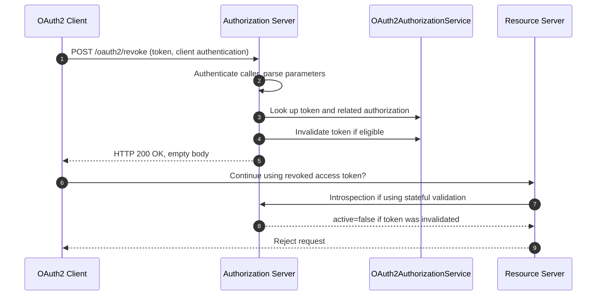
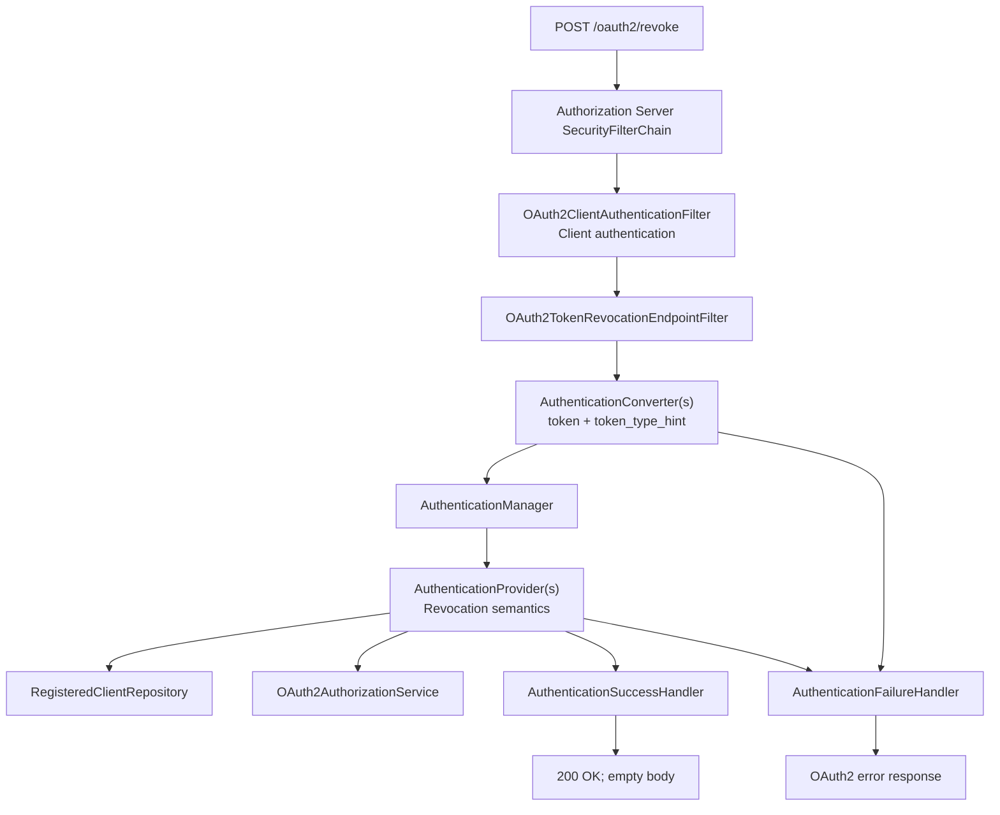
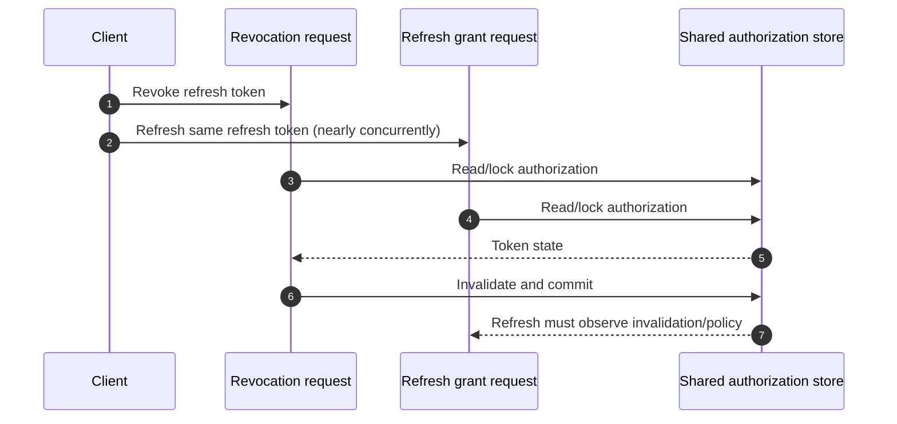
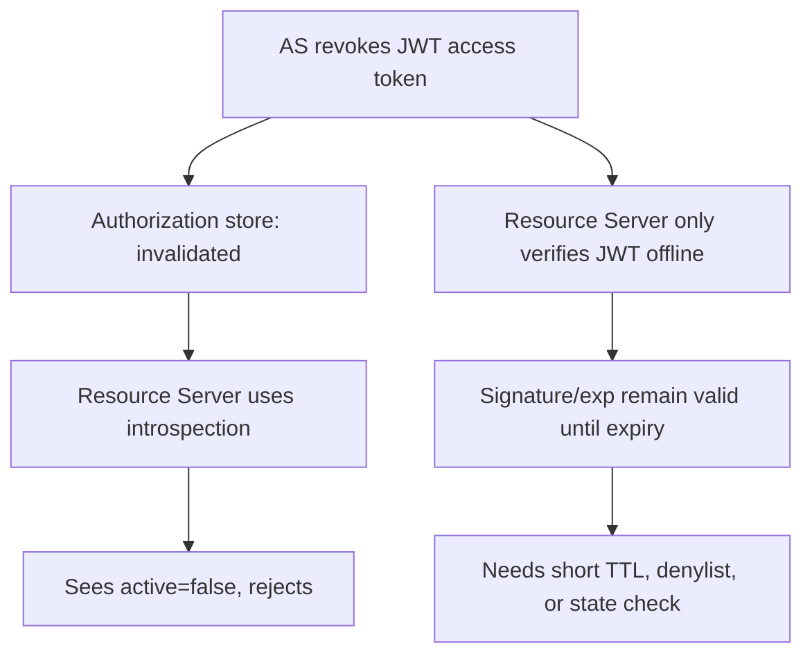
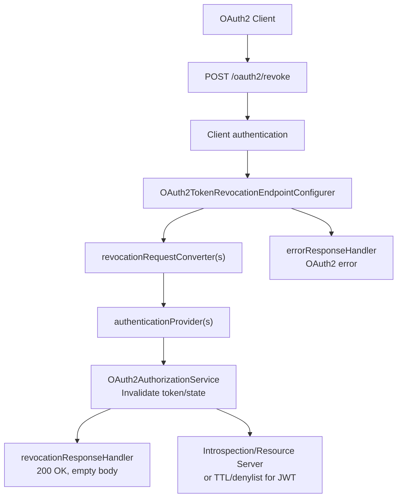

# OAuth2TokenRevocationEndpointConfigurer and Customization Points

## 1. Objectives, Scope, and Use Cases

In the **Revocation** chapter of the **SPRING_SECURITY_OAUTH2_OIDC_AUTHORIZATION_SERVER** module, **token revocation** allows an OAuth 2.0 client to inform the Authorization Server (AS) that a token should no longer be used. With **Spring Security**, **Spring Authorization Server (SAS)**, and **Spring Boot**, the primary integration point is `OAuth2TokenRevocationEndpointConfigurer` — the pipeline configurator for the **Token Revocation Endpoint** per RFC 7009.

This lesson focuses on how the endpoint works, its six customization points, its relationship with authorization state, security principles, and testing strategies. This is not a guide on issuing or signing JWTs manually outside SAS.

After this lesson, you will be able to:

- Explain the purpose of `POST /oauth2/revoke` and the RFC 7009 contract, including `token`, `token_type_hint`, HTTP 200, and OAuth2 errors.
- Distinguish revoking an **access token**, a **refresh token**, and an entire authorization/token family per policy.
- Configure `OAuth2TokenRevocationEndpointConfigurer` inside `OAuth2AuthorizationServerConfigurer` and the right `SecurityFilterChain`.
- Identify the extension points `revocationRequestConverter(s)`, `authenticationProvider(s)`, `revocationResponseHandler`, and `errorResponseHandler`.
- Add request validation, business policies, auditing, and monitoring while preserving standard handlers.
- Understand the limits of revoking self-contained JWTs when Resource Servers verify offline, and choose appropriate introspection, token lifetimes, or denylists.
- Test idempotency, token non-disclosure, client authentication, race conditions, caching, and multi-instance behavior.

**Versioning:** Code examples target common APIs in **Spring Authorization Server 1.x**, **Spring Security 6.x**, and **Spring Boot 3.x**. Class names, default provider lists, or signatures may change across upgrades; verify against your actual dependencies. Some snippets are marked as *integration skeletons*, not standalone runnable applications.

## 2. What Problem Does Token Revocation Solve?

Tokens typically have finite lifetimes:

- **Access tokens** have a relatively short TTL and are used at Resource Servers.
- **Refresh tokens** may live longer and are used at the Token Endpoint to obtain new access tokens.
- Users may log out or withdraw consent; administrators may disable a client, or a client may discover a refresh token was lost.

Waiting solely for `exp` can leave a token usable for an undesirably long period. RFC 7009 provides a way to request **proactive invalidation of a token** at the Authorization Server.



**Important:** The end of the diagram assumes the Resource Server uses introspection or another updated state-checking mechanism. If the API only verifies JWT signatures offline, the old JWT signature remains cryptographically valid; revoking at the AS **does not automatically make APIs stop accepting the JWT immediately**.

### 2.1. Revocation, Expiration, Logout, and Introspection

| Concept | Purpose | Timing / Output |
| --- | --- | --- |
| `exp`/expiration | Token naturally expires over time | Checked by recipient or AS |
| Token revocation | Client asks AS to invalidate a token | `POST /oauth2/revoke`, issues no token |
| Token introspection | Resource Server queries AS for token state/metadata | `POST /oauth2/introspect` with `active` |
| OAuth2 Token Endpoint | Exchanges code, refresh, or other grant for tokens | `POST /oauth2/token`, returns token response |
| OIDC logout | Ends login session and/or notifies clients | Separate logout protocol; not synonymous with revoking all tokens |
| Refresh token rotation | Replaces refresh token on use to reduce replay | Executed in refresh grant flow, does not replace revocation endpoint |

Client-side logout that only deletes cookies/local tokens does not necessarily revoke tokens at the AS. Conversely, revoking a refresh token does not automatically clear the browser's OIDC session. A "log out everywhere" policy requires coordinating multiple mechanisms.

## 3. HTTP Contract per RFC 7009

### 3.1. Requests Require `token`

Revocation requests are sent over **HTTPS**, using **POST**, with an `application/x-www-form-urlencoded` form body:

```http
POST /oauth2/revoke HTTP/1.1
Host: auth.example.com
Authorization: Basic <REDACTED_CLIENT_CREDENTIALS>
Content-Type: application/x-www-form-urlencoded
Accept: application/json

token=OPAQUE_REFRESH_TOKEN&token_type_hint=refresh_token
```

| Parameter | Required | Meaning |
| --- | --- | --- |
| `token` | Yes | The token value the client wants to revoke |
| `token_type_hint` | No | Token type hint, e.g., `access_token` or `refresh_token` |

Tokens are sensitive credentials: never place them in query strings, URLs, access logs, or browser history. `Authorization` in the example only illustrates `client_secret_basic`; actual client authentication methods must match `RegisteredClient` and AS policy.

**`token_type_hint` is only a hint**, not proof of token type. The AS may search other token types if the hinted lookup misses; never skip client checks, token state checks, or authorization binding merely because the caller claimed `refresh_token`.

### 3.2. Success Response: HTTP 200 and Empty Body

Example response:

```http
HTTP/1.1 200 OK
Cache-Control: no-store
Pragma: no-cache
Content-Length: 0
```

Cache-control headers may be added per policy; a success body is **not** JSON containing `revoked=true` or a new token. A key point of RFC 7009 is that the AS responds with **HTTP 200** both when the token is successfully revoked **and when the client submits an invalid or nonexistent token**, to avoid disclosing token state.

**Do not infer from HTTP 200 that the token ever existed**, belonged to the client, or that every copy at Resource Servers immediately stopped being accepted. For the same token, repeated revocation requests are protocol-valid and should yield the same success response.

### 3.3. Error Responses

Several errors must be distinguished from nonexistent tokens:

| Scenario | Expected Response |
| --- | --- |
| `token` does not exist or is already revoked | **200 OK**; do not disclose token state |
| Missing `token` or malformed parameters | OAuth2 `invalid_request`, typically 400 |
| Invalid client authentication | OAuth2 `invalid_client`; status/headers per authentication method |
| AS does not support revocation for token type | `unsupported_token_type` per RFC 7009, when applicable |
| Dependency/database error | Appropriate server error; never pretend revocation succeeded |
| Caller not permitted per policy | Appropriate authorization error; avoid disclosing who owns the token |

`unsupported_token_type` is not the Token Endpoint's `unsupported_grant_type`. Do not reuse one generic error code for every failure.

Example error when a parameter is missing:

```http
HTTP/1.1 400 Bad Request
Content-Type: application/json
Cache-Control: no-store

{"error":"invalid_request"}
```

An `invalid_client` error may require an appropriate HTTP 401/`WWW-Authenticate` header, especially for HTTP Basic; do not copy a Basic header onto `private_key_jwt`/mTLS methods.

## 4. Meaning of Revoking Access Tokens vs. Refresh Tokens

### 4.1. When Revoking an Access Token

The AS marks the requested access token as no longer active in its token store/policy. A revoked access token must not be reported as `active=true` by the AS when a Resource Server introspects it again.

**However**, for self-contained JWT access tokens:

- The already-issued JWS payload and signature do not change.
- Offline Resource Servers may keep accepting it if unexpired and signature/issuer/audience/scopes remain valid.
- To block access quickly, Resource Servers need introspection, a denylist, versioned-session checks, event-driven invalidation, or sufficiently short TTLs.
- Never assume modifying a record at the AS makes every API automatically "know" about the revocation.

### 4.2. When Revoking a Refresh Token

Refresh tokens are used to request new access tokens. Once a refresh token is revoked, the Token Endpoint must reject the corresponding refresh grant, typically with `invalid_grant`.

RFC 7009 specifies that when revoking a refresh token, the AS **should** also invalidate access tokens based on the same authorization grant if the system supports access token revocation. Conversely, when revoking an access token, the AS **may** invalidate the related refresh token per policy.

| Token Requested for Revocation | Minimum Impact | Cascading Impact to Design |
| --- | --- | --- |
| Access token | That token is no longer active at the AS | May revoke related refresh token/authorization per policy |
| Refresh token | Cannot refresh further | Consider invalidating access tokens in the same grant per RFC 7009 |
| Refresh token family with detected replay | Block credential/family per security policy | May revoke entire family/authorization, forcing re-login |
| Full session logout | Must not be inferred from a single revoke request | Coordinate revocation, session logout, client notifications, and policy |

SAS's default provider has specific behavior depending on token state and version; **do not assume every access token revocation request automatically invalidates the entire refresh token family**. If business requirements call for a stricter policy, build an extension backed by tests.

### 4.3. Revoking One Token Differs from Revoking the Entire Authorization

A single `OAuth2Authorization` can contain multiple tokens/states from the same grant. There are at least three levels of control:

1. **Single token:** invalidate only the requested token.
2. **Grant authorization:** invalidate tokens associated with one authorization.
3. **Token family/session:** invalidate related refresh tokens and access tokens along the rotation tree or login session.

Do not delete an entire authorization on a single access token revocation request if the user or business policy only asked to revoke one credential. Conversely, during a refresh-token reuse incident, revoking a single token value may be insufficient.

## 5. Position of `OAuth2TokenRevocationEndpointConfigurer` in the SAS DSL

SAS organizes endpoints inside `OAuth2AuthorizationServerConfigurer`. `tokenRevocationEndpoint(...)` is the configuration point for the revocation pipeline inside the AS `SecurityFilterChain`.

```java
@Configuration(proxyBeanMethods = false)
@EnableWebSecurity
public class AuthorizationServerSecurityConfig {

    @Bean
    @Order(1)
    SecurityFilterChain authorizationServerChain(HttpSecurity http)
            throws Exception {

        OAuth2AuthorizationServerConfigurer as =
                OAuth2AuthorizationServerConfigurer.authorizationServer();

        http
            .securityMatcher(as.getEndpointsMatcher())
            .with(as, server -> server
                    .tokenRevocationEndpoint(revoke -> {
                        // Only customize when there is an explicit requirement.
                    })
                    .oidc(Customizer.withDefaults()))
            .authorizeHttpRequests(authorize ->
                    authorize.anyRequest().authenticated())
            .exceptionHandling(exceptions ->
                    exceptions.defaultAuthenticationEntryPointFor(
                            new LoginUrlAuthenticationEntryPoint("/login"),
                            new MediaTypeRequestMatcher(MediaType.TEXT_HTML)))
            .oauth2ResourceServer(resourceServer ->
                    resourceServer.jwt(Customizer.withDefaults()));

        return http.build();
    }

    @Bean
    @Order(2)
    SecurityFilterChain applicationChain(HttpSecurity http)
            throws Exception {

        http.authorizeHttpRequests(authorize ->
                    authorize.anyRequest().authenticated())
            .formLogin(Customizer.withDefaults());

        return http.build();
    }
}
```

**Scope of example:** This is a DSL skeleton showing where the endpoint fits, not a standalone Authorization Server. You still need `RegisteredClientRepository`, `OAuth2AuthorizationService`, token generators, signing keys, issuer settings, and user authentication. Enable OIDC only if your application uses OIDC and provides the required beans.

If your system needs no custom revocation behavior, **keep the default configuration**. SAS provides standard converters, providers, and response handling for the endpoint; there is no need to rewrite the logic just to support RFC 7009.

### 5.1. Endpoint Path and Issuer

The default path is typically `/oauth2/revoke`, but can be configured via `AuthorizationServerSettings`:

```java
@Bean
AuthorizationServerSettings authorizationServerSettings() {
    return AuthorizationServerSettings.builder()
            .issuer("https://auth.example.com")
            .tokenRevocationEndpoint("/oauth2/revoke")
            .build();
}
```

If you change the path, synchronize client configurations, gateways, published metadata, and security matchers. Never set up a `@PostMapping("/oauth2/revoke")` alongside the SAS filter, as doing so can create a code path that bypasses client authentication or authorization state.

## 6. Revocation Pipeline Architecture



This is a conceptual responsibility diagram: exact filter ordering and exception flows depend on SAS/Spring Security configuration.

| Stage | Component | Responsibility |
| --- | --- | --- |
| Match HTTP endpoint | `SecurityFilterChain`, `OAuth2TokenRevocationEndpointFilter` | Routes requests into the revocation flow |
| Authenticate caller | `OAuth2ClientAuthenticationFilter` and providers | Proves client identity per registered method |
| Parse request | `AuthenticationConverter` | Validates form, `token`, and hint |
| Process revoke | `AuthenticationProvider` | Verifies client/token relationship, applies policy, invalidates |
| Persist state | `OAuth2AuthorizationService` | Persists token/authorization invalidation |
| Return success | `AuthenticationSuccessHandler` | HTTP 200, empty body |
| Return error | `AuthenticationFailureHandler` | OAuth2 error JSON, appropriate status/headers |

**Distinction:** Client authentication belongs to `clientAuthentication(...)`/client auth providers; revocation validation and state updates belong to `tokenRevocationEndpoint(...)`. Never verify client secrets manually in a request converter and skip registered authentication methods.

## 7. Extension Points of `OAuth2TokenRevocationEndpointConfigurer`

### 7.1. API Table

| API | Parameter Type | Purpose | Common Pitfalls |
| --- | --- | --- | --- |
| `revocationRequestConverter(...)` | `AuthenticationConverter` | Adds a converter for revocation requests | Matches wrong requests, skips token/hint checks |
| `revocationRequestConverters(...)` | `Consumer<List<AuthenticationConverter>>` | Inspects/modifies the converter list | Removes default converter or changes order without testing |
| `authenticationProvider(...)` | `AuthenticationProvider` | Adds a provider to handle token revocation authentication | Bypasses client binding, token state, or returns success before persistence |
| `authenticationProviders(...)` | `Consumer<List<AuthenticationProvider>>` | Inspects/modifies the provider list | Overly broad `supports(...)`, conflicting providers |
| `revocationResponseHandler(...)` | `AuthenticationSuccessHandler` | Customizes successful HTTP response | Leaks token details or revocation status |
| `errorResponseHandler(...)` | `AuthenticationFailureHandler` | Customizes OAuth2 error response | Leaks tokens, mixes up `invalid_client` with invalid tokens |

SAS 1.x includes related classes such as `OAuth2TokenRevocationAuthenticationConverter`, `OAuth2TokenRevocationAuthenticationProvider`, and `OAuth2TokenRevocationAuthenticationToken`. When upgrading framework versions, check API signatures and default behavior with integration tests.

### 7.2. Choosing the Right Customization Point

- **Reject duplicate or oversized token form parameters:** converter or a filter/body size limiter before the endpoint.
- **Add custom client/token policies:** provider or policy service invoked before mutating state.
- **Record audits and metrics:** decorate the provider/service or use event handling, never logging raw tokens.
- **Revoke a refresh token family:** transactional domain/state mutation logic with race tests; never place in an HTTP success handler.
- **Adjust HTTP response per interoperability contract:** success/error handlers while preserving RFC 7009.
- **Change client authentication method:** `clientAuthentication(...)`, not `revocationRequestConverter(...)`.
- **Customize claims in newly issued tokens:** token customizer/generator, not the revocation endpoint.
- **Propagate revocations to Resource Servers near real-time:** introspection/cache invalidation/denylist/event design, not just changing the revocation handler.

Do not use list consumers to strip defaults unless you understand every consequence. Choose the smallest extension point sufficient for the requirement.

## 8. Request Converters: Structural Validation, Not Revocation

`AuthenticationConverter#convert(HttpServletRequest)` receives the form request, verifies structural validity, and returns an `Authentication` describing the revocation request for the provider. A converter is not responsible for deleting tokens in the database or issuing new tokens.

### 8.1. Key Invariants

- `token` must be present in the proper format and non-blank.
- When `token_type_hint` is present, control its occurrence count and encoding.
- Prevent parameter pollution: `token=A&token=B` must be rejected per policy, never arbitrarily taking the first value.
- Bound token/body length to mitigate memory/CPU/storage DoS.
- Never log tokens or client secrets.
- Never use a request parameter `client_id` as proof of client identity.
- Never treat an unrecognized hint as proof that the token is invalid, since the RFC states hints only assist lookup.

### 8.2. Wrapper Preserving the Default Converter

Example adding parameter-occurrence validation and then **delegating to the standard converter**:

```java
public final class StrictRevocationRequestConverter
        implements AuthenticationConverter {

    private final AuthenticationConverter delegate;

    public StrictRevocationRequestConverter(
            AuthenticationConverter delegate) {
        this.delegate = delegate;
    }

    @Override
    public Authentication convert(HttpServletRequest request) {
        String[] tokens = request.getParameterValues("token");
        String[] hints = request.getParameterValues("token_type_hint");

        if (tokens == null || tokens.length != 1
                || !StringUtils.hasText(tokens[0])
                || tokens[0].length() > 8192
                || (hints != null && hints.length > 1)) {

            throw new OAuth2AuthenticationException(
                    new OAuth2Error(
                            OAuth2ErrorCodes.INVALID_REQUEST));
        }

        return delegate.convert(request);
    }
}
```

`8192` is only an **illustrative** limit; choose based on actual token formats. This class does not read raw bytes and cannot alone guarantee absolute protection against body-size DoS; configure form/body size limits at your reverse proxy/container as well. The converter still delegates protocol semantics, including `token_type_hint`.

### 8.3. Registering via the Converter List

```java
authorizationServer.tokenRevocationEndpoint(revoke ->
        revoke.revocationRequestConverters(converters -> {
            for (int i = 0; i < converters.size(); i++) {
                AuthenticationConverter current = converters.get(i);

                if (current instanceof
                        OAuth2TokenRevocationAuthenticationConverter) {

                    converters.set(i,
                            new StrictRevocationRequestConverter(
                                    current));
                }
            }
        }));
```

This configuration snippet assumes the `authorizationServer` variable in scope, not a complete bean definition. Verify the exact default runtime class for your SAS version. If the default converter is missing from the list unexpectedly, do not insert a catch-all converter; fail configuration/tests loudly and resolve explicitly.

**Never construct an `OAuth2TokenRevocationAuthenticationToken` with an authenticated client principal derived from client-supplied form input.** The client principal must come from the client authentication chain.

## 9. Authentication Providers: Authorization Checks and State Updates

`AuthenticationProvider` processes the revocation request produced by the converter. SAS's standard provider coordinates the client principal, token state, and `OAuth2AuthorizationService` to apply the proper semantics.

### 9.1. Non-Skippable Checks

| Check | Why Needed? |
| --- | --- |
| Caller authenticated via registered method | Prevents unauthorized clients from calling the endpoint |
| Client associated with target token/authorization per policy | Prevents Client A from arbitrarily revoking B's token |
| Token type supported | Handles `access_token`, `refresh_token`, or other tokens per semantics |
| Token active vs. already revoked | Preserves idempotency; does not disclose token existence |
| Authorization/token state persisted successfully | Never reports true success before persistence finishes |
| Scope and cascading side effects | Does not invalidate broader or narrower than policy dictates |
| Race conditions/transactions | Prevents a refresh token rotated concurrently with revoke from staying alive against policy |
| Safe auditing | Records who requested and business outcome without leaking raw tokens |

### 9.2. Provider Decorator for Business Policies

When you want to layer an extra policy without rewriting revocation from scratch, one option is to **decorate** the standard provider:

```java
public final class PolicyGuardedRevocationProvider
        implements AuthenticationProvider {

    private final AuthenticationProvider delegate;
    private final RevocationAdmissionPolicy admissionPolicy;

    public PolicyGuardedRevocationProvider(
            AuthenticationProvider delegate,
            RevocationAdmissionPolicy admissionPolicy) {
        this.delegate = delegate;
        this.admissionPolicy = admissionPolicy;
    }

    @Override
    public boolean supports(Class<?> authentication) {
        return delegate.supports(authentication);
    }

    @Override
    public Authentication authenticate(Authentication authentication) {
        admissionPolicy.validateCaller(authentication);

        Authentication result = delegate.authenticate(authentication);

        // Audit non-sensitive metadata only. Never log tokens.
        admissionPolicy.auditCompleted(authentication);
        return result;
    }
}
```

`RevocationAdmissionPolicy` is an **application-defined** interface/service, not a built-in SAS API. Methods must inspect the **authenticated client principal**, never trusting a `client_id` in the form. `auditCompleted` should log only safe data (authenticated client ID, correlation ID, operation type, timestamp), never the token or whether the token existed for the caller.

### 9.3. Registering the Decorator in the Provider List

```java
authorizationServer.tokenRevocationEndpoint(revoke ->
        revoke.authenticationProviders(providers -> {
            ListIterator<AuthenticationProvider> iterator =
                    providers.listIterator();

            while (iterator.hasNext()) {
                AuthenticationProvider candidate = iterator.next();

                if (candidate instanceof
                        OAuth2TokenRevocationAuthenticationProvider) {

                    iterator.set(
                            new PolicyGuardedRevocationProvider(
                                    candidate, revocationAdmissionPolicy));
                }
            }
        }));
```

`authorizationServer` and `revocationAdmissionPolicy` are supplied by application configuration; this snippet only illustrates wrapping the provider. When multiple custom providers exist, verify ordering and `supports(...)` so unrelated authentication tokens are not intercepted. If policy denies the request, throw a properly designed exception/error code rather than returning a fake successful `Authentication`.

### 9.4. What Not to Do in a Provider

- Delete all authorizations of a client just because a request contained a mismatched token.
- Return errors containing the token or explaining why a token does not exist to callers.
- Return HTTP 200 before a failed state update.
- Mint a new refresh token during revocation.
- Skip authentication because a request came from an internal network.
- Write DB state in a separate repository out of sync with the `OAuth2AuthorizationService` used by SAS.
- Build unrelated custom grant logic inside a revocation provider.

## 10. `OAuth2AuthorizationService` and Persistence

`OAuth2AuthorizationService` is where SAS stores `OAuth2Authorization` and token metadata. During revocation, the provider looks up the authorization associated with the token, applies invalidation, and saves the state according to the implementation.

### 10.1. In-Memory vs. JDBC

| Implementation | Suitable For | Limitations |
| --- | --- | --- |
| `InMemoryOAuth2AuthorizationService` | Demos, local dev, simple tests | State is not durable and not automatically shared across replicas |
| `JdbcOAuth2AuthorizationService` | Environments needing durable persistence | Requires schema migrations, transactions, indexes, and DB operations |
| Custom store adhering to contract | Specialized Redis/DB backends | Must guarantee atomicity, serialization, expiry, and SAS semantics |

When an AS runs multiple instances, a revocation on Node A must affect introspection/refresh handled on Node B. If each node maintains independent in-memory state, clients will observe inconsistent results depending on the load balancer.

### 10.2. Invalidation vs. Record Deletion

Do not treat "deleting the token row" as the only option. SAS tracks token metadata and related authorizations; deleting the entire row can erase audit trails, consent links, or data needed for token family rules. Choose deliberately:

- Mark individual tokens as invalidated.
- Invalidate the entire authorization when policy requires it.
- Purge expired records under a separate retention policy.

If implementing custom persistence, return success only after the state-update transaction commits per contract; DB failures must emit telemetry and fail safely.

### 10.3. Concurrency with Refresh Tokens

A notable race condition:



This diagram illustrates the **consistency goal**, not a claim that the framework locks the DB in this exact manner out of the box. For concurrent requests, test transaction isolation, optimistic locking/atomic updates, or store-specific mechanisms. If a refresh finishes just before revoke, a new token may have been issued; your policy must specify whether descendant tokens are also revoked.

## 11. Customizing the Success Handler

`revocationResponseHandler(AuthenticationSuccessHandler)` lets you customize how the endpoint writes a successful response.

### 11.1. Preserving the RFC 7009 Contract

A custom success handler must still:

- Return **HTTP 200 OK** both when a token is revoked and when it is invalid/unrecognized.
- **Never return a body containing tokens, token owners, revoked state, or new refresh tokens**.
- Never redirect the browser to a request-supplied URL.
- Never leak client/authorization details in headers.
- Never write the response before the provider/state update finishes per design.
- Include cache headers and logging aligned with security policy.

Registering via the DSL:

```java
authorizationServer.tokenRevocationEndpoint(revoke ->
        revoke.revocationResponseHandler(customRevocationSuccessHandler));
```

`customRevocationSuccessHandler` is an application-provided and tested `AuthenticationSuccessHandler`.

### 11.2. When to Keep the Default

If you only need to log audits, increment metrics, attach safe tracing, or manage token-family state, consider service/provider/event integration instead of replacing the response handler. The default handler preserves protocol details such as HTTP status and an empty body.

A custom handler that both invokes the default handler **and writes JSON again** can cause double-writes/corrupted responses. If decorating, perform only safe side effects before committing the response, and do not emit new response fields.

## 12. Customizing the Error Handler

`errorResponseHandler(AuthenticationFailureHandler)` controls how revocation endpoint errors are returned.

### 12.1. Error Code Table

| Code / Scenario | Meaning | Handling |
| --- | --- | --- |
| `invalid_request` | Missing `token`, duplicate params, or malformed request | JSON error HTTP response; never leak token |
| `invalid_client` | Client authentication failed | Status/headers per method; safe audit |
| `unsupported_token_type` | AS does not support revoking the hinted/requested token type per RFC 7009 | Do not confuse with `unsupported_grant_type` |
| Client not permitted per policy | Authz failure | Never reveal whether the token belongs to another client |
| Storage/dependency failure | Unable to complete processing | Appropriate HTTP 5xx; never fake success/inactive |

**A nonexistent token is not an `invalid_token` error returned to the caller** in normal revocation flows: RFC 7009 requires a 200 result that does not disclose token existence.

### 12.2. Registering the Handler

```java
authorizationServer.tokenRevocationEndpoint(revoke ->
        revoke.errorResponseHandler(customRevocationErrorHandler));
```

The handler must return OAuth2 JSON with the proper error code—never stack traces, raw tokens, secrets, private keys, or PII. Never convert token revocation errors into HTML login redirects for back-channel clients.

### 12.3. Do Not Leak Tokens via Error Messages

Avoid:

```json
{
  "error": "invalid_token",
  "error_description": "Refresh token belongs to user alice@example.com"
}
```

This is an **anti-pattern**, not a valid response. It turns the endpoint into a token enumeration oracle. If investigative details are needed, write them to access-controlled audit logs and return only a safe correlation ID to the caller.

## 13. Client Authentication and Revocation Authorization

A confidential client must authenticate via its registered `ClientAuthenticationMethod`. Common methods:

- `client_secret_basic`.
- `client_secret_post`.
- `private_key_jwt`.
- `tls_client_auth` or another mTLS method supported by the AS.

Public clients lack a confidential secret; the AS needs a policy suited to the token type and caller. Never assume every public client may revoke every client's tokens merely by knowing the token string. Nor should a self-declared `client_id` in the request become an authenticated principal.

### 13.1. Tokens Belonging to Another Client

For example, Client A submits a token originally issued to Client B. The AS must protect token–client binding and avoid leaking token existence. Whether it returns an error or neutral outcome depends on framework/profile, but **never** allow A to revoke B's token without explicit authorization.

### 13.2. Limiting Abuse

- Rate limit by authenticated client, not solely by IP.
- Enforce limits on token/body length and parameter count.
- Protect with HTTPS/TLS and secure credential storage.
- Never log raw `token`, `Authorization` headers, or form bodies.
- Do not let `token_type_hint` trigger unbounded database scans.
- Audit spikes in revocations, invalid client attempts, and store errors.

Revocation can be abused for DoS if attackers can revoke other users' tokens. Enforcing client binding and quotas is just as important as at the Token Endpoint.

## 14. JWT Access Tokens and Limits of Immediate Revocation

### 14.1. Why a JWT Signature Does Not Change After Revocation

Self-contained JWTs are typically verified by Resource Servers using public JWKS keys. On revocation, the AS updates state in its token store, yet already-issued JWTs still retain valid signatures.



An offline Resource Server does not automatically learn that the AS database changed. Achieving "immediate revocation" requires an additional state propagation or lookup mechanism.

### 14.2. Design Options

| Solution | Revocation Freshness | Trade-off |
| --- | --- | --- |
| Opaque token + per-request introspection | Can be near real-time | Increases network latency and AS load |
| Introspection + short cache TTL | Bounded delay up to cache TTL | Balances performance and revocation speed |
| Short-lived JWT | Waits for token expiration | Simple, but not immediate revocation |
| JWT + `jti` denylist | Can be fast with good store/propagation | Adds state, caching, HA, and cleanup overhead |
| JWT + event-driven invalidation | Near real-time when event delivery is reliable | Eventual consistency, retry/replay complexity |
| Session/token version check | Effective per user/client/session policy | Requires shared state/checks at APIs |

Choose according to your threat model. Financial APIs or emergency lockouts may require state checks with latency lower than JWT TTL; less sensitive APIs can accept short access token TTLs.

### 14.3. Role of Introspection After Revocation

If the AS introspects JWTs using `OAuth2AuthorizationService` and stored state, it can return `active=false` after invalidation. However, if the Resource Server never calls introspection, that change has no effect on live API requests.

Caching `active=true` introspection results for too long opens a window where revoked tokens remain accepted. Cache TTLs must be bounded by `exp`, security policy, and acceptable revocation delay.

## 15. Revocation and Refresh Token Rotation

Refresh token rotation reduces replay risk by issuing a new refresh token and invalidating the old one on each use. When evidence shows an old refresh token was reused:

- It may indicate a stolen credential.
- The AS may need to revoke the entire token family per security policy.
- The client may need to re-authenticate.
- Audits should record the token-family event without logging raw tokens.

Do not confuse "normal rotation" with "client explicitly calling `/oauth2/revoke`". Both mutate token state, but have different triggers and purposes.

### 15.1. Family Revocation Requires Consistency

A production workflow may have to update multiple related token rows. Invalidating only the current token while ignoring descendant refresh tokens already issued still lets an attacker keep refreshing. Define clear token-family relationships, transactions/locking, and multi-instance integration tests.

Do not invent a family model by concatenating token strings or prefixing token values. Use safe authorization/family identifiers in token metadata/storage.

## 16. HTTP Testing Examples

### 16.1. Sending a Revocation Request

Example using `curl`:

```bash
curl -i -X POST "https://auth.example.com/oauth2/revoke" \
  -u "portal-web:REDACTED_CLIENT_SECRET" \
  -H "Content-Type: application/x-www-form-urlencoded" \
  --data-urlencode "token=REDACTED_REFRESH_TOKEN" \
  --data-urlencode "token_type_hint=refresh_token"
```

This is a formatting example; **never place real secrets in shell history**. In production, use secret injection/credential handling that avoids exposing secrets in process lists, shell history, or CI logs.

### 16.2. MockMvc Test for Nonexistent Tokens

```java
@Test
void unknownTokenReturnsSuccessWithoutMetadata() throws Exception {
    mockMvc.perform(post("/oauth2/revoke")
            .contentType(MediaType.APPLICATION_FORM_URLENCODED)
            .with(httpBasic("portal-web", testClientSecret))
            .param("token", "UNKNOWN_TEST_TOKEN"))
        .andExpect(status().isOk())
        .andExpect(content().string(""));
}
```

This is a skeleton; the test context needs a registered client with matching auth method/password encoder, token authorization service, and AS security chain. If client authentication is wrong, the response may be `invalid_client` before the revocation provider even runs.

### 16.3. Testing Invalid Requests

```java
@Test
void missingTokenIsInvalidRequest() throws Exception {
    mockMvc.perform(post("/oauth2/revoke")
            .contentType(MediaType.APPLICATION_FORM_URLENCODED)
            .with(httpBasic("portal-web", testClientSecret)))
        .andExpect(status().isBadRequest())
        .andExpect(jsonPath("$.error").value("invalid_request"));
}
```

Add tests for duplicate `token` parameters, oversized request bodies, unsupported hints, and wrong content types. Do not treat a 200 on a malformed request as a pass if a converter skipped structural validation.

## 17. Business and Security Test Matrix

### 17.1. Token State and Idempotency

| Scenario | Expected Result |
| --- | --- |
| Revoke valid client refresh token | HTTP 200; subsequent refresh grant fails |
| Revoke valid opaque access token | HTTP 200; subsequent introspection returns `active=false` |
| Revoke nonexistent token | HTTP 200; body does not leak token state |
| Revoke already-revoked token | HTTP 200; idempotent behavior |
| Revoke expired token | HTTP 200 per contract |
| Wrong `token_type_hint` sent, token still found | Hint does not bypass validation; processed per RFC/policy |
| Grant with related token family | Tokens invalidated per documented policy |
| DB write failure | Never reports completed state update; safe error |
| Revoke on Node A, introspect on Node B | Both observe the same state via shared storage |
| Concurrent revoke and refresh | No tokens issued against concurrency policy |
| Client A attempts to revoke Token B | No unauthorized revocation and no token state leak |

### 17.2. Client Authentication, HTTP, and Privacy

| Scenario | Expected Result |
| --- | --- |
| Missing client authentication when required | `invalid_client`/unauthorized |
| Wrong secret | Token state unchanged |
| Unregistered client auth method | Rejected |
| Missing `token` | `invalid_request` |
| Two `token` parameters | Malformed request rejected per policy |
| Very long token | Blocked within budget, no resource exhaustion |
| Successful revocation | HTTP 200, empty body |
| Nonexistent token | Identical success response, no enumeration |
| Custom error handler | Valid JSON/status/headers; no secret leak |
| Custom success handler | Does not return `revoked`/token details |
| Auditing | Never logs raw tokens, refresh tokens, or client secrets |
| Request retries | No state/side effects violating policy |

### 17.3. JWTs and Resource Servers

| Scenario | Expected Result |
| --- | --- |
| Revoke JWT when API verifies offline only | API may accept until `exp`; documented known limit |
| Revoke JWT + introspection | AS returns inactive per token state |
| Revoke JWT + `jti` denylist | API rejects once denylist updates/propagates |
| Active introspection cache still valid | Bound maximum revocation delay window |
| JWKS key rotation | Do not confuse key rotation with per-token revocation |
| Wrong audience/scope | API rejects even if token is unrevoked |
| Sender-constrained token | Resource Server still verifies proof-of-possession |

## 18. Observability and Troubleshooting

### 18.1. Metrics to Monitor

- `POST /oauth2/revoke` request count and P50/P95/P99 latency.
- Rates of HTTP 200, `invalid_request`, `invalid_client`, and server errors.
- Persistence/transaction/concurrency error counts.
- `invalid_grant` rate on refresh grants post-revocation.
- Introspection `active=false` rate post-revocation.
- Token state replication delay across AS replicas.
- Cache hit/stale windows at Resource Servers.
- Frequency of token-family incidents and policy-driven bulk revocations.

**Never use token values, client secrets, or Authorization headers as metric labels.** Use authenticated client IDs and credential-free correlation IDs with appropriate access controls.

### 18.2. Troubleshooting Table

| Symptom | Likely Cause | What to Check |
| --- | --- | --- |
| `POST /oauth2/revoke` returns 404 | Wrong path or AS chain not matching endpoint | `AuthorizationServerSettings`, `getEndpointsMatcher()` |
| Returns HTML login | Application chain/entry point intercepted request | `@Order`, client authentication filter |
| `invalid_client` | Invalid secret/method/assertion | `RegisteredClient` and client auth providers |
| `invalid_request` | Missing/duplicate token or invalid form | Converter and request parsing |
| `unsupported_token_type` | Token type unsupported per policy | Hint and supported token types |
| HTTP 200 but refresh still succeeds | State not invalidated or reading different store | `OAuth2AuthorizationService` and transactions |
| HTTP 200 but JWT still calls APIs | Resource Server verifies offline | TTL, introspection, denylist, cache |
| Revoke effective on only one replica | In-memory store or slow replication | Shared persistence/HA |
| Custom provider breaks other grants | Overly broad `supports` or removed default provider | Provider list and regression tests |
| Revocation deletes unintended authorizations | Overly broad deletion policy | Distinguish token/grant/family revocation |
| Success handler returns JSON metadata | Custom handler violates RFC 7009 | Return empty body |
| Tokens leaked in logs | Logging form bodies/exceptions/traces | Redaction and retention |
| Revocation spikes DB load | Unindexed token scan or missing rate limit | Token lookup/indexes, quotas, metrics |

## 19. Anti-Patterns to Avoid

| Anti-Pattern | Risk | Alternative |
| --- | --- | --- |
| Writing custom `@PostMapping("/oauth2/revoke")` trusting form `client_id` | Bypasses client auth and SAS pipeline | Use `OAuth2TokenRevocationEndpointConfigurer` |
| Returning 404 for nonexistent tokens | Turns endpoint into a token-probing oracle | RFC 7009: HTTP 200 success |
| Returning `{"revoked": true}` and username | Leaks token state/PII | HTTP 200, empty body |
| Blindly trusting `token_type_hint` | Wrong token type or skipped checks | Hint only assists lookup |
| Uncontrolled deletion of entire authorizations | Over-broad revocation, lost state/audit | Explicit policy and revocation scope |
| Replacing standard provider without client binding | Client A revokes Token B | Delegate/retain standard validation |
| Writing raw tokens to audit logs | Credential exposure | Safe correlation ID / HMAC identifier |
| Assuming JWT revocation works offline immediately | APIs keep accepting signed tokens | Introspection/denylist/TTL |
| Unbounded introspection caching | Revoked tokens stay active at APIs | Short TTL + invalidation |
| Infinite retries on DB failure | DoS and thread exhaustion | Timeouts, bounded retries, circuit breaker |
| Changing success handler to alter token claims | Unrelated to token generation | Use token customizer |
| Revoking refresh token while ignoring family policy | Descendant credentials remain usable | Design and test family revocation |

## 20. Acceptance Checklist

- [ ] Understand RFC 7009: `token` required, `token_type_hint` optional, HTTPS POST form.
- [ ] HTTP 200 with empty body for revoked or invalid/nonexistent tokens.
- [ ] Client authentication matches registered method and never trusts form `client_id` as an authenticated identity.
- [ ] Never disclose token state, user, client, or credentials in success/error responses.
- [ ] Body size limits, parameter count limits, and rate limits are configured.
- [ ] AS `SecurityFilterChain` properly matches `/oauth2/revoke` and does not fall through to HTML login.
- [ ] Custom converters/providers do not drop default components.
- [ ] Providers enforce token–client binding and prevent unauthorized cross-client revocation.
- [ ] State updates use `OAuth2AuthorizationService` with proper transactions/consistency.
- [ ] Single-token, grant, and token-family policies are documented.
- [ ] Revoked refresh tokens cannot obtain new tokens.
- [ ] Cascading effect on access tokens when revoking a refresh token is evaluated per RFC.
- [ ] Resource Servers have a strategy for revoked JWTs (if required).
- [ ] Introspection/denylist caches have suitable TTLs and propagation.
- [ ] Success/error handlers preserve the OAuth2 HTTP contract and leak no tokens.
- [ ] Tokens, client secrets, `Authorization` headers, and form bodies are never logged.
- [ ] Tests cover unknown/expired/already-revoked tokens and malformed requests.
- [ ] Tests cover cross-client revocation, refresh/revoke concurrency, and multiple AS replicas.
- [ ] Metrics cover latency/errors/state propagation and incident response.

## 21. Summary



**`OAuth2TokenRevocationEndpointConfigurer` is an extension point for the token revocation pipeline, not a way to bypass the protocol.** RFC 7009 requires standard requests, authenticated callers, and success responses that do not reveal whether a token exists. Converters validate structure; providers enforce authority and update state; response handlers preserve the HTTP contract. In Spring Authorization Server, distinguish revoking access tokens, refresh tokens, and authorization families, and remember that **signed JWTs may remain valid when APIs verify purely offline**. By safeguarding client binding, synchronizing token stores, designing caches carefully, and testing concurrency, revocation provides safe and consistent OAuth2/OIDC lifecycle control.
