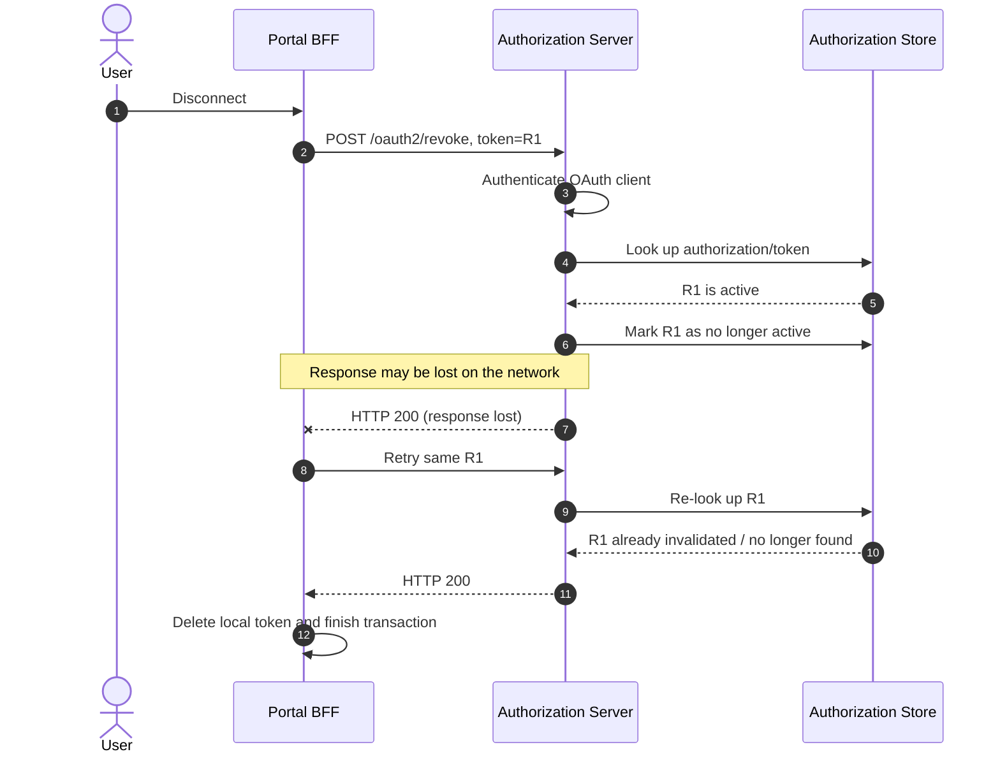
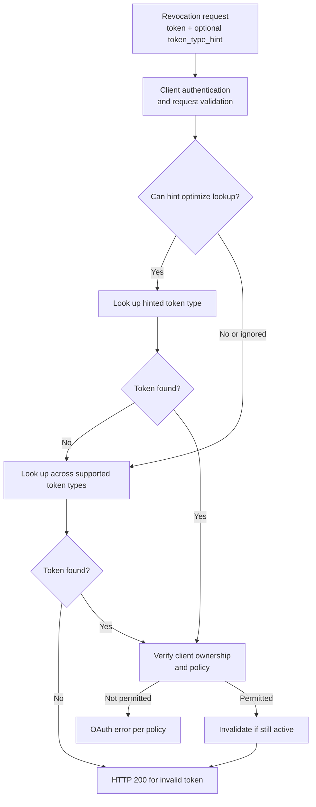
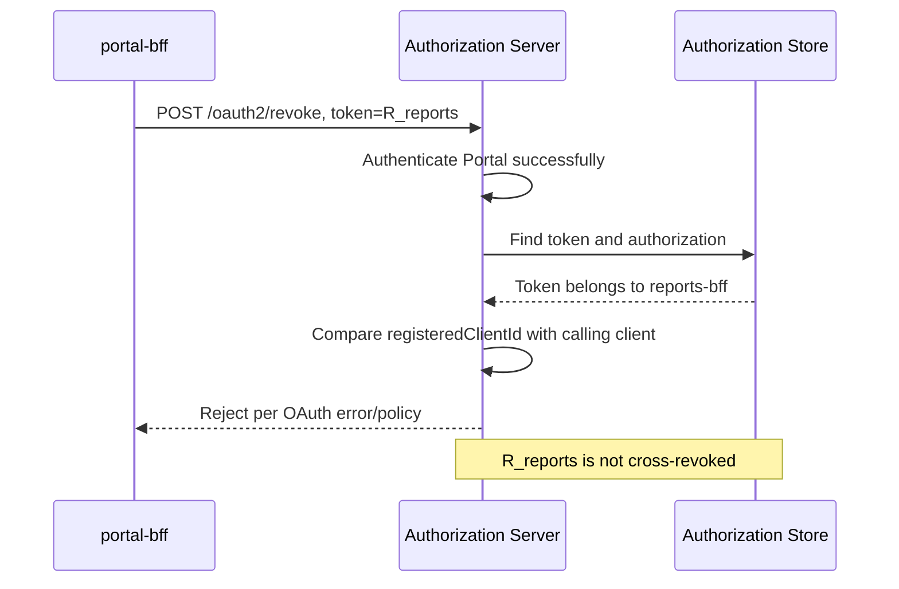
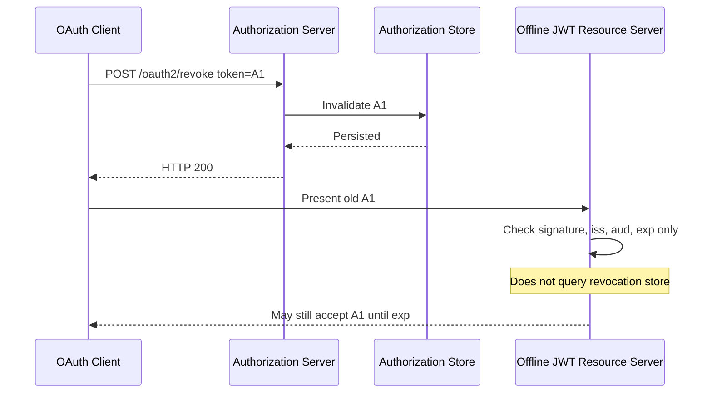
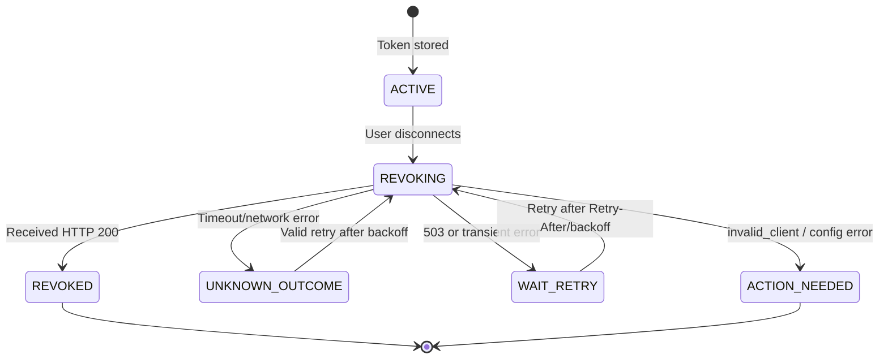
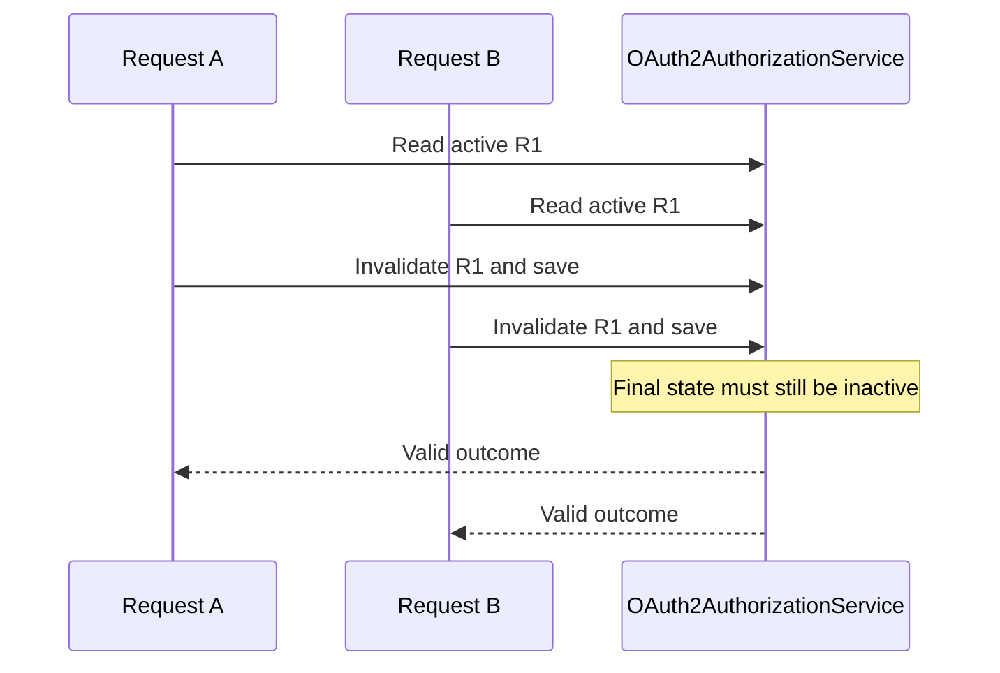

# Responses for Nonexistent Tokens and Safe Idempotency of Revocation

An OAuth client that wants to log out a user, disconnect an application, or stop using a refresh token calls the Authorization Server's **Token Revocation Endpoint**. What happens if that token has already been revoked, has expired, is no longer in the database, or the request is resent after a network drop?

According to **RFC 7009 — OAuth 2.0 Token Revocation**, when the request is valid and the client has passed the required checks, the Authorization Server responds with **HTTP 200** in both situations: when the token was successfully revoked **and** when the token is no longer valid. The client does not need to know whether the token previously existed or was already revoked: the goal of the operation is to ensure the credential **can no longer be used**, and that state has been achieved.

This is the basis for the **safe repeatability** (*idempotent behavior*) of revocation: resending the same valid request must never reactivate the token, create a new access grant, or return an error merely because the token was handled in a prior request. However, **HTTP 200 does not mean every error is masked**: a missing `token` parameter, invalid client authentication, or a token belonging to another client are cases that must be handled separately.

This lesson belongs to the **Revocation** chapter in the **SPRING_SECURITY_OAUTH2_OIDC_AUTHORIZATION_SERVER** module, aimed at learning how to design, configure, secure, test, and operate an OAuth 2.0/OpenID Connect Authorization Server with **Spring Security** and **Spring Authorization Server** in a Spring Boot application. The focus is on **responses for nonexistent tokens and semantics when retrying the endpoint**, while clarifying limits regarding self-contained JWTs, protocol errors, and multi-node deployments.

> **Key Principle:** For a valid revocation request from an authorized client, a **nonexistent, expired, or already-revoked token** is not a reason to return `invalid_grant`. Typically the result is **HTTP 200**, without revealing whether the token ever existed. Yet **client authentication and revocation authority checks remain mandatory**; never use the HTTP 200 rule to skip them.

**Implementation Scope:** Examples use Spring Boot 3.x, Spring Security 6.x, and Spring Authorization Server 1.5.x; newer versions may change packages, APIs, or default behaviors. Test actual HTTP behavior against your active dependencies rather than relying solely on filter/provider names.

## 1. Why Must Revocation Accept Repeated Calls?

Suppose **Portal BFF** holds refresh token `R1` for an authorization belonging to `user-123`. When the user chooses "Disconnect", the backend calls `POST /oauth2/revoke`.

Four situations can happen:

1. **R1 is still active:** the server revokes R1 and returns HTTP 200.
2. **R1 was already revoked:** another tab or service completed the operation earlier; the server still returns HTTP 200.
3. **R1 is not found:** the record was purged, the token never existed, or the string was malformed; for a valid client request, the server returns HTTP 200 under the invalid-token rule.
4. **The server revoked it, but the response was lost:** the client does not know the first attempt succeeded and retries the request. The retry receives HTTP 200 so the client can finish cleaning up its state.



An important distinction: a client repeating the call **does not necessarily force the backend to write the same record multiple times**. The implementation can detect that the token is already invalidated and skip writing again. What matters is that **state and protocol results** are not broken by repeated requests.

### 1.1. Meaning of HTTP 200 in RFC 7009

| Situation After Authentication and Request Validation | Result to Client | Why? |
|---|---|---|
| Active token, successfully revoked | HTTP `200` | Revocation objective achieved |
| Token already revoked | HTTP `200` | Credential is already invalid |
| Token already expired | HTTP `200` | Credential can no longer be used |
| Token does not exist | HTTP `200` | Does not leak existence state |
| Server misses token due to wrong hint | Continues searching supported types; if still absent, HTTP `200` | `token_type_hint` is not a source of truth |
| Token belongs to another client | **Do not automatically treat as success** | Client must pass token revocation ownership check |
| Invalid client credentials | Client authentication error | Lacks authority to perform operation |
| Request missing `token` | Request error | Request lacks prerequisites to process |

RFC 7009, Section 2.1, requires verifying a confidential client's credentials and checking whether the token was issued to **the client calling revocation**. If this permission check fails, the request is rejected with an appropriate error. Therefore, **never equate "token not found" with "found another client's token"** and blindly return HTTP 200 for everything while skipping ownership checks.

### 1.2. Definition of Idempotent in This Context

An operation is idempotent when applying it multiple times toward the same target state yields the same final outcome as applying it once. For revocation:

```text
Revoke(active R1)   -> R1 inactive
Revoke(inactive R1) -> R1 inactive
Revoke(unknown R1)  -> Does not create a new R1
```

From the **authorized caller's perspective**, a valid request for an already-invalidated token still receives protocol success. Idempotent **does not mean** the request has no side effects: the first call may legitimately update the database, audits, and related state. Unnecessary side effects on subsequent calls should be avoided or governed by a clear policy.

## 2. Token Revocation Protocol per RFC 7009

### 2.1. Endpoint, Method, and Parameters

Spring Authorization Server exposes the **OAuth2 Token Revocation Endpoint** by default at:

```text
POST https://login.example.com/oauth2/revoke
Content-Type: application/x-www-form-urlencoded
```

Sample request from a **confidential OAuth client**:

```http
POST /oauth2/revoke HTTP/1.1
Host: login.example.com
Authorization: Basic <base64(client_id:client_secret)>
Content-Type: application/x-www-form-urlencoded

token=REFRESH_TOKEN_VALUE&token_type_hint=refresh_token
```

| Parameter | Requirement | Role |
|---|---|---|
| `token` | **Required** | Credential the client wants to revoke |
| `token_type_hint` | Optional | Hints `access_token` or `refresh_token` to optimize lookup |
| Client authentication | Per client type/registered method | Proves the calling client's identity and right to call |

Never pass `token` in the URL query string or via HTTP GET: it can appear in browser history, access logs, referers, or proxy logs. The Token Revocation Endpoint uses HTTPS and POST with a form body.

### 2.2. Success Response Is Not a Status JSON Object

Valid illustrative example:

```http
HTTP/1.1 200 OK
Cache-Control: no-store
Pragma: no-cache
Content-Length: 0

```

RFC 7009 specifies HTTP **200** if the token was successfully revoked **or** the token is invalid. Clients must not depend on a response body to distinguish the two cases; the body plays no deciding role in the success contract.

Do not design a response like:

```json
{
  "exists": false,
  "was_revoked": true,
  "owner": "user-123",
  "revoked_at": "2026-11-16T12:00:00Z"
}
```

These fields **do not belong to RFC 7009's success revocation contract** and can leak token status, user identity, or when the token was used. Audit details belong in **protected internal channels**, never in the public response of the Token Revocation Endpoint.

### 2.3. Why Not Use HTTP 404 for Unknown Tokens?

If the endpoint returned:

- `200` when the token exists and was just revoked;
- `404` when the token does not exist;
- `409` when the token was already revoked;

then a client or observer could deduce the **token's state** from the status code. Moreover, clients would have to write branching logic for the same goal: "credential is no longer valid".

RFC 7009 intentionally collapses **already revoked tokens** and **invalid tokens** into a `200` result. Consolidating responses simplifies retries and reduces a channel for token-existence leakage. Still, response timing, error details, logs, quotas, and side channels must be designed carefully—uniform HTTP 200 alone is not a complete anti-enumeration defense.

## 3. Three Outcome Groups That Must Be Kept Separate

### 3.1. Token-State Success: 200

When client authentication is valid, the request is well-formed, and the token is already invalid or validly revoked, the server responds with HTTP `200`. The client should:

1. Never reuse the token;
2. Delete or replace the credential in its own token store;
3. Mark the disconnect action as complete per business logic;
4. Never interpret HTTP 200 as "the token definitely existed";
5. Check whether session logout / consent cleanup is also needed if required by the product.

### 3.2. Client Authentication or Request Errors

Typical errors:

| Scenario | Common OAuth Error Code | What to Do |
|---|---|---|
| Wrong client ID/secret or client assertion | `invalid_client` | Do not disclose tokens; fix credentials/registration |
| Missing `token` | `invalid_request` | Fix form body and contract |
| Multiple `token` parameters violating policy | `invalid_request` | Reject ambiguous request |
| Token was issued to another client | Rejection error per RFC 7009 and implementation | Disallow cross-client revocation |
| Presented token type unsupported for revocation | `unsupported_token_type` | Check token type/policy |
| Wrong HTTP method/content type | 4xx/appropriate request error | Do not turn into revocation success |

**Do not hardcode one specific OAuth error code** for every client-ownership mismatch case without checking the code and Spring Authorization Server version in use. What is mandatory is that client authority is enforced and error messages do not leak unnecessary token details.

### 3.3. Server Unable to Execute Revocation

If the Authorization Server returns **HTTP 503**, RFC 7009 requires the client to **assume the token may still exist** and retry after a reasonable interval. The server may send a `Retry-After` header.

```http
HTTP/1.1 503 Service Unavailable
Retry-After: 30
Cache-Control: no-store

```

In that case:

- Do not mark the server-side token as definitely revoked;
- Perform bounded retries with exponential backoff and jitter per policy;
- Queue the operation defensively if the application must guarantee disconnection;
- Do not hammer the endpoint in an infinite loop;
- You may delete the local credential so the client stops using it immediately, **while** distinguishing local deletion from AS-confirmed revocation.

Network failures after sending a request can create an **unknown outcome**: the server processed it, but the response never reached the client. Thanks to safe repeatability semantics, the client can retry a valid request. However, if client credentials expire or are revoked between retries, new error codes reflect **changes in caller authority**, not a violation of token-revocation idempotency.

## 4. `token_type_hint` Is Only a Hint, Not a Source of Truth

RFC 7009 allows:

```text
token_type_hint=access_token
token_type_hint=refresh_token
```

The goal is to help the Authorization Server locate the token faster when separate tables/indexes exist for token types. **Hints must never replace actual token verification.**

### 4.1. Correct Hint

The client sends refresh token R1 with `token_type_hint=refresh_token`. The server can query the refresh token index first. If found and all other checks pass, the server revokes per policy.

### 4.2. Wrong Hint for a Real Token

The client sends a **refresh token** with `token_type_hint=access_token`. RFC 7009 requires that if the token is not found using the hint, the Authorization Server must extend the search across **the token types it supports**. The server is also allowed to **ignore the hint** and identify the token type itself.



Do not build a custom provider that returns "not found, 200" **immediately when the hinted lookup misses** if the token could exist in another type's index. That bug both breaks revocation and violates hint-handling rules.

### 4.3. Unrecognized or Malformed Hint String

`token_type_hint=foobar` or an unsupported hint **does not by itself cause an error** just because the hint string is unfamiliar. RFC 7009 states that invalid hints are ignored and do not dictate the revocation response.

Distinguish clearly:

- **Unfamiliar hint:** the client merely supplied an unrecognized hint, which can be ignored while looking up the token.
- **Actual token type unsupported for revocation:** may return `unsupported_token_type` per RFC 7009.

Do not automatically return `unsupported_token_type` merely because `token_type_hint` is not one of the two familiar strings.

## 5. Checking Client Ownership Before Revocation

### 5.1. Why Can't a Client Revoke Another Application's Token?

Suppose there are two OAuth clients:

- `portal-bff` holds refresh token `R_portal`;
- `reports-bff` holds refresh token `R_reports`.

If `portal-bff` learns `R_reports` and calls the revocation endpoint, the Authorization Server **must not let Portal invalidate Reports' token merely by knowing the token string**. Tokens are bearer credentials, yet RFC 7009 revocation requires checking which client made the request.



Do not turn the "unknown token returns 200" rule into a shortcut for **when a token belonging to another client was found**. Guarantee there are no unauthorized revocation side effects. Whether specific cases return an error or generic response depends on implementation, but **never disclose owner details of the token in the response**.

### 5.2. Client Authentication Is Independent of Token Lookup

Spring Authorization Server uses `OAuth2ClientAuthenticationFilter` to authenticate clients per registration. A confidential client uses `client_secret_basic`, `private_key_jwt`, or mTLS as configured. If authentication fails, the server must return an error before performing sensitive token operations.

Never extract a bare `client_id` from the form body and treat it as an authenticated client. For public clients unable to hold secrets, permitted client types and identification methods must follow framework capabilities and policy; never leave the revocation endpoint open so any caller can revoke arbitrary tokens.

### 5.3. Important Check Ordering

A conceptual pipeline:

```text
HTTP request
    -> valid method/body/parameters
    -> client authentication / identification
    -> token lookup (hint only optimizes)
    -> token ownership / policy
    -> token active? (may already be inactive)
    -> invalidate when permitted and necessary
    -> HTTP 200 if succeeded/invalid token
```

If the token is not found at all, the pipeline cannot verify ownership of a nonexistent record and can complete with HTTP 200 once the request/client checks pass. If the token is found, checking binding to the registered client is essential to prevent cross-client revocation.

## 6. Where Does Spring Authorization Server Implement This?

### 6.1. Default Endpoint and Classes

In Spring Authorization Server 1.5.x, the default endpoint is `/oauth2/revoke`. Key mechanisms include:

| Component | Role |
|---|---|
| `OAuth2TokenRevocationEndpointFilter` | Receives POST revocation requests |
| `OAuth2TokenRevocationAuthenticationConverter` | Converts form parameters into an authentication request |
| `OAuth2TokenRevocationAuthenticationProvider` | Verifies client, token, authorization, and executes revocation |
| `OAuth2AuthorizationService` | Looks up/saves `OAuth2Authorization` and related token states |
| `OAuth2TokenRevocationEndpointConfigurer` | Configures converters, providers, and response/error handlers |
| `OAuth2ClientAuthenticationFilter` | Performs client authentication per registered method |
| `AuthorizationServerSettings` | Configures issuer and endpoint URLs |

Spring's filters/providers handle most of RFC 7009 out of the box. **There is no need to write a custom `@PostMapping("/oauth2/revoke")` just to return HTTP 200**: custom implementations easily miss client authentication, ownership, token invalidation, or standard error responses.

### 6.2. Protocol Chain Configuration

Spring Security 6.x with Spring Authorization Server 1.5.x example:

```java
package example.authserver.config;

import org.springframework.context.annotation.Bean;
import org.springframework.context.annotation.Configuration;
import org.springframework.core.annotation.Order;
import org.springframework.security.config.Customizer;
import org.springframework.security.config.annotation.web.builders.HttpSecurity;
import org.springframework.security.oauth2.server.authorization.config.annotation.web.configurers.OAuth2AuthorizationServerConfigurer;
import org.springframework.security.web.SecurityFilterChain;

@Configuration(proxyBeanMethods = false)
public class AuthorizationServerSecurityConfig {

    @Bean
    @Order(1)
    SecurityFilterChain authorizationServerSecurityFilterChain(
            HttpSecurity http) throws Exception {

        OAuth2AuthorizationServerConfigurer as =
                OAuth2AuthorizationServerConfigurer.authorizationServer();

        http
            .securityMatcher(as.getEndpointsMatcher())
            .with(as, server -> server
                .tokenRevocationEndpoint(Customizer.withDefaults()))
            .authorizeHttpRequests(authorize -> authorize
                .anyRequest().authenticated());

        return http.build();
    }

    @Bean
    @Order(2)
    SecurityFilterChain applicationSecurityFilterChain(HttpSecurity http)
            throws Exception {

        http.authorizeHttpRequests(authorize -> authorize
                .anyRequest().authenticated())
            .formLogin(Customizer.withDefaults());

        return http.build();
    }
}
```

This snippet illustrates the **protocol chain** and revocation configuration point; it is not a standalone runnable Spring Boot example. You still need `RegisteredClientRepository`, `OAuth2AuthorizationService`, issuer configuration, user login, and other Authorization Server beans for your grants/token types.

Calling `tokenRevocationEndpoint(Customizer.withDefaults())` highlights the endpoint configuration; in the default Authorization Server configuration, the endpoint is **already supported**, not a feature that only exists when calling this method.

### 6.3. Explicit Endpoint and Issuer Configuration

```java
import org.springframework.context.annotation.Bean;
import org.springframework.security.oauth2.server.authorization.settings.AuthorizationServerSettings;

@Bean
AuthorizationServerSettings authorizationServerSettings() {
    return AuthorizationServerSettings.builder()
            .issuer("https://login.example.com")
            .tokenRevocationEndpoint("/oauth2/revoke")
            .build();
}
```

This is the default path. If you change it to `/oauth2/v1/revoke`, synchronize metadata, client configurations, proxy routing, and integration tests. Never let clients call an endpoint on a different node/issuer from where tokens were issued.

### 6.4. Customizable Extension Points

`OAuth2TokenRevocationEndpointConfigurer` provides:

- `revocationRequestConverter(...)` and `revocationRequestConverters(...)`;
- `authenticationProvider(...)` and `authenticationProviders(...)`;
- `revocationResponseHandler(...)`;
- `errorResponseHandler(...)`.

Custom logic may aim to add auditing, tenant policies, or related-token revocation rules. However, never modify the success handler to **differentiate public responses between existing and nonexistent tokens**, as that violates RFC 7009's intent.

**Important note:** `authenticationProvider(customProvider)` typically **adds** a provider to the list. If the default provider handles the request before your custom provider, your policy may be skipped. When replacing or wrapping a provider, use `authenticationProviders(...)` to control the list, preserve default validation, and write integration tests proving your custom rule executes.

## 7. OAuth2AuthorizationService and Token State

### 7.1. Authorizations and Related Tokens

Spring Authorization Server stores grant state in `OAuth2Authorization`. Depending on the grant, an authorization can hold:

- Authorization code (if any);
- Access token and its metadata;
- Refresh token and metadata;
- OIDC ID token or other tokens;
- `registeredClientId`, principal, scopes, grant type, and attributes.

`OAuth2AuthorizationService` lets you look up authorizations by ID or token and save updated state. Common implementations include `InMemoryOAuth2AuthorizationService` and `JdbcOAuth2AuthorizationService`.

For production, per-node in-memory stores are usually unsuitable if one node issues a token and another receives the revocation request. Shared persistence and a consistency strategy are required.

### 7.2. Difference Between "Not Found" and "Already Invalidated"

With `OAuth2AuthorizationService.findByToken(value, tokenType)`:

- `null` may mean the token does not exist in the store or is no longer retained/queryable;
- A found `OAuth2Authorization` may contain token metadata already marked **invalidated**;
- A token may still have a record yet be **expired**;
- A custom store may delete the record/token immediately upon revocation.

**Do not force clients to distinguish these states via HTTP responses.** For valid requests and unusable tokens, the revocation contract returns HTTP 200.

Example state check **inside an authorized test/service**, not a public endpoint:

```java
import org.springframework.security.oauth2.core.OAuth2TokenType;
import org.springframework.security.oauth2.server.authorization.OAuth2Authorization;
import org.springframework.security.oauth2.server.authorization.OAuth2AuthorizationService;

OAuth2Authorization auth = authorizationService.findByToken(
        refreshTokenValue, OAuth2TokenType.REFRESH_TOKEN);

if (auth == null) {
    // Authorization not found in the current store.
} else if (auth.getRefreshToken() != null
        && !auth.getRefreshToken().isActive()) {
    // Refresh token is inactive: expired or invalidated.
}
```

This snippet is solely for checking state in a trusted environment. Never expose `auth == null` or `isActive()` externally to return differing responses based on token existence.

### 7.3. Updating State Properly

In Spring Authorization Server, `OAuth2Authorization.Builder` supports `invalidate(token)` to mark a token inactive in metadata. A **purely internal** illustration:

```java
OAuth2Authorization authorization = authorizationService.findByToken(
        refreshTokenValue, OAuth2TokenType.REFRESH_TOKEN);

if (authorization != null && authorization.getRefreshToken() != null
        && authorization.getRefreshToken().isActive()) {

    // Client authentication, ownership check, and cascading policy
    // must already have been enforced beforehand.
    OAuth2Authorization updated = OAuth2Authorization.from(authorization)
            .invalidate(authorization.getRefreshToken().getToken())
            .build();

    authorizationService.save(updated);
}
```

**Do not copy this snippet into a public revocation controller.** It intentionally does **not** perform client authentication, ownership validation, cascading policies, concurrency control, or HTTP response handling. Spring's default provider should handle the protocol unless a tested customization is required.

### 7.4. Should the Record Be Completely Deleted?

Marking invalidated preserves metadata needed for authorizations, auditing, and state handling. Completely deleting the record can wipe out all related tokens or unexpectedly break refresh/consent flows. Cleanup policies must consider:

- Is the revoked token an access or refresh token?
- Do multiple tokens belong to the same authorization?
- How long must the audit trail be retained?
- If the record is deleted, what happens to other tokens?
- Are refresh requests/rotations happening concurrently?

Do not use `authorizationService.remove(authorization)` as a default substitute for revoking **a single token** without assessing its impact on the whole authorization.

## 8. How Do Access Token and Refresh Token Revocation Differ?

### 8.1. RFC 7009 Cascading Policy Rules

RFC 7009 requires implementations to **support revoking refresh tokens** and **recommends supporting revoking access tokens**. When revoking a refresh token and the server supports access-token revocation, the RFC recommends also invalidating access tokens based on the same authorization grant. When revoking an access token, the server **may** revoke the related refresh token depending on policy.

| Token Submitted for Revocation | Basic Action | Cascading Decisions Required |
|---|---|---|
| Refresh token `R1` | Invalidate R1 | Also revoke same-grant access tokens, token family, or authorization? |
| Access token `A1` | Invalidate A1 if supported | Also revoke R1? |
| Expired token | No remaining usage rights | Clean up related metadata? |
| Nonexistent token | No token to modify | Return HTTP 200 if client/request valid |
| Token owned by another client | Disallow unauthorized revocation | Reject per client verification policy |

**Do not assume** revoking a refresh token in Spring Authorization Server automatically causes Resource Servers to reject already-issued JWT access tokens immediately. Verify the actual provider, persistence, and how APIs validate tokens.

### 8.2. Refresh Token Rotation Creates More Idempotent Cases

A BFF client with `reuseRefreshTokens(false)` enabled may receive `R2` after refreshing with `R1`. If it still holds a copy of R1 and calls revoke:

- R1 may already be invalidated due to rotation;
- A valid revocation request for R1 should not return `invalid_grant`;
- Revoking R1 **does not mean** R2 is automatically revoked without a corresponding token-family/authorization policy;
- A client intending a true disconnect should revoke the **current token R2** and handle the authorization/session per policy.

Idempotency of revocation does not mean revoking an older token automatically covers all descendant tokens issued afterward.

### 8.3. Logout Differs from Revocation

**Logout** ends a local/SSO login session or clears session state. **Revocation** acts on tokens/authorizations. **Consent withdrawal** removes permissions the user previously approved for a client. These three can be combined in a "Disconnect" feature, but they are not the same API.

Do not treat HTTP 200 from `/oauth2/revoke` as proof that all browser sessions, all access tokens, and consent were deleted. The product must explicitly define the scope of the action.

## 9. Self-Contained JWTs, Opaque Tokens, and Revocation Consistency

### 9.1. Opaque Tokens or Introspection

With opaque access tokens, Resource Servers typically query the Authorization Server via `/oauth2/introspect` to check whether a token is still active. If revocation is persisted in a shared authorization store, a subsequent introspection call can return:

```json
{
  "active": false
}
```

The API can then stop accepting the token based on the introspection result. However, if introspection results are cached, a **delay window** still exists between revocation and state refresh.

### 9.2. Self-Contained JWTs Verified Offline by Resource Servers

With JWT access tokens, a Resource Server may check only the signature, issuer, audience, `exp`, and scopes **without calling back to the Authorization Server**. Then:

1. The Authorization Server marks the token revoked in the store;
2. The issued token still has a valid cryptographic signature;
3. Because the Resource Server does not check the revocation store, it may continue accepting the token until expiration;
4. HTTP 200 at the revocation endpoint **does not prove** every Resource Server has seen the revocation event.



This is an **architectural limitation** of self-contained bearer JWTs, not a flaw in RFC 7009. If near-instant access token revocation is required, consider introspection, a `jti` denylist, event-driven revocation, or short access token TTLs; each carries trade-offs in load, caching, availability, and consistency.

### 9.3. "Safe Repeatability" Differs from "Immediate System-Wide Effect"

- **Idempotent revocation:** the server responds consistently when the same already-invalidated token is submitted again.
- **Durable revocation:** revocation state is persisted durably and consistent across nodes.
- **Propagation:** Resource Servers become aware of the revocation state.
- **Session termination:** client/user sessions are terminated as intended.

Do not measure all of these layers with a single `status().isOk()` assertion.

## 10. Revocation Endpoint Needs Protection Against Token Enumeration

### 10.1. Never Reveal Whether a Token Ever Existed

An endpoint can inadvertently leak information through:

- Different HTTP status codes between real and unknown tokens;
- `error_description` revealing the token's owner or state;
- JSON responses containing `exists`, `revokedAt`, or `tokenOwner`;
- Custom headers appearing only when a token is found;
- Large timing differences between lookup hits and misses;
- Rate limits/quotas that distinguish valid from invalid tokens for external callers.

Returning HTTP 200 for nonexistent tokens is one layer of non-disclosure, but **does not guarantee constant-time processing** and does not replace the controls above.

### 10.2. Never Skip Client Authentication to "Avoid Leakage"

Hiding token state does not mean letting anonymous callers spam arbitrary tokens. Client authentication/identification, authorization checks, and rate limiting must run before or within the pipeline. If public clients exist, enforce policies suited to that client type; avoid a bypass path for "secretless clients" that lets them revoke other clients' tokens.

### 10.3. Defending Against DoS and Brute-Force

The Token Revocation Endpoint can be abused with large volumes of random tokens:

- Bound body size and parameter counts;
- Rate limit by authenticated client, source address, and risk signals;
- Index token lookups efficiently;
- Avoid scanning the entire token store for every unfamiliar hint;
- Enforce timeouts/concurrency limits on database calls;
- Record metrics on errors and load spikes without logging raw tokens;
- Never let a synchronous audit pipeline become a bottleneck causing widespread 503s.

During an outage, the server must return an appropriate error instead of faking HTTP 200 for unpersisted requests. A "fake 200" can mislead clients into thinking credentials were invalidated when they remain active.

## 11. How OAuth Clients Implement Safe Retries

### 11.1. Client State Machine

A client managing revocation can track state as follows:



Never retry indefinitely with wrong client credentials. After `invalid_client`, fix client authentication/registration; if the client itself was disabled, its right to call the endpoint has changed.

### 11.2. Bounded Retry Pseudocode

```javascript
// Pseudocode for a trusted backend/client.
// revokeOnce() performs an HTTPS form POST and does not log the token.
async function revokeWithRetry(revokeOnce, token, maxAttempts = 3) {
  for (let attempt = 1; attempt <= maxAttempts; attempt++) {
    let response;

    try {
      response = await revokeOnce(token);
    } catch (networkError) {
      // Timeout: the previous call may have already succeeded.
      if (attempt === maxAttempts) {
        return { status: "unknown", reason: "network" };
      }
      await waitWithBackoff(attempt);
      continue;
    }

    if (response.status === 200) {
      return { status: "revoked_or_already_invalid" };
    }

    if (response.status === 503) {
      if (attempt === maxAttempts) {
        return { status: "unknown", reason: "service_unavailable" };
      }
      await waitWithBackoff(attempt, response.retryAfter);
      continue;
    }

    // invalid_client, invalid_request, or non-retryable error:
    return { status: "action_required", httpStatus: response.status };
  }

  return { status: "unknown" };
}
```

This is **pseudocode**, not a complete retry library: `waitWithBackoff`, request timeouts, jitter, cancellation, business idempotency, and credential protection must all be implemented in practice. If the app immediately prevents the user from using the token, it can **delete the local token**, while still tracking server-side revocation when the outcome is `unknown`.

### 11.3. No Need for Arbitrary Idempotency Keys

RFC 7009 already defines proper behavior for tokens that are no longer valid. Clients do not need to send an `Idempotency-Key` header to safely retry revocation; that is not a standard RFC field. If a surrounding enterprise workflow needs one, use a separate request/correlation ID for audit/job tracking without **altering the standard protocol contract**.

### 11.4. When Should a Client Stop Retrying?

- **HTTP 200:** stop, remove the token from client storage.
- **503/network timeout:** bounded retries with backoff; once exhausted, record an "uncertain" state.
- **invalid_client:** stop; fix credentials instead of resending the same wrong secret.
- **invalid_request:** stop; fix the form/request.
- **unsupported_token_type:** stop; verify token type and server policy.
- **Client disabled:** stop; requires administrative action rather than continuously retrying login/revocation.

## 12. curl Examples for Nonexistent and Already-Revoked Tokens

### 12.1. Revoking a Real Refresh Token in a Test Environment

Suppose Portal BFF completed the Authorization Code Flow and received a refresh token from the Authorization Server:

```bash
curl --request POST "https://login.example.com/oauth2/revoke" \
  --user "$PORTAL_CLIENT_ID:$PORTAL_CLIENT_SECRET" \
  --header "Content-Type: application/x-www-form-urlencoded" \
  --data-urlencode "token=$PORTAL_REFRESH_TOKEN" \
  --data-urlencode "token_type_hint=refresh_token" \
  --include
```

Expected response if client and request are valid: HTTP `200`, empty body. **Run only in a test environment**; never print real tokens into chat, tickets, CI logs, or test reports.

### 12.2. Resending the Same Refresh Token

Resend the same request after token R1 has already been invalidated:

```bash
curl --request POST "https://login.example.com/oauth2/revoke" \
  --user "$PORTAL_CLIENT_ID:$PORTAL_CLIENT_SECRET" \
  --header "Content-Type: application/x-www-form-urlencoded" \
  --data-urlencode "token=$PORTAL_REFRESH_TOKEN" \
  --data-urlencode "token_type_hint=refresh_token" \
  --include
```

For an already-invalidated token when the client still has authority to call, expect **HTTP 200**. If you receive `invalid_grant` merely because R1 was already revoked, a custom handler may be applying **Token Endpoint** semantics to the **Revocation Endpoint**.

### 12.3. Sending a Nonexistent Token

```bash
curl --request POST "https://login.example.com/oauth2/revoke" \
  --user "$PORTAL_CLIENT_ID:$PORTAL_CLIENT_SECRET" \
  --header "Content-Type: application/x-www-form-urlencoded" \
  --data-urlencode "token=nonexistent-test-token-12345" \
  --data-urlencode "token_type_hint=refresh_token" \
  --include
```

Expected per RFC: HTTP `200` if the client authenticates validly, the request is properly formatted, and the token is not found. No token is created or refreshed by this request.

### 12.4. Testing a Wrong Hint

With an **active test refresh token**, send `token_type_hint=access_token`. If the access token index misses, the server must still search supported token types and properly revoke the refresh token. Separately test `token_type_hint=unknown_kind` to ensure the server does not error solely due to an unfamiliar hint.

### 12.5. Do Not Treat HTTP 200 as Proof a Token Is Valid

A reverse misconception: if a random token gets `200` from revocation, that does **not** prove the token exists or was ever issued. Revocation is not token introspection. To check token state with an authorized caller, use the Token Introspection Endpoint and its own policy; do not turn revocation into a "check token" API.

## 13. Automated Testing with Spring Boot and MockMvc

### 13.1. Testing That Nonexistent Tokens Return 200

The following integration test sample assumes the Spring test context already includes a confidential client `portal-bff` with secret `test-secret`, Spring Authorization Server's protocol chain, and `OAuth2AuthorizationService`:

```java
import static org.springframework.security.test.web.servlet.request
        .SecurityMockMvcRequestPostProcessors.httpBasic;
import static org.springframework.test.web.servlet.request
        .MockMvcRequestBuilders.post;
import static org.springframework.test.web.servlet.result
        .MockMvcResultMatchers.status;

import org.junit.jupiter.api.Test;
import org.springframework.beans.factory.annotation.Autowired;
import org.springframework.boot.test.autoconfigure.web.servlet.AutoConfigureMockMvc;
import org.springframework.boot.test.context.SpringBootTest;
import org.springframework.http.MediaType;
import org.springframework.test.web.servlet.MockMvc;

@SpringBootTest
@AutoConfigureMockMvc
class RevocationEndpointTests {

    @Autowired
    MockMvc mvc;

    @Test
    void unknownTokenDoesNotBecomeAnError() throws Exception {
        mvc.perform(post("/oauth2/revoke")
                .with(httpBasic("portal-bff", "test-secret"))
                .contentType(MediaType.APPLICATION_FORM_URLENCODED)
                .param("token", "nonexistent-random-test-value")
                .param("token_type_hint", "refresh_token"))
            .andExpect(status().isOk());
    }
}
```

**Static imports are wrapped for readability**, though Java import statements must follow your project's syntax rules (whitespace line breaks between parts are valid as long as identifiers are not split). If strict project conventions require single-line imports, keep each import on one line. This test is meaningful only if `portal-bff` is genuinely registered, the secret is properly encoded, and endpoint authentication is active.

Do not write a unit test stubbing a controller to return `200`; run against **the real filter chain and provider**. Using mock authentication that bypasses `OAuth2ClientAuthenticationFilter` will fail to verify that client authentication is enforced.

### 13.2. Testing an Already-Revoked Token

An end-to-end test should:

1. Use the test client to obtain a valid access/refresh token via a registered grant.
2. Verify the token is truly active via token exchange/introspection or the authorization store.
3. POST revocation the first time and assert HTTP `200`.
4. POST revocation a second time with the **same token** and assert HTTP `200`.
5. Verify the token can no longer be used to refresh/call APIs under your state-checking architecture.
6. Verify no new token was issued by the revocation request.
7. If auditing is logged, verify the first invalidation is distinguished from the repeat call **without logging raw tokens**.

Do not use a mock token that never existed to prove **real token revocation works**; unknown-token tests and real-token tests must be separate test cases.

### 13.3. Testing a Wrong token_type_hint

Create an **active refresh token R1**, call revoke on R1 with `token_type_hint=access_token`, and then attempt to refresh again. Expect R1 to be unusable per policy. This proves the server does not miss tokens solely because the client sent the wrong hint.

### 13.4. Testing Client Ownership

Create token R1 for Client A, then perform revocation using Client B's credentials. Expect:

- R1 is **not revoked** without authorization;
- The server returns an OAuth error/response matching the verified contract;
- No token owner information is leaked;
- Client A can still manage its own token;
- Tests do not share tokens/fixtures that cause cross-test side effects.

### 13.5. Testing Malformed Requests

```java
@Test
void missingTokenParameterIsNotAnIdempotentSuccess() throws Exception {
    mvc.perform(post("/oauth2/revoke")
            .with(httpBasic("portal-bff", "test-secret"))
            .contentType(MediaType.APPLICATION_FORM_URLENCODED))
        .andExpect(status().isBadRequest());
}
```

This is an example method to place inside the test class above. **HTTP 200 for unknown tokens does not apply when the required `token` parameter itself is missing.**

## 14. Full Test Matrix

| Case | Client/Request | Security Expectation |
|---|---|---|
| Active real token | Owning client, valid request | HTTP `200`; token no longer active in store |
| Already-revoked token | Resend same token with valid client | HTTP `200` |
| Expired token | Token past expiration | HTTP `200` when request/client valid |
| Nonexistent token | Random unissued value | HTTP `200` |
| Token purged from store | Record cleaned up | HTTP `200` |
| Missing `token` | Request lacks token parameter | `invalid_request`/4xx error |
| Duplicate token parameter | Two token values | Reject ambiguous request |
| Correct hint | Refresh token + `refresh_token` hint | Revokes the right token |
| Wrong hint | Refresh token + `access_token` hint | Still searches supported types and revokes |
| Unknown hint | `token_type_hint=unknown` | Does not error solely due to hint |
| Wrong client secret | Client auth fails | `invalid_client`; token untouched |
| Nonexistent client | Invalid client authentication | Rejected |
| Client B revokes A's token | Token belongs to Client A | No cross-client revocation; appropriate error |
| Disallowed token type revocation | Server does not support that type | `unsupported_token_type` if applicable |
| GET instead of POST | GET `/oauth2/revoke` | Not processed as POST revocation |
| Wrong content type | JSON body instead of form | Not processed as valid form |
| Retry after response loss | First succeeded but client timed out | Next call may return HTTP `200` |
| 503 + `Retry-After` | Store temporarily unavailable | Do not confirm revoked; retry with backoff |
| Revoke R1 before refresh | R1 inactive | Refresh grant with R1 fails |
| Revoke R1 after rotation | R1 inactive, R2 active | Do not assume R2 is auto-revoked |
| Revoke access JWT | AS marks inactive | Offline Resource Server may accept until expiry |
| Opaque token + introspection | Token revoked | `active=false` once state updates |
| Multiple nodes | Issued on Node A, revoked on Node B | Consistent shared store |
| Refresh vs. revoke race | Two ops on same authorization | No policy-violating issuance; race handled |
| Auditing | Known/unknown/repeated revocation | No raw token logged, no owner leaked |
| Rate limiting | Burst of random tokens | Lookup store protected; errors when overloaded |

### 14.1. Never Use HTTP Status Alone to Test Effectiveness

There are two assertion layers:

**Protocol layer:** HTTP 200 for nonexistent/already-revoked tokens, proper errors for invalid client authentication and malformed requests, no token detail leaks.

**State layer:** A real token after revocation cannot be used under the active validity model, store metadata reflects invalidation, related tokens follow policy, and no updates are lost under concurrency.

Looking only at HTTP 200 can make an endpoint whose database write failed look like a pass; test end-to-end from issuance to rejected usage.

## 15. Concurrency, Databases, and Multiple Nodes

### 15.1. Two Concurrent Revocation Requests

Two valid requests revoking the same R1 can arrive nearly simultaneously:



In this scenario, both requests may succeed under revocation semantics if the client is valid and there is no policy conflict. However, if concurrent refresh rotation or other tokens are being added to the authorization, a **full-record read-modify-write** can overwrite newer updates. Use transactions/isolation, optimistic locking, or appropriate atomic update strategies.

### 15.2. Retries and Durability

If the server returns HTTP 200 **before committing revocation state** and the database transaction subsequently rolls back, the client may falsely believe the token was revoked. A system must ensure the success response reflects a completed state persistence per the storage contract.

In a cluster, Node B must observe revocations written by Node A, and Resource Servers using introspection must read consistent data. Never deploy independent per-node `InMemoryOAuth2AuthorizationService` instances in production and expect revocations to propagate.

### 15.3. Caching and Latency

Check:

- Token lookup caches at the Authorization Server;
- Introspection caches at Resource Servers;
- Offline JWTs that do not check revocation state;
- Replica lag or event propagation delays;
- TTL/cleanup of authorization records;
- Races between refresh token rotation and revocation.

HTTP 200 remains the protocol outcome for valid revocations, but the product's target for **time until invalidation across all APIs** must be tested and measured separately.

## 16. Common Operational Failures

| Symptom | Possible Cause | How to Diagnose |
|---|---|---|
| Revoking unknown token returns 404 | Custom controller queries DB and throws not-found | Align response with RFC 7009 semantics |
| Second revocation returns `invalid_grant` | Mixing refresh grant logic with revocation | Idempotent success for inactive tokens |
| Revoke with wrong hint has no effect | Lookup checks only the hint without fallback | Search across supported token types |
| Client B revokes Client A's token | Missing ownership validation | Check `registeredClientId` and client authentication |
| Real token state unchanged yet returns 200 | Persistence error or custom success handler | Check transaction/`OAuth2AuthorizationService` |
| Revoke succeeds yet JWT still calls APIs | Resource Server checks signature/expiry only | Review revocation propagation/TTL strategy |
| Revoke refresh yet access token stays active | Missing cascade policy, offline JWT | Define token-family/grant policy and API validation |
| Token disappears after restart | In-memory authorization store | Use durable persistence |
| Revoked on Node A, still active on Node B | Unsynchronized store/cache | Shared DB, cache invalidation, cluster tests |
| Token/revocation endpoint redirects to login | Wrong `SecurityFilterChain` or entry point | Check protocol matcher and client authentication |
| Client treats 503 as 200 | Retry handler lumps all 2xx/5xx into success | Separate transient failures and unknown outcomes |
| Client retries excessively | Missing backoff/`Retry-After` | Add limits, jitter, circuit breaker |
| Logs expose raw tokens | HTTP request logging or APM body capture | Redact tokens/`Authorization` headers |
| Timing differs for real vs. fake tokens | Different lookup, audit, or response paths | Evaluate side channels per threat model |
| Revoking random tokens overloads DB | No rate limit, unindexed lookup | Index lookups, quotas, traffic safeguards |
| Sessions remain in other apps after logout | Revocation is not global logout | Design logout/consent/device management separately |

### 16.1. Do Not "Fix" It by Returning 200 for Every Request

An anti-pattern:

```java
// INCORRECT: returns 200 even when client authentication is invalid
@PostMapping("/oauth2/revoke")
public ResponseEntity<Void> revoke(@RequestParam String token) {
    return ResponseEntity.ok().build();
}
```

This snippet neither authenticates the client, changes token state, nor achieves revocation. Returning HTTP 200 for unknown tokens **is only meaningful after the request and required checks have passed**.

## 17. Observability, Auditing, and Data Protection

### 17.1. Useful Metrics

Track:

- Revocation request counts by client and environment;
- Rates of HTTP 200, client authentication errors, malformed requests, and 503s;
- Latency from request receipt to revocation commit;
- Retry/timeout rates;
- Authorization store errors or DB saturation;
- Count of active tokens invalidated by type;
- Revocations targeting already-inactive tokens, in safe aggregate form only;
- Propagation lag to introspection/caches if measurable.

Never use the HTTP 200 rate to infer **how many real tokens existed**, since invalid/unknown tokens also return 200. If you need counts of actual revocations, measure internally in access-controlled telemetry without exposing them in public responses.

### 17.2. Safe Logging

You can log:

```text
event=oauth_revocation
client_id=portal-bff
outcome=accepted
http_status=200
request_id=trace-123
latency_ms=23
```

Never log raw `token`, `client_secret`, HTTP Basic headers, cookies, refresh tokens, access tokens, or full request bodies. To correlate events, use internal identifiers or policy-compliant HMAC fingerprints that do not make credentials recoverable from logs.

### 17.3. Auditing Once vs. Repeated Requests

The system can record a **token transition active→invalidated** event when an actual state change occurs, alongside request metadata per call if needed. Avoid letting retries emit repeated "new token revoked" events or trigger downstream side effects multiple times. Especially when an event bus broadcasts access termination, events emitted from state transitions need deduplication/transactional outbox guarantees.

Never expose internal audit details in HTTP responses that would let clients guess whether a token ever existed.

## 18. Practice Exercise and Self-Assessment Questions

### 18.1. Exercise: Disconnecting Portal

**Context:** Portal BFF holds access token A1, refresh token R1, and a browser session. The user clicks "Disconnect". The Authorization Server runs across multiple nodes using `JdbcOAuth2AuthorizationService`, and the Orders API validates access tokens.

**Requirements:**

1. Register a confidential client using `client_secret_basic`, Authorization Code, and refresh grant per policy.
2. Configure `/oauth2/revoke` from Spring Authorization Server.
3. Obtain real tokens via OAuth APIs in a test, then revoke R1.
4. Call revoke on R1 twice more; verify **every valid call returns HTTP 200**.
5. Send a random never-issued token; verify HTTP 200.
6. Send a wrong hint; verify the server still locates and revokes the token properly.
7. Send missing `token`, wrong secret, and a different client: verify errors/no side effects.
8. Simulate a network drop after the first request; perform bounded retries and verify state.
9. Verify a refresh grant using R1 is rejected; check access token A1 per propagation policy.
10. Run multi-node tests and revoke/refresh races; prevent lost updates.
11. Verify logs contain no tokens/secrets and dashboards do not treat all HTTP 200s as existing tokens.
12. Explicitly define whether browser logout, consent withdrawal, and token revocation are coupled or independent in the product.

**Acceptance Criteria:** Unknown/expired/already-revoked tokens do not cause unnecessary client errors; client authentication and ownership are still enforced; revoked credentials cannot issue new tokens; retries do not resurrect tokens; Resource Servers behave according to the chosen JWT/opaque architecture.

### 18.2. Self-Assessment Questions

1. Why does RFC 7009 require HTTP 200 even when a token does not exist?
2. If R1 has already been revoked, should resending the same R1 return `invalid_grant`?
3. Does safe idempotency of revocation mean having zero side effects altogether?
4. If client authentication is invalid, should the server return HTTP 200 "to avoid leaking tokens"?
5. How does a token not found differ from a found token belonging to another client?
6. Is `token_type_hint` a strict command or only a hint? What must happen if the hint is wrong?
7. Does `unsupported_token_type` apply to the actual token type or to any unfamiliar hint string?
8. Upon receiving HTTP 503, what must the client assume about the token's state?
9. Does HTTP 200 prove a JWT access token is immediately rejected by all Resource Servers? Why?
10. Why are deleting local tokens and server-side revocation two separate responsibilities?
11. When revoking a refresh token, are related access tokens guaranteed to become invalid in every architecture?
12. Does a test asserting only HTTP 200 on a random token prove revocation works properly?
13. In a cluster, what lost update can a race between refresh token rotation and revocation cause?
14. Why is an "HTTP 200 revocation" metric not the count of real tokens revoked?
15. When is an additional token-family, introspection/denylist, or event-propagation mechanism needed?

## 19. References

- [RFC 7009 — OAuth 2.0 Token Revocation](https://www.rfc-editor.org/rfc/rfc7009): `token`, `token_type_hint`, HTTP 200 for invalid tokens, error handling, client authentication, and cascading revocation policy.
- [RFC 6749 — OAuth 2.0](https://www.rfc-editor.org/rfc/rfc6749): client authentication, token types, token endpoint, and error responses.
- [Spring Authorization Server — Protocol Endpoints](https://docs.spring.io/spring-authorization-server/reference/protocol-endpoints.html): `OAuth2TokenRevocationEndpointConfigurer` and extension points.
- [Spring Authorization Server — Configuration Model](https://docs.spring.io/spring-authorization-server/reference/configuration-model.html): `AuthorizationServerSettings`, `/oauth2/revoke` path, and client authentication.
- [Spring Authorization Server — Core Model / Components](https://docs.spring.io/spring-authorization-server/reference/core-model-components.html): `OAuth2Authorization`, `OAuth2AuthorizationService`, token state, and JDBC/in-memory storage.
- [Spring Security — Resource Server JWT](https://docs.spring.io/spring-security/reference/servlet/oauth2/resource-server/jwt.html): verifying JWT signatures and claims; requiring another strategy for immediate revocation.
- [RFC 7662 — OAuth 2.0 Token Introspection](https://www.rfc-editor.org/rfc/rfc7662): `active` field and the difference between querying state and revoking tokens.

**Remember:** The Token Revocation Endpoint is an operation targeting **a final state where the token is no longer valid**, not an API for querying whether a token ever existed. Under RFC 7009, an authorized client sending a valid request receives **HTTP 200** for already-revoked, expired, or unfound tokens; resending the request must never bring the token back to life. However, client authentication, ownership, request formatting, transient errors, and offline JWT limitations must still be handled distinctly. In Spring Authorization Server, keep the default pipeline and test both **protocol responses** and **actual state in the authorization store/Resource Server** so revocation remains safe across retries, multi-node deployments, and network failures.
