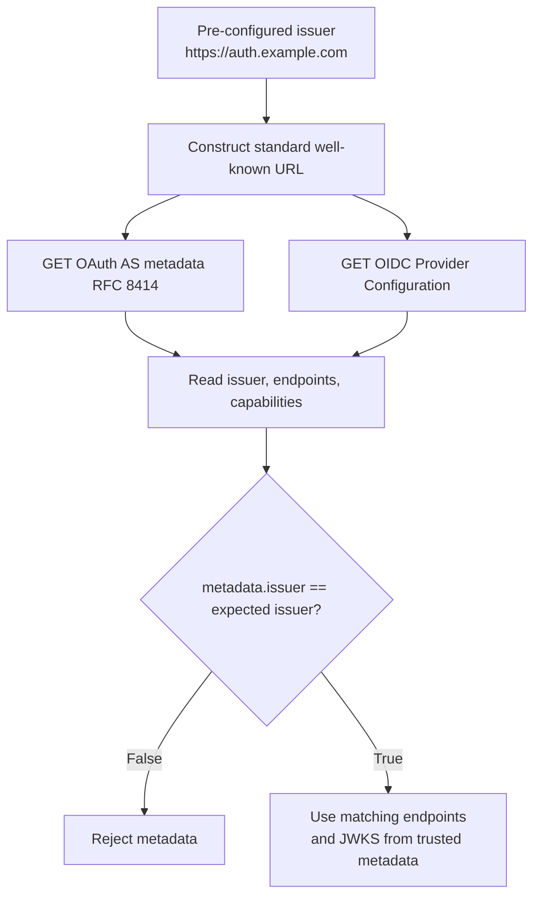
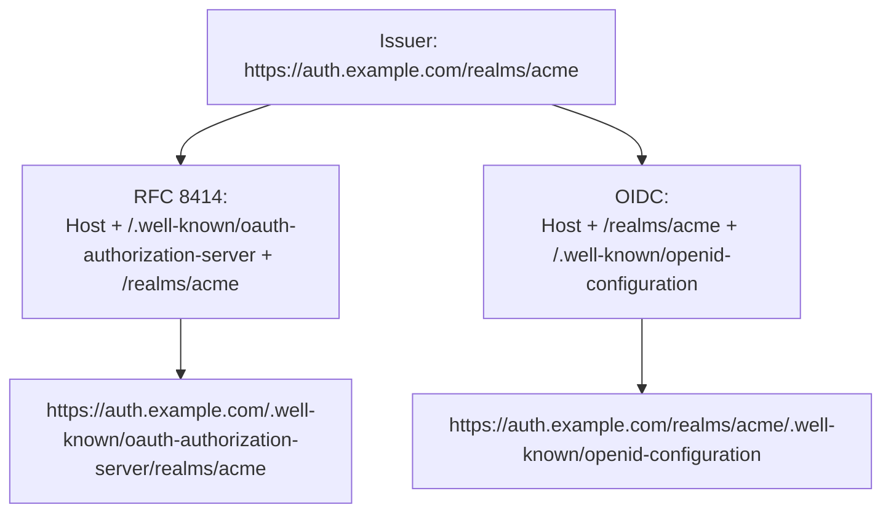
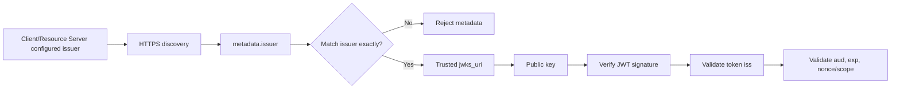
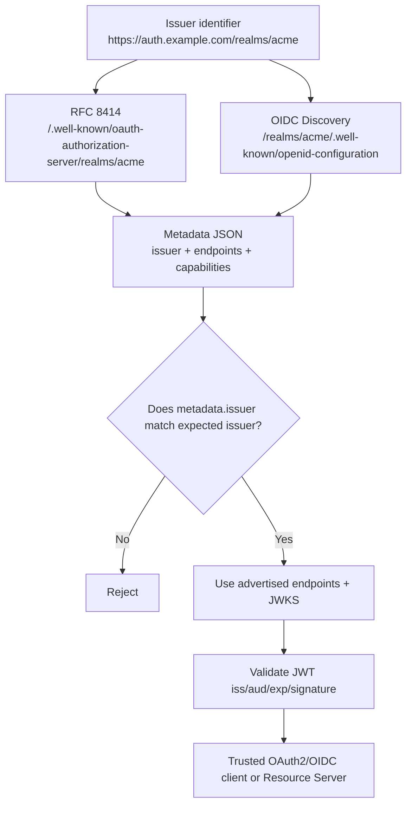

# Well-Known Paths and Relationship with Issuer

## 1. Objectives and Context

In the **Metadata and Discovery** chapter of the **SPRING_SECURITY_OAUTH2_OIDC_AUTHORIZATION_SERVER** module, an Authorization Server does more than expose endpoints like `/oauth2/authorize`, `/oauth2/token`, and `/oauth2/jwks`. It must also publish a **metadata document** so OAuth 2.0 clients, OpenID Connect Relying Parties, and Resource Servers can discover supported endpoints, algorithms, and capabilities.

This lesson focuses on the relationship between the **issuer identifier** and **`.well-known` paths**, specifically the two standards commonly paired with Spring Security/Spring Authorization Server (SAS):

- **OAuth 2.0 Authorization Server Metadata — RFC 8414:** `/.well-known/oauth-authorization-server` convention.
- **OpenID Connect Discovery 1.0:** `/.well-known/openid-configuration` convention.

Both paths serve discovery, yet **they are not completely interchangeable aliases**. When the issuer contains a path, their URL construction rules are especially easy to confuse.

After this lesson, you will be able to:

- Explain what an issuer is and why metadata `issuer` must match the issuer trusted by the client.
- Construct the correct well-known path for both root issuers and issuers with paths.
- Distinguish RFC 8414 metadata from OIDC Provider Configuration.
- Configure a fixed issuer and OIDC discovery in Spring Authorization Server.
- Distinguish **issuer URL**, **well-known path**, **endpoint paths**, and **JWKS URL**.
- Verify metadata when the Authorization Server runs behind a reverse proxy, ingress, or context path.
- Design discovery for OAuth2 Clients, OIDC Clients, and Resource Servers.
- Test consistency and guard against host-header poisoning, issuer mix-up, and multi-tenancy flaws.

**Scope:** Examples illustrate common APIs of **Spring Authorization Server 1.x**, **Spring Security 6.x**, and **Spring Boot 3.x**. Metadata fields, routes, and auto-configuration may vary by version, profile, and enabled endpoints; verify against your exact dependencies and actual responses. The module goal is to help you design, configure, secure, test, and operate a reliable OAuth 2.0/OpenID Connect Authorization Server in a Spring Boot application.

## 2. Issuer Is the Identifier of the Authorization Server

An **Issuer** is a URL identifying an Authorization Server or OpenID Provider (OP), for example:

```text
https://auth.example.com
```

An issuer is **not simply** a hostname, nor necessarily the path prefix of all OAuth endpoints. It acts as an **identity-based trust anchor** so recipients know "who issued this metadata and token."

A valid issuer in these contexts typically has the following properties:

- It is an HTTPS URL in production.
- It has a scheme, a host, and optionally a path.
- It contains no query string or fragment.
- It is configured consistently and remains stable.
- It is **known in advance** by the client/Resource Server, rather than read arbitrarily from a token or attacker-controlled input.
- It matches the `issuer` field in the returned metadata exactly.
- It matches the `iss` claim in ID Tokens, and the `iss` claim in JWT access tokens per the applicable profile/configuration.

Example tenant-based issuer:

```text
https://auth.example.com/realms/acme
```

In a multi-tenant model, path-based issuers help distinguish each tenant/realm. However, **merely changing the issuer string does not create complete multi-tenancy**: each issuer also needs corresponding discovery routing, client registrations, key policies, storage isolation, and token validation.

### 2.1. Issuer Is Not the Token Endpoint

| Address | Role |
| --- | --- |
| `https://auth.example.com` | Issuer identifier |
| `https://auth.example.com/.well-known/oauth-authorization-server` | OAuth 2.0 AS metadata document per RFC 8414 for root issuer |
| `https://auth.example.com/.well-known/openid-configuration` | OIDC Provider Configuration for root issuer |
| `https://auth.example.com/oauth2/authorize` | Authorization Endpoint |
| `https://auth.example.com/oauth2/token` | Token Endpoint |
| `https://auth.example.com/oauth2/jwks` | JWK Set Endpoint |
| `https://auth.example.com/oauth2/introspect` | Token Introspection Endpoint, if supported |
| `https://auth.example.com/oauth2/revoke` | Token Revocation Endpoint, if supported |

These endpoints are **typical layout examples**. Clients should not infer endpoints by concatenating paths onto the issuer. **Metadata is the authoritative source of advertised endpoints**, and the response must be verified against the trusted issuer.

### 2.2. Issuer Differs from Internal Hostname

An AS running in a container may listen on:

```text
http://authorization-service:9000
```

While the issuer for external users/clients is:

```text
https://auth.example.com
```

`authorization-service` is internal DNS, not the public issuer. If the issuer is derived from an internal request, metadata and JWTs may contain `http://authorization-service:9000`; external clients will hit `iss` validation failures or try to reach an unroutable endpoint.

**Production should configure the issuer explicitly**, rather than relying on the `Host` header or network path of an arbitrary request.

## 3. What Is a Well-Known Endpoint?

The `.well-known` mechanism (per RFC 8615 on well-known URIs) lets standard protocols define a predictable location for publishing configuration. OAuth/OIDC uses well-known documents so clients can discover endpoints without hardcoding every URL.

Key points:

- `/.well-known/...` is the **path to fetch the document**, not the issuer itself.
- The document is typically **JSON** containing `issuer` and endpoint URLs/capabilities.
- The well-known URL can be **derived from the issuer according to the specification's rules**.
- Endpoint URLs declared inside metadata may have different routes or hosts from the issuer within supported configuration/trust boundaries.
- Clients must verify that the JSON `issuer` field equals the expected issuer; receiving HTTP 200 or valid JSON alone is insufficient.



## 4. Two Discovery Standards to Distinguish

### 4.1. OAuth 2.0 Authorization Server Metadata — RFC 8414

RFC 8414 standardizes the metadata document for an OAuth 2.0 Authorization Server. The standard well-known suffix is:

```text
/.well-known/oauth-authorization-server
```

Root issuer example:

```text
Issuer:
https://auth.example.com

OAuth AS metadata:
https://auth.example.com/.well-known/oauth-authorization-server
```

Metadata can advertise the Authorization Endpoint, Token Endpoint, JWKS URL, revocation, introspection, grant/response types, and authentication methods. Whether a field appears depends on whether the server supports that feature.

### 4.2. OpenID Connect Discovery 1.0

OIDC defines **OpenID Provider Configuration** at:

```text
/.well-known/openid-configuration
```

For a root issuer:

```text
Issuer:
https://auth.example.com

OIDC Discovery:
https://auth.example.com/.well-known/openid-configuration
```

OIDC metadata includes extra information for user-authenticating clients, such as `userinfo_endpoint`, `subject_types_supported`, and `id_token_signing_alg_values_supported`. Do not assume an OAuth 2.0-only AS supports the full OIDC contract.

### 4.3. Comparison Table

| Criterion | OAuth AS metadata (RFC 8414) | OIDC Discovery 1.0 |
| --- | --- | --- |
| Well-known suffix | `oauth-authorization-server` | `openid-configuration` |
| Audience | OAuth2 Clients, Resource Servers, and integrators | OIDC Relying Parties and systems needing OP metadata |
| Focus | OAuth endpoints, grants, auth methods, capabilities | OIDC authentication, ID Token, UserInfo, OP capabilities |
| Identifier field | `issuer` | `issuer` |
| JWT public keys | `jwks_uri` if published/applicable | `jwks_uri` per OIDC OP metadata |
| Implies OIDC support? | Not necessarily | Yes, when response is a valid OIDC Provider Configuration |
| Can coexist? | Yes | Yes |
| With path-based issuer | Well-known path is **inserted between host and issuer path** | Well-known suffix is **appended after issuer path** per OIDC Discovery |

**The most important distinction of this lesson:** For an issuer **without a path**, the two URLs look very similar—differing only in document name. For an issuer **with a path**, the URL structure **differs in placement**, not just by changing a trailing string.

## 5. URL Rules for a Root Issuer

When the issuer has no path:

```text
ISSUER = https://auth.example.com

RFC 8414:
https://auth.example.com/.well-known/oauth-authorization-server

OIDC Discovery:
https://auth.example.com/.well-known/openid-configuration
```

Both mechanisms share the same origin. However, they are **two distinct metadata endpoints** with their respective schemas and requirements.

An application can serve both JSON documents simultaneously if it supports both OAuth AS Metadata and OIDC. When only OAuth is used, RFC 8414 alone may suffice depending on the client contract.

### 5.1. Do Not Hardcode the Two Paths as Aliases of Each Other

Do not configure a proxy so that `/.well-known/oauth-authorization-server` and `/.well-known/openid-configuration` blindly return the exact same object. Some fields overlap, yet OIDC's metadata requirements and advertised capabilities differ from OAuth's.

Even if a proxy/router points to the same backend implementation, ensure **each response adheres to the schema and content** of the standard represented by that URL.

## 6. URL Rules for an Issuer With a Path — The Most Error-Prone Case

Suppose the issuer is:

```text
https://auth.example.com/realms/acme
```

### 6.1. RFC 8414: Insert Well-Known **Before the Issuer Path**

According to RFC 8414's URL construction rule:

```text
Issuer:
https://auth.example.com/realms/acme

OAuth AS Metadata:
https://auth.example.com/.well-known/oauth-authorization-server/realms/acme
```

The `/realms/acme` portion of the issuer comes **after** the `/.well-known/oauth-authorization-server` suffix.

### 6.2. OIDC Discovery: Append Well-Known **After the Issuer Path**

According to OIDC Discovery 1.0:

```text
Issuer:
https://auth.example.com/realms/acme

OIDC Provider Configuration:
https://auth.example.com/realms/acme/.well-known/openid-configuration
```

The `/realms/acme` portion appears **before** `/.well-known/openid-configuration`.

### 6.3. Side-by-Side Comparison to Avoid Confusion

| Issuer | URL per RFC 8414 | URL per OIDC Discovery |
| --- | --- | --- |
| `https://auth.example.com` | `https://auth.example.com/.well-known/oauth-authorization-server` | `https://auth.example.com/.well-known/openid-configuration` |
| `https://auth.example.com/tenant-a` | `https://auth.example.com/.well-known/oauth-authorization-server/tenant-a` | `https://auth.example.com/tenant-a/.well-known/openid-configuration` |
| `https://auth.example.com/realms/acme` | `https://auth.example.com/.well-known/oauth-authorization-server/realms/acme` | `https://auth.example.com/realms/acme/.well-known/openid-configuration` |

Path placement diagram:



**Do not apply `ISSUER + "/.well-known/oauth-authorization-server"` to an issuer with a path.** That formula violates RFC 8414 path ordering.

### 6.4. Versions, Gateways, and Multi-Issuer Support

A library or server may support compatibility routes in addition to the canonical route. Do not conclude from a URL "returning 200" that it is standard for all clients. If multi-tenancy is needed, configure the router/ingress and test the canonical URLs for every issuer.

In Spring Authorization Server, **do not simply set `issuer(".../realms/acme")` and assume both well-known paths and all endpoints will automatically be created and mapped properly for the tenant**. Routing, security filter chains, context/tenant resolution, client repositories, and public URLs require explicit implementation/coordination depending on the version.

## 7. Example OAuth Authorization Server Metadata JSON

A document at `https://auth.example.com/.well-known/oauth-authorization-server` might look like:

```json
{
  "issuer": "https://auth.example.com",
  "authorization_endpoint": "https://auth.example.com/oauth2/authorize",
  "token_endpoint": "https://auth.example.com/oauth2/token",
  "jwks_uri": "https://auth.example.com/oauth2/jwks",
  "response_types_supported": ["code"],
  "grant_types_supported": [
    "authorization_code",
    "refresh_token",
    "client_credentials"
  ],
  "token_endpoint_auth_methods_supported": [
    "client_secret_basic",
    "private_key_jwt"
  ],
  "code_challenge_methods_supported": ["S256"],
  "revocation_endpoint": "https://auth.example.com/oauth2/revoke",
  "introspection_endpoint": "https://auth.example.com/oauth2/introspect"
}
```

This is a **theoretical example**, not guaranteed output across every SAS version. Advertised endpoints and methods must match features actually enabled and configured; do not advertise `private_key_jwt` if the application does not handle it properly.

### 7.1. Meaning of Key Fields

| Field | Role | What to Check |
| --- | --- | --- |
| `issuer` | AS identifier | Must match expected issuer |
| `authorization_endpoint` | Endpoint starting authorization | Public URL, valid redirects, and HTTPS |
| `token_endpoint` | Endpoint exchanging grants for tokens | Uses proper client auth method |
| `jwks_uri` | Public JWK Set for JWT verification | Proper origin/key policy; no private keys |
| `response_types_supported` | Supported response types | Clients do not request unconfigured types |
| `grant_types_supported` | Supported grant types | Does not mean every client may use every grant |
| `token_endpoint_auth_methods_supported` | Client authentication methods at Token Endpoint | Must match registered clients and providers |
| `code_challenge_methods_supported` | Supported PKCE methods | Prefer S256 per security profile |
| `revocation_endpoint` | RFC 7009 endpoint | Present when revocation is supported/advertised |
| `introspection_endpoint` | RFC 7662 endpoint | Present when introspection is supported/advertised |

**AS capabilities are not per-client permissions.** For example, metadata may include `client_credentials`, yet client `portal-web` must still be explicitly registered with that grant to use it.

### 7.2. Fields That May Be Absent

Metadata fields are conditional per specification/profile. Do not treat the absence of optional fields as a broken server. However, if a client depends on a feature—such as PKCE, introspection, or revocation—it must verify that the document advertises the relevant endpoint/capability or rely on trusted out-of-band configuration.

## 8. Example OIDC Provider Configuration JSON

When OIDC is enabled, an illustrative document at `https://auth.example.com/.well-known/openid-configuration`:

```json
{
  "issuer": "https://auth.example.com",
  "authorization_endpoint": "https://auth.example.com/oauth2/authorize",
  "token_endpoint": "https://auth.example.com/oauth2/token",
  "userinfo_endpoint": "https://auth.example.com/userinfo",
  "jwks_uri": "https://auth.example.com/oauth2/jwks",
  "response_types_supported": ["code"],
  "subject_types_supported": ["public"],
  "id_token_signing_alg_values_supported": ["RS256"],
  "scopes_supported": ["openid", "profile", "email"],
  "claims_supported": ["sub", "iss", "aud", "exp", "iat", "email"]
}
```

Values are **illustrative only**; SAS may use `/userinfo` or different endpoint paths depending on version and configuration. Do not copy this sample into a reverse-proxy static JSON response if your actual runtime is configured differently.

### 8.1. Fields Distinct from OAuth Metadata

- `userinfo_endpoint`: where OIDC clients fetch user claims using an appropriate access token.
- `subject_types_supported`: OP subject identifier types, e.g., `public` or `pairwise` as supported.
- `id_token_signing_alg_values_supported`: supported ID Token signing algorithms.
- `claims_supported`: claims the OP may support; does not guarantee every claim appears in every ID Token.
- `end_session_endpoint`: may be advertised when the OP supports appropriate logout.

OIDC clients must still validate the ID Token per OIDC Core: signature, `iss`, `aud`, `exp`, `nonce`/`auth_time`, and flow-specific checks. Discovery **does not replace token validation**.

### 8.2. A Metadata Document Is Not an ID Token

Metadata only advertises configuration. Clients never use `issuer` in the JSON as proof that a user has logged in. An ID Token must be issued after an authentication flow and validated by its own rules.

## 9. Relationship Between Issuer, Metadata, and the `iss` Claim

You can view this as a trust chain:



Three distinct values must remain consistent:

1. **Expected issuer**: configured in the OIDC Client/Resource Server.
2. **`issuer` in discovery JSON**: the AS declaring its own identifier.
3. **`iss` in the JWT**: the token asserting who issued it.

If the AS publishes metadata `issuer=https://auth.example.com` while an ID Token contains `iss=http://auth-internal:9000`, the client must reject the token due to issuer mismatch.

### 9.1. Exact Match, Not Just Same Hostname

The following strings **must not by default be treated as the same issuer**:

```text
https://auth.example.com
https://auth.example.com/
http://auth.example.com
https://auth.example.com/realms/acme
https://auth.example.com/realms/other
https://AUTH.example.com
```

Some URL normalization exists at the HTTP/DNS layer, but OIDC/metadata issuer matching has strict exact-match requirements. Do not downgrade validation to hostname-only comparison, path stripping, or `startsWith`.

### 9.2. Never Take an Arbitrary Issuer from a Token to Trigger Discovery

An attacker-crafted token can contain:

```json
{
  "iss": "https://attacker.example",
  "sub": "admin",
  "aud": "orders-api",
  "exp": 1890000000
}
```

If a Resource Server takes any `iss` from an unverified token, fetches metadata/JWKS from it, and trusts the newly fetched key, an attacker can stand up their own issuer and make the API accept forged tokens.

**Correct:** The Resource Server holds a configured list of trusted issuers, or a tightly controlled multi-tenant resolver. Metadata/JWKS are only discovered for pre-approved issuers.

### 9.3. Audience and Issuer Check Two Different Things

`iss` states **who issued** the token. `aud` states **who the intended recipient** is. The Resource Server must check both; a token with a valid issuer but `aud=billing-api` is not automatically valid at `orders-api`.

## 10. Configuring `AuthorizationServerSettings` in SAS

In Spring Authorization Server, the official issuer configuration typically lives in an `AuthorizationServerSettings` bean:

```java
@Configuration(proxyBeanMethods = false)
public class AuthorizationServerSettingsConfig {

    @Bean
    AuthorizationServerSettings authorizationServerSettings() {
        return AuthorizationServerSettings.builder()
                .issuer("https://auth.example.com")
                .authorizationEndpoint("/oauth2/authorize")
                .tokenEndpoint("/oauth2/token")
                .jwkSetEndpoint("/oauth2/jwks")
                .build();
    }
}
```

In this example:

- `issuer(...)` sets the stable public identifier.
- `authorizationEndpoint(...)` defines the authorization endpoint path within the application.
- `tokenEndpoint(...)` defines the token endpoint path.
- `jwkSetEndpoint(...)` defines the JWKS path.

**The issuer is not automatically a URL prefix for all endpoints.** Endpoint paths are configured separately, and public URLs must be built and routed consistently with any servlet context path and reverse proxy.

### 10.1. Why Configure the Issuer Explicitly in Production?

If no issuer is configured, some SAS setups infer the issuer from the current request. While convenient for local testing, in production this easily causes issues:

- Reverse proxies pass internal Host/scheme values.
- Direct requests to the AS use a different hostname from the public domain.
- Load balancers expose multiple hostnames.
- Gateways handle `Forwarded`/`X-Forwarded-*` headers inconsistently.
- Attackers intentionally send malicious `Host` headers.

Pinning a fixed issuer reduces the risk of metadata/token issuers changing per request. After configuring it, test both public discovery and the actual token `iss`.

### 10.2. Do Not Infer All Routes from the Issuer Path

For example:

```java
AuthorizationServerSettings.builder()
        .issuer("https://auth.example.com/realms/acme")
        .tokenEndpoint("/oauth2/token")
        .build();
```

Do not assume the public token endpoint is guaranteed to be:

```text
https://auth.example.com/realms/acme/oauth2/token
```

or:

```text
https://auth.example.com/oauth2/token
```

from just those two lines. The final URL depends on context path, ingress rewrites, multi-tenant routing, and how your SAS version builds endpoint URLs. **Inspect the actual JSON metadata and test HTTP routing end-to-end** before publishing client integration details.

## 11. Enabling OIDC Discovery in `SecurityFilterChain`

OAuth AS Metadata normally comes with the Authorization Server's endpoint configuration. OIDC Provider Configuration requires enabling OIDC in SAS when serving OIDC clients:

```java
@Configuration(proxyBeanMethods = false)
@EnableWebSecurity
public class AuthorizationServerSecurityConfig {

    @Bean
    @Order(1)
    SecurityFilterChain authorizationServerSecurityFilterChain(
            HttpSecurity http) throws Exception {

        OAuth2AuthorizationServerConfigurer authorizationServer =
                OAuth2AuthorizationServerConfigurer.authorizationServer();

        http
            .securityMatcher(authorizationServer.getEndpointsMatcher())
            .with(authorizationServer, configurer ->
                    configurer.oidc(Customizer.withDefaults()))
            .authorizeHttpRequests(authorize ->
                    authorize.anyRequest().authenticated())
            .exceptionHandling(exceptions ->
                    exceptions.defaultAuthenticationEntryPointFor(
                            new LoginUrlAuthenticationEntryPoint("/login"),
                            new MediaTypeRequestMatcher(MediaType.TEXT_HTML)));

        return http.build();
    }

    @Bean
    @Order(2)
    SecurityFilterChain appSecurityFilterChain(
            HttpSecurity http) throws Exception {

        http.authorizeHttpRequests(authorize ->
                    authorize.anyRequest().authenticated())
            .formLogin(Customizer.withDefaults());

        return http.build();
    }
}
```

This is an **illustrative skeleton**, not a standalone runnable Authorization Server. It still requires `RegisteredClientRepository`, `OAuth2AuthorizationService`, `OAuth2AuthorizationConsentService` as needed, `JWKSource<SecurityContext>`/`JwtDecoder` for OIDC/JWT, user authentication, issuer, and token generators per version.

### 11.1. Does the Metadata Endpoint Require Login?

Discovery generally must be public to clients—for example, an OIDC client fetches provider configuration before any user logs in. Never accidentally apply authentication or HTML login redirects to `/.well-known/...`.

However, the endpoint is served through the actual filter chain and security matcher. If JSON metadata returns `302 /login` or `401` against contract, inspect `@Order`, the matcher, OIDC enablement, and custom rules; never open all AS endpoints just to "fix discovery."

### 11.2. When Should OIDC Not Be Enabled?

If the Authorization Server only implements OAuth 2.0 for API authorization and does not provide OpenID Connect authentication, **there is no need to enable OIDC**. Standard OAuth clients can discover AS metadata via RFC 8414 without ID Tokens or UserInfo.

Exposing `/.well-known/openid-configuration` when the OP does not implement required OIDC capabilities can cause clients to start broken flows. Only advertise features genuinely supported.

## 12. Spring Boot Properties and Discovery Consumers

### 12.1. Spring Security OAuth2 Client / OIDC Client

A Spring Boot OAuth2 Client can use the issuer to discover provider metadata:

```yaml
spring:
  security:
    oauth2:
      client:
        registration:
          portal:
            provider: corporate-auth
            client-id: portal-web
            client-secret: ${PORTAL_CLIENT_SECRET}
            authorization-grant-type: authorization_code
            redirect-uri: "{baseUrl}/login/oauth2/code/{registrationId}"
            scope: openid,profile
        provider:
          corporate-auth:
            issuer-uri: https://auth.example.com
```

This is client configuration, **not Authorization Server configuration**. `issuer-uri` must point to the issuer identifier, not the `openid-configuration` URL. Discovery behavior and fallback order between OIDC/OAuth metadata depend on Spring Security version and registration type.

The client registration must still exist on the AS with the exact `client_id`, secret/method, redirect URI, and scopes; discovery does not register clients automatically.

### 12.2. Spring Security Resource Server (JWT)

A Resource Server typically configures the issuer:

```yaml
spring:
  security:
    oauth2:
      resourceserver:
        jwt:
          issuer-uri: https://auth.example.com
```

Spring Security can use this issuer to discover metadata and JWKS, then validate the `iss` claim. However, the Resource Server still needs to check `aud` and `scope` permissions per API; a valid issuer and signature alone do not constitute business authorization.

To avoid discovery at startup or integrate with special setups, `jwk-set-uri` can be configured as supported by Spring Security, while keeping appropriate issuer/audience validation.

### 12.3. Do Not Use the Metadata URL as `issuer-uri`

Wrong:

```yaml
spring:
  security:
    oauth2:
      resourceserver:
        jwt:
          issuer-uri: https://auth.example.com/.well-known/openid-configuration
```

The value above is the **discovery document URL**, not the issuer. Clients can construct wrong well-known paths or fail `iss` matching.

Right:

```yaml
spring:
  security:
    oauth2:
      resourceserver:
        jwt:
          issuer-uri: https://auth.example.com
```

## 13. Reverse Proxies, Ingress, and Servlet Context Path

In production, an AS often runs behind:

```text
Internet -> https://auth.example.com -> Ingress/Proxy
         -> http://authorization-service:9000 -> Spring Boot
```

The proxy may terminate TLS, change `Host`, rewrite paths, or add a context prefix. If metadata emits internal URLs or unroutable public paths, clients will fail even though the AS backend is healthy.

### 13.1. Common Errors

| External expectation | Backend sees | Consequence if misconfigured |
| --- | --- | --- |
| `https://auth.example.com` | `http://authorization-service:9000` | Wrong metadata `issuer` or token `iss` |
| `https://auth.example.com/oauth2/token` | `http://service:9000/oauth2/token` | Public token endpoint URL is wrong |
| `https://auth.example.com/oauth2/jwks` | `http://service:9000/oauth2/jwks` | Resource Server cannot fetch keys |
| `https://auth.example.com/realms/acme/.well-known/openid-configuration` | Different internal path | OIDC discovery returns 404 |
| `https://auth.example.com/.well-known/oauth-authorization-server/realms/acme` | Proxy does not map RFC 8414 route | OAuth discovery for path issuer fails |

### 13.2. Forwarded Headers Must Come from a Trusted Proxy

Headers like `Forwarded`, `X-Forwarded-Proto`, `X-Forwarded-Host`, and `X-Forwarded-Prefix` can tell an application its public origin/path. Spring Boot offers forwarded-header strategies, for example:

```yaml
server:
  forward-headers-strategy: framework
```

**Never blindly trust forwarded headers from the internet.** If a client can send `X-Forwarded-Host: attacker.example` and the application uses it to build issuers/URLs, it enables issuer poisoning, malicious redirects, or pointing JWKS/token endpoints to an attacker's host.

Safe practice:

1. Have the reverse proxy strip forwarded headers sent by internet clients.
2. Have the proxy set verified scheme/host/prefix headers.
3. Only accept forwarded headers on the backend from trusted network/proxy peers.
4. Pin the production issuer explicitly.
5. Test external URLs through the actual public ingress, not just localhost.

### 13.3. Context Path and URL Rewriting

If the application sets `server.servlet.context-path=/auth` while the public proxy strips or prepends `/auth`, establish a clear contract:

- Does the public issuer include `/auth` or not?
- Are the public well-known paths routed according to their respective standards?
- What paths do metadata `authorization_endpoint`/`token_endpoint`/`jwks_uri` advertise?
- Do browser redirects, form login, and consent URLs work through ingress?
- Can Resource Servers fetch JWKS from the advertised URL?

There is no universal string-concatenation formula that works for every proxy + issuer path combination. The right result is **a set of public URLs clients can actually reach, paired with an exact metadata issuer**.

## 14. Multi-Tenant: Each Issuer Is a Trust Boundary

In a multi-tenant model, two realms may share a host with path-distinct issuers:

```text
https://auth.example.com/realms/acme
https://auth.example.com/realms/contoso
```

Consumers must bind metadata/JWKS and registrations to the **exact issuer**, not just the hostname.

### 14.1. Standard Mapping Example

| Realm | RFC 8414 metadata | OIDC metadata |
| --- | --- | --- |
| `acme` | `https://auth.example.com/.well-known/oauth-authorization-server/realms/acme` | `https://auth.example.com/realms/acme/.well-known/openid-configuration` |
| `contoso` | `https://auth.example.com/.well-known/oauth-authorization-server/realms/contoso` | `https://auth.example.com/realms/contoso/.well-known/openid-configuration` |

Inside each document:

- `issuer` must equal that realm's issuer.
- Endpoint URLs must route to the corresponding tenant/realm.
- Authorization codes, client registrations, consent, and token state must be partitioned per policy.
- Key material/JWKS may be shared or separated by design, but tokens must carry the exact `iss` and Resource Servers must trust only permitted issuers.
- Never accept a tenant A token for tenant B simply because `sub` or `kid` matches.

### 14.2. Do Not Trust Tenant Selection from a Query Parameter Alone

If a request arrives at `/.well-known/openid-configuration?tenant=acme`, the AS should not rely on a self-asserted query parameter to serve another tenant's metadata when the issuer contract requires explicit paths. Clients must use an approved issuer identifier with consistent routing.

### 14.3. Do Not Treat Enabling Multi-Tenancy as a Single Boolean

A production system may need a tenant resolver, routing, client repository partitioning, per-tenant authorization contexts, keys, and metadata generation. Having the right well-known URL is a **necessary condition for discovery**, not a guarantee that all per-tenant endpoints are secure.

## 15. Discovery, JWKS, and Key Rotation

Metadata typically includes `jwks_uri`, for example:

```json
{
  "issuer": "https://auth.example.com",
  "jwks_uri": "https://auth.example.com/oauth2/jwks"
}
```

Resource Servers and OIDC Clients use public keys from JWKS to verify JWTs signed by the AS. `jwks_uri` is the **URL of the public key set**, not a private key source.

### 15.1. Minimum Checks

- The JWKS URL is reachable over HTTPS.
- Public JWKs contain no RSA private parameters (`d`, `p`, `q`, `dp`, `dq`, `qi`) or EC private `d`.
- The JWT JOSE header `kid` matches an appropriate public key.
- The algorithm `alg` is allowlisted; reject `alg=none` or unapproved algorithms.
- `iss` matches the pinned issuer.
- `aud` matches the client ID (ID Token) or Resource Server/API (access token per profile).
- `exp`/`nbf`/`iat` and flow constraints are verified.

### 15.2. Key Rotation Does Not Require Changing the Issuer

Rotating signing keys changes `kid` and the public JWKS, and **should not change the issuer** while the Authorization Server remains the same entity. Changing the issuer forces clients and Resource Servers to treat it as a much larger trust-configuration change than key rotation.

During key rotation, JWKS should have an overlap window publishing both old and new public keys so unexpired tokens remain verifiable. Metadata `jwks_uri` can usually remain stable while JWKS content evolves with the key lifecycle.

### 15.3. Metadata and JWKS Caching

Clients may cache discovery JSON/JWKS. When changing endpoint paths, issuers, or keys:

- Account for cache TTL/propagation windows.
- Never reuse or collide `kid` values in ways that cause caches to pick the wrong key.
- Never remove old public keys prematurely.
- Prepare rollout/rollback plans for metadata and client registrations.
- Monitor unknown `kid`s, issuer mismatches, and discovery 404/5xx errors.

Do not cache metadata "forever" on clients if your system needs to support key or endpoint rotation. Conversely, do not force clients to fetch discovery on every API request; follow sensible cache policies and library capabilities.

## 16. Securing the Discovery Process

### 16.1. HTTPS and Trusted Sources

Discovery responses usually require no client authentication, yet they contain URLs that directly steer the OAuth flow. Protect them with:

- HTTPS with certificate validation.
- Exact issuer allowlists/configuration.
- Disallowing arbitrary redirects to untrusted hosts when fetching metadata/JWKS.
- Restricting URL schemes/origins by policy.
- Proper DNS, proxy, and egress protections.
- Never treating a `200 JSON` from an attacker host as trusted metadata.

### 16.2. SSRF and Issuer Confusion

A multi-tenant system accepting arbitrary user-supplied issuer URLs can suffer SSRF if the backend fetches metadata from internal addresses such as `127.0.0.1`, link-local addresses, or cloud metadata services. If business requirements demand discovering user-proposed issuers, enforce approval/allowlisting and network egress restrictions.

Never take `issuer`, `jwks_uri`, or `authorization_endpoint` from an unverified JWT and fetch it directly. Token headers `jku`/`x5u` are likewise untrusted URL sources without an explicit policy.

### 16.3. OAuth Mix-Up and Multiple Issuers

When a client interacts with multiple AS instances, bind each authorization transaction to its initial issuer, state/PKCE, and matching metadata endpoints. Never switch Token Endpoints just because a browser callback carries unexpected parameters. Depending on supported profiles, issuer identification in the authorization response (e.g., RFC 9207 `iss` response parameter) helps prevent mix-up, though it does not replace discovery issuer validation.

### 16.4. Why Does Public Metadata Still Need Protection?

Even though metadata contains no private keys, if an attacker tampers with metadata contents they can redirect clients to a malicious token endpoint or JWKS. Therefore, being public **does not mean modifiable**. HTTPS, trust configuration, and protocol-level integrity/issuer-matching checks are mandatory.

## 17. Testing Discovery Over HTTP

### 17.1. Checking a Root Issuer

Terminal example with `curl`:

```bash
curl --fail-with-body -i \
  "https://auth.example.com/.well-known/oauth-authorization-server"

curl --fail-with-body -i \
  "https://auth.example.com/.well-known/openid-configuration"
```

Expected:

- Status `200 OK` if the endpoint is enabled.
- JSON-compatible `Content-Type`.
- Body is a schema-valid JSON object.
- `issuer` is exactly `https://auth.example.com`.
- Endpoint URLs are public HTTPS URLs reachable by clients.
- No redirect to HTML login or internal hosts.
- OIDC document exists only when the server supports and enables OIDC per config.

An OAuth-only AS may not serve an OIDC well-known document; that is not necessarily an error.

### 17.2. Checking an Issuer With a Path

For `https://auth.example.com/realms/acme`:

```bash
# RFC 8414: well-known suffix precedes the issuer path.
curl -i \
  "https://auth.example.com/.well-known/oauth-authorization-server/realms/acme"

# OIDC Discovery: well-known suffix follows the issuer path.
curl -i \
  "https://auth.example.com/realms/acme/.well-known/openid-configuration"
```

Do not use a 200 response from a custom URL to assume both standards are supported. Verify the respective routes, JSON `issuer`, and metadata semantics.

### 17.3. Inspecting JSON Values with `jq`

```bash
curl -fsS \
  "https://auth.example.com/.well-known/oauth-authorization-server" \
  | jq '{
      issuer,
      authorization_endpoint,
      token_endpoint,
      jwks_uri,
      grant_types_supported
    }'
```

For OIDC:

```bash
curl -fsS \
  "https://auth.example.com/.well-known/openid-configuration" \
  | jq '{
      issuer,
      authorization_endpoint,
      token_endpoint,
      jwks_uri,
      userinfo_endpoint,
      id_token_signing_alg_values_supported
    }'
```

These commands are illustrative; `jq` is a CLI utility, not a Java dependency. Against real hosts/issuers, never add `-k` to bypass TLS certificate validation just because a certificate is misconfigured.

## 18. Testing with Spring Security / MockMvc

### 18.1. Checking OAuth Metadata

```java
@Test
void oauthMetadataContainsConfiguredIssuer() throws Exception {
    mockMvc.perform(
            get("/.well-known/oauth-authorization-server"))
        .andExpect(status().isOk())
        .andExpect(content().contentTypeCompatibleWith(
                MediaType.APPLICATION_JSON))
        .andExpect(jsonPath("$.issuer")
                .value("https://auth.example.com"))
        .andExpect(jsonPath("$.token_endpoint")
                .value("https://auth.example.com/oauth2/token"));
}
```

This is an integration test skeleton: the context requires the SAS security filter chain, `AuthorizationServerSettings`, and version-appropriate infrastructure beans. For proxies/context paths, add tests with forwarded headers **from a trusted proxy layer** or end-to-end HTTP tests through ingress.

### 18.2. Checking OIDC Metadata

```java
@Test
void oidcProviderConfigurationContainsIssuerAndJwksUri()
        throws Exception {

    mockMvc.perform(
            get("/.well-known/openid-configuration"))
        .andExpect(status().isOk())
        .andExpect(jsonPath("$.issuer")
                .value("https://auth.example.com"))
        .andExpect(jsonPath("$.jwks_uri")
                .value("https://auth.example.com/oauth2/jwks"))
        .andExpect(jsonPath("$.id_token_signing_alg_values_supported")
                .isArray());
}
```

This test requires OIDC to be enabled. Do not expect all claims/algorithms to match this sample if the AS uses different algorithms or profiles.

### 18.3. Testing That Token `iss` Matches Metadata

An end-to-end test should:

1. Call discovery and extract the expected `issuer`.
2. Complete an authorization code/OIDC flow with a registered test client.
3. Receive the ID Token or JWT access token.
4. Verify the **signature** using JWKS for that issuer; do not merely decode the payload.
5. Verify the `iss` claim equals the `issuer` in metadata and the configured issuer.
6. Verify `aud`, `exp`, `nonce`/PKCE per token type and flow.
7. Present the token to a Resource Server trusting a different issuer → must be rejected.

`MockMvc` metadata tests do not prove JWT signature validation or reverse proxy correctness. Those are separate test layers.

## 19. Path and Security Test Matrix

| Test case | Expected |
| --- | --- |
| Root issuer and RFC 8414 URL | Metadata exists, `issuer` matches |
| Root issuer and OIDC URL with OIDC enabled | OIDC metadata exists, `issuer` matches |
| Path issuer — RFC 8414 | Well-known inserted before path, JSON matches issuer |
| Path issuer — OIDC | Well-known appended after path, JSON matches issuer |
| OAuth-only with OIDC disabled | No fake OIDC capabilities advertised |
| Metadata `issuer` differs from configured issuer | Client must reject |
| Metadata contains `http://internal-host` in production | Fails public URLs check |
| `jwks_uri` unroutable | Discovery/JWT validation integration test fails |
| Public JWKS contains private key fields | Block release; handle as security incident |
| JWT has wrong `iss` | Client/Resource Server rejects |
| JWT has right issuer but wrong `aud` | Resource Server rejects |
| Attacker injects `X-Forwarded-Host` at proxy | Host poisoning blocked |
| Direct backend request uses internal `Host` | Does not alter public issuer |
| Signing key rotated with unchanged issuer | New tokens use new key; public JWKS overlaps |
| Client holds stale metadata cache | Rollout/TTL/compatibility verified |
| Realm A metadata returns realm B issuer | Fails; no cross-tenant leak |
| User-supplied issuer points to 127.0.0.1/link-local | Backend refuses to fetch per policy (SSRF defense) |
| Authorization Endpoint returns login HTML while metadata redirects to login | Discovery test fails; fix matcher |
| Proxy rewrite makes `/.well-known` 404 | Routing test fails; fix ingress |
| Metadata advertises unsupported grant/method | Compatibility test fails |
| Metadata valid but Token Endpoint differs from public path | End-to-end client test fails |

## 20. Troubleshooting Common Errors

| Symptom | Likely Cause | Where to Check |
| --- | --- | --- |
| `/.well-known/oauth-authorization-server` returns 404 | Route disabled, wrong issuer path/proxy rewrite | Endpoint mapping, matcher, ingress |
| `/.well-known/openid-configuration` returns 404 | OIDC not enabled or different route | `oidc(Customizer.withDefaults())` and version |
| Well-known returns `302 /login` | Wrong security filter chain/matcher/authorization rules | `@Order`, endpoint filter chain, exception handling |
| JSON returns `issuer=http://localhost:9000` | AS infers issuer from internal request | `AuthorizationServerSettings.issuer(...)` |
| Client reports `invalid issuer` | Metadata issuer differs from client config/ID Token `iss` | Exact match on scheme, host, path |
| Path issuer generates wrong OAuth well-known URL | Used OIDC-style trailing suffix formula | RFC 8414 path insertion |
| OIDC discovery with path issuer has no response | Proxy/AS fails to map issuer-path suffix | OIDC route and tenant resolution |
| `jwks_uri` 404 or empty key set | Wrong `JWKSource`/JWKS mapping/proxy path | JWK bean, JWK endpoint, public URL |
| JWT rejected after rotation | Improper `kid`/cache/JWKS overlap | JOSE header, public JWK set, cache TTL |
| Browser authorize works, client token exchange fails | Metadata token endpoint URL mismatches external route | Discovery JSON and proxy path |
| Different replicas return different issuers/endpoints | Dynamic request issuer, inconsistent config | Issuer pinning, shared configuration |
| Different `Host` header alters metadata | Trusting client `Host`/forwarded header | Proxy sanitization and fixed issuer |
| Resource Server fails startup due to discovery error | Metadata unavailable/TLS cert/network | HTTPS, outbound connectivity, startup behavior |
| Multi-tenant client gets another tenant's metadata | Tenant resolver/cache key lacks issuer path | Per-issuer isolation and cache key |
| Client gets right metadata, ID Token has wrong issuer | Token generator/issuer context out of sync | Token `iss` and metadata integration test |

### 20.1. Distinguishing Configuration Errors from Protocol Errors

- **404:** usually routing/feature/path; never "fix" by disabling token validation.
- **302 login:** discovery is treated as a browser-protected resource; fix the filter chain.
- **Issuer mismatch:** align issuer/configuration per trust agreement; never relax validators to hostname comparison.
- **JWKS unavailable:** fix networking, JWKS endpoint, or key source; never skip JWT signatures.
- **Tenant mismatch:** isolate routing/tokens/metadata; never select a tenant solely from an unverified token.

## 21. Acceptance Checklist

- [ ] Fixed production issuer over public HTTPS with no query/fragment.
- [ ] Issuer clearly distinguished from well-known URLs and endpoint paths.
- [ ] RFC 8414 URL built by inserting `/.well-known/oauth-authorization-server` between origin and issuer path.
- [ ] OIDC URL built by appending `/.well-known/openid-configuration` after issuer path.
- [ ] For a root issuer, both well-known URLs differ only by suffix.
- [ ] Metadata `issuer` matches the expected issuer exactly.
- [ ] Token `iss` matches the configured issuer and verifies signature/JWKS.
- [ ] AS advertises only endpoints, scopes, grants, and client auth methods actually supported.
- [ ] OIDC Provider Configuration is advertised only when OIDC is enabled and properly configured.
- [ ] `AuthorizationServerSettings` configures issuer and endpoints consistently.
- [ ] Proxy/ingress preserves exact public scheme/host/path.
- [ ] Forwarded headers are trusted only from controlled proxies.
- [ ] Public metadata/JWKS URLs are reachable over HTTPS without redirecting to HTML login.
- [ ] JWKS contains no private key material; key rotation maintains public overlap.
- [ ] OAuth2/OIDC clients are configured with the issuer URI, not the well-known JSON URL.
- [ ] Resource Servers trust only approved issuers and enforce `aud` and API permissions.
- [ ] Multi-tenant routing/caching/token storage are bound to the exact issuer.
- [ ] Discovery prevents user-supplied issuers from causing SSRF or issuer mix-up.
- [ ] Tested root issuer, path issuer, 404s, proxy rewrites, mismatches, JWT validation, and key rotation.
- [ ] Tested discovery end-to-end over public ingress, not just localhost.

## 22. Summary



**Well-known is the discovery address; issuer is the trusted identity.** For a root issuer, RFC 8414 and OIDC URLs look similar; for an issuer with a path, **RFC 8414 inserts well-known before the path, whereas OIDC Discovery appends well-known after the path**. In Spring Authorization Server, configure the issuer explicitly, enable OIDC when needed, verify metadata/JWKS through public ingress, and validate `issuer`/`iss` consistently. Keeping clear boundaries among issuer, discovery URL, endpoint URLs, and JWT verification lets Spring Boot systems run OAuth 2.0/OpenID Connect securely and smoothly while avoiding issuer mismatches, reverse-proxy poisoning, and cross-tenant trust confusion.
