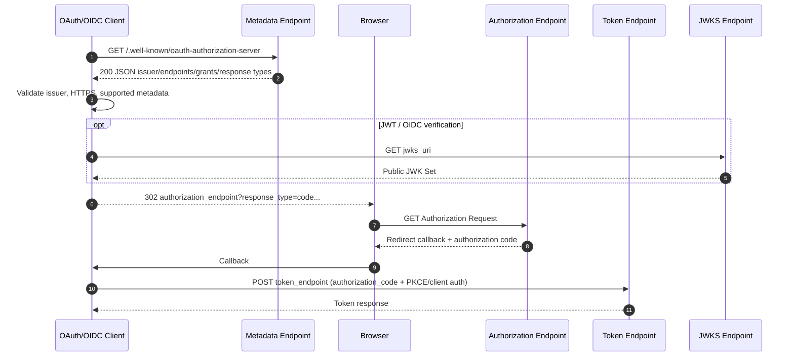

# Endpoints, `grant_types_supported`, and `response_types_supported` Fields

## 1. The Problem: How Does a Client Know What an Authorization Server Supports?

A Java application using Spring Security OAuth2 Client needs to authenticate users through an Authorization Server. If the development team had to configure every URL manually, it would be easy to confuse `/oauth2/authorize` with `/oauth2/token`, call an internal endpoint behind a reverse proxy, or assume the server supports a grant that is actually disabled.

**OAuth 2.0 Authorization Server Metadata** (RFC 8414) and **OpenID Connect Discovery 1.0** solve this by publishing a standard JSON document so clients can discover the identity provider's endpoints and protocol capabilities. In this document, three field groups are central:

1. **Endpoints**: which URLs clients should send requests to.
2. **`grant_types_supported`**: which ways of obtaining tokens the server claims to support.
3. **`response_types_supported`**: which `response_type` values the Authorization Endpoint supports when responding to authorization requests.

For example, a server using only Authorization Code + PKCE, Client Credentials, and Refresh Token may publish `response_types_supported=["code"]` even though `grant_types_supported` lists multiple values. That is **not a contradiction**: the two fields describe different aspects.

This lesson belongs to the **Metadata and Discovery** chapter of the `SPRING_SECURITY_OAUTH2_OIDC_AUTHORIZATION_SERVER` module, aiming to **teach how to design, configure, secure, test, and operate an OAuth 2.0/OpenID Connect Authorization Server using Spring Security and Spring Authorization Server in a Spring Boot application**. It focuses on the public contract semantics, generating metadata with Spring, and testing so capabilities are never misadvertised.

### Learning Objectives

After this lesson, you will be able to:

- Read RFC 8414 metadata and OIDC Provider Configuration, and explain the key endpoints.
- Distinguish **required**, **optional**, and **default-when-omitted** semantics in RFC 8414.
- Explain how `grant_types_supported` differs from `response_types_supported`, `response_modes_supported`, and `scopes_supported`.
- Verify that metadata is consistent with `RegisteredClient`, `AuthorizationServerSettings`, and actual authentication providers.
- Customize `OAuth2AuthorizationServerMetadataEndpointConfigurer` or `OidcProviderConfigurationEndpointConfigurer` when genuinely needed.
- Verify discovery in environments with reverse proxies, context paths, HTTPS, multiple issuers, and JWKS keys.
- Write integration tests for endpoint availability, metadata values, client interoperability, and unsupported configurations.

> **Scope:** Spring Java examples prioritize **Spring Authorization Server 1.5.x / Spring Security 6.x**. For Spring Security 7.x or other Spring Authorization Server versions, verify packages, DSLs, and default behaviors before applying. No additional special notes were provided in the lesson input.

## 2. Discovery Is a Public Contract, Not a Token-Issuing Endpoint

A client retrieves a JSON document from a `.well-known` address over HTTPS. The JSON states which URLs and capabilities the server has; only then does the client perform an authorization request or token request according to its registered grant.



**Metadata does not grant permissions and does not replace authorization checks.** If metadata lists `client_credentials`, a public SPA does not thereby gain permission to use Client Credentials. The server still enforces client registration and client authentication policy.

### 2.1. Two Document Types to Recognize

| Discovery Type | Standard | Typical Well-Known Path | Purpose |
| --- | --- | --- | --- |
| OAuth Authorization Server Metadata | **RFC 8414** | `/.well-known/oauth-authorization-server` | Publishes OAuth 2.0 configuration |
| OIDC Provider Configuration | **OpenID Connect Discovery 1.0** | `/.well-known/openid-configuration` | Publishes OAuth + properties required for OIDC |

The same Spring Authorization Server can serve both documents. **Do not assume the two JSON documents are identical**: OIDC Provider Configuration requires additional OIDC fields such as `subject_types_supported` and `id_token_signing_alg_values_supported`.

When using an issuer with a path, the two standards place the well-known path differently; Section 15 analyzes this in detail.

## 3. Complete Example of OAuth Authorization Server Metadata

Suppose the public issuer is `https://login.example.com` and the server supports Authorization Code + PKCE, Client Credentials, Refresh Token, and Device Authorization.

```http
GET /.well-known/oauth-authorization-server HTTP/1.1
Host: login.example.com
Accept: application/json
```

A valid response, trimmed to the illustrated features:

```http
HTTP/1.1 200 OK
Content-Type: application/json
```

```json
{
  "issuer": "https://login.example.com",
  "authorization_endpoint": "https://login.example.com/oauth2/authorize",
  "token_endpoint": "https://login.example.com/oauth2/token",
  "jwks_uri": "https://login.example.com/oauth2/jwks",
  "introspection_endpoint": "https://login.example.com/oauth2/introspect",
  "revocation_endpoint": "https://login.example.com/oauth2/revoke",
  "device_authorization_endpoint": "https://login.example.com/oauth2/device_authorization",
  "pushed_authorization_request_endpoint": "https://login.example.com/oauth2/par",
  "response_types_supported": [
    "code"
  ],
  "grant_types_supported": [
    "authorization_code",
    "refresh_token",
    "client_credentials",
    "urn:ietf:params:oauth:grant-type:device_code"
  ],
  "token_endpoint_auth_methods_supported": [
    "client_secret_basic",
    "private_key_jwt"
  ],
  "scopes_supported": [
    "openid",
    "profile",
    "orders.read"
  ],
  "code_challenge_methods_supported": [
    "S256"
  ]
}
```

**This is illustrative metadata, not guaranteed default output across every Spring version.** Only advertise `pushed_authorization_request_endpoint`, `device_authorization_endpoint`, `jwks_uri`, or a given algorithm/grant when the deployment actually provides that capability. If the server is OAuth-only without OpenID Connect enabled, `openid`/`profile` in `scopes_supported` should not mislead consumers into thinking OIDC is active.

### 3.1. Data Type Conventions

| Field | JSON type | Example |
| --- | --- | --- |
| `issuer` | String, URL | `"https://login.example.com"` |
| `authorization_endpoint` | String, URL | `"https://login.example.com/oauth2/authorize"` |
| `token_endpoint` | String, URL | `"https://login.example.com/oauth2/token"` |
| `jwks_uri` | String, URL | `"https://login.example.com/oauth2/jwks"` |
| `grant_types_supported` | Array of strings | `["authorization_code","client_credentials"]` |
| `response_types_supported` | Array of strings | `["code"]` |
| `token_endpoint_auth_methods_supported` | Array of strings | `["client_secret_basic"]` |
| `code_challenge_methods_supported` | Array of strings | `["S256"]` |

Under RFC 8414, multi-valued fields are represented as **JSON arrays**; **empty arrays must not appear** in an RFC 8414 metadata response. Do not emit `"grant_types_supported":"authorization_code"` as a single string or `"response_types_supported":[]` expecting clients to guess.

## 4. Key Endpoints and Publication Conditions

### 4.1. Endpoint Field Reference Table

| Metadata field | Role | Characteristics/Conditions |
| --- | --- | --- |
| `issuer` | Unique identifier of the Authorization Server | **REQUIRED** per RFC 8414; HTTPS, no query/fragment; exact-matched during discovery |
| `authorization_endpoint` | Receives authorization requests from user-agents | **REQUIRED**, unless the server supports no grant needing an Authorization Endpoint |
| `token_endpoint` | Exchanges codes or credentials for tokens | **REQUIRED**, except when the server supports only the Implicit Grant per RFC 8414 exception |
| `jwks_uri` | Address of public JWK Set for signature verification | **OPTIONAL** per RFC 8414; if present, must be HTTPS; depends on signed token issuance and key source |
| `registration_endpoint` | Dynamic Client Registration | OPTIONAL; do not advertise if registration is not enabled |
| `introspection_endpoint` | OAuth Token Introspection (RFC 7662) | OPTIONAL; protected by client authentication/authorization |
| `revocation_endpoint` | OAuth Token Revocation (RFC 7009) | OPTIONAL; do not assume every client can revoke every token |
| `device_authorization_endpoint` | Client initiates Device Authorization (RFC 8628) | OPTIONAL; not the URL where users enter the user code |
| `pushed_authorization_request_endpoint` | Pushed Authorization Request (RFC 9126) | OPTIONAL; client POSTs authorization parameters via back-channel |
| `userinfo_endpoint` | OIDC UserInfo (OIDC Discovery) | OIDC-specific; requires OIDC UserInfo enabled and access token protection |
| `end_session_endpoint` | OIDC RP-Initiated Logout | OIDC-specific; verify logout endpoint is supported and enabled |

**REQUIRED/OPTIONAL** in the table refers to **RFC 8414** specification rules when applicable, not that every server must implement every endpoint. The Implicit-only exception for `token_endpoint` is historical; **it is not a modern design recommendation**.

### 4.2. Why Not All Endpoints Are Alike

The **Authorization Endpoint** receives browser redirects, handles login/consent, and processes `response_type`. The **Token Endpoint** receives direct HTTP POSTs, authenticates clients where applicable, and processes `grant_type`. **Introspection/Revocation** accept tokens to inspect/revoke with dedicated caller authorization policies. **JWKS** publishes public keys and does not accept authorization codes.

Wiring the wrong endpoint causes protocol failures or secret exposure. For example, sending `client_secret` in the Authorization Endpoint query string leaks the secret; sending an authorization code to the JWKS endpoint makes no sense.

### 4.3. JWKS URL Is Not the Signing Key

`jwks_uri` points to JSON containing **public keys**; never include private JWK parameters such as `d`, `p`, `q` on a public endpoint. Clients use `kid`/`alg` from the token header to select a public key, while still validating issuer, audience, expiry, and algorithm allowlists.

Spring Authorization Server 1.5.x registers the JWK Set Endpoint only when an appropriate `JWKSource<SecurityContext>` bean is present. If none exists, do not advertise `jwks_uri` as though the endpoint were ready.

## 5. `grant_types_supported`: Which Ways of Obtaining Tokens Does the Server Support?

`grant_types_supported` is a **JSON array** containing the OAuth `grant_type` values supported by the Authorization Server.

| Grant type value | Main flow | Related endpoints/steps |
| --- | --- | --- |
| `authorization_code` | User authenticates/consents; client exchanges code for token | Authorization Endpoint → Token Endpoint |
| `refresh_token` | Client exchanges refresh token for a new access token | Token Endpoint |
| `client_credentials` | Service authenticates itself, no interactive end-user | Token Endpoint |
| `urn:ietf:params:oauth:grant-type:device_code` | Input-constrained device; user confirms on another device | Device Authorization + verification + Token Endpoint |
| `urn:ietf:params:oauth:grant-type:token-exchange` | Exchanges an input token for another token per policy | Token Endpoint, if RFC 8693 is implemented |
| `implicit` | Historical: token returned via front-channel | Not recommended for new deployments per OAuth Security BCP |
| `password` | Legacy Resource Owner Password Credentials | Not recommended / unused in modern OAuth designs |

Spring Authorization Server 1.5.x provides providers for grants supported by the given version; for example, many 1.x releases support Authorization Code, Client Credentials, Refresh Token, Device Code, and Token Exchange. **Do not infer an enabled capability solely from a class name on the classpath.** Verify configurers, providers, registrations, policies, and integration tests.

### 5.1. Relationship Between Grant Types and Browser Steps

- `authorization_code` requires an authorization request with `response_type=code`, after which the Token Endpoint handles `grant_type=authorization_code`.
- `client_credentials` **does not use the Authorization Endpoint**; it only calls the Token Endpoint with `grant_type=client_credentials`.
- `refresh_token` runs solely at the Token Endpoint with `grant_type=refresh_token`.
- Device Code has a dedicated endpoint to issue `device_code` and a separate verification flow; it does not create `response_type=device_code`.
- Token Exchange does not create `response_type=token-exchange` at the Authorization Endpoint.

### 5.2. Token Endpoint Example with Client Credentials

```http
POST /oauth2/token HTTP/1.1
Host: login.example.com
Authorization: Basic <ENCODED_CLIENT_CREDENTIALS>
Content-Type: application/x-www-form-urlencoded

grant_type=client_credentials&scope=orders.read
```

`client_credentials` is a **grant type** value. It is sent in the Token Endpoint body, not in a browser `response_type` query parameter.

### 5.3. Authorization Code + PKCE Example

Browser request:

```http
GET /oauth2/authorize?response_type=code&client_id=orders-web&
redirect_uri=https%3A%2F%2Forders.example.com%2Fcallback&
scope=openid%20orders.read&
state=RANDOM_STATE&
code_challenge=BASE64URL_SHA256_VERIFIER&
code_challenge_method=S256 HTTP/1.1
Host: login.example.com
```

After login/consent, the client receives the code and calls:

```http
POST /oauth2/token HTTP/1.1
Host: login.example.com
Content-Type: application/x-www-form-urlencoded
Authorization: Basic <ENCODED_CLIENT_CREDENTIALS>

grant_type=authorization_code&code=AUTH_CODE&
redirect_uri=https%3A%2F%2Forders.example.com%2Fcallback&
code_verifier=ORIGINAL_SECRET_VERIFIER
```

These requests are wrapped across lines for readability; real URLs and form bodies must be properly encoded. `code_challenge` at the Authorization Endpoint and `code_verifier` at the Token Endpoint serve distinct roles. **PKCE is a flow protection mechanism, not a separate `grant_type`.**

## 6. `response_types_supported`: What Does the Authorization Endpoint Return?

`response_types_supported` is **REQUIRED** by RFC 8414 and is a JSON array containing the `response_type` values supported by the Authorization Endpoint.

In a modern Authorization Code architecture:

```json
{
  "response_types_supported": ["code"]
}
```

`code` indicates the Authorization Endpoint will issue an **authorization code**, rather than issuing an access token directly through the browser. It corresponds to `response_type=code` requests followed by `grant_type=authorization_code` at the Token Endpoint.

### 6.1. Common Response Types

| `response_type` | Meaning | Notes |
| --- | --- | --- |
| `code` | Returns authorization code | Sensible default for new systems; pair with PKCE |
| `token` | Implicit flow returning access token via front-channel | Legacy, risky; do not advertise if unsupported |
| `id_token` | OIDC Implicit flow returning ID Token only | Legacy OIDC |
| `code id_token` | OIDC Hybrid flow returning code + ID Token | Use only if the OP truly supports it |
| `code token` | Hybrid/combined response per profile | Check specification and implementation |
| `code id_token token` | OIDC Hybrid flow with code/ID Token/access token | Avoid advertising if using Code Flow only |

Multi-value response types are **a single space-delimited string**, not separate grant types. For example:

```json
{
  "response_types_supported": [
    "code",
    "code id_token"
  ]
}
```

This example describes a provider supporting multiple response types; **do not apply it to a server supporting only Code Flow**. Never add `id_token`, `token`, or Hybrid combinations just to make metadata look fuller.

### 6.2. Why Doesn't `response_types_supported` Include `client_credentials`?

`client_credentials` has no browser authorization step. It is a `grant_type` at the Token Endpoint. Therefore:

```json
{
  "grant_types_supported": [
    "authorization_code",
    "client_credentials",
    "refresh_token"
  ],
  "response_types_supported": [
    "code"
  ]
}
```

This is logical and common: the server issues tokens via three grants, while the Authorization Endpoint returns only one response type.

### 6.3. `response_types_supported` Is Not `response_modes_supported`

Two independent concepts:

- **`response_type`**: what kind of result is returned, e.g., `code`.
- **`response_mode`**: which channel delivers the result, e.g., `query`, `fragment`, or `form_post` when supported.

A request might use `response_type=code&response_mode=query`. Advertising `response_types_supported=["code"]` does not imply `form_post` is supported. When `response_modes_supported` is omitted, RFC 8414 specifies a default of `["query","fragment"]` for this metadata parameter; **do not interpret that historical default as an instruction to enable fragment responses for every flow**.

## 7. Grant Type vs. Response Type Reference Table

| OAuth/OIDC Flow | `grant_type` at Token Endpoint | `response_type` at Authorization Endpoint | Related Metadata Fields |
| --- | --- | --- | --- |
| Authorization Code | `authorization_code` | `code` | Both fields must reflect it |
| Authorization Code + PKCE | `authorization_code` | `code` | `code_challenge_methods_supported` adds `S256` |
| Client Credentials | `client_credentials` | **None** | Grant type only |
| Refresh Token | `refresh_token` | **None** | Grant type only |
| Device Authorization | `urn:ietf:params:oauth:grant-type:device_code` | **None** | `device_authorization_endpoint` |
| Token Exchange | `urn:ietf:params:oauth:grant-type:token-exchange` | **None** | Server/token exchange policy |
| Implicit (legacy) | `implicit` in metadata grant list | `token` or OIDC implicit response | Not recommended for new apps |
| OIDC Hybrid (legacy) | Typically `authorization_code` when exchanging code | `code id_token` or other combinations | Must enable and implement OIDC Hybrid properly |

**There is no one-to-one mapping between elements of the two arrays.** Several grant types never use the Authorization Endpoint, while a single authorization code grant can correspond to multiple response types on an OIDC provider supporting Hybrid flows.

### 7.1. Server-Level Metadata Differs from Per-Client Permissions

An Authorization Server may advertise:

```json
{
  "grant_types_supported": [
    "authorization_code",
    "client_credentials",
    "refresh_token"
  ],
  "response_types_supported": [
    "code"
  ]
}
```

Yet each client has its own permissions:

| Client | Grant types in registration | Meaning |
| --- | --- | --- |
| `orders-web` | `authorization_code`, `refresh_token` | Can log users in and refresh when issued |
| `orders-worker` | `client_credentials` | Cannot use the user-agent Code Flow |
| `orders-spa` | `authorization_code` | Public client, uses PKCE, stores no secret |

Metadata represents **global server capabilities**. The Authorization Server still checks `RegisteredClient.authorizationGrantTypes`, redirect URIs, client authentication methods, scopes, and policies on every request. Never take the union of registrations and assume one client is permitted to use all of them.

## 8. Companion Capability Fields

| Field | Type | Meaning | Pitfall to Avoid |
| --- | --- | --- | --- |
| `scopes_supported` | Array of strings | Scopes the server chooses to advertise as supported | No requirement to expose sensitive internal scopes; does not auto-grant scopes |
| `response_modes_supported` | Array of strings | How authorization responses are returned | Add `form_post` only if actually supported |
| `code_challenge_methods_supported` | Array of strings | PKCE code challenge methods, e.g., `S256` | Do not advertise `plain` if forbidden by policy |
| `token_endpoint_auth_methods_supported` | Array of strings | Client auth methods at the Token Endpoint | Does not mean every client can use every method |
| `token_endpoint_auth_signing_alg_values_supported` | Array of strings | JWS algorithms for JWT client authentication at the Token Endpoint | Not the signing algorithm for access tokens or ID Tokens |
| `introspection_endpoint_auth_methods_supported` | Array of strings | Caller auth methods at introspection | Protect against token enumeration |
| `revocation_endpoint_auth_methods_supported` | Array of strings | Client auth methods at revocation | Does not grant permission to revoke arbitrary tokens |
| `tls_client_certificate_bound_access_tokens` | Boolean | Ability to issue certificate-bound access tokens per RFC 8705 | Do not enable if Resource Servers do not enforce PoP |
| `dpop_signing_alg_values_supported` | Array of strings | JWS algorithms for DPoP proofs per RFC 9449 | Advertise only if DPoP support actually exists |
| `pushed_authorization_request_endpoint` | URL | PAR Endpoint (RFC 9126) | Ensure the endpoint exists and uses HTTPS |
| `require_pushed_authorization_requests` | Boolean | Policy requiring PAR per RFC 9126 | `true` must be enforced, not just placed in JSON |

Distinguish three layers:

1. **Metadata capabilities** advertise protocol features the server can handle.
2. **Client registrations** restrict which parts of the protocol each client may use.
3. **Security policy/resource behavior** decides whether a specific token, client, or auth method is accepted at a given step.

### 8.1. Token Signing Algorithms Differ from JWT Client Authentication

`token_endpoint_auth_signing_alg_values_supported=["RS256","ES256"]` describes the algorithm for **client assertion JWTs** used by clients to authenticate at the Token Endpoint. It does **not** guarantee that access tokens are signed with RS256/ES256.

In OIDC, `id_token_signing_alg_values_supported` advertises algorithms for signing **ID Tokens**. Align each `RegisteredClient`'s `TokenSettings.idTokenSignatureAlgorithm(...)` with your key source and OIDC Client capabilities.

### 8.2. `scopes_supported` Is a Capability, Not Pre-Granted Consent

Metadata `scopes_supported=["openid","orders.read"]` does not mean the user has consented to `orders.read` or that every client may request it. The Authorization Endpoint and Token Endpoint still enforce client registrations and consent/authorization policies.

## 9. Required, Optional, and Omitted-Field Default Semantics

Reading **REQUIRED**, **OPTIONAL**, and **RECOMMENDED** accurately in the RFC is critical when validating metadata.

| Field | RFC 8414 | Rule |
| --- | --- | --- |
| `issuer` | REQUIRED | HTTPS URI without query/fragment; must match issuer used to access metadata |
| `authorization_endpoint` | Conditionally REQUIRED | Required unless no grant needing an Authorization Endpoint is supported |
| `token_endpoint` | Conditionally REQUIRED | Required unless the server supports only the Implicit Grant |
| `response_types_supported` | REQUIRED | RFC 8414 requires a non-empty JSON array; cannot be arbitrarily omitted or returned empty |
| `scopes_supported` | RECOMMENDED | Sensitive internal scopes may be omitted |
| `grant_types_supported` | OPTIONAL | If omitted, RFC default is `["authorization_code","implicit"]` |
| `response_modes_supported` | OPTIONAL | If omitted, RFC specifies default `["query","fragment"]` |
| `token_endpoint_auth_methods_supported` | OPTIONAL | If omitted, default is `client_secret_basic` |
| `jwks_uri` | OPTIONAL | If present, must be HTTPS; advertise only when usable |
| `introspection_endpoint` / `revocation_endpoint` | OPTIONAL | Advertise only when implemented |

**Critical warning:** The `["authorization_code","implicit"]` default when `grant_types_supported` is absent is **RFC 8414 metadata parsing semantics**, not evidence that Spring enables the Implicit Grant nor a recommendation to enable it. Therefore, modern deployments **should explicitly publish the list of genuinely supported grants** so clients do not misinfer.

Likewise, an empty array is invalid under RFC 8414 rules for multi-valued metadata claims: if there are no values to advertise, evaluate omitting the field according to its requirement level rather than returning `[]`.

### 9.1. Do Not Add Unimplemented Grants Just to Beautify Metadata

If the server configures only Authorization Code + Client Credentials, do not advertise `implicit`, `password`, Device Code, or Token Exchange as if supported. For extension grants, ensure `AuthenticationConverter`/`AuthenticationProvider`, validation, token generation, and tests are all in place before advertising.

### 9.2. OIDC Consistency

When OpenID Connect is enabled, OIDC Provider Configuration adds required fields: `subject_types_supported` and `id_token_signing_alg_values_supported` (alongside required OAuth fields). `issuer` in provider metadata must match `iss` in ID Tokens. Never infer OIDC support just because OAuth metadata includes `openid` in `scopes_supported`.

## 10. How Spring Authorization Server Generates Metadata

Spring Authorization Server 1.5.x provides `OAuth2AuthorizationServerConfigurer` and `OAuth2AuthorizationServerMetadataEndpointConfigurer`. When configuring the Authorization Server `SecurityFilterChain`, the framework automatically exposes OAuth metadata at the standard well-known URL.

### 10.1. Related Components

| Spring Component | Role |
| --- | --- |
| `AuthorizationServerSettings` | Default/custom issuer and endpoint paths |
| `OAuth2AuthorizationServerConfigurer` | Attaches the Authorization Server filter chain and endpoints |
| `OAuth2AuthorizationServerMetadataEndpointConfigurer` | Allows customizing RFC 8414 metadata |
| `OAuth2AuthorizationServerMetadataEndpointFilter` | Handles metadata GETs and serializes the response |
| `OidcConfigurer` | Enables necessary OIDC endpoints |
| `OidcProviderConfigurationEndpointConfigurer` | Customizes OIDC Provider Configuration |
| `RegisteredClientRepository` | Manages client registrations; does not change global metadata capabilities |
| `JWKSource<SecurityContext>` | Key source for signing JWTs and publishing the JWK Set when configured |

### 10.2. `AuthorizationServerSettings` Example

```java
import org.springframework.context.annotation.Bean;
import org.springframework.context.annotation.Configuration;
import org.springframework.security.oauth2.server.authorization.settings.AuthorizationServerSettings;

@Configuration
class IssuerAndEndpointConfiguration {
    @Bean
    AuthorizationServerSettings authorizationServerSettings() {
        return AuthorizationServerSettings.builder()
                .issuer("https://login.example.com")
                .authorizationEndpoint("/oauth2/authorize")
                .tokenEndpoint("/oauth2/token")
                .tokenIntrospectionEndpoint("/oauth2/introspect")
                .tokenRevocationEndpoint("/oauth2/revoke")
                .jwkSetEndpoint("/oauth2/jwks")
                .pushedAuthorizationRequestEndpoint("/oauth2/par")
                .deviceAuthorizationEndpoint("/oauth2/device_authorization")
                .build();
    }
}
```

This configures **URIs/paths and the issuer**; it does not enable every grant just by setting a path. Endpoints still require their corresponding filters/providers/beans. An `AuthorizationServerSettings` with `/oauth2/jwks` does not mean the JWKS endpoint is active if there is no `JWKSource`.

### 10.3. `SecurityFilterChain` for OAuth Metadata

```java
import org.springframework.context.annotation.Bean;
import org.springframework.core.annotation.Order;
import org.springframework.security.config.annotation.web.builders.HttpSecurity;
import org.springframework.security.oauth2.server.authorization.config.annotation.web.configurers.OAuth2AuthorizationServerConfigurer;
import org.springframework.security.web.SecurityFilterChain;

@Bean
@Order(1)
SecurityFilterChain authorizationServerSecurityFilterChain(
        HttpSecurity http) throws Exception {

    OAuth2AuthorizationServerConfigurer authorizationServer =
            OAuth2AuthorizationServerConfigurer.authorizationServer();

    http
        .securityMatcher(authorizationServer.getEndpointsMatcher())
        .with(authorizationServer, server -> {
            // OAuth Authorization Server Metadata Endpoint is configured
            // alongside the Authorization Server's OAuth endpoints.
        })
        .authorizeHttpRequests(authorize ->
            authorize.anyRequest().authenticated());

    return http.build();
}
```

This is a **skeleton**, not a full application. You still need `RegisteredClientRepository`, `OAuth2AuthorizationService`, `AuthorizationServerSettings`, key/token services, and a user-login security chain for Authorization Code flows. The metadata endpoint is publicly accessible even though other protocol endpoints require authentication; verify real behavior with integration tests so rules do not accidentally block metadata.

## 11. Customizing `grant_types_supported` and `response_types_supported`

Official extension point in Spring Authorization Server 1.5.x:

```java
.authorizationServerMetadataEndpoint(metadata ->
    metadata.authorizationServerMetadataCustomizer(
        authorizationServerMetadataCustomizer
    )
)
```

`authorizationServerMetadataCustomizer` receives the `OAuth2AuthorizationServerMetadata` builder. The builder supports `grantTypes(Consumer<List<String>>)` and `responseTypes(Consumer<List<String>>)` to add, replace, or remove values.

### 11.1. Controlled Customization Example

```java
@Bean
@Order(1)
SecurityFilterChain authorizationServerSecurityFilterChain(
        HttpSecurity http) throws Exception {

    OAuth2AuthorizationServerConfigurer server =
            OAuth2AuthorizationServerConfigurer.authorizationServer();

    http.securityMatcher(server.getEndpointsMatcher())
        .with(server, authorizationServer ->
            authorizationServer.authorizationServerMetadataEndpoint(metadata ->
                metadata.authorizationServerMetadataCustomizer(builder -> {
                    // ONLY declare values verified to be supported.
                    builder.responseTypes(types -> {
                        types.clear();
                        types.add("code");
                    });

                    builder.grantTypes(grants -> {
                        grants.clear();
                        grants.add("authorization_code");
                        grants.add("client_credentials");
                        grants.add("refresh_token");
                    });
                })
            )
        )
        .authorizeHttpRequests(authorize ->
            authorize.anyRequest().authenticated());

    return http.build();
}
```

This example intentionally advertises `response_types_supported=["code"]` and three grant types for a system **already configured with those exact three grants**. It does not activate any grant by itself. If the application also supports Device Code or Token Exchange, advertise them accurately; never copy a sample list as hardcoded truth.

### 11.2. Avoiding Bad Customizations

Common mistakes:

- `types.add("client_credentials")`: wrong because Client Credentials is not a response type.
- `grants.add("code")`: wrong because the grant type is `authorization_code`, while `code` is the response type.
- `grants.add("password")` for retired legacy clients: misadvertises and can steer clients toward insecure flows.
- `builder.issuer("https://internal:9000")` behind a proxy while ID Tokens use the public issuer: causes mismatch and breaks interoperability.
- `builder.responseTypes(types -> types.clear())`: leaves a required list empty.

**Do not customize metadata to mask configuration errors.** If metadata advertises a grant yet the Token Endpoint always returns `unsupported_grant_type`, inspect the real capability and registration policy first rather than patching JSON independently of protocol handling.

### 11.3. Decoupling Capability Config from Client Registrations

A maintainable operational pattern uses a validated capability configuration:

```yaml
app:
  oauth2:
    advertised-grant-types:
      - authorization_code
      - refresh_token
      - client_credentials
    advertised-response-types:
      - code
```

This is a **custom configuration model**, not a standard Spring Boot auto-property. Bind this configuration into a validated bean and use it when configuring metadata, backed by integration tests verifying every advertised capability has a working implementation. Never let external clients supply grant lists that the server blindly echoes into metadata.

## 12. OIDC Discovery: Where It Matches and Differs from OAuth Metadata

When OpenID Connect is enabled, Spring Authorization Server provides `OidcConfigurer` and `OidcProviderConfigurationEndpointConfigurer`.

### 12.1. Enabling OIDC Provider Configuration

```java
@Bean
@Order(1)
SecurityFilterChain authorizationServerSecurityFilterChain(
        HttpSecurity http) throws Exception {

    OAuth2AuthorizationServerConfigurer server =
            OAuth2AuthorizationServerConfigurer.authorizationServer();

    http.securityMatcher(server.getEndpointsMatcher())
        .with(server, authorizationServer ->
            authorizationServer.oidc(oidc ->
                oidc.providerConfigurationEndpoint(provider ->
                    provider.providerConfigurationCustomizer(builder -> {
                        builder.responseTypes(types -> {
                            types.clear();
                            types.add("code");
                        });
                    })
                )
            )
        )
        .authorizeHttpRequests(authorize ->
            authorize.anyRequest().authenticated());

    return http.build();
}
```

This skeleton highlights provider metadata. A real OIDC Server needs `JwtDecoder`, `JWKSource`, login/user authentication, ID Token/claims, and related OIDC beans. **OIDC is not enabled automatically simply by creating a client with the `openid` scope**.

### 12.2. Example OIDC Provider Configuration

```json
{
  "issuer": "https://login.example.com",
  "authorization_endpoint": "https://login.example.com/oauth2/authorize",
  "token_endpoint": "https://login.example.com/oauth2/token",
  "jwks_uri": "https://login.example.com/oauth2/jwks",
  "userinfo_endpoint": "https://login.example.com/userinfo",
  "response_types_supported": ["code"],
  "grant_types_supported": [
    "authorization_code",
    "refresh_token"
  ],
  "subject_types_supported": ["public"],
  "id_token_signing_alg_values_supported": ["RS256"],
  "scopes_supported": ["openid", "profile"]
}
```

This is only an OIDC Code Flow example. `subject_types_supported` and `id_token_signing_alg_values_supported` are **required** fields in OIDC Discovery. If the provider uses pairwise subjects or ES256 ID Token signing, metadata must reflect that accurately. Also omit `userinfo_endpoint` if the endpoint is not enabled.

### 12.3. Historical Defaults in OIDC Discovery

OIDC Discovery has similar historical default rules for `grant_types_supported`. However, new systems should use Code Flow + PKCE and advertise actual capabilities; **never enable the Implicit Grant merely because an optional field has a spec default**.

### 12.4. OAuth Metadata and OIDC Metadata Must Be Consistent

When the same issuer serves both metadata endpoints, check:

- `issuer` is identical and matches token `iss`.
- `authorization_endpoint`, `token_endpoint`, and `jwks_uri` URLs match the same deployment.
- `response_types_supported` reflects the flows both the OIDC provider and OAuth endpoint actually handle.
- `grant_types_supported` does not contradict implementation and registrations.
- OIDC-specific fields, such as `id_token_signing_alg_values_supported`, match the key source and ID Token configuration.

The two documents do not need every field to be identical, but they must never make contradictory claims about the same capability.

## 13. Discovery Metadata Does Not Replace `RegisteredClient`

Suppose the server supports Authorization Code, Client Credentials, Refresh Token, Device Code, and PAR. A specific client can still only use its registered grants.

```java
RegisteredClient ordersWeb = RegisteredClient.withId(
                UUID.randomUUID().toString())
        .clientId("orders-web")
        .clientSecret(encodedClientSecret)
        .clientAuthenticationMethod(
                ClientAuthenticationMethod.CLIENT_SECRET_BASIC)
        .authorizationGrantType(AuthorizationGrantType.AUTHORIZATION_CODE)
        .authorizationGrantType(AuthorizationGrantType.REFRESH_TOKEN)
        .redirectUri("https://orders.example.com/callback")
        .scope("openid")
        .scope("orders.read")
        .clientSettings(ClientSettings.builder()
                .requireProofKey(true)
                .build())
        .build();
```

Imports and the secret encoder are omitted in this example. `requireProofKey(true)` enforces PKCE for the Authorization Code client, but **does not turn `grant_types_supported` into a new grant**.

### 13.1. Why Is `client_credentials` in Metadata Yet `orders-web` Is Rejected?

Because `orders-web` does not have `AuthorizationGrantType.CLIENT_CREDENTIALS` in its registration. Metadata represents server capabilities; registration represents per-client permissions. The Token Endpoint must reject requests when a client tries an unregistered grant, typically with `unauthorized_client` per policy.

### 13.2. Why Is a Scope in Metadata Yet a Client Cannot Request It?

`scopes_supported` is not an allow-all list for every client. `RegisteredClient.scopes` and authorization policy determine which scopes can be requested. Users may also need to consent, and Resource Servers may enforce additional roles/permissions.

### 13.3. Why Does Metadata Include the Token Endpoint Yet Browsers Should Not Call It Directly?

`token_endpoint` gives clients the address. How it is called and how clients authenticate remain governed by the OAuth flow. Confidential clients must never put secrets in the browser just because the endpoint appears in public JSON; public clients must use PKCE and follow public-client rules.

## 14. Extension Endpoints and Capability Advertisement Caveats

### 14.1. Device Authorization

When supporting RFC 8628:

```json
{
  "device_authorization_endpoint": "https://login.example.com/oauth2/device_authorization",
  "grant_types_supported": [
    "authorization_code",
    "urn:ietf:params:oauth:grant-type:device_code"
  ],
  "response_types_supported": ["code"]
}
```

A device client POSTs to the Device Authorization Endpoint to receive `device_code`/`user_code`/`verification_uri`. The user opens `verification_uri` and enters the code while the client polls the Token Endpoint with the device grant. **`verification_uri` is returned in the device authorization response**; it is neither identical to `authorization_endpoint` nor required as a static metadata field.

### 14.2. Pushed Authorization Requests (PAR)

When supporting RFC 9126:

```json
{
  "pushed_authorization_request_endpoint": "https://login.example.com/oauth2/par",
  "response_types_supported": ["code"],
  "grant_types_supported": ["authorization_code"]
}
```

A PAR client sends authorization parameters over a back-channel and then the browser sends `request_uri` to the Authorization Endpoint. **PAR does not introduce a new grant type.** If metadata sets `require_pushed_authorization_requests: true`, the server must genuinely enforce PAR at the Authorization Endpoint within its applicable scope.

### 14.3. Token Exchange

When supporting RFC 8693, the exact grant value is:

```text
urn:ietf:params:oauth:grant-type:token-exchange
```

Do not write `"token_exchange"` or `"exchange_token"` when targeting RFC 8693. Do not advertise it merely because Token Exchange classes are on the classpath if no provider/policy is configured.

### 14.4. Revocation and Introspection

`revocation_endpoint` and `introspection_endpoint` describe URLs distinct from the Token Endpoint. These endpoints require client authentication/authorization per policy; not every caller is allowed to revoke or introspect another client's tokens.

## 15. Path-Based Issuers, Reverse Proxies, and TLS Termination

The **public issuer** address determines discovery URLs. This is a common source of errors when Spring Boot runs behind a reverse proxy with a context path.

Suppose the public issuer is:

```text
https://login.example.com/auth
```

Per RFC 8414, the well-known URI is **inserted between the hostname and the issuer path**:

```text
https://login.example.com/.well-known/oauth-authorization-server/auth
```

In OIDC Discovery, for issuer path `/auth`, provider configuration is fetched from:

```text
https://login.example.com/auth/.well-known/openid-configuration
```

**Do not construct paths for both standards using the same formula.** Inspect ingress/proxy routes carefully, as some deployments add rewrites/prefixes that cause 404s or serve the wrong JSON.

### 15.1. Endpoint URLs May Carry the Public Issuer Prefix

Example metadata may contain:

```json
{
  "issuer": "https://login.example.com/auth",
  "authorization_endpoint": "https://login.example.com/auth/oauth2/authorize",
  "token_endpoint": "https://login.example.com/auth/oauth2/token",
  "jwks_uri": "https://login.example.com/auth/oauth2/jwks",
  "response_types_supported": ["code"],
  "grant_types_supported": ["authorization_code"]
}
```

These are **public URLs**, which may differ from internal servlet paths. Never advertise `http://localhost:9000`, private hosts, or internal Kubernetes DNS to external clients.

### 15.2. Forwarded Headers Need a Trust Boundary

If TLS terminates at ingress:

- Configure a fixed `AuthorizationServerSettings.issuer(...)` matching the public issuer whenever possible.
- Trust `Forwarded`/`X-Forwarded-Host`/`X-Forwarded-Proto` only from trusted reverse proxies.
- Have the proxy strip forwarded headers sent by external clients.
- Guard against host-header injection producing forged `issuer` or `token_endpoint` values.
- Do not double-apply the context path in both the issuer and endpoint paths.

If the issuer changes unexpectedly, JWT `iss` and metadata can diverge, causing clients/Resource Servers to reject tokens. That is a security/compatibility bug—never "fix" it by disabling issuer validation.

## 16. How Clients Process Metadata Safely

A client using metadata to configure endpoints must still **validate the metadata before using it**.

### 16.1. Client-Side Workflow

1. Obtain the **expected issuer** from trusted configuration, never blindly from unverified user input.
2. Construct the exact well-known URL for the standard in use.
3. Perform HTTPS GET and verify the TLS server certificate and hostname.
4. Parse JSON against the schema and check required fields.
5. Verify **exact match** between `issuer` and the expected issuer.
6. Verify endpoint URLs and `jwks_uri` against trust policy.
7. Check whether the grant, response type, PKCE, and auth method needed by the client are advertised.
8. Never accept weak algorithms or extra grants just because metadata lists additional values.
9. Cache metadata/JWKS with sensible TTL/refresh and track contract changes.

RFC 8414 requires the response's `issuer` to match the issuer used to construct the well-known URL; if they differ, the client **must not use that metadata**.

### 16.2. Preventing SSRF and Discovery from Untrusted Issuers

If an application accepts an arbitrary user-entered issuer and fetches metadata from the backend, it risks SSRF against internal addresses. Use an allowlist or trusted onboarding flow, block private/link-local/reserved IPs and off-policy redirects, and guard against DNS rebinding at the infrastructure layer.

### 16.3. Never Trust Metadata Over Protocol Validation

Metadata only advertises capabilities. The client must still:

- Generate and verify `state` for browser flows.
- Generate `code_verifier` and use PKCE S256 when supported/required.
- Validate redirect URIs/callbacks and `iss` in ID Tokens.
- Pin/allowlist JWT signing algorithms per client policy.
- Validate `aud`/`exp`/`nonce` as applicable.

Never let a server "hint" `none` or implicit and automatically disable configured protections.

## 17. Reading Metadata with `curl` and `jq`

### 17.1. Checking the HTTP Response

```bash
curl --fail-with-body --silent --show-error --include \
  "https://login.example.com/.well-known/oauth-authorization-server"
```

Expect HTTP 200, `Content-Type: application/json`, and a JSON object containing `issuer`, endpoint URLs, and `response_types_supported`.

### 17.2. Printing Key Fields

```bash
curl --fail-with-body --silent --show-error \
  "https://login.example.com/.well-known/oauth-authorization-server" \
  | jq '{
      issuer,
      authorization_endpoint,
      token_endpoint,
      jwks_uri,
      grant_types_supported,
      response_types_supported,
      token_endpoint_auth_methods_supported,
      code_challenge_methods_supported
    }'
```

### 17.3. Checking Grants and Response Types with `jq`

```bash
curl --fail-with-body --silent --show-error \
  "https://login.example.com/.well-known/oauth-authorization-server" \
  | jq -e '
      .issuer == "https://login.example.com"
      and (.response_types_supported | index("code") != null)
      and (.grant_types_supported | index("authorization_code") != null)
    '
```

This command only checks **metadata claims**; it does not prove the Token Endpoint or Authorization Endpoint executes the flows properly. Run integration tests with real registered clients.

### 17.4. When OIDC Is Enabled

```bash
curl --fail-with-body --silent --show-error \
  "https://login.example.com/.well-known/openid-configuration" \
  | jq '{
      issuer,
      authorization_endpoint,
      token_endpoint,
      jwks_uri,
      response_types_supported,
      grant_types_supported,
      subject_types_supported,
      id_token_signing_alg_values_supported
    }'
```

Before concluding OIDC metadata is broken, verify OIDC is enabled and required OIDC beans/endpoints are active.

## 18. Metadata and Capability Test Matrix

| Test Case | Data / Condition | Expected Result |
| --- | --- | --- |
| RFC 8414 discovery | GET OAuth well-known URL | HTTP 200 JSON with exact issuer |
| OIDC discovery enabled | GET OIDC well-known URL | HTTP 200 JSON with OIDC required fields |
| OIDC disabled | GET openid-configuration | Does not advertise fake OIDC support |
| Issuer mismatch | JSON issuer differs from expected | Client rejects metadata |
| Issuer with context path | Public issuer `/auth` | Exact well-known URLs per each standard |
| TLS termination | App runs HTTP internally, public HTTPS | JSON contains no internal hosts/HTTP URLs |
| Metadata schema | Multi-valued fields | JSON array, not string |
| Empty array | `response_types_supported=[]` | Flagged as contract violation |
| Response type code | `response_types_supported=["code"]` | Authorization Code request works |
| Unsupported response type | Request `response_type=token` when only code supported | Rejected; no front-channel token issued |
| Authorization Code grant | `grant_types_supported` has `authorization_code` | Properly registered client exchanges code |
| Client Credentials grant | `grant_types_supported` has `client_credentials` | Registered confidential client calls token endpoint |
| Unauthorized grant | Code-only client requests `client_credentials` | Rejected despite server metadata listing grant |
| Refresh Token | `refresh_token` advertised | Refresh flow works when token/client eligible |
| Device Code | Device Code grant + endpoint published | Device Authorization and polling work |
| Device Code response type | JSON contains `response_type=device_code` | Flagged as misconfiguration |
| Token Exchange | URN grant in metadata | Provider actually processes exchange and policy |
| PAR endpoint | URL published | HTTPS POST PAR returns valid `request_uri` |
| JWKS advertised | `jwks_uri` in JSON | GET public JWKS works, no private params |
| No JWKSource | No key source configured | No fake `jwks_uri` advertised |
| Introspection advertised | URL in JSON | Endpoint enforces client auth and token lookup |
| Revocation advertised | URL in JSON | Revokes per RFC/policy, not wide open |
| PKCE advertised | `code_challenge_methods_supported=["S256"]` | Code Flow + PKCE processed properly |
| Auth methods advertised | Basic/JWT/mTLS in JSON | Only actually supported methods; per-client registration still enforced |
| OIDC signing algorithms | OIDC has `id_token_signing_alg_values_supported` | Alg matches ID Token/key source/client |
| Metadata duplicate/conflict | OAuth/OIDC share issuer, inconsistent URLs | Deployment mismatch detected and fixed |
| Proxy header spoofing | Spoofed external `X-Forwarded-Host` | Metadata issuer/endpoints unchanged |
| Multi-instance | GET metadata across multiple nodes | Consistent issuer/capabilities/keys |
| Rolling upgrade | Mixed-version nodes | Does not advertise unsynchronized grants |
| Client metadata cache | Capability changes after deploy | Refreshes per TTL/invalidation; does not cache forever |
| Client unknown issuer | User enters internal URL | SSRF blocked per policy |
| Unsupported algorithm | Metadata lists value disallowed by verifier | Client does not relax allowlist |
| Registration endpoint | Dynamic registration disabled | No fake `registration_endpoint` advertised |

### 18.1. Automating Integration Tests with MockMvc

Pseudocode illustrating JUnit + Spring Security test assertions:

```java
mockMvc.perform(get("/.well-known/oauth-authorization-server"))
    .andExpect(status().isOk())
    .andExpect(content().contentTypeCompatibleWith(MediaType.APPLICATION_JSON))
    .andExpect(jsonPath("$.issuer").value("https://login.example.com"))
    .andExpect(jsonPath("$.response_types_supported[0]").value("code"))
    .andExpect(jsonPath("$.grant_types_supported").isArray());
```

This is a minimal contract test, not a substitute for flow tests. The test environment needs real issuer/endpoint configuration, Authorization Server beans, and the security chain. If the provider emits grants in a different order, assert membership rather than array index ordering.

### 18.2. Negative Capability Tests

Include tests proving that **unadvertised** flows also **cannot** execute:

- `response_type=token` never issues a token if the server only supports Code Flow.
- `grant_type=password` is rejected if disallowed by policy.
- A public SPA cannot use `client_credentials` simply because metadata advertises it.
- Unregistered clients cannot arbitrarily use `private_key_jwt` or mTLS.
- Metadata includes a PAR endpoint, yet requests bypassing PAR are rejected if PAR is required.

## 19. Troubleshooting: Metadata Looks Right Yet Clients Still Fail

| Symptom | Possible Cause | Fix |
| --- | --- | --- |
| GET well-known 404 | Endpoint disabled, wrong security matcher, ingress path rewrite | Check `SecurityFilterChain` and public routes |
| OAuth well-known works, OIDC well-known missing | OIDC not enabled | Add `oidc(...)` and required OIDC beans |
| `issuer` has internal URL | Reverse proxy/forwarded headers/issuer config | Set fixed canonical public issuer |
| `issuer` mismatches ID Token | Metadata/ID Token built from different issuer sources | Synchronize issuer and verify token `iss` |
| Authorization Code client fails | Metadata has `code`, but `RegisteredClient` has wrong redirect/grant | Check registration and PKCE |
| Client Credentials returns `unauthorized_client` | Client not registered for grant | Distinguish server capability from client permission |
| Grant advertised yet `unsupported_grant_type` | Provider or endpoint does not handle grant | Inspect configurer/provider; align metadata |
| JWKS 404 | `JWKSource` not registered | Check bean and issuer/proxy path |
| JWKS works yet verification fails | `kid`/`alg`/issuer/audience mismatch | Check key source, token, and decoder policy |
| `response_types_supported` unexpectedly includes `token` | Copied old/Implicit metadata | Keep only supported and needed flows |
| OIDC Provider metadata missing fields | OIDC unconfigured or customizer stripped required claims | Preserve required OIDC fields |
| Device URI confused | Using `device_authorization_endpoint` as `verification_uri` | Distinguish device authorization response from metadata |
| PAR URI returns 404 | Advertised in metadata, endpoint not enabled | Check PAR configurer and proxy route |
| Metadata differs across nodes | Out-of-sync rolling deployment | Check version/config/issuer and readiness |
| Client accepts issuer from any URL | Weak discovery trust model | Pin issuers, block SSRF, verify HTTPS |

Practical debugging order: **public issuer → well-known URL → HTTP status/content type → JSON schema → endpoint availability → actual grant/response handling → `RegisteredClient` → client security validation**.

## 20. Designing Stable Metadata Operations

### 20.1. Metadata Is an API Contract with Real Versioning Impact

You do not need ad-hoc JSON version numbers, yet every endpoint or capability change can impact clients. Maintain:

- An inventory of dependent clients and Resource Servers.
- Stable issuer/endpoint contracts.
- A migration plan when changing hostnames/paths.
- Deprecation notices before removing previously supported grants/response types.
- Regression tests on metadata values in every release.
- Monitoring for client discovery errors, issuer mismatches, 404s, `unsupported_grant_type`, and JWKS refreshes.

### 20.2. Never Publish Operational Secrets

Metadata is publicly readable by design, so it must never contain:

- Client secrets or private keys.
- Internal service URLs or internal management addresses.
- Private JWT signing parameters.
- Database credentials, tenant secrets, or sensitive KMS identifiers.
- User or session data.

The capability list also reveals part of the protocol surface. Advertise only what is necessary and genuinely supported; never treat metadata as a place for debug configuration.

### 20.3. Caching and Rolling Deployments

Clients may cache metadata and JWKS. When rolling out a new capability:

1. Enable the endpoint/provider and verify across all nodes.
2. Ensure key sources, URLs, and issuers are consistent.
3. Only then advertise the capability in metadata.
4. Allow clients to refresh caches per TTL and verify compatibility.

When retiring a capability, reverse the order sensibly: communicate and migrate first without breaking existing clients immediately, then remove from metadata and disable handling on schedule. **Metadata does not replace runtime feature flags.**

## 21. End-to-End Scenario: From OAuth-Only to OIDC + PAR

A system initially serves only service-to-service traffic via `client_credentials`. Later, the team adds user login via Authorization Code + PKCE, OIDC ID Tokens, and PAR.

**Phase A — Client Credentials**

The server has a Token Endpoint and `grant_types_supported` advertises `client_credentials`. Before an Authorization Endpoint exists for browser flows, **do not advertise `code` if unsupported**. Note a design constraint: RFC 8414 still specifies `response_types_supported` as required and empty arrays as invalid; a purely token-only server supporting no response types must carefully evaluate how to conform to this metadata profile instead of emitting self-contradictory JSON. Never inject fake capabilities into metadata just to pass schema validation.

**Phase B — Authorization Code + PKCE**

Add the Authorization Endpoint, client redirect URI registration, PKCE S256, and login/consent. Metadata now has `authorization_endpoint`, `response_types_supported=["code"]`, and `grant_types_supported` including `authorization_code`. Test callback/token exchange, `state`, and PKCE.

**Phase C — OIDC**

Enable `oidc(...)`, `JWKSource`/`JwtDecoder`, ID Tokens, and UserInfo per configuration. Serve `/.well-known/openid-configuration` with `subject_types_supported` and `id_token_signing_alg_values_supported`. Do not advertise implicit/hybrid unless actually supported.

**Phase D — PAR**

Enable the PAR Endpoint and advertise `pushed_authorization_request_endpoint`. If policy requires all authorization requests to go through PAR, enforce it at the Authorization Endpoint and publish `require_pushed_authorization_requests` accordingly.

After each phase, integration tests must verify consistency across **metadata ⇄ real endpoints ⇄ grants/providers ⇄ registrations ⇄ security policy**.

## 22. Pre-Production Checklist

- [ ] Canonical public `issuer` defined with HTTPS URL and compliant well-known path.
- [ ] OAuth Metadata Endpoint returns HTTP 200 JSON with an exact-matching `issuer`.
- [ ] OIDC Provider Configuration is advertised only when OIDC is enabled and has all required fields.
- [ ] `authorization_endpoint`, `token_endpoint`, `jwks_uri`, and optional endpoints point to active public URLs.
- [ ] No phantom endpoints or internal hostnames advertised.
- [ ] `response_types_supported` is a JSON array containing only actually supported response types.
- [ ] `grant_types_supported` explicitly lists implemented grants rather than relying on historical Implicit Grant defaults.
- [ ] `client_credentials`/`refresh_token`/Device Code/Token Exchange are not confused with `response_type`.
- [ ] `token_endpoint_auth_methods_supported` reflects server support without implicitly granting per-client permission.
- [ ] `code_challenge_methods_supported` reflects PKCE policy, preferring `S256`.
- [ ] `RegisteredClient` restricts grants, auth methods, scopes, and redirect URIs per application.
- [ ] OIDC fields and ID Token algorithms match implementation and key source.
- [ ] TLS termination, context path, and forwarded headers are hardened against host-header injection.
- [ ] Clients validate issuer, HTTPS, schema, and mitigate SSRF during discovery.
- [ ] Metadata configuration rolls out alongside endpoints/providers during rolling deployments.
- [ ] Integration tests cover both supported and unsupported capabilities, proxies, multiple nodes, and migrations.
- [ ] Metadata exposes no secrets, private keys, or internal management URLs.

## 23. Summary

The three key field groups should be understood as a contract:

1. **Endpoints** answer **where to send requests**. `authorization_endpoint` handles browser authorization, `token_endpoint` handles token requests, `jwks_uri` serves public keys; optional endpoints are published only when ready.
2. **`grant_types_supported`** answers **which grants the server can use to issue tokens**. It does not mean every client may use every grant.
3. **`response_types_supported`** answers **which response shapes the Authorization Endpoint supports**; `code` fits Authorization Code, while `client_credentials`/`refresh_token` are not response types.
4. **Metadata ≠ RegisteredClient.** Server capabilities, client permissions, and runtime validation are three distinct layers.
5. **Discovery must be secure and consistent.** Issuer, URLs, proxy routing, JWKS, OIDC fields, and algorithms must be verified end-to-end; never treat JSON as an advertisement layer detached from implementation.

In Spring Authorization Server 1.5.x, `AuthorizationServerSettings` manages the issuer and paths, `OAuth2AuthorizationServerMetadataEndpointConfigurer` customizes OAuth metadata, and `OidcProviderConfigurationEndpointConfigurer` customizes OIDC metadata. Test real endpoints together with advertised grants and response types before deploying to production.

### References

- [RFC 8414 — OAuth 2.0 Authorization Server Metadata](https://www.rfc-editor.org/rfc/rfc8414)
- [OpenID Connect Discovery 1.0 — OpenID Provider Metadata](https://openid.net/specs/openid-connect-discovery-1_0.html)
- [RFC 6749 — OAuth 2.0 Authorization Framework](https://www.rfc-editor.org/rfc/rfc6749)
- [RFC 7591 — OAuth 2.0 Dynamic Client Registration Protocol](https://www.rfc-editor.org/rfc/rfc7591)
- [RFC 7636 — Proof Key for Code Exchange (PKCE)](https://www.rfc-editor.org/rfc/rfc7636)
- [RFC 8628 — OAuth 2.0 Device Authorization Grant](https://www.rfc-editor.org/rfc/rfc8628)
- [RFC 8693 — OAuth 2.0 Token Exchange](https://www.rfc-editor.org/rfc/rfc8693)
- [RFC 9126 — OAuth 2.0 Pushed Authorization Requests](https://www.rfc-editor.org/rfc/rfc9126)
- [RFC 9700 — OAuth 2.0 Security Best Current Practice](https://www.rfc-editor.org/rfc/rfc9700)
- [Spring Authorization Server 1.5.8 — Configuration Model](https://docs.spring.io/spring-authorization-server/reference/configuration-model.html)
- [Spring Authorization Server 1.5.8 — Protocol Endpoints](https://docs.spring.io/spring-authorization-server/reference/protocol-endpoints.html)
- [Spring Authorization Server 1.5.8 — AuthorizationServerSettings API](https://docs.spring.io/spring-authorization-server/reference/api/java/org/springframework/security/oauth2/server/authorization/settings/AuthorizationServerSettings.html)
- [Spring Authorization Server 1.5.8 — AbstractOAuth2AuthorizationServerMetadata.AbstractBuilder API](https://docs.spring.io/spring-authorization-server/reference/api/java/org/springframework/security/oauth2/server/authorization/AbstractOAuth2AuthorizationServerMetadata.AbstractBuilder.html)
