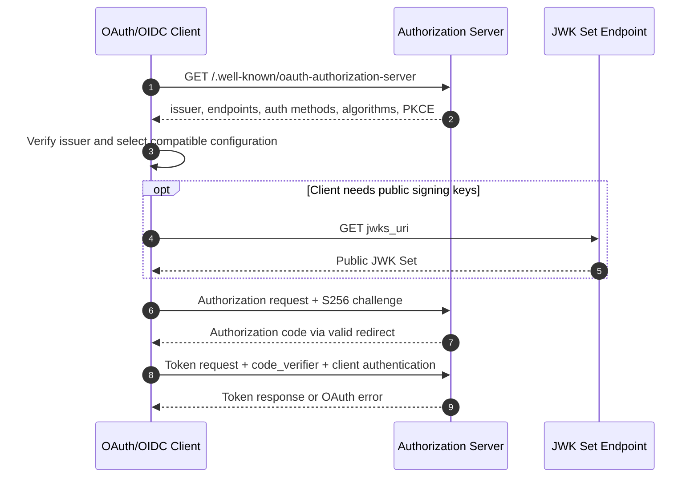
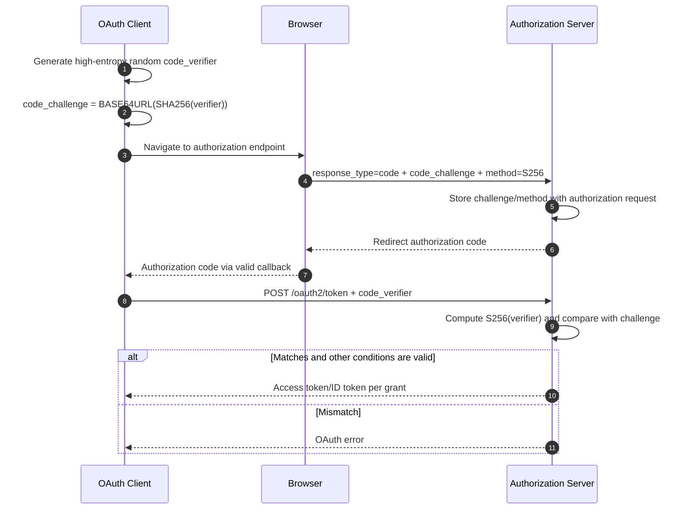
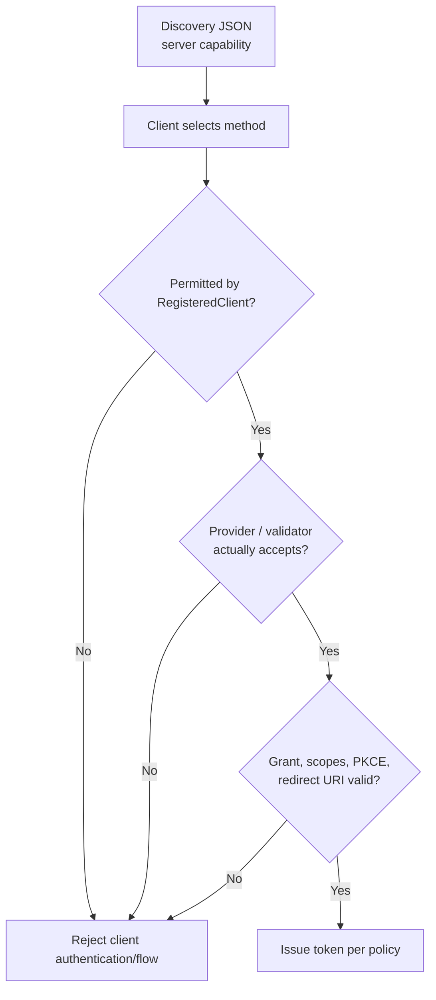

# Advertising Authentication Methods, Signing Algorithms, and PKCE Capabilities

When an OAuth 2.0 or OpenID Connect application connects to an Authorization Server, it needs to know **which endpoints the server exposes, which client authentication methods it accepts, which signing algorithms it supports, and whether it supports PKCE**. If this information lives only in manual documentation, clients and servers easily drift out of sync after a deployment or upgrade.

**Authorization Server Metadata** per RFC 8414 and **OpenID Provider Configuration** per OpenID Connect Discovery publish these capabilities as JSON at well-known addresses. Through discovery, OAuth clients can read fields such as `token_endpoint_auth_methods_supported`, `token_endpoint_auth_signing_alg_values_supported`, and `code_challenge_methods_supported` before choosing an interaction flow.

However, **metadata is an advertisement of supported capabilities, not a security policy enforcement mechanism**. A server advertising `S256` does not automatically require every client to use PKCE; a server advertising `private_key_jwt` does not mean every registered client is permitted to use that method. The backend must actually enforce what it advertises.

This lesson belongs to the **Metadata and Discovery** chapter of the **SPRING_SECURITY_OAUTH2_OIDC_AUTHORIZATION_SERVER** module, focusing on designing, configuring, securing, testing, and operating an OAuth 2.0/OpenID Connect Authorization Server with Spring Security and Spring Authorization Server in a Spring Boot application.

After this lesson, you will be able to:

- Distinguish OAuth 2.0 Authorization Server Metadata from OpenID Connect Provider Configuration.
- Interpret metadata for client authentication methods, JWT client-assertion signing algorithms, ID token signing algorithms, and PKCE.
- Understand the boundary between global capabilities advertised in metadata and permissions configured on each `RegisteredClient`.
- Configure the issuer, discovery endpoints, and metadata customizers in Spring Authorization Server.
- Register clients using `private_key_jwt` or `client_secret_basic` and enforce PKCE via `ClientSettings`.
- Test that metadata matches the actual behavior of the Authorization Endpoint and Token Endpoint.
- Plan capability changes, configure caches/proxies, and prevent clients from breaking after rollouts.

## 1. What Problem Does Discovery Solve?

Suppose a system includes:

- `login.example.com` running Spring Authorization Server.
- `portal.example.com`, an OAuth/OIDC client interacting with a browser.
- `orders-api`, a Resource Server verifying access tokens.
- Another batch client authenticating with `private_key_jwt`.

Participants should not guess that the Token Endpoint always accepts HTTP Basic, that ID tokens are always signed with `RS256`, or that PKCE always uses an arbitrary method. Discovery lets clients read the issuer's public contract.



Discovery is especially important when:

1. **Onboarding a new client:** learning whether the server supports `client_secret_basic`, `private_key_jwt`, or mTLS.
2. **Migrating to stronger authentication:** learning whether the server accepts JWT client assertions signed with the desired algorithm.
3. **Requiring PKCE:** verifying `S256` is supported so the client builds `code_challenge` and `code_verifier`.
4. **Maintaining issuer and public keys:** obtaining the exact `issuer`, `token_endpoint`, `authorization_endpoint`, and `jwks_uri`.
5. **Post-deploy contract testing:** comparing metadata across instances to prevent clients from working on node A while failing on node B.

**Note:** Discovery does not replace client registration, client authentication, or scope authorization, nor does it guarantee every grant is enabled for every client.

## 2. Two Metadata Types: OAuth 2.0 and OpenID Connect

### 2.1. OAuth 2.0 Authorization Server Metadata — RFC 8414

For the illustrative issuer `https://login.example.com`, the standard well-known URL is:

```http
GET /.well-known/oauth-authorization-server HTTP/1.1
Host: login.example.com
Accept: application/json
```

The response includes OAuth information such as `issuer`, `authorization_endpoint`, `token_endpoint`, `jwks_uri`, `grant_types_supported`, `response_types_supported`, authentication methods, and PKCE methods.

For an issuer with a path, RFC 8414 constructs the well-known URL differently from a root issuer: the well-known prefix is inserted per RFC rules rather than appended arbitrarily to the end of the URI. Always verify the actual metadata URL against the issuer and proxy configuration.

### 2.2. OpenID Connect Discovery

When OIDC is enabled, Provider Configuration is typically accessed at:

```http
GET /.well-known/openid-configuration HTTP/1.1
Host: login.example.com
Accept: application/json
```

In addition to relevant OAuth metadata, OIDC adds `userinfo_endpoint`, `subject_types_supported`, `id_token_signing_alg_values_supported`, and other OIDC fields depending on enabled features.

In OIDC, `id_token_signing_alg_values_supported` is **required** metadata indicating the algorithms the server may use to sign ID tokens. It **does not mean the same thing** as `token_endpoint_auth_signing_alg_values_supported`.

### 2.3. Comparison

| Characteristic | OAuth 2.0 AS Metadata | OIDC Provider Configuration |
| --- | --- | --- |
| Primary specification | RFC 8414 | OpenID Connect Discovery 1.0 |
| Illustrative URL for root issuer | `/.well-known/oauth-authorization-server` | `/.well-known/openid-configuration` |
| Scope | OAuth endpoints, grants, client auth, PKCE, keys | Relevant OAuth metadata plus OIDC identity authentication details |
| Client auth field | `token_endpoint_auth_methods_supported` | May advertise the corresponding field |
| JWT client auth field | `token_endpoint_auth_signing_alg_values_supported` | May advertise the corresponding field |
| PKCE field | `code_challenge_methods_supported` | May advertise the corresponding field |
| ID token signing alg | Not the focus of RFC 8414 | `id_token_signing_alg_values_supported` |
| Activation in Spring AS | Authorization Server Metadata Endpoint | Must enable OIDC via `.oidc(...)` |

Do not assume the two documents produced by Spring Authorization Server have the **exact same set of fields**. When customizing metadata, check both endpoints consumed by your clients.

## 3. Metadata Fields to Publish

Illustrative response for a deployment with Authorization Code, Client Credentials, PKCE S256, and JWT client authentication:

```json
{
  "issuer": "https://login.example.com",
  "authorization_endpoint": "https://login.example.com/oauth2/authorize",
  "token_endpoint": "https://login.example.com/oauth2/token",
  "jwks_uri": "https://login.example.com/oauth2/jwks",
  "response_types_supported": ["code"],
  "grant_types_supported": ["authorization_code", "client_credentials"],
  "token_endpoint_auth_methods_supported": [
    "client_secret_basic",
    "private_key_jwt",
    "none"
  ],
  "token_endpoint_auth_signing_alg_values_supported": ["RS256"],
  "code_challenge_methods_supported": ["S256"]
}
```

**This is illustrative JSON for a deployment configured with that contract, not guaranteed default output from Spring Authorization Server.** Values must reflect the converters/providers actually installed, per-client policies, and accepted algorithms. Advertising `none` only makes sense when the server supports public clients with proper controls—never to let confidential clients skip authentication.

| Metadata | Type | Meaning |
| --- | --- | --- |
| `issuer` | String URL | Issuer identifier for clients/resource servers to verify the token source. |
| `authorization_endpoint` | String URL | Endpoint starting the authorization flow. |
| `token_endpoint` | String URL | Endpoint exchanging codes, refreshing tokens, or using supported grants. |
| `jwks_uri` | String URL | Public JWK Set address for verifying server signatures, if present. |
| `response_types_supported` | Array of strings | Response types supported by the AS. |
| `grant_types_supported` | Array of strings | Grant types implemented by the server. |
| `token_endpoint_auth_methods_supported` | Array of strings | Client authentication methods supported at the Token Endpoint. |
| `token_endpoint_auth_signing_alg_values_supported` | Array of strings | JWS algorithms accepted for client assertion JWTs at the Token Endpoint. |
| `code_challenge_methods_supported` | Array of strings | PKCE methods supported by the Authorization Server. |
| `introspection_endpoint_auth_methods_supported` | Array of strings | Auth methods for the Token Introspection Endpoint, if published. |
| `revocation_endpoint_auth_methods_supported` | Array of strings | Auth methods for the Token Revocation Endpoint, if published. |
| `id_token_signing_alg_values_supported` | Array of strings | ID token signing algorithms in OIDC Provider Configuration. |

The three central fields here are **client authentication methods**, **client authentication signing algorithms**, and **PKCE challenge methods**. They should not be lumped into a single "supported algorithms" list because they serve three different protocol steps.

## 4. `token_endpoint_auth_methods_supported` — Client Authentication Methods

`token_endpoint_auth_methods_supported` is a JSON array listing the names of client authentication methods that the Token Endpoint can handle.

Common values:

| Value | How It Works | Notes |
| --- | --- | --- |
| `client_secret_basic` | Client ID and secret sent via HTTP Basic Authentication. | Requires TLS; store secrets securely and never log them. |
| `client_secret_post` | Client ID and secret sent in the token request form body. | Avoid if stronger alternatives fit; still requires TLS. |
| `client_secret_jwt` | Client signs a JWT assertion with a shared secret. | Must validate JWT claims, signature, expiry, audience, and replay protection. |
| `private_key_jwt` | Client signs a JWT assertion with its private key. | AS verifies using the public key/JWKS bound to the client. |
| `tls_client_auth` | Client authenticated via PKI mTLS certificate. | Certificate must be verified by the TLS stack and matched to client registration. |
| `self_signed_tls_client_auth` | Client certificate verified against a registered key/certificate. | Differs from PKI mTLS in trust/registration model. |
| `none` | Public client with no client authentication secret. | Does not make confidential clients anonymous; tokens/grants remain bound to client and policy. |

These are **protocol values**; use the exact standard strings. Never invent custom labels like `basic`, `jwt`, `mutual_tls`, or `no_auth` in standard metadata.

### 4.1. Server Support Differs from Per-Client Permission

Suppose metadata advertises:

```json
{
  "token_endpoint_auth_methods_supported": [
    "client_secret_basic",
    "private_key_jwt"
  ]
}
```

This only states that the Token Endpoint can process both methods. A client `reporting-worker` registered with `private_key_jwt` **does not automatically gain permission** to switch to `client_secret_basic` just because it appears in metadata.

In Spring Authorization Server, per-client permissions are configured in `RegisteredClient.clientAuthenticationMethods`, while validation runs through client authentication converters/providers. The server must accept a request **only when the method used is both supported by the server and registered for that specific client**.

### 4.2. Confidential Clients vs. Public Clients

- Confidential clients can hold a client secret, private key, or certificate and generally must authenticate when calling the Token Endpoint.
- Public clients, such as native apps or SPAs, cannot safely hold a secret. When configured with `none`, the client still sends its `client_id` properly and satisfies PKCE, redirect URI, code binding, and other policies.
- `none` here is a **client authentication method**, completely unrelated to `alg=none` in a JWT client assertion.

Never use metadata to bypass client authentication after a failed request. A confidential client presenting a wrong secret must be rejected, never retried with `none`.

### 4.3. RFC 8414 Defines a Default When Omitted

Under RFC 8414, if `token_endpoint_auth_methods_supported` is absent, the metadata default is `client_secret_basic`. This is an **optional-field interpretation rule**, not proof that the server implements every other client authentication method.

In systems with PKI mTLS, `private_key_jwt`, or public clients, explicitly publish the actual list so client SDKs do not misinfer. Still, never advertise an unenabled method just to make the response look "complete."

## 5. `token_endpoint_auth_signing_alg_values_supported` — JWT Client Assertion Signing Algorithms

`token_endpoint_auth_signing_alg_values_supported` is a JSON array of JWS algorithm names accepted by the Token Endpoint for verifying signatures on **JWT client assertions** in:

- `private_key_jwt`;
- `client_secret_jwt`.

Per RFC 8414 Section 2:

- If `token_endpoint_auth_methods_supported` includes `private_key_jwt` or `client_secret_jwt`, this signing algorithm field **MUST be published**.
- When the field is omitted, **no default algorithm is implied**.
- The value `none` **MUST NOT** be published.
- Servers **SHOULD** support `RS256`.

Typical algorithms include:

| Algorithm | Family | Appropriate For |
| --- | --- | --- |
| `RS256` | RSA PKCS#1 v1.5 + SHA-256 | `private_key_jwt` with RSA keys and compliant policy. |
| `PS256` | RSA-PSS + SHA-256 | `private_key_jwt` with RSA keys and compliant policy. |
| `ES256` | ECDSA P-256 + SHA-256 | `private_key_jwt` with matching EC keys. |
| `HS256` | HMAC-SHA-256 | `client_secret_jwt` with a strong shared secret and compliant policy. |

Do not assume every listed algorithm works with every method or every client. For example, `HS256` is inappropriate for a client registered solely for `private_key_jwt` with an RSA public key.

### 5.1. What Is a JWT Client Assertion Used For?

A client using `private_key_jwt` sends a request such as:

```http
POST /oauth2/token HTTP/1.1
Host: login.example.com
Content-Type: application/x-www-form-urlencoded

grant_type=client_credentials&scope=reports.read&client_id=reporting-worker&client_assertion_type=urn%3Aietf%3Aparams%3Aoauth%3Aclient-assertion-type%3Ajwt-bearer&client_assertion=<SIGNED_CLIENT_JWT>
```

The JWT assertion is signed by the **client**, not the Authorization Server. Important claims typically include issuer/subject equal to the client ID, audience targeting the Token Endpoint/AS per validation rules, a very short lifetime, and a replay-prevention identifier.

The server must verify the JWT signature using the registered client's key (or shared secret for `client_secret_jwt`) along with security claims. **Metadata only describes accepted algorithms; it does not replace JWT assertion validation.**

### 5.2. Do Not Confuse Client Signing with Authorization Server Signing

An Authorization Server might simultaneously:

- Accept `RS256` to **verify JWT client assertions** at the Token Endpoint.
- Use `ES256` to **sign ID tokens** sent to OIDC clients.
- Use `RS256` or `PS256` to **sign JWT access tokens** verified by Resource Servers.
- Advertise a separate `dpop_signing_alg_values_supported` for **DPoP proof JWTs**, if DPoP is enabled.

These four purposes are not equivalent:

| Metadata/Configuration | Signing Party | Verified Target |
| --- | --- | --- |
| `token_endpoint_auth_signing_alg_values_supported` | OAuth client | JWT client assertion at Token Endpoint |
| `id_token_signing_alg_values_supported` | OpenID Provider | OIDC ID token |
| JWT access token signing policy | Authorization Server | Access token for Resource Server |
| `dpop_signing_alg_values_supported` | OAuth client | DPoP proof JWT when implemented |

Specifically, **`jwks_uri` in issuer metadata publishes the Authorization Server's public keys**, not the keys of every client using `private_key_jwt`. Client keys are configured via client registration or a client's corresponding JWK Set URL.

### 5.3. Changing Algorithms Is a Contract Change

If metadata previously advertised `RS256` and the server suddenly accepts only `ES256`, clients that have not rotated their keys and assertion signers will receive `invalid_client`. Prepare a compatibility window, key rollout, and per-client settings before dropping old algorithms.

Never advertise `alg=none` for JWT client assertions, never trust `alg` solely because it appears in a JWT header, and never fetch keys/algorithms from untrusted URLs inside assertions.

## 6. OIDC's `id_token_signing_alg_values_supported`

In OpenID Connect Discovery, `id_token_signing_alg_values_supported` is **required** and lists the JWS signing algorithms the OpenID Provider can use to sign ID tokens.

Illustrative OIDC response:

```json
{
  "issuer": "https://login.example.com",
  "authorization_endpoint": "https://login.example.com/oauth2/authorize",
  "token_endpoint": "https://login.example.com/oauth2/token",
  "jwks_uri": "https://login.example.com/oauth2/jwks",
  "response_types_supported": ["code"],
  "subject_types_supported": ["public"],
  "id_token_signing_alg_values_supported": ["RS256"],
  "token_endpoint_auth_methods_supported": [
    "client_secret_basic",
    "private_key_jwt"
  ],
  "token_endpoint_auth_signing_alg_values_supported": ["RS256"],
  "code_challenge_methods_supported": ["S256"]
}
```

This remains an illustrative document for a specific deployment. `id_token_signing_alg_values_supported` must match the encoder/signing keys used by the Authorization Server for ID tokens; client-auth signing algorithms must match the client assertion validator.

Libraries may publish additional fields such as `claims_supported`, `scopes_supported`, `userinfo_endpoint`, and `end_session_endpoint` when those features are enabled.

When verifying an ID token, the client must verify the signature using the issuer's public JWKs, `iss`, `aud`, `exp`, `nonce` if required by the flow, and related OIDC checks. **Never use `token_endpoint_auth_signing_alg_values_supported` to configure the ID token verifier.**

## 7. `code_challenge_methods_supported` — PKCE Capabilities

Under RFC 8414, `code_challenge_methods_supported` is an optional JSON array advertising the `code_challenge_method` values supported for **Proof Key for Code Exchange (PKCE)**.

Example:

```json
{
  "code_challenge_methods_supported": ["S256"]
}
```

The two original methods in RFC 7636 are:

| Method | Challenge Derivation | Recommendation |
| --- | --- | --- |
| `S256` | `BASE64URL-ENCODE(SHA256(ASCII(code_verifier)))`, no padding. | **Preferred**; better protects the verifier against authorization request exposure. |
| `plain` | `code_challenge = code_verifier`. | Use only for legacy compatibility where policy permits; never intentionally downgrade from `S256`. |

RFC 9700 (OAuth 2.0 Security Best Current Practice) requires Authorization Servers to support PKCE and requires public clients to use PKCE in the authorization code flow. Confidential clients should also use PKCE to defend against code injection and related attacks.

### 7.1. An Authorization Code Flow Using `S256`



PKCE binds the authorization request to the token exchange; an attacker who intercepts only the authorization code without the verifier cannot exchange it for tokens.

### 7.2. Deriving the Challenge Properly

`code_verifier` must be a high-entropy random string using RFC 7636 allowed characters with length between 43 and 128 characters. For `S256`:

```text
code_challenge = BASE64URL_NOPAD(
    SHA256(ASCII(code_verifier))
)
```

Standard RFC 7636 test vector example:

```text
code_verifier:
dBjftJeZ4CVP-mB92K27uhbUJU1p1r_wW1gFWFOEjXk

code_challenge:
E9Melhoa2OwvFrEMTJguCHaoeK1t8URWbuGJSstw-cM
```

Never use usernames, session IDs, timestamps, or fixed constants as the verifier. Never send `code_verifier` in the authorization request when using `S256`; keep the verifier until the token exchange.

### 7.3. Advertising `S256` Support Differs from Enforcing PKCE Policy

These three questions are **distinct**:

1. Does the server support `S256`? — Answered by `code_challenge_methods_supported` when published accurately.
2. Which clients are required to use PKCE? — Governed by registration and authorization policy, e.g., `ClientSettings.requireProofKey(true)`.
3. Does a request carry a valid code verifier? — Enforced by the Authorization/Token Endpoint at runtime.

A metadata response with `["S256"]` **does not mean every client has `requireProofKey` enabled**. Conversely, requiring PKCE on registered clients without advertising PKCE capability in metadata makes auto-configuring clients harder.

### 7.4. Never Automatically Fall Back to `plain`

If a client supports `S256` and encounters an error due to a mismatched verifier/challenge, never retry with `plain` "just to make it work." The cause may be verifier storage bugs, wrong redirects, code reuse, or a downgrade attack.

Only advertise `plain` if the server genuinely still supports it, legacy compatibility risks are understood, and mitigations exist. Never add `plain` to metadata simply to pass a client SDK test.

## 8. Relationship Between Global Metadata and `RegisteredClient`

Metadata advertises **capabilities the Authorization Server can handle system-wide**; `RegisteredClient` defines **which capabilities a specific client is allowed to use**.

| Capability | Published in Metadata | Per-Client Configuration |
| --- | --- | --- |
| Client authentication | `token_endpoint_auth_methods_supported` | `RegisteredClient.clientAuthenticationMethod(...)` |
| JWT client assertion alg | `token_endpoint_auth_signing_alg_values_supported` | `ClientSettings.tokenEndpointAuthenticationSigningAlgorithm(...)` |
| PKCE methods | `code_challenge_methods_supported` | `ClientSettings.requireProofKey(true)` enforces PKCE; does not set an alg allowlist on its own |
| Grant types | `grant_types_supported` | `RegisteredClient.authorizationGrantType(...)` |
| Scopes | `scopes_supported` | `RegisteredClient.scope(...)` |
| Redirect URI | Authorization Server handles `authorization_endpoint` | `RegisteredClient.redirectUri(...)` |

Example of a confidential client using RSA JWT assertions and Authorization Code + PKCE:

```java
RegisteredClient client = RegisteredClient.withId("portal-record-id")
    .clientId("portal-oidc")
    .clientAuthenticationMethod(
        ClientAuthenticationMethod.PRIVATE_KEY_JWT)
    .authorizationGrantType(
        AuthorizationGrantType.AUTHORIZATION_CODE)
    .redirectUri(
        "https://portal.example.com/login/oauth2/code/login")
    .scope("openid")
    .scope("profile")
    .clientSettings(ClientSettings.builder()
        .jwkSetUrl("https://portal.example.com/.well-known/jwks.json")
        .tokenEndpointAuthenticationSigningAlgorithm(
            SignatureAlgorithm.RS256)
        .requireProofKey(true)
        .build())
    .build();
```

Imports depend on the Spring Authorization Server version; this is a registration excerpt omitting the repository, the client's private key, user authentication, and filter chains.

Explanation:

- `PRIVATE_KEY_JWT`: this client must authenticate with a JWT client assertion.
- `jwkSetUrl(...)`: URL of the **client's** public JWKs, used by the AS to verify assertions.
- `tokenEndpointAuthenticationSigningAlgorithm(RS256)`: this client's assertions must use RS256.
- `requireProofKey(true)`: this client's authorization code flow must use PKCE.
- `scope(...)` and `redirectUri(...)`: per-client policy, never inferred from global metadata.

**Never edit metadata to grant permissions to a client.** To enable `private_key_jwt` for a client, update its registration and validation. To require PKCE, update policy and test the actual flow.

## 9. Metadata Endpoints in Spring Authorization Server

In Spring Authorization Server on Spring Boot, metadata is served by filters/endpoint configurers inside the **Spring Security filter chain**, not by a hand-written application REST controller.

Key components:

| Component | Function |
| --- | --- |
| `OAuth2AuthorizationServerConfigurer` | Applies the Authorization Server's OAuth 2.0 endpoints to `HttpSecurity`. |
| `OAuth2AuthorizationServerMetadataEndpointConfigurer` | Customizes the OAuth 2.0 Authorization Server Metadata response. |
| `OAuth2AuthorizationServerMetadataEndpointFilter` | Serves RFC 8414 JSON. |
| `OidcConfigurer` | Enables OpenID Connect endpoints when configured. |
| `OidcProviderConfigurationEndpointConfigurer` | Customizes the OpenID Provider Configuration response. |
| `OidcProviderConfigurationEndpointFilter` | Serves OIDC Discovery JSON. |
| `AuthorizationServerSettings` | Defines issuer, endpoint paths, and related routing configuration. |
| `RegisteredClientRepository` | Stores per-client auth methods, grants, scopes, and settings—**not global metadata JSON**. |

### 9.1. Enabling OAuth Metadata and OIDC Discovery

The OAuth2 Authorization Server Metadata Endpoint is among the default Spring Authorization Server endpoints mapped at the well-known path. The OpenID Connect Provider Configuration Endpoint is enabled only when the application activates OIDC.

Abbreviated example:

```java
@Bean
SecurityFilterChain authorizationServerSecurityFilterChain(
        HttpSecurity http) throws Exception {

    OAuth2AuthorizationServerConfigurer authorizationServer =
        OAuth2AuthorizationServerConfigurer.authorizationServer();

    http
        .securityMatcher(authorizationServer.getEndpointsMatcher())
        .with(authorizationServer, server -> server
            .oidc(Customizer.withDefaults()));

    return http.build();
}
```

This excerpt focuses on **enabling the endpoints**. A real application also requires beans such as `RegisteredClientRepository`, `OAuth2AuthorizationService`, `JWKSource`, and `JwtDecoder` when enabling OIDC features, plus a user login security chain and proper exception handling. Do not treat this snippet as a complete application.

### 9.2. Issuer Must Be Explicit and Stable

`AuthorizationServerSettings` publishes a consistent issuer:

```java
@Bean
AuthorizationServerSettings authorizationServerSettings() {
    return AuthorizationServerSettings.builder()
        .issuer("https://login.example.com")
        .build();
}
```

When running behind a reverse proxy, the issuer in metadata must match the issuer trusted by clients and Resource Servers, never fluctuating between `http://localhost:9000` and `https://login.example.com` across nodes.

When the issuer contains a path, use compliant RFC/discovery configuration rather than manually concatenating incorrect well-known paths. Test both `/.well-known/oauth-authorization-server` and `/.well-known/openid-configuration` against the real issuer.

### 9.3. JWKS and Discovery Are Related but Not the Same Endpoint

Metadata's `jwks_uri` points to the Authorization Server's public JWK Set. Metadata itself contains no private keys and does not prove which client owns a key used for `private_key_jwt`.

In Spring Authorization Server, the JWK Set endpoint is configured when an appropriate `JWKSource<SecurityContext>` exists. Never publish a `jwks_uri` pointing to an inactive endpoint or returning private JWK material.

## 10. Customizing Metadata Fields with the Spring Authorization Server API

Spring Authorization Server exposes two distinct extension points:

- OAuth: `authorizationServerMetadataEndpoint(...).authorizationServerMetadataCustomizer(...)`.
- OIDC: `oidc(...).providerConfigurationEndpoint(...).providerConfigurationCustomizer(...)`.

The builders typically offer typed methods such as:

- `tokenEndpointAuthenticationMethod(...)` or `tokenEndpointAuthenticationMethods(...)`;
- `codeChallengeMethod(...)` or `codeChallengeMethods(...)`;
- `idTokenSigningAlgorithm(...)` or `idTokenSigningAlgorithms(...)` on the OIDC builder;
- `claim(name, value)` for extension metadata or fields without a typed setter.

### 10.1. Controlled Customizer Example

Suppose the deployment actually implements PKCE `S256`, JWT client authentication accepting RS256 for `private_key_jwt` and HS256 for `client_secret_jwt`, and an ID token signer using only RS256.

```java
package com.example.authserver.config;

import java.util.List;

import org.springframework.context.annotation.Bean;
import org.springframework.context.annotation.Configuration;
import org.springframework.core.annotation.Order;
import org.springframework.security.config.annotation.web.builders.HttpSecurity;
import org.springframework.security.oauth2.server.authorization.config.annotation.web.configurers.OAuth2AuthorizationServerConfigurer;
import org.springframework.security.web.SecurityFilterChain;

@Configuration(proxyBeanMethods = false)
class AuthorizationServerDiscoveryConfig {

    private static final List<String> CLIENT_ASSERTION_ALGORITHMS =
        List.of("RS256", "HS256");

    @Bean
    @Order(1)
    SecurityFilterChain authorizationServerSecurityFilterChain(
            HttpSecurity http) throws Exception {

        OAuth2AuthorizationServerConfigurer authorizationServer =
            OAuth2AuthorizationServerConfigurer.authorizationServer();

        http
            .securityMatcher(authorizationServer.getEndpointsMatcher())
            .with(authorizationServer, server -> server
                .authorizationServerMetadataEndpoint(endpoint ->
                    endpoint.authorizationServerMetadataCustomizer(metadata -> {
                        metadata.codeChallengeMethods(methods -> {
                            if (!methods.contains("S256")) {
                                methods.add("S256");
                            }
                        });
                        metadata.claim(
                            "token_endpoint_auth_signing_alg_values_supported",
                            CLIENT_ASSERTION_ALGORITHMS);
                    }))
                .oidc(oidc ->
                    oidc.providerConfigurationEndpoint(endpoint ->
                        endpoint.providerConfigurationCustomizer(metadata -> {
                            metadata.codeChallengeMethods(methods -> {
                                if (!methods.contains("S256")) {
                                    methods.add("S256");
                                }
                            });
                            metadata.claim(
                                "token_endpoint_auth_signing_alg_values_supported",
                                CLIENT_ASSERTION_ALGORITHMS);
                            metadata.idTokenSigningAlgorithms(algorithms -> {
                                algorithms.clear();
                                algorithms.add("RS256");
                            });
                        }))));

        return http.build();
    }
}
```

**Warning before copying:** this example only demonstrates how to write metadata customizers; it does not configure client authentication providers, JWT assertion validators, the ID token encoder, or the PKCE validator. `CLIENT_ASSERTION_ALGORITHMS` and `["RS256"]` are accurate only when your deployment's runtime configuration actually accepts those exact algorithms. If the application does not support HS256, do not advertise HS256. If the ID token signer uses ES256, update the OIDC metadata accordingly.

Do not wipe out default authentication methods on the metadata builder as a shortcut for "security configuration" via JSON. To genuinely disable an authentication method, change the underlying converters/providers, registration policies, and runtime tests, then narrow metadata to match.

### 10.2. Why Use `claim(...)` for JWT Client Signing Algorithms?

In the Spring Authorization Server 1.5.x API, metadata builders expose typed methods for `tokenEndpointAuthenticationMethods(...)` and `codeChallengeMethods(...)`. To publish `token_endpoint_auth_signing_alg_values_supported` when no matching typed builder method is available, you can use:

```java
metadata.claim(
    "token_endpoint_auth_signing_alg_values_supported",
    List.of("RS256", "HS256")
);
```

This customizes JSON metadata only; **it does not enable RS256 or HS256 in the client assertion decoder**. Verify `ClientSettings.tokenEndpointAuthenticationSigningAlgorithm(...)` and how the provider validates JWT assertions so you do not misadvertise.

### 10.3. Appending to vs. Replacing a List

These two operations are not equivalent:

```java
// Add S256 if not present, without removing existing methods.
metadata.codeChallengeMethods(methods -> {
    if (!methods.contains("S256")) {
        methods.add("S256");
    }
});
```

```java
// Use only when the backend ACTUALLY restricts to this exact method.
metadata.codeChallengeMethods(methods -> {
    methods.clear();
    methods.add("S256");
});
```

Advertising `["S256"]` while the backend still accepts `plain` leaves an incomplete contract; conversely, advertising `plain` when the backend rejects it causes client SDKs to pick the wrong option. The rule is: metadata must tell the truth, not try to "command" the backend.

### 10.4. Metadata for Introspection and Revocation

If the deployment exposes `/oauth2/introspect` and `/oauth2/revoke`, also check:

- `introspection_endpoint_auth_methods_supported`;
- `revocation_endpoint_auth_methods_supported`;
- JWT client authentication algorithm fields for each endpoint if required by the standards/profiles your deployment targets.

Do not assume all three endpoints accept identical authentication methods. For instance, a Resource Server might call introspection with `client_secret_basic` while Token Endpoint clients use `private_key_jwt`. Adding a method at the Token Endpoint does not configure the other endpoints automatically.

### 10.5. Version Differences Between Spring Authorization Server and Spring Security 7

Java snippets in this lesson use **Spring Authorization Server 1.5.x** APIs and imports. Starting with **Spring Security 7**, Authorization Server capabilities are integrated directly into Spring Security and the package for `OAuth2AuthorizationServerConfigurer` moves to `org.springframework.security.config.annotation.web.configurers.oauth2.server.authorization`. Configuration via `HttpSecurity.oauth2AuthorizationServer(...)` must also be checked against that version's documentation.

When upgrading, verify **the exact dependency version in your project**, available metadata builders/configurers, and live outputs from both discovery endpoints; never mechanically update package imports and assume metadata emission stayed identical.


## 11. Public Metadata Does Not Mean Any Client Can Use Everything

An attacker can read discovery JSON just like any legitimate client. That is completely normal: metadata describes the public protocol, not secret credentials.

Meanwhile, the server continues enforcing security boundaries:



**Example:** the server supports `client_secret_basic` and `private_key_jwt`. Client `reporting-worker` is registered solely for `private_key_jwt`. When it sends Basic credentials, client authentication must be rejected even though Basic is advertised server-wide in metadata.

For PKCE, if a registered client requires a proof key, an authorization code request missing a challenge must be rejected; having `S256` in metadata does not enforce that check on its own.

### 11.1. Never Use Discovery JSON as an Authorization Decision Source

Each service must still validate access tokens for issuer, audience, signature/expiry, and API policy. `jwks_uri` only provides the issuer's public keys; it does not mean every access token signed with those keys is accepted by every Resource Server.

### 11.2. Never Trust Metadata URLs from Arbitrary Sources

Clients must know the expected issuer via configuration/trust store before calling discovery. Accepting an issuer URL from a user request, unverified token, or untrusted input and fetching metadata/JWKS from it exposes the system to SSRF, rogue issuer spoofing, or internal network probing.

Avoid:

- Blindly following discovery redirects from HTTPS to HTTP.
- Trusting a returned issuer that differs from the configured issuer without verification.
- Using staging metadata to verify production tokens.
- Allowing unrestricted remote JWKS URIs not bound to the issuer/configuration.
- Caching metadata for multiple issuers under a shared key without isolating by issuer.

## 12. Verifying Metadata with `curl` and `jq`

Before configuring a client SDK, inspect the live endpoints from the client's real network/TLS context.

### 12.1. Reading OAuth 2.0 Metadata

```bash
curl --fail --silent --show-error \
  --header 'Accept: application/json' \
  'https://login.example.com/.well-known/oauth-authorization-server' \
  | jq '{
      issuer,
      authorization_endpoint,
      token_endpoint,
      token_endpoint_auth_methods_supported,
      token_endpoint_auth_signing_alg_values_supported,
      code_challenge_methods_supported
    }'
```

Check:

- `issuer` matches strictly, including scheme, host, and path if any.
- `token_endpoint` uses HTTPS and targets the right environment.
- Auth methods match client authentication converters/providers.
- If JWT client authentication is advertised, signing algorithms are present and exclude `none`.
- PKCE methods list only actually supported methods.

### 12.2. Reading OIDC Provider Configuration

```bash
curl --fail --silent --show-error \
  'https://login.example.com/.well-known/openid-configuration' \
  | jq '{
      issuer,
      jwks_uri,
      token_endpoint_auth_methods_supported,
      token_endpoint_auth_signing_alg_values_supported,
      id_token_signing_alg_values_supported,
      code_challenge_methods_supported
    }'
```

If the OIDC endpoint returns 404, verify that OIDC is enabled via `.oidc(...)`, the request matches the issuer/path, and proxies/security matchers route the endpoint properly. **Do not enable OIDC solely to silence an OAuth-only client error** if the product does not need OIDC; use OAuth AS metadata instead.

### 12.3. Automated Assertion for Issuer and PKCE S256

```bash
curl --fail --silent --show-error \
  'https://login.example.com/.well-known/oauth-authorization-server' \
  | jq --exit-status --arg issuer 'https://login.example.com' '
      .issuer == $issuer
      and (.code_challenge_methods_supported | type == "array")
      and (.code_challenge_methods_supported | index("S256") != null)
    '
```

The command exits nonzero if metadata fails the assertion. Distinguish **unreachable endpoint** from **JSON missing a field**; `curl --fail` and `jq --exit-status` help pipelines catch errors, while safely capturing response bodies/headers aids diagnosis.

### 12.4. Verifying the No-`none` Signing Algorithm Rule

```bash
curl --fail --silent --show-error \
  'https://login.example.com/.well-known/oauth-authorization-server' \
  | jq --exit-status '
      (.token_endpoint_auth_methods_supported // []) as $methods
      | if ($methods | index("private_key_jwt") != null
                or index("client_secret_jwt") != null)
        then
          (.token_endpoint_auth_signing_alg_values_supported | type == "array")
          and (.token_endpoint_auth_signing_alg_values_supported | length > 0)
          and (.token_endpoint_auth_signing_alg_values_supported
               | index("none") == null)
        else true end
    '
```

This is a contract-check example: verify `jq` syntax in your CI environment first, and complement it with per-algorithm tests using valid and invalid client assertions. Well-formed JSON alone does not prove the provider verifies signatures securely.

## 13. Behavioral Testing: Metadata Must Match Runtime

Reading JSON alone is insufficient. A system might advertise `S256` without validating `code_verifier`, or advertise `private_key_jwt` while missing a decoder or client key.

### 13.1. Metadata Test Matrix

| Scenario | Expected |
| --- | --- |
| GET OAuth metadata over HTTPS | Returns valid JSON; `issuer` and endpoint URLs consistent. |
| GET OIDC configuration when OIDC enabled | Includes `id_token_signing_alg_values_supported` and required OIDC fields. |
| GET OIDC when OIDC disabled | Does not pretend OIDC exists; OAuth metadata still works. |
| `private_key_jwt` advertised | Non-empty `token_endpoint_auth_signing_alg_values_supported`, no `none`. |
| Server supports only RS256 for JWT assertions | Metadata does not advertise ES256/HS256 as implemented options. |
| Server has public clients | `none` advertised only when matching public-client handling exists. |
| Client registered as `PRIVATE_KEY_JWT` sends Basic | Rejected even though Basic is in server-wide metadata. |
| Client `PRIVATE_KEY_JWT` sends valid RS256 assertion | Authenticated when all claims/key/policy checks pass. |
| JWT assertion payload altered with old signature | Rejected. |
| JWT assertion uses `alg=none` | Rejected. |
| Expired assertion or wrong audience | Rejected. |
| Authorization Code request with valid `S256` | Receives code when other conditions are valid. |
| Token exchange with matching verifier | Exchanges unused code for tokens. |
| Token exchange with wrong verifier | Rejected; no tokens issued. |
| Public client requires PKCE, request omits challenge | Authorization request rejected per policy. |
| Only `S256` advertised, client sends `plain` | Behavior matches published policy; test catches drift. |
| Same issuer, two instances return different method lists | CI/canary alerts on inconsistent metadata. |
| `jwks_uri` errors or points to wrong environment | Discovery integration test fails. |
| Metadata behind reverse proxy returns internal issuer | Test catches URL/issuer mismatch. |

### 13.2. Integration Testing with MockMvc

In Spring Boot, you can use `MockMvc` to call the metadata endpoint through the real filter chain. Contract-check excerpt:

```java
@SpringBootTest
@AutoConfigureMockMvc
class AuthorizationServerMetadataTests {

    @Autowired
    MockMvc mockMvc;

    @Test
    void publishesS256AndCorrectIssuer() throws Exception {
        mockMvc.perform(get(
                "/.well-known/oauth-authorization-server"))
            .andExpect(status().isOk())
            .andExpect(jsonPath("$.issuer")
                .value("https://login.example.com"))
            .andExpect(jsonPath("$.code_challenge_methods_supported")
                .isArray())
            .andExpect(jsonPath(
                "$.code_challenge_methods_supported[0]")
                .value("S256"));
    }
}
```

This is an illustrative test requiring proper imports/test configuration and issuer/filter chain setup. If a deployment advertises multiple PKCE methods or order is not fixed, **do not assert `S256` is at index 0**. Assert array membership containing `S256` instead so the test does not depend on element ordering.

Supplement with live HTTP tests through the reverse proxy or canary environment to verify client-visible URLs, since internal `MockMvc` does not catch every forwarded-header or CDN issue.

### 13.3. Important Negative Tests

- JWT assertion signed with a disallowed algorithm whose `alg` name is otherwise valid.
- JWT assertion with wrong issuer/subject/audience, replayed `jti`, or expired `exp`.
- A registered client attempting to use another client's authentication method.
- Authorization Code + PKCE with wrong or missing verifier.
- Request declaring an unsupported `code_challenge_method`.
- Metadata advertising `S256` while the backend fails to validate PKCE.
- Metadata advertising an RSA algorithm while client JWKS lacks a matching key.
- OIDC `id_token_signing_alg_values_supported` differing from the actual ID token's signing algorithm.

Notably, **an error code from the Token Endpoint does not immediately pinpoint wrong metadata**. For example, `invalid_client` can stem from a bad client secret, JWT assertion, client registration, or algorithm mismatch. Inspect metadata, registrations, and credential-redacted security logs together.

## 14. Common Deployment Mistakes

### 14.1. Metadata Advertises `private_key_jwt` Yet Client Gets `invalid_client`

Verify `RegisteredClient` has `PRIVATE_KEY_JWT`, `ClientSettings.jwkSetUrl` points to the client's public JWKS URL, the JWKS contains the right key/`kid`, per-client signing algorithm is set properly, and the JWT assertion carries valid `iss`/`sub`/`aud`/`exp`/`jti` claims.

Never "fix" this by disabling signature verification or falling back to `client_secret_basic` if the client is not registered for it.

### 14.2. `id_token_signing_alg_values_supported` Mismatches Real ID Tokens

Check `JWKSource`, `JwtEncoder`, `JwtGenerator`, `JwsHeader` customization, and key selector configuration. Metadata must reflect the algorithm the ID token generator actually emits, not the algorithms accepted by the client assertion verifier.

### 14.3. Client Uses `plain` Despite Metadata Advertising `S256`

Check SDK version, verifier/challenge generation code, whether the authorization request sends `code_challenge_method=S256`, and whether backend policy actually rejects `plain`. If policy requires S256-only, verify rejection in the authorization provider; editing metadata alone is not enough.

### 14.4. Missing `code_challenge_methods_supported`

RFC 8414 defines this field as OPTIONAL, yet omitting it can prevent SDKs from detecting PKCE support. Inspect the metadata builder, OIDC configuration builder, and Spring Authorization Server version.

Do not conclude a server lacks PKCE support solely from an omitted field; verify the flow and deployment contract. Still, for deployments requiring PKCE, explicitly advertise `S256` so clients auto-configure safely.

### 14.5. OAuth Metadata Is Right, OIDC Discovery Is Missing Fields

The two endpoints have separate customizers. Adding a field only to `authorizationServerMetadataCustomizer` does not add it to OIDC Provider Configuration. Update `providerConfigurationCustomizer` or the underlying OIDC generator configuration, then test both endpoints.

### 14.6. Some Clients Break After Enabling mTLS or Changing Signing Algorithms

Metadata may have changed ahead of backend/client registrations, client assertion algs may have shifted, or the proxy may not forward client certificates. Roll out in stages: enable the new capability on the backend first, test it, update metadata, migrate clients, and only then retire the old capability.

### 14.7. 404 at `/.well-known/openid-configuration`

Check whether OIDC is enabled and the issuer URL is accurate. An OAuth Authorization Server is not required to implement OIDC; the RFC 8414 endpoint can exist independently. If OIDC is enabled yet 404s behind a proxy, inspect context path, routes, and filter chain security matchers.

### 14.8. Stale Cached Metadata After Deployment

CDNs, reverse proxies, or clients may cache discovery JSON. When adding a method, stale caches hide the new capability. When removing an old method, stale caches cause clients to keep using the removed method. Establish clear `Cache-Control`/TTL, rollback, and overlap policies.

## 15. Changing Metadata in Production Operations

Discovery is a public contract shared with many OAuth clients. Changing a single list item can become a **breaking change** even when the server's Java API stays untouched.

### 15.1. Rolling Out `private_key_jwt`

A safe rollout plan:

1. Prepare key management, JWK Set URLs, or client public key registration.
2. Enable and test `private_key_jwt` in client authentication converters/providers.
3. Register a pilot client with `PRIVATE_KEY_JWT` and the appropriate signing algorithm.
4. Test JWT client assertions with valid/invalid signatures, audience, expiry, and replay.
5. Advertise `private_key_jwt` and actually supported signing algorithms in metadata.
6. Migrate a cohort of clients to assertion signing; monitor `invalid_client` rates and key-verification latency.
7. Expand rollout, removing secret-based methods only after corresponding clients have migrated.

**Never advertise first and build the provider later.** Client SDKs may automatically pick the newly advertised method as soon as they read metadata.

### 15.2. Rolling Out Mandatory PKCE `S256`

1. Verify Authorization/Token Endpoints handle `S256` properly.
2. Update SDKs/clients to generate high-entropy verifiers and store them securely across requests.
3. Enable `ClientSettings.requireProofKey(true)` for public clients and applicable confidential clients.
4. Advertise `code_challenge_methods_supported` containing `S256` on all discovery endpoints clients use.
5. Test missing/wrong challenges, missing/wrong verifiers, and code reuse.
6. Monitor `invalid_request`/`invalid_grant` errors around rollout.
7. If retiring `plain`, enforce rejection at runtime first or coordinate with metadata updates—never merely delete `plain` from JSON.

### 15.3. Rolling Out ID Token Signing Algorithms

Changing `id_token_signing_alg_values_supported` must be coordinated with signing keys/JWKS, OIDC client decoders, JWKS caches, and key rotation. Never remove old public keys from JWKS before existing unexpired ID tokens finish needing verification, except during key-compromise incidents.

Good practice keeps old algorithm support during a reasonable overlap window, upgrades clients, monitors active keys/algorithms, and only then retires the old algorithm.

### 15.4. Observing Drift Between Metadata and Runtime

Metrics and events to collect:

| Observation | Signal to Watch |
| --- | --- |
| `invalid_client` rate by method | An advertised method is actually failing in bulk. |
| JWT client assertion failures by alg | Clients pick an algorithm mismatching metadata/registration. |
| PKCE missing/mismatch failures | Clients have not switched to S256 or mis-store verifiers. |
| Discovery endpoint 4xx/5xx | Metadata unavailable during client onboarding/startup. |
| Metadata hash/version per AS instance | Instances are advertising inconsistent capabilities. |
| JWKS fetch failures | Issuer signing keys unavailable to verifiers. |
| Discovery response cache age | CDNs/clients still see stale capabilities post-deploy. |

Avoid using raw client secrets, client JWT assertions, access tokens, authorization codes, or verifiers as metric labels or log fields. For client IDs, manage cardinality and log access per policy.

## 16. Checklist for Secure and Compliant Metadata Publication

- [ ] Explicit `AuthorizationServerSettings.issuer` consistent across proxy, metadata, and tokens.
- [ ] RFC 8414 endpoint works at the well-known URL matching the issuer.
- [ ] OIDC Provider Configuration enabled and tested when the app genuinely implements OIDC.
- [ ] `token_endpoint_auth_methods_supported` contains only methods supported by the Token Endpoint.
- [ ] Individual clients remain constrained by `RegisteredClient.clientAuthenticationMethods`.
- [ ] Confidential clients never fall back to public `none` on authentication errors.
- [ ] When `private_key_jwt`/`client_secret_jwt` are advertised, `token_endpoint_auth_signing_alg_values_supported` is present and non-empty.
- [ ] `none` never appears in JWT client assertion signing algorithms.
- [ ] JWT client assertion algorithm list matches provider validation and per-client signing policy.
- [ ] OIDC `id_token_signing_alg_values_supported` matches the real ID token signer, not confused with client assertion algs.
- [ ] `jwks_uri` points to the issuer's public JWK Set with no private keys.
- [ ] `code_challenge_methods_supported` advertises PKCE methods actually supported by the server.
- [ ] `S256` is preferred; clients never auto-downgrade to `plain` after S256 errors.
- [ ] Clients needing PKCE have `ClientSettings.requireProofKey(true)` enabled and backend verifier checks active.
- [ ] OAuth metadata and OIDC provider configuration customizers are configured separately as needed.
- [ ] Metadata customization is never used in place of authentication providers, token validation, or registration policy.
- [ ] Introspection/revocation authentication methods are accurately published if those endpoints are active.
- [ ] HTTPS, issuer pinning, and well-known URLs are validated to prevent SSRF/issuer substitution.
- [ ] CI checks JSON schema, issuer, algorithms, PKCE fields, and JWT client-auth constraints.
- [ ] Integration tests cover `private_key_jwt`, `client_secret_basic`, wrong method, missing/wrong PKCE, and wrong JWT alg.
- [ ] Multi-instance and reverse-proxy setups return consistent metadata; cache/TTL/rollout are managed.
- [ ] No credentials, private keys, runtime secrets, or user data appear in metadata.
- [ ] Compatibility documentation and rollout plans exist before retiring old auth methods or algorithms.

**Remember:** `token_endpoint_auth_methods_supported` describes **how clients can authenticate**; `token_endpoint_auth_signing_alg_values_supported` describes **algorithms for verifying JWT client assertion signatures**; `code_challenge_methods_supported` describes **PKCE methods supported by the Authorization Server**. `id_token_signing_alg_values_supported` is a separate algorithm set for **ID tokens signed by the OpenID Provider**. Everything advertised must match the actual backend and each client's registration; discovery does not enforce security by itself.

## 17. References

- [RFC 8414 — OAuth 2.0 Authorization Server Metadata](https://www.rfc-editor.org/rfc/rfc8414.html): metadata fields, default rules, and well-known endpoint.
- [OpenID Connect Discovery 1.0](https://openid.net/specs/openid-connect-discovery-1_0.html): OpenID Provider Configuration and `id_token_signing_alg_values_supported`.
- [OpenID Connect Core 1.0](https://openid.net/specs/openid-connect-core-1_0.html): ID tokens, client authentication, and validation.
- [RFC 7636 — Proof Key for Code Exchange](https://www.rfc-editor.org/rfc/rfc7636.html): `code_verifier`, `code_challenge`, `S256`, and `plain`.
- [RFC 9700 — Best Current Practice for OAuth 2.0 Security](https://www.rfc-editor.org/rfc/rfc9700.html): PKCE requirements and downgrade prevention.
- [RFC 7523 — JWT Profile for OAuth 2.0 Client Authentication and Authorization Grants](https://www.rfc-editor.org/rfc/rfc7523.html): JWT client assertions and validation.
- [RFC 7591 — OAuth 2.0 Dynamic Client Registration](https://www.rfc-editor.org/rfc/rfc7591.html): `token_endpoint_auth_method` and client metadata.
- [Spring Authorization Server — Protocol Endpoints](https://docs.spring.io/spring-authorization-server/reference/protocol-endpoints.html): `OAuth2AuthorizationServerMetadataEndpointConfigurer` and `OidcProviderConfigurationEndpointConfigurer`.
- [Spring Authorization Server — Configuration Model](https://docs.spring.io/spring-authorization-server/reference/configuration-model.html): issuer, default endpoints, and OIDC configuration.
- [Spring Authorization Server — Metadata Builder API](https://docs.spring.io/spring-authorization-server/reference/api/java/org/springframework/security/oauth2/server/authorization/AbstractOAuth2AuthorizationServerMetadata.AbstractBuilder.html): typed setters for methods, PKCE, and `claim(...)`.
- [Spring Authorization Server — OIDC Provider Configuration Builder API](https://docs.spring.io/spring-authorization-server/reference/api/java/org/springframework/security/oauth2/server/authorization/oidc/OidcProviderConfiguration.Builder.html): `idTokenSigningAlgorithm(...)`.
- [Spring Authorization Server — ClientSettings.Builder API](https://docs.spring.io/spring-authorization-server/reference/api/java/org/springframework/security/oauth2/server/authorization/settings/ClientSettings.Builder.html): `requireProofKey` and `tokenEndpointAuthenticationSigningAlgorithm`.
- [IANA OAuth Parameters Registry](https://www.iana.org/assignments/oauth-parameters): registered auth method names, code challenge methods, and parameter values.
