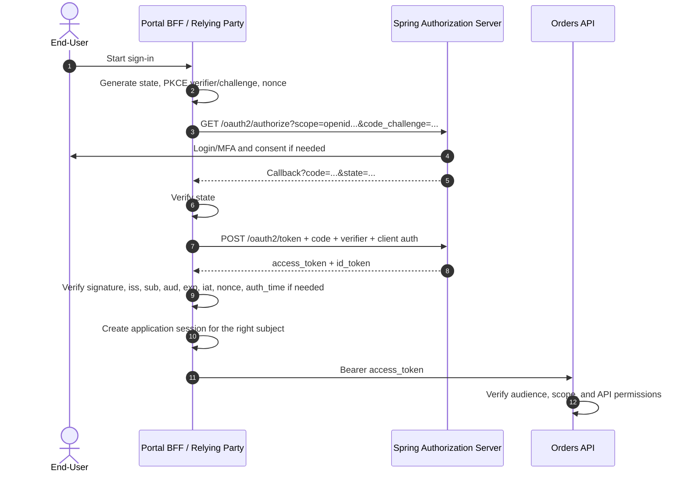
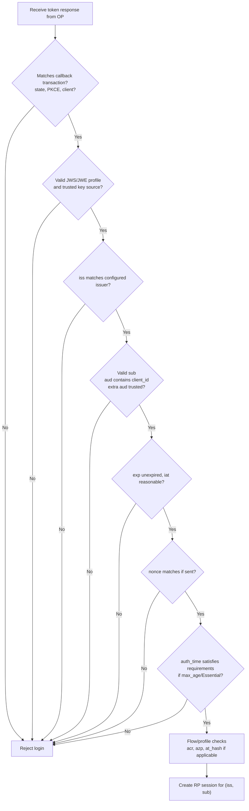
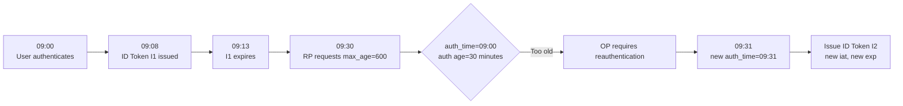

# ID Token and the iss, sub, aud, exp, iat, auth_time Claims

**OpenID Connect (OIDC)** adds a user identity authentication layer on top of OAuth 2.0. In OAuth 2.0, an access token mainly enables a client to access protected resources; it is not standardized evidence for an application to conclude **who just signed in, via which identity provider, and at what time**. OIDC introduces the **ID Token** to represent those core facts of the authentication event.

An ID Token is a **JSON Web Token (JWT)** issued by the OpenID Provider (OP)—here, **Spring Authorization Server**—to the **Relying Party (RP)**, i.e., the OIDC client. The RP must verify the signature and the claims binding the token to the **issuer, subject, receiving client, and authentication time**. An ID Token containing `iss`, `sub`, `aud`, `exp`, and `iat` is not automatically safe: **their values must be accurate and validated against the transaction context**.

This lesson belongs to the **OIDC Core and ID Token** chapter of the **SPRING_SECURITY_OAUTH2_OIDC_AUTHORIZATION_SERVER** module. The overall goal is to learn how to design, configure, secure, test, and operate an OAuth 2.0/OpenID Connect Authorization Server with Spring Security and Spring Authorization Server in a Spring Boot application. The focus here is the **meaning, appearance conditions, issuance, and validation of six claims**: `iss`, `sub`, `aud`, `exp`, `iat`, and `auth_time`.

> **Quick memory rule:** `iss` tells **who issued it**, `sub` tells **which user**, `aud` tells **which client may accept it**, `exp` tells **when the token expires**, `iat` tells **when the ID Token was issued**, and `auth_time` tells **when the user actually authenticated**.

**Technical scope:** Content follows OpenID Connect Core 1.0 (Errata Set 2) and commonly used APIs of Spring Authorization Server 1.5.x / Spring Security 6.x in Spring Boot 3.x. Newer versions may differ in APIs/configuration; verify against your deployed version. This lesson prioritizes the **Authorization Code Flow + PKCE**; hybrid/implicit flows have additional rules and should not be inferred from code flow examples.

## 1. ID Tokens Are for Authentication, Not Access Tokens

### 1.1. Actors and Roles

| Role | Example | Responsibility |
|---|---|---|
| **End-User** | Employee accessing the Portal | Authenticates via the OP |
| **OpenID Provider (OP)** | `https://login.example.com` | Authenticates users, issues ID Tokens, publishes metadata/JWKS |
| **Relying Party (RP)** | `portal-bff` | Initiates login, validates ID Tokens, creates application sessions |
| **OAuth client** | The RP `portal-bff` itself | Holds client ID, authenticates at the token endpoint when appropriate |
| **Resource Server** | Orders API | Verifies **access tokens** and API permissions |
| **Browser** | Employee's browser | Goes through login, consent, and callback |

The ID Token is **consumed by the RP** to verify sign-in. The Orders API should never accept an ID Token as a Bearer credential just because it is also a JWT with a valid signature.

### 1.2. Comparing the Three Token Types

| Token | Purpose | Typical Audience | Where Is It Sent? |
|---|---|---|---|
| **ID Token** | Asserts End-User authentication info for the RP | RP's `client_id` | From OP to RP, usually via token response |
| **Access Token** | Authorizes calling APIs/Resource Servers | API/resource identifier per profile | Client sends to API |
| **Refresh Token** | Requests new tokens under a granted authorization | Intended for the Token Endpoint/authorization context | Client sends to OP, never to APIs |

Never use `sub` in an ID Token as a substitute for `scope`, tenant authorization, or operation permission checks. The RP may know who the user is, but that **does not automatically grant permission** to read all of that user's orders.

### 1.3. When Does the ID Token Appear?

In the OIDC Authorization Code Flow, the client requests the `openid` scope at the Authorization Endpoint. After the user signs in and completes authorization, the RP receives an **authorization code** via callback, exchanges the code at the Token Endpoint, and receives an **ID Token** alongside the access token if the request is valid.



**Never create an RP session before the ID Token passes validation.** A token that is only Base64URL-decoded to inspect the payload without verifying its signature and claims is **not** trustworthy proof of login.

## 2. ID Token Structure and the Six Core Claims

### 2.1. Illustrative JSON

A signed ID Token typically has the three-part JWS Compact Serialization format:

```text
BASE64URL(JWS_HEADER).BASE64URL(PAYLOAD).BASE64URL(SIGNATURE)
```

**Illustrative** decoded payload (not a real token usable in production):

```json
{
  "iss": "https://login.example.com",
  "sub": "user-8b3a",
  "aud": "portal-bff",
  "exp": 1795003600,
  "iat": 1795000000,
  "auth_time": 1794999700,
  "nonce": "n-0S6_WzA2Mj",
  "acr": "urn:example:loa:2",
  "amr": ["pwd", "otp"]
}
```

The numeric timestamps only illustrate relationships between claims, not a claim that this token is currently valid. In production, the OP uses actual UTC time and a managed signing key.

### 2.2. Required and Conditional

| Claim | Required by OIDC Core? | JSON Type | Meaning |
|---|---|---|---|
| `iss` | **REQUIRED** | String | Issuer Identifier of the OP |
| `sub` | **REQUIRED** | String | Subject Identifier of the End-User at the issuer |
| `aud` | **REQUIRED** | String or array of strings | Audience(s); must contain the RP's `client_id` |
| `exp` | **REQUIRED** | Number (NumericDate) | Time after which the ID Token must no longer be accepted |
| `iat` | **REQUIRED** | Number (NumericDate) | Time at which the ID Token was issued |
| `auth_time` | **CONDITIONAL** | Number (NumericDate) | Time of user authentication; **required** when `max_age` is sent or `auth_time` is requested as an Essential Claim |

Beyond these six claims, `nonce`, `azp`, `acr`, `amr`, and other claims may appear depending on the transaction/profile. Do not treat them as the same field or as default conditions for every flow.

### 2.3. NumericDate Is Not Milliseconds

`exp`, `iat`, and `auth_time` are numbers of seconds since `1970-01-01T00:00:00Z`. Java's `Instant.getEpochSecond()` returns this unit; `System.currentTimeMillis()` returns **milliseconds** and must never be assigned directly to a NumericDate.

```java
Instant issuedAt = Instant.now();

long iat = issuedAt.getEpochSecond();
long exp = issuedAt.plusSeconds(300).getEpochSecond();

// Wrong: millisecond value, roughly 1000x larger than the correct epoch seconds.
long wrongIat = System.currentTimeMillis();
```

When an ID Token has an `iat` roughly 1000 times larger than the current timestamp, there is usually a milliseconds bug. Test data types and time conversions before placing values into a JWT.

## 3. The iss Claim: Identifying the OpenID Provider That Issued the Token

### 3.1. Issuer Semantics

`iss` is the **Issuer Identifier** of the OP. Per OIDC Core, it is a case-sensitive URL using the `https` scheme, containing a host and optionally a port/path; **it contains no query or fragment components**. For example:

```text
iss = https://login.example.com
```

The RP must compare `iss` in the ID Token against the **trusted, configured/discovered issuer**. The following two issuers are **not equivalent just because they share a host**:

```text
https://login.example.com
https://login.example.com/tenant/acme
```

In multi-tenant systems, path/hostname may distinguish tenants/issuers; accepting another tenant's token by ignoring `iss` causes identity mix-ups.

### 3.2. Issuer Discovery and Metadata

The RP can fetch metadata via OIDC Discovery, e.g., `https://login.example.com/.well-known/openid-configuration` when the issuer/settings match. Metadata publishes `issuer`, `authorization_endpoint`, `token_endpoint`, `jwks_uri`, and supported capabilities.

```json
{
  "issuer": "https://login.example.com",
  "authorization_endpoint": "https://login.example.com/oauth2/authorize",
  "token_endpoint": "https://login.example.com/oauth2/token",
  "jwks_uri": "https://login.example.com/oauth2/jwks"
}
```

This is **abbreviated metadata**, not a full discovery response. The RP must cross-check the metadata's `issuer` with the token's `iss`. Never read `iss` from an unverified token and arbitrarily connect to an attacker-specified JWKS URL.

### 3.3. Common Issuer Mistakes

- Issuer configured as `http://localhost:9000` while the reverse proxy exposes `https://login.example.com`;
- OP and RP differ in trailing slash, path, or letter casing;
- Tenant A verifies Tenant B's token because they share a signing key without checking `iss`;
- Metadata fetched from staging while tokens come from production;
- A URL provided inside the token itself is used as a trust anchor.

**Having the right signing key does not replace having the right issuer.** A system may use multiple keys or share signing infrastructure across issuers; the RP must still distinguish the exact trusted issuer.

## 4. The sub Claim: Stable Identifier of the End-User

### 4.1. sub Is Not a Username or Email

`sub` is the **Subject Identifier**: a case-sensitive string, locally unique within the issuer, and **never reassigned to another End-User**. Per OIDC Core, it must not exceed **255 ASCII characters**.

```json
{
  "iss": "https://login.example.com",
  "sub": "user-8b3a"
}
```

Do not treat `sub` as always being an email, username, phone number, or a mutable/recycled database primary key. Emails can change or be reused; two users can hold the same email at different times. Maintain a stable system-managed identity mapping.

### 4.2. The (iss, sub) Pair Uniquely Identifies the User

The value `sub=user-123` can appear under two **different** issuers. Therefore, the RP should store account links keyed by the **`(iss, sub)` pair**, not by `sub` alone.

| Issuer | Subject | Could It Be the Same Person? |
|---|---|---|
| `https://login.company-a.example` | `user-123` | Must not be inferred |
| `https://login.company-b.example` | `user-123` | Must not be inferred |
| `https://login.company-a.example` | `user-123` | Same issuer-sub identity if account mapping policy is preserved |

If an RP links accounts by `sub` without `iss`, it can create **account confusion / account takeover** when integrating multiple OPs.

### 4.3. Public and Pairwise Subjects

OIDC supports **public subjects** and **pairwise subjects**. With public subjects, multiple RPs see the same `sub` for a user at the OP. With pairwise subjects, the OP generates different `sub` values per RP sector identifier to limit cross-RP user tracking.

Thus, if two apps ask "why does the same user have different `sub` values?", do not immediately assume a bug. Inspect the **subject type**, issuer, sector, and client registration. Do not force two RPs to share `sub` by putting email or internal user IDs into tokens if doing so violates privacy policy.

### 4.4. UserInfo Must Match the ID Token's Subject

When the RP calls the **OIDC UserInfo Endpoint** with an access token, the response includes `sub`, and that value **must match `sub` in the verified ID Token**. If it does not match, the RP **must not use** those UserInfo claims as identity data for the session.

```json
{
  "sub": "user-8b3a",
  "name": "Example User",
  "email": "user@example.com"
}
```

The name/email examples are illustrative data only. Do not treat email from UserInfo as a security identifier in place of the `(iss, sub)` pair.

## 5. The aud Claim: Which Client Is the ID Token For?

### 5.1. The ID Token's Audience Is the OIDC Client

`aud` must contain the **RP's `client_id`** registered with the OP. For example, Portal with `client_id=portal-bff`:

```json
{
  "aud": "portal-bff"
}
```

Or with multiple audiences:

```json
{
  "aud": ["portal-bff", "another-trusted-audience"]
}
```

The RP **must reject** an ID Token that does not contain its own client ID or contains additional audiences that the RP **does not trust**, per OIDC Core rules.

### 5.2. Do Not Confuse ID Token aud With Access Token aud

| Token | Correct `aud` in the Example |
|---|---|
| Portal's ID Token | `portal-bff` |
| Access token for Orders API | `orders-api` |
| Access token for Gateway | `gateway-api` |

If an RP receives a JWT with `aud=orders-api` and treats it as a valid ID Token because it comes from the same issuer, that is **token substitution**. An access token does not become an ID Token just because it has `sub`, `iss`, and `exp` claims.

Conversely, the Orders API must not accept an ID Token with `aud=portal-bff` just because its signature is valid.

### 5.3. The azp Claim Is Related, Not a Replacement for aud

`azp` is the **authorized party**, an **optional** claim per OIDC Core, typically meaningful only when required by a profile/extension. If `azp` is present, the RP should verify its value matches `client_id` and the active extension policy.

```json
{
  "aud": ["portal-bff", "other-audience"],
  "azp": "portal-bff"
}
```

Do not treat `azp` as permission to skip `aud` validation. When multiple audiences exist, check for untrusted audiences and apply the appropriate authorized-party rules.

### 5.4. Client ID Is Not RegisteredClient.id

In Spring Authorization Server, `RegisteredClient` has at least two distinct identifiers:

- `RegisteredClient.getId()`: the internal registration ID used to link authorization records;
- `RegisteredClient.getClientId()`: the **public OAuth2/OIDC `client_id`** used by the RP.

The ID Token's `aud` claim must be bound to **`client_id`**, not the internal ID of the registration record.

## 6. exp and iat: When the ID Token Expires and Was Issued

### 6.1. exp: Do Not Accept Expired Tokens

`exp` is the expiration time of the ID Token. Per OIDC Core, the current time must be **before** `exp` for the RP to accept the token; a small clock skew may be permitted by policy, typically no more than a few minutes.

```text
now < exp  -> acceptable (subject to all other checks)
now >= exp -> must reject, except for controlled leeway
```

This governs the **ID Token when used for authentication**. It does not mean the OP's browser/SSO session or the RP's application session expires at `exp`.

### 6.2. iat: When the Token Was Issued

`iat` is when the JWT was **issued**. It helps the RP evaluate whether the token was issued too far in the past or future per policy, bound nonce retention windows, and monitor clock drift.

`iat` is **not** when the user entered a password or completed MFA; that is `auth_time`'s job. A newly issued ID Token from a refresh may have a fresh `iat` while still reflecting an **older authentication event**.

### 6.3. Distinguishing TTLs From Login Sessions

| Timestamp / Lifetime | Meaning | Does It Mean Logout? |
|---|---|---|
| ID Token `iat` | Time the ID Token was issued | No |
| ID Token `exp` | After this point, RP must not accept the token for new authentication | Does not automatically end all created sessions |
| Access token expiry | Time after which APIs reject the access token | Does not automatically revoke ID Tokens |
| RP session lifetime | Application cookie/session per RP policy | Independent of `exp` if designed that way |
| OP session lifetime | Login/SSO session at the Authorization Server | Governed by its own policy |
| `auth_time` | Time of the user's most recent authentication tied to the transaction | Does not indicate whether a session is still alive |

A common mistake is setting `id_token_validity=5 minutes` and assuming the app forces users to sign in again after 5 minutes. ID Token lifetime and session lifetime are two separate policies.

### 6.4. Timeline Comparison Example

Suppose:

```text
09:00:00  User enters password and completes MFA
09:08:00  OP issues ID Token I1 (auth_time=09:00, iat=09:08)
09:13:00  ID Token I1 expires (exp=09:13)
09:15:00  RP still has its own session if policy permits
10:00:00  OP may still hold an SSO session if unexpired
```

The `exp` event at 09:13 does not force the RP or OP session to end immediately. However, if the RP requires **reauthentication** for a sensitive action, it must initiate a new OIDC authentication with `max_age` or an appropriate step-up policy, and then inspect `auth_time`.

## 7. auth_time: Actual Time of Authentication

### 7.1. When Is It Required?

Per OIDC Core:

- **Required** in the ID Token when the Authorization Request contains `max_age`;
- **Required** when `auth_time` is requested as an **Essential Claim**;
- **Optional** in all other requests.

For example, an OIDC request with:

```text
max_age=600
```

means the elapsed time since the last active authentication must not exceed **600 seconds** per RP requirement. If that time has elapsed, the OP **must attempt to reauthenticate the user**. And when a request uses `max_age`, the returned ID Token **must contain `auth_time`**, even if an active SSO session exists.

### 7.2. max_age=0 Has Special Meaning

`max_age=0` has an effect equivalent to `prompt=login` per OIDC Core: it requires active reauthentication instead of silently reusing an existing session.

Notes:

- `prompt=login` asks the OP to attempt reauthentication; it **does not replace** `auth_time` checks when RP policy demands proof of authentication time.
- `max_age=0` both requires reauthentication and makes `auth_time` **mandatory** in the ID Token.
- If the OP cannot fulfill an interactive request, handle it with an appropriate OIDC error rather than setting `auth_time=now` to bypass checks.

### 7.3. auth_time Is Not iat

Consider an employee who logs in at **09:00**, then opens the Portal at **09:30**. Because the OP has an active SSO session, it can issue a new ID Token without prompting for a password again:

```text
auth_time = 09:00  // actual user authentication time
iat       = 09:30  // time the current ID Token was issued
exp       = 09:35  // time the current ID Token expires
```

If the OP emits `auth_time=09:30` when the user did not reauthenticate, the token misrepresents the login event. That is a **security bug**, not just a display bug.

### 7.4. auth_time When Issuing an ID Token via Refresh Token

OIDC Core also specifies rules when a new ID Token is issued during a refresh:

- `iss`, `sub`, and `aud` retain the semantics of the ID Token tied to the original authentication;
- `iat` reflects when the **new ID Token** was issued;
- If `auth_time` is present, it must reflect the **original authentication time**, **not** when the refresh token was used;
- A new ID Token on refresh normally need not repeat the original session's `nonce`, and special rules apply if a nonce is retained.

**Never use a refresh token grant to claim a user just reauthenticated.** A refresh token proves ongoing authorization, not that the user completed a new authentication event.

### 7.5. When max_age Is No Longer Satisfied

Suppose a request arrives with `max_age=600` at **09:30**, while the real `auth_time` is **09:00**. The 1,800-second gap exceeds 600 seconds; the OP must attempt to prompt the user to reauthenticate. If reauthentication succeeds at **09:31**:

```text
auth_time = 09:31  // actual reauthentication
iat       = 09:31 or later
```

When receiving the ID Token, the RP must check that `auth_time` is present, is a NumericDate, is a reasonable timestamp, and is fresh enough for the `max_age` sent. If `auth_time` is too old or missing when required, the RP must not accept the authentication merely because the signature is valid.

### 7.6. A Trustworthy Time Source Is Required

`auth_time` must originate from an **OP-trusted user authentication event** preserved in the appropriate session/authentication context. It cannot be safely derived from:

- `Instant.now()` at ID Token issuance time;
- The moment the user clicked "Approve" on consent;
- The time the authorization code was exchanged at the Token Endpoint;
- The time a refresh token was used;
- A client-sent `X-Authenticated-At` header without a trust contract.

If custom logic issues an ID Token for an OIDC profile with `max_age` without a trustworthy original authentication timestamp, you must design a mechanism to retrieve/reauthenticate it or reject the flow—**never fabricate `auth_time`**.

## 8. Relationship Between the Six Claims and nonce, azp, acr, amr

### 8.1. A Meaning Matrix

| Claim | Question Answered | Easily Confused With |
|---|---|---|
| `iss` | Who authenticated/issued the token? | `aud` or JWKS URL |
| `sub` | Which user was authenticated? | Email, username, `client_id` |
| `aud` | Which RP is this ID Token for? | API/access token audience |
| `exp` | When does the ID Token expire? | RP or OP session expiration |
| `iat` | When was the ID Token issued? | User authentication time |
| `auth_time` | When did the user actually authenticate? | `iat` or consent timestamp |
| `nonce` | Which auth request is this token bound to? | `state` |
| `azp` | Authorized party in profiles with extensions | `aud` |
| `acr` | Authentication assurance level/context | API scope or role |
| `amr` | Authentication methods used | `auth_time` |

### 8.2. nonce Prevents Per-Transaction Replay/Substitution

If the RP sends `nonce` in the Authentication Request, the OP **must** include that `nonce` in the ID Token, and the RP must verify an **exact match**. `nonce` binds the ID Token to the initiated login transaction and mitigates replay.

`state` is checked by the RP at the **authorization callback**; `nonce` is checked by the RP inside the **ID Token**. Neither replaces the other, and PKCE binds the authorization code to the initiating client.

### 8.3. acr/amr Do Not Replace auth_time

If an RP needs MFA, a recent `auth_time` alone does not tell whether the **authentication method** satisfied MFA. `acr` and `amr` can supply assurance level/authentication method details, with semantics defined by OP/RP policy.

An OP might have a very recent password-only authentication while the application requires phishing-resistant MFA. Thus, **"recently signed in" and "met the required authentication assurance"** are two distinct conditions.

### 8.4. at_hash and c_hash Depend on the Flow

In OIDC hybrid/implicit flows, claims like `at_hash` and `c_hash` have requirements depending on the response type and which endpoint returns which tokens. In the **Authorization Code Flow** (this lesson's example), `at_hash` in the ID Token from the Token Endpoint is **optional**, and validation rules differ as well.

Do not copy a validation matrix meant for hybrid flows into code flows and declare all ID Tokens lacking `at_hash` invalid. Conversely, if your application supports multiple response types, implement the validation appropriate for each flow.

## 9. HTTP Scenario: Login Request with nonce and max_age

### 9.1. OIDC Authorization Request

Example of RP `portal-bff` starting Authorization Code + PKCE:

```http
GET /oauth2/authorize?response_type=code&client_id=portal-bff&redirect_uri=https%3A%2F%2Fportal.example.com%2Flogin%2Foauth2%2Fcode%2Fcentral&scope=openid%20profile&state=STATE_RANDOM&nonce=NONCE_RANDOM&max_age=600&code_challenge=PKCE_CHALLENGE&code_challenge_method=S256 HTTP/1.1
Host: login.example.com
```

In this flow:

- `scope=openid` marks the request as OIDC;
- `state` binds the callback to the original transaction;
- `nonce` binds the ID Token to the request;
- `max_age=600` enforces an authentication age requirement, making `auth_time` mandatory;
- `code_challenge` enables PKCE for code exchange;
- `redirect_uri` must match the registered URI.

These placeholders are not valid random values for deployment. The application must generate high-entropy `nonce`/`state`/`verifier` values **per transaction** and persist state appropriately.

### 9.2. Callback Carries Only code and state

After login/consent:

```http
HTTP/1.1 302 Found
Location: https://portal.example.com/login/oauth2/code/central?code=AUTHORIZATION_CODE&state=STATE_RANDOM
```

In the Authorization Code Flow, the ID Token is **not** placed in the callback URL; it is issued at the Token Endpoint after the RP exchanges the authorization code.

### 9.3. Token Response Includes the ID Token

```http
POST /oauth2/token HTTP/1.1
Host: login.example.com
Authorization: Basic <base64(client_id:client_secret)>
Content-Type: application/x-www-form-urlencoded

grant_type=authorization_code&code=AUTHORIZATION_CODE&redirect_uri=https%3A%2F%2Fportal.example.com%2Flogin%2Foauth2%2Fcode%2Fcentral&code_verifier=ORIGINAL_VERIFIER
```

```json
{
  "access_token": "<access-token-example>",
  "token_type": "Bearer",
  "expires_in": 300,
  "scope": "openid profile",
  "id_token": "<signed-id-token-example>"
}
```

This is illustrative. In production, `id_token` is a signed JWT (and optionally encrypted if the client/OP use a supporting profile), not a raw JSON payload. The RP must verify all security conditions before trusting any claims.

## 10. Spring Authorization Server: Enabling OIDC and Configuring the Issuer

### 10.1. SecurityFilterChain for the Protocol

In Spring Authorization Server 1.5.x, OIDC is enabled via `OAuth2AuthorizationServerConfigurer.oidc(...)`:

```java
package example.authserver.config;

import org.springframework.context.annotation.Bean;
import org.springframework.context.annotation.Configuration;
import org.springframework.core.annotation.Order;
import org.springframework.http.MediaType;
import org.springframework.security.config.Customizer;
import org.springframework.security.config.annotation.web.builders.HttpSecurity;
import org.springframework.security.oauth2.server.authorization.config.annotation.web.configurers.OAuth2AuthorizationServerConfigurer;
import org.springframework.security.web.SecurityFilterChain;
import org.springframework.security.web.authentication.LoginUrlAuthenticationEntryPoint;
import org.springframework.security.web.util.matcher.MediaTypeRequestMatcher;

@Configuration(proxyBeanMethods = false)
public class AuthorizationServerChains {

    @Bean
    @Order(1)
    SecurityFilterChain protocolSecurityFilterChain(HttpSecurity http)
            throws Exception {

        OAuth2AuthorizationServerConfigurer as =
                OAuth2AuthorizationServerConfigurer.authorizationServer();

        http
            .securityMatcher(as.getEndpointsMatcher())
            .with(as, server -> server
                .oidc(Customizer.withDefaults()))
            .authorizeHttpRequests(authorize -> authorize
                .anyRequest().authenticated())
            .exceptionHandling(exceptions -> exceptions
                .defaultAuthenticationEntryPointFor(
                    new LoginUrlAuthenticationEntryPoint("/login"),
                    new MediaTypeRequestMatcher(MediaType.TEXT_HTML)))
            .oauth2ResourceServer(oauth2 -> oauth2
                .jwt(Customizer.withDefaults()));

        return http.build();
    }

    @Bean
    @Order(2)
    SecurityFilterChain loginSecurityFilterChain(HttpSecurity http)
            throws Exception {

        http.authorizeHttpRequests(authorize -> authorize
                .anyRequest().authenticated())
            .formLogin(Customizer.withDefaults());

        return http.build();
    }
}
```

This is a **skeleton** configuration; a working Authorization Server also needs `RegisteredClientRepository`, `OAuth2AuthorizationService`, `OAuth2AuthorizationConsentService`, signing keys/JWK source, a `JwtDecoder` for applicable OIDC features, and a real login mechanism. Simply enabling `.oidc(...)` does not replace the key/issuer source or guarantee that custom claims are accurate.

### 10.2. Issuer Must Match iss

```java
import org.springframework.context.annotation.Bean;
import org.springframework.security.oauth2.server.authorization.settings.AuthorizationServerSettings;

@Bean
AuthorizationServerSettings authorizationServerSettings() {
    return AuthorizationServerSettings.builder()
            .issuer("https://login.example.com")
            .build();
}
```

`issuer` must be the public HTTPS URL that RPs actually trust. Configure ingress/reverse proxies and forwarded headers to accept headers only from trusted proxies; never allow production to emit ID Tokens with `iss=http://localhost:9000` or an internal pod URL.

### 10.3. JWKSource and JwtDecoder

`JwtGenerator` uses `JwtEncoder`/`JWKSource` to sign ID Tokens. A `JwtDecoder` bean is commonly needed for OIDC features such as UserInfo:

```java
import com.nimbusds.jose.proc.SecurityContext;
import com.nimbusds.jose.jwk.source.JWKSource;

import org.springframework.context.annotation.Bean;
import org.springframework.security.oauth2.jwt.JwtDecoder;
import org.springframework.security.oauth2.server.authorization.config.annotation.web.configuration.OAuth2AuthorizationServerConfiguration;

@Bean
JwtDecoder jwtDecoder(JWKSource<SecurityContext> jwkSource) {
    return OAuth2AuthorizationServerConfiguration.jwtDecoder(jwkSource);
}
```

This snippet assumes `JWKSource` is already configured. In production, private signing keys must be protected and persisted across restarts, with public JWKS published appropriately and key rollover supported. Never generate a random key on every restart, which breaks verification of unexpired tokens.

## 11. RegisteredClient: client_id Is the ID Token's Audience

Example registering a confidential RP:

```java
package example.authserver.config;

import java.time.Duration;

import org.springframework.security.oauth2.core.AuthorizationGrantType;
import org.springframework.security.oauth2.core.ClientAuthenticationMethod;
import org.springframework.security.oauth2.core.oidc.OidcScopes;
import org.springframework.security.oauth2.jose.jws.SignatureAlgorithm;
import org.springframework.security.oauth2.server.authorization.client.RegisteredClient;
import org.springframework.security.oauth2.server.authorization.settings.ClientSettings;
import org.springframework.security.oauth2.server.authorization.settings.TokenSettings;

RegisteredClient portal = RegisteredClient
        .withId("portal-bff-registration")
        .clientId("portal-bff")
        .clientSecret(passwordEncoder.encode(portalSecret))
        .clientAuthenticationMethod(
                ClientAuthenticationMethod.CLIENT_SECRET_BASIC)
        .authorizationGrantType(AuthorizationGrantType.AUTHORIZATION_CODE)
        .authorizationGrantType(AuthorizationGrantType.REFRESH_TOKEN)
        .redirectUri("https://portal.example.com/login/oauth2/code/central")
        .scope(OidcScopes.OPENID)
        .scope(OidcScopes.PROFILE)
        .clientSettings(ClientSettings.builder()
                .requireProofKey(true)
                .requireAuthorizationConsent(true)
                .build())
        .tokenSettings(TokenSettings.builder()
                .accessTokenTimeToLive(Duration.ofMinutes(5))
                .idTokenSignatureAlgorithm(SignatureAlgorithm.RS256)
                .build())
        .build();
```

This is an **illustrative** builder that belongs inside a method with `passwordEncoder` and a secret retrieved from secret management. `.scope(OidcScopes.OPENID)` allows OIDC requests. `clientId("portal-bff")` is the value the RP checks against the ID Token's `aud`; `withId("portal-bff-registration")` is the internal ID used to store the registration.

**Do not treat `idTokenSignatureAlgorithm` as deciding which users receive an ID Token.** Token issuance is governed by the authorization grant, authentication, client registration, and policy; the signing algorithm is purely a cryptographic configuration.

### 11.1. Distinguishing Policy Claims From Client Registration

Settings such as `requireProofKey(true)` protect the Authorization Code Flow; `requireAuthorizationConsent(true)` controls consent; `idTokenSignatureAlgorithm` controls the configured ID Token signing algorithm. None of these fields automatically make `sub` a stable username or recover `auth_time` from a lost authentication event.

If the OP uses a public/pairwise subject identifier policy or receives authentication timestamps from an upstream IdP, handle mapping and trusted data at the corresponding identity/authentication layer.

## 12. Customizing auth_time and ID Tokens with JwtEncodingContext

### 12.1. Filter by the Right Token Type

Spring Authorization Server supports `OAuth2TokenCustomizer<JwtEncodingContext>` to adjust claims before `JwtGenerator` signs the JWT. You must **filter specifically for ID Tokens**, because the customizer can also be invoked when minting JWT access tokens.

Structural example:

```java
import org.springframework.context.annotation.Bean;
import org.springframework.security.oauth2.core.oidc.endpoint.OidcParameterNames;
import org.springframework.security.oauth2.server.authorization.token.JwtEncodingContext;
import org.springframework.security.oauth2.server.authorization.token.OAuth2TokenCustomizer;

@Bean
OAuth2TokenCustomizer<JwtEncodingContext> oidcJwtCustomizer() {
    return context -> {
        if (!OidcParameterNames.ID_TOKEN.equals(
                context.getTokenType().getValue())) {
            return;
        }

        // Handle only ID Tokens; do not write claims into access tokens.
        // Add claims from a verified data source if needed.
    };
}
```

Never write a customizer that changes `aud` to `orders-api` for every JWT; doing so would make **the ID Token no longer intended for the client**. Likewise, do not copy sensitive role/tenant claims into the ID Token if the RP does not need them.

### 12.2. Reading auth_time From a Trusted Authentication Source

One pattern exposes **authentication time** through a dedicated service. Example internal application API (not a built-in Spring class):

```java
import java.time.Instant;
import java.util.Optional;

import org.springframework.security.core.Authentication;

public interface AuthenticationTimeSource {
    // Returns the time the user actually authenticated for the session/transaction
    // and the principal verified by the OP.
    Optional<Instant> findAuthenticationTime(Authentication principal);
}
```

Then add the claim when generating the **ID Token**:

```java
import java.time.Instant;

import org.springframework.context.annotation.Bean;
import org.springframework.security.oauth2.core.oidc.IdTokenClaimNames;
import org.springframework.security.oauth2.core.oidc.endpoint.OidcParameterNames;
import org.springframework.security.oauth2.server.authorization.token.JwtEncodingContext;
import org.springframework.security.oauth2.server.authorization.token.OAuth2TokenCustomizer;

@Bean
OAuth2TokenCustomizer<JwtEncodingContext> oidcJwtCustomizer(
        AuthenticationTimeSource times) {

    return context -> {
        if (!OidcParameterNames.ID_TOKEN.equals(
                context.getTokenType().getValue())) {
            return;
        }

        times.findAuthenticationTime(context.getPrincipal())
                .ifPresent(authenticatedAt ->
                    context.getClaims().claim(
                        IdTokenClaimNames.AUTH_TIME,
                        authenticatedAt.getEpochSecond()));
    };
}
```

**Security limitation of this example:** `AuthenticationTimeSource` is an abstraction **implemented by your product** that must source the timestamp from a trusted login/MFA event bound to the right subject and authorization/session. This customizer only **adds the claim when a trusted timestamp exists**; it does **not** enforce `max_age`, prove the OIDC request asked for an Essential Claim, or guarantee the OP reauthenticated the user. If no trusted timestamp exists when a request requires `auth_time`, **reject the request or trigger reauthentication per policy** before issuing a valid ID Token.

Never use `Instant.now()` as a "temporary fill-in" for `auth_time`. And never let the client dictate `auth_time` via an unverified request parameter.

### 12.3. Coordinate a Single Customizer Bean Explicitly

If the project already defines an `OAuth2TokenCustomizer<JwtEncodingContext>` for access tokens, do not define another bean with the same generic type assuming the framework will run all of them in order. Use **one composite customizer**, branch by token type, and delegate to tested handler components.

If the application defines its own `OAuth2TokenGenerator` or `JwtGenerator`, **attach the customizer via `JwtGenerator.setJwtCustomizer(...)`**; when letting the framework construct the default generator, the customizer bean can be autowired per Spring Authorization Server conventions.

### 12.4. Do Not Arbitrarily Override Required Claims

Exercise strict caution with:

- `iss`: must match the published issuer;
- `sub`: must come from the issuer's subject identifier policy;
- `aud`: must contain the RP's client ID;
- `iat`, `exp`: must align with token issuance and TTL;
- `auth_time`: must reflect the actual authentication event.

A customizer should enrich claims when needed from a **trusted context**, not "patch the payload to pass a test" by overwriting security-critical claims.

## 13. How Does the Relying Party Validate the ID Token?

### 13.1. Conceptual Workflow

The RP must not merely parse the JSON payload. In the OIDC Authorization Code Flow, the validation workflow is:



This diagram is a **logical checklist**, not a mandatory execution order of specific Spring methods. Furthermore, when the ID Token is JWE-encrypted per registration, the RP must decrypt it properly before verifying the inner signed JWT.

### 13.2. Required and Contextual Validation Table

| Check | When? | Result If Invalid |
|---|---|---|
| Signature/JWE profile, algorithm, key | Per OIDC flow and registration | Reject |
| Exact `iss` match | Every ID Token | Reject |
| Valid `sub` | Every ID Token | Reject |
| `aud` contains `client_id` | Every ID Token | Reject |
| Trusted additional audiences | When `aud` is multi-valued | Reject if any untrusted audience exists |
| Valid `azp` per extension/profile | When `azp` is present and policy applies | Reject if unsatisfied |
| Unexpired `exp` | Every ID Token | Reject |
| `iat` present and reasonable | Every ID Token; separate freshness policy | Reject if missing or outside policy bounds |
| `nonce` matches request | When RP sent a nonce | Reject |
| `auth_time` present | When `max_age` or Essential `auth_time` | Reject if missing |
| `auth_time` fresh enough | When RP enforces authentication age | Reject or require reauth if too old |
| `acr`/`amr` satisfied | When app requires assurance/step-up | Reject or step-up |
| `at_hash`/`c_hash` | Per response type/flow | Verify when required |
| UserInfo `sub` matches | When calling UserInfo | Do not use UserInfo if mismatched |

### 13.3. Never Write an Incomplete Custom Validator

Java code like:

```java
String[] parts = idToken.split("\\.");
String payloadJson = new String(
        Base64.getUrlDecoder().decode(parts[1]),
        StandardCharsets.UTF_8);
```

**only decodes the payload**; it does not verify the signature, issuer, audience, expiry, nonce, or `auth_time`. Never use this payload to establish an authenticated session or grant permissions.

### 13.4. Use Spring Security OAuth2 Login Built-in OIDC Support

In a Spring Boot RP, the typical configuration is:

```yaml
spring:
  security:
    oauth2:
      client:
        registration:
          central:
            provider: central
            client-id: portal-bff
            client-secret: ${PORTAL_BFF_CLIENT_SECRET}
            client-authentication-method: client_secret_basic
            authorization-grant-type: authorization_code
            redirect-uri: "{baseUrl}/login/oauth2/code/{registrationId}"
            scope: openid,profile
        provider:
          central:
            issuer-uri: https://login.example.com
```

This example only illustrates client registration; the secret must be supplied from an appropriate store, never committed to Git. **When using `oauth2Login` and Spring Security's OIDC support**, framework components perform most standard validations and map `OidcIdToken`/`OidcUser` in context.

Do not assume advanced policies such as **Essential `auth_time`, `max_age`, tenant binding, `acr` assurance, and business constraints** are automatically enforced just because default login works. Verify your dependency version and write integration tests for specific requirements.

### 13.5. A Generic JwtDecoder Is Not a Complete OIDC Validator

`NimbusJwtDecoder` can verify signatures and configured default validators. However, a generic `JwtDecoder` used on a Resource Server **does not inherently know** the RP's client ID, transaction nonce, requested `max_age`, or the OIDC hybrid flow in use.

If building a custom RP, you need a complete **OIDC ID Token validation layer**; never call `jwtDecoder.decode(idToken)` and treat the absence of an exception as full OIDC compliance.

## 14. Timestamp Validation Example with Instant

### 14.1. Computing Authentication Age in the Right Units

Suppose the RP sent `max_age=600`. Upon receiving the ID Token, the RP extracts the NumericDate `auth_time` and compares it with the validation time.

```java
import java.time.Duration;
import java.time.Instant;

public final class AuthenticationAgePolicy {
    private AuthenticationAgePolicy() {}

    public static boolean satisfiesMaxAge(
            Instant now,
            Instant authenticationTime,
            Duration maxAge,
            Duration allowedClockSkew) {

        if (authenticationTime.isAfter(now.plus(allowedClockSkew))) {
            return false; // Authentication time is too far in the future.
        }

        Duration elapsed = Duration.between(authenticationTime, now);

        return elapsed.compareTo(maxAge.plus(allowedClockSkew)) <= 0;
    }
}
```

This is **illustrative policy code** to adapt per project; it handles clock skew, yet **does not by itself prove** that `auth_time` came from a trusted OP or that the user completed MFA. In production, validate the signed ID Token, `iss`, `aud`, nonce, and other claims **before** using the timestamp.

**Note on `max_age=0`:** this is an active reauthentication request and cannot be satisfied merely by checking "now minus auth_time is under a few seconds." The RP/OP must enforce `prompt=login`-equivalent behavior and validate claims against the transaction.

### 14.2. Illustrative Timeline Diagram



This example highlights: **issuing a new ID Token does not automatically refresh `auth_time`**. The OP must perform a real reauthentication event when policy requires it.

## 15. Test Matrix for the Six Claims

A test suite needs at least **one full OIDC flow from authorize → login → token endpoint → RP validation**, not merely mocked JSON payloads.

| Test Case | Condition | Expected Result |
|---|---|---|
| Valid ID Token | Correct `iss`, `sub`, `aud`, `exp`, `iat` | RP accepts if all other checks pass |
| Missing `iss` | ID Token has no issuer | Reject |
| Wrong `iss` | Token from staging/different tenant issuer | Reject |
| `iss` differs by trailing slash | Config and claim do not exact-match | Reject per issuer contract |
| Missing `sub` | Unidentifiable End-User | Reject |
| `sub` overwritten with client ID | Wrong identity mapping | Detect regression |
| Same `sub` string from different issuer | Same `sub` but different `iss` | Do not merge accounts |
| UserInfo `sub` mismatch | UserInfo `sub` differs from ID Token `sub` | Do not use UserInfo |
| Missing `aud` | No audience | Reject |
| API's `aud` | `aud=orders-api` instead of `portal-bff` | Reject ID Token |
| Multi-valued `aud` with untrusted entry | RP + untrusted audience | Reject |
| Invalid `azp` per profile | `azp` does not match client/policy | Reject per extension/policy |
| Missing `exp` | No expiration timestamp | Reject |
| Past `exp` | Expired token | Reject |
| `exp` too far out | Exceeds TTL policy | Reject per policy |
| Missing `iat` | No issued-at timestamp | Reject |
| `iat` far in the future | Unreasonable clock or issuance time | Reject |
| Milliseconds used | NumericDate ~1000x too large | Detect/reject |
| `auth_time` not requested | No `max_age`/Essential claim | `auth_time` may be absent |
| `max_age` sent, `auth_time` missing | `max_age=600` but ID Token omits claim | Reject |
| Essential `auth_time` missing | Claim requested as Essential | Reject |
| `auth_time` too old | Authentication age exceeds `max_age` | Reauth/reject |
| `max_age=0` | Existing old SSO session | Must force active reauthentication |
| `auth_time` set to `iat` | OP uses token issuance time instead of login time | Detect regression |
| Refresh issues new ID Token | New `iat`, original `auth_time` | Do not fabricate a new login |
| Wrong `nonce` | ID Token value differs from request | Reject |
| Missing `nonce` despite request | Cannot bind ID Token to transaction | Reject |
| Tampered ID Token payload | Signature no longer valid | Reject |
| Unknown `kid` / JWKS mismatch | No trusted key | Reject |
| Access token passed as ID Token | Wrong `aud`/token type | Reject |
| Multiple tenants | Incorrect issuer/subject mapping | Prevent cross-tenant identity |
| Clock skew | Small drift per policy | Controlled accept/reject |

### 15.1. Complementary Test Layers

**Generator / Authorization Server layer:** Issue real ID Tokens via the Token Endpoint; assert all claims, `aud` equals `client_id`, `iss` matches settings, NumericDates are in seconds, `nonce` is preserved, and `auth_time` reflects real login when needed.

**RP / Validation layer:** Pass tokens with valid/invalid signatures, issuers, audiences, expiries, and nonces/`max_age` into the OIDC client and assert **no session is created** when validation fails.

**End-to-end layer:** Simulate SSO sessions, `max_age` reauthentication, multi-tab logins, and logout; verify `auth_time` is not reset simply by token issuance or refresh.

### 15.2. Sample Assertions on OidcIdToken

```java
// Pseudocode/JUnit intent: idToken is an OidcIdToken created
// and verified with a real OIDC fixture, not an arbitrary JSON token.
assertThat(idToken.getIssuer().toString())
        .isEqualTo("https://login.example.com");
assertThat(idToken.getSubject()).isEqualTo("user-8b3a");
assertThat(idToken.getAudience()).contains("portal-bff");
assertThat(idToken.getExpiresAt()).isAfter(Instant.now());
assertThat(idToken.getIssuedAt()).isNotNull();

// When the request specifies max_age:
assertThat(idToken.getAuthenticatedAt()).isNotNull();
```

This sample only shows **target assertions**; the `OidcIdToken` fixture and imports must come from the real test. Unit-testing a claim alone does not prove the OP enforced reauthentication when `max_age` expired; you need integration tests with a real login session.

### 15.3. Independent OIDC Resource Server Tests

If the Orders API accepts **Portal's ID Token** as an access token, token separation is broken. Add a test case sending an ID Token to the Orders API and assert it is rejected by audience/token profile/policy checks. Likewise, a validly signed token lacking the required scope must be denied resource access.

## 16. Common Implementation Pitfalls

| Symptom | Cause | Resolution |
|---|---|---|
| RP reports issuer mismatch | Issuer config differs from proxy domain or tenant | Align `AuthorizationServerSettings.issuer` and discovery |
| RP reports invalid audience | ID Token has API `aud` or internal registration ID | Use the RP's OAuth `client_id` |
| Changing email loses account | Used email as user key instead of `(iss,sub)` | Design stable subject mapping |
| Two tenants merged into one account | Stored `sub` only, dropped `iss` | Key by `(iss, sub)` pair |
| ID Token has bizarre `exp` | Used milliseconds or uncontrolled TTL override | Use NumericDate seconds and token settings |
| ID Token expired yet app still has session | Assumed ID Token expiry triggers auto-logout | Define session policy separately |
| `iat` treated as login time | Confused issued-at with authentication event | Use `auth_time` |
| `max_age=600` does not trigger re-login | OP does not enforce session age freshness | Implement reauthentication policy and test it |
| `max_age` sent but `auth_time` missing | OP failed to record login time or customizer not wired | Preserve auth event, emit accurate claim, never spoof |
| `auth_time` always equals `iat` | Used `Instant.now()` during JWT signing | Read from trusted authentication context |
| Refresh overwrites `auth_time` | OP used refresh time as login time | Keep original authentication timestamp |
| Nonce mismatch | RP generated a new nonce or lost transaction state | Store nonce per authorization request |
| Multi-tab login fails | `state`/nonce/verifier overwritten | Key transaction state uniquely per flow |
| ID Token lacks valid signature/`kid` | `JWKSource`/encoder or key rotation error | Check JWKS, algorithm, and active key |
| UserInfo `sub` differs from ID Token | Mixed user contexts or issuers | Reject UserInfo, investigate mapping |
| RP accepts ID Token from another client | Did not check `aud`/client ID | Use a complete OIDC validator |
| App injects `auth_time` from client header | Self-asserted data is untrusted | Use only OP-trusted auth events |
| ID Token carries sensitive roles | Customizer blindly copies authorities | Restrict claims by purpose |
| Orders API accepts ID Token | Resource Server does not distinguish token/audience | Validate audience and token profile |

### 16.1. Never Fix Errors by Disabling Validation

When encountering `invalid_issuer`, `invalid_audience`, or expired ID Token errors, never disable those validators application-wide. Inspect issuer/trust configuration, client registration, clocks, and actual tokens. If `max_age` causes logins to fail, inspect the `auth_time` source and reauthentication policy rather than dropping freshness requirements.

### 16.2. Multi-Node Deployments and Key Rotation

A multi-node Authorization Server must keep consistent:

- `issuer`, client registrations, and redirect URIs;
- Signing keys/JWKS and active `kid`;
- Authentication/session state and `auth_time` timestamps;
- Authorization store and consent state;
- NTP/UTC clock accuracy for `exp`, `iat`, and `auth_time`;
- Subject mapping logic, especially across multiple tenants or upstream IdPs.

If node A authenticates the user while node B issues the ID Token, the **original authentication timestamp** must be propagated via trusted state, not recomputed on node B using the current time.

## 17. Hands-On Exercise: Portal Login with max_age

**Scenario:** Central Login runs Spring Authorization Server with issuer `https://login.example.com`, and RP `portal-bff` uses Authorization Code + PKCE. The "View sensitive HR data" action requires a user authentication no older than **10 minutes**. The RP must also support regular logins that can reuse the SSO session.

**Implementation requirements:**

1. Configure `AuthorizationServerSettings.issuer` to the public HTTPS URL.
2. Enable `oidc(Customizer.withDefaults())` and provide signing keys and `JwtDecoder`/JWKS.
3. Register `portal-bff` with `openid`, Authorization Code, client auth, and PKCE.
4. Implement non-reassigned subject identifiers; RP keys users by `(iss,sub)`.
5. RP sends unique `state`/`nonce` per authorization request.
6. For regular logins, OP issues ID Tokens with valid `iss`, `sub`, `aud`, `exp`, and `iat`.
7. For the sensitive action, RP requests `max_age=600`.
8. OP records real user authentication timestamps, forces reauthentication past 600 seconds, and emits accurate `auth_time`.
9. RP rejects tokens with missing/spoofed `auth_time`, wrong issuer/audience, expiration, or nonce mismatch.
10. Verify `iat` is never reused as `auth_time` during SSO reuse or refresh.
11. If calling UserInfo, verify `sub` matches the verified ID Token.
12. Orders API accepts only access tokens with valid audience/scope and rejects ID Tokens as Bearer credentials.

**Acceptance criteria:** ID Tokens are properly signed and bound to the issuer, End-User, RP, and validity window; the RP validates every claim per the OIDC contract; `auth_time` reflects real authentication; `max_age` is enforced; and tokens are never misused across roles.

## 18. Self-Assessment Questions

1. How does an ID Token differ from an access token in audience and purpose?
2. Why must `iss` exact-match the issuer metadata trusted by the RP?
3. Why is the `(iss,sub)` pair needed as the account key instead of `sub` alone?
4. May `sub` change when a user changes their email or be reassigned to a new user?
5. With pairwise subjects, why can two RPs observe different `sub` values for the same End-User?
6. Which value from `RegisteredClient` must the ID Token's `aud` contain?
7. If an ID Token has `aud=orders-api` while the RP is `portal-bff`, why must it be rejected?
8. Does `exp` automatically force the RP or OP session to end at that timestamp?
9. How do `iat` and `auth_time` differ when reusing an existing SSO session?
10. Under what conditions does OIDC Core require `auth_time`?
11. What behavior is `max_age=0` equivalent to?
12. Why must `auth_time=Instant.now()` never be assigned at the Token Endpoint if the user did not reauthenticate?
13. If the RP sent a nonce but the ID Token lacks one, what must the RP do?
14. What three distinct things do `state`, PKCE, and `nonce` protect?
15. When `azp` or `acr` is present, what policy must the RP apply to interpret them?
16. Why must UserInfo `sub` match ID Token `sub`?
17. Why is running a generic `JwtDecoder` alone insufficient to prove safe OIDC login?
18. When issuing a new ID Token via refresh token, how should `iat` and `auth_time` be handled?
19. What consequences can a milliseconds bug in `exp`/`iat` cause?
20. Which integration tests are needed to prove both OP and RP enforce the six claims properly?

## 19. Official References

- [OpenID Connect Core 1.0 — ID Token](https://openid.net/specs/openid-connect-core-1_0.html#IDToken): definitions of `iss`, `sub`, `aud`, `exp`, `iat`, `auth_time`, and related claims.
- [OpenID Connect Core 1.0 — Authorization Code Flow ID Token Validation](https://openid.net/specs/openid-connect-core-1_0.html#IDTokenValidation): steps the RP must verify, `nonce`, audience, expiry, and authentication time.
- [OpenID Connect Core 1.0 — Authorization Endpoint / max_age](https://openid.net/specs/openid-connect-core-1_0.html#AuthRequest): reauthentication rules and mandatory `auth_time` when `max_age` is sent.
- [OpenID Connect Core 1.0 — Refreshing an Access Token](https://openid.net/specs/openid-connect-core-1_0.html#RefreshingAccessToken): semantics of ID Tokens issued on refresh, especially `iat` and `auth_time`.
- [OpenID Connect Discovery 1.0](https://openid.net/specs/openid-connect-discovery-1_0.html): issuer metadata and JWKS URI.
- [Spring Authorization Server — Core Model / Components](https://docs.spring.io/spring-authorization-server/reference/core-model-components.html): `JwtGenerator`, `JwtEncodingContext`, and ID Token customizers.
- [Spring Authorization Server — Configuration Model](https://docs.spring.io/spring-authorization-server/reference/configuration-model.html): enabling OIDC, `AuthorizationServerSettings`, and default endpoints.
- [Spring Security — OAuth2 Login Advanced Configuration](https://docs.spring.io/spring-security/reference/servlet/oauth2/login/advanced.html): RP/OIDC client configuration and extension points.
- [Spring Security — OAuth2 Client Core](https://docs.spring.io/spring-security/reference/servlet/oauth2/client/core.html): client registration/issuer and token processing.
- [RFC 7519 — JSON Web Token](https://www.rfc-editor.org/rfc/rfc7519): JWT structure and NumericDate.
- [RFC 7636 — PKCE](https://www.rfc-editor.org/rfc/rfc7636): binding the authorization code to the verifier in the OIDC code flow.

**Takeaway:** The ID Token is proof of **user authentication for the Relying Party**, not an API credential. The RP must verify an exact `iss`, `sub` scoped to the issuer namespace, `aud` containing its client ID, unexpired `exp`, and reasonable `iat`. `auth_time` indicates **when the user actually authenticated**, distinct from `iat`; it is **required** when using `max_age` or requesting Essential `auth_time`. In Spring Authorization Server, issuer, OIDC, signing keys, and customizers must be configured consistently; in Spring Security OIDC Client, validation must tie into the authorization transaction, nonce, timing policies, and assurance. Never use `Instant.now()` to fabricate an authentication event that never occurred.
