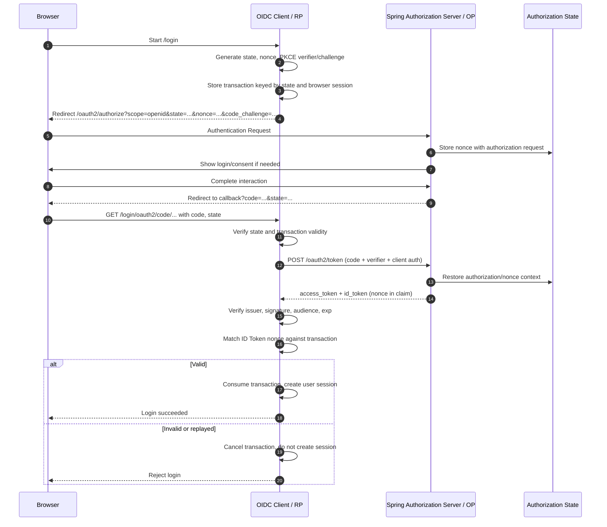

# Nonce and Protecting the Binding Between Login Requests and ID Tokens

## 1. Objective and Security Problem to Solve

In the **SPRING_SECURITY_OAUTH2_OIDC_AUTHORIZATION_SERVER** module, we learn how to design, configure, secure, test, and operate an **OAuth 2.0/OpenID Connect Authorization Server** using **Spring Security**, **Spring Authorization Server**, and **Spring Boot**. In the **OIDC Core and ID Token** chapter, this lesson explains how to use the **`nonce`** parameter to bind a client (Relying Party, RP) login request to the **ID Token** issued by the OpenID Provider (OP) for that specific login attempt.

An ID Token is a JWT conveying user authentication details such as issuer, subject, audience, issuance/expiration timestamps, and other OIDC claims. A valid digital signature proves the token came from an issuer holding a trusted key, yet **it does not by itself prove the ID Token belongs to the login request currently pending in this browser**. A previously issued valid ID Token could be replayed by an attacker or injected into another login session if the client omits contextual binding.

`nonce` is an unpredictable value **generated by the client before redirecting the browser to the Authorization Endpoint**. If the client sends that value in the OIDC Authentication Request, the OP must copy **the exact received value** into the ID Token's `nonce` claim. After verifying the ID Token, the client matches that claim against the nonce stored for the active login transaction. Any mismatch or missing claim when a nonce was requested must result in **rejecting the login** without creating a user session.

> **Core point:** a nonce does not make a JWT's cryptographic signature stronger; it binds a verified ID Token to **a specific login initiation**, helping prevent replay and token substitution.

### Learning Outcomes

After this lesson, you will be able to:

1. Distinguish the goals of `nonce`, `state`, PKCE, and ID Token validation claims.
2. Know when `nonce` is required by OIDC Core and why you should still use `nonce` in the Authorization Code Flow.
3. Generate a nonce with a CSPRNG, store it per transaction, send it to the Authorization Endpoint, and validate it in the ID Token.
4. Configure Spring Authorization Server to issue ID Tokens containing `nonce`, and explain Spring Security OAuth2 Login's role on the client side.
5. Test scenarios with missing, wrong, replayed nonces, two concurrent tabs, or ID Tokens from a different issuer/client.
6. Operate the nonce mechanism across sessions, browsers, proxies, multiple nodes, and timeouts.

### Scope

Primary examples use the **Authorization Code Flow + PKCE S256**, OIDC `scope=openid`, a confidential web client, and Spring Authorization Server. Implicit/Hybrid references are only for comparing OIDC Core rules; for new applications, prefer Authorization Code + PKCE instead of choosing Implicit/Hybrid just because `nonce` is mandatory there.

## 2. Nonce in OIDC Core: Definition and Mandatory Rules

Per OpenID Connect Core 1.0 (Errata Set 2), `nonce` is a string sent by the client in the **Authentication Request** to associate a client session with an ID Token and mitigate replay attacks. The OP passes the `nonce` value **unmodified** into the ID Token's `nonce` claim.

| Rule | Practical Meaning |
| --- | --- |
| Client generates an unpredictable nonce with sufficient entropy | Outsiders cannot guess the nonce to prepare forged tokens or substitute tokens |
| If the Authentication Request contains `nonce`, the OP **MUST** include `nonce` in the ID Token | The OP must not silently drop the claim or alter its value |
| If the request sent `nonce`, the RP **MUST** verify the `nonce` claim in the ID Token matches the sent value | Missing or mismatched `nonce` is an authentication failure |
| Client **SHOULD** consider detecting nonce reuse/replay | Blocks reusing an ID Token for an already-completed transaction |
| `nonce` does not replace signature/issuer/audience/expiration checks | All other ID Token validations remain mandatory |

**What "passed unmodified" means:** the OP copies **the exact nonce string that appeared on the wire in the Authorization Request** into the ID Token without hashing or transforming it. A client **may proactively send a hash of an internal secret** as the wire nonce; in that case, the ID Token must contain that hash, and the client compares accordingly. Distinguishing this is especially important when working with Spring Security OAuth2 Login.

### 2.1. When Is Nonce Required?

| OIDC Flow | `response_type` | Nonce Requirement in Authentication Request |
| --- | --- | --- |
| Authorization Code | `code` | **OPTIONAL** per OIDC Core; **recommended** for new deployments |
| Implicit | `id_token` | **REQUIRED** |
| Implicit | `id_token token` | **REQUIRED** |
| Hybrid | `code id_token` | **REQUIRED** |
| Hybrid | `code id_token token` | **REQUIRED** |
| Hybrid | `code token` | **OPTIONAL** |

The difference stems from where the ID Token appears and how the client binds the session. In Code Flow, the ID Token is fetched over a direct channel from the Token Endpoint after exchanging an authorization code; in Implicit or certain Hybrid flows, the ID Token travels through the browser from the Authorization Endpoint, making `nonce` especially critical.

"Optional" in Authorization Code Flow **does not mean skipping verification**: once a client sends `nonce`, the OP must return it and the client must verify it. Application policy may require `nonce` on **every** login even though the spec allows omitting it in Code Flow.

### 2.2. Nonce Belongs to the Authentication Request, Not the Token Request

In the Code Flow example:

- **Before login:** the client sends `nonce` at `GET /oauth2/authorize`, alongside `scope=openid`, `state`, and the PKCE challenge.
- **After login:** the browser callback carries `code` and `state`, **not `nonce` as a required callback parameter**.
- **Code exchange:** the client sends `grant_type=authorization_code`, `code`, `redirect_uri`, and `code_verifier` to `POST /oauth2/token`; do not add `nonce` to the token request body expecting the OP to "echo it back."
- **Upon receiving the ID Token:** the `nonce` claim must match the nonce the client sent in the authorize step.

The OP must persist the authorization request context so that when the Token Endpoint issues the ID Token, it includes the corresponding `nonce`. With Spring Authorization Server, this context is managed by the Authorization Code/OIDC pipeline and authorization state in `OAuth2AuthorizationService`.

### 2.3. An ID Token Is Not an Access Token

| Characteristic | ID Token | Access Token |
| --- | --- | --- |
| Primary consumer | OAuth/OIDC **client** (RP) | **Resource Server** |
| Purpose | Conveys user authentication result | Authorizes resource/API calls |
| Typical audience | RP's `client_id` | API/resource audience |
| Nonce | OIDC claim binding the request when sent by client | Not a substitute for the ID Token's `nonce` claim |
| Validation | Signature, `iss`, `aud`, `exp`, `nonce`, and login context | Signature/state, issuer, audience, scopes, and permissions |

Never use an Access Token in place of an ID Token to sign in. Never send an ID Token in an `Authorization: Bearer` header to an API as though it were an Access Token.

## 3. How Do Nonce, State, and PKCE Differ?

These three mechanisms often appear in the same OAuth/OIDC Authorization Code Flow, yet they protect different points.

| Mechanism | Created By | Sent Where? | Verified Where? | Primary Goal |
| --- | --- | --- | --- | --- |
| `state` | RP/client | Authorization Request | Authorization Response callback | Binds the authorize response to the initiating session/browser; prevents login CSRF |
| `nonce` | RP/client | OIDC Authentication Request | `nonce` claim in the verified ID Token | Binds the ID Token to a specific login attempt; mitigates token replay/substitution |
| `code_verifier` / `code_challenge` (PKCE) | RP/client | Challenge at authorize, verifier at token exchange | Authorization Server during code exchange | Prevents someone intercepting an authorization code from exchanging it without the verifier |

You cannot replace these mechanisms by checking just one variable. An OAuth response with a valid `state` can still yield an ID Token with a mismatched `nonce` if a pipeline/token provider malfunctions or token substitution occurs. An ID Token with a valid `nonce` does not prove the authorization code was protected by PKCE.

### 3.1. Example Risk When Skipping Nonce Verification

1. The RP initiates a new login request, creating transaction `login-B`.
2. An attacker manages to inject a **valid ID Token from another transaction** into callback handling or login completion.
3. The RP merely decodes the token and sees a valid signature, valid issuer, and valid audience.
4. If the RP skips `nonce` and other transaction bindings, it risks accepting a token that does not belong to `login-B`.

When `nonce` is used properly, `login-B` has a fresh random nonce. A token from `login-A` has a different nonce (or none) and is rejected. That is why `nonce` is directly about **request-to-token binding**, not just "an extra random value for security."

### 3.2. Why Is `state` Needed at the Same Time?

The client must verify `state` **before** exchanging the code in the callback to ensure the response matches a transaction initiated in that exact browser/session. After exchanging the code and obtaining the ID Token, the client verifies `nonce`. These are two distinct checkpoints in the same login transaction.

If no transaction matches the returned `state`, **do not exchange the code**. If `state` matches but the ID Token's `nonce` is wrong, **do not create an authenticated session**. Both are security failures—never regenerate a fresh state/nonce and skip the comparison.

### 3.3. Nonce Does Not Prove How Recently the User Typed a Password

`nonce` proves the ID Token belongs to the current request, **not** that the user just typed a password during this request. The OP may reuse a valid SSO session and issue a new ID Token containing the new nonce.

If business logic requires the user to have **authenticated recently**, use `max_age` or an appropriate `prompt=login` policy and verify `auth_time` in the ID Token. A fresh `nonce` can coexist with an `auth_time` from an older SSO session; the two claims solve different requirements.

### 3.4. Replay Detection Differs From Nonce Comparison

Matching `nonce` answers: **"Does this token belong to the request currently being processed?"** Replay detection also answers: **"Has this request or token already been used to complete a login?"**

Therefore, beyond comparing `nonce`, the RP must consume/mark the transaction complete once, clear temporary state/nonce after processing, and reject reused callbacks. If designing for idempotent retries, be careful not to create a second session or accept an old ID Token under a new transaction.

## 4. Nonce Lifecycle in Authorization Code + PKCE



### 4.1. Authorization Request: Nonce Is Sent at Authorize

Suppose the RP is `orders-web`, the OP issuer is `https://auth.example.com`, and the registered callback is `https://orders.example.com/login/oauth2/code/orders`. The client initiates:

```http
GET /oauth2/authorize?response_type=code
  &client_id=orders-web
  &redirect_uri=https%3A%2F%2Forders.example.com%2Flogin%2Foauth2%2Fcode%2Forders
  &scope=openid%20profile
  &state=STATE_RANDOM_PER_LOGIN
  &nonce=NONCE_RANDOM_PER_LOGIN
  &code_challenge=PKCE_S256_CHALLENGE
  &code_challenge_method=S256 HTTP/1.1
Host: auth.example.com
```

This simulated request is wrapped across lines for readability and **is not a valid copy-paste URL**. In practice, concatenate properly and percent-encode query parameters. `STATE_RANDOM_PER_LOGIN`, `NONCE_RANDOM_PER_LOGIN`, and `PKCE_S256_CHALLENGE` must be randomly generated per transaction—never use the example literals.

At the RP, before redirecting, store:

| Transaction Field | Purpose |
| --- | --- |
| `state` | Lookup key for the login transaction on callback |
| Exact nonce value sent on the wire | Compared against the `nonce` claim in the ID Token |
| `code_verifier` | Proves authority to exchange the authorization code |
| `issuer`, `client_id`, `redirect_uri` | Prevents mixing issuers, client registrations, and callbacks |
| Creation time/TTL, `consumed` flag | Limits replay and handles stale callbacks |
| Browser/session binding | Ensures state cannot be redeemed from another user's browser |

Opening a new login tab can create a separate transaction. Never store a single global "current nonce" for the entire application or a fixed attribute overwritten by a second tab.

### 4.2. Authorization Response Carries Only Code and State

After user login/consent, the browser receives a redirect such as:

```http
HTTP/1.1 302 Found
Location: https://orders.example.com/login/oauth2/code/orders?code=AUTH_CODE&state=STATE_RANDOM_PER_LOGIN
```

The RP verifies that the returned `state` was initiated in the same browser/session, matches an unexpired transaction, and has not been consumed. Do not proceed if `state` is missing or mismatched. Nonce does not come from the callback; nonce comes from the stored transaction.

### 4.3. Token Response Contains the ID Token With the Nonce Claim

The RP calls the Token Endpoint with the code, code verifier, and client authentication. Using the stored authorization state, the OP issues the ID Token:

```http
HTTP/1.1 200 OK
Content-Type: application/json
Cache-Control: no-store

{
  "access_token": "ACCESS_TOKEN_VALUE",
  "token_type": "Bearer",
  "expires_in": 300,
  "id_token": "SIGNED_JWT_WITH_NONCE_CLAIM"
}
```

Example decoded ID Token header/payload:

```json
{
  "iss": "https://auth.example.com",
  "sub": "user-1042",
  "aud": "orders-web",
  "exp": 1800000300,
  "iat": 1800000000,
  "nonce": "NONCE_RANDOM_PER_LOGIN"
}
```

Actual ID Tokens are signed/encoded JWTs, not raw JSON. The JSON above only illustrates claims. The ID Token must have its **signature and OIDC criteria verified** before trusting any claim, including `nonce`. Never treat successful Base64URL decoding as token validation.

### 4.4. Completing the Transaction and Establishing the Session

A login succeeds only when **both verification phases** pass:

1. The callback has a `state` matching a pending transaction bound to the right browser/session, within TTL, and unconsumed.
2. The ID Token from the right issuer has a valid signature, audience, and timestamps, and its `nonce` claim matches the wire nonce bound to the transaction.

Upon success, mark the transaction consumed and remove temporary state/nonce/code verifier. Never use this nonce as a session ID, CSRF token, or password. If the user initiates a new login, generate **a fresh nonce**, even if the OP still holds an SSO cookie.

## 5. Configuring OpenID Connect in Spring Authorization Server

Spring Authorization Server is the **OP** side, responsible for accepting Authentication Requests, validating client/redirect/scopes, persisting request context, and issuing ID Tokens containing `nonce` when the request includes one. The RP has its own responsibility for generating, storing, and verifying `nonce`.

### 5.1. Enabling OIDC Protocol Support

With Spring Authorization Server 1.5.x using `OAuth2AuthorizationServerConfigurer`:

```java
package com.example.authserver;

import org.springframework.context.annotation.Bean;
import org.springframework.context.annotation.Configuration;
import org.springframework.core.annotation.Order;
import org.springframework.security.config.Customizer;
import org.springframework.security.config.annotation.web.builders.HttpSecurity;
import org.springframework.security.oauth2.server.authorization.config.annotation.web.configurers.OAuth2AuthorizationServerConfigurer;
import org.springframework.security.web.SecurityFilterChain;

@Configuration
public class AuthorizationServerSecurityConfig {

    @Bean
    @Order(1)
    SecurityFilterChain authorizationServerSecurityFilterChain(HttpSecurity http)
            throws Exception {

        OAuth2AuthorizationServerConfigurer authorizationServerConfigurer =
                OAuth2AuthorizationServerConfigurer.authorizationServer();

        http
            .securityMatcher(authorizationServerConfigurer.getEndpointsMatcher())
            .with(authorizationServerConfigurer, authorizationServer ->
                    authorizationServer.oidc(Customizer.withDefaults()))
            .authorizeHttpRequests(authorize -> authorize.anyRequest().authenticated());

        return http.build();
    }
}
```

This is the security chain configuration for protocol endpoints, **not a standalone runnable application**. You still need user authentication (login page / second security chain), `RegisteredClientRepository`, `OAuth2AuthorizationService`, `AuthorizationServerSettings`, a JWK source / JWT signer, and related beans. Enabling OIDC configures related endpoints such as Provider Configuration, UserInfo, and Logout; OIDC dynamic client registration is not enabled by default.

**Do not create a custom `/nonce` endpoint**: `nonce` is an Authentication Request parameter and an ID Token claim, not a standalone protocol endpoint. Nor should you add a `nonce` grant type to `RegisteredClient`.

### 5.2. Declaring a Standard Issuer

```java
import org.springframework.context.annotation.Bean;
import org.springframework.security.oauth2.server.authorization.settings.AuthorizationServerSettings;

@Bean
AuthorizationServerSettings authorizationServerSettings() {
    return AuthorizationServerSettings.builder()
            .issuer("https://auth.example.com")
            .build();
}
```

The `issuer` value must be consistent across discovery metadata, the ID Token `iss` claim, JWK Set URI, and RP configuration. When running behind a reverse proxy, use the public HTTPS URL; do not let ID Tokens emit `iss=http://auth-service:9000` while RPs trust `https://auth.example.com`.

If the system already has an `AuthorizationServerSettings` bean, update the existing bean instead of defining a second one. Use HTTPS for all real traffic. Localhost lab examples must be kept separate from production.

### 5.3. Registering an OIDC-Capable Client

A confidential RP using Authorization Code + PKCE:

```java
import java.util.UUID;

import org.springframework.security.crypto.password.PasswordEncoder;
import org.springframework.security.oauth2.core.AuthorizationGrantType;
import org.springframework.security.oauth2.core.ClientAuthenticationMethod;
import org.springframework.security.oauth2.core.oidc.OidcScopes;
import org.springframework.security.oauth2.server.authorization.client.RegisteredClient;
import org.springframework.security.oauth2.server.authorization.settings.ClientSettings;

RegisteredClient ordersWeb = RegisteredClient.withId(UUID.randomUUID().toString())
        .clientId("orders-web")
        .clientSecret(passwordEncoder.encode("lab-only-change-this-secret"))
        .clientAuthenticationMethod(ClientAuthenticationMethod.CLIENT_SECRET_BASIC)
        .authorizationGrantType(AuthorizationGrantType.AUTHORIZATION_CODE)
        .authorizationGrantType(AuthorizationGrantType.REFRESH_TOKEN)
        .redirectUri("https://orders.example.com/login/oauth2/code/orders")
        .scope(OidcScopes.OPENID)
        .scope(OidcScopes.PROFILE)
        .clientSettings(ClientSettings.builder()
                .requireProofKey(true)
                .requireAuthorizationConsent(true)
                .build())
        .build();
```

This snippet only defines the registration, which must be saved via `RegisteredClientRepository` alongside the application's other clients. Lab secrets must be replaced with securely managed secrets in production; confidential and public clients authenticate differently—never embed a shared client secret in an SPA or native app.

The `openid` scope signals an OIDC authentication request; without it, a plain OAuth request must not be treated as requesting an ID Token. `requireProofKey(true)` strengthens Authorization Code protection, but does not generate or verify `nonce` on the RP side.

### 5.4. How Spring Authorization Server Handles the nonce Claim

The default pipeline preserves the OIDC Authorization Request context in authorization state, including `nonce` if present, so that when the Token Endpoint mints the ID Token, it includes the `nonce` claim per OIDC. Thus, with default behavior, you do not need an `OAuth2TokenCustomizer` just to copy `nonce` into the ID Token.

If you customize the ID Token via `OAuth2TokenCustomizer<JwtEncodingContext>` or replace the token generator:

- Modify only the business claims genuinely needed.
- Preserve `iss`, `sub`, `aud`, `exp`, `iat`, and `nonce` in context.
- **Never generate a fresh nonce at ID Token issuance time**; doing so makes the claim differ from the Authentication Request.
- Never overwrite `nonce` with a value taken from a Token Endpoint query string or unverified input.
- Test both with and without `nonce`, concurrent login transactions, and token request retries.

When using custom persistence, ensure the Authorization Code, request context, and `nonce` are not lost between the Authorization Endpoint and the Token Endpoint, even across different application instances.

## 6. Generating Nonce, Storing Transactions, and Coordinating Multiple Logins

### 6.1. Generating Nonce with SecureRandom

OIDC Core does not mandate a fixed nonce length, but requires strong entropy. A practical choice is **32 random bytes** (256 bits) from a CSPRNG encoded as unpadded Base64URL. This is a testable implementation policy, not a hard protocol limit.

Java 17+ example:

```java
import java.security.SecureRandom;
import java.util.Base64;

public final class LoginNonce {
    private static final SecureRandom RNG = new SecureRandom();

    private LoginNonce() { }

    public static String newValue() {
        byte[] random = new byte[32];
        RNG.nextBytes(random);
        return Base64.getUrlEncoder().withoutPadding().encodeToString(random);
    }
}
```

The RP calls `LoginNonce.newValue()` each time a login transaction begins. Never derive a nonce from `System.currentTimeMillis()`, low-entropy UUIDs, usernames, session IDs, IP addresses, or sequential values. Do not reuse the same string for `state`, `nonce`, and `code_verifier`; generate three independent values.

### 6.2. Where Should Nonce Be Stored?

For server-side web clients, store the transaction in the HTTP session or a secure RP store. Each record tracks:

```text
state -> {
  nonce_sent_on_wire,
  pkce_code_verifier,
  issuer,
  client_id,
  redirect_uri,
  created_at,
  consumed: false
}
```

The record must also be bound to the **initiating browser/session**. Having an unguessable `state` in the callback URL is insufficient if any browser can look up the record and claim someone else's session.

Across multiple instances, use distributed session storage or sticky sessions paired with durable storage per design. If session state is lost between authorize and callback, **never skip `nonce` verification to "fix" login**; fail the transaction safely and ask the user to restart.

### 6.3. Multi-Tab Protection

Two tabs may initiate logins almost simultaneously:

| Tab | State | Nonce | Result |
| --- | --- | --- | --- |
| A | `state-A` | `nonce-A` | ID Token-A is valid only for transaction A |
| B | `state-B` | `nonce-B` | ID Token-B is valid only for transaction B |

Never store nonce in a global singleton variable or a single `"currentNonce"` session attribute where tab B overwrites tab A. Key records by `state`, mark each transaction consumed, and purge expired records.

### 6.4. Can You Hash the Nonce Before Sending?

Yes, if the client implements it consistently. For example:

1. Generate a secret `nonceSecret` in the session.
2. Compute `wireNonce = BASE64URL(SHA-256(ASCII(nonceSecret)))`.
3. Send `wireNonce` in the Authentication Request.
4. The OP must copy **wireNonce** into the ID Token's `nonce` claim.
5. The client keeps `nonceSecret` until callback, recomputes `wireNonce`, and compares.

This technique is cited as an implementation example in OIDC Core and is used by Spring Security OAuth2 Login in its documented default behavior: the resolver keeps the raw nonce in request attributes and sends its hash in additional parameters; the provider later hashes the raw nonce to compare against the ID Token claim.

**Integration warning:** if you build a custom client and send a raw nonce, match the claim against that exact wire nonce. If you use Spring Security OAuth2 Login, do not add another check comparing the raw nonce against the ID Token and blame the OP for a mismatch: the framework may be using a **hashed wire nonce**. Do not double-hash the nonce or overwrite request attributes, which breaks the built-in verification.

## 7. Validating ID Tokens and Nonce on the Client Side

Nonce provides security value only when the RP checks it **on a fully verified ID Token**. At a minimum, the RP pipeline must:

1. Receive the authorization response at the registered callback; match `state` against a transaction in the browser session, checking TTL and consumed status.
2. Exchange the authorization code at the trusted issuer's Token Endpoint with `code_verifier` and appropriate client authentication.
3. Receive the ID Token from the token response and decode/verify the JWT per the OIDC configuration discovered from the trusted issuer.
4. Validate core and contextual claims (table below).
5. Compare the `nonce` claim against the nonce sent for **this transaction**, not against a value from the callback.
6. If all checks PASS, consume the transaction and create an authenticated session.

### 7.1. Checklist for Verifying the ID Token Before Trusting Nonce

| Check | Principle |
| --- | --- |
| Signature / JWS | Verify using a trusted issuer key and permitted algorithm; never trust `alg=none` or `jku`/`kid` from an untrusted issuer |
| `iss` | **Exact** match with the selected/discovered issuer |
| `aud` | Must contain the RP's `client_id`; reject untrusted additional audiences |
| `azp` | If present, verify an appropriate authorized party, especially with multiple audiences |
| `exp` | Unexpired relative to current time (allowing small clock skew) |
| `iat` | Reasonable issuance timestamp; optionally reject overly old tokens |
| `nonce` | If the request sent `nonce`, the claim must exist and equal the wire nonce of the request |
| `auth_time` | If the RP requires recent authentication via `max_age`/claims, evaluate authentication age |
| `at_hash` and `c_hash` | Verify in flows/cases where OIDC requires them; Code Flow ID Tokens from the Token Endpoint follow different rules from Hybrid/Implicit |

Per OIDC Core, an ID Token received directly from the Token Endpoint in Code Flow has specific signature considerations involving TLS; **new implementations should verify ID Token signatures** using the issuer's JWK Set rather than merely decoding the payload. Pin JWT verification to the fixed registered issuer/client instead of dynamically selecting JWK Sets from claims in an untrusted token.

**Never check `nonce` before trusting the signature:** an attacker can craft an unsigned JWT with a guessed or browser-observed nonce. If code merely compares the `nonce` string from the payload without verifying the token, the entire OIDC authentication can be forged.

### 7.2. Example Nonce Check After Token Verification

Example Java helper for a **custom client implementing** the nonce check. The input `idToken` is assumed to have already passed signature, issuer, audience, and expiry validation by a trusted OIDC/JWT validator; this method **does not replace** those steps.

```java
import java.nio.charset.StandardCharsets;
import java.security.MessageDigest;

import org.springframework.security.oauth2.core.OAuth2AuthenticationException;
import org.springframework.security.oauth2.core.OAuth2Error;
import org.springframework.security.oauth2.core.oidc.OidcIdToken;

public final class OidcNonceVerifier {

    private OidcNonceVerifier() { }

    public static void verify(OidcIdToken validatedIdToken,
                              String expectedNonceSentOnWire) {
        if (validatedIdToken == null || expectedNonceSentOnWire == null
                || expectedNonceSentOnWire.isBlank()) {
            throw new OAuth2AuthenticationException(
                    new OAuth2Error("invalid_nonce"));
        }

        String actual = validatedIdToken.getNonce();
        if (actual == null ||
                !MessageDigest.isEqual(
                        expectedNonceSentOnWire.getBytes(StandardCharsets.UTF_8),
                        actual.getBytes(StandardCharsets.UTF_8))) {
            throw new OAuth2AuthenticationException(
                    new OAuth2Error("invalid_nonce"));
        }
    }
}
```

Suppose the application sent nonce `n-ABCD1234` in the Authentication Request; the helper receives that **exact** string as `expectedNonceSentOnWire`. If the application sent a SHA-256 hash of a raw nonce, the helper must receive **the sent hash**, not the raw secret.

Note: this function only checks the nonce of an already-trusted ID Token. The login transaction still requires state/session binding, replay prevention, and TTL enforcement. When using default Spring Security OAuth2 Login, **you generally do not need to write this helper**, because the provider already performs the corresponding nonce validation.

### 7.3. Ensure Nonce Is Checked Per Transaction

A common broken sequence:

```text
RP receives id_token
RP decodes JWT
RP reads nonce from id_token
RP sets expectedNonce = nonce just read
RP compares expectedNonce and nonce in token
=> always matches, provides no protection
```

The expected nonce must come from the transaction stored by the RP **before redirecting the browser to the OP**—never from the incoming token, an unsigned attacker cookie, a callback query string, or an overwritable global variable.

### 7.4. Mismatches Must Fail Authentication

| Case | RP Decision |
| --- | --- |
| Request had nonce, ID Token lacks `nonce` claim | Reject |
| Request had nonce, ID Token has different nonce | Reject |
| Nonce matches but JWT signature is invalid | Reject |
| Nonce matches but issuer differs | Reject |
| Nonce matches but audience lacks current client | Reject |
| Nonce matches but token is expired | Reject |
| Nonce matches and claims are valid, but state/callback is wrong | Reject |
| Nonce matches and state matches, but transaction already consumed | Reject replay |
| Nonce, state, and all checks are valid | May create session after applying extra policies |

Never automatically retry with a new nonce when an ID Token has the wrong nonce and then keep using that old token; doing so breaks the binding `nonce` exists to enforce.

## 8. Spring Security OAuth2 Login: Where Is Nonce Generated and Verified?

When the RP is a Spring Boot application using Spring Security OAuth2 Client, the lowest-risk path is using **default OAuth2 Login** instead of manually handling authorization responses, the Token Endpoint, and ID Tokens.

### 8.1. Configuring ClientRegistration for OIDC

Example `application.yml` for an RP running at `https://orders.example.com`:

```yaml
spring:
  security:
    oauth2:
      client:
        registration:
          orders:
            provider: orders-idp
            client-id: orders-web
            client-secret: ${ORDERS_CLIENT_SECRET}
            authorization-grant-type: authorization_code
            redirect-uri: "{baseUrl}/login/oauth2/code/{registrationId}"
            scope:
              - openid
              - profile
        provider:
          orders-idp:
            issuer-uri: https://auth.example.com
```

`${ORDERS_CLIENT_SECRET}` is Spring Boot syntax for reading the secret from an environment variable; never hardcode real secrets in Git. Register the callback `https://orders.example.com/login/oauth2/code/orders` at the Authorization Server. Issuer metadata and redirect URIs must use the exact external URL behind proxies/gateways.

Example client security chain:

```java
package com.example.ordersweb;

import org.springframework.context.annotation.Bean;
import org.springframework.context.annotation.Configuration;
import org.springframework.security.config.Customizer;
import org.springframework.security.config.annotation.web.builders.HttpSecurity;
import org.springframework.security.web.SecurityFilterChain;

@Configuration
public class WebSecurityConfig {

    @Bean
    SecurityFilterChain webSecurityFilterChain(HttpSecurity http)
            throws Exception {
        return http
                .authorizeHttpRequests(authorize -> authorize
                        .requestMatchers("/", "/health").permitAll()
                        .anyRequest().authenticated())
                .oauth2Login(Customizer.withDefaults())
                .build();
    }
}
```

This configuration only illustrates OIDC client security. The application needs the `spring-boot-starter-oauth2-client` dependency (or equivalent) plus cookie/session, TLS, proxy, and CSRF configuration suited to the environment. Never place `client-secret` in a browser JavaScript bundle.

### 8.2. How the Default Resolver and Provider Handle Nonce

In Spring Security OAuth2 Login versions verified against source code:

1. `DefaultOAuth2AuthorizationRequestResolver` generates an unpredictable raw nonce for requests containing the `openid` scope.
2. The resolver stores the **raw nonce** in `OAuth2AuthorizationRequest` attributes.
3. The resolver computes `BASE64URL(SHA-256(ASCII(raw-nonce)))` and sends the **nonce hash** in the Authentication Request's additional parameters.
4. After the Token Endpoint returns the ID Token, `OidcAuthorizationCodeAuthenticationProvider` reads the raw nonce from the saved authorization request, recomputes the hash, and compares it with `idToken.getNonce()`.
5. If the nonce is missing or mismatched, the provider raises an `invalid_nonce` error and aborts OIDC Login.

This is an implementation choice of the **Spring Security client**. It does not mean Spring Authorization Server or OIDC Core automatically hashes nonce values. The OP simply copies **the wire value** into the ID Token. Both sides match because the client resolver hashed it before sending.

Related source references:

- `DefaultOAuth2AuthorizationRequestResolver.applyNonce(...)`: generates raw nonce, stores attributes, and puts the hash into request parameters.
- `OidcAuthorizationCodeAuthenticationProvider.validateNonce(...)`: when the authorization request has a nonce, computes the hash and compares it to the ID Token claim.

If you write a custom `OAuth2AuthorizationRequestResolver` or `OAuth2AuthorizationRequestRepository`, preserve all nonce-related data intact. Never replace it with a resolver that only builds a URL and drops request attributes; otherwise the client loses its basis for validating the nonce.

### 8.3. Session/Transaction Storage

Spring Security persists `OAuth2AuthorizationRequest` between redirect and callback via an authorization request repository, defaulting to the HTTP session in many servlet setups. If an application implements stateless OAuth2 Login:

- define your own secure transaction save/restore mechanism;
- protect integrity and confidentiality of nonce/verifier data as needed;
- bind the transaction to the browser and issuer/client;
- support multiple tabs;
- clear/consume once upon callback.

Never skip `nonce` simply to avoid sessions. "Stateless" calls for an alternative way to store transaction state, not "skipping `state`/`nonce`."

### 8.4. Customization and Scope of Responsibility

Default Spring Security OAuth2 Login handles many tricky OIDC Client steps such as authorize redirects, token exchange, ID Token validation, nonce, and sessions. Application policy must still address:

- checking/restricting configured issuers and registrations;
- business-layer authorization;
- login session cookie security and timeouts;
- safe account linking (not relying on unverified emails);
- step-up/re-authentication rules if business logic requires `max_age`.

Never write a custom "nonce filter" on the Authorization Server to validate the RP's nonce. **The RP is responsible for verifying the nonce in the ID Token**; the OP must faithfully echo the request value.

## 9. Attack Scenarios, Integration Errors, and Mitigations

### 9.1. Replaying an Already-Used ID Token

**Scenario:** an attacker possesses an old valid ID Token and tries to inject it into a new transaction. If the new transaction has its own random nonce and verifies it, the old token is rejected. If an attacker could replay an entire callback before the client marks it consumed, replay protection at the transaction/code/session layer is still required; `nonce` does not replace that step.

### 9.2. Token Substitution Across Two Tabs

**Scenario:** tab A starts with `nonce-A` and tab B starts with `nonce-B`. The client stores a global `currentNonce` so B overwrites A. When A receives its callback, the client either falsely rejects it or a developer "fixes" it by disabling nonce checks.

**Mitigation:** look up transactions by `state` bound to the browser session; each record holds its own nonce and verifier, TTL, and consumed flag. Never use a singleton.

### 9.3. Login CSRF and Invalid State

**Scenario:** an attacker initiates a login in their own browser and feeds the callback to the victim's browser. If the RP does not check `state` bound to the victim's browser session, it risks logging the victim into the wrong account.

**Mitigation:** verify `state` early, before token exchange, and also verify `nonce` in the ID Token. Never use `nonce` as an excuse to remove `state`.

### 9.4. OP Issues an ID Token Missing Nonce

**Scenario:** the request included a nonce, yet the OP's token generator/customizer drops the `nonce` claim. The RP must reject it even if the JWT has a valid signature.

**Mitigation:** inspect OIDC configuration, authorization state, custom token generators, and the `openid` scope; never weaken the RP to treat nonce as "optional" when the client actually sent one.

### 9.5. Spring Security Client Double-Hashes Nonce

**Scenario:** a developer customizes `DefaultOAuth2AuthorizationRequestResolver` to pre-hash the nonce while the provider also hashes the raw nonce in attributes. The client sends a string different from what the provider expects, causing logins to fail consistently with `invalid_nonce`.

**Mitigation:** understand the stored secret vs. wire nonce contract, avoid adding extra hashing when the framework already hashes, and test end-to-end against your exact Spring Security version.

### 9.6. Wrong Issuer or Another Client's ID Token

An ID Token whose nonce happens to match but has the wrong `iss` or `aud` must still be rejected. If an RP supports multiple issuers, bind the chosen issuer **when initiating the transaction** rather than picking an issuer from an unverified token's claim.

### 9.7. Nonce Does Not Prove the User "Just Logged In"

**Scenario:** an RP requires authentication within the last 5 minutes, sends a fresh nonce, and receives a new ID Token because the OP reused yesterday's SSO session. The nonce matches, yet business logic still needs to check `auth_time` and `max_age`.

**Mitigation:** send `max_age=300`, require `auth_time` per protocol, and compare user authentication time against business limits. Never equate `iat` (ID Token issuance time) with `auth_time`.

### 9.8. Wrong Redirect URI or Lost Login Transaction

If the redirect URI does not match `RegisteredClient`, the OP rejects before issuing an authorization code. If the RP loses its session/transaction between redirect and callback, there is no trusted expected nonce to compare. Both cases must fail cleanly with a clear error and restart login; never invent a new expected nonce at callback and declare it valid.

## 10. Hands-On Verification of Nonce in an OIDC Login

This section walks through a demo with client `orders-web` and issuer `https://auth.example.com`. These are **example addresses**—replace them with your own Authorization Server/lab values. The goal is to observe `nonce` appearing in the Authentication Request and being preserved in the ID Token claim.

### 10.1. Prerequisites

Requirements:

- Spring Authorization Server has OIDC enabled via `.oidc(Customizer.withDefaults())`, with a signer/JWK Set and stable issuer.
- Client `orders-web` has `authorization_code`, scope `openid`, and an exact registered redirect URI.
- The RP stores transactions (`state`, `nonce`, PKCE verifier, issuer, client ID) per session.
- Tools are available to observe HTTP redirects and the **verified** ID Token after token exchange.
- Production traffic uses HTTPS; no real client secrets are used in this exercise.

### 10.2. Generating State, Nonce, and PKCE Challenge with PowerShell

The following PowerShell snippet is compatible with Windows PowerShell 5.1 and generates a transaction on a lab machine only:

```powershell
$rng = [Security.Cryptography.RandomNumberGenerator]::Create()

function New-RandomUrlValue {
    param([int]$ByteLength = 32)
    $bytes = New-Object byte[] $ByteLength
    $rng.GetBytes($bytes)
    return [Convert]::ToBase64String($bytes).TrimEnd('=').Replace('+', '-').Replace('/', '_')
}

$state = New-RandomUrlValue
$nonceSentOnWire = New-RandomUrlValue
$codeVerifier = New-RandomUrlValue

$sha = [Security.Cryptography.SHA256]::Create()
$digest = $sha.ComputeHash(
    [Text.Encoding]::ASCII.GetBytes($codeVerifier))
$codeChallenge = [Convert]::ToBase64String($digest).TrimEnd('=').Replace('+', '-').Replace('/', '_')
$sha.Dispose()
$rng.Dispose()

$issuer = "https://auth.example.com"
$redirectUri = "https://orders.example.com/login/oauth2/code/orders"

$url = $issuer + "/oauth2/authorize?" +
    "response_type=code" +
    "&client_id=orders-web" +
    "&scope=openid%20profile" +
    "&redirect_uri=" + [uri]::EscapeDataString($redirectUri) +
    "&state=" + [uri]::EscapeDataString($state) +
    "&nonce=" + [uri]::EscapeDataString($nonceSentOnWire) +
    "&code_challenge=" + [uri]::EscapeDataString($codeChallenge) +
    "&code_challenge_method=S256"

$url
```

This example shows **a client generating and sending a nonce directly**. If your actual RP uses default Spring Security OAuth2 Login, the framework manages nonce/hashing and transactions automatically; **do not paste this manual script into a default OAuth2 Login flow**, which would create two conflicting nonce layers.

In the lab, keep `$state`, `$nonceSentOnWire`, and `$codeVerifier` temporarily on the client to verify callback/token exchange. **Never write verifiers or client secrets to logs, shell history, tickets, or URLs**. Only open the authorize URL in a test session against a trusted issuer.

### 10.3. Observing Callback and ID Token

1. Open the authorize URL, sign in, and approve consent if prompted.
2. Observe the callback carrying the authorization code and returned **state**.
3. Verify the callback state equals `$state` and the transaction has not expired.
4. Exchange the code at the Token Endpoint with the transaction's `code_verifier` and client authentication (if confidential client).
5. Verify the ID Token using an OIDC/JWT validator configured for the issuer, key, audience, and expiry.
6. After verification, read the `nonce` claim and compare it with `$nonceSentOnWire`.

Expected result:

```text
client nonce sent at /oauth2/authorize
      = claim "nonce" inside verified id_token
      = expected nonce bound to callback state

JWT signature          PASS
iss = expected issuer   PASS
aud contains client_id  PASS
exp valid               PASS
state matches request   PASS
nonce matches request   PASS
```

### 10.4. Manual Negative Tests

Run these in a test environment where you can intentionally modify responses or use a stub OIDC Provider. Never alter a signed ID Token and conclude only nonce failed: if you change the payload without re-signing with a trusted key, **signature verification** fails first.

Tests to run:

1. Create two transactions A/B and inject ID Token-A into B's handler: must be rejected due to nonce mismatch.
2. Have the test OP issue an ID Token **without a nonce** despite the request having one: RP rejects.
3. Have the test OP issue a token with a wrong nonce yet validly signed by the test key: RP rejects.
4. Keep the right nonce but use the wrong issuer or audience: RP rejects on those checks.
5. Send a successful callback once and replay the same callback: RP must not create a second login.
6. Drop the session/transaction before callback: RP rejects and asks to restart login.
7. Omit nonce in Code Flow: behavior depends on RP policy; under mandatory-nonce policy, reject or refuse to initiate a request without nonce.

### 10.5. Observing Nonce When Spring Security Hashes Automatically

When using default Spring Security OAuth2 Login, you may see the nonce **on the wire** in the authorize URL differ from the raw nonce in authorization request attributes. To verify:

1. Enable appropriate logging in a lab environment, **never logging raw tokens, session cookies, or code verifiers**.
2. Capture the **wire** nonce from the authorize request.
3. After token exchange, verify the ID Token and check the `nonce` claim against that wire nonce.
4. If inspecting framework internals, verify `BASE64URL(SHA-256(ASCII(raw-nonce))) = wire-nonce`.

Do not compare the raw nonce from attributes directly against the claim when the resolver hashed it. Nor should you conclude the OP "hashed the nonce"—the OP simply echoed what the client sent.

## 11. Automated Test Matrix

Test from three angles: **RP request generation**, **OP ID Token issuance**, and **RP callback/login validation**. Each test must know where the expected nonce was generated and which transaction is active.

| ID | Scenario | Expected Result |
| --- | --- | --- |
| NONCE-01 | RP starts OIDC Code Flow with scope `openid` | Request contains a nonce per RP policy |
| NONCE-02 | RP initiates two consecutive login requests | Distinct nonces with sufficient entropy |
| NONCE-03 | Nonce length/encoding matches policy (e.g., 32-byte Base64URL) | Non-empty, non-sequential/unpredictable |
| NONCE-04 | Authorization Request includes nonce, OP issues ID Token | `nonce` claim present, matches wire value |
| NONCE-05 | Authorization Request omits nonce in Code Flow | Behavior matches OIDC Core and client policy |
| NONCE-06 | Client requests Implicit `id_token` without nonce | OP supporting this flow rejects; OP not supporting it rejects flow |
| NONCE-07 | Hybrid `code id_token` missing nonce | OP supporting this flow rejects; OP not supporting it rejects flow |
| NONCE-08 | Callback state matches, ID Token nonce matches | Login succeeds if all remaining checks PASS |
| NONCE-09 | Callback state matches, ID Token lacks nonce | Reject |
| NONCE-10 | Callback state matches, ID Token nonce mismatches | Reject |
| NONCE-11 | ID Token nonce matches, forged signature | Reject |
| NONCE-12 | ID Token nonce matches, untrusted issuer | Reject |
| NONCE-13 | ID Token nonce matches, audience lacks client ID | Reject |
| NONCE-14 | ID Token nonce matches, token expired | Reject |
| NONCE-15 | Callback missing state or mismatched state | Reject before token exchange |
| NONCE-16 | Callback nonce matches, transaction already consumed | Reject replay |
| NONCE-17 | Open two tabs A/B with separate state and nonce | Token-A matches only transaction-A |
| NONCE-18 | Transaction/session lost between redirect and callback | Do not create authenticated session |
| NONCE-19 | Nonce matches, invalid code verifier | OP rejects token exchange via PKCE |
| NONCE-20 | Custom OIDC token generator fails to copy nonce | Test catches RP rejecting ID Token |
| NONCE-21 | RP uses default Spring Security resolver | Wire nonce is hash of raw nonce and provider validates accordingly |
| NONCE-22 | Custom RP resolver drops raw nonce from attributes | Test catches flow losing expected nonce check |
| NONCE-23 | RP sends raw nonce, custom verifier checks wire nonce | No double-hashing |
| NONCE-24 | RP sends hashed nonce, custom verifier checks wire hash | Does not mistakenly compare raw secret |
| NONCE-25 | ID Token has fresh `iat` but `auth_time` too old for `max_age` | Do not treat fresh nonce as re-authentication |
| NONCE-26 | Issuer metadata changes or key rotation occurs | Accepts only ID Tokens signed by trusted issuer keys; nonce still matches |
| NONCE-27 | Multiple RP instances and callback hits another node | Transaction restored safely; nonce still matches |
| NONCE-28 | Callback arrives after TTL | Reject, issue no session |
| NONCE-29 | ID Token nonce matches, `azp`/multi-audience violates policy | Reject |
| NONCE-30 | OP issues ID Token from Token Endpoint in Code Flow | Do not require nonce in callback query string |

### 11.1. Isolating Nonce Failures in Integration Tests

To confirm a failure is specifically caused by `nonce`, set up a test OP/stub that **signs a valid ID Token with the test key** while intentionally setting the wrong nonce. If you merely flip a byte in a real JWT payload, the test only proves signature validation works—**it does not exercise the nonce validator**.

Scenario:

```text
given:
  trusted test issuer, registered client orders-web
  transaction state = S, expected wire nonce = N
  ID Token signed by trusted test key
  ID Token issuer/audience/time all valid

when:
  callback state = S
  verified ID Token nonce = N_OTHER

then:
  authentication rejected
  no session/cookie issued as authenticated
  transaction invalidated or marked failed
```

Then replace `N_OTHER` with `N` and confirm the positive test passes. This proves the nonce boundary without conflating it with other JWT checks.

### 11.2. Testing Spring Authorization Server Directly

On the OP side, test that `/oauth2/authorize` accepts `nonce` on a registered request; once the code is exchanged at `/oauth2/token`, the response's ID Token must carry the matching `nonce` claim. Re-run this test whenever changing `OAuth2TokenCustomizer` or a custom `OAuth2AuthorizationService`.

Do not create an API endpoint just to query nonces on the OP. Observe them via the issued ID Token and internal test authorization state.

### 11.3. Testing Spring Security OAuth2 Login Directly

On the RP side, test that `DefaultOAuth2AuthorizationRequestResolver` generates a nonce for OIDC requests, stores the raw nonce in request attributes, and sends the hash on the wire; then test that `OidcAuthorizationCodeAuthenticationProvider` rejects `invalid_nonce` when the ID Token lacks or mismatches the claim. For custom request repositories, test session/transaction restoration and multiple tabs.

When upgrading Spring Security, re-run tests because resolver/provider implementation details can evolve between releases while OIDC Core rules remain constant.

## 12. Operations, Troubleshooting, and Production Checklist

### 12.1. Common Issues

| Symptom | Possible Cause | Inspection / Fix |
| --- | --- | --- |
| `invalid_nonce` at RP | ID Token missing/wrong claim, authorization request repository lost nonce, or custom resolver double-hashed | Inspect wire nonce and expected transaction nonce; never log full ID Tokens |
| Browser login has code but RP reports missing state | Session/cookie lost, callback hit wrong host, or transaction expired | Check `SameSite`/`Secure` cookies, proxy, and redirect URI; never bypass `state` |
| Fails only when multiple tabs are open | Single `currentNonce`/`currentState` value stored | Store multiple transactions keyed by `state` |
| OP issues ID Token without nonce | Request omitted nonce or custom generator lost context | Check authorize request and ID Token issuance logic |
| Nonce matches yet RP reports invalid ID Token | Invalid `iss`, `aud`, `exp`, signature, or `azp` | Inspect each validation step individually; never disable validators |
| Nonce differs due to custom request resolver | Raw nonce and wire nonce confused, or double-hashed | Confirm the contract of your resolver/provider |
| Old login accepted by OP without password prompt | OP reused SSO session; nonce does not force re-auth | Use `max_age`/`auth_time` when fresh authentication is needed |
| Replayed callback still creates a session | Transaction not consumed, lacking replay protection | Mark single-use, enforce TTL, and protect session |
| Multi-node: login succeeds intermittently | Unshared transaction store or inconsistent cookies/sessions | Shared session store, routing, and TLS forwarding |
| Broke after changing issuer/path | RP uses stale issuer/redirect or ID Token has wrong `iss` | Inspect discovery metadata, registration, and forwarded headers |

### 12.2. Expiration, Replay, and Session Data

- Generate a fresh nonce for **every Authentication Request**, even when the user already has an SSO session.
- Keep login transaction TTLs short and well-defined (sized for user interaction time, never unbounded).
- Consume or cancel the transaction when the callback succeeds/fails, and purge expired entries.
- Across multiple nodes, ensure a transaction cannot complete successfully twice.
- If storing transactions in cookies, enforce integrity/confidentiality and bind to the browser; prefer `HttpOnly`/`Secure`/`SameSite` per design.
- Never log full `state`, `nonce`, PKCE verifier, authorization code, ID Token, or session cookies.

Nonce is not an absolute secret: if it appears in the authorize URL, the browser and OP can observe it. Its security relies on **unpredictability, uniqueness, and binding to the verified transaction/ID Token**, not on assuming "no one ever saw the nonce."

### 12.3. Protecting Authorization Server and Client in Production

**At the Authorization Server (OP):**

- Issue ID Tokens only for valid OIDC requests containing `openid`.
- Preserve the request's nonce verbatim until the ID Token is issued.
- Never inject a new random nonce into the ID Token at the Token Endpoint.
- Protect authorization codes, client authentication, PKCE, issuer/JWK signing keys, and authorization state.
- Use a shared `OAuth2AuthorizationService` across instances.
- When customizing `OAuth2TokenCustomizer`, verify required claims are not overwritten.

**At the OIDC Client (RP):**

- Generate and store independent `nonce`/`state`/verifier values per request.
- Before token exchange, verify `state` and browser/session binding.
- After token exchange, verify the ID Token's signature, issuer, audience, timestamps, and nonce.
- Pin issuer/client registration per transaction; never switch based on an untrusted token.
- Reject replayed callbacks or nonces from other transactions.
- Apply TLS, cookie/session security, and proper secret management.
- Re-test whenever changing request resolvers, token validators, or session storage.

### 12.4. Auditing and Metrics Without Leaking Tokens

Track these events:

- count of OIDC authorize requests with/without nonce by client and flow;
- count of callbacks with invalid `state`;
- count of ID Tokens missing or mismatching `nonce`;
- count of expired/replayed transactions;
- login failure rate by issuer/audience/signature/time;
- count of callbacks arriving after a transaction is already consumed;
- request repository/session restoration errors in a cluster.

Never use raw nonces or raw ID Tokens as metric labels (high cardinality risk and data exposure). Use internal correlation IDs, restricted hashed transaction identifiers, and categorized outcome codes instead.

### 12.5. Self-Check Questions

**Question 1.** In the OIDC Authorization Code Flow, is `nonce` required by the specification?  
**Answer:** `OPTIONAL` per OIDC Core, yet recommended as a security policy for new clients. Once sent, the OP must include it in the ID Token and the RP must match it.

**Question 2.** For `response_type=id_token token` (Implicit Flow), is `nonce` required?  
**Answer:** Yes, `REQUIRED` per OIDC Core. Still, do not pick Implicit for new applications simply because `nonce` is mandatory.

**Question 3.** How does `nonce` differ from `state`?  
**Answer:** `state` binds the authorization callback to the request/browser; `nonce` binds the ID Token to the Authentication Request. Both are needed in flows using `state` and `nonce`.

**Question 4.** Does `nonce` protect an authorization code from being exchanged on another machine?  
**Answer:** No. PKCE binds the code to the `code_verifier`; `nonce` protects ID Token binding.

**Question 5.** Is an ID Token with a valid signature but wrong `nonce` acceptable?  
**Answer:** No, if the Authentication Request included a nonce. The RP must reject the login.

**Question 6.** Why might Spring Security send a nonce hash instead of the raw nonce?  
**Answer:** It is how the client keeps the raw nonce in request attributes, sends the hash on the wire, and compares the ID Token against that hash. The OP still echoes the exact wire value.

**Question 7.** Does a fresh `nonce` prove the user just typed their password?  
**Answer:** No. Use a recent-authentication policy such as `max_age` and verify `auth_time`.

**Question 8.** Can one `nonce` be reused across multiple tabs?  
**Answer:** No. Each login transaction needs its own `nonce` and `state`; each callback must correlate to the right transaction.

### 12.6. Pre-Production Checklist

- [ ] RP requests the `openid` scope when initiating an OIDC login.
- [ ] Client generates `nonce` via CSPRNG with strong entropy, fresh for every request.
- [ ] Client generates `state` and PKCE verifier independently, never reusing `nonce` as `state`/verifier.
- [ ] Nonce is persisted per transaction, bound to the browser/session, with a TTL.
- [ ] Multi-tab logins are supported via multiple records keyed by `state`; no global `currentNonce`.
- [ ] OP copies the wire nonce verbatim into the ID Token claim whenever the request included a nonce.
- [ ] RP verifies callback `state` before token exchange.
- [ ] RP verifies ID Token signature/JWS, issuer, audience, expiration, and other OIDC claims.
- [ ] RP rejects if the `nonce` claim is missing or does not match the expected wire nonce.
- [ ] Transaction is consumed upon success and cannot be replayed into a new login.
- [ ] Spring Authorization Server has `.oidc(Customizer.withDefaults())` and proper issuer/JWK config.
- [ ] When using Spring Security OAuth2 Login, resolver customizations do not drop nonce attributes or double-hash.
- [ ] Token generator/customizer does not overwrite `nonce` or required claims.
- [ ] `max_age`/`auth_time` policy is enforced if recent authentication is required.
- [ ] TLS, redirect URIs, client registration, cookies, and proxies are configured securely.
- [ ] Negative tests cover missing nonce, wrong nonce, replay, wrong state, wrong issuer/aud, and multiple tabs.
- [ ] Logs and telemetry contain no code verifiers, ID Tokens, session cookies, or raw tokens.

### Mental Map

```text
OIDC Client / RP:
  Login transaction:
    state = S
    wire nonce = N
    PKCE verifier = V
    issuer + client_id + browser/session binding
         |
         v
GET /oauth2/authorize?scope=openid&state=S&nonce=N&code_challenge=...
         |
         v
Spring Authorization Server / OP:
  authenticate user, store request context, issue authorization code
         |
         v
Callback: code + state=S  ---> RP validates state/session
         |
         v
POST /oauth2/token (code + code_verifier=V)
         |
         v
ID Token signed by OP:
    iss, sub, aud, exp, iat, nonce=N
         |
         v
RP validates signature + iss + aud + exp + nonce==N
         |
         +-- PASS --> consume transaction, establish session
         |
         +-- FAIL --> reject, no authenticated session

Spring Security OAuth2 Login implementation detail:
  original nonce secret -> SHA-256/base64url -> wire nonce N
  OP copies N to ID Token
  RP hashes original nonce secret again and compares to N
```

**Core takeaway:** `nonce` is the link between an **Authentication Request** and an **ID Token**, not an arbitrary claim checked in isolation. Per OIDC Core, `nonce` is optional for the Authorization Code Flow, yet if the RP sends one, the ID Token must carry the matching nonce and the RP must verify it. In Spring Boot applications, leverage Spring Security OAuth2 Login on the RP side and the Spring Authorization Server OIDC pipeline on the OP side, keeping `state`, `nonce`, PKCE, and full JWT verification intact.

## Official Standards and References

- [OpenID Connect Core 1.0, Errata Set 2](https://openid.net/specs/openid-connect-core-1_0.html): sections 3.1.2.1 (nonce in Code Flow), 3.1.3.7 (ID Token validation), 3.2.2.1 (Implicit Flow), 3.3.2.1 (Hybrid Flow), 15.5.2 (nonce implementation notes).
- [OpenID Connect Discovery 1.0](https://openid.net/specs/openid-connect-discovery-1_0.html): issuer, provider metadata, and endpoint discovery.
- [RFC 7636 — Proof Key for Code Exchange](https://www.rfc-editor.org/rfc/rfc7636): code verifier, challenge, and binding the authorization code.
- [RFC 9700 — Best Current Practice for OAuth 2.0 Security](https://www.rfc-editor.org/rfc/rfc9700.html): protecting authorization codes, redirects, and browser-based flows in modern deployments.
- [Spring Authorization Server — Configuration Model](https://docs.spring.io/spring-authorization-server/reference/configuration-model.html): enabling OIDC via `.oidc(Customizer.withDefaults())` and configuring issuer/JWK.
- [Spring Authorization Server — Core Model Components](https://docs.spring.io/spring-authorization-server/reference/core-model-components.html): token generators and customizers, how ID Tokens are issued.
- [Spring Security — OAuth 2.0 Login](https://docs.spring.io/spring-security/reference/servlet/oauth2/login/core.html): configuring an OIDC Relying Party with OAuth2 Client.
- [Spring Security source — DefaultOAuth2AuthorizationRequestResolver](https://github.com/spring-projects/spring-security/blob/main/oauth2/oauth2-client/src/main/java/org/springframework/security/oauth2/client/web/DefaultOAuth2AuthorizationRequestResolver.java): `applyNonce(...)` source generating raw nonce/wire hash.
- [Spring Security source — OidcAuthorizationCodeAuthenticationProvider](https://github.com/spring-projects/spring-security/blob/main/oauth2/oauth2-client/src/main/java/org/springframework/security/oauth2/client/oidc/authentication/OidcAuthorizationCodeAuthenticationProvider.java): `validateNonce(...)` source comparing hashed nonce against ID Token claim.
