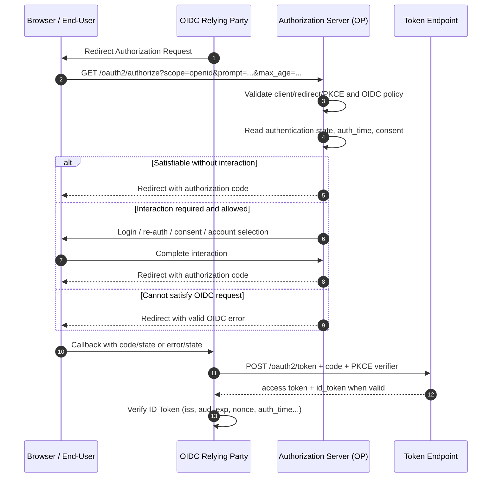

# Handling prompt, max_age, login_hint, and Parameters by Actual Support Level

## Lesson Objectives

In the **OIDC Core and ID Token** chapter of the **SPRING_SECURITY_OAUTH2_OIDC_AUTHORIZATION_SERVER** module, we learn how to understand, send, handle, and test interactive parameters in an **OpenID Connect (OIDC) Authentication Request** when building an **Authorization Server** with **Spring Security**, **Spring Authorization Server**, and **Spring Boot**.

Three parameters are frequently confused: `prompt`, `max_age`, and `login_hint`:

- `prompt` requests or restricts **user interaction** (re-login, consent, account selection, or no UI).
- `max_age` sets a limit on the **age of the most recent user authentication**, not the access token expiry or cookie lifetime.
- `login_hint` merely **hints at the identity to sign in**; it neither authenticates the user nor replaces account selection.

OIDC Core defines what these parameters mean, yet **a framework accepting or preserving a parameter in the request does not prove the framework fully enforces it**. With Spring Authorization Server, you must distinguish between available configuration APIs, end-to-end verifiable behavior, application logic you must build yourself, and requests that must be actively rejected when unsupported.

### Expected Outcomes

After this lesson, you will be able to:

1. Distinguish an OAuth2 Authorization Code request from an OIDC Authentication Request carrying the `openid` scope.
2. Accurately describe `prompt=none`, `prompt=login`, `prompt=consent`, and `prompt=select_account`, including combined values.
3. Enforce `max_age` against **actual authentication** timestamps and emit `auth_time` in the ID Token when OIDC requires it.
4. Use `login_hint` to improve UX without turning it into identity proof.
5. Recognize the meaning and boundaries of `id_token_hint`, `ui_locales`, `acr_values`, `claims`, `display`, `nonce`, and request object parameters.
6. Classify support into **built-in**, **requires configuration**, **requires application logic**, and **version-dependent verification**.
7. Add parameters in Spring Security OAuth2 Client and validate/enforce policy on the Authorization Server without breaking default checks.
8. Design test cases for existing sessions, silent authentication, consent, step-up, account switching, and standard OIDC errors.

> **Running scenario:** `employee-portal` uses Authorization Code + PKCE with Spring Security OAuth2 Client to sign in to `https://auth.example.com`. The user already has an SSO session. Before a sensitive action, the portal wants recent authentication (e.g., at most 5 minutes old); when checking SSO non-interactively, the portal uses `prompt=none`; the login screen can accept `login_hint`. Every request must remain OAuth2/OIDC-compliant and never grant privileges beyond the active session.

## 1. Placing Parameters in the OIDC Authorization Code Flow

OIDC extends OAuth 2.0 to provide information about **user authentication** via an **ID Token**. In the Authorization Code Flow, the Relying Party (RP, OAuth2 Client) redirects the browser to the Authorization Endpoint of the OpenID Provider (OP, Authorization Server), the user authenticates/consents if required, and then the client exchanges the code at the Token Endpoint.



### 1.1. Example Authentication Request

For readability, the URL below is wrapped across lines; in an actual request, values must be **URL-encoded** with no line breaks in the URI.

```http
GET /oauth2/authorize?response_type=code
    &client_id=employee-portal
    &redirect_uri=https%3A%2F%2Fportal.example.com%2Flogin%2Foauth2%2Fcode%2Femployee
    &scope=openid%20profile
    &state=RANDOM_CSRF_VALUE
    &nonce=RANDOM_NONCE_VALUE
    &code_challenge=BASE64URL_SHA256_CODE_VERIFIER
    &code_challenge_method=S256
    &prompt=login
    &max_age=300
    &login_hint=alice%40example.com HTTP/1.1
Host: auth.example.com
```

Parameter groups:

| Group | Parameters | Role |
|---|---|---|
| Core OAuth2 | `response_type`, `client_id`, `redirect_uri`, `scope`, `state` | Identifies client, flow, requested permissions, callback, and CSRF-protecting session binding. |
| PKCE | `code_challenge`, `code_challenge_method` | Binds the authorization code to the client holding the verifier. |
| OIDC | `openid` in scope, `nonce` | Enables OIDC; binds the ID Token to the request and mitigates replay. |
| OIDC interaction | `prompt`, `max_age`, `login_hint` | Guides login UX/freshness and hints at the identity. |
| Extended OIDC | `id_token_hint`, `acr_values`, `ui_locales`, `claims`, `display` | Hints for session, assurance, language, claims, and UI display. |

**Key point:** OIDC interaction parameters belong to the **Authorization Request** (typically via browser redirect), not the Token Endpoint. Never try adding `prompt=login` to `POST /oauth2/token` to force re-login; the authorization code exchange has no user-authentication UI.

### 1.2. Facts You Must Never Infer From the Request

- Sending `prompt=login` does not prove the user **actually** re-logged in.
- Sending `max_age=300` does not prove the user authenticated within 300 seconds; you must check actual `auth_time`.
- Sending `login_hint=alice@example.com` does not prove the current user is Alice.
- Sending `acr_values` does not prove MFA occurred.
- Having `nonce` in the request does not let the client skip comparing `nonce` in the ID Token.
- Having `scope=openid` does not automatically expose all PII at UserInfo.

## 2. `prompt`: Four OIDC Core Values to Know

Per OpenID Connect Core 1.0 section 3.1.2.1, `prompt` is a space-delimited, case-sensitive ASCII list. The values defined by OIDC Core are:

| Value | Standard Meaning | Common Use Case |
|---|---|---|
| `none` | **Display no authentication/consent UI**; if interaction is required, return an error. | Silent SSO check, probing existing OP session. |
| `login` | Prompt the user to reauthenticate, even if a session already exists. | Re-confirming identity before a sensitive transaction. |
| `consent` | Prompt the user for consent, if possible. | Refreshing consent for a client/claims. |
| `select_account` | Prompt the user to choose an account. | Devices/sessions with multiple signed-in accounts. |

A request can combine multiple space-separated values such as `prompt=login%20consent`, but **`none` must never be combined with any other value**.

### 2.1. `prompt=none`: Never Display UI

```http
GET /oauth2/authorize?response_type=code&client_id=employee-portal
    &scope=openid&state=STATE&prompt=none HTTP/1.1
Host: auth.example.com
```

If the OP already holds an eligible authentication session, sufficient consent, and all other conditions pass, the OP may issue an authorization code **without showing any screen**.

If the user is not signed in, needs re-auth, lacks consent, or needs account selection/MFA, the OP must not render UI to "get it done"; it must return the appropriate OIDC error, for example:

```http
HTTP/1.1 302 Found
Location: https://portal.example.com/callback?error=login_required&state=STATE
```

This assumes `redirect_uri` has been validated and the callback is trustworthy. Never redirect to an unvalidated attacker-supplied URI. Depending on the situation, errors may be `login_required`, `consent_required`, `interaction_required`, or another valid standard extension error.

**Never do this:** the OP receives `prompt=none` and redirects to `/login`, opens a consent screen, shows an account chooser, or renders a captcha. If a security filter chain redirects before OIDC logic sees the request, the implementation does not yet satisfy silent-error behavior.

#### Invalid Combinations

```text
prompt=none login
prompt=none consent
prompt=none select_account
```

OIDC Core requires returning an error when `none` appears alongside another value. Never silently pick one of them and proceed.

### 2.2. `prompt=login`: Re-Authentication, Not "Passing Through via SSO"

The OP must ensure reauthentication happens when the client requests `prompt=login`. If the user already has an SSO cookie, **merely reading the cookie and issuing a code** does not establish a new authentication. The OP must perform active reauthentication using a policy-compliant method.

- This may use password/passkey/MFA or authentication from an OP-trusted upstream Identity Provider.
- The authentication timestamp must be updated after **actual authentication completes**, not when the request arrives.
- If reauthentication is impossible, return an OIDC error like `login_required` instead of treating an old session as fresh.
- Never assume `login_hint` suffices to reauthenticate.
- A "Continue" screen that performs no real authentication may fail to satisfy re-auth requirements.

`prompt=login` is an interaction directive; **`max_age`** is the quantitative directive on authentication age.

### 2.3. `prompt=consent`: Different From Routine Consent

Spring Authorization Server offers `ClientSettings.requireAuthorizationConsent(true)` to require consent per registration and `OAuth2AuthorizationConsentService` to persist granted consent. Distinguish the two:

- `requireAuthorizationConsent(true)` is the general setting requiring consent for a client per framework logic.
- `prompt=consent` is a **per-request** directive asking to prompt the user again, even if they previously consented.

If the framework or app **reuses stored consent**, showing the consent screen again is a separate UX/policy requirement you must enforce. Simply accepting a `prompt=consent` query parameter without displaying consent does not mean its semantics are supported.

If consent cannot be collected when requested, the OP must return an appropriate error such as `consent_required`. When `prompt=none` is sent and the client lacks consent, return the error **without rendering the consent page**.

### 2.4. `prompt=select_account`: Real Account Selection Is Required

An OP may hold multiple sessions or allow users to switch accounts. `select_account` requests an opportunity to choose an identity.

- Never pull an email from `login_hint` and switch `sub` automatically.
- Never expose a list of accounts to untrusted clients or leak whether accounts exist.
- If only one account exists and multi-account is unsupported, maintain a clear policy and UI/behavior tested for your supported profile.
- When account selection is impossible when required, OIDC defines the typical error `account_selection_required`.
- After selection, the ID Token's `sub` must reflect the account actually authenticated.

### 2.5. Multi-Value Lists and Unknown Values

For example, `prompt=login%20consent` can require both reauthentication and consent. Client and OP must URL-encode spaces and handle interaction ordering consistently.

OIDC Core lets an OP **ignore or return an error** for an unrecognized `prompt` value to allow future extensions. If your system chooses a strict allowlist, document and test it; do not turn silently ignoring unknown values into a risk-reduction shortcut.

## 3. `max_age`: Authentication Age and the `auth_time` Claim

`max_age` is the maximum elapsed seconds since the End-User was **actively authenticated** by the OP. When authentication age exceeds this value, the OP **must attempt to reauthenticate**.

Example:

```text
Current time:             10:05:00
Actual auth time:         09:57:00
max_age:                  300 seconds
Authentication age:       480 seconds
Conclusion:               Re-authentication required before issuing code/ID Token
```

If the same request also contains `prompt=none`, **no re-auth UI may be shown**. The OP must return an error because the requirement cannot be met non-interactively.

### 3.1. `max_age=0` and `prompt=login`

OIDC Core specifies that `max_age=0` is equivalent to `prompt=login` in requiring reauthentication. However, `max_age` has an additional consequence for the **ID Token**: whenever the request includes `max_age`, the returned ID Token **must include the `auth_time` claim**.

| Request | May Reuse Active Login Session? | `auth_time` in ID Token |
|---|---|---|
| Neither `max_age` nor `prompt=login` | Yes, if policy allows. | Typically optional, unless requested as an essential claim. |
| `max_age=300`, session logged in 1 min ago | Yes. | **Required** to include `auth_time`. |
| `max_age=300`, last auth 20 min ago | Must attempt reauthentication. | **Required** to include `auth_time` once completed. |
| `max_age=0` | Must actively reauthenticate. | **Required** to include `auth_time`. |
| `prompt=login` without `max_age` | Must reauthenticate. | Not made mandatory by `max_age`; include if profile/app needs it. |
| `prompt=none&max_age=0`, no just-completed auth | Must not show login UI. | Return an error if unsatisfiable; never issue an ID Token lacking `auth_time`. |

### 3.2. `auth_time` Is Not `iat`

In an ID Token:

- `iat`: when the **ID Token was issued**.
- `auth_time`: when the **user actually authenticated**.
- `exp`: when the **ID Token expires**.

Illustrative ID Token payload:

```json
{
  "iss": "https://auth.example.com",
  "sub": "user-123",
  "aud": "employee-portal",
  "iat": 1794809400,
  "exp": 1794810300,
  "auth_time": 1794809160,
  "nonce": "RANDOM_NONCE_VALUE"
}
```

`auth_time` may be earlier than `iat` because the OP reused a valid SSO session. **Never set `auth_time=Instant.now()` when the Token Endpoint signs the ID Token** if the user did not authenticate at that moment. Doing so tricks the client into treating an old session as freshly authenticated.

OIDC Core requires `auth_time` to be UTC epoch seconds, typically a JSON number. When an ID Token is issued via a refresh token grant, `auth_time` (if present) still describes the original/corresponding authentication, not the refresh time.

### 3.3. Where to Obtain a Trustworthy Authentication Timestamp?

Spring Security `Authentication` and HTTP sessions indicate that a **user is authenticated**, yet they do not automatically guarantee the timestamp of the **last active authentication** with OIDC semantics.

Design storage for this timestamp:

1. When authentication actually succeeds, record the timestamp in a trusted security/session context.
2. Distinguish a fresh login from a restored or remember-me session.
3. If federating to an upstream IdP, trust only verified `auth_time` or equivalent upstream assertions.
4. On account switching or successful step-up, decide whether to update the auth timestamp per policy.
5. Bind the timestamp to the exact user, session, and client/authorization request; prevent races during parallel logins.
6. Persist/restore the timestamp across restarts and multiple instances if sessions survive restarts.
7. When minting the ID Token, use the **verified** timestamp from that state.
8. If data is missing to satisfy `max_age`, never fabricate `auth_time`—reauthenticate or return an appropriate error.

**Never use:** `HttpSession.getCreationTime()`, `/authorize` request arrival time, access token creation time, or last API access time as proof of authentication.

### 3.4. Clients Must Check `auth_time` Themselves

The OP is responsible for enforcing `max_age`, yet the RP must still verify the ID Token and authentication age when freshness is required.

RP-side pseudocode:

```java
Instant authenticatedAt = idToken.getAuthenticatedAt();
if (authenticatedAt == null) {
    throw new SecurityException("ID Token missing required auth_time");
}

Instant now = clock.instant();
Duration age = Duration.between(authenticatedAt, now);

if (age.isNegative() || age.compareTo(Duration.ofMinutes(5)) > 0) {
    throw new SecurityException("Authentication is not recent enough");
}
```

This example assumes `idToken` is an `OidcIdToken` whose **signature and standard claims have already been verified by Spring Security**. Production must handle clock skew per policy and avoid accepting excessively future-dated `auth_time` values. Never decode the payload and trust `auth_time` before verifying `iss`, `aud`, signature, and `nonce`.

## 4. `login_hint`: A Hint, Not Proof of Identity

`login_hint` lets the RP suggest which user intends to sign in, such as an email, username, phone number, or OP-understood identifier.

```text
login_hint=alice%40example.com
```

The OP may use the hint to:
- Pre-fill the username field.
- Show a "Continue as ..." message after appropriate checks.
- Suggest a tenant/realm or perform home realm discovery **after validating required data**.
- Save a typing step when the client legitimately knows the username.

The OP may also ignore the hint for security, privacy, or lack of support.

### 4.1. What You Must Never Do

- Never auto-login a user based solely on `login_hint`.
- Never populate `sub` in the ID Token from raw `login_hint` without authentication.
- Never skip MFA/step-up because the hint matches a stored account.
- Never use the hint to bypass `prompt=select_account`.
- Never return messages that reveal to unauthorized parties whether an email/account exists.
- Never write PII-bearing hints to logs, metrics, analytics, reverse proxy access logs, or unexpected referrers.
- Never let a client send `tenant=admin`/email and treat it as a trust boundary.

**Attack example:** An attacker edits the URL from `login_hint=alice@example.com` to `login_hint=admin@example.com`. If the OP picks that account or opens an admin session purely from the hint, that is a critical authentication flaw. The right approach is using the hint for UX display while deriving the final identity strictly from trusted authentication/SSO results.

### 4.2. Using a Hint When an Account Is Already Signed In

When the OP already has Bob's session and receives `login_hint=alice@example.com`:

- Never silently morph Bob's session into Alice's.
- You may keep Bob's session if policy does not bind the hint and the request does not demand a different account.
- You may present an account chooser or prompt Alice to sign in if appropriate.
- If the client needs **mandatory subject binding**, consider `claims.id_token.sub` with `value` per OIDC Core where the OP supports it, or an explicit account selection mechanism; never use `login_hint` as a mandatory constraint.

`login_hint` is only a hint; any subject/tenant enforcement policy must be explicit in the contract.

## 5. Related OIDC Parameters and Support Boundaries

Beyond `prompt`, `max_age`, and `login_hint`, other OIDC Core parameters often appear in Authorization Requests:

| Parameter | Standard Meaning | Implementation Boundary |
|---|---|---|
| `id_token_hint` | Previously issued ID Token hinting at session/subject. | Must verify trust and never treat as fresh authentication. |
| `ui_locales` | Ordered list of preferred BCP47 language tags. | Login/consent UI must support localization; unsupported locales can be ignored. |
| `acr_values` | Ordered list of preferred ACRs. | Meaningful only when the OP has an assurance mapping and supports step-up. |
| `claims` | JSON object requesting specific ID Token/UserInfo claims. | Optional support; requires parser, consent, data minimization, and essential-claim logic. |
| `display` | UI display hint: `page`, `popup`, `touch`, `wap`. | No UI is forced to support every display mode. |
| `nonce` | Binds RP session to ID Token; mitigates replay. | Client must generate strong entropy and verify `nonce` in the ID Token when sent. |
| `response_mode` | How the authorization response is returned. | Use only modes the OP/flow truly supports and secures. |
| `request` | Request Object JWT carrying authentication parameters. | Optional support; validation/JOSE/parameter precedence are critical. |
| `request_uri` | Reference to a Request Object or corresponding request URI mechanism. | Distinguish OIDC `request_uri` from OAuth2 PAR; never auto-fetch untrusted URLs. |

### 5.1. `id_token_hint` and `prompt=none`

OIDC Core recommends sending `id_token_hint` with `prompt=none` when possible so the OP knows which session the client references. However:
- Not every `prompt=none` request requires a hint; the OP should succeed when possible even without one.
- An OP may return `invalid_request` if a hint is missing under a specific profile, but do not assume that applies to all OPs.
- An ID Token hint comes from a prior issuance; it does not prove the user is currently signed in.
- Bind the hint to a trusted issuer/client/session/subject and active authentication policy.

Do not confuse `id_token_hint` in an **Authentication Request** with `id_token_hint` in **OIDC RP-Initiated Logout**: same parameter name, different context, purpose, and processing.

### 5.2. `ui_locales` and `display`: UI Preferences

`ui_locales=vi-VN%20en-US` indicates the client prefers Vietnamese UI first, then English. The OP may pick the first locale the app supports. Never reject an otherwise valid login request solely because a locale is unsupported.

`display=popup` suggests a popup view, yet the UI must still maintain browser security restrictions and proper CSRF/state/redirect handling; never weaken clickjacking protections just to support popups.

### 5.3. `acr_values` Differs From Essential `claims.id_token.acr`

`acr_values` is a preference-ordered list of ACRs requested by the RP; it **does not turn the request into a mandatory MFA constraint**.

If the application mandates step-up, it needs an assurance policy:

- Define which ACRs map to password, passkey, MFA, or other authentication methods.
- Record authentication method evidence (`amr` when appropriate).
- Ensure the OP genuinely reached the level before emitting that `acr` in the ID Token.
- Never set `acr=high` simply because the client sent `acr_values=high`.
- Verify `acr` at the RP when it is a business security requirement.
- If the OP supports `claims` and the RP requests essential `acr` with a specific `value`/`values`, OIDC Core requires stricter enforcement than ordinary `acr_values`.

Example `claims` request when the OP actually supports it:

```json
{
  "id_token": {
    "auth_time": {"essential": true},
    "acr": {"essential": true, "values": ["urn:example:acr:mfa"]}
  },
  "userinfo": {
    "email_verified": {"essential": true}
  }
}
```

The JSON above must be URL-encoded when passed in the Authorization Request query/form. `essential` does not guarantee every OP returns the claim; OIDC Core defines specific handling when an essential claim is unavailable or when an essential `acr` has required values. Clients must verify the response rather than trusting their own request.

### 5.4. `request` and `request_uri`

OIDC Core defines Request Objects as JWTs passed via `request` or `request_uri`. Support is optional; if an OP does not support them per its profile, it must return an appropriate standard error rather than silently ignoring security constraints.

OAuth 2.0 **Pushed Authorization Requests (PAR)** also uses `request_uri`, yet it is a distinct flow with a push endpoint and server-issued `request_uri`. Never assume a framework supporting a PAR endpoint automatically supports arbitrary OIDC Request Objects or arbitrary URLs.

**Risks to prevent:** SSRF from client-supplied `request_uri`, bypassing `redirect_uri` validation, wrong precedence between outer query parameters and Request Object claims, unverified signatures, oversized requests, and logging Request Objects containing PII.

## 6. Build an Actual Support Matrix Instead of Guessing From Parameter Names

The **Spring Authorization Server 1.5.8** documentation describes `OAuth2AuthorizationEndpointConfigurer`, converters, providers, authorization request validators, consent pages, and OIDC endpoints. It does not promise that every secondary OIDC Core parameter is automatically enforced simply because OIDC is enabled.

Evaluate your exact dependency stack, including:
- Spring Boot, Spring Security, and Spring Authorization Server (if using the standalone line).
- `SecurityFilterChain`, login entry points, consent pages, and session registries.
- Custom converters/providers/validators/callbacks installed by the application.
- Upstream Identity Providers if the app performs federation.
- The OIDC client SDK actually building requests and validating ID Tokens.

### 6.1. Capability Matrix to Populate via E2E Tests

| Feature | OIDC Core Standard | What to Verify in Your Spring App |
|---|---|---|
| `scope=openid`, Authorization Code, ID Token | Core of the OIDC Code Flow. | Enable `oidc(...)`, configure JWK/JWT, and register client/redirect/PKCE properly. |
| `prompt=none` | Non-interactive; returns error when session/consent is missing. | Test provider behavior and especially entry point/`SecurityFilterChain` when user is unauthenticated. |
| `prompt=login` | Active reauthentication. | Prove login actually ran rather than merely reusing an SSO cookie. |
| `prompt=consent` | Prompts for consent. | Test with already-saved consent; `requireAuthorizationConsent` alone does not prove re-consent. |
| `prompt=select_account` | Account selection. | Requires UX/account manager; does not appear automatically from the parameter. |
| `max_age` | Reauthenticate when age exceeded; ID Token includes `auth_time`. | Persist real auth time, check age, emit/verify claim, and test clock behavior. |
| `login_hint` | Identity hint, optional. | Login UI may use or ignore it; forbidden to treat as a credential. |
| `ui_locales`/`display` | UI hints. | Verify real UI support, locales, and resources. |
| `acr_values`/`claims` | Assurance/claim requests; conditional support. | Verify actual ID Token `acr`, `auth_time`, consent, schema, and feature flags. |
| `id_token_hint` | Prior session/identity hint. | Verify trust handling and user/client binding. |
| `request`/`request_uri` | Optional, with dedicated validation rules. | Verify discovery, server capability, JOSE/PAR semantics, and standard errors. |

**A test showing only that a request did not return 400 is insufficient.** Verify sessions, UI, callbacks, and actual ID Tokens. Every row in the matrix must be marked `SUPPORTED`, `CUSTOM_IMPLEMENTED`, `REJECTED`, or `NOT_TESTED` for your exact version/profile—never claim "full OIDC Core support" lightly.

### 6.2. Version Note on `prompt=none`

Spring Authorization Server 1.4+ handles `prompt=none` in specific cases, yet that does not exempt you from testing your security chain and error redirects. During the transition from Spring Authorization Server 1.x to integrated Authorization Server support in Spring Security 7.x, public reports noted that `AuthorizationFilter` and endpoint filter ordering can route unauthenticated requests to the login entry point before returning OIDC `login_required`. Even when issues are closed as configuration responsibility, **this remains a critical integration test case**.

Never hastily set `permitAll()` on `/oauth2/authorize` to "make `prompt=none` work" without architectural review: the Authorization Endpoint must protect code issuance, redirects, and user sessions. Review filter/entry-point configuration for your version, preserve standard validation steps, and test OIDC callback error semantics.

## 7. Sending Parameters From Spring Security OAuth2 Client

This is the **RP/Client side**, not Spring Authorization Server configuration.

Spring Security provides `DefaultOAuth2AuthorizationRequestResolver` and `setAuthorizationRequestCustomizer(...)` to add parameters to the Authorization Request.

### 7.1. Example Client Always Requiring Recent Authentication

```java
import org.springframework.context.annotation.Bean;
import org.springframework.security.config.annotation.web.builders.HttpSecurity;
import org.springframework.security.oauth2.client.registration.ClientRegistrationRepository;
import org.springframework.security.oauth2.client.web.DefaultOAuth2AuthorizationRequestResolver;
import org.springframework.security.oauth2.client.web.OAuth2AuthorizationRequestResolver;
import org.springframework.security.web.SecurityFilterChain;

@Bean
SecurityFilterChain clientSecurityFilterChain(
        HttpSecurity http,
        ClientRegistrationRepository registrations) throws Exception {

    DefaultOAuth2AuthorizationRequestResolver resolver =
            new DefaultOAuth2AuthorizationRequestResolver(
                    registrations, "/oauth2/authorization");

    resolver.setAuthorizationRequestCustomizer(builder ->
            builder.additionalParameters(params -> {
                params.put("max_age", "300");
                params.put("login_hint", "alice@example.com");
            }));

    http.authorizeHttpRequests(auth -> auth
                .anyRequest().authenticated())
        .oauth2Login(oauth2 -> oauth2
                .authorizationEndpoint(endpoint ->
                        endpoint.authorizationRequestResolver(resolver)));

    return http.build();
}
```

**Notes:**
- `alice@example.com` is an example string—never hardcode it in a real app. For multi-user apps, obtain hints from trusted UI/business state after validation and privacy checks.
- This snippet illustrates adding `max_age`/`login_hint` to the URL; it **does not guarantee the OP enforces** reauthentication or automatically verifies `auth_time`.
- In apps with multiple `ClientRegistration`s, this customizer affects all registrations; scope it by provider/client contract or use a request resolver decorator.
- `DefaultOAuth2AuthorizationRequestResolver` constructs standard values (redirect, scope, state, PKCE when configured). Never assemble URLs manually and lose those protections.
- Session storage, authorization repository, and full business configuration are omitted; this is an illustrative integration snippet.

### 7.2. Example Requesting Login and Consent

```java
resolver.setAuthorizationRequestCustomizer(builder ->
        builder.additionalParameters(params -> {
            params.put("prompt", "login consent");
            params.put("max_age", "0");
        }));
```

OIDC Core permits compatible multiple prompt values. Clients should avoid sending `prompt=none` alongside `prompt=login` or `consent`. Never populate `prompt` from raw query parameters where an attacker could make the RP skip an intended step-up.

### 7.3. Setting Requirements per Business Route

Not every RP action needs reauthentication. For example:
- Standard dashboard page: do not send a short `max_age`.
- Viewing sensitive reports: `max_age=300`.
- Changing payment methods: `max_age=0` or step-up per ACR policy.
- Non-interactive SSO check: `prompt=none`, with fallback to explicit login flow.
- Account switching: `prompt=select_account` when the OP truly supports it.

Client-sent parameters are **requests**; enforcement requires OP, RP, and policy together. For silent flows, browser cookie partitioning / third-party cookie restrictions can prevent the OP from seeing its session inside an iframe. Never rely on hidden-iframe silent login as a dependable long-term refresh mechanism; consider Authorization Code with refresh tokens/BFF under a secure policy.

## 8. Spring Authorization Server Configuration and Extension Points

### 8.1. Enabling OIDC and Preserving Standard Authorization Code Steps

Spring Authorization Server 1.5.x configures OIDC via `OAuth2AuthorizationServerConfigurer.oidc(...)`. Skeleton example:

```java
@Bean
@Order(1)
SecurityFilterChain authorizationServerSecurityFilterChain(
        HttpSecurity http) throws Exception {

    var as = OAuth2AuthorizationServerConfigurer.authorizationServer();

    http.securityMatcher(as.getEndpointsMatcher())
        .with(as, configurer -> configurer
                .oidc(Customizer.withDefaults())
                .authorizationEndpoint(endpoint -> endpoint
                        .consentPage("/oauth2/consent")))
        .authorizeHttpRequests(authorize -> authorize
                .anyRequest().authenticated());

    return http.build();
}
```

Imports: `org.springframework.core.annotation.Order`, `org.springframework.context.annotation.Bean`, `org.springframework.security.config.Customizer`, `org.springframework.security.config.annotation.web.builders.HttpSecurity`, `org.springframework.security.web.SecurityFilterChain`, `org.springframework.security.oauth2.server.authorization.config.annotation.web.configurers.OAuth2AuthorizationServerConfigurer`.

This is a **skeleton**, not a standalone Authorization Server. You still need `RegisteredClientRepository`, `OAuth2AuthorizationService`, `OAuth2AuthorizationConsentService`, `JWKSource<SecurityContext>`, `AuthorizationServerSettings`, a login filter chain, cookie/session config, and the `/oauth2/consent` view.

This configuration does not automatically build login UI reauthentication, account selection, or `max_age` enforcement. Do not enable OIDC just to accept `prompt` without implementing the protocol capability.

### 8.2. Documented Spring Extension Points

`OAuth2AuthorizationEndpointConfigurer` offers:
- `authorizationRequestConverter(...)` / `authorizationRequestConverters(...)`: parses requests.
- `authenticationProvider(...)` / `authenticationProviders(...)`: request authentication logic.
- `authorizationResponseHandler(...)` / `errorResponseHandler(...)`: protocol responses.
- `consentPage(...)`: consent UI.
  
`OAuth2AuthorizationCodeRequestAuthenticationProvider` offers:
- `setAuthenticationValidator(...)` to extend request validation; you must retain the default validator.
- `setAuthorizationConsentRequired(...)` (in supporting versions) to customize the **decision to require consent**, optionally using request/consent state as input.

Spring Security form login/SSO/sessions must handle:
- Real authentication and recording `auth_time`.
- Recognizing `prompt=login` and forcing reauthentication.
- Handling `prompt=none` without displaying UI.
- Account selection and `login_hint` UX.
- OIDC-compliant error propagation back to the RP callback.

**Do not confuse request parameter validation with interaction enforcement.** An `AuthenticationValidator` rejects `max_age=-5`, yet it does not prove reauthentication occurred or that the ID Token carries `auth_time`.

### 8.3. Example Safe Validator for `prompt`/`max_age` Syntax

The following Java example validates values in the Authorization Request while preserving Spring's default validator. It **does not by itself enforce** `prompt=login`, `max_age`, consent, or account selection:

```java
package com.example.authserver.oidc;

import java.util.Arrays;
import java.util.LinkedHashSet;
import java.util.Set;
import java.util.function.Consumer;

import org.springframework.security.oauth2.core.OAuth2Error;
import org.springframework.security.oauth2.core.OAuth2ErrorCodes;
import org.springframework.security.oauth2.server.authorization.authentication.OAuth2AuthorizationCodeRequestAuthenticationContext;
import org.springframework.security.oauth2.server.authorization.authentication.OAuth2AuthorizationCodeRequestAuthenticationException;
import org.springframework.security.oauth2.server.authorization.authentication.OAuth2AuthorizationCodeRequestAuthenticationToken;
import org.springframework.security.oauth2.server.authorization.authentication.OAuth2AuthorizationCodeRequestAuthenticationValidator;

public final class OidcInteractionRequestValidator
        implements Consumer<OAuth2AuthorizationCodeRequestAuthenticationContext> {

    private final OAuth2AuthorizationCodeRequestAuthenticationValidator defaults =
            new OAuth2AuthorizationCodeRequestAuthenticationValidator();

    @Override
    public void accept(OAuth2AuthorizationCodeRequestAuthenticationContext context) {
        // DO NOT skip the framework's redirect_uri and scope checks.
        defaults.accept(context);

        OAuth2AuthorizationCodeRequestAuthenticationToken request =
                context.getAuthentication();

        if (!request.getScopes().contains("openid")) {
            return;
        }

        Object rawPrompt = request.getAdditionalParameters().get("prompt");
        if (rawPrompt != null) {
            if (!(rawPrompt instanceof String)) {
                invalidRequest(request);
            }
            String prompt = (String) rawPrompt;
            if (prompt.isBlank()) {
                invalidRequest(request);
            }

            Set<String> values = new LinkedHashSet<>(
                    Arrays.asList(prompt.strip().split("\\s+")));

            if (values.contains("none") && values.size() != 1) {
                invalidRequest(request);
            }

            // STRICT contract chosen by the application; OIDC Core also allows
            // ignoring an unrecognized extension value instead of returning an error.
            Set<String> supported = Set.of(
                    "none", "login", "consent", "select_account");
            if (!supported.containsAll(values)) {
                invalidRequest(request);
            }
        }

        Object rawMaxAge = request.getAdditionalParameters().get("max_age");
        if (rawMaxAge != null) {
            if (!(rawMaxAge instanceof String)) {
                invalidRequest(request);
            }
            String seconds = (String) rawMaxAge;
            if (seconds.length() > 10 || !seconds.matches("[0-9]+")) {
                invalidRequest(request);
            }
            try {
                Long.parseLong(seconds);
            } catch (NumberFormatException ex) {
                invalidRequest(request);
            }
        }
    }

    private static void invalidRequest(
            OAuth2AuthorizationCodeRequestAuthenticationToken request) {
        throw new OAuth2AuthorizationCodeRequestAuthenticationException(
                new OAuth2Error(OAuth2ErrorCodes.INVALID_REQUEST),
                request);
    }
}
```

**Accuracy notes for this example:** 
- This is **request validation**; storing values in `additionalParameters` is only one part of the flow. With PAR or custom converters, ensure parameters enter the request context and pass through the same validation rules.
- The sample applies a strict allowlist for `prompt`. OIDC Core permits alternative handling of unrecognized values; product policy should decide.
- The sample places no business upper bound on `max_age` beyond numeric syntax; production should enforce sensible upper bounds to prevent abuse with `0` or huge values.
- The sample does not resolve duplicate HTTP parameters; ensure converters/proxies enforce clear rules without parameter pollution.
- Never log raw `login_hint` or request parameters inside exceptions/logs.
- **Never register this validator and claim full OIDC interaction support.**

Attach the validator to the default provider via the hook:

```java
authorizationEndpoint.authenticationProviders(providers -> {
    for (var provider : providers) {
        if (provider instanceof OAuth2AuthorizationCodeRequestAuthenticationProvider standard) {
            standard.setAuthenticationValidator(
                    new OidcInteractionRequestValidator());
            return;
        }
    }
    throw new IllegalStateException("Authorization Code provider not found");
});
```

This snippet belongs inside the `.authorizationEndpoint(authorizationEndpoint -> ...)` lambda of the Authorization Server configurer. If you have custom providers or version API differences, verify ordering and preserve the original validator. Never replace the entire provider list just to add a few checks.

### 8.4. Why Doesn't a Validator Solve `prompt=none` When the User Is Not Signed In?

`OAuth2AuthorizationEndpointFilter` sits inside a `SecurityFilterChain`. `AuthorizationFilter`, `ExceptionTranslationFilter`, and the login entry point may process unauthenticated requests **before** or **differently from** the provider's interaction policy. The HTTP outcome might be a redirect to `/login` instead of an OIDC error back to the RP.

Therefore, test the actual path from browser to callback, including:
- Request with no session.
- Request with a stale session.
- Request with a session lacking consent.
- Request submitted via PAR.
- Request intercepted by an MFA/captcha gateway.
- Request behind a reverse proxy with a different callback URL.

If `prompt=none` is a critical capability, write E2E conformance tests before announcing support. Never mechanically apply `permitAll()` to an endpoint meant to be protected.

## 9. Ensuring `auth_time` in the ID Token

### 9.1. Recording Timestamp on Successful Authentication

Architecturally, the application should have a component like:

```java
import java.time.Instant;

// Application-defined example interface, not a built-in Spring API.
public interface OidcAuthenticationTimeService {

    // Records the timestamp after a REAL active authentication event.
    void recordAuthentication(
            String userId, String authenticationSessionId, Instant when);

    // Returns the verified timestamp; never derive from token issue time.
    Instant requireAuthenticationTime(
            String userId, String authenticationSessionId);
}
```

This interface illustrates the contract. Actual implementations can use a Spring Security `AuthenticationSuccessHandler`/session registry, distributed session store, or verified upstream federation claims. **Note:** these methods do not exist automatically in Spring and must be built, integrated, and tested per security policy.

### 9.2. Customizing the ID Token with `JwtEncodingContext`

Spring Authorization Server supports `OAuth2TokenCustomizer<JwtEncodingContext>`. Write `auth_time` only from a trusted timestamp source tied to the right authorization/session:

```java
import java.time.Instant;

import org.springframework.context.annotation.Bean;
import org.springframework.security.oauth2.core.oidc.IdTokenClaimNames;
import org.springframework.security.oauth2.core.oidc.endpoint.OidcParameterNames;
import org.springframework.security.oauth2.server.authorization.OAuth2Authorization;
import org.springframework.security.oauth2.server.authorization.token.JwtEncodingContext;
import org.springframework.security.oauth2.server.authorization.token.OAuth2TokenCustomizer;

@Bean
OAuth2TokenCustomizer<JwtEncodingContext> idTokenCustomizer() {
    return context -> {
        if (!OidcParameterNames.ID_TOKEN.equals(
                context.getTokenType().getValue())) {
            return; // Do not insert auth_time into access_token.
        }

        OAuth2Authorization authorization = context.getAuthorization();
        if (authorization == null) {
            return;
        }

        // This attribute is stored by the application after active authentication,
        // never auto-generated at token signing time.
        Instant authenticatedAt =
                authorization.getAttribute("oidc.authenticated_at");

        if (authenticatedAt != null) {
            context.getClaims().claim(
                    IdTokenClaimNames.AUTH_TIME,
                    authenticatedAt.getEpochSecond());
        }
    };
}
```

**Important:**
1. This only shows how to **emit the claim into the ID Token**, not a complete implementation of `max_age`. Persist the attribute on the right `OAuth2Authorization` from a verified login flow and preserve it when the authorization is stored.
2. If a request requires `auth_time` and the attribute is missing, **reject or reauthenticate before issuing the ID Token**; the snippet above does not perform that rejection.
3. Never write `auth_time=Instant.now()` inside the customizer.
4. Never alter `iss`, `sub`, `aud`, `exp`, `nonce`, or the ID Token's signature.
5. Ensure the customizer is attached to `JwtGenerator`; wire it explicitly if you instantiate your own `OAuth2TokenGenerator`.
6. Never assume `getAuthorization()` carries identical state across all grants; verify Authorization Code and Refresh Token flows for your version.

### 9.3. Measuring Authentication Age and Deciding at the OP

Pseudocode for the interaction policy:

```text
function evaluate(request, session, now):
    validateOauth2AndOidcRequest(request)

    if request.prompt contains "none" with another value:
        return error("invalid_request")

    if session absent:
        if request.prompt contains "none":
            return error("login_required")
        return interactiveLogin()

    if request.max_age is present:
        if trustedAuthTime absent:
            if request.prompt contains "none":
                return error("login_required")
            return interactiveReauthentication()
        if now - trustedAuthTime > request.max_age:
            if request.prompt contains "none":
                return error("login_required")
            return interactiveReauthentication()

    if request.prompt contains "login":
        return interactiveReauthentication()

    if requiresAccountSelection(request):
        if request.prompt contains "none":
            return error("account_selection_required")
        return accountSelectionUi()

    if requiresConsent(request, storedConsent):
        if request.prompt contains "none":
            return error("consent_required")
        return consentUi()

    return issueAuthorizationCode()
```

This is an **illustrative algorithm**, not a built-in Spring method. Real flows must handle multiple simultaneous conditions (e.g., both re-login and consent) and record which interactions completed to prevent redirect loops. Every error must flow through the standard redirect/error handler after `redirect_uri`/client validation passes.

## 10. Mandatory Test Matrix per Parameter

### 10.1. `prompt` Behavior

| Test Case | Session / Consent | Request | Expected Result |
|---|---|---|---|
| Silent success | Valid session, sufficient consent. | `prompt=none` | Code/callback without displaying UI. |
| Silent no session | Not logged in. | `prompt=none` | OIDC `login_required`/appropriate error at callback, never reaching login UI. |
| Silent needs consent | Logged in, missing consent. | `prompt=none` | `consent_required` or appropriate OIDC error; no consent page shown. |
| Silent needs fresh auth | Stale session. | `prompt=none&max_age=300` | Error, no login UI shown. |
| Invalid combination | Any. | `prompt=none%20login` | Error, condition never ignored. |
| Force login | Active session exists. | `prompt=login` | Active reauthentication occurs, not mere cookie reuse. |
| Force consent | Session + saved consent. | `prompt=consent` | Prompted again if profile/app commits to support. |
| Select account | Multiple user sessions exist. | `prompt=select_account` | Account chosen; ID Token `sub` matches authenticated user. |
| Unknown extension | Any. | `prompt=custom` | Error or ignore per documented and tested policy. |

### 10.2. `max_age`, `auth_time`, `login_hint`

| Test Case | Expectation |
|---|---|
| `max_age=300`, auth 60s ago | Session may be reused; ID Token must have accurate `auth_time`. |
| `max_age=300`, auth 600s ago | OP reauthenticates; ID Token gets new `auth_time` from real authentication. |
| `max_age=0`, old session | Re-auth equivalent to `prompt=login`; ID Token includes `auth_time`. |
| `max_age=abc` or negative number | Rejected by input validation, not misparsed or silently ignored. |
| Extremely large `max_age` | Bounded by validation/policy; no integer overflow. |
| ID Token issued 5 min after login | `auth_time` equals login time, **not** `iat` if user did not re-login. |
| ID Token issued via refresh | Preserves original/corresponding `auth_time`, never overwritten with refresh time. |
| `login_hint=alice`, session is Bob | Does not automatically switch identity; applies UI/user-choice policy. |
| `login_hint` with unknown email | Does not leak account enumeration; hint may be ignored. |
| `login_hint` with special characters | Input escaped; no XSS/HTML injection or PII logging. |

### 10.3. Additional Parameters

- `id_token_hint` with issuer/signature/client mismatch is handled safely; never accepted as a credential.
- `ui_locales=vi-VN en-US` picks a supported locale or fallback without altering security policy.
- `acr_values` yields an ID Token `acr` reflecting actual assurance, never copied blindly from the query.
- Essential `claims` for `auth_time`/`acr` follow profile rules; never unconditionally dump all PII claims.
- `display=popup` preserves Content Security Policy and frame protections.
- `nonce` in the request is echoed and verified by the RP in the ID Token.
- `request`/`request_uri`/PAR never bypass standard validation; no SSRF.
- Error callbacks preserve `state` and never leak tokens/codes to unverified redirects.

## 11. Testing Examples with MockMvc and Browser E2E

### 11.1. Validation Tests Do Not Replace Browser Tests

With Spring Boot Test + MockMvc, you can test certain validation cases once `RegisteredClient`, redirect URI, session, PKCE, and custom validator fixtures are set up:

```java
@SpringBootTest
@AutoConfigureMockMvc
class OidcInteractionRequestValidationTest {

    @Autowired
    MockMvc mvc;

    @Test
    void rejectsPromptNoneCombinedWithLogin() throws Exception {
        mvc.perform(get("/oauth2/authorize")
                .param("response_type", "code")
                .param("client_id", "employee-portal")
                .param("redirect_uri",
                        "https://portal.example.com/callback")
                .param("scope", "openid")
                .param("state", "STATE_EXAMPLE")
                .param("code_challenge", "PKCE_CHALLENGE_EXAMPLE")
                .param("code_challenge_method", "S256")
                .param("prompt", "none login"))
            // Assertion must match the exact handler/redirect behavior,
            // typically 302 with error=invalid_request at the callback.
            .andExpect(status().is3xxRedirection());
    }
}
```

**Important fixture note:** this code is **illustrative** and will not run standalone without an authenticated session or if the filter chain redirects to `/login` before the provider. `PKCE_CHALLENGE_EXAMPLE` is not a valid code challenge; generate a real PKCE verifier/challenge in tests. For E2E tests, assert that **Location** carries OIDC `error=invalid_request` and `state`, not merely a 302 status.

### 11.2. E2E Conformance Should Use a Real Browser

MockMvc excels at testing filters/providers and request logic, yet it cannot fully verify:
- Whether the login form actually renders.
- Session/SSO cookies after logout and timeouts.
- Browser third-party cookies, `SameSite`, and CSRF.
- Account selection UX, consent UI, and MFA.
- Redirects after login/re-auth and preservation of OIDC request state.
- RP validation of `nonce`, `auth_time`, and ACR.
- Multiple browser sessions and user accounts.

Therefore, include real browser end-to-end tests, network assertions, and tests against a real OIDC client SDK.

### 11.3. Testing the ID Token Against Its Contract

After the client exchanges the authorization code for tokens:
1. Verify the JWT signature with trusted JWKS.
2. Verify `iss` equals the configured issuer.
3. Verify `aud` contains the client ID, and `azp` when multiple audiences exist.
4. Verify `exp`, `iat`, and `nonce` if sent in the request.
5. With `max_age`, verify `auth_time` is present and matches the actual auth event.
6. With step-up, verify `acr`/`amr` against the committed profile.
7. Reject `auth_time` in the future or newer than actual login activity.
8. Verify the Token Endpoint does not issue ID Tokens to OAuth2-only clients not requesting `openid`.

Conceptual JSON assertions:

```text
assert(id_token.auth_time != null)
assert(id_token.auth_time <= request_completed_at + allowed_skew)
assert(request_completed_at - id_token.auth_time <= max_age + allowed_skew)
assert(id_token.iss == expected_issuer)
assert(id_token.aud contains registered_client_id)
assert(id_token.nonce == original_nonce)
```

If a test checks only that `auth_time` exists without verifying the timestamp's source or age, the implementation can still be broken.

## 12. Security and Operations

### 12.1. Never Lower Authentication Assurance Because of a Request Parameter

- The RP/client may ask for `prompt=login`, yet the OP must enforce a real authentication policy.
- `login_hint` is untrusted input; never unlock an account or select `sub` without credentials.
- `acr_values` does not let a client self-elevate ACR.
- `prompt=none` must never bypass missing consent or MFA.
- `max_age` does not replace session timeouts, idle timeouts, or token `exp`.
- Authorization requests must validate client, redirect, PKCE, state, response type, and scopes.
- Never allow external input to control arbitrary redirects, upstream IdP URLs, or dynamic login pages.

### 12.2. Privacy and Logging

Authorization Requests often traverse browsers, history, proxies, and observability pipelines, and may carry `login_hint`, `id_token_hint`, `claims`, and PII. Therefore:

- Avoid placing emails/phone numbers in URLs unless necessary; use PAR/JAR where supported.
- Redact sensitive query parameters in access logs and APM/tracing.
- Never log raw ID Tokens, authorization codes, nonces, PKCE verifiers, or request objects.
- Apply CSP, CSRF protection, and security headers to login/consent UIs.
- Never reflect hint values directly into HTML unescaped.
- Protect session storage, set `Secure`/`HttpOnly`/`SameSite` cookies appropriately, and trust only verified proxy headers.

### 12.3. Preventing Reauthentication/Consent Loops

If an OP receives `prompt=login`, completes login, and redirects back to the same request without marking the interaction complete, the system can prompt for login endlessly. Likewise, `prompt=consent` can trigger infinite consent prompts.

Persist per-request interaction state (state/authorization session ID) with expiry and anti-replay protection. Do not inspect only the query string at each step; track whether UI interaction has completed **for the current request**.

### 12.4. Multi-Instance Synchronization

When the OP runs multiple replicas:
- Sessions, `auth_time`, consent, and request context must be durably stored or shared per architecture.
- Another node must never assume a session reauthenticated merely because the request landed on it.
- Custom login/consent state must be tamper-proof and CSRF-protected.
- ID Token signers/JWKS must remain consistent.
- `prompt`/`max_age` policies and error handling must match across all instances.
- Measure login-to-code redirect latency and `login_required`/`consent_required` rates during silent auth.

### 12.5. Account-Safe Observability

Log structured fields such as:
- Registered `client_id` (if policy allows).
- Presence/absence of parameter names, not raw `login_hint` values.
- Outcome: silent success, needs login, needs consent, reauth success, error category.
- Rounded authentication-age buckets/metrics where helpful, avoiding unnecessary precise PII timestamps.
- Latency and version support matrix.

Never log raw `id_token_hint` or `nonce`. Never use email/`login_hint`/subject as metric labels.

## 13. Common Errors and Troubleshooting Guide

| Symptom | Possible Cause | Resolution |
|---|---|---|
| `prompt=none` still opens login form | Filter chain/entry point intercepts before provider or custom logic is missing. | Test unauthenticated E2E; check filter order/handlers for your version and error redirects. |
| `prompt=login` does not re-login | OP reuses SSO cookie or app only parses parameter. | Force active authentication and store real auth timestamp. |
| `max_age=0` still issues code from old session | `max_age` not enforced; only numeric validation exists. | Apply authentication age policy before issuing code. |
| ID Token has `auth_time=iat` despite old session | Customizer calls `now()` at token issuance. | Persist real login time; never recompute at Token Endpoint. |
| `max_age` accepted yet ID Token lacks `auth_time` | OP fails to propagate auth state/claim. | Integrate ID Token generation; fail/re-auth when timestamp is absent. |
| `prompt=consent` shows no UI | Consent service reuses prior consent or app ignores prompt. | Customize consent decision; test with previously saved consent. |
| `prompt=select_account` silently uses old account | No account selection UX implemented. | Advertise support only when UI and accurate `sub` binding exist. |
| `login_hint` switches current user | Raw hint trusted as credential. | Use hint only for UX pre-fill; authenticate user and verify session/account. |
| OIDC error missing `state` | Error redirect handler/custom filter drops `state`. | Preserve OAuth2 callback contract and verify redirect URI. |
| Custom validator breaks OAuth2 requests | Omitted default redirect/scope validation. | Delegate to default validator before custom checks. |
| `prompt` sent to Token Endpoint | Wrong protocol layer. | Send in the Authorization Request from the RP. |
| `acr_values` echoed as `acr` | Missing assurance mapping. | Emit only ACR levels actually achieved. |
| Callback stuck in redirect loop | Per-request interaction state not marked complete. | Track per-request state, expiry, and anti-replay. |
| `request_uri` exploited for SSRF | Fetches arbitrary unvalidated URLs. | Support request objects/PAR only with allowlists, limits, and verification. |
| Silent iframe fails frequently | Third-party cookie restrictions and session partitioning. | Use explicit redirects, refresh tokens, or BFF instead of iframes. |
| MockMvc test gets 302 but passes falsely | 302 points to login page rather than RP error callback. | Assert `Location`, `error`/`state`, and absence of UI. |

## 14. Hands-On Exercise

**Scenario:** `employee-portal` has the following requirements:
- Standard SSO for the profile page.
- Contract approval page requires authentication within the last 5 minutes.
- SSO check route must display no UI.
- Sign-ins from email invitations supply `login_hint`.
- Occasionally the client asks the user to re-select an account.

### Implementation Requirements

1. Enable OIDC Authorization Code + PKCE and register `employee-portal` with valid redirect URIs.
2. Configure Spring Security OAuth2 Client to send `prompt=none` for SSO checks, `max_age=300` for approvals, and `login_hint` for invitations.
3. Document the capability matrix for your actual Spring Authorization Server / Spring Security version.
4. Implement a request validator preserving default redirect/scope checks and validating `prompt`/`max_age` syntax.
5. Design an authentication time store driven by successful logins, never JWT signing time.
6. Enforce reauthentication when `max_age` is exceeded; `max_age=0` forces active login.
7. Emit ID Tokens carrying `auth_time` from the real authentication event when requested.
8. With `prompt=none`, return OIDC errors to the RP when session/consent is missing; never redirect to the login form.
9. With `prompt=consent`, verify previously saved consent is still re-prompted if your app commits to supporting it.
10. With `prompt=select_account`, implement it or explicitly reject it if unsupported; never pick users from `login_hint`.
11. Test invalid `login_hint`, XSS payloads, and email enumeration; verify PII redaction.
12. Test E2E across two instances behind a load balancer, reverse proxy, and real browsers.
13. Verify the RP validates `nonce`, `state`, PKCE, and ID Token signature/issuer/audience/`auth_time`.
14. Run relevant OpenID conformance tests/profiles and document unsupported areas clearly.

**Completion criteria:** No codes/ID Tokens are issued violating interaction policies; `max_age` is backed by real `auth_time` verified by the RP; `prompt=none` renders no UI; `login_hint` never alters identity without authentication; and claimed support is proven by actual tests rather than parameter names alone.

## 15. Pre-Handoff Checklist

- [ ] Confirm `openid`/Authorization Code/PKCE/nonce flow and client registration are accurate.
- [ ] `prompt` parses a case-sensitive list, and `none` is never combined with other values.
- [ ] `prompt=none` achieves silent success or returns proper OIDC errors without showing login/consent UI.
- [ ] `prompt=login` triggers active reauthentication even when an SSO session exists.
- [ ] `prompt=consent` is not swallowed by prior consent if the app promises support.
- [ ] `prompt=select_account` has real UX or is clearly documented as unsupported.
- [ ] `max_age` evaluates authentication age against a trusted authentication timestamp.
- [ ] `max_age=0` is handled as reauthentication, not merely checking `iat`.
- [ ] ID Token includes `auth_time` when `max_age` is sent or `auth_time` is essential.
- [ ] `auth_time` reflects real login and is preserved properly across refresh grants.
- [ ] RP verifies signature, `iss`, `aud`, `exp`, `nonce`, and `auth_time` when required.
- [ ] `login_hint` is treated strictly as a hint, never as a credential, `sub`, or tenant proof.
- [ ] `id_token_hint` is handled under a trust model, never self-authenticating from the hint.
- [ ] `acr_values` is never copied straight into `acr` without meeting assurance.
- [ ] `claims`/`ui_locales`/`display` are advertised as supported only after implementation.
- [ ] Default `redirect_uri` and `scope` validations are preserved when customizing providers.
- [ ] Both the Authorize Endpoint and login/consent/filter chains participate in enforcement.
- [ ] Support claims are never hardcoded from framework version without integration tests.
- [ ] Error redirects preserve `state`, use registered redirect URIs, and never leak PII.
- [ ] Queries containing `login_hint`/`id_token_hint` are excluded from logs/traces.
- [ ] Multi-instance/session stores are consistent with no login/consent loops.
- [ ] Tests cover empty/stale sessions, saved consent, `max_age`, account switching, and MFA.
- [ ] Capability matrix, unsupported behaviors, and version limitations are documented.

## Summary

OIDC `prompt`, `max_age`, and `login_hint` serve three distinct purposes: **controlling interaction**, **enforcing authentication freshness**, and **hinting at an account**. `prompt=none` demands a UI-free outcome or a protocol-compliant error. `max_age` ties directly to the ID Token's **`auth_time`**, which must never be faked using `iat` or request arrival time. `login_hint` only improves UX convenience and never authenticates an identity.

In Spring Authorization Server, extension hooks for converters, providers, validators, consent, and token customizers let you build the desired behavior, yet **you should never assume full OIDC Core enforcement simply because hooks exist or parameters are accepted**. Real flows depend on the security filter chain, login UI, session state, federation, and RP client validation. Define capabilities per version, implement missing enforcement, reject unsupported requests safely, and advertise support only after running integration, E2E, and conformance tests.

## References

1. [OpenID Connect Core 1.0 incorporating errata set 2](https://openid.net/specs/openid-connect-core-1_0.html): section 3.1.2.1 (Authentication Request: `prompt`, `max_age`, `login_hint`, `id_token_hint`, `acr_values`), section 3.1.2.6 (Authentication Error Response), and section 2 (ID Token: `auth_time`).
2. [OpenID Connect Discovery 1.0](https://openid.net/specs/openid-connect-discovery-1_0.html): OP metadata and capability fields such as `claims_parameter_supported`, request objects, and UI locales.
3. [Spring Authorization Server 1.5.8 — Protocol Endpoints](https://docs.spring.io/spring-authorization-server/reference/protocol-endpoints.html): `OAuth2AuthorizationEndpointConfigurer`, validation hooks, consent page, and OIDC endpoints.
4. [Spring Authorization Server 1.5.8 — Core Model / Components](https://docs.spring.io/spring-authorization-server/reference/core-model-components.html): `OAuth2TokenCustomizer<JwtEncodingContext>`, ID Tokens, and consent/session models.
5. [Spring Authorization Server 1.5.8 — OAuth2AuthorizationCodeRequestAuthenticationProvider](https://docs.spring.io/spring-authorization-server/reference/api/java/org/springframework/security/oauth2/server/authorization/authentication/OAuth2AuthorizationCodeRequestAuthenticationProvider.html): `setAuthenticationValidator`, `setAuthorizationConsentRequired`.
6. [Spring Authorization Server 1.5.8 — OAuth2AuthorizationCodeRequestAuthenticationValidator](https://docs.spring.io/spring-authorization-server/reference/api/java/org/springframework/security/oauth2/server/authorization/authentication/OAuth2AuthorizationCodeRequestAuthenticationValidator.html): default validator for `redirect_uri`/`scope`.
7. [Spring Security — OAuth2 Client Authorization Grants](https://docs.spring.io/spring-security/reference/servlet/oauth2/client/authorization-grants.html): `DefaultOAuth2AuthorizationRequestResolver`, `setAuthorizationRequestCustomizer`, and `prompt`.
8. [Spring Authorization Server — Getting Started](https://docs.spring.io/spring-authorization-server/reference/getting-started.html): enabling OIDC, `SecurityFilterChain`, login entry points, and beans.
9. [Spring Security — OIDC `prompt=none` discussion, Issue #18647](https://github.com/spring-projects/spring-security/issues/18647): filter-chain migration scenario requiring integration testing (do not treat an issue thread as protocol specification).
10. [OpenID Connect Conformance Profiles](https://openid.net/wordpress-content/uploads/2016/12/OpenID-Connect-Conformance-Profiles.pdf): test cases for `prompt`, `max_age`, `login_hint`, `auth_time`, and ID Tokens.
11. [RFC 7636 — PKCE](https://www.rfc-editor.org/rfc/rfc7636.html): `code_challenge` and `code_verifier` in the Authorization Code Flow.
12. [RFC 9101 — JWT-Secured Authorization Request (JAR)](https://www.rfc-editor.org/rfc/rfc9101.html): security requirements for signed Request Objects per deployment profile.
13. [RFC 9126 — Pushed Authorization Requests (PAR)](https://www.rfc-editor.org/rfc/rfc9126.html): pushing authorization parameters to the OP and passing an OP-issued `request_uri`.
