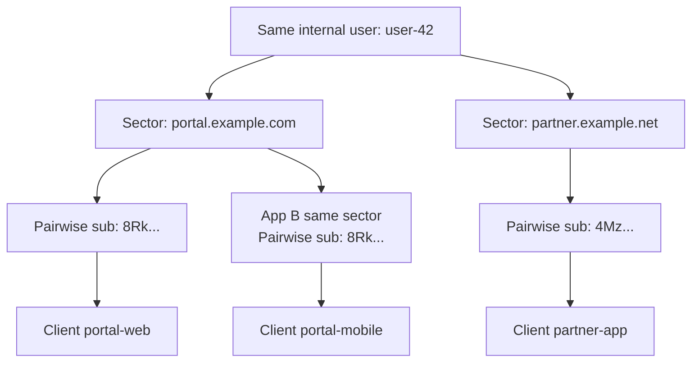
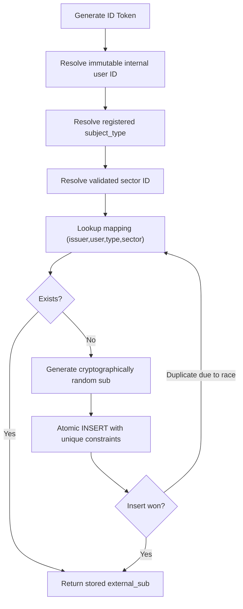
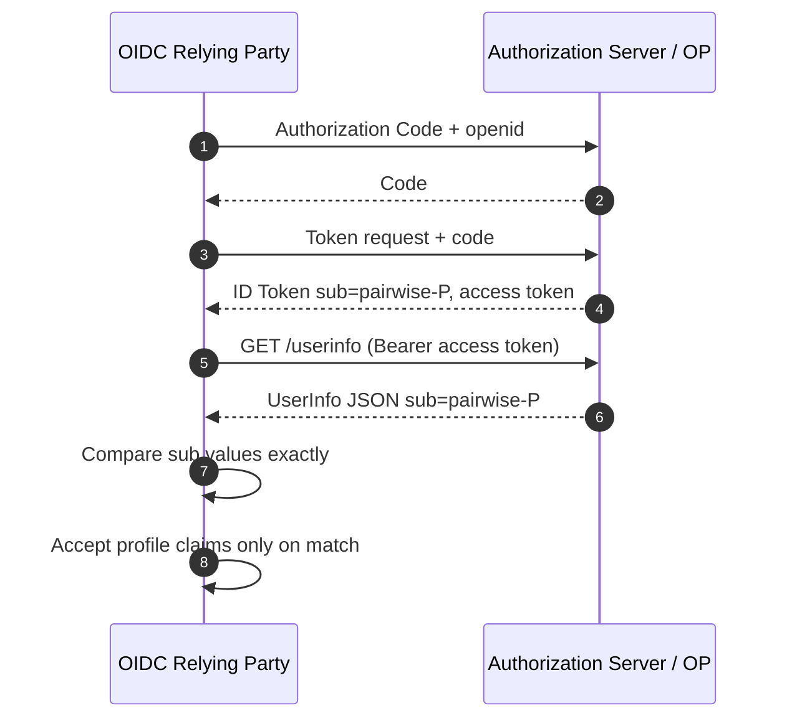
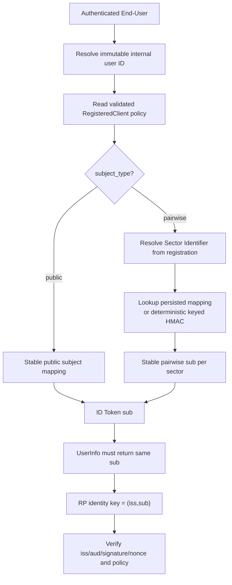

# Stable Subject Identifiers and Designing Pairwise Subjects When Needed

## 1. Objectives and Context

In the **OIDC Core and ID Token** chapter of the **SPRING_SECURITY_OAUTH2_OIDC_AUTHORIZATION_SERVER** module, identifying a user is more than picking a `username` field and placing it into a JWT. OpenID Connect (OIDC) defines the **Subject Identifier**, carried in the `sub` claim, as a stable identifier for an End-User at an OpenID Provider (OP). When the same user logs into multiple applications, issuing a shared `sub` simplifies account linking, yet can also enable unrelated applications to perform **cross-app user tracking**.

This lesson explains the two modes defined in **OpenID Connect Core 1.0**:

- **Public subject identifier:** the same user receives a shared `sub` across clients under the same issuer.
- **Pairwise subject identifier:** the OP issues distinct `sub` values per **Sector Identifier** to limit identity correlation across different client groups.

In **Spring Boot**, **Spring Security**, and **Spring Authorization Server (SAS)** applications, you must design the **identity model**, **registered client**, **ID Token customization**, **UserInfo**, **metadata/discovery**, **persisted data**, and **migration operations** together. Replacing a claim with a random string on every login fails the stability requirement.

After this lesson, you will be able to:

1. Distinguish `iss`, `sub`, `client_id`, username, email, and internal account ID.
2. Explain the rules of a stable subject that is never reassigned to another user and is matched as an `(iss, sub)` pair.
3. Choose between public and pairwise based on account-linking needs and privacy requirements.
4. Determine the sector from `sector_identifier_uri` or redirect URI hosts per OIDC Core.
5. Design a pairwise mapping table or an HMAC scheme with long-term secret management.
6. Customize ID Tokens in SAS without unintentionally altering the access token's `sub`.
7. Ensure UserInfo `sub` matches the ID Token `sub` and discovery metadata advertises accurate subject types.
8. Test stability, isolation, migrations, multi-tenancy, concurrency, and privacy risks.

**Version scope:** Examples follow **OIDC Core 1.0** and common APIs of **Spring Authorization Server 1.x / Spring Security 6.x / Spring Boot 3.x**. Registering `sector_identifier_uri`, choosing `subject_type`, and managing pairwise subjects are **policies/logic your application may need to implement itself**; do not assume every SAS version provides pairwise subjects out of the box. Code snippets clearly distinguish framework APIs from illustrative business interfaces.

## 2. What Is a Subject in OIDC?

An ID Token is a JWT carrying End-User authentication results sent by the OP to the Relying Party (RP). Core claims include:

```json
{
  "iss": "https://auth.example.com",
  "sub": "Wb7PpK4yK2w5Kbn_YvpSgZJ0nTMh_4bPhUtR1nFmZVg",
  "aud": "portal-web",
  "iat": 1790000000,
  "exp": 1790000600
}
```

This is an illustrative payload; the JSON is unsigned and not a real usable token.

| Claim / Attribute | Meaning | Suitable as Long-Term User Identity? |
| --- | --- | --- |
| `iss` | Issuer/OP that issued the ID Token | One half of the identity key |
| `sub` | End-User Subject Identifier at the issuer | Yes, **when paired with issuer** |
| `aud` | OIDC client ID receiving the ID Token | No; it is the audience |
| `client_id` | Identifier of the OAuth2/OIDC client | No; it identifies the application |
| `email` | User's email | Not recommended; mutable, recyclable, or unverified |
| `preferred_username` | Display/login username | No; can change or be reassigned |
| `name` | Display name | No; not unique |
| Internal user ID | Identifier in identity database | Internal use; consider not exposing directly |
| Session ID | Browser login session | No; changes per session |
| `jti` | JWT token identifier | No; may differ per token |

Per OIDC Core, `sub` is a stable, case-sensitive identifier string, locally unique within the issuer for an End-User and **never reassigned to another End-User**. It identifies the *subject*, not a session or token.

**Most important rule for Relying Parties:** An OIDC account key is the **pair `(issuer, subject)`**, not `sub` alone.

### 2.1. Why Is the `(iss, sub)` Pair Necessary?

Two independent OPs can both return `sub = "12345"`. That does not mean both tokens belong to the same person.

```text
OP A:
iss = https://auth-a.example.com
sub = 12345

OP B:
iss = https://auth-b.example.com
sub = 12345

=> Two distinct OIDC identities.
```

An RP using `sub` alone as its database key risks accidentally merging accounts across issuers, especially when supporting social login or enterprise federation.

### 2.2. How Stable Must `sub` Be?

- Same issuer, same End-User, and same sector (for pairwise) must produce the same `sub` across logins.
- Logging out, changing passwords, switching sessions, refreshing tokens, or changing user-agents **must not** alter `sub`.
- Changing email, username, display name, or phone number **must not** alter `sub`.
- Never reassign an old `sub` to another person after account deletion.
- Database migrations, cluster switches, SAS upgrades, or signing key rotations must never accidentally change `sub`.

Deliberate account merges/splits or issuer migrations may warrant a planned identity migration, never silent changes as an implementation side effect.

## 3. Public Subject: Simple for Linking, Broad Correlation Surface

A **Public Subject Identifier** is a `sub` that the OP provides consistently for the same End-User across clients under the same issuer.

Example:

| Issuer | Internal User | OIDC Client | `sub` |
| --- | --- | --- | --- |
| `https://auth.example.com` | user-42 | portal-web | `usr_v1_7a1f` |
| `https://auth.example.com` | user-42 | mobile-app | `usr_v1_7a1f` |
| `https://auth.example.com` | user-42 | analytics-app | `usr_v1_7a1f` |
| `https://auth.example.com` | user-84 | portal-web | `usr_v1_c29e` |

These values are illustrative and do not represent a standard algorithm.

### 3.1. Advantages

- Easy to link the same user across multiple applications within the same ecosystem.
- Simple to migrate or share account mappings between organization-managed RPs.
- No per-sector mapping table needed when an immutable internal identifier exists.
- Simpler federation debugging, support, and identity auditing.

### 3.2. Disadvantages

- Two different apps receiving the same `sub` can correlate users without needing email.
- A compromised client can leak values usable to correlate users at other clients.
- If `sub` directly exposes sequential database IDs, it can leak user counts/structure or aid enumeration when combined with other data.

**Public does not mean public PII.** You can use a random, stable opaque identifier that hides database IDs. Still, sharing that opaque string allows RPs under the same issuer to correlate users.

### 3.3. When to Use Public Subjects

Public subjects fit well when:

- Applications are operated by the same organization and need shared identifiers.
- There is clear agreement on cross-app account linking.
- Access to claims/metadata is properly controlled.
- There is no requirement to isolate identifiers by RP group/sector.

You do not need pairwise subjects everywhere; choose based on data-processing purpose, threat model, and interoperability needs.

## 4. Pairwise Subject: Reducing Correlation Across Sectors

A **Pairwise Subject Identifier** is an identifier computed/stored by the OP per **End-User + Sector Identifier** within an issuer. The same user receives different `sub` values across different sectors.



| Issuer | Local User | Client | Sector | Pairwise `sub` |
| --- | --- | --- | --- | --- |
| auth.example.com | user-42 | portal-web | `portal.example.com` | `pairwise-P` |
| auth.example.com | user-42 | portal-mobile | `portal.example.com` | `pairwise-P` |
| auth.example.com | user-42 | partner-app | `partner.example.net` | `pairwise-Q` |
| auth.example.com | user-84 | portal-web | `portal.example.com` | `pairwise-R` |

Here `pairwise-P` differs from `pairwise-Q` despite the same internal user. Clients in the same sector intentionally receive the same subject so that client group can link accounts.

### 4.1. What Pairwise Protects — and Does Not Protect

Pairwise reduces user correlation via **`sub` values** across different sectors. It does **not** by itself:

- Hide email, phone, picture, or username if those claims are still released.
- Prevent clients from correlating users via cookies, IP addresses, device fingerprints, or external IDs.
- Prevent the OP from knowing which pairwise subjects map to the same internal user.
- Protect tokens from theft or replace signature/issuer/audience validation.
- Prevent two clients in the same sector from correlating users: they receive the same pairwise `sub`.

Privacy policies must cover profile claims, UserInfo responses, consent, logging, and telemetry—not just `sub`.

## 5. Sector Identifier in OIDC Core

A **Sector Identifier** defines the group of clients within which the same End-User may receive the same pairwise `sub`. The sector is determined from the host of `sector_identifier_uri` if registered; otherwise, it is derived from the host of the registered `redirect_uri` per OIDC rules.

Crucially, **the sector is bound at client registration time**, not freely selected by a request parameter on each login.

### 5.1. Client With a Single Redirect Host

Registered Client:

```text
client_id = portal-web
redirect_uri = https://portal.example.com/login/oauth2/code/portal
sector_identifier_uri = (not registered)
```

The default sector is the **host of the redirect URI**:

```text
portal.example.com
```

Do not use the full URL as the sector, and do not include the path `/login/oauth2/code/portal`. If the app changes its callback path while keeping the host and sector unchanged, the pairwise `sub` can remain intact.

### 5.2. Multiple Redirect URIs With Different Hosts

If a client registers:

```text
https://portal.example.com/callback
https://mobile.example.net/callback
```

then per OIDC Core, a client using pairwise subjects **must register `sector_identifier_uri`** whenever its redirect URIs span multiple hostnames. Never pick whichever callback hostname happened to be used at login time, because `sub` would depend on the chosen redirect URI and fluctuate across logins.

### 5.3. What Is `sector_identifier_uri`?

Example client registration:

```text
sector_identifier_uri =
https://sector.example.org/oidc/sector-identifier.json
```

This HTTPS URL returns a **JSON array** listing the RP's registered `redirect_uri` values:

```json
[
  "https://portal.example.com/callback",
  "https://mobile.example.net/callback"
]
```

When `sector_identifier_uri` is used, the sector is **the host of this URI**:

```text
sector.example.org
```

It is **not** the host of `portal.example.com` or `mobile.example.net`, and **not** the full `sector_identifier_uri` with its path. Redirect URIs must be validated against the JSON array at the registered URI per OIDC rules.

### 5.4. Two Clients Sharing a Sector

Two RPs may register the same sector URI under host `sector.example.org` if registration policy permits. In that case, the same user receives the same pairwise identifier within that sector.

This is useful when two apps belonging to the same legal entity or product suite need account linking, yet it is a **privacy decision**: never lump unrelated RPs into one sector just to save storage.

### 5.5. When a Redirect Host or Sector URI Changes

- Changing a redirect callback path while keeping the sector: usually no `sub` change needed.
- Changing a redirect host **without** a fixed `sector_identifier_uri`: sector may change, changing `sub`.
- Changing the host of `sector_identifier_uri`: sector changes; without a migration plan, new subjects are issued.
- Updating the JSON redirect URI list while keeping the sector URI host: revalidate registration/redirect URLs; the sector host itself stays the same.
- Moving an app to a new domain: consider retaining the trusted old sector URI with proper ownership/registration controls, or execute an explicit identity migration.

## 6. Rules for Safely Registering `sector_identifier_uri`

An OIDC operator may need a dedicated **Registration Service** to persist and validate sector settings rather than relying on real-time authentication requests.

### 6.1. Recommended Workflow

1. Client owner submits `client_id`, `redirect_uris`, `subject_type`, and `sector_identifier_uri` if applicable.
2. AS validates `redirect_uris` are well-formed and comply with client policy.
3. If `sector_identifier_uri` is used, verify HTTPS scheme and valid host.
4. Fetch the JSON document safely under network/SSRF policies at registration or update time.
5. Verify the JSON is an array of absolute URI strings containing all registered redirect URIs.
6. Extract the sector from the `sector_identifier_uri` host, canonicalize per explicit policy, and store it.
7. Approve cross-client/product-group sector sharing privileges.
8. Use only the **validated, stored sector from registration**—never fetch external URIs on every ID Token issuance.
9. When a client updates redirect URIs or sector settings, revalidate and assess impact on subject mappings.

### 6.2. Preventing SSRF

`sector_identifier_uri` is supplied by the client owner. If the backend fetches arbitrary URLs unchecked, an attacker can target:

- `http://127.0.0.1` or private IPs.
- Cloud metadata / link-local endpoints.
- Internal admin APIs.
- Redirects to internal hosts.
- Domains flipping DNS records mid-fetch.

Enforce egress/allowlist policies, HTTPS certificate validation, redirect limits, DNS-rebinding defenses, timeouts, response-size caps, JSON validation, and auditing. Never treat HTTPS alone as sufficient SSRF protection.

### 6.3. Protecting Stability

If the JSON at the sector URI changes or becomes unreachable during user login, **never silently fall back to the redirect host as the sector**. Approved registration is the trusted source of the sector; revalidation errors belong in an out-of-band workflow rather than silently issuing a new `sub`.

Never let a client pass `sector_identifier` or `subject_type=pairwise` in an authorization request to override registration policy.

## 7. Designing Internal Identities Before Emitting `sub`

A realistic model needs at least three concepts:

| Value | Example | Lifecycle |
| --- | --- | --- |
| Internal immutable user ID | `user-01J3V...` | Created at account creation; never reused |
| Public OIDC subject | `pub_N6a...` | Persistent per user within issuer |
| Pairwise OIDC subject | `p_F3...` | Persistent per issuer + user + sector |

**Never use username/email directly as `sub`**. Usernames can be renamed, and emails can be transferred, recycled, and carry PII.

### 7.1. Designing the Internal User ID

Recommendations:

- Immutable internal ID, random/UUID or high-entropy string.
- Managed by the identity service, independent of login name.
- When a user is deleted, retain tombstones per retention policy so IDs and subjects are never reassigned.
- When importing/migrating users, preserve old-user → new-user mappings through a verified process.
- Never use mutable business identifiers like employee numbers or emails as the root identity.

### 7.2. Designing the External Subject

An external `sub` should be:

- Opaque, revealing no PII or sequential database keys.
- Unique within the issuer for its sector scope.
- Generated/stored durably and never reassigned.
- Bounded in length; OIDC Core limits subject strings to at most 255 ASCII characters.
- Consistently encoded, without runtime casing changes.
- Unchanged when the user resets passwords or signs in again.

Never generate a random subject **per request**. Randomness works only when generated **once and persisted** in a long-term mapping.

## 8. Choosing Public vs. Pairwise: Architectural Decision

| Question | Favors Public Subject | Favors Pairwise Subject |
| --- | --- | --- |
| Do multiple apps intentionally need to recognize the same user? | Yes | Can share one sector for that app group |
| Do apps belong to unrelated organizations? | Correlation risk | Separate sectors to limit correlation |
| Are there per-RP privacy requirements? | Requires careful review | Typically better suited |
| Migrating from a long-standing public-subject system? | Lower migration risk | Requires coordinated migration |
| Can you operate durable sector registration/subject mapping? | Simpler | More complex |
| Must the OP preserve subjects even when client redirect URIs change? | Yes | Requires stable sectors and migration policy |

### 8.1. Do Not Assume Every `client_id` Is a Sector

OIDC pairwise uses the **Sector Identifier**, not `client_id` by default. Two clients in the same sector can receive the same `sub`. If a product wants each client to get a distinct `sub` even on the same domain, design registration with OIDC-compatible sector separation or an approved profile/contract—never claim "standard OIDC pairwise = hash(client_id + user_id)."

### 8.2. Unsure Which Mode to Pick?

Map out which app groups need identity linking first. Where full separation is required, ensure distinct sectors; where an app group is permitted to link, assign a controlled sector via registration.

Once a subject type has been issued to a client, changing it can break RP account links; treat it as a **breaking change**.

## 9. Approach 1: Durable Subject Mapping Table

One straightforward way to manage rotation and migration is **generating a random pairwise subject once and storing it in a database**.

### 9.1. Illustrative Schema

```sql
CREATE TABLE oidc_subject_mapping (
    mapping_id       VARCHAR(64) PRIMARY KEY,
    issuer_id        VARCHAR(255) NOT NULL,
    internal_user_id VARCHAR(100) NOT NULL,
    subject_type     VARCHAR(20) NOT NULL,
    sector_id        VARCHAR(255) NOT NULL,
    external_sub     VARCHAR(255) NOT NULL,
    created_at       TIMESTAMP NOT NULL,
    retired_at       TIMESTAMP NULL,
    CONSTRAINT uq_oidc_subject_by_person_sector
        UNIQUE (issuer_id, internal_user_id, subject_type, sector_id),
    CONSTRAINT uq_oidc_external_subject
        UNIQUE (issuer_id, external_sub)
);
```

This is vendor-neutral illustrative SQL; tune data types, indexes, and collations for your DB. For public subjects, use a fixed internal marker (not an OIDC sector) or a separate mapping table; never ambiguously mix public and pairwise semantics.

The two unique constraints protect against:

- More than one subject for a user within the same issuer+sector.
- The same external subject being assigned to two different mappings in the same issuer.

### 9.2. Subject Generation Flow



Generate `external_sub` with sufficient random entropy encoded as unpadded Base64URL. Never reuse a public subject inside pairwise mappings.

Example helper:

```java
public final class OpaqueSubjectGenerator {

    private final SecureRandom secureRandom = new SecureRandom();

    public String newSubject() {
        byte[] bytes = new byte[32]; // 256 bits
        secureRandom.nextBytes(bytes);

        return Base64.getUrlEncoder()
                .withoutPadding()
                .encodeToString(bytes);
    }
}
```

This covers only **value generation**. You must persist durably under unique keys and handle races with transactions/unique constraints. On insert conflict, look up the winning mapping rather than issuing a second subject.

### 9.3. Pros and Cons

**Pros:**

- No long-term dependency on an HMAC secret.
- Easy to keep subjects stable across signing key rotations.
- Supports audited migrations, merges, and retirements.
- Collisions/races are caught cleanly by DB constraints.

**Cons:**

- Depends on datastore availability, backups, and HA.
- Mapping table is sensitive: it reveals links across pairwise identities.
- Requires transaction isolation and tombstone/retention policies.
- Restoring an outdated DB backup can lose issued mappings, causing `sub` changes if regenerated.

**Never expose the mapping table to RPs**. Return only the external `sub` for the authorized sector.

## 10. Approach 2: Deterministic Pairwise Subjects via HMAC

Subjects can be derived using a keyed pseudorandom function such as HMAC-SHA-256:

```text
pairwise_sub =
    BASE64URL(
       HMAC-SHA256(
           secret_key,
           encode(issuer, sector_identifier, immutable_user_id)
       )
    )
```

This is **one application design satisfying stability and irreversibility goals**, not the sole algorithm mandated by OIDC Core. OIDC specifies the properties of pairwise identifiers; the OP chooses the construction as long as it is hard to reverse/guess and remains stable.

### 10.1. Why Not Plain SHA-256?

Anti-pattern:

```text
sub = SHA256(tenant_id + "|" + email)
```

Emails can be guessed, are mutable, delimiters can collide, and unkeyed hashes can be brute-forced via dictionaries. Moreover, using email changes the subject whenever the user updates their email.

HMAC with a protected secret key prevents attackers from reversing or testing candidate user/sector pairs, provided the key stays secret and encoding is unambiguous.

### 10.2. Java Example with Length-Prefixed Canonical Encoding

```java
public final class HmacPairwiseSubjectService {

    private final SecretKey pairwiseKey;

    public HmacPairwiseSubjectService(SecretKey pairwiseKey) {
        this.pairwiseKey = pairwiseKey;
    }

    public String derive(String issuer,
                         String sector,
                         String immutableUserId) {

        Objects.requireNonNull(issuer);
        Objects.requireNonNull(sector);
        Objects.requireNonNull(immutableUserId);

        byte[] input = encode(
                issuer, sector, immutableUserId);

        try {
            Mac mac = Mac.getInstance("HmacSHA256");
            mac.init(pairwiseKey);

            return Base64.getUrlEncoder()
                    .withoutPadding()
                    .encodeToString(mac.doFinal(input));
        } catch (GeneralSecurityException ex) {
            throw new IllegalStateException(
                    "Could not derive pairwise subject", ex);
        }
    }

    private static byte[] encode(String... parts) {
        try {
            ByteArrayOutputStream output =
                    new ByteArrayOutputStream();
            DataOutputStream stream =
                    new DataOutputStream(output);

            for (String part : parts) {
                byte[] bytes =
                        part.getBytes(StandardCharsets.UTF_8);
                stream.writeInt(bytes.length);
                stream.write(bytes);
            }

            stream.flush();
            return output.toByteArray();
        } catch (IOException ex) {
            throw new UncheckedIOException(ex);
        }
    }
}
```

**Notes on this code:**

- `SecretKey` must be loaded from a secret manager/KMS/HSM or secure key store—**never regenerated randomly on restart**.
- HMAC key length must meet security policy; never hardcode keys in source code or `application.yml`.
- `issuer`, `sector`, and `immutableUserId` must be canonical strings/identifiers from trusted sources.
- Length prefixing avoids ambiguities present in unescaped string concatenation.
- The Base64URL HMAC output is opaque ASCII and contains no direct email/PII.
- Stability depends strictly on inputs, secret key, and canonicalization; changing any one alters the subject.
- This example computes HMAC inside the JVM; if key custody requires non-exportable keys, perform keyed derivation via HSM/KMS or use a persisted mapping DB.

### 10.3. Long-Term Management of HMAC Secrets

Never equate the HMAC secret with the JWT signing private key:

- JWT signing keys can rotate routinely with `kid`/JWKS.
- The HMAC pairwise key is part of a **long-term identity mapping contract**.
- Changing the HMAC key without a migration plan **changes all pairwise subjects**.
- Never share keys across dev, staging, and production.
- Isolate keys per issuer/security domain when policy requires.
- Protect key access, backups/recovery, and audit trails.

If key compromise forces rotation, do not merely swap an environment variable and keep issuing ID Tokens. Run a migration: retain existing mappings or implement a versioned subject strategy coordinated with RPs. In many systems, **persisted random mappings** preserve stability more easily under strict key-rotation mandates.

## 11. Canonicalization Rules and Sector Identification

A subtle bug occurs when the same sector has multiple string forms:

```text
PORTAL.EXAMPLE.COM
portal.example.com
portal.example.com.
xn--... (IDN/punycode)
```

Canonicalize **once at client registration** using approved URL/IDN rules and persist the canonical value. Never change canonicalization logic silently across releases.

### 11.1. Example Helper Extracting Hostname From a URI

```java
public final class SectorHost {

    public static String fromValidatedUri(URI uri) {
        Objects.requireNonNull(uri);

        if (!"https".equalsIgnoreCase(uri.getScheme())) {
            throw new IllegalArgumentException(
                    "Sector identifier URI must use HTTPS");
        }

        String host = uri.getHost();
        if (host == null || host.isBlank()) {
            throw new IllegalArgumentException(
                    "Sector identifier URI requires a host");
        }

        return IDN.toASCII(host).toLowerCase(Locale.ROOT);
    }
}
```

This is an illustrative helper, **not a replacement for full URI validation**. Before using it, strip userinfo, validate DNS/SSRF/redirects, ports, hostname policies, and ownership. When no `sector_identifier_uri` is registered, derive the host from the **registered redirect URI** per OIDC rules, never from a callback URI supplied by the browser.

### 11.2. Never Derive the Sector at Runtime From Arbitrary `redirect_uri`

An authorization request may include a `redirect_uri` from the registered allowlist. Still, sector determination must come from the validated registration, not per-request redirect hosts. If a client has multiple redirect hosts without a valid sector URI, reject or fix the client registration rather than emitting route-dependent `sub` values.

### 11.3. Issuer Is Also a Critical Input

If two issuers share internal user IDs and sectors, never treat issuer A's pairwise subject as equivalent to issuer B's. RPs always key by `(iss, sub)`, and derivation can include `issuer` as domain separation in HMAC to prevent cross-issuer correlation per policy.

## 12. Integration in Spring Authorization Server: ID Token Issuance

SAS uses `JwtGenerator`/`JwtEncoder` to mint JWTs. The claim extension point is `OAuth2TokenCustomizer<JwtEncodingContext>`, where `context.getTokenType()` indicates whether the token is an access token or an OIDC ID Token.

**Do not overwrite `sub` on every JWT**. Access tokens have their own audience/subject contract for Resource Servers; ID Tokens carry the End-User `sub` for the OIDC client. Sharing one customizer bean does not mean both token types should receive identical values.

### 12.1. Example Customizer Scoped Strictly to ID Tokens

```java
@Configuration(proxyBeanMethods = false)
public class OidcSubjectConfiguration {

    @Bean
    OAuth2TokenCustomizer<JwtEncodingContext> oidcSubjectCustomizer(
            SubjectIdentifierService subjectIdentifierService) {

        return context -> {
            String tokenType = context.getTokenType().getValue();

            if (!OidcParameterNames.ID_TOKEN.equals(tokenType)) {
                return;
            }

            String issuer = context
                    .getAuthorizationServerContext()
                    .getIssuer();

            RegisteredClient client = context.getRegisteredClient();

            // Business service must resolve the real, immutable user ID
            // from the authenticated end-user principal/authorization.
            String immutableUserId =
                    subjectIdentifierService.resolveUserId(context);

            String externalSubject =
                    subjectIdentifierService.subjectFor(
                            issuer, immutableUserId, client);

            context.getClaims().subject(externalSubject);
        };
    }
}
```

`SubjectIdentifierService` is an **application-defined business interface**, not a built-in SAS bean. It must:

1. Confirm `context` represents a valid **end-user authentication** in an OIDC grant—never read subject from request parameters.
2. Resolve the immutable internal user ID; never use `principal.getName()` if it is a mutable email/username.
3. Read the **registered/validated** `subject_type` and sector of `RegisteredClient`.
4. For `public`, return the stable public subject mapping.
5. For `pairwise`, look up or generate the stable subject per issuer+user+sector.
6. Never regenerate subjects on token refresh, email change, or AS restart.
7. Fail closed if sector, user, or policy cannot be resolved; never fall back to login username.

### 12.2. Illustrative Domain-Layer Interface

```java
public interface SubjectIdentifierService {

    String resolveUserId(JwtEncodingContext context);

    String subjectFor(
            String issuer,
            String immutableUserId,
            RegisteredClient registeredClient);
}
```

This is an **example contract**; two methods alone do not implement full privacy controls. Separate responsibilities cleanly:

```text
IdentityResolver          -> immutable user ID
ClientRegistrationPolicy  -> subject_type, validated sector
SubjectMappingRepository  -> stable public/pairwise ID
SubjectIdentifierService  -> external sub
JwtEncodingContext        -> ID Token claims
```

Never perform an HTTP fetch to `sector_identifier_uri` on every ID Token. That would be slow, vulnerable to SSRF, and risk mutating sectors based on remote content.

### 12.3. Watch the Authentication Principal

In OAuth2 flows, the principal can be a user, a client, or an intermediate authentication token depending on grant and stage. In Authorization Code flows with a user, extract the authenticated end-user context stored by SAS in the authorization. Never confuse `client_id`, authenticated client principal, or access-token subject with the ID Token's `sub`.

**Never use the Client Credentials grant to mint ID Tokens for non-existent users.** Pairwise subjects apply to End-User identities in OIDC authentication.

### 12.4. Verify With Real Tokens

After adding the customizer:

- Run the Authorization Code + OIDC flow.
- Verify the real ID Token signature via JWKS.
- Inspect the ID Token's `sub` against your subject policy.
- Confirm `iss`, `aud`, `exp`, `iat`, `nonce`, and OIDC conditions remain valid.
- Confirm access token `sub` was not unintentionally overwritten.
- Verify consistency with `UserInfo` and RP session/login handling.

The customizer does not replace RP-side OIDC validation; they are separate responsibilities.

## 13. OIDC UserInfo Must Be Consistent With the ID Token

OIDC Core requires the RP receiving a UserInfo Response to verify that UserInfo's `sub` **matches exactly** `sub` in the ID Token. If they differ, the RP must not use UserInfo claims as belonging to the same End-User.

### 13.1. Illustrative Flow



If the ID Token returns `sub=pairwise-P` while UserInfo returns an internal user ID or public subject, the RP must treat it as an error.

### 13.2. Example Valid Data

Illustrative ID Token payload:

```json
{
  "iss": "https://auth.example.com",
  "sub": "pairwise-P",
  "aud": "portal-web",
  "iat": 1790000000,
  "exp": 1790000600
}
```

UserInfo response:

```json
{
  "sub": "pairwise-P",
  "name": "Nguyen Van A",
  "email": "user@example.com",
  "email_verified": true
}
```

Profile claims depend on scopes, consent, data availability, and policy; never assume every ID Token/UserInfo contains an email.

### 13.3. SAS UserInfo Customization

Depending on version, SAS offers `oidcUserInfoEndpoint(...)` and UserInfo mapper/handler hooks. If custom UserInfo logic does not read `sub` directly from the verified ID Token/authorization, **reuse the exact same subject resolver and registration sector**, or read the trusted subject stored on the authorization. Then verify exact `sub` equality in tests.

Do not make a one-sided change in `JwtEncodingContext` and assume Resource Servers, UserInfo, `id_token_hint`, or logout references update automatically. Check every place where subject identifiers are emitted.

### 13.4. UserInfo and Access Token Subject

Depending on your token profile, an access token may carry a `sub` intended for Resource Servers that differs from the pairwise ID Token subject. That is not an OIDC violation as long as UserInfo binds to the right End-User and returns the exact `sub` matching the ID Token. Still, implementers must ensure UserInfo never mistakenly surfaces an access-token `sub` as the user-facing pairwise identifier when they differ.

## 14. OIDC Discovery and Registering Subject Types

OIDC Provider Configuration publishes `subject_types_supported`, for example:

```json
{
  "issuer": "https://auth.example.com",
  "jwks_uri": "https://auth.example.com/oauth2/jwks",
  "subject_types_supported": ["public", "pairwise"]
}
```

**Never advertise `pairwise` unless the OP genuinely enforces sector registration policies, stable mappings, and UserInfo consistency.**

### 14.1. Public-Only Deployment

A deployment supporting only public subjects can publish:

```json
{
  "subject_types_supported": ["public"]
}
```

This is a valid choice when aligned with requirements and identity policy. Never assume that having an opaque `sub` means a provider supports pairwise subjects.

### 14.2. Configuring in Spring Authorization Server

SAS provides an OIDC provider configuration endpoint and extension points to customize provider metadata per version. You should:

1. Enable OIDC in `OAuth2AuthorizationServerConfigurer`.
2. Inspect the `/.well-known/openid-configuration` response.
3. Advertise `public`/`pairwise` only when backed by actual system capabilities.
4. When supporting both, define policy rules for selecting `subject_type` at registration.
5. Test registration validation alongside actual ID Token/UserInfo behavior.

Example enabling OIDC via DSL:

```java
OAuth2AuthorizationServerConfigurer as =
        OAuth2AuthorizationServerConfigurer.authorizationServer();

http
    .securityMatcher(as.getEndpointsMatcher())
    .with(as, server ->
            server.oidc(Customizer.withDefaults()));
```

This is a `SecurityFilterChain` fragment, not a complete AS configuration. Advertising `pairwise` in metadata must rely on the **version-appropriate provider configuration customizer and real implementation**, not static JSON edits.

## 15. Security and Privacy for Subject Identifiers

### 15.1. `sub` Is Still Correlatable Data

Even when a pairwise subject contains no email, the same stable value can correlate sessions within the **same sector**. At the OP, the mapping table linking multiple pairwise subjects to an internal user ID is sensitive data.

Therefore:

- Minimize who can read subject mappings.
- Keep mapping tables out of analytics exports and ordinary logs.
- Avoid putting `sub` into query URLs or redirect logs unnecessarily.
- Protect backups, support bundles, DB snapshots, and HMAC keys.
- Limit retention and support user deletion requests per applicable regulations.
- Never leak internal IDs in exceptions or audit exports sent to RPs.
- Require explicit purpose and authorization when the OP must reverse a mapping for support/security.

### 15.2. Never Grant Permissions Based on a Subject String

`sub` is an **identifier**, not a role or permission. Resource Servers must verify access tokens for the right issuer, audience, scope, and business authorization—never grant admin access because `sub` carries a particular prefix.

### 15.3. Never Use an ID Token as an API Bearer Token

ID Tokens are issued for the OIDC client (`aud=client_id`). Access tokens are used for Resource Servers. Both may be JWTs, yet they have distinct audiences and validation rules. A pairwise ID Token `sub` is no reason for an API to ignore token types or accept ID Tokens.

### 15.4. Correlation Risk via Other Claims

Pairwise `sub` is only one piece of unlinkability. If an ID Token always emits `email`, `phone_number`, or a global employee ID to every client, RPs can still correlate users effortlessly.

Better policy:

- Release profile claims strictly per scope, consent, and claim policies.
- Set `email_verified` only when the email was actually verified.
- Prefer UserInfo when clients need contextual profile data.
- Keep unnecessary PII out of access tokens.
- Document correlation risks for every sector grouping.

## 16. Impact on Account Linking at the Relying Party

A Relying Party can store user mappings like:

```sql
CREATE TABLE external_identity (
    identity_id       VARCHAR(64) PRIMARY KEY,
    local_account_id  VARCHAR(64) NOT NULL,
    issuer            VARCHAR(255) NOT NULL,
    subject           VARCHAR(255) NOT NULL,
    CONSTRAINT uq_external_identity UNIQUE (issuer, subject)
);
```

The RP should match on the verified issuer and subject from the ID Token. Never auto-merge accounts solely because two logins share an email address.

### 16.1. Example Account Takeover Risk via Email

- User A logs in at OP X with `email=person@example.com`.
- User B later acquires a similar email or OP Y emits that email too.
- The RP keys accounts purely on email, ignoring `iss` and `sub`.
- B may be linked into A's account under a loose linking policy.

Using the `(iss, sub)` pair as the external identity key keeps OIDC identities distinct. If linking two identities is desired, require proof/consent per policy and audit it.

### 16.2. Pairwise Subjects and Cross-App Linking

If two RPs in different sectors want to know whether they serve the same user, they **must not infer it** from pairwise `sub` values. The OP may offer a consent-driven account-linking workflow, such as a domain identity hub or controlled API, subject to dedicated privacy and authorization review.

Never "decode" pairwise subjects by handing clients the internal ID; doing so defeats identifier isolation.

## 17. Migrations and Lifecycle Changes

### 17.1. Switching From Public to Pairwise

This is a **breaking change** for RPs storing `(iss, sub)`. RPs may treat the same user as a brand-new account.

Viable plan:

1. Inventory clients/tenants currently relying on public `sub`.
2. Agree on sector groupings and consent/privacy policies.
3. Populate stable pairwise mappings before issuing new tokens.
4. Build a secure migration workflow helping RPs link old and new external identities only after verifying user ownership.
5. Test in staging with non-sensitive or safely anonymized data.
6. Roll out per client/tenant and monitor account-link failures.
7. Maintain a rollback plan that never reassigns subjects to other users.

Never silently change all `sub` values in a single release simply by flipping a `pairwise=true` flag.

### 17.2. Changing the Issuer

The issuer is part of the identity tuple. Changing from:

```text
https://auth-old.example.com
```

to:

```text
https://auth-new.example.com
```

creates a **new identity from the RP's perspective** even if `sub` stays unchanged. Plan trust, registration, and mapping migrations—never change `iss` while expecting clients to auto-merge issuers.

### 17.3. Rotating JWT Signing Keys

Rotating signing keys and `kid`/JWKS **must not change `sub`**. Any pairwise HMAC key is a separate long-term secret—never rotate it alongside signing keys unless executing an intentional migration.

### 17.4. Changing Sectors or Redirect URIs

- Preserve sectors via consistent hosts and validated registrations whenever possible.
- When changing a sector, assess the impact on RP account identities.
- Support dual mapping/migration per policy if required.
- Never fall back to public `sub` when pairwise derivation fails.
- Never accept a new sector from an unapproved request.

### 17.5. Merging, Splitting, and Deleting Users

General rules:

- Never reuse a deleted user's external `sub` for another person.
- Account merges require verifying ownership of both accounts and explicit reconciliation.
- Account splits require fresh mappings/consent evaluation so old links never point to the wrong person.
- Preserve immutable subject mappings across backups and restores.
- Enforce retention/tombstone rules per security and privacy requirements.

## 18. Testing Subject Services and Integration

### 18.1. Standard Test Matrix

| Test Case | Expected Result |
| --- | --- |
| Same user + issuer + public mode, clients A/B | Identical `sub` |
| Same user + issuer + pairwise + same sector | Identical `sub` |
| Same user + issuer + pairwise + different sectors | Distinct `sub` |
| Two users + same issuer/sector | Distinct `sub` |
| Same user changes username/email | `sub` unchanged |
| Same user logs out/in repeatedly | `sub` unchanged |
| AS restart / rolling upgrade | `sub` unchanged |
| JWT signing key rotation | `sub` unchanged |
| Multiple AS replicas using shared mapping | Consistent `sub` |
| Redirect path changes, sector unchanged | `sub` unchanged |
| Client has multiple redirect hostnames, no sector URI | Registration rejected per pairwise policy |
| Client has validated sector URI and valid redirects | Sector taken from sector URI host |
| `sector_identifier_uri` targets SSRF destination | Registration fetch blocked |
| Unknown user / invalid registration | Fail closed; no ID Token issued |
| ID Token pairwise `sub` and UserInfo `sub` | Exact match |
| ID Token wrong `aud` or `iss` | RP rejects |
| Pairwise `sub` logged in URL | Detected and removed |
| Public-to-pairwise switch without migration | Release blocked by change policy |

### 18.2. Unit Test for Stable HMAC and Sector Isolation

```java
@Test
void pairwiseSubjectIsStableAndSeparatedBySector() {
    byte[] keyBytes = new byte[32];
    Arrays.fill(keyBytes, (byte) 0x5A);

    SecretKey key = new SecretKeySpec(
            keyBytes, "HmacSHA256");

    HmacPairwiseSubjectService service =
            new HmacPairwiseSubjectService(key);

    String issuer = "https://auth.example.com";
    String user = "immutable-user-42";

    String one = service.derive(
            issuer, "portal.example.com", user);

    String again = service.derive(
            issuer, "portal.example.com", user);

    String otherSector = service.derive(
            issuer, "partner.example.net", user);

    assertEquals(one, again);
    assertNotEquals(one, otherSector);
    assertFalse(one.contains(user));
}
```

**Note:** The hardcoded key in this unit test is a test fixture and **must never be used in production**. This test verifies determinism and sector separation, not secret storage, issuer isolation, or OIDC token lifecycles.

### 18.3. Unit Test Separating Two Users

```java
@Test
void differentUsersCannotSharePairwiseSubject() {
    SecretKey key = new SecretKeySpec(
            new byte[32], "HmacSHA256"); // Test fixture only

    HmacPairwiseSubjectService service =
            new HmacPairwiseSubjectService(key);

    String a = service.derive(
            "https://auth.example.com",
            "portal.example.com",
            "user-A");

    String b = service.derive(
            "https://auth.example.com",
            "portal.example.com",
            "user-B");

    assertNotEquals(a, b);
}
```

For persisted mappings, also test DB unique constraints and race conditions when two concurrent requests create a mapping for the same user/sector. Do not merely test that a random generator avoids collisions in a small loop.

### 18.4. ID Token + UserInfo Integration Test

1. Register an OIDC client with `subject_type=pairwise` and a valid sector.
2. Complete the Authorization Code Flow with scope `openid`.
3. Exchange the code for an ID Token and access token.
4. Verify the ID Token signature with public JWKS.
5. Check `iss`, `aud`, `exp`, `iat`, and `nonce` per flow.
6. Record `sub` from the ID Token.
7. Call UserInfo with the valid access token.
8. Verify UserInfo `sub` equals the recorded value.
9. Sign in again as the same user/client; `sub` must remain unchanged.
10. Sign in on another client in the same sector; `sub` must match.
11. Sign in on a client in a different sector; `sub` must differ.
12. Test a token for the wrong audience or untrusted issuer; RP must reject.

Never merely decode a JWT payload and conclude subject mapping and token validation work. Integration tests must verify real signatures and mandatory validations.

## 19. Common Errors and Diagnostics

| Symptom | Possible Cause | Resolution |
| --- | --- | --- |
| Different `sub` on every login | Generating random ID per request without persisting mapping | Generate mapping once and persist it |
| Changing email breaks RP account | Using email/username as `sub` | Use an immutable internal ID |
| Mobile and web get different `sub` despite needing linking | Different sectors with no shared sector URI | Design approved sector grouping/registration |
| Two RPs from different orgs get the same `sub` | Public mode or shared sector | Review privacy policy and separate sectors properly |
| `sub` changed after rollout | HMAC secret, canonicalization, or mapping store changed | Roll back or run controlled migration; inspect key/storage |
| UserInfo returns different `sub` than ID Token | UserInfo uses internal/public sub | Align resolver or read trusted subject from authorization |
| `subject_types_supported` lists `pairwise` yet login is public | Metadata disagrees with implementation | Fix registration, subject customizer, and tests |
| Access token `sub` changed unexpectedly | JWT customizer applied to all token types | Scope customizer strictly to ID Tokens or explicit policy |
| Client has multiple redirect hosts and no sector URI | Registration violates OIDC pairwise rules | Require HTTPS sector URI and validate JSON |
| AS suffers SSRF when registering sector URI | Unchecked URL fetching | Enforce HTTPS + egress policy/allowlist/redirect/DNS checks |
| Two AS nodes emit different `sub` | Unsynced secret or local mapping DB | Use a shared store or unified KMS secret |
| New tenant collides `sub` with another tenant | Missing issuer/domain separation | Protect `(iss,sub)` tuple and key namespacing |
| RP merges two users sharing an email | Used email as identity key | Store `(iss,sub)` and require proof for account linking |
| Changing issuer makes RP treat user as new | Identity tuple changed | Migrate federation/trust and mappings |
| Deleted user's old `sub` assigned to new account | Reused internal ID or mapping | Never reassign; retain tombstones per policy |
| Pairwise users still correlated via email | Profile claims expose shared identifiers | Minimize PII/scopes/consent and audit privacy |

## 20. Production Deployment Checklist

- [ ] Decided public vs. pairwise subject type per RP group and privacy requirements.
- [ ] Every RP uses `(iss,sub)` as its external identity key.
- [ ] Internal user ID is immutable, independent of username/email, and never reassigned.
- [ ] External subject is opaque, case-sensitive ASCII, at most 255 characters.
- [ ] Subject stays stable across login, logout, refresh, email change, rolling restarts, and key rotations.
- [ ] Pairwise subject is keyed by **issuer + user + sector**, not automatically by `client_id`.
- [ ] Clients sharing a sector are linked only when policy approves.
- [ ] `sector_identifier_uri` uses HTTPS and a validated JSON array containing registered redirect URIs.
- [ ] Clients with multiple redirect hosts have a valid sector URI when using pairwise subjects.
- [ ] Sectors are canonicalized/stored at registration, never read from arbitrary request params.
- [ ] SSRF protections block unsafe fetches of sector URIs; never fetch on every login.
- [ ] Pairwise mapping DB enforces unique constraints, transactions, backups, and tombstone policies.
- [ ] If using HMAC, keys are durably managed and never rotated unintentionally to alter `sub`.
- [ ] `JwtEncodingContext` customizer modifies ID Token `sub` only per policy.
- [ ] UserInfo `sub` always matches ID Token `sub`.
- [ ] OIDC discovery `subject_types_supported` reflects real capabilities.
- [ ] RPs verify signature, `iss`, `aud`, `exp`, `nonce`, and UserInfo subject equality.
- [ ] ID Tokens are never used as API access tokens.
- [ ] Profile claims/consent do not undermine pairwise privacy guarantees.
- [ ] Internal ID mappings, pairwise secrets, and excess PII are never logged.
- [ ] Migration plans exist for changes to issuer, subject type, sector, user store, or HMAC key.
- [ ] Tested multi-instance behavior, concurrency, account merges/splits, failures, and restores.
- [ ] Auditing and access controls guard subject mappings.

## 21. Mental Map



**`sub` in OIDC is the End-User's persistent identifier at an issuer; `iss` defines the trust scope of that identifier.** Public subjects support linking users across clients under the same issuer while increasing correlation potential. Pairwise subjects use registered sectors to isolate subjects across RP groups, provided the OP preserves the exact subject per user/sector across the system lifecycle. In Spring Authorization Server, a sound design requires an immutable identity model, secure sector registration, durable mappings/HMAC, a token-type-aware ID Token customizer, and consistent UserInfo and discovery metadata. When these boundaries are properly implemented and tested, an OAuth 2.0/OpenID Connect Authorization Server can support both intentional identity linking and cross-app tracking protection as needed.
