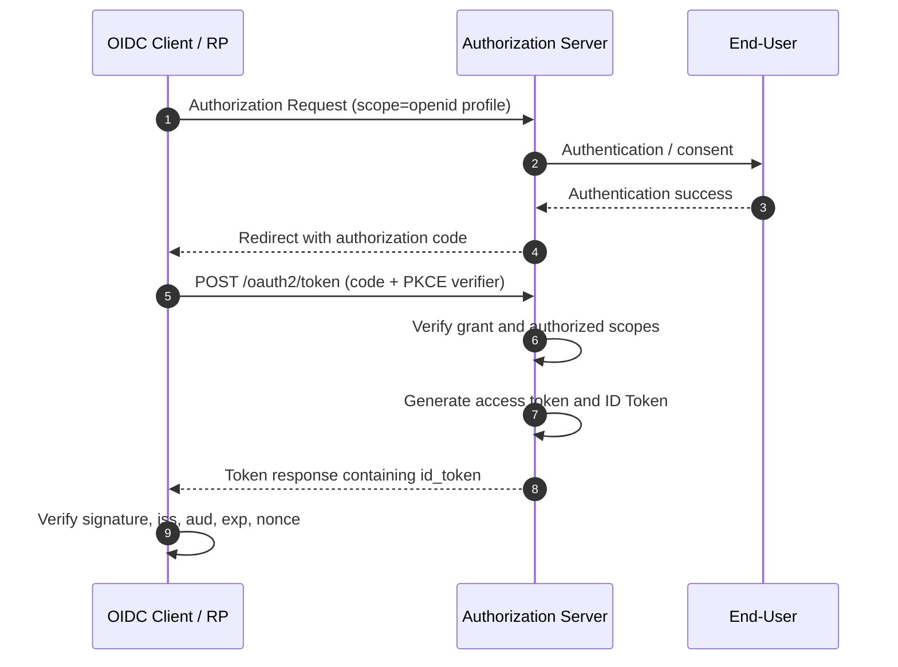

# Customizing ID Tokens with OAuth2TokenCustomizer

## 1. What Role Does the ID Token Play in OpenID Connect?

In an **OAuth 2.0/OpenID Connect Authorization Server** built with **Spring Security, Spring Authorization Server, and Spring Boot**, OAuth 2.0 handles resource access authorization, while **OpenID Connect (OIDC)** adds a user authentication layer on top of OAuth 2.0. After the user signs in and the client completes the authorization flow, the OpenID Provider (OP) can issue an **ID Token** so the client knows the user's identity and authentication context.

An ID Token is typically a signed JWT. It carries authentication claims such as:

- Who issued the token (`iss`).
- Which user was authenticated (`sub`).
- Which client the token was issued for (`aud`).
- When the token was issued and expires (`iat`, `exp`).
- Additional authentication context such as login time (`auth_time`), authentication methods (`amr`), authentication context class (`acr`), or the `nonce` bound to the authentication request.

Applications may need to add claims like `name`, `email`, `preferred_username`, `locale`, or a namespaced business claim. Spring Authorization Server provides the extension point:

```java
OAuth2TokenCustomizer<JwtEncodingContext>
```

The objective is to **customize only the ID Token**, preserve OIDC semantics, and include only data the client is permitted to receive. An ID Token is an authentication assertion intended for the OIDC client; it is not an access token for calling APIs.

In the **SPRING_SECURITY_OAUTH2_OIDC_AUTHORIZATION_SERVER** module, the goal is learning how to design, configure, secure, test, and operate an OAuth 2.0/OpenID Connect Authorization Server with Spring Security and Spring Authorization Server. This lesson belongs to the **OIDC Core and ID Token** chapter and focuses on using `OAuth2TokenCustomizer` to add claims to ID Tokens.

### Learning Outcomes

After this lesson, you will be able to:

1. Distinguish ID Tokens, access tokens, and UserInfo responses.
2. Recognize required, conditional, and optional OIDC registered claims.
3. Configure `OAuth2TokenCustomizer<JwtEncodingContext>` to process only ID Tokens.
4. Fetch data from the principal and a trusted user/claims service.
5. Restrict claims by authorized scopes, client policy, and consent.
6. Avoid overwriting `iss`, `sub`, `aud`, `exp`, `iat`, `nonce`, `at_hash`, and protocol claims.
7. Test ID Tokens on both the Authorization Server and the OIDC Relying Party.

**Example scope:** Spring Boot 3.x, Spring Security 6.x, and Spring Authorization Server 1.5.x on the Servlet stack. Some APIs or configuration styles may differ in newer releases; verify against the Javadoc and documentation of your exact dependency versions.

## 2. Distinguishing ID Token, Access Token, and UserInfo

These three artifacts have distinct consumers and purposes:

| Component | Primary Consumer | Purpose | Example Data |
| --- | --- | --- | --- |
| **ID Token** | OIDC Client / Relying Party (RP) | Confirms the authentication event and subject to the client | `iss`, `sub`, `aud`, `exp`, `iat`, `auth_time`, `nonce`, permitted profile claims |
| **Access token** | Resource Server / API | Authorizes access to protected resources per scope/audience | `scope`, API `aud`, token binding, and claims the API needs |
| **UserInfo response** | OIDC Client calling the UserInfo Endpoint with an access token | Provides claims about the End-User per scope/authorization | `sub`, `name`, `email`, `picture`, other profile claims |

### 2.1. The ID Token Is Authentication Proof for the Client

An ID Token is issued during an OIDC authentication flow when the request includes the `openid` scope. The client must validate the token per OIDC, including signature, issuer, audience, expiry, `nonce` if sent in the request, and related rules such as `azp`.

An ID Token is not an API authorization credential. Never send an ID Token in an `Authorization: Bearer` header in place of an access token; APIs require an access token with the right audience and scopes.

### 2.2. Access Tokens Carry Resource Access Permissions

An access token may be a JWT or an opaque/reference token. The Resource Server validates the token and enforces API permissions. Never pack all API permissions into the ID Token just so a frontend can read roles; doing so misuses the token and can expose permissions to clients that do not need them.

### 2.3. UserInfo Serves Profile Data

The UserInfo Endpoint returns claims about the user based on the access token and granted permissions. When a client needs large profile data, frequently changing attributes, or data needed only on specific screens, UserInfo is usually a better fit than putting everything into the ID Token.

In Spring Authorization Server, UserInfo customization is configured via `OidcUserInfoEndpointConfigurer` and `userInfoMapper(...)`. That is a separate extension point; `OAuth2TokenCustomizer<JwtEncodingContext>` is for customizing JWTs, including ID Tokens.

## 3. ID Token Claims per OIDC Core

### 3.1. Required Claims

OIDC Core requires the ID Token to include these claims:

| Claim | Meaning | Client-Side Validation |
| --- | --- | --- |
| `iss` | Issuer Identifier of the OpenID Provider | Must match the trusted, configured issuer |
| `sub` | Subject Identifier of the End-User | Must be a stable identifier per OP subject rules |
| `aud` | Audience, containing the RP's Client ID | Must include the current client's `client_id` |
| `exp` | Expiration time of the token | Client rejects tokens past expiration, within policy clock tolerance |
| `iat` | Time the token was issued | Client checks issuance timestamp per policy and context |

These claims are protocol components. **Never use a customizer to arbitrarily alter or remove them**. Spring Authorization Server is responsible for generating standard claims from issuer, client, authorization, and token context.

### 3.2. Conditional or Optional Claims

| Claim | When Present | Meaning |
| --- | --- | --- |
| `nonce` | Authentication request sent `nonce` | Binds the ID Token to the client request, mitigating ID Token replay |
| `auth_time` | Client requested `max_age` or `auth_time` per OIDC rules | Time the user actually authenticated |
| `acr` | OP provides an Authentication Context Class Reference | Achieved authentication assurance level/context |
| `amr` | OP provides Authentication Methods References | Authentication methods used |
| `azp` | May appear with multiple audiences; required or recommended by OIDC under specific conditions | Authorized Party, typically the Client ID permitted to use the token |
| `at_hash` | Certain hybrid/implicit response types returning an access token with the ID Token | Hash of the access token per OIDC |
| `c_hash` | Hybrid flow returning an authorization code with the ID Token | Hash of the authorization code per OIDC |
| `sid` | When OP supports session identifiers | OIDC session identifier for related features |

The presence and computation of hash/nonce claims depend on the response type and flow. **Do not recompute or overwrite them with arbitrary strings**; let the framework/provider handle them per the protocol implementation.

### 3.3. Standard Profile Claims

OIDC defines profile scopes so clients can request groups of claims:

| Scope | Related Claims |
| --- | --- |
| `profile` | `name`, `family_name`, `given_name`, `middle_name`, `nickname`, `preferred_username`, `profile`, `picture`, `website`, `gender`, `birthdate`, `zoneinfo`, `locale`, `updated_at` |
| `email` | `email`, `email_verified` |
| `address` | `address` |
| `phone` | `phone_number`, `phone_number_verified` |

Scopes are a mechanism for requesting and granting access to claim groups. A client sending a scope does not automatically mean every claim in that group must be issued; the OP still applies consent, user policy, claim availability, and privacy policy.

### 3.4. Subject Identifiers Should Not Be Mutable Emails or Usernames

`sub` is the OIDC subject identifier. Use a stable identifier free of unnecessary PII that does not change with email/username updates. If a user's email changes, their `sub` should not change simply because of the new email.

OIDC supports public and pairwise subject identifiers. With pairwise subjects, the same End-User receives distinct subjects per sector/client policy to reduce cross-client tracking. If implementing pairwise subjects, profile claim mapping must share the same internal user identity and subject-mapping policy; never invent a different `sub` inside the customizer.

## 4. How Spring Authorization Server Creates an ID Token

### 4.1. Token Creation Flow

In the OIDC authorization code flow:

1. The client sends an authorization request containing scope `openid` and needed scopes/claims.
2. The user authenticates at the Authorization Server.
3. The AS validates client, redirect URI, consent, and authorization request.
4. The client receives an authorization code and sends it to the Token Endpoint.
5. The AS verifies the code/client and mints tokens per the granted authorization.
6. When OIDC is requested, the AS creates an ID Token JWT and returns it in the token response.



### 4.2. Role of JwtEncodingContext

Spring Authorization Server supplies `JwtEncodingContext` during JWT encoding. The context gives the customizer access to:

- `getTokenType()`: type of token being generated.
- `getRegisteredClient()`: authenticated client registration.
- `getPrincipal()`: Authentication principal of the grant context.
- `getAuthorizationGrantType()`: grant type, e.g., authorization code or refresh token.
- `getAuthorizedScopes()`: actual scopes granted to the authorization.
- `getAuthorization()`: corresponding authorization state if present.
- `getClaims()`: builder to add/modify JWT claims.
- `getJwsHeader()`: builder for the JOSE/JWS header.

A customizer may be invoked for multiple JWT types. Always check the token type before adding claims:

```java
OidcParameterNames.ID_TOKEN.equals(context.getTokenType().getValue())
```

This is how you identify an ID Token by token type in Spring Authorization Server. Do not merely check for the `openid` scope, since `openid` can also appear in the context when minting an access token.

### 4.3. Separating ID Token and Access Token Types

| Token Being Generated | Condition to Check | Claims to Add |
| --- | --- | --- |
| ID Token | `OidcParameterNames.ID_TOKEN` | Profile claims, authentication context claims, and custom claims permitted by client/consent |
| JWT Access Token | `OAuth2TokenType.ACCESS_TOKEN` | Resource Server claims such as audience, scopes, and roles/tenant if policy permits |
| Other JWTs (if any) | Corresponding token type | Only claims meant for that consumer |

If one customizer bean handles both ID Tokens and access tokens, branch cleanly so email/profile data never leaks into access tokens and API roles never leak into ID Tokens.

## 5. Configuring OAuth2TokenCustomizer to Add Claims

### 5.1. Create a Service Reading Claims From a Trusted Source

Never pull profile data from request parameters, query strings, headers, or client-supplied payloads. Create a service reading from the identity store / user profile service after verifying the subject:

```java
import java.util.Map;
import java.util.Set;

public interface OidcUserClaimsService {

    /**
     * Returns claims permitted for the specific client,
     * based on the subject and actually granted scopes.
     *
     * Do not return registered claims such as iss, sub, aud, exp, iat.
     */
    Map<String, Object> claimsFor(
            String subject,
            String clientId,
            Set<String> authorizedScopes);
}
```

The implementation is responsible for:

- Resolving the internal subject matching the authenticated principal.
- Checking whether the user is allowed to disclose the profile data.
- Enforcing consent, client policy, and granted scopes.
- Returning only claims with appropriate JSON data types.
- Never returning passwords, secrets, private credentials, or unnecessary data.

### 5.2. Customizer Scoped Strictly to ID Tokens

Spring configuration example:

```java
import org.springframework.context.annotation.Bean;
import org.springframework.context.annotation.Configuration;
import org.springframework.security.oauth2.core.oidc.OidcParameterNames;
import org.springframework.security.oauth2.server.authorization.token.JwtEncodingContext;
import org.springframework.security.oauth2.server.authorization.token.OAuth2TokenCustomizer;

@Configuration(proxyBeanMethods = false)
public class OidcIdTokenConfiguration {

    @Bean
    OAuth2TokenCustomizer<JwtEncodingContext> idTokenCustomizer(
            OidcUserClaimsService claimsService) {

        return context -> {
            // Customize only the ID Token; do not affect JWT access tokens.
            if (!OidcParameterNames.ID_TOKEN.equals(
                    context.getTokenType().getValue())) {
                return;
            }

            String subject = context.getPrincipal().getName();
            String clientId = context.getRegisteredClient().getClientId();

            claimsService.claimsFor(
                    subject,
                    clientId,
                    context.getAuthorizedScopes()
            ).forEach((claimName, claimValue) ->
                    context.getClaims().claim(claimName, claimValue));
        };
    }
}
```

This is a minimal pattern. Before using it, ensure `context.getPrincipal().getName()` matches the stable subject identifier used by default in your application's ID Tokens. If the principal name is a mutable email or username, fix subject mapping at the authentication/principal layer so the entire OIDC flow uses the same identifier; **never overwrite `sub` in the customizer to paper over the issue**.

### 5.3. Adding Claims Based on Authorized Scopes

Example service releasing profile/email claims only if the corresponding scopes were granted:

```java
import java.util.LinkedHashMap;
import java.util.Map;
import java.util.Set;

import org.springframework.security.oauth2.core.oidc.OidcScopes;
import org.springframework.stereotype.Service;

@Service
public class DefaultOidcUserClaimsService implements OidcUserClaimsService {

    private final UserProfileRepository profiles;

    public DefaultOidcUserClaimsService(UserProfileRepository profiles) {
        this.profiles = profiles;
    }

    @Override
    public Map<String, Object> claimsFor(
            String subject,
            String clientId,
            Set<String> authorizedScopes) {

        Map<String, Object> claims = new LinkedHashMap<>();

        if (authorizedScopes.contains(OidcScopes.PROFILE)) {
            profiles.findProfile(subject).ifPresent(profile -> {
                claims.put("name", profile.displayName());
                claims.put("preferred_username", profile.username());
                claims.put("locale", profile.locale());
            });
        }

        if (authorizedScopes.contains(OidcScopes.EMAIL)) {
            profiles.findEmail(subject).ifPresent(email -> {
                claims.put("email", email.address());
                claims.put("email_verified", email.verified());
            });
        }

        return claims;
    }
}
```

`UserProfileRepository`, `UserProfile`, and `EmailProfile` here are illustrative application domain types. Replace them with real repositories/services. Checking scopes is a necessary condition; the service must also enforce client policies and consent if your system applies per-RP claim disclosure rules.

**Never infer an email is verified simply because the user entered one.** The `email_verified` claim must reflect the identity system's actual verification state, not a hardcoded boolean.

### 5.4. Custom Claims by Client Policy and Custom Scope

If a client needs a business claim like department, define explicitly which clients may receive it and how users consent. Example using a custom scope `employee`:

```java
private static final String EMPLOYEE_SCOPE = "employee";
private static final String DEPARTMENT_CLAIM =
        "https://claims.example.com/department";

if (authorizedScopes.contains(EMPLOYEE_SCOPE)
        && oidcClientPolicy.mayReceiveDepartment(clientId)) {
    departmentService.findDepartment(subject).ifPresent(department ->
            claims.put(DEPARTMENT_CLAIM, department));
}
```

In `RegisteredClient`, the custom scope `employee` must be registered, and the authorization flow must request and grant it per consent/policy. Never emit the department claim just because the client holds `openid` or `profile`. Use an organization-controlled namespace URI for custom claim names to avoid colliding with standard claims or other systems' custom claims.

Example scope declarations in client registration:

```java
RegisteredClient registeredClient = RegisteredClient.withId("orders-oidc-client")
        .clientId("orders-oidc-client")
        // Other client properties: secret/auth method/redirect URI/grant types...
        .scope(OidcScopes.OPENID)
        .scope(OidcScopes.PROFILE)
        .scope(OidcScopes.EMAIL)
        .scope("employee")
        .build();
```

This snippet only illustrates scope registration; in a real application, supply a unique ID, proper authentication method, registered redirect URI, and safe grant types. Having a scope in client registration only indicates the client may request it; the authorization request, user consent, and policy determine which scopes are actually granted to an authorization.

### 5.5. Use One Customizer Bean or Compose Deliberately

An application may need multiple JWT customizations: access token claims, ID Token claims, headers, or tenant context. Organize them into a single customizer bean with clear branches or a composite customizer with explicit ordering.

Do not declare multiple beans of type `OAuth2TokenCustomizer<JwtEncodingContext>` assuming Spring automatically chains all of them in order. Wiring depends on token generator configuration; when multiple behaviors are needed, compose them explicitly and test that every branch runs for the intended token type.

## 6. Which Claims Must Never Be Arbitrarily Overwritten?

### 6.1. Registered Claims and OIDC Protocol Claims

Never overwrite claims the provider must populate per protocol:

| Claim | Why Not Overwrite Manually? |
| --- | --- |
| `iss` | Must be the OP's exact issuer identifier |
| `sub` | Subject identifier must remain stable and follow subject-type policy |
| `aud` | Must include the right Client ID; wrong audience lets tokens be accepted by wrong clients |
| `exp`, `iat` | Managed by token generator and clock policy |
| `nonce` | Must match the `nonce` from the authentication request when required |
| `auth_time` | Reflects real authentication time, not token issuance time |
| `at_hash`, `c_hash` | Follow OIDC calculation rules based on response type and signing algorithm |
| `azp` | Tied to authorized party and audience semantics |
| `acr`, `amr` | Must reflect actual authentication context and methods |

Overwriting protocol claims can produce non-compliant ID Tokens or mislead the RP about the authentication event. Customizers should focus on **permitted custom claims and profile claims**.

### 6.2. Never Put Credentials or Secrets Inside an ID Token

Never add:

- Passwords, password hashes, or recovery codes.
- Client secrets, signing private keys, or API keys.
- Refresh tokens, authorization codes, or raw access tokens.
- Session cookies or internal bearer credentials.
- Private keys, symmetric keys, or credential-derivation material.

A JWS-signed JWT has a payload that is typically only base64url-encoded, not encrypted. Anyone holding the ID Token can read its payload. Signatures protect integrity, not confidentiality.

### 6.3. Minimize PII and Profile Data

An ID Token may be stored in browsers, native apps, logs, or telemetry depending on client architecture. Add only data the RP genuinely needs:

- Include email/phone/address only when the client has permission and a clear purpose.
- Never include date of birth, home address, financial/health info, or sensitive data by default.
- Never emit internal database IDs if they expose system internals or enable correlation.
- Never embed entire user profile objects or deeply nested JSON inside tokens.

If the RP needs profile details after sign-in, the UserInfo Endpoint is often better suited because the client calls it on demand while claims remain governed by scopes and policy.

## 7. ID Token vs. UserInfo: Where Should Claims Live?

| Criterion | ID Token | UserInfo |
| --- | --- | --- |
| When data is available | Immediately in the authentication token response | Client calls the endpoint when needed |
| Nature | Snapshot of the authentication event | Profile data returned at call time |
| Recipient | Client in the ID Token's audience | Client presenting a valid access token |
| Size | Should stay small and stable | Can be larger, though still needs data minimization |
| Data updates | Static inside an issued token | Can reflect fresher profile data |
| Purpose | Identity/authentication | User claims/profile |

### 7.1. UserInfo Mapper in Spring Authorization Server

When customizing the UserInfo response, use `userInfoMapper(...)` in the OIDC UserInfo Endpoint configurer. Illustrative example:

```java
import org.springframework.context.annotation.Bean;
import org.springframework.context.annotation.Configuration;
import org.springframework.security.oauth2.core.oidc.OidcUserInfo;
import org.springframework.security.oauth2.server.authorization.oidc.authentication.OidcUserInfoAuthenticationContext;

import java.util.function.Function;

@Configuration(proxyBeanMethods = false)
public class OidcUserInfoConfiguration {

    @Bean
    Function<OidcUserInfoAuthenticationContext, OidcUserInfo> userInfoMapper(
            OidcUserClaimsService claimsService) {
        return context -> {
            String subject = context.getAuthorization().getPrincipalName();
            String clientId = context.getAuthorization().getRegisteredClientId();
            return new OidcUserInfo(claimsService.claimsFor(
                    subject,
                    clientId,
                    context.getAuthorization().getAuthorizedScopes()));
        };
    }
}
```

This mapper illustrates the concept; verify exact API types, imports, and registration against your project's Spring Authorization Server version. In security configuration, wire the mapper into the OIDC UserInfo Endpoint. Do not confuse this mapper with `OAuth2TokenCustomizer<JwtEncodingContext>`.

Example wiring the mapper into the Authorization Server filter chain:

```java
import java.util.function.Function;

import org.springframework.context.annotation.Bean;
import org.springframework.core.annotation.Order;
import org.springframework.security.config.Customizer;
import org.springframework.security.config.annotation.web.builders.HttpSecurity;
import org.springframework.security.oauth2.core.oidc.OidcUserInfo;
import org.springframework.security.oauth2.server.authorization.config.annotation.web.configurers.OAuth2AuthorizationServerConfigurer;
import org.springframework.security.oauth2.server.authorization.oidc.authentication.OidcUserInfoAuthenticationContext;
import org.springframework.security.web.SecurityFilterChain;

@Bean
@Order(1)
SecurityFilterChain authorizationServerChain(
        HttpSecurity http,
        Function<OidcUserInfoAuthenticationContext, OidcUserInfo> userInfoMapper)
        throws Exception {

    OAuth2AuthorizationServerConfigurer authorizationServer =
            OAuth2AuthorizationServerConfigurer.authorizationServer();

    http
        .securityMatcher(authorizationServer.getEndpointsMatcher())
        .with(authorizationServer, server -> server
            .oidc(oidc -> oidc
                .userInfoEndpoint(userInfo ->
                    userInfo.userInfoMapper(userInfoMapper))))
        .authorizeHttpRequests(authorize ->
            authorize.anyRequest().authenticated());

    return http.build();
}
```

This configures only the OIDC UserInfo Endpoint; the app still needs beans and filter chains for login, clients, authorization persistence, signing keys, and other endpoints. If the project already has an Authorization Server filter chain, add `.oidc(...userInfoEndpoint...)` to the existing configuration rather than creating a second chain with a competing endpoint matcher.

### 7.2. Do Not Use the ID Token as an Unbounded UserInfo Cache

An ID Token is a snapshot at authentication time. If an email or profile changes, previously issued ID Tokens do not update automatically. When the RP needs current info, use UserInfo or a properly authorized profile API; never bloat the ID Token into a replica of the user database.

## 8. Designing Safe and Stable Custom Claims

### 8.1. Choosing Claim Names

Custom claims should be namespaced to prevent collisions:

```json
{
  "https://claims.example.com/department": "engineering",
  "https://claims.example.com/employee_type": "full_time"
}
```

These are illustrative names; use a domain/namespace controlled by your organization. Avoid short names like `role`, `tenant`, or `department` if multiple systems define them with conflicting semantics.

### 8.2. Data Types and Schema

| Data | Recommended JSON Type | Example |
| --- | --- | --- |
| Boolean | Boolean | `"email_verified": true` |
| Timestamp | NumericDate per standard claims or agreed custom format | `auth_time: 1794820200` |
| List | String array | `"groups": ["sales", "support"]` |
| Numeric value | Number | `"risk_level": 2` when clearly defined |
| Object | Small object, explicitly versioned schema | Only when genuinely needed |
| Identifier | Stable string containing no secrets | `"department": "engineering"` |

Never pass arbitrary Java objects or JPA entities directly into claims. Map cleanly to DTOs/schemas to avoid accidentally serializing lazy relations, password hashes, internal fields, or unintended data.

### 8.3. Keep Tokens Small and Versioned

Oversized ID Tokens increase:

- Bandwidth and client processing overhead.
- Risk of hitting browser/proxy cookie, header, or storage limits if tokens pass through those layers.
- Risk of leaking PII in logs, traces, crash reports, and analytics.
- Compatibility costs across multiple consuming clients.

Renaming a claim or changing its type is a breaking contract change. When multiple RPs consume it, plan a compatibility path: emit old and new claims in parallel during transition, track client versions, and retire the old claim after migration completes.

### 8.4. Per-Client Claims

Not every OIDC client needs the same profile:

- An internal web client might need `name` and `preferred_username`.
- A customer support app might need `email` if consented.
- An HR client might need `department` if policy allows.
- An analytics client should not receive email/phone when it only needs a pseudonymous subject.

Use client policies and authorized scopes to constrain claims. Never rely on a `client_id` sent in an unverified request; read the client from `JwtEncodingContext.getRegisteredClient()` resolved by the provider.

## 9. Verifying the ID Token on the Relying Party Side

Issuing an ID Token with custom claims is only half the contract. The RP must verify the ID Token before creating a session or treating the user as logged in.

### 9.1. Verification Steps

The RP must:

1. Obtain issuer and JWKS from trusted discovery metadata or out-of-band configuration.
2. Verify the signature using an accepted algorithm and matching key.
3. Verify `iss` exactly.
4. Verify `aud` contains its own `client_id`.
5. If `aud` has multiple audiences, handle `azp` per OIDC Core.
6. Verify `exp`, `iat`, and clock tolerance.
7. If the authorization request included `nonce`, match it against the nonce stored for the browser/session request.
8. Verify hash claims (`at_hash`, `c_hash`) when required by flow/response type.
9. Enforce `auth_time`, `acr`, and `amr` per the application's authentication requirements.
10. Create a session or consume claims only after validation succeeds.

Never merely decode a JWT payload and trust its contents. Base64url decoding does not verify signatures, issuer, audience, or nonce.

### 9.2. Custom Claims Do Not Replace Protocol Validation

The RP can use a department claim to render UI or pick a workflow, yet it must verify the ID Token first. A custom claim must never allow skipping `aud`, `iss`, `exp`, `nonce`, or authentication policies.

If a claim serves as input for API authorization, the API still needs an access token with the right audience/scopes and its own authorization checks. An ID Token's audience is the client, not the Resource Server.

## 10. Testing Customizers and ID Tokens End-to-End

### 10.1. Unit Testing Claim-Selection Policy

Extract claim-selection policy into an independently testable service:

```java
import java.util.LinkedHashMap;
import java.util.Map;
import java.util.Set;

import org.springframework.security.oauth2.core.oidc.OidcScopes;

public final class OidcClaimPolicy {

    private OidcClaimPolicy() {
    }

    public static Map<String, Object> profileClaims(
            Set<String> scopes,
            String displayName,
            String email,
            boolean emailVerified) {

        Map<String, Object> claims = new LinkedHashMap<>();

        if (scopes.contains(OidcScopes.PROFILE) && displayName != null) {
            claims.put("name", displayName);
        }
        if (scopes.contains(OidcScopes.EMAIL) && email != null) {
            claims.put("email", email);
            claims.put("email_verified", emailVerified);
        }
        return claims;
    }
}
```

Example JUnit 5 tests:

```java
import java.util.Map;
import java.util.Set;

import org.junit.jupiter.api.Test;
import org.springframework.security.oauth2.core.oidc.OidcScopes;

import static org.assertj.core.api.Assertions.assertThat;

class OidcClaimPolicyTest {

    @Test
    void profileScopeControlsNameClaim() {
        Map<String, Object> claims = OidcClaimPolicy.profileClaims(
                Set.of(OidcScopes.OPENID, OidcScopes.PROFILE),
                "Lan Nguyen",
                "lan@example.com",
                true);

        assertThat(claims)
                .containsEntry("name", "Lan Nguyen")
                .doesNotContainKey("email");
    }

    @Test
    void emailScopeControlsEmailClaims() {
        Map<String, Object> claims = OidcClaimPolicy.profileClaims(
                Set.of(OidcScopes.OPENID, OidcScopes.EMAIL),
                "Lan Nguyen",
                "lan@example.com",
                false);

        assertThat(claims)
                .containsEntry("email", "lan@example.com")
                .containsEntry("email_verified", false)
                .doesNotContainKey("name");
    }

    @Test
    void openidAloneDoesNotExposeProfileOrEmail() {
        Map<String, Object> claims = OidcClaimPolicy.profileClaims(
                Set.of(OidcScopes.OPENID),
                "Lan Nguyen",
                "lan@example.com",
                true);

        assertThat(claims).isEmpty();
    }
}
```

These tests verify the claim-selection policy, not that the token generator actually restricts extra claims to ID Tokens. Token Endpoint integration tests are still required.

### 10.2. Integration Test Matrix

| ID | Scenario | Expected Result |
| --- | --- | --- |
| O01 | Authorization request includes `openid` | OIDC flow can issue an ID Token |
| O02 | Request omits `openid` | Does not issue an ID Token merely because other OAuth scopes were requested |
| O03 | `openid profile` granted | Profile claims added per policy |
| O04 | `openid email` granted | Email claims added if data exists and consent/policy allows |
| O05 | `openid` only | No profile/email claims disclosed outside policy |
| O06 | Custom scope `employee` granted | Custom department claim appears only for policy-approved clients |
| O07 | Client barred from receiving department | Department claim omitted even though principal has a department |
| O08 | Principal lacks profile data | No fake values or schema-breaking empty claims emitted |
| O09 | Unverified email | `email_verified` is false, never forced true |
| O10 | Different clients for same subject | Claims filtered per client policy |
| O11 | JWT access token minted | ID-Token-only custom claims do not appear outside policy |
| O12 | ID Token minted | Customizer detects `OidcParameterNames.ID_TOKEN` |
| O13 | Claims service fails | Token generation follows fail policy rather than falling back to broad data |
| O14 | `sub` uses mutable email | Test catches unstable subject mapping |
| O15 | Authentication request sent `nonce` | ID Token includes matching `nonce` per protocol |
| O16 | Request included `max_age` | `auth_time` reflects actual authentication time |
| O17 | Multiple audiences | `azp`/audience semantics match OIDC |
| O18 | Hybrid/implicit response needing hash claims | `at_hash`/`c_hash` handled properly by framework |
| O19 | Custom claim collides with registered claim | Policy prevents overwriting standard claims |
| O20 | ID Token received by RP | RP verifies signature, issuer, audience, expiry, and nonce |
| O21 | ID Token audience mismatches client | RP rejects |
| O22 | Nonce mismatch / replay | RP rejects ID Token |
| O23 | Wrong claim data type | Integration test catches schema incompatibility |
| O24 | Token carries PII beyond scope/consent | Absent from ID Token |
| O25 | UserInfo needed for dynamic profile | UserInfo mapper returns claims per scope/policy |
| O26 | ID Token attempted as API Bearer token | Resource Server rejects due to token type/audience/policy |

### 10.3. Verifying the Token Response

In tests, complete the authorization code + PKCE flow with a test user and test client:

- Confirm the response contains `id_token` when the OIDC flow requires it.
- Verify the signature and decode using an appropriate test decoder.
- Confirm standard claims remain intact and un-overwritten by the customizer.
- Confirm profile/custom claims match granted scopes and client policy.
- Confirm access tokens did not receive ID-Token-only claims.
- Confirm RP validation runs and creates a session only after verification passes.

Never use production JWTs or real PII in test fixtures, CI logs, or public snapshots.

## 11. Common Design Mistakes

| Mistake | Consequence | Fix |
| --- | --- | --- |
| Adding claims without checking token type | Profile claims leak into access tokens or vice versa | Check `OidcParameterNames.ID_TOKEN` before adding |
| Using ID Token as an access token | API receives wrong audience/token purpose | Use access tokens for Resource Servers |
| Sending email to every client | Unnecessary PII exposure | Enforce authorized scopes, consent, and client policy |
| Trusting request parameters for claims | Client can spoof identity/profile | Read from principal and trusted identity store |
| Using email as `sub` | Subject changes when email changes | Use stable/pairwise subject identifiers |
| Overwriting `iss`, `aud`, `exp`, `iat`, `nonce` | Non-compliant ID Token or broken validation | Let the token generator manage protocol claims |
| Manually miscomputing `at_hash`/`c_hash` | RP rejects or misvalidates response | Let the provider compute them per flow and algorithm |
| Dumping whole user entities into JWTs | Leaks internal fields, bloats tokens, breaks schema | Map to an allowlisted claim DTO |
| Using `openid` scope to dump all profile data | Violates consent/scope semantics | Check `profile`/`email`/`address`/`phone` or custom claim grants |
| Putting API roles into ID Tokens for APIs | Confuses identity tokens with authorization tokens | Keep API roles/permissions in access tokens and RS policy |
| Using token customizer for UserInfo | Dynamic data misses the right endpoint | Use a dedicated UserInfo mapper |
| Declaring multiple customizer beans without composing | Some logic skipped or unclear wiring | Use one composite customizer with clear branches |
| Trusting payload just because it decodes | Forged tokens may be accepted | RP must verify signature and OIDC claims |
| Skipping `nonce` checks at the RP | ID Tokens can be replayed across auth sessions | Persist and match `nonce` per request |
| Not versioning claim contracts | Older clients break on schema changes | Run parallel migrations and compatibility tests |

## 12. Production Checklist

**OIDC semantics**

- [ ] ID Tokens are issued only in OIDC flows with the `openid` scope.
- [ ] `iss`, `sub`, `aud`, `exp`, and `iat` are generated properly by the provider.
- [ ] `sub` is stable and independent of mutable email/username values.
- [ ] `nonce`, `auth_time`, `acr`, `amr`, `azp`, `at_hash`, and `c_hash` comply with OIDC where applicable.
- [ ] ID Token audience is the OIDC client; APIs use dedicated access tokens.

**Customizer and claims**

- [ ] Customizer checks `OidcParameterNames.ID_TOKEN`.
- [ ] Claims come from a trusted principal/identity store.
- [ ] Profile/email/address/phone claims are released strictly per authorized scopes, consent, and client policy.
- [ ] Custom claims use namespaces and explicit schemas/types.
- [ ] Registered claims are never overwritten and secrets/credentials are never added.
- [ ] ID Tokens stay compact with no unnecessary PII or sensitive data.
- [ ] UserInfo is customized via its own mapper when appropriate.

**Testing and operations**

- [ ] Unit tests cover claim-selection policy and integration tests cover the Token Endpoint.
- [ ] RP tests verify signature, issuer, audience, expiry, and nonce.
- [ ] Access tokens and ID Tokens are tested separately without shared assumptions.
- [ ] Tests cover scope/consent/client-specific claims and claims-service failures.
- [ ] Raw ID Tokens and PII are never written to logs/traces.
- [ ] Schema versioning/migration strategy exists for RP consumers.

## 13. References

- [OpenID Connect Core 1.0 — ID Token](https://openid.net/specs/openid-connect-core-1_0.html#IDToken): definition of ID Token, required claims, conditional claims, and validation.
- [OpenID Connect Core 1.0 — Standard Claims](https://openid.net/specs/openid-connect-core-1_0.html#StandardClaims): profile claims and their semantics.
- [OpenID Connect Core 1.0 — UserInfo Endpoint](https://openid.net/specs/openid-connect-core-1_0.html#UserInfo): UserInfo response and subject consistency.
- [Spring Authorization Server — How-to: Customize JWT Claims](https://docs.spring.io/spring-authorization-server/reference/guides/how-to-custom-claims-authorities.html): using `OAuth2TokenCustomizer<JwtEncodingContext>`.
- [Spring Authorization Server — Core Model Components](https://docs.spring.io/spring-authorization-server/reference/core-model-components.html): registered clients, authorizations, and token components.
- [Spring Authorization Server — Protocol Endpoints](https://docs.spring.io/spring-authorization-server/reference/protocol-endpoints.html): OIDC endpoints and customization points.
- [Spring Security — OAuth2 Resource Server JWT](https://docs.spring.io/spring-security/reference/servlet/oauth2/resource-server/jwt.html): Resource Server JWT validation; never use in place of RP ID Token validation.
- [RFC 7519 — JSON Web Token](https://www.rfc-editor.org/rfc/rfc7519): registered claims and JWT representation.

**Conclusion:** `OAuth2TokenCustomizer<JwtEncodingContext>` lets Spring Authorization Server enrich JWTs with custom claims, yet the customizer must check the token type with `OidcParameterNames.ID_TOKEN`. Release profile/custom claims strictly based on an authenticated principal, authorized scopes, consent, and client policy. Let the provider manage protocol claims such as `iss`, `sub`, `aud`, `exp`, `iat`, `nonce`, and hash claims, and use UserInfo for dynamic or larger profile datasets. An ID Token is always intended for the OIDC client and must be thoroughly verified by the RP before establishing a login session.
