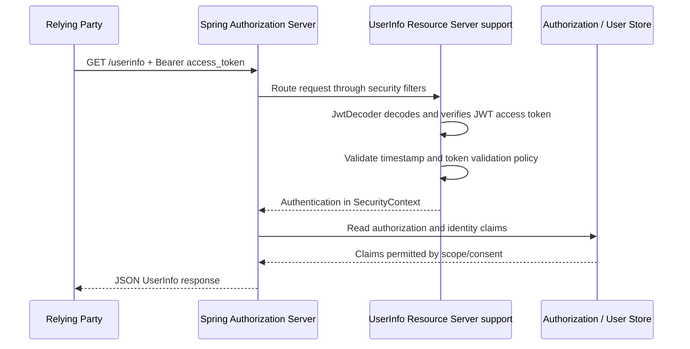

# Configuring Resource Server and JwtDecoder for UserInfo

## 1. Context and Goals

In an OAuth 2.0/OpenID Connect (OIDC) system using **Spring Security**, **Spring Authorization Server**, and Spring Boot, the OIDC Provider (OP) can provide a UserInfo Endpoint for the Relying Party (RP) to retrieve additional claims about the End-User after login.

UserInfo is not a public profile-reading endpoint. According to OIDC Core, it is an **OAuth 2.0 protected resource**: the RP sends an access token as a Bearer token; the OP validates the token before returning claims permitted by scopes, consent, and policy.

In Spring Authorization Server, enabling OIDC automatically configures resource server support for the UserInfo endpoint. However, this configuration requires a **JwtDecoder** bean to decode and verify JWT access tokens. The decoder bean is typically created from the same **JWKSource<SecurityContext>** that the Authorization Server uses for its signing keys.

This lesson belongs to the **OIDC UserInfo** chapter and focuses on configuring the Resource Server and JwtDecoder for the UserInfo endpoint.

After this lesson, you will be able to:

1. Explain why UserInfo is treated as a protected resource.
2. Distinguish between an ID Token and an access token in a UserInfo request.
3. Enable the OIDC UserInfo endpoint in Spring Authorization Server.
4. Configure JwtDecoder to verify JWT access tokens.
5. Understand the relationship between JWKSource, signing keys, JWKS, and the decoder.
6. Structure SecurityFilterChain for protocol endpoints and user login.
7. Configure RegisteredClient to request OIDC scopes.
8. Test UserInfo using HTTP and Spring Security.
9. Customize claims using an ID Token customizer or a UserInfo mapper.
10. Control audience, scopes, privacy, key rotation, and authentication errors.

## 2. What Does the UserInfo Endpoint Do?

The UserInfo Endpoint returns information about an authenticated End-User according to the permissions granted to the RP. After the OIDC Authorization Code Flow, the RP receives an ID Token to verify login. If it needs a name, email, or additional profile information, the RP sends the access token to the UserInfo Endpoint.

Example architecture:

- **order-web**: RP, a web application that wants to display the user profile.
- **auth.example.com**: OIDC Provider built with Spring Authorization Server.
- **orders-api**: Business Resource Server protecting order data.
- **/userinfo**: endpoint on the OP returning identity claims to the RP.

UserInfo is not where the RP sends the ID Token. The request uses the access token issued in the OIDC Authentication Request.

### 2.1. UserInfo Is a Resource Server

Although UserInfo is hosted alongside the Authorization Server, at the protocol level it is still a protected resource. Therefore, the endpoint requires authentication based on an access token. In Spring Authorization Server, when OIDC is enabled, the framework integrates resource server support to authenticate UserInfo requests.

With a standard JWT access token configuration, JwtDecoder reads the compact JWT, verifies the signature, and checks token conditions per the configuration. The endpoint then uses the authorization context to determine which claims are returned.

### 2.2. UserInfo Does Not Replace the ID Token

| Component | Role | Where Used |
|---|---|---|
| ID Token | Proof that the OP authenticated the End-User for the RP | RP verifies issuer, audience, signature, and expiration |
| Access Token | Credential for accessing a protected resource | RP sends to UserInfo or an API per audience/scope |
| UserInfo Response | Additional claims about the End-User | Used by the RP after verifying the subject |
| Refresh Token | Requests a new access token if issued | Token Endpoint |

The ID Token is issued at the Token Endpoint. UserInfo is a separate subsequent HTTP request protected by an access token.

## 3. UserInfo Request Flow

Suppose the RP has completed the OIDC Authorization Code Flow and received an access token. The RP calls:

```http
GET /userinfo HTTP/1.1
Host: auth.example.com
Authorization: Bearer ACCESS_TOKEN_VALUE
Accept: application/json
```

Processing flow:



Key steps:

1. The RP sends the **access token**, not the ID Token.
2. Resource Server support authenticates the token before the UserInfo mapper runs.
3. JwtDecoder verifies the JWT access token against the JWK source and validators.
4. The UserInfo provider retrieves the authorization context associated with the token.
5. The mapper builds OidcUserInfo.
6. The endpoint returns JSON claims filtered by policy.

If the access token is invalid, expired, or has a bad signature, the request must be rejected before returning user information.

## 4. Distinguishing JwtDecoder on the OP from ID Token Validation on the RP

This is a common point of confusion when configuring OIDC:

- **Spring Authorization Server's JwtDecoder** in this lesson serves the internal resource server support of the UserInfo endpoint, verifying the access token presented to the endpoint.
- **The OIDC client/RP** has its own decoder or OIDC client machinery to verify the ID Token received from the OP.
- **Business Resource Servers** such as orders-api may have their own decoder to verify access tokens issued for that API.

All three roles may share the issuer/JWKS or key infrastructure, but they have different responsibilities and policies.

Do not send the ID Token to UserInfo and use a decoder to treat it as an access token. UserInfo requires an access token per OIDC Core and RFC 6750.

## 5. Prerequisites Before Configuring

Before enabling UserInfo in Spring Authorization Server, you need:

| Component | Requirement |
|---|---|
| Spring Authorization Server | Dependency matching your Spring Security/Spring Boot version |
| OIDC configurer | Enabled on the Authorization Server filter chain |
| RegisteredClientRepository | Contains a client permitted to request OIDC |
| JWKSource<SecurityContext> | Provides the JWT signing key and corresponding public key |
| JwtDecoder | Mandatory bean for the UserInfo endpoint |
| AuthorizationServerSettings | Stable issuer and endpoint URIs |
| User identity source | Provides claims by subject |
| User authentication | Authenticates the End-User at the OP when using Authorization Code Flow |

OIDC is disabled in a minimal Authorization Server configuration. Having only OAuth 2.0 endpoints is not enough to have a UserInfo endpoint.

## 6. Dependencies and Versions

With Spring Boot and Spring Authorization Server, use the dependency managed by the corresponding BOM. Example Maven dependency:

```xml
<dependency>
    <groupId>org.springframework.boot</groupId>
    <artifactId>spring-boot-starter-oauth2-authorization-server</artifactId>
</dependency>
```

The application also needs web/security and a user authentication mechanism according to the project structure. Do not mix classes/configuration DSL from Spring Authorization Server 1.x with the integrated API of newer Spring Security lines if the dependencies are incompatible.

The following examples use the Spring Authorization Server 1.x (1.5.x line) configurer API. With newer integrated Spring Security Authorization Server lines, DSL initialization may differ; check the documentation for the exact version in use.

## 7. Enabling OIDC and UserInfo in SecurityFilterChain

The OIDC configurer enables OIDC protocol endpoints, including Provider Configuration, Logout, and UserInfo. Example:

```java
@Configuration(proxyBeanMethods = false)
@EnableWebSecurity
class AuthorizationServerSecurityConfig {

    @Bean
    @Order(1)
    SecurityFilterChain authorizationServerSecurityFilterChain(
            HttpSecurity http) throws Exception {

        OAuth2AuthorizationServerConfigurer authorizationServerConfigurer =
            OAuth2AuthorizationServerConfigurer.authorizationServer();

        http
            .securityMatcher(authorizationServerConfigurer.getEndpointsMatcher())
            .with(authorizationServerConfigurer, authorizationServer ->
                authorizationServer.oidc(Customizer.withDefaults())
            )
            .authorizeHttpRequests(authorize ->
                authorize.anyRequest().authenticated()
            )
            .exceptionHandling(exceptions ->
                exceptions.defaultAuthenticationEntryPointFor(
                    new LoginUrlAuthenticationEntryPoint("/login"),
                    new MediaTypeRequestMatcher(MediaType.TEXT_HTML)
                )
            );

        return http.build();
    }
}
```

Key points to understand:

- getEndpointsMatcher() scopes the chain to Authorization Server protocol endpoints.
- oidc(Customizer.withDefaults()) enables OIDC and UserInfo.
- anyRequest().authenticated() requires authentication per endpoint configuration; UserInfo requests will be authenticated by resource server support using the access token.
- The login entry point handles browser redirects for interactive requests; machine-to-machine error handling must follow the protocol.

**Do not write a custom /userinfo controller to replace the standard endpoint** if the goal is to use Spring Authorization Server's OIDC protocol endpoint. Use the official configurer and extension points to preserve framework-level authentication/error handling.

### 7.1. Separate End-User Authentication Chain

Authorization Code Flow requires a user login mechanism. Minimal example:

```java
@Bean
@Order(2)
SecurityFilterChain applicationSecurityFilterChain(
        HttpSecurity http) throws Exception {

    http
        .authorizeHttpRequests(authorize ->
            authorize.anyRequest().authenticated()
        )
        .formLogin(Customizer.withDefaults());

    return http.build();
}
```

This is only a structural example. Production may use MFA, passkeys, federated login, or another user authentication provider. The user login chain does not replace resource server authentication for UserInfo.

## 8. Configuring JwtDecoder — A Mandatory Bean

Spring Authorization Server requires a JwtDecoder bean for the OIDC UserInfo endpoint. A convenient configuration helper is provided by the framework:

```java
@Bean
JwtDecoder jwtDecoder(JWKSource<SecurityContext> jwkSource) {
    return OAuth2AuthorizationServerConfiguration.jwtDecoder(jwkSource);
}
```

This helper creates a decoder based on the Authorization Server's JWK source. The decoder uses trusted key material to verify JWT access tokens sent to UserInfo.

### 8.1. Why Does the Decoder Take JWKSource?

The Authorization Server signs JWT access tokens with its private signing key. To verify the token, the decoder needs the corresponding public key. JWKSource<SecurityContext> is the JWK source used by the Authorization Server during signing/serving the key set; the framework helper uses that same source to create the decoder.

Flow:

```text
JWKSource<SecurityContext>
       |
       +----> JWT token generator / signing key
       |
       +----> JwtDecoder
                    |
                    v
          Verify access token signature
                    |
                    v
          UserInfo authentication
```

This is why you should not create a decoder with a random key or a key unrelated to the Authorization Server's signer.

### 8.2. A Decoder Is Not a Token Generator

JwtDecoder only decodes and verifies JWTs. It does not:

- Issue ID Tokens or access tokens.
- Generate authorization codes.
- Authenticate the End-User's password.
- Decide consent.
- Fetch profiles from the database on its own.
- Build the UserInfo claims response.

Those responsibilities belong to the token generator, authentication providers, authorization service, and UserInfo mapper respectively.

### 8.3. Do Not Omit JwtDecoder Because OIDC Is Enabled

Calling oidc(Customizer.withDefaults()) enables the UserInfo endpoint and resource server support, but does not automatically provide a complete JwtDecoder bean for all configurations. If the required bean is missing, the application cannot verify access tokens for this endpoint.

Declare the decoder explicitly as shown in the example and verify the ApplicationContext at startup.

## 9. JWKSource, JWKS Endpoint, and Signing Keys

A JWK source must exist for the Authorization Server to sign JWTs and publish public keys via the JWK Set endpoint. Conceptual example with RSA:

```java
@Bean
JWKSource<SecurityContext> jwkSource() {
    RSAKey signingKey = loadRsaSigningKeyFromKeyStoreOrKms();

    JWKSet jwkSet = new JWKSet(signingKey);

    return new ImmutableJWKSet<>(jwkSet);
}
```

loadRsaSigningKeyFromKeyStoreOrKms() is a placeholder for the application's key loading, not a built-in Spring API. In production, private keys must be protected with an appropriate keystore, KMS, or HSM.

Spring Authorization Server's default JWK Set endpoint is typically /oauth2/jwks when JWKSource is configured. The RP uses public keys from this endpoint to verify the ID Token; the UserInfo endpoint internally uses the decoder created from JWKSource to verify the access token.

### 9.1. Signing Key and Verification Key

- The private key is used to sign JWTs.
- The public key is used to verify signatures.
- kid identifies the key in the JOSE header/JWK Set.
- The decoder selects the matching key and verifies the signature.
- The JWK Set must never publish private key material.

Do not expose private RSA parameters such as d, p, or q in the public JWK Set.

### 9.2. Keys Must Be Stable Across Restarts

If a new random key pair is generated on every application startup, old tokens may no longer verify and the RP may fail to verify still-valid ID Tokens. Use a persistent key store and establish a rotation/overlap process.

## 10. Issuer and AuthorizationServerSettings

The issuer must be stable and match the OP's public URL. Example:

```java
@Bean
AuthorizationServerSettings authorizationServerSettings() {
    return AuthorizationServerSettings.builder()
        .issuer("https://auth.example.com")
        .build();
}
```

Default endpoints typically include:

| Endpoint | Default URI |
|---|---|
| Authorization | /oauth2/authorize |
| Token | /oauth2/token |
| JWK Set | /oauth2/jwks |
| OIDC Provider Configuration | /.well-known/openid-configuration |
| OIDC UserInfo | /userinfo |
| OIDC Logout | /connect/logout |

You can change URIs via AuthorizationServerSettings. If you change the UserInfo path, discovery metadata must reflect the exact endpoint and the RP must call the URI retrieved from trusted metadata.

Do not build the issuer from untrusted Host/Forwarded headers. When running behind a reverse proxy, configure the external issuer explicitly and only trust forwarded headers from a controlled proxy.

## 11. RegisteredClient and OIDC Scopes

The client must be permitted to request OIDC scopes. Example confidential web client:

```java
RegisteredClient orderWeb = RegisteredClient
    .withId(UUID.randomUUID().toString())
    .clientId("order-web")
    .clientSecret(passwordEncoder.encode(secretFromSecretManager))
    .clientAuthenticationMethod(
        ClientAuthenticationMethod.CLIENT_SECRET_BASIC)
    .authorizationGrantType(AuthorizationGrantType.AUTHORIZATION_CODE)
    .authorizationGrantType(AuthorizationGrantType.REFRESH_TOKEN)
    .redirectUri(
        "https://app.example.com/login/oauth2/code/order-oidc")
    .scope(OidcScopes.OPENID)
    .scope(OidcScopes.PROFILE)
    .scope(OidcScopes.EMAIL)
    .scope(OidcScopes.ADDRESS)
    .scope(OidcScopes.PHONE)
    .clientSettings(ClientSettings.builder()
        .requireProofKey(true)
        .requireAuthorizationConsent(true)
        .build())
    .tokenSettings(TokenSettings.builder()
        .accessTokenFormat(OAuth2TokenFormat.SELF_CONTAINED)
        .build())
    .build();
```

This is a sample registration; TTL, secret storage, consent, and redirect URI must fit the application. SELF_CONTAINED selects a JWT access token for this example, allowing UserInfo resource server support to verify it with JwtDecoder.

### 11.1. Meaning of the Scopes

| Scope | Standard Claim Group That May Be Returned |
|---|---|
| openid | Required to request OIDC; UserInfo includes subject |
| profile | Name, nickname, profile, picture, locale, and related profile claims |
| email | email and email_verified |
| address | address |
| phone | phone_number and phone_number_verified |

Scopes permit requesting claim groups, not a guarantee that every attribute has data. The OP must also apply consent and privacy policies.

### 11.2. Scopes Are Not an Arbitrary Claim List

orders.read is a separate API scope, not automatically an OIDC profile scope. Do not return profile data merely because a token contains an unrelated business scope.

## 12. Resource Server Support Is Auto-Configured When OIDC Is Enabled

When OIDC is enabled in Spring Authorization Server, the framework automatically configures resource server support so that UserInfo requests are authenticated with an access token. Therefore, in a standard setup you do not need to add a separate oauth2ResourceServer().jwt() chain solely for the UserInfo endpoint to accept Bearer tokens.

The JwtDecoder bean is used within this support to verify access tokens. If the application also protects business APIs in the same process, those APIs can have their own SecurityFilterChain and their own decoder matching the API's audience/issuer.

### 12.1. Avoid SecurityFilterChain Conflicts

A configuration may have:

1. A high-priority chain for Authorization Server protocol endpoints.
2. A chain for form login or authentication UI.
3. Another chain for business APIs if running in the same process.

Ensure matchers and ordering are clear. If another chain matches /userinfo before the protocol chain, UserInfo may bypass the filters configured by Authorization Server.

### 12.2. UserInfo Does Not Accept Client Secret

The RP calls UserInfo using an access token in the Authorization header. The client secret is used at the Token Endpoint to authenticate a confidential client when exchanging an authorization code; it is not a credential for a UserInfo request.

Do not send client_secret to /userinfo.

## 13. Access Token Must Be a JWT in the Standard Decoder Configuration

JwtDecoder accepts compact JWT serialization. Opaque/reference tokens do not have a JWT structure for the decoder to verify.

In the example configuration, RegisteredClient selects:

```java
.tokenSettings(TokenSettings.builder()
    .accessTokenFormat(OAuth2TokenFormat.SELF_CONTAINED)
    .build())
```

This selects a self-contained JWT access token. The decoder needs the matching key and proper validation.

### 13.1. If Using Opaque/Reference Access Tokens

You cannot pass an opaque token into JwtDecoder and expect it to decode successfully. Standard Spring Authorization Server UserInfo support in this example relies on JWT Resource Server authentication. If the system must use reference/opaque tokens for UserInfo, you need to design an appropriate authentication integration, such as a custom authentication provider/introspection path, and test against the OIDC contract.

Do not enable opaque tokens on other APIs and assume the UserInfo endpoint automatically switches to introspection.

### 13.2. Tokens Must Have Valid Semantics

A JWT access token must be issued by a trusted OP and still be valid. Merely checking that a token string has three dot-separated segments is not enough. You must verify signature, timestamps, issuer, and any additional policies required by your deployment.

## 14. JwtDecoder Validation: Signature, Timestamp, and Issuer

In a standard setup, the Spring Authorization Server helper creates a decoder based on JWKSource. If the application applies custom validation policies, it must preserve the foundational checks:

- Valid signature against a trusted key.
- Algorithm within the allowlist.
- exp has not expired.
- nbf has reached its effective time if the claim is used.
- iss matches the trusted issuer if required by the token contract.
- Required claims/token type match the endpoint.

Do not disable timestamp or signature validation just to make a UserInfo request succeed.

### 14.1. Audience Must Follow the Token Contract

Do not assume the access token's audience equals the RP's client ID. The ID Token's audience is the RP/client; the access token's audience, if issued, must reflect the resource the token is intended for.

If the deployment requires access tokens to carry a specific audience for UserInfo, emit the claim per contract and add the corresponding validator. Do not add an aud=client_id validator merely because the ID Token uses the client ID as its audience.

### 14.2. A Custom Decoder Is a Responsible Change

If replacing the helper decoder with a custom-built decoder, the application is responsible for configuring the key source, algorithm allowlist, validators, clock skew, and issuer/resource policy. Do not build a new JwtDecoder just to change one claim converter while accidentally dropping default validators.

With newer Spring Security versions, you can configure a Nimbus decoder with a JWK source and attach OAuth2TokenValidator<Jwt>; exact builder APIs depend on the version. Consult the reference docs for your dependency version before implementing.

## 15. Where Does the Default UserInfo Response Get Its Claims?

By default, Spring Authorization Server builds the UserInfo response based on the **ID Token** claims stored in the authorization, and then returns only the standard claims matching the scopes requested in the authorization.

For example, if the user granted openid profile email, the response might be:

```json
{
  "sub": "user-42",
  "name": "Nguyen An",
  "given_name": "An",
  "family_name": "Nguyen",
  "preferred_username": "an.nguyen",
  "email": "an@example.com",
  "email_verified": true
}
```

This is an illustrative response. The OP only returns a claim when data exists, the scope is granted, and consent/policy permits it.

### 15.1. The sub Claim Is Mandatory

The UserInfo response must contain sub. The RP must match this value with sub in the verified ID Token. If they do not match, the RP must not combine claims from two different subjects.

### 15.2. Unrequested Claims Should Not Be Returned

If the RP only requests openid email, the OP should not return full address, phone number, profile, and ungranted custom claims. Data minimization is part of UserInfo design.

## 16. Customizing ID Token Claims for UserInfo to Use

A convenient way to add standard claims is to include the needed claims in the ID Token via OAuth2TokenCustomizer<JwtEncodingContext>. The default UserInfo mapper can consume those claims and filter them by scopes.

Example:

```java
@Bean
OAuth2TokenCustomizer<JwtEncodingContext> idTokenCustomizer(
        OidcUserInfoService userInfoService) {

    return context -> {
        if (OidcParameterNames.ID_TOKEN.equals(
                context.getTokenType().getValue())) {

            OidcUserInfo userInfo =
                userInfoService.loadUser(context.getPrincipal().getName());

            context.getClaims().claims(claims ->
                claims.putAll(userInfo.getClaims())
            );
        }
    };
}
```

OidcUserInfoService is an application service reading the identity store. This example omits the repository and permission checks.

### 16.1. Only Add Trusted Claims

Do not take email, phone, roles, or tenant from request parameters and insert them into the ID Token. Claims must come from a verified identity source. Ensure sub is controlled by the OP and cannot be arbitrarily overwritten by a customizer.

### 16.2. ID Token and UserInfo Can Carry Different Amounts of Data

If you add all profile claims to the ID Token, that data also reaches the RP immediately in the Token Response. If you want to keep certain claims restricted to UserInfo only, use a custom UserInfo mapper that reads data from the access token/authorization context instead of embedding everything into the ID Token.

## 17. Customizing the UserInfo Mapper

Spring Authorization Server lets you provide a userInfoMapper, which accepts OidcUserInfoAuthenticationContext and returns OidcUserInfo.

Example mapping claims from a JWT access token:

```java
Function<OidcUserInfoAuthenticationContext, OidcUserInfo> userInfoMapper =
    context -> {
        OidcUserInfoAuthenticationToken authentication =
            context.getAuthentication();

        JwtAuthenticationToken principal =
            (JwtAuthenticationToken) authentication.getPrincipal();

        return new OidcUserInfo(principal.getToken().getClaims());
    };
```

This is a short snippet illustrating the extension point. You should not copy all access token claims into the UserInfo response by default, because the token may contain scope, audience, client ID, tenant, or technical metadata not meant for the RP.

### 17.1. Attaching the Mapper to the Endpoint Configurer

```java
@Bean
@Order(1)
SecurityFilterChain authorizationServerSecurityFilterChain(
        HttpSecurity http,
        Function<OidcUserInfoAuthenticationContext, OidcUserInfo>
            userInfoMapper) throws Exception {

    OAuth2AuthorizationServerConfigurer configurer =
        OAuth2AuthorizationServerConfigurer.authorizationServer();

    http
        .securityMatcher(configurer.getEndpointsMatcher())
        .with(configurer, authorizationServer ->
            authorizationServer.oidc(oidc ->
                oidc.userInfoEndpoint(userInfo ->
                    userInfo.userInfoMapper(userInfoMapper)
                )
            )
        )
        .authorizeHttpRequests(authorize ->
            authorize.anyRequest().authenticated()
        );

    return http.build();
}
```

If using multiple beans/configuration classes, ensure the mapper bean is registered uniquely and the chain is not declared twice. A complete configuration still requires the JwtDecoder bean and Authorization Server infrastructure beans.

### 17.2. Mapper Using the Authorization Context and a User Service

In a real application, the mapper should read the subject and granted scopes, then fetch permitted claims from an identity service:

```java
Function<OidcUserInfoAuthenticationContext, OidcUserInfo> userInfoMapper(
        UserInfoService userInfoService) {

    return context -> {
        OidcUserInfoAuthenticationToken authentication =
            context.getAuthentication();

        JwtAuthenticationToken jwtAuthentication =
            (JwtAuthenticationToken) authentication.getPrincipal();

        String subject = jwtAuthentication.getToken().getSubject();
        Set<String> authorizedScopes =
            context.getAuthorization().getAuthorizedScopes();

        Map<String, Object> claims = new LinkedHashMap<>(
            userInfoService.loadClaims(subject, authorizedScopes));

        claims.put("sub", subject);

        return new OidcUserInfo(claims);
    };
}
```

This is an illustrative method to express policy; UserInfoService itself must filter claims by scopes and consent. Always ensure sub in the response is the subject of the authenticated access token.

## 18. Protecting Claims and Privacy

UserInfo may contain identifying data such as email, phone number, address, and profile details. The OP must control:

- Which scope permits each claim group.
- Whether consent is required for the client/user.
- Which claims may be returned according to client registration.
- Whether the user is allowed to share data with that RP.
- Which data is stale or needs refreshing from an authoritative source.
- Whether custom claims leak internal IDs, roles, tenant, or sensitive data.

Do not treat profile as permission to read every column in the user table. Never return password hashes, security answers, private attributes, internal permissions, or data unrelated to the RP's purpose.

### 18.1. Scope and Consent Must Be Checked at the OP

The UserInfo mapper should use authorized scopes/consent stored in the authorization context. Do not merely look at the scopes the RP originally sent; the OP may have restricted them or the user may have denied part of the permissions.

### 18.2. Do Not Return Data Based Solely on client_id

The Client ID identifies the RP, but does not automatically authorize reading all profile claims. Combine client policy, scopes, consent, and user-specific policy.

## 19. Calling UserInfo and Verifying Results on the RP

Request:

```http
GET /userinfo HTTP/1.1
Host: auth.example.com
Authorization: Bearer ACCESS_TOKEN_VALUE
Accept: application/json
```

Successful response:

```http
HTTP/1.1 200 OK
Content-Type: application/json
Cache-Control: no-store

{
  "sub": "user-42",
  "name": "Nguyen An",
  "email": "an@example.com",
  "email_verified": true
}
```

The RP needs to:

1. Call the exact UserInfo URI obtained from the verified Provider Configuration.
2. Send the access token using the Bearer scheme over TLS.
3. Verify the HTTP response and JSON schema.
4. Verify that sub exists.
5. Match sub with the verified ID Token.
6. Use only claims within the granted scope.
7. Never log the access token or a response containing PII.

### 19.1. Example Call with curl

```bash
curl --fail-with-body \
  --header "Authorization: Bearer $ACCESS_TOKEN" \
  --header "Accept: application/json" \
  https://auth.example.com/userinfo
```

Do not put real access tokens into shared shell history, tickets, or documentation. Use temporary environment variables or test tools with secret masking.

### 19.2. Common Errors

| Result | Possible Cause | Resolution |
|---|---|---|
| 401 invalid_token | Missing, expired, bad signature, or unaccepted token | Check token and decoder/JWK |
| 401 due to missing Bearer | RP sent wrong header/scheme | Send access token per RFC 6750 |
| 403 or access denied | Endpoint policy/authorization | Check scopes and authorization |
| UserInfo only contains sub | Only openid granted or no profile claims | Check granted scopes and mapper |
| Missing email | User has no email or scope/consent not granted | Check identity source and email scope |
| sub differs from ID Token | Mapper or identity mapping error | Refuse to merge claims and investigate |

Final error codes may depend on the authentication entry point and framework version. Test in practice rather than assuming all errors return the exact same status.

## 20. JWKS Caching and Key Rotation

JwtDecoder must verify signatures using trusted keys. When the Authorization Server rotates its signing key:

1. Create a new key in KMS/HSM/keystore.
2. Publish the new public key via JWKS alongside the old key.
3. Wait for caches/consumers to have a chance to fetch the new key.
4. Switch the token generator to the new key.
5. Monitor token verification errors and missing-kid errors.
6. Keep the old key long enough for valid tokens and cache policies.
7. Remove the old public key only when no valid tokens need verification with it.

Because UserInfo uses an internal decoder based on JWKSource, the key source must accurately reflect rotation state. If an old key is removed too early, still-valid access tokens may be rejected.

### 20.1. Do Not Generate a New Key on Every Startup

Key pairs used for production must persist across restarts. Generating a random RSA key pair in a bean is only suitable for controlled demos/tests; never use it as a production signing key strategy.

## 21. Testing JwtDecoder and the UserInfo Endpoint

### 21.1. Decoder Unit Tests

Verify:

- JWT with a valid signature from a trusted key.
- JWT with tampered payload/signature.
- Non-existent kid.
- Algorithm outside the allowlist.
- Expired token or token before nbf.
- Wrong issuer if required by validator.
- Token with wrong profile/claim per policy.
- Key rotation and cache refresh.

Do not mock JwtDecoder to always return a principal and conclude that signatures are being verified.

### 21.2. UserInfo Integration Tests

Send real requests through SecurityFilterChain:

| Test Case | Expected Result |
|---|---|
| Valid JWT access token | UserInfo returns JSON |
| Missing Bearer token | Rejected |
| ID Token sent instead of access token | Rejected |
| Expired access token | Rejected |
| Invalid signature | Rejected |
| Non-existent Key ID | Rejected |
| Revoked token / authorization no longer valid per state | Rejected per implementation mechanism |
| openid scope only | Returns subject and minimal permitted claims only |
| profile present | Returns standard profile claims with data |
| email present | May return email claims if granted and data exists |
| Mapper returns different sub | RP integration test must reject |
| Mapper attempts to return ungranted claim | Policy test verifies claim is filtered |

### 21.3. Testing with MockMvc

Example endpoint test structure:

```java
mockMvc.perform(get("/userinfo")
        .header(
            HttpHeaders.AUTHORIZATION,
            "Bearer " + validAccessToken))
    .andExpect(status().isOk())
    .andExpect(jsonPath("$.sub").value("user-42"));
```

To test the real decoder, use a JWT signed with a test key matching the JWKSource in the test context. Do not use a fake token that is merely three dot-separated segments or mock the filter chain to skip signature validation.

### 21.4. Testing RP Subject Binding

Create a valid ID Token with sub=user-42, then simulate a UserInfo response with sub=user-99. The RP must reject the response and not update the profile for the current user. This is a critical test because a valid access token signature does not replace OIDC subject binding.

## 22. Common Implementation Mistakes

| Mistake | Consequence | Fix |
|---|---|---|
| Enabling OIDC without declaring JwtDecoder | UserInfo cannot verify access tokens | Register a decoder from JWKSource |
| Calling UserInfo with an ID Token | Wrong credential type | Send a Bearer access token |
| Using client secret at UserInfo | Credential exposure, protocol violation | Send only the access token |
| Decoder uses a different key from the signer | Valid JWTs are rejected | Use the matching JWKSource |
| Non-persistent JWKSource | Old tokens fail after restart | Store signing keys securely |
| Disabling signature validation | Accepts forged access tokens | Always verify JWS |
| Skipping timestamp checks | Accepts expired/not-yet-valid tokens | Keep timestamp validation |
| Confusing ID Token aud with access token aud | Wrong policy and false rejections/acceptances | Define audience per token type |
| Selecting opaque tokens while still using JwtDecoder | Decoder cannot read reference tokens | Use JWT or custom introspection integration |
| Returning all access token claims | Leaks internal metadata | Allowlist claims in mapper |
| Returning email when scope not granted | Privacy/consent violation | Filter by authorized scopes |
| Not checking sub on the RP | Risk of mixing identity claims | Match UserInfo sub with ID Token sub |
| Mapper taking subject from request | UserInfo may return another user's profile | Use the authenticated principal |
| Wrong SecurityFilterChain matcher | UserInfo bypasses proper filters | Check endpoint matcher and order |
| Generating a key pair on every restart | JWKS changes unexpectedly | Use a persistent key lifecycle |
| Logging Bearer token/UserInfo body | Exposes tokens and PII | Redact tokens, restrict auditing |

## 23. Operations and Observability

Track the following metrics:

- UserInfo request count by normalized client/endpoint.
- Success and invalid_token rates.
- JwtDecoder signature failures, timestamp failures, and kid lookup failures.
- Latency of the UserInfo mapper and identity store.
- Ratio of sub-only responses vs responses with profile/email claims.
- Identity lookup errors and mapper exceptions.
- JWKS rotation, key cache refreshes, and token verification failures.
- Rate of requests missing scope/consent by client.
- Count of responses rejected due to privacy policy.

Never include raw access tokens, email, phone, subject, or full UserInfo JSON in metric labels. Audit logs may record client ID, outcome, error code, correlation ID, and pseudonymized subject if needed.

### 23.1. Runbook When UserInfo Returns Mass 401s

1. Check whether the OIDC configurer is still enabled.
2. Check whether the JwtDecoder bean is created in the application context.
3. Check whether JWKSource contains the key matching the access token's kid.
4. Check whether the token format is self-contained JWT.
5. Check whether the access token is unexpired and has a valid signature.
6. Check whether chain matcher/order routes /userinfo through the Authorization Server chain.
7. Check issuer, clock, and custom validators.
8. Check key rotation/cache and deployment rollout.

Never resolve the issue by permitting all requests to /userinfo or disabling signature verification.

## 24. Production Deployment Checklist

- [ ] OIDC is enabled using the version-appropriate configurer.
- [ ] UserInfo endpoint is published via discovery metadata.
- [ ] RP calls UserInfo with a Bearer access token over TLS.
- [ ] Neither ID Token nor client secret is sent to UserInfo.
- [ ] JwtDecoder bean is registered.
- [ ] Decoder uses JWKSource matching the access token's signing key.
- [ ] JWT signature and timestamp validation are intact.
- [ ] Issuer/algorithm/token policy is clearly defined.
- [ ] Access token format matches the decoder; opaque tokens have dedicated integration.
- [ ] RegisteredClient is permitted to request openid and needed OIDC scopes.
- [ ] UserInfo mapper returns only claims granted by scope/consent.
- [ ] UserInfo response always contains sub matching the authenticated subject.
- [ ] RP matches UserInfo sub with ID Token sub.
- [ ] No unnecessary PII or internal claims are returned.
- [ ] JWK signing keys are protected and rotation includes overlap.
- [ ] SecurityFilterChain matcher/order is tested.
- [ ] Tests cover valid, expired, bad-signature, wrong-key, and missing-scope tokens.
- [ ] Tests cover privacy, mapper, and subject binding.
- [ ] Logs/metrics contain no raw tokens or PII.
- [ ] Runbook exists for handling JwtDecoder, JWKS, and UserInfo failures.

### Core Knowledge

OIDC UserInfo is a protected resource that accepts a **Bearer access token** to return identity claims to the RP. In Spring Authorization Server, enabling **oidc(Customizer.withDefaults())** configures the UserInfo endpoint and resource server support; the application must still declare a **JwtDecoder bean** to verify JWT access tokens. The standard approach is creating the decoder with **OAuth2AuthorizationServerConfiguration.jwtDecoder(jwkSource)** so it shares the same JWK source as the Authorization Server.

By default, Spring Authorization Server builds the UserInfo response from ID Token claims and filters standard claims by granted scopes. When dynamic data or custom claims are needed, use **OAuth2TokenCustomizer** or **userInfoMapper** to read a trusted identity source and return only permitted claims. The RP must always verify that **sub** in UserInfo matches **sub** in the verified ID Token.

Never use an ID Token in place of an access token, never disable signature/timestamp validation, and never return all claims simply because a token is active. **JwtDecoder authenticates the access token; the UserInfo mapper decides what identity data is disclosed.**

## 25. References

- [OpenID Connect Core 1.0 — UserInfo Endpoint](https://openid.net/specs/openid-connect-core-1_0.html#UserInfo)
- [OpenID Connect Core 1.0 — Standard Claims](https://openid.net/specs/openid-connect-core-1_0.html#StandardClaims)
- [RFC 6750 — OAuth 2.0 Bearer Token Usage](https://www.rfc-editor.org/rfc/rfc6750)
- [RFC 7515 — JSON Web Signature (JWS)](https://www.rfc-editor.org/rfc/rfc7515)
- [RFC 7517 — JSON Web Key (JWK)](https://www.rfc-editor.org/rfc/rfc7517)
- [RFC 7519 — JSON Web Token (JWT)](https://www.rfc-editor.org/rfc/rfc7519)
- [Spring Authorization Server 1.5.8 — How-to: Customize the OpenID Connect 1.0 UserInfo response](https://docs.spring.io/spring-authorization-server/reference/guides/how-to-userinfo.html)
- [Spring Authorization Server 1.5.8 — Configuration Model](https://docs.spring.io/spring-authorization-server/reference/configuration-model.html)
- [Spring Authorization Server 1.5.8 — Protocol Endpoints](https://docs.spring.io/spring-authorization-server/reference/protocol-endpoints.html)
- [Spring Security — OAuth 2.0 Resource Server JWT](https://docs.spring.io/spring-security/reference/servlet/oauth2/resource-server/jwt.html)
- [Spring Security — Servlet Architecture](https://docs.spring.io/spring-security/reference/servlet/architecture.html)
