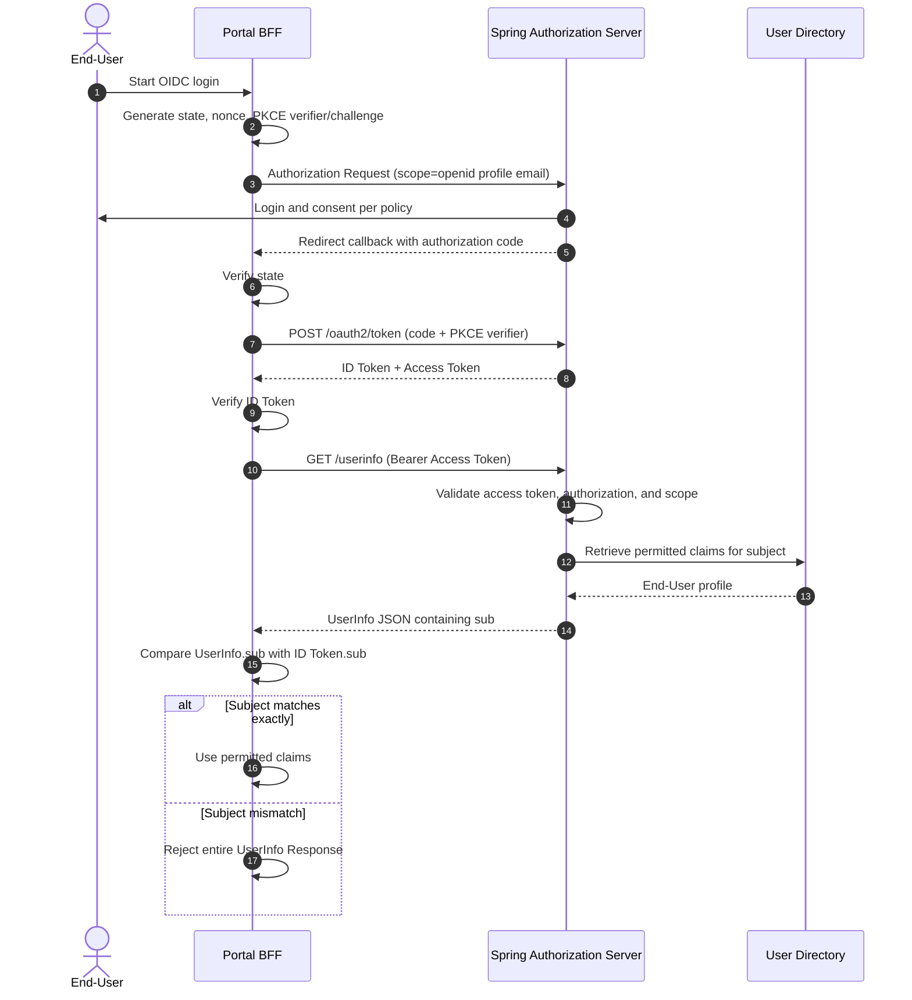

# Retrieving User Information and Verifying Response Subject

The **OpenID Connect UserInfo Endpoint** is an OAuth 2.0 Protected Resource that allows a Relying Party (RP) to retrieve additional claims about the End-User after completing OIDC authentication. The RP sends the **access token** received from the OIDC authorization flow to the UserInfo Endpoint; the OpenID Provider (OP) validates the token and returns a JSON object containing the claims the client is authorized to receive.

The most critical security point of the response is the **`sub`** claim. According to OpenID Connect Core, `sub` **must always be present** in the UserInfo Response, and the RP **must verify an exact match** between this value and `sub` in the previously verified ID Token. If the two values differ, the RP **must not use any claims** in the UserInfo Response. This rule prevents token substitution: an access token could otherwise lead to information for an End-User different from the one identified in the ID Token.

In Spring Boot using **Spring Authorization Server**, the UserInfo Endpoint belongs to the OIDC configuration. The framework provides access token authentication and a default mapper; the application can customize retrieving claims from the ID Token, access token, or a separate profile store. On the RP side, **Spring Security `OidcUserService`** handles calling the UserInfo Endpoint and verifying the response subject before assembling the `OidcUser`.

This lesson belongs to the **OIDC UserInfo** chapter of the **SPRING_SECURITY_OAUTH2_OIDC_AUTHORIZATION_SERVER** module, supporting the learning path on designing, configuring, securing, testing, and operating an OAuth 2.0/OpenID Connect Authorization Server with Spring Security and Spring Authorization Server in Spring Boot. The focus is on **retrieving user information, restricting claims by scope, and verifying the response `sub`**.

> **Mandatory principle:** The ID Token identifies the user the OP authenticated for the RP. The UserInfo Response must refer to **that exact subject**. A valid access token signature or HTTP 200 from the UserInfo Endpoint does not replace comparing `sub`.

**Version scope:** Configuration examples are based on Spring Authorization Server 1.5.x and Spring Security 6.x. APIs in Spring Security 7.x may change under the new Authorization Server integration; consult the dependencies and documentation of the project version in use.

## 1. What Does the UserInfo Endpoint Solve?

### 1.1. ID Token and UserInfo Serve Different Purposes

In OIDC, the ID Token is proof of the authentication event. It may contain core claims such as `iss`, `sub`, `aud`, `exp`, `iat`, `auth_time`, `nonce`. The UserInfo Endpoint lets the RP retrieve additional profile information that the user has agreed to share.

For example, a Portal needs to display an employee's name and avatar. Instead of putting the entire profile into the ID Token, the OP can issue a compact ID Token and serve profile claims via the UserInfo Endpoint when the RP is granted the appropriate scopes.

| Component | Purpose | Credential Used |
|---|---|---|
| **ID Token** | Proves the authentication event to the OIDC client | JWT signed by the OP |
| **UserInfo Endpoint** | Returns additional claims about the End-User | OAuth Bearer access token |
| **Access Token** | Authorizes calling UserInfo/APIs per scope and policy | Issued by the Token Endpoint |
| **Refresh Token** | Requests a new access token under the granted authorization | Sent only to the Token Endpoint |
| **UserInfo Response** | Profile/claims bound to a subject | JSON by default |

**Do not send the ID Token to the UserInfo Endpoint in place of an access token.** The ID Token is issued to the RP to verify login; the UserInfo Endpoint is a protected resource guarded by an access token.

### 1.2. Actors

| Role | Example | Responsibility |
|---|---|---|
| End-User | Employee accessing the Portal | Logs in and decides what information to share |
| OpenID Provider (OP) | `https://login.example.com` | Authenticates, issues ID Token/access token, serves UserInfo |
| Relying Party (RP) | `portal-bff` | Verifies ID Token, calls UserInfo, and establishes application session |
| Resource Server | Orders API | Verifies access tokens and API permissions; does not use ID Token as Bearer |
| User Directory | HR profile store | Profile data source trusted by the OP |

### 1.3. Authorization Code Flow



The RP may only use UserInfo after verifying the ID Token and binding it to the authorization transaction. Do not establish a login session merely because the UserInfo Endpoint returned JSON containing a `sub`.

## 2. Endpoint and Request per OpenID Connect Core

### 2.1. UserInfo Endpoint Is a Protected Resource

The UserInfo Endpoint requires the access token to be sent as a **Bearer Token** per RFC 6750. The RP typically obtains the endpoint URI from OpenID Provider Discovery metadata via the `userinfo_endpoint` field.

Abbreviated metadata example:

```json
{
  "issuer": "https://login.example.com",
  "authorization_endpoint": "https://login.example.com/oauth2/authorize",
  "token_endpoint": "https://login.example.com/oauth2/token",
  "jwks_uri": "https://login.example.com/oauth2/jwks",
  "userinfo_endpoint": "https://login.example.com/userinfo"
}
```

This is an illustrative example, not full metadata. Do not hard-code an endpoint from a different issuer or construct URLs from data inside an unverified token.

In Spring Authorization Server's default configuration, the UserInfo Endpoint is typically exposed at `/userinfo`. Clients should read `userinfo_endpoint` from discovery rather than assuming a path. If the path is changed, keep Authorization Server settings, discovery metadata, reverse proxy, and client registration synchronized.

### 2.2. Sending the Access Token in the Authorization Header

Illustrative GET request:

```http
GET /userinfo HTTP/1.1
Host: login.example.com
Authorization: Bearer <ACCESS_TOKEN>
Accept: application/json
```

OIDC also permits UserInfo Requests using HTTP POST per protocol rules. For bearer tokens, using the Authorization header over HTTPS is the standard and safer choice.

**Do not put the access token in the URL query string.** URLs can be recorded in access logs, browser history, telemetry, or Referer headers. Never send tokens over unencrypted HTTP.

### 2.3. JSON Response

Example successful response:

```http
HTTP/1.1 200 OK
Content-Type: application/json
Cache-Control: no-store

{
  "sub": "user-8b3a",
  "name": "Nguyen An",
  "given_name": "An",
  "family_name": "Nguyen",
  "preferred_username": "an.nguyen",
  "email": "an.nguyen@example.com",
  "email_verified": true,
  "picture": "https://cdn.example.com/profiles/user-8b3a.jpg"
}
```

`sub` must always be present. Other claims may be returned depending on scope, specific claim requests, consent, and the OP's privacy policy. If the OP cannot provide a requested claim, that claim should be **omitted from the JSON** rather than returning `null` or an empty string to simulate data.

If the client registration requires UserInfo Responses to be signed and/or encrypted, the response format may be a JWT with `Content-Type: application/jwt`. The Spring Authorization Server examples in this lesson use the default JSON response; do not assume a custom mapper automatically enables response signing/encryption.

### 2.4. UserInfo Error Responses

| Scenario | Typical Result | RP Action |
|---|---|---|
| Missing Bearer token | `401 Unauthorized` | Check client request/token |
| Invalid or expired access token | `401` with `invalid_token` per RFC 6750 | Request a new token if refresh policy allows |
| Token missing required permissions | `403` with `insufficient_scope` when applicable | Request appropriate scope/consent |
| Temporary UserInfo service error | `5xx` | Retry with limits and backoff |
| Response missing `sub` | Response violates OIDC Core | Reject response |
| `sub` differs from ID Token | Response does not belong to the right subject | Reject all UserInfo claims |

Do not turn a UserInfo error into an empty user profile and proceed to grant access. If the endpoint fails, the RP may treat the login as failed or continue with minimal claims verified in the ID Token **only when application policy allows**; clearly distinguish UserInfo unavailability from authentication failure.

## 3. The sub Claim Is a Mandatory Identity Binding

### 3.1. sub Must Always Appear

OIDC Core specifies that the UserInfo Response **MUST** contain the `sub` claim. This value is the Subject Identifier of the End-User at the issuer. It must be a stable string under the OP's subject policy and should not be replaced with an email or mutable display name.

```json
{
  "sub": "user-8b3a",
  "email": "an.nguyen@example.com"
}
```

If the response lacks `sub`, the RP cannot prove the returned profile belongs to the authenticated End-User. The RP must reject that response.

### 3.2. UserInfo.sub Must Match ID Token.sub Exactly

Suppose the verified ID Token has:

```json
{
  "iss": "https://login.example.com",
  "sub": "user-8b3a",
  "aud": "portal-bff"
}
```

A subject-valid UserInfo Response must have:

```json
{
  "sub": "user-8b3a",
  "name": "Nguyen An"
}
```

If the UserInfo Response instead returns:

```json
{
  "sub": "user-91f2",
  "name": "Another User",
  "email": "another@example.com"
}
```

then the RP **must not use any claims** from the second response. Do not simply drop the `sub` field and keep `name`/`email`: the entire response may belong to someone else due to token substitution.

The comparison must be exact and case-sensitive—do not trim, lowercase, normalize, or map two subjects to the same value just to "let it pass."

### 3.3. Why Does Token Substitution Occur?

The access token and ID Token are two separate credentials. If the RP fetches UserInfo using an access token that is not properly bound to the ID Token's authorization/subject, the endpoint can return information for a different End-User. When the RP merges that response into the current user session without comparing `sub`, the application can display or associate data for the wrong person.

Common causes include:

- The client stores an access token from one session and pairs it with an ID Token from another session;
- UserInfo caching uses a key missing issuer/subject or is shared across users;
- A custom UserInfo mapper reads the subject from a client-controlled request parameter or header;
- The RP only verifies the ID Token signature without checking `sub` in UserInfo;
- Multiple issuers use the same `sub` string, and the RP fails to scope identity by issuer.

### 3.4. Do Not Merge Users by sub Alone

User identification at the RP should rely on the **`(iss, sub)` pair**. The same `sub` string across two different issuers does not automatically refer to the same person.

| ID Token issuer | ID Token sub | UserInfo sub | Conclusion |
|---|---|---|---|
| `https://login.example.com` | `user-8b3a` | `user-8b3a` | Match |
| `https://login.example.com` | `user-8b3a` | `user-91f2` | Reject response |
| `https://partner.example.net` | `user-8b3a` | `user-8b3a` | Match within partner issuer; do not auto-merge with internal issuer |

The UserInfo Endpoint belongs to the OP that the RP discovered/trusts. Do not read `iss` from a default JSON response as a substitute for verifying the ID Token's issuer.

## 4. Scopes Determine Requested Claim Groups

### 4.1. Standard OIDC Scopes

OIDC defines standard scopes for requesting groups of claims about the End-User:

| Scope | Standard Claims Requested |
|---|---|
| `openid` | Activates OIDC; requests ID Token and subject |
| `profile` | `name`, `family_name`, `given_name`, `middle_name`, `nickname`, `preferred_username`, `profile`, `picture`, `website`, `gender`, `birthdate`, `zoneinfo`, `locale`, `updated_at` |
| `email` | `email`, `email_verified` |
| `address` | `address` |
| `phone` | `phone_number`, `phone_number_verified` |

The `profile`, `email`, `address`, and `phone` scopes request their corresponding claim groups. The OP may omit certain claims for privacy reasons or because data is absent; missing a voluntary claim is not necessarily a protocol error.

### 4.2. Scopes Do Not Guarantee Every Claim Has a Value

For example, if the RP sends:

```text
scope=openid profile email
```

the OP may return `sub`, `name`, `preferred_username`, `email`, and other claims allowed by policy. However, if the user has not provided an avatar, `picture` may be omitted. If the OP does not have a verified email, it must not set `email_verified=true`.

Scopes represent requested and potentially consented permissions/fields; they do not fabricate nonexistent data, prove data freshness, or force the OP to disclose every field.

### 4.3. Consent and Claim Release

The Authorization Server may require End-User consent before sharing certain groups of information. For example:

- `profile` may be approved;
- `email` may be denied;
- `phone` may not be requested;
- An organization-specific sensitive claim is only returned to clients permitted by policy.

Do not infer that having the `email` scope gives a client access to every subject's email in the system. Authorization must be tied to the **exact client, exact authorization, exact user, and exact point in time**.

### 4.4. Claims Request Parameter

OIDC supports the `claims` parameter so the RP can request specific claims beyond scope groups. Example request asking for `given_name` and `email` at UserInfo:

```json
{
  "userinfo": {
    "given_name": {
      "essential": true
    },
    "email": {
      "essential": true
    },
    "email_verified": null
  }
}
```

This parameter is sent as encoded JSON in the authorization request. `essential` indicates the importance of the claim to the RP; it does not force the OP to reveal data if policy or privacy forbids it. When implementing a custom mapper, check the claims parameter support of your version and profile; do not claim a custom mapper automatically handles individual claim requests unless implemented.

### 4.5. Do Not Expand Claims Beyond Scope

A custom mapper should not return the entire user entity just because the access token is valid. Filter claims according to granted scopes and client policy. For instance, a client with only `openid profile` must not receive `email`, `phone_number`, `address`, or sensitive internal fields merely because they exist in the database.

## 5. Distinguishing UserInfo Data from Authorization Data

UserInfo primarily provides identity/profile information about the End-User. Data such as admin roles, order ownership, tenant status, payment limits, or approval rights typically belongs to separate **authorization policies**.

| Data | Examples | How to Handle |
|---|---|---|
| Basic profile | `name`, `given_name`, `picture` | May be returned under `profile` |
| Contact | `email`, `phone_number` | Return per corresponding scope and consent |
| Address | `address` | Return only when permitted |
| Identifier | `sub` | Mandatory, stable per issuer |
| Business permissions | `orders.approve`, `payments.admin` | Do not infer from profile; requires separate policy |
| Tenant membership | `tenant_id`, tenant roles | Return only under explicit contract/policy |
| Internal secrets | Password hash, reset token, MFA secret | Never include in UserInfo |

If an API requires the `orders.read` permission, validate the access token and policy at the Resource Server. Do not let a client infer permissions solely from `preferred_username`, `email_verified`, or a profile claim.

## 6. Enabling the OIDC UserInfo Endpoint in Spring Authorization Server

### 6.1. Enabling OIDC in the Protocol SecurityFilterChain

In Spring Authorization Server 1.5.x, the UserInfo Endpoint is enabled alongside OIDC via `.oidc(Customizer.withDefaults())`.

```java
package example.authserver.config;

import org.springframework.context.annotation.Bean;
import org.springframework.context.annotation.Configuration;
import org.springframework.core.annotation.Order;
import org.springframework.http.MediaType;
import org.springframework.security.config.Customizer;
import org.springframework.security.config.annotation.web.builders.HttpSecurity;
import org.springframework.security.oauth2.server.authorization.config.annotation.web.configurers.OAuth2AuthorizationServerConfigurer;
import org.springframework.security.web.SecurityFilterChain;
import org.springframework.security.web.authentication.LoginUrlAuthenticationEntryPoint;
import org.springframework.security.web.util.matcher.MediaTypeRequestMatcher;

@Configuration(proxyBeanMethods = false)
public class AuthorizationServerSecurityConfig {

    @Bean
    @Order(1)
    SecurityFilterChain authorizationServerSecurityFilterChain(
            HttpSecurity http) throws Exception {

        OAuth2AuthorizationServerConfigurer as =
                OAuth2AuthorizationServerConfigurer.authorizationServer();

        http
            .securityMatcher(as.getEndpointsMatcher())
            .with(as, server -> server
                .oidc(Customizer.withDefaults()))
            .authorizeHttpRequests(authorize -> authorize
                .anyRequest().authenticated())
            .exceptionHandling(exceptions -> exceptions
                .defaultAuthenticationEntryPointFor(
                    new LoginUrlAuthenticationEntryPoint("/login"),
                    new MediaTypeRequestMatcher(MediaType.TEXT_HTML)));

        return http.build();
    }

    @Bean
    @Order(2)
    SecurityFilterChain applicationSecurityFilterChain(
            HttpSecurity http) throws Exception {

        http
            .authorizeHttpRequests(authorize -> authorize
                .anyRequest().authenticated())
            .formLogin(Customizer.withDefaults());

        return http.build();
    }
}
```

This is a skeleton configuration. A real application also requires `RegisteredClientRepository`, `OAuth2AuthorizationService`, `OAuth2AuthorizationConsentService`, issuer, login, JWK source/signing key, and beans matching the active grants.

Enabling OIDC configures OIDC endpoints such as Provider Configuration, JWK Set, UserInfo, and others depending on the version. Merely enabling `.oidc(...)` is not enough for the UserInfo endpoint to verify access tokens; you must configure `JwtDecoder` as shown in the next section.

### 6.2. JwtDecoder Is Mandatory for the UserInfo Endpoint

Spring Authorization Server 1.5.x documentation explicitly notes that OAuth2 Resource Server support is configured for UserInfo requests, and **a `JwtDecoder` bean is required** for the UserInfo Endpoint to validate JWT access tokens.

Example when the Authorization Server has a `JWKSource<SecurityContext>`:

```java
import com.nimbusds.jose.proc.SecurityContext;
import com.nimbusds.jose.jwk.source.JWKSource;

import org.springframework.context.annotation.Bean;
import org.springframework.security.oauth2.jwt.JwtDecoder;
import org.springframework.security.oauth2.server.authorization.config.annotation.web.configuration.OAuth2AuthorizationServerConfiguration;

@Bean
JwtDecoder jwtDecoder(JWKSource<SecurityContext> jwkSource) {
    return OAuth2AuthorizationServerConfiguration.jwtDecoder(jwkSource);
}
```

`JWKSource` must be configured with a persistent signing key and its corresponding public key. This decoder example suits a standard Spring Authorization Server configuration; if using multi-tenant issuers/keys or custom JWT validation, ensure the decoder and trust policy align.

Do not use a decoder that accepts any issuer/algorithm just to make UserInfo requests succeed. The access token must have its signature, expiration, issuer, and required system conditions verified before the mapper returns a profile.

### 6.3. Endpoint Path

In the default configuration, the UserInfo Endpoint is typically `/userinfo`. Clients should read `userinfo_endpoint` from discovery instead of hard-coding it. If changing the path, keep Authorization Server settings, discovery metadata, reverse proxy, and client registration synchronized.

Do not create a separate public controller returning user profiles and call it OIDC UserInfo if it does not perform bearer-token validation, authorization lookup, and response subject binding.

## 7. Default UserInfo Mapper in Spring Authorization Server

### 7.1. Default Behavior

According to Spring Authorization Server 1.5.x documentation:

- UserInfo requests are authenticated using a Bearer access token;
- `OidcUserInfoAuthenticationProvider` processes `OidcUserInfoAuthenticationToken`;
- The default mapper extracts standard claims from the ID Token;
- Claims are returned based on the scopes requested in the authorization;
- Success/error handlers convert the result into a UserInfo Response or an OAuth error response.

Therefore, in a basic setup, the application can enable `.oidc(Customizer.withDefaults())`, configure JWK/`JwtDecoder`, and include the needed standard claims in the ID Token. Writing a custom UserInfo mapper is not always necessary.

### 7.2. When to Use the Default Mapper

Keep the default mapper when:

- Standard claims are already present in the ID Token;
- The application's scope-based claim release policy fits;
- Dynamic lookups during UserInfo requests are not needed;
- Merging from multiple data sources is not needed;
- Client/tenant-specific rules beyond existing policies are not needed.

Using the default reduces custom code and avoids introducing another place where `sub`, scope, or claim release can go wrong.

### 7.3. When a Custom Mapper Is Needed

Consider a custom mapper when:

- User profiles live in a separate database/LDAP/service;
- Fresh profile information is needed without embedding everything into the ID Token;
- Different clients may only receive different subsets of claims;
- Filtering by tenant, consent, scope, or business policy is required;
- Claims need to be normalized across multiple sources.

Even when customized, the mapper must keep `sub` aligned with the ID Token tied to the authorization and only return permitted claims.

## 8. Customizing UserInfo with userInfoMapper

### 8.1. Extension Point

Spring Authorization Server provides:

```java
.oidc(oidc -> oidc
    .userInfoEndpoint(userInfo -> userInfo
        .userInfoMapper(userInfoMapper)
    )
)
```

`userInfoMapper` has the type:

```java
Function<OidcUserInfoAuthenticationContext, OidcUserInfo>
```

`OidcUserInfoAuthenticationContext` gives the mapper access to:

- `getAuthentication()` — the request's `OidcUserInfoAuthenticationToken`;
- `getAccessToken()` — the Bearer access token used;
- `getAuthorization()` — the associated `OAuth2Authorization`, including the ID Token and access token.

Do not manually parse the raw HTTP Authorization header inside the mapper. Use the context already authenticated by the framework.

### 8.2. Getting the Subject from the Authorization Tied to the Access Token

The example below uses the ID Token stored in `OAuth2Authorization` as the trusted subject source:

```java
OAuth2Authorization authorization = context.getAuthorization();

OAuth2Authorization.Token<OidcIdToken> idTokenHolder =
        authorization.getToken(OidcIdToken.class);

if (idTokenHolder == null) {
    throw new OAuth2AuthenticationException(
            new OAuth2Error("invalid_token"));
}

String subject = idTokenHolder.getToken().getSubject();
```

Do not take the subject from a query parameter, `X-User-Id`, email, or an unverified claim. If the authorization has no corresponding ID Token, the mapper must reject or apply an explicitly designed subject model for that flow; do not guess the subject from the principal name.

### 8.3. Scope-Aware Mapper with Database Profile

The following example illustrates a mapper with a per-scope claim allowlist. `UserProfileService` is an application interface, not a built-in Spring class.

```java
package example.authserver.oidc;

import java.util.LinkedHashMap;
import java.util.Map;
import java.util.Set;
import java.util.function.Function;

import org.springframework.context.annotation.Bean;
import org.springframework.context.annotation.Configuration;
import org.springframework.security.oauth2.core.OAuth2Error;
import org.springframework.security.oauth2.core.OAuth2AuthenticationException;
import org.springframework.security.oauth2.core.oidc.OidcScopes;
import org.springframework.security.oauth2.core.oidc.OidcUserInfo;
import org.springframework.security.oauth2.core.oidc.OidcIdToken;
import org.springframework.security.oauth2.server.authorization.OAuth2Authorization;
import org.springframework.security.oauth2.server.authorization.oidc.authentication.OidcUserInfoAuthenticationContext;

@Configuration(proxyBeanMethods = false)
public class UserInfoMapperConfiguration {

    public interface UserProfileService {
        Map<String, Object> findClaimsBySubject(String subject);
    }

    @Bean
    Function<OidcUserInfoAuthenticationContext, OidcUserInfo>
            userInfoMapper(UserProfileService profiles) {

        return context -> {
            OAuth2Authorization authorization =
                    context.getAuthorization();

            OAuth2Authorization.Token<OidcIdToken> idTokenHolder =
                    authorization.getToken(OidcIdToken.class);

            if (idTokenHolder == null) {
                throw new OAuth2AuthenticationException(
                        new OAuth2Error("invalid_token"));
            }

            String subject = idTokenHolder.getToken().getSubject();
            if (subject == null || subject.isBlank()) {
                throw new OAuth2AuthenticationException(
                        new OAuth2Error("invalid_token"));
            }

            Set<String> scopes = context.getAccessToken().getScopes();
            Map<String, Object> source =
                    profiles.findClaimsBySubject(subject);

            Map<String, Object> claims = new LinkedHashMap<>();
            claims.put("sub", subject);

            if (source == null) {
                return new OidcUserInfo(claims);
            }

            if (scopes.contains(OidcScopes.PROFILE)) {
                copyAllowed(source, claims,
                        "name", "given_name", "family_name",
                        "middle_name", "nickname", "preferred_username",
                        "profile", "picture", "website", "gender",
                        "birthdate", "zoneinfo", "locale", "updated_at");
            }

            if (scopes.contains(OidcScopes.EMAIL)) {
                copyAllowed(source, claims, "email", "email_verified");
            }

            if (scopes.contains(OidcScopes.PHONE)) {
                copyAllowed(source, claims,
                        "phone_number", "phone_number_verified");
            }

            if (scopes.contains(OidcScopes.ADDRESS)
                    && source.containsKey("address")
                    && source.get("address") != null) {
                claims.put("address", source.get("address"));
            }

            return new OidcUserInfo(claims);
        };
    }

    private static void copyAllowed(
            Map<String, Object> source,
            Map<String, Object> target,
            String... names) {

        for (String name : names) {
            Object value = source.get(name);
            if (value != null
                    && (!(value instanceof String text) || !text.isBlank())) {
                target.put(name, value);
            }
        }
    }
}
```

**Pattern explanation:**

1. `sub` is taken from the ID Token attached to the authorization, not from the client request.
2. Scopes are read from the authenticated access token via `context.getAccessToken()`.
3. Only claims in the corresponding scope's allowlist are added to the response.
4. Missing/null/blank string values are skipped.
5. `OidcUserInfo` is built from the final claims map.

This is an architectural example illustrating mapping; in production, add service implementation, consent, client-specific policies, tenant binding, and data-source testing before releasing sensitive claims.

### 8.4. Attaching the Mapper to the OIDC Configuration

Example wiring the mapper into the protocol chain:

```java
@Bean
@Order(1)
SecurityFilterChain authorizationServerSecurityFilterChain(
        HttpSecurity http,
        Function<OidcUserInfoAuthenticationContext, OidcUserInfo>
                userInfoMapper) throws Exception {

    OAuth2AuthorizationServerConfigurer as =
            OAuth2AuthorizationServerConfigurer.authorizationServer();

    http
        .securityMatcher(as.getEndpointsMatcher())
        .with(as, server -> server
            .oidc(oidc -> oidc
                .userInfoEndpoint(userInfo -> userInfo
                    .userInfoMapper(userInfoMapper))))
        .authorizeHttpRequests(authorize -> authorize
            .anyRequest().authenticated());

    return http.build();
}
```

This is an illustrative configuration fragment; the application still needs `JwtDecoder`, JWK source, authorization service, client repository, and login chain. Do not declare two `SecurityFilterChain` beans with conflicting matchers/order just to attach a mapper.

### 8.5. Do Not Blindly Return All Claims from the Source Token

A simple implementation takes all claims from the JWT access token and returns them:

```java
return new OidcUserInfo(jwtAuthentication.getToken().getClaims());
```

This can work if the access token was specifically designed to contain only UserInfo-permitted claims. However, it can also leak `roles`, `tenant_ids`, internal flags, or sensitive data outside the UserInfo contract.

If using this approach, verify that the token generator filters claims by client, scope, subject, and policy. Never return the entire access token payload simply because it is a valid JWT.

## 9. Customize Claims in the ID Token or UserInfo?

### 9.1. Two Strategies

Spring Authorization Server supports two common approaches:

| Strategy | How It Works | Suitable When |
|---|---|---|
| Add claims to ID Token | Uses `OAuth2TokenCustomizer<JwtEncodingContext>` when minting the ID Token; the default UserInfo mapper can read claims from it per scope | Claims should be immediately available in the ID Token or when using the default mapper |
| Custom UserInfo mapper | Queries directory/database or another source when a UserInfo request arrives | Dynamic claims, custom filtering, or avoiding bloating the ID Token |

The ID Token is issued in the token response; UserInfo is fetched via access token in a separate request. Putting the entire profile into the ID Token can bloat the token and expose more data than necessary. Add only claims the RP genuinely needs.

### 9.2. Adding Standard Claims to the ID Token

Example customizer. The snippet assumes `UserProfileService` has the same contract as the mapper section above and the application provides `SubjectResolver` to obtain a stable subject identifier from the authenticated principal:

```java
import org.springframework.security.core.Authentication;

public interface SubjectResolver {
    String resolve(Authentication principal);
}
```

`copyAllowed` is a shared allowlist helper; when implementing, place the helper in the same class or a shared component rather than duplicating claim-filtering logic.

```java
@Bean
OAuth2TokenCustomizer<JwtEncodingContext> idTokenCustomizer(
        UserProfileService profiles,
        SubjectResolver subjectResolver) {

    return context -> {
        if (!OidcParameterNames.ID_TOKEN.equals(
                context.getTokenType().getValue())) {
            return;
        }

        String subject = subjectResolver.resolve(context.getPrincipal());
        Map<String, Object> profile =
                profiles.findClaimsBySubject(subject);

        if (profile != null) {
            context.getClaims().claims(claims -> {
                if (context.getAuthorizedScopes()
                        .contains(OidcScopes.PROFILE)) {
                    copyAllowed(profile, claims,
                            "name", "given_name", "family_name",
                            "preferred_username", "picture");
                }

                if (context.getAuthorizedScopes()
                        .contains(OidcScopes.EMAIL)) {
                    copyAllowed(profile, claims,
                            "email", "email_verified");
                }
            });
        }
    };
}
```

`SubjectResolver` is an application-defined component mapping a principal to a subject identifier. In pairwise-subject or multi-tenant systems, do not assume principal name equals `sub`; use a unified subject resolver.

### 9.3. Do Not Arbitrarily Overwrite sub

Whether claims are added to the ID Token or UserInfo, `sub` must be generated by the OP's subject identifier policy. Never use email, mutable username, or an ID sent by the client request. If a custom UserInfo mapper retrieves the subject from the ID Token, keep that exact subject in the response.

### 9.4. Avoid Conflicts Between ID Token and UserInfo

Spring Security can merge `OidcUser` claims from the ID Token and UserInfo. If both sources return the same claim with different values, the application may misread the profile or overwrite attributes depending on merge order. Establish clear claim ownership: authentication claims reside in the ID Token; extended profile resides in UserInfo; never return conflicting values.

## 10. Client Scope Registration to Retrieve UserInfo

### 10.1. RegisteredClient for OIDC

Example confidential client `portal-bff`:

```java
RegisteredClient portal = RegisteredClient
        .withId("portal-bff-registration")
        .clientId("portal-bff")
        .clientSecret(passwordEncoder.encode(portalSecret))
        .clientAuthenticationMethod(
                ClientAuthenticationMethod.CLIENT_SECRET_BASIC)
        .authorizationGrantType(AuthorizationGrantType.AUTHORIZATION_CODE)
        .authorizationGrantType(AuthorizationGrantType.REFRESH_TOKEN)
        .redirectUri(
                "https://portal.example.com/login/oauth2/code/central")
        .scope(OidcScopes.OPENID)
        .scope(OidcScopes.PROFILE)
        .scope(OidcScopes.EMAIL)
        .clientSettings(ClientSettings.builder()
                .requireProofKey(true)
                .requireAuthorizationConsent(true)
                .build())
        .build();
```

`openid` makes the request OIDC. `profile` and `email` request the corresponding claim groups. `requireAuthorizationConsent(true)` enforces consent per policy. This is an illustrative builder; secrets must come from a secret manager and registrations must be persisted in a durable repository in production.

### 10.2. Authorization Request

The RP may request:

```http
GET /oauth2/authorize?response_type=code&client_id=portal-bff&redirect_uri=https%3A%2F%2Fportal.example.com%2Flogin%2Foauth2%2Fcode%2Fcentral&scope=openid%20profile%20email&state=RANDOM_STATE&nonce=RANDOM_NONCE&code_challenge=PKCE_CHALLENGE&code_challenge_method=S256 HTTP/1.1
Host: login.example.com
```

The RP must generate `state`, `nonce`, and PKCE verifier/challenge securely per transaction. Requested scopes are not guaranteed to be granted; consent and client policy determine the permitted scope.

### 10.3. Granted Scopes Are the Basis for Returning Claims

The UserInfo mapper should use scopes attached to the **issued access token**, not the raw `scope` query parameter of the authorization request. If the user denies `email` or the server strips that scope, the response must not return email simply because the client once asked for it.

### 10.4. Do Not Confuse Client Scopes with Business Permissions

OIDC `profile` or `email` scopes govern profile claim groups. They are not application roles. For example, `email` does not mean the user is allowed to access `/admin`; `profile` does not mean the client may read the entire HR database.

## 11. Calling UserInfo with curl

### 11.1. GET with Access Token

```bash
curl --request GET "https://login.example.com/userinfo" \
  --header "Authorization: Bearer $ACCESS_TOKEN" \
  --header "Accept: application/json"
```

Use test tokens only in testing environments. Do not record tokens in shell history, CI output, or public logs. If the endpoint path published via discovery differs from `/userinfo`, use the exact metadata URL.

### 11.2. Do Not Send the ID Token Instead of the Access Token

```bash
# Wrong purpose: An ID Token is not a Bearer credential for the UserInfo Endpoint.
curl --request GET "https://login.example.com/userinfo" \
  --header "Authorization: Bearer $ID_TOKEN"
```

This request cannot be considered a valid UserInfo request merely because the ID Token is a signed JWT. The endpoint requires a proper access token validated according to policy.

### 11.3. Cross-Checking Subject in the Response

Suppose the RP has verified the ID Token and stored `ID_TOKEN_SUBJECT` in transaction state:

```bash
# After receiving UserInfo JSON in USERINFO_JSON:
jq -e --arg expected "$ID_TOKEN_SUBJECT" \
  '.sub != null and .sub == $expected' \
  <<< "$USERINFO_JSON"
```

This only demonstrates subject verification using a command-line tool. In a real application, parse JSON with a proper library and perform an exact comparison in code before using any claim. Never use shell/JQ to replace full OIDC validation or store access tokens in unprotected variables/logs.

## 12. Spring Security OIDC Client Calling UserInfo

### 12.1. Configuring Issuer Discovery

A Spring Boot RP can configure:

```yaml
spring:
  security:
    oauth2:
      client:
        registration:
          central:
            provider: central
            client-id: portal-bff
            client-secret: PORTAL_BFF_CLIENT_SECRET_FROM_SECRET_MANAGER
            client-authentication-method: client_secret_basic
            authorization-grant-type: authorization_code
            redirect-uri: "{baseUrl}/login/oauth2/code/{registrationId}"
            scope:
              - openid
              - profile
              - email
        provider:
          central:
            issuer-uri: https://login.example.com
```

`issuer-uri` allows Spring Security to discover provider metadata, including `userinfo_endpoint` when published by the OP. Secrets must be injected from a secret manager or secure runtime config, never committed to Git. The secret value in the snippet is just a placeholder name, not a credential.

### 12.2. Enabling oauth2Login

```java
@Configuration(proxyBeanMethods = false)
public class PortalSecurityConfig {

    @Bean
    SecurityFilterChain portalSecurityFilterChain(HttpSecurity http)
            throws Exception {

        http
            .authorizeHttpRequests(authorize -> authorize
                .requestMatchers("/", "/assets/**").permitAll()
                .anyRequest().authenticated())
            .oauth2Login(Customizer.withDefaults());

        return http.build();
    }
}
```

With the `openid` OIDC scope and provider metadata containing a UserInfo endpoint, Spring Security uses `OidcUserService` by default. In Spring Security 6.3+, the default service calls UserInfo when the endpoint is declared, the client uses the Authorization Code Flow, and the access token carries an applicable scope such as `profile`, `email`, `address`, `phone` (or empty scopes under default conditions).

Therefore, if the RP requests only `openid` and no UserInfo scopes, Spring Security may not call the UserInfo endpoint by default. This is not an error if the ID Token already contains sufficient claims for the use case.

### 12.3. OidcUserService Verifies the Subject

`OidcUserService` uses the access token to call the UserInfo Endpoint, converts the response into `OidcUserInfo`, and then verifies:

- The UserInfo Response contains `sub`;
- `UserInfo.sub` matches `ID Token.sub` exactly.

If `sub` is missing or mismatched, Spring Security throws `OAuth2AuthenticationException` with error `invalid_user_info_response`; the RP should never ignore this error to create a login session.

### 12.4. Customizing OidcUserService

If you need to adjust retrieval or user mapping after fetching UserInfo, you can configure `OidcUserService`:

```java
@Bean
OAuth2UserService<OidcUserRequest, OidcUser> oidcUserService() {
    OidcUserService delegate = new OidcUserService();

    return userRequest -> {
        // Delegate performs the UserInfo call and verifies the subject.
        OidcUser oidcUser = delegate.loadUser(userRequest);

        // Business mapping can be added after the response is verified.
        // Do not skip or replace the subject with an untrusted claim.
        return oidcUser;
    };
}

@Bean
SecurityFilterChain portalSecurityFilterChain(
        HttpSecurity http,
        OAuth2UserService<OidcUserRequest, OidcUser> oidcUserService)
        throws Exception {

    http
        .authorizeHttpRequests(authorize -> authorize
            .anyRequest().authenticated())
        .oauth2Login(oauth2 -> oauth2
            .userInfoEndpoint(userInfo -> userInfo
                .oidcUserService(oidcUserService)));

    return http.build();
}
```

The example above preserves the delegate's validation. If a custom `OAuth2UserService` makes the HTTP request itself, it must enforce the `sub` check before constructing `OidcUser`. Never use authority mapping to inadvertently bypass UserInfo response verification.

### 12.5. Claim Type Conversion

Spring Security includes default converters to coerce certain standard claims such as `email_verified`, `phone_number_verified`, and `updated_at`. If writing a custom `OAuth2UserService`, preserve proper JSON types:

- Booleans must be booleans, not the string `"true"`;
- `updated_at` must be converted to an appropriate temporal type;
- `address` is an object with OIDC-defined fields;
- `sub` must be a string.

Do not coerce every claim into a string; doing so breaks the schema and causes errors in typed accessors.

## 13. UserInfo and Subject Consistency in Spring Security

### 13.1. OidcUser Holds Two Claim Sources

Spring Security's `OidcUser` holds:

- `getIdToken()` — the verified ID Token;
- `getUserInfo()` — the fetched and subject-verified UserInfo Response;
- `getClaims()` — combined claims from the ID Token and UserInfo (if present).

This lets the application use a unified OIDC principal, but also requires clear claim-conflict rules. Do not let `email`, `name`, or custom claims in UserInfo overwrite security-relevant attributes trusted from the ID Token without an explicit policy.

### 13.2. Separating Identity Key from Display Attributes

User identification at the RP should rely on the verified `(issuer, subject)` pair. Fields like `name`, `preferred_username`, `email`, and `picture` are only for display/contact per policy. When a user changes their email or name, the RP must not create a new account just because a display claim changed.

### 13.3. UserInfo Is Not the Final Authorization Source

Do not map `roles` from UserInfo directly to admin permissions unless the OP has defined the contract, audience, claim source, and update workflow. UserInfo is information about the End-User; Resource Servers need their own authorization policies and must validate the access token issued for the API.

### 13.4. When the UserInfo Endpoint Is Unavailable

Two product policies are possible:

- **Fail closed:** do not complete login if the application requires certain claims from UserInfo;
- **Controlled fallback:** continue with verified ID Token claims only if the use case permits, without fabricating missing claims.

Never proceed with a UserInfo response that has a subject mismatch. That is a security failure, not a transient network error to retry and ignore.

## 14. Protecting Profile Data and Privacy

### 14.1. Data Minimization

Return only the claims the client actually needs. For example:

- An internal calendar app may only need `sub`, `name`, `email`;
- A contact system needs `phone_number` only with the `phone` scope;
- An app that does not need date of birth should not request or store `birthdate`;
- Avatars can be supplied via controlled URLs rather than large embedded payloads.

Never dump an entire JPA entity, LDAP attributes, or HR record into the UserInfo Response.

### 14.2. Scope and Consent Must Be Enforced on the Server

Do not rely solely on the consent UI. The mapper/service must check the actual scopes of the access token and client policy. If an access token was issued but the user later revokes consent or the authorization is invalidated, the endpoint must enforce appropriate state/token validation before returning a profile.

### 14.3. Avoiding Data Exposure in Logs

Do not log:

- Bearer access tokens;
- Full UserInfo responses containing personal data;
- Authorization headers;
- Full email, phone number, address, or date of birth unnecessarily;
- Database queries containing user profiles.

You may log authenticated client ID, granted scopes, protected internal subject code, request ID, latency, and error category. When auditing claim release, record claim group/scope names and policy outcome rather than sensitive values.

### 14.4. Caching Must Bind to the Exact Subject and Authorization

If the RP caches UserInfo, the cache key must include issuer, subject, and relevant authorization/client factors. Never cache a response by email or `preferred_username` alone. Set an appropriate TTL, handle profile changes, and avoid serving stale data after sharing permissions are revoked.

### 14.5. Do Not Treat the picture URL as Trusted Content

The `picture` claim is usually a URL. The RP should not blindly fetch every URL from UserInfo and embed it directly without controls; protect against SSRF, internal URLs, unexpected content-types, and malicious content. When rendering in a browser, apply CSP and appropriate image-loading policies.

## 15. Testing the UserInfo Endpoint and RP

### 15.1. Authorization Server Test Matrix

| Test Case | Condition | Expected |
|---|---|---|
| OIDC enabled | `.oidc(Customizer.withDefaults())` | UserInfo Endpoint published/configured |
| Missing JwtDecoder | No matching decoder | Caught at startup/configuration test |
| Valid access token | Unexpired Bearer token | Returns UserInfo |
| Missing Bearer token | Request without Authorization | Rejected |
| Expired/invalid token | Invalid JWT or inactive token | Rejected |
| Token lacking profile scopes | Only `openid` | Returns only permitted claims, typically at least `sub` |
| `profile` present | Access token has profile scope | May return permitted profile claims |
| `email` present | Access token has email scope | May return email/email_verified if present and policy permits |
| Missing email | Email scope granted but directory lacks email | Omit email claim, do not return fake empty string |
| Custom UserInfo mapper | Profile source has data | Returns only allowlisted claims |
| Missing subject | Mapper cannot determine subject | Rejected |
| Wrong subject | Mapper returns sub different from ID Token subject | RP must reject entire response |
| Different tenant | Token subject belongs to tenant A but mapper reads tenant B profile | Reject or withhold data per tenant policy |
| Sensitive claim outside scope | Source has phone/address but token lacks scope | Do not return those claims |
| Authorization revoked | Access token is no longer active | Rejected |
| Multi-node | Request hits node different from token-issuing node | Consistent state/token validation |
| Log redaction | Request with bearer token | Raw token not logged |

### 15.2. RP Test Matrix

| Test Case | UserInfo Response | Expected |
|---|---|---|
| Correct subject | `sub` matches ID Token | Accepted if other validations pass |
| Missing subject | No `sub` | Rejected |
| Subject mismatch | `sub` differs from ID Token | Entire response rejected |
| Wrong subject type | `sub` is not a string | Rejected |
| Different issuer | Endpoint/discovery does not belong to trusted OP | Not called or rejected |
| HTTP 401 | Access token invalid/expired | Handle token error; do not create user from empty response |
| HTTP 403 | Insufficient scope | Do not use out-of-scope claims |
| HTTP 500/timeout | UserInfo service failure | Bounded retry or fail per policy |
| Missing optional claim | Missing picture/email | Not treated as protocol failure if sub is valid |
| Conflicting claim | email/name differs from ID Token | Apply defined claim precedence |
| Replay from another session | sub does not match transaction | Rejected |
| Claim injection | JSON contains undefined internal permission field | Not elevated into admin permission |

### 15.3. MockMvc Test for the Server Endpoint

Integration tests need a real Spring context, `JwtDecoder`, client/authorization fixture, and OIDC config:

```java
@SpringBootTest
@AutoConfigureMockMvc
class UserInfoEndpointTests {

    @Autowired
    MockMvc mvc;

    @Test
    void userInfoRequiresBearerAccessToken() throws Exception {
        mvc.perform(get("/userinfo")
                .accept(MediaType.APPLICATION_JSON))
            .andExpect(status().isUnauthorized());
    }
}
```

This test only verifies that a request without a Bearer token is rejected. The happy path needs to obtain a valid access token via an OIDC grant in the fixture, send that token to `/userinfo`, and inspect the JSON and subject. Do not use `@WithMockUser` to conclude that Bearer access token validation works; `@WithMockUser` creates an authentication in the test context and bypasses the OAuth resource-server pipeline.

### 15.4. Testing Subject Mismatch on the RP

JUnit pseudocode for standalone validation logic:

```java
static void assertMatchingSubject(
        OidcIdToken idToken,
        OidcUserInfo userInfo) {

    String expected = idToken.getSubject();
    String actual = userInfo.getSubject();

    if (actual == null || !actual.equals(expected)) {
        throw new OAuth2AuthenticationException(
                new OAuth2Error("invalid_user_info_response"));
    }
}
```

This illustrates the requirement; Spring Security `OidcUserService` already performs subject checking. If writing a custom service, preserve equivalent validation and test missing/mismatch cases. On mismatch, do not use any claims from the response.

### 15.5. Testing Default Mapper and Custom Mapper Separately

Two test suites are needed:

- **Default mapper:** Verifies standard claims from the ID Token are filtered by granted scopes;
- **Custom mapper:** Verifies data source, subject binding, scope allowlist, tenant policy, and omission of missing claims.

Testing only the custom mapper can miss broken default configuration. Testing only the default mapper can miss custom code returning excessive data.

## 16. Common Implementation Mistakes

| Symptom | Possible Cause | Resolution |
|---|---|---|
| `/userinfo` returns 404 | OIDC not enabled or different endpoint path | Check `.oidc(...)`, discovery, and settings |
| UserInfo request returns 401 | Missing/wrong/expired Bearer access token | Check access token and Authorization header |
| UserInfo request uses ID Token | Confused token purpose | Use access token |
| No UserInfo call from Spring RP | Scope lacks profile/email/address/phone, missing endpoint, or unsuitable grant | Check `OidcUserService` retrieval conditions |
| UserInfo only contains sub | Access token lacks profile/email scope or policy denies | Check scopes/consent and claims source |
| `sub` mismatch | Cross-session token/authorization mix-up or mapper wrong subject | Reject response, check correlation |
| `sub` changes with email | Email used as subject | Use a stable subject identifier |
| Custom mapper returns extra claims | Not filtering by scope/allowlist | Apply data minimization |
| Custom mapper takes sub from header | Trusting caller-supplied data | Get from authorization/ID Token bound to access token |
| UserInfo missing data after consent | Consent/scope not granted or directory lacks data | Check authorization and data source |
| `email_verified` wrong type | Mapper returns string "true" instead of boolean | Return proper JSON boolean type |
| Address claim wrong structure | Returns string instead of schema-compliant object | Use standard object/map |
| Missing JwtDecoder bean | OIDC UserInfo needs decoder to verify JWT access token | Configure decoder from JWKSource |
| Valid token but endpoint errors | Mismatched issuer/JWKS/algorithm or decoder | Check issuer, keys, and validators |
| UserInfo claims overwrite ID Token | Merging claims without precedence | Define authoritative claim source |
| Cache returns another user's profile | Cache key lacks issuer/subject | Key by (iss, sub) and authorization context |
| Profile service errors | Downstream DB/LDAP unavailable | Clear timeout, circuit breaker, fail policy |
| Logs expose bearer token | HTTP logging/APM records Authorization header | Redact headers and bodies |

### 16.1. Do Not Ignore Subject Mismatch to "Keep Login Working"

A common mistake is catching `OAuth2AuthenticationException` and continuing to build `DefaultOidcUser` from the ID Token or arbitrary UserInfo claims. If the error is `invalid_user_info_response` due to subject mismatch, the application must reject the response and investigate the root cause. Never turn an anti-token-substitution check into a silent fallback.

### 16.2. Do Not Return Email as sub

Emails can change, be unverified, or be recycled. Substituting `sub` with email to correlate two data sources violates OIDC semantics and can lead to improper account linking. Use a stable subject identifier policy; email is only a profile claim.

## 17. Operations and Observability

### 17.1. Metrics to Monitor

- UserInfo request volume by client, issuer, and environment;
- HTTP 200/401/403/5xx rates;
- Invalid/expired access token error rate;
- RP-side `invalid_user_info_response` rate;
- Request rates by `profile`, `email`, `address`, `phone` scope;
- Latency of mapper and downstream user directory;
- Rate of claims omitted due to policy or missing data;
- Cache hit/miss ratio if caching is used;
- Requests from invalid clients/issuers.

Never log raw access tokens or full UserInfo Responses to derive metrics. Use aggregate counters, verified client ID, request ID, and error codes.

### 17.2. User Directory Is a Critical Dependency

If the custom mapper calls a database/LDAP/profile service, the UserInfo endpoint depends on that source's availability. Configure timeouts, connection pools, circuit breakers, or TTL-bounded caches. Never let an unbounded lookup hang protocol endpoint threads.

If caching is used, implement an invalidation strategy when profiles change or consent is revoked. Caches must never leak data across tenants/issuers/clients.

### 17.3. Multi-Node and Authorization Consistency

All Authorization Server nodes must agree on:

- Issuer and UserInfo endpoint URL;
- Signing/JWKS and access token validation;
- Registered clients and scope policies;
- Authorization store and access token state;
- Subject identifier mapping;
- User directory and tenant policy.

An access token issued on node A must validate properly on node B. A mapper running on node B must query the right subject from the authorization context, rather than relying on a local session or in-memory profile map existing only on node A.

### 17.4. Incident Response

If a UserInfo Response is found returning a `sub` different from the ID Token:

1. Reject the entire response at the RP;
2. Do not create or continue a session based on those claims;
3. Record an audit event with request ID, issuer, client ID, and a safe subject fingerprint;
4. Check whether the access token belongs to the expected authorization/subject;
5. Inspect the mapper, cache keys, tenant mapping, and token storage;
6. Assess the scope of sessions/claims misused;
7. Revoke affected authorizations/tokens per policy if compromise is suspected.

Never write raw tokens or user profiles into incident logs.

## 18. Hands-on Exercise

**Context:** The company has Central Login at `https://login.example.com` and Portal BFF with client ID `portal-bff`. The Portal needs `name`, `preferred_username`, `email`, and an avatar. The User Directory stores profiles by stable subject. Access tokens are issued via Authorization Code + PKCE.

**Requirements:**

1. Enable OIDC in Spring Authorization Server using `.oidc(Customizer.withDefaults())`.
2. Configure `JWKSource` and `JwtDecoder` suitable for UserInfo access-token validation.
3. Register `portal-bff` with `openid`, `profile`, `email`, exact redirect URI, and PKCE.
4. Require the client to obtain `userinfo_endpoint` via discovery metadata.
5. Send the access token via `Authorization: Bearer`, not the ID Token.
6. Write a custom `userInfoMapper` retrieving `sub` from the ID Token attached to `OAuth2Authorization`.
7. Return `profile` claims only when the access token has the `profile` scope; return `email`/`email_verified` only when it has the `email` scope.
8. Always return `sub`, never return null/empty claims, and never include passwords/internal roles in the response.
9. On the RP, use Spring Security `OidcUserService` or a custom service preserving subject validation.
10. Write tests for valid `sub`, missing `sub`, mismatched `sub`, missing scope, and expired token.
11. Prove that when `sub` mismatches, the RP uses zero claims from UserInfo.
12. Verify that logs/metrics contain no Bearer tokens or full profile data.

**Acceptance criteria:** The UserInfo Endpoint serves only requests with a valid access token; response claims are filtered by scope/policy; `sub` is always present and comes from a trusted subject; the RP verifies `UserInfo.sub` matches `ID Token.sub` exactly; a mismatch fails the entire response.

## 19. Self-Assessment Questions

1. Is the UserInfo Endpoint a protected resource or part of the Token Endpoint?
2. Why must a UserInfo Request use an access token instead of an ID Token?
3. Where does the RP obtain `userinfo_endpoint`?
4. Which claim must always be present in a UserInfo Response?
5. Why must `UserInfo.sub` match `ID Token.sub` exactly?
6. If `sub` mismatches, can the RP keep `email` and `name` and discard `sub`?
7. Which claim groups do the `profile`, `email`, `address`, and `phone` scopes request?
8. Does a requested scope guarantee the OP must return every claim?
9. Why must a custom mapper use the granted access token's scopes instead of raw query parameters?
10. What data does `OidcUserInfoAuthenticationContext` provide?
11. Why does the Spring Authorization Server UserInfo Endpoint require a `JwtDecoder` bean?
12. When should you keep the default UserInfo mapper, and when should you customize it?
13. How do you obtain a stable `sub` from the authorization instead of email/username?
14. How does Spring Security `OidcUserService` handle subject mismatch?
15. Why might `openid` alone not trigger an automatic UserInfo request in Spring Security?
16. Why should UserInfo not contain admin permissions or an entire user entity?
17. Which claim sources does `OidcUser.getClaims()` combine?
18. If the UserInfo endpoint has a network error, under what circumstances can the RP continue with the ID Token?
19. Which fields need to be redacted in logs?
20. How do you test end-to-end protection against token substitution?

## 20. Official References

- [OpenID Connect Core 1.0 — UserInfo Endpoint](https://openid.net/specs/openid-connect-core-1_0.html#UserInfo): access token, UserInfo Request/Response, standard claims, mandatory `sub`, and subject matching rules against the ID Token.
- [OpenID Connect Core 1.0 — Standard Claims](https://openid.net/specs/openid-connect-core-1_0.html#StandardClaims): definitions of claims such as `name`, `email`, `address`, `phone_number`, and scope groups.
- [OpenID Connect Discovery 1.0](https://openid.net/specs/openid-connect-discovery-1_0.html): `userinfo_endpoint` metadata and issuer discovery.
- [RFC 6750 — OAuth 2.0 Bearer Token Usage](https://www.rfc-editor.org/rfc/rfc6750): sending access tokens in the Authorization header and Bearer token error handling.
- [Spring Authorization Server — How-to: Customize the OIDC UserInfo response](https://docs.spring.io/spring-authorization-server/reference/guides/how-to-userinfo.html): enabling the UserInfo Endpoint, default mapper, custom mapper, and retrieving claims.
- [Spring Authorization Server — Protocol Endpoints](https://docs.spring.io/spring-authorization-server/reference/protocol-endpoints.html): `OidcUserInfoEndpointConfigurer`, converters, providers, response handlers, and `userInfoMapper`.
- [Spring Authorization Server — OidcUserInfoEndpointConfigurer API](https://docs.spring.io/spring-authorization-server/reference/api/java/org/springframework/security/oauth2/server/authorization/config/annotation/web/configurers/OidcUserInfoEndpointConfigurer.html): API for configuring the UserInfo mapper.
- [Spring Authorization Server — OidcUserInfoAuthenticationProvider API](https://docs.spring.io/spring-authorization-server/reference/api/java/org/springframework/security/oauth2/server/authorization/oidc/authentication/OidcUserInfoAuthenticationProvider.html): provider and `setUserInfoMapper`.
- [Spring Security — OAuth2 Login Advanced Configuration](https://docs.spring.io/spring-security/reference/servlet/oauth2/login/advanced.html): configuring `OidcUserService`, `oauth2Login`, and user mapping.
- [Spring Security — OidcUserService API](https://docs.spring.io/spring-security/reference/api/java/org/springframework/security/oauth2/client/oidc/userinfo/OidcUserService.html): fetching UserInfo, retrieval policy, and custom mappers.
- [Spring Security — OidcUser API](https://docs.spring.io/spring-security/reference/api/java/org/springframework/security/oauth2/core/oidc/user/OidcUser.html): ID Token, UserInfo, and combined claims.

**Key takeaway:** The UserInfo Endpoint returns additional claims about the End-User using a **Bearer access token**. `sub` is a mandatory claim and the RP must compare it exactly with `ID Token.sub`; a mismatch means rejecting the entire response to prevent token substitution. The `profile`, `email`, `address`, and `phone` scopes determine requested claim groups, yet the OP may still omit unavailable or unpermitted claims. In Spring Authorization Server, enable OIDC, configure `JwtDecoder`, keep the default mapper when sufficient or customize `userInfoMapper` with a scope allowlist and subject sourced from the authorization. In Spring Security, `OidcUserService` handles calling UserInfo and checking the subject; never skip this check when writing a custom client service.
