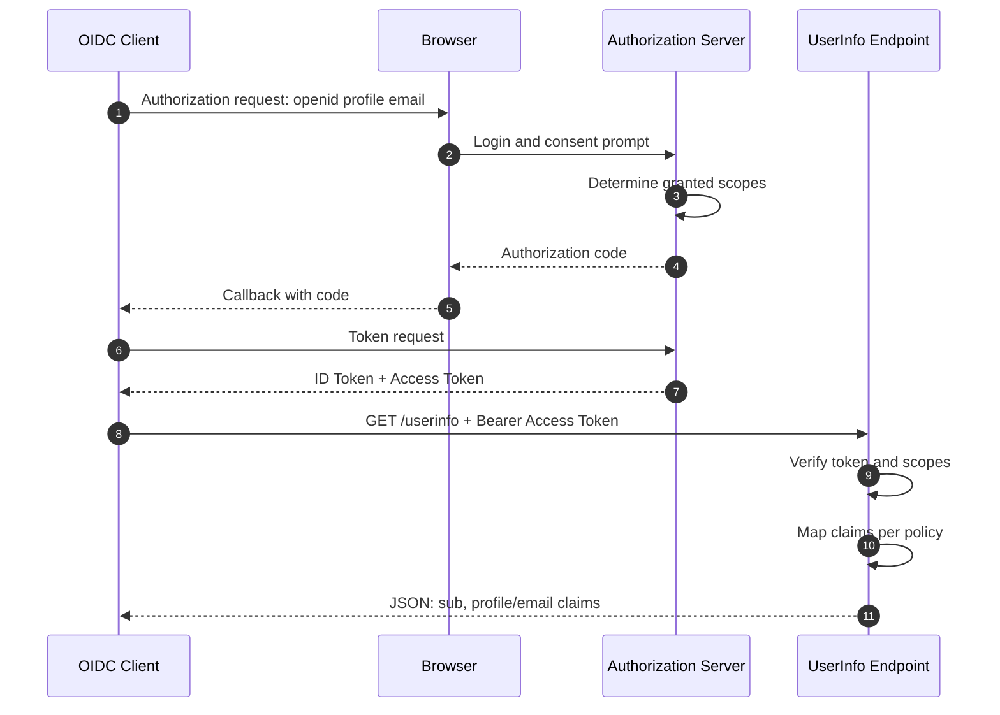
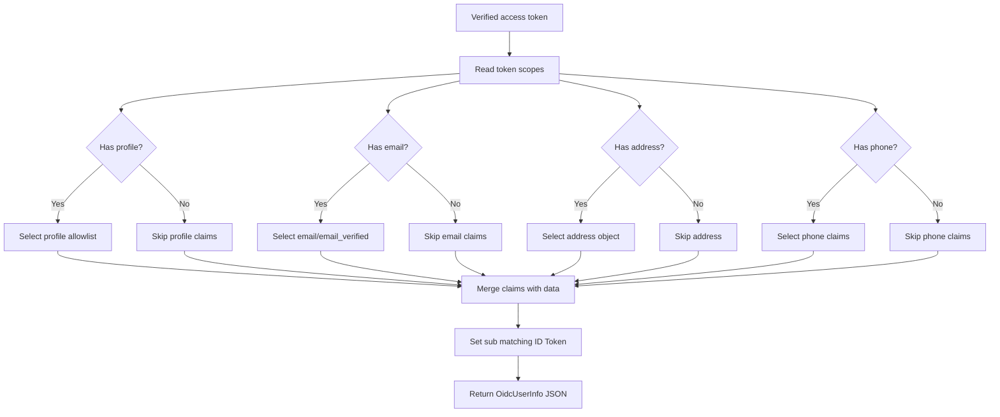

# Mapping Claims by Granted Scopes

OpenID Connect (OIDC) uses `scope` values so clients can request standard groups of information about the End-User. When a client requests `openid profile email`, the Authorization Server may return profile claims such as `name`, `preferred_username`, `email`, and `email_verified` via the UserInfo Endpoint, depending on available data, consent, and privacy policy.

**Mapping claims by granted scopes** is the rule that decides which claims are permitted to appear in the UserInfo response based on the permissions granted to the current access token. It ensures the client receives only the groups of information authorized by the token, rather than receiving the entire user profile just because the backend holds that data.

In Spring Authorization Server, the UserInfo Endpoint has a default mapper that extracts standard claims from the ID Token and filters them by the scopes of the authorization request. When profiles must be retrieved from a database, LDAP, or an internal service, the application can configure `userInfoMapper` to build `OidcUserInfo` according to its policy.

This lesson belongs to the **OIDC UserInfo** chapter of the **SPRING_SECURITY_OAUTH2_OIDC_AUTHORIZATION_SERVER** module, designed to teach how to design, configure, secure, test, and operate an OAuth 2.0/OpenID Connect Authorization Server with Spring Security and Spring Authorization Server in a Spring Boot application.

After this lesson, you will be able to:

- Explain the roles of `openid`, `profile`, `email`, `address`, and `phone`.
- Distinguish between scopes requested by the client, scopes registered for the client, and scopes actually granted.
- Map claims according to the scopes on the current access token.
- Use the default UserInfo mapper or customize `OidcUserInfoEndpointConfigurer.userInfoMapper`.
- Keep the `sub` claim consistent with the ID Token and handle missing claim data.
- Control custom claims, consent, sensitive data, and privacy.
- Test UserInfo across combinations of scopes, tokens, subjects, missing claims, and changing data.

## 1. What Question Does UserInfo Answer?

OIDC adds an identity layer on top of OAuth 2.0. After the End-User logs in and the client receives an ID Token and an access token, the client can call the UserInfo Endpoint with the access token to obtain additional information about the user.

For example, a portal application needs a display name and email:

- The client sends an authorization request with `scope=openid profile email`.
- The Authorization Server authenticates the user and collects consent per policy.
- The server issues an access token with the approved scopes.
- The client sends the access token to the UserInfo Endpoint.
- UserInfo returns `sub` along with the profile/email claims permitted for release.



UserInfo is an OAuth 2.0 protected resource. The client must send the access token in the HTTP Authorization header as a Bearer token over HTTPS. Do not send the ID Token in place of the access token, and do not place the access token in the URL query string.

Example request:

```http
GET /userinfo HTTP/1.1
Host: login.example.com
Authorization: Bearer <ACCESS_TOKEN>
Accept: application/json
```

Example response when the access token is granted `openid profile email`:

```json
{
  "sub": "user-7f31",
  "name": "Nguyen An",
  "given_name": "An",
  "family_name": "Nguyen",
  "preferred_username": "an.nguyen",
  "email": "an@example.com",
  "email_verified": true
}
```

The response above is only an example. The server may lack certain values or the user may not have agreed to share them; claims without data should be omitted from the JSON instead of returning `null` or empty strings.

## 2. Three Scope Concepts to Distinguish

A common mistake is using the wrong scope set when building the UserInfo response. OAuth has at least three distinct sets:

| Scope Set | Meaning | Sufficient to Return Claims? |
| --- | --- | --- |
| Registered client scopes | Scopes the client is permitted to request, e.g., `openid`, `profile`, `email`. | No. This is the upper bound of the registration. |
| Requested client scopes | The `scope` values in the authorization request. | No. The user or policy may deny part of them. |
| Granted scopes | Scopes actually approved by the authorization/token. | Yes. The basis for determining the token's permissions. |

For example, a client is registered for `openid profile email address` but requests only `openid email`. The user approves that request. The access token should carry only `openid` and `email`; UserInfo must not return `name` or `address` merely because those two scopes exist in the registration.

If a client requests `openid profile email` but consent approves only `openid profile`, the mapper must omit `email` and `email_verified`. Do not infer consent from the UI screen, from the list of scopes the client supports, or from an unverified request parameter.

In Spring Authorization Server:

- `RegisteredClient.getScopes()` represents the scopes permitted in the client's registration.
- `OAuth2Authorization.getAuthorizedScopes()` represents the scopes granted to the authorization.
- `context.getAccessToken().getScopes()` in the UserInfo mapper represents the scopes bound to the presented access token.

When building a response for a specific request, use the scopes of the **current access token**. This prevents a downscoped access token from receiving all claims of a broader authorization.

## 3. OIDC Standard Scopes and Corresponding Claims

OIDC defines four optional scopes for requesting groups of standard claims. These are case-sensitive scope values.

| Scope | Requested Claims |
| --- | --- |
| `profile` | `name`, `family_name`, `given_name`, `middle_name`, `nickname`, `preferred_username`, `profile`, `picture`, `website`, `gender`, `birthdate`, `zoneinfo`, `locale`, `updated_at` |
| `email` | `email`, `email_verified` |
| `address` | `address` |
| `phone` | `phone_number`, `phone_number_verified` |

### 3.1. openid

`openid` is the mandatory scope for an authorization request to be treated as an OIDC request. It triggers the identity flow and ID Token issuance per OIDC.

`openid` is not equivalent to permission to read the full profile. If a client requests only `openid`, UserInfo must still include at least `sub`, but must not automatically add email, address, phone number, or profile claims simply because the backend stores those fields.

### 3.2. profile

`profile` requests the default group of profile information:

| Claim | Description |
| --- | --- |
| `name` | Full display name. |
| `given_name` | Given/first name. |
| `family_name` | Family/last name. |
| `middle_name` | Middle name. |
| `nickname` | Casual name/nickname. |
| `preferred_username` | Preferred username. |
| `profile` | Profile page URL. |
| `picture` | Avatar picture URL. |
| `website` | Personal website. |
| `gender` | Gender as provided by the user. |
| `birthdate` | Date of birth in OIDC format. |
| `zoneinfo` | Time zone using IANA zone name, e.g., `Asia/Ho_Chi_Minh`. |
| `locale` | Language/region, e.g., `vi-VN`. |
| `updated_at` | Time the information was last updated, represented as a NumericDate (Unix seconds). |

Not every user has all of these fields. `profile` permits returning the values that actually exist and are allowed to be shared.

### 3.3. email

`email` requests:

- `email`: the End-User's email address.
- `email_verified`: boolean indicating whether the email address has been verified by the OP's process.

Do not set `email_verified=true` merely because the email looks syntactically valid or the user typed it into a form. The value must reflect the actual verification state. If the server does not know whether the email is verified, the claim may be omitted per policy; never guess.

### 3.4. address

`address` is a JSON object, not an arbitrary concatenated string:

```json
{
  "address": {
    "formatted": "12 Nguyen Hue, District 1, Ho Chi Minh City",
    "street_address": "12 Nguyen Hue",
    "locality": "Ho Chi Minh City",
    "region": "Ho Chi Minh City",
    "postal_code": "700000",
    "country": "VN"
  }
}
```

Standard components include `formatted`, `street_address`, `locality`, `region`, `postal_code`, and `country`. Do not return an address when the client only has `profile` or `email`.

Address is potentially sensitive personal data. Return it only when the `address` scope is genuinely granted and consent/policy allows.

### 3.5. phone

`phone` requests:

- `phone_number`: the End-User's phone number.
- `phone_number_verified`: boolean indicating whether the phone number has been verified by the OP's process.

Do not infer `phone_number_verified=true` from the fact that a phone number exists in the database. There must be a verifiable confirmation state, such as completing an OTP challenge per policy.

### 3.6. offline_access Is Not a Profile Scope

`offline_access` is used to request access when the End-User is not present and typically relates to issuing a refresh token under OIDC. It does **not** request additional UserInfo profile claims.

Similarly, business scopes such as `orders.read`, `billing.read`, or `admin` do not automatically correspond to OIDC profile claims. If custom claims are needed, design an explicit mapping with an allowlist and clear authorization policy.

## 4. Important Rules of the UserInfo Response

### 4.1. sub Must Always Be Present

OIDC Core requires `sub` to always appear in the UserInfo response. The `sub` value in UserInfo **MUST match exactly** the `sub` in the ID Token verified by the client.

This is a safety measure against token substitution. The client must not use UserInfo claims if the subject in the response differs from the subject in the ID Token.

Invalid example:

```json
{
  "sub": "another-user",
  "email": "an@example.com"
}
```

If the ID Token has `sub=user-7f31` but UserInfo returns `sub=another-user`, the client must discard the entire UserInfo response. Never merely strip `sub` and continue trusting the remaining fields.

### 4.2. Claims Without Data Should Be Omitted

OIDC allows the OP to omit certain requested claims for privacy reasons or when data is unavailable. Omitting a claim is not a protocol error.

Prefer:

```json
{
  "sub": "user-7f31",
  "name": "Nguyen An"
}
```

Avoid:

```json
{
  "sub": "user-7f31",
  "name": "Nguyen An",
  "email": null,
  "phone_number": ""
}
```

For booleans, `false` is a valid value and differs from omitting a claim. For example, `email_verified=false` must be preserved if that is the actual verification state.

### 4.3. Scope Is a Permission Boundary, Not a Guarantee of Data Presence

If an access token has `email`, the client is authorized to request email per policy; that does not guarantee every account has an email or that the OP is forced to return it.

This can be expressed as:

```text
UserInfo claims
    = claims with available data
    ∩ claims permitted by scope
    ∩ claims permitted by consent/policy
```

This is the principle of permission-based filtering. Every layer must be satisfied before returning a claim.

## 5. Flow of Mapping Claims by Granted Scopes

Suppose a user has the profile:

```json
{
  "sub": "user-7f31",
  "name": "Nguyen An",
  "email": "an@example.com",
  "email_verified": true,
  "phone_number": "+84901234567",
  "phone_number_verified": true,
  "address": {
    "locality": "Ho Chi Minh City",
    "country": "VN"
  }
}
```

The client requests `openid profile email phone`. After consent, the access token is actually granted only `openid profile email`.

The mapper must return:

```json
{
  "sub": "user-7f31",
  "name": "Nguyen An",
  "email": "an@example.com",
  "email_verified": true
}
```

The mapper does not return `phone_number` or `phone_number_verified` because the `phone` scope is not on the access token, even though the data is available.



Steps:

1. Verify the access token at the UserInfo Endpoint.
2. Retrieve the authorization associated with the token and the scopes of that specific token.
3. Retrieve the stable subject from the ID Token/authorization.
4. Load profile data from a trusted source.
5. Map each claim group according to its corresponding scope.
6. Drop values that are missing or not permitted to be shared.
7. Always set `sub` matching the ID Token.
8. Return the JSON response.

Do not load the entire profile data and return it straight to the client. Having data in the database is not authorization to disclose that data.

## 6. Spring Authorization Server: Default Behavior

When OpenID Connect is enabled in Spring Authorization Server, the UserInfo Endpoint is registered in the Authorization Server filter chain. This endpoint is a protected resource and requires an access token in the Authorization header.

Minimal OIDC configuration:

```java
@Bean
@Order(1)
SecurityFilterChain authorizationServerSecurityFilterChain(
        HttpSecurity http) throws Exception {

    OAuth2AuthorizationServerConfigurer authorizationServer =
        OAuth2AuthorizationServerConfigurer.authorizationServer();

    http
        .securityMatcher(authorizationServer.getEndpointsMatcher())
        .with(authorizationServer, server ->
            server.oidc(Customizer.withDefaults()));

    return http.build();
}
```

A real application also needs the Authorization Server beans, filter chains protecting login/application routes, and signing key configuration. For the UserInfo Endpoint in current Spring Authorization Server configurations, a `JwtDecoder` is required to verify access tokens.

By default, Spring Authorization Server:

- Authenticates the access token sent to UserInfo.
- Finds the `OAuth2Authorization` corresponding to the token.
- Uses the ID Token stored in the authorization as the source of standard claims.
- Filters standard claims based on the scopes requested in the authorization.
- Builds `OidcUserInfo` and returns the JSON response.

Therefore, if the ID Token already has the right standard claims and no mapping from another data source is needed, you can keep the default mapper.

### 6.1. Client Registration for OIDC Scopes

Example registration:

```java
RegisteredClient portal = RegisteredClient.withId("portal-internal-id")
    .clientId("customer-portal")
    .clientAuthenticationMethod(
        ClientAuthenticationMethod.CLIENT_SECRET_BASIC)
    .authorizationGrantType(
        AuthorizationGrantType.AUTHORIZATION_CODE)
    .authorizationGrantType(
        AuthorizationGrantType.REFRESH_TOKEN)
    .redirectUri(
        "https://portal.example.com/login/oauth2/code/portal")
    .scope(OidcScopes.OPENID)
    .scope(OidcScopes.PROFILE)
    .scope(OidcScopes.EMAIL)
    .scope(OidcScopes.ADDRESS)
    .scope(OidcScopes.PHONE)
    .clientSettings(ClientSettings.builder()
        .requireAuthorizationConsent(true)
        .requireProofKey(true)
        .build())
    .build();
```

Registration allows the client to request those scopes. Consent UI and authorization policy still decide which scopes are granted in a specific authorization.

Do not add every scope to every client out of habit. A client that only needs display name and email should only be granted the necessary scopes.

### 6.2. Note on Token Format

In the standard documented configuration, the Spring Authorization Server UserInfo Endpoint uses Resource Server support and `JwtDecoder`. If the system selects opaque/reference access tokens or changes token authentication, verify UserInfo authentication support for the exact version and custom filter chain; do not assume the default JWT decoder configuration automatically reads opaque tokens.

## 7. Approach 1: Adding Standard Claims to the ID Token and Using the Default Mapper

Spring documentation recommends the simple approach of putting standard claims into the ID Token upon issuance. The default UserInfo mapper then returns only the standard claims requested per scopes.

Define a service that returns only verified **profile claims**, excluding protocol claims such as `iss`, `sub`, `aud`, `exp`, or `nonce`:

```java
public interface UserProfileService {

Map<String, Object> loadStandardProfileClaims(String principalName);
}
```

Customizer for the ID Token:

```java
@Configuration(proxyBeanMethods = false)
public class IdTokenProfileClaimsConfig {

    @Bean
    OAuth2TokenCustomizer<JwtEncodingContext> idTokenCustomizer(
            UserProfileService userProfileService) {

        return context -> {
            if (!OidcParameterNames.ID_TOKEN.equals(
                    context.getTokenType().getValue())) {
                return;
            }

            Map<String, Object> source =
                userProfileService.loadStandardProfileClaims(
                    context.getPrincipal().getName());

            Set<String> authorizedScopes = context.getAuthorizedScopes();
            Map<String, Object> source =
                userProfileService.loadStandardProfileClaims(
                    context.getPrincipal().getName());
            if (source == null) {
                source = Map.of();
            }

            Set<String> authorizedScopes = context.getAuthorizedScopes();

            Map<String, Object> allowed = new HashMap<>();

            copyScopeClaims(source, allowed, authorizedScopes,
                OidcScopes.PROFILE,
                Set.of(
                    "name", "family_name", "given_name", "middle_name",
                    "nickname", "preferred_username", "profile", "picture",
                    "website", "gender", "birthdate", "zoneinfo",
                    "locale", "updated_at"));

            copyScopeClaims(source, allowed, authorizedScopes,
                OidcScopes.EMAIL,
                Set.of("email", "email_verified"));

            copyScopeClaims(source, allowed, authorizedScopes,
                OidcScopes.ADDRESS,
                Set.of("address"));

            copyScopeClaims(source, allowed, authorizedScopes,
                OidcScopes.PHONE,
                Set.of("phone_number", "phone_number_verified"));

            context.getClaims().claims(claims ->
                claims.putAll(allowed));
        };
    }

    private static void copyScopeClaims(
            Map<String, Object> source,
            Map<String, Object> target,
            Set<String> scopes,
            String requiredScope,
            Set<String> claimNames) {

        if (!scopes.contains(requiredScope)) {
            return;
        }

        for (String claimName : claimNames) {
            Object value = source.get(claimName);
            if (value != null
                    && (!(value instanceof String text) || !text.isBlank())) {
                target.put(claimName, value);
            }
        }
    }
}
```

Required imports:

```java
import java.util.HashMap;
import java.util.Map;
import java.util.Set;

import org.springframework.context.annotation.Bean;
import org.springframework.context.annotation.Configuration;
import org.springframework.security.oauth2.core.oidc.OidcScopes;
import org.springframework.security.oauth2.core.oidc.endpoint.OidcParameterNames;
import org.springframework.security.oauth2.server.authorization.token.JwtEncodingContext;
import org.springframework.security.oauth2.server.authorization.token.OAuth2TokenCustomizer;
```

This example illustrates the customizer portion; the application needs to provide `UserProfileService` and the remaining beans. The service should return only verified allowlisted claims, never protocol claims or an entire database entity.

**Why check the token type?** `JwtGenerator` can mint both ID Tokens and JWT access tokens. Without filtering for `ID_TOKEN`, profile data could accidentally be embedded into an access token or another JWT type.

**Why filter by authorized scopes when minting the ID Token?** This reduces the risk of embedding claims beyond what was approved. The default UserInfo mapper still filters standard claims by scope; the customizer should not be used to broaden client permissions.

Do not overwrite `sub` with the username. The subject is determined by the OIDC subject policy and may be a pairwise identifier. The service should be queried with a trusted user identifier, while the ID Token's subject remains managed by the Authorization Server.

## 8. Approach 2: Customizing userInfoMapper to Map Directly from a Profile Source

When profile claims reside in a database, LDAP, or a profile service and you do not want to embed all of that data into the ID Token, you can configure `OidcUserInfoEndpointConfigurer.userInfoMapper`.

The mapper receives `OidcUserInfoAuthenticationContext`, which provides:

- `getAuthorization()`: the authorization associated with the access token.
- `getAccessToken()`: the Bearer access token used for the UserInfo request.
- `getAuthentication()`: `OidcUserInfoAuthenticationToken` representing the authenticated request.

From the authorization, the application can retrieve the ID Token to determine `sub`. From the current access token, the mapper retrieves scopes to filter claims.

### 8.1. Subject-Based Profile Service

```java
public interface UserInfoProfileService {

    Map<String, Object> loadClaimsBySubject(String subject);
}
```

The service must map the issued subject to the right user profile. With pairwise subjects, do not assume `sub` is always a username or internal primary key; use the application's mapping table/subject resolver.

### 8.2. Mapper Filtering by Access Token Scopes

```java
@Configuration(proxyBeanMethods = false)
public class UserInfoMapperConfig {

    private static final Set<String> PROFILE_CLAIMS = Set.of(
        "name",
        "family_name",
        "given_name",
        "middle_name",
        "nickname",
        "preferred_username",
        "profile",
        "picture",
        "website",
        "gender",
        "birthdate",
        "zoneinfo",
        "locale",
        "updated_at"
    );

    @Bean
    @Order(1)
    SecurityFilterChain authorizationServerSecurityFilterChain(
            HttpSecurity http,
            UserInfoProfileService profileService) throws Exception {

        Function<OidcUserInfoAuthenticationContext, OidcUserInfo> mapper =
            context -> {
                OAuth2Authorization authorization =
                    context.getAuthorization();

                if (authorization == null) {
                    throw new OAuth2AuthenticationException(
                        new OAuth2Error(OAuth2ErrorCodes.INVALID_TOKEN));
                }

                OAuth2Authorization.Token<OidcIdToken> idTokenHolder =
                    authorization.getToken(OidcIdToken.class);

                if (idTokenHolder == null) {
                    throw new OAuth2AuthenticationException(
                        new OAuth2Error(OAuth2ErrorCodes.INVALID_TOKEN));
                }

                String subject = idTokenHolder.getToken().getSubject();
                Set<String> scopes = context.getAccessToken().getScopes();

                Map<String, Object> source =
                    profileService.loadClaimsBySubject(subject);
                if (source == null) {
                    source = Map.of();
                }

                Map<String, Object> response = new HashMap<>();
                response.put("sub", subject);

                copyScopeClaims(source, response, scopes,
                    OidcScopes.PROFILE, PROFILE_CLAIMS);

                copyScopeClaims(source, response, scopes,
                    OidcScopes.EMAIL,
                    Set.of("email", "email_verified"));

                copyScopeClaims(source, response, scopes,
                    OidcScopes.ADDRESS, Set.of("address"));

                copyScopeClaims(source, response, scopes,
                    OidcScopes.PHONE,
                    Set.of("phone_number", "phone_number_verified"));

                // Custom scopes are mapped only when explicitly defined by application policy.
                copyScopeClaims(source, response, scopes,
                    "employee.read",
                    Set.of("employee_id", "department"));

                return new OidcUserInfo(response);
            };

        OAuth2AuthorizationServerConfigurer authorizationServer =
            OAuth2AuthorizationServerConfigurer.authorizationServer();

        http
            .securityMatcher(authorizationServer.getEndpointsMatcher())
            .with(authorizationServer, server ->
                server.oidc(oidc ->
                    oidc.userInfoEndpoint(userInfo ->
                        userInfo.userInfoMapper(mapper))));

        http.authorizeHttpRequests(authorize ->
            authorize.anyRequest().authenticated());

        return http.build();
    }

    private static void copyScopeClaims(
            Map<String, Object> source,
            Map<String, Object> target,
            Set<String> scopes,
            String requiredScope,
            Set<String> claimNames) {

        if (!scopes.contains(requiredScope)) {
            return;
        }

        for (String claimName : claimNames) {
            Object value = source.get(claimName);
            if (value != null
                    && (!(value instanceof String text) || !text.isBlank())) {
                target.put(claimName, value);
            }
        }
    }
}
```

Key imports:

```java
import java.util.HashMap;
import java.util.Map;
import java.util.Set;
import java.util.function.Function;

import org.springframework.context.annotation.Bean;
import org.springframework.context.annotation.Configuration;
import org.springframework.core.annotation.Order;
import org.springframework.security.config.annotation.web.builders.HttpSecurity;
import org.springframework.security.oauth2.core.OAuth2Error;
import org.springframework.security.oauth2.core.OAuth2AuthenticationException;
import org.springframework.security.oauth2.core.OAuth2ErrorCodes;
import org.springframework.security.oauth2.core.oidc.OidcScopes;
import org.springframework.security.oauth2.core.oidc.OidcIdToken;
import org.springframework.security.oauth2.core.oidc.OidcUserInfo;
import org.springframework.security.oauth2.server.authorization.OAuth2Authorization;
import org.springframework.security.oauth2.server.authorization.config.annotation.web.configurers.OAuth2AuthorizationServerConfigurer;
import org.springframework.security.oauth2.server.authorization.oidc.authentication.OidcUserInfoAuthenticationContext;
import org.springframework.security.web.SecurityFilterChain;
```

This example focuses on the mapper; a real filter chain must integrate properly with the existing Authorization Server config, login chain, exception handling, `JwtDecoder`, and required beans. If the project already has a `SecurityFilterChain` for the Authorization Server, add `userInfoEndpoint(...)` to the existing configurer instead of creating a second chain with a duplicate matcher.

### 8.3. Why Use Scopes on the Access Token?

An authorization may store approved scopes, yet a UserInfo request always presents a specific access token. Using `context.getAccessToken().getScopes()` ties the response to that exact credential. If the system downscopes when minting a token, the mapper will not accidentally apply broader scopes from the registration or initial authorization request.

### 8.4. Keeping sub Consistent

The mapper retrieves `sub` from the ID Token stored in the authorization, then puts that exact value into the response. Do not take the subject from a query parameter, request header, client-sent username, or an unverified claim.

The client must also verify that `sub` in UserInfo matches `sub` in the ID Token exactly before using any other claims.

## 9. Mapping Custom Claims by Custom Scopes

An application may define its own scopes, for example:

| Custom Scope | Claims That May Be Permitted |
| --- | --- |
| `employee.read` | `employee_id`, `department` |
| `organization.read` | `organization_id`, `organization_name` |
| `support.contact.read` | `support_contact` |

These are application-specific conventions, not standard OIDC scopes. You must register the scopes in `RegisteredClient`, define consent/policy, and verify that the mapper strictly limits the claims.

Example:

```java
copyScopeClaims(
    source,
    response,
    scopes,
    "organization.read",
    Set.of("organization_id", "organization_name")
);
```

Do not map an `admin` scope to the entire user object or an entire database row. Each scope should have an explicit claim allowlist and a clear business purpose. When the scope is absent from the access token, the corresponding custom claims must be omitted even if the user has that data.

Custom claims must not overwrite OIDC protocol claims such as `sub`. Avoid repurposing standard claim names for custom meanings; if namespacing is needed, pick clear names aligned with the client contract.

## 10. Scopes, Consent, and Privacy

A scope is part of an authorization contract, not unlimited consent for every possible use of data.

### 10.1. Granted Scope Does Not Guarantee a Claim Is Always Returned

OIDC allows the OP to withhold certain requested claims for privacy reasons. For example, a user may approve `email` without having a verified email; the server may return `email` with `email_verified=false`, or omit the claim per policy if no valid data exists.

Similarly, granting `address` does not mean every address component has a value. The mapper may return an object containing only the populated fields, provided it matches the schema and policy.

### 10.2. Do Not Return PII Outside Scope

Do not return the following data merely because it exists in the profile database:

- Passwords, password hashes, recovery codes, or MFA secrets.
- Client secrets, private keys, session tokens, or refresh tokens.
- Government ID numbers, payment details, health records, or internal data without valid scope/purpose.
- Internal database IDs if not designed to be public subjects.
- Internal roles/authorities merely because an access token has a generic API scope.

For sensitive claims, consider separate consent, purpose of use, retention, and data-protection regulations. A broad scope like `profile` should not be interpreted as permission to export every field in an internal profile.

### 10.3. Do Not Put Rapidly Changing Data into the ID Token Unnecessarily

The ID Token is a snapshot at authentication/token-issuance time. If the profile changes afterward, an existing ID Token still holds the old values until expiration. UserInfo can query fresher data sources on each request, though cache, latency, and availability must be managed.

Choose the data source per requirements:

| Approach | Advantages | Trade-offs |
| --- | --- | --- |
| Claims in ID Token, default mapper | Simple, response consistent with issued data. | Profile may be stale until tokens are re-issued. |
| Custom UserInfo mapper querying DB/service | Can reflect latest data and per-request policy. | Adds latency, service dependency, and error handling needs. |
| Profile cache with short TTL | Reduces load on data source. | Introduces update delay and requires invalidation policy. |

Do not call multiple profile services synchronously on every request if a token-time snapshot meets requirements. Conversely, do not embed data needing immediate updates into the ID Token and assume UserInfo will automatically reflect changes.

## 11. UserInfo and ID Token Have Different Roles

| Criterion | ID Token | UserInfo |
| --- | --- | --- |
| Purpose | Message confirming authentication to the client. | Endpoint returning End-User claims for an access token. |
| Timing | Issued in token response/authorization response per flow. | Client calls separately after obtaining access token. |
| Format | Signed JWT (and optionally encrypted per config). | Usually JSON; may be signed/encrypted per registration and implementation. |
| Subject | Contains `sub`. | Must contain `sub` and must match ID Token. |
| Freshness | Snapshot at issuance time. | Can fetch fresher data depending on mapper/source. |
| Access Control | Client verifies ID Token per OIDC. | UserInfo Endpoint requires a valid access token. |

Do not use an access token as proof of authentication in place of an ID Token on an OIDC client. Likewise, never send an ID Token to the UserInfo Endpoint in place of an access token.

The client must verify the ID Token per OIDC, call UserInfo with the access token, and compare `sub`. Only when the subject matches should the client use the remaining claims from UserInfo.

## 12. Common Errors and How to Handle Them

### 12.1. Client Requests email but UserInfo Does Not Return email

Check whether `email` is actually in the access token's scopes, whether consent approved it, whether the profile service has an email, and whether the mapper allowlists `email`. Do not check only the scope list in RegisteredClient.

### 12.2. Client Receives Profile Claims Even Though It Requested Only openid

Check whether a custom mapper returns the entire profile map without scope filtering. Check whether an ID Token customizer embeds unnecessary claims and whether the default mapper was replaced by a custom mapper that skipped filtering.

### 12.3. UserInfo Returns a Different sub from the ID Token

Check the subject resolver, pairwise subject policy, tenant/sector mapping, and whether the mapper pulls the right ID Token from the authorization bound to the access token. The client must discard the entire response on mismatch.

### 12.4. email_verified Is Always true

Check whether the mapping hardcodes literal `true` or defaults to `true` when the database field is null. Only use the verification status recorded from a trusted email verification workflow.

### 12.5. address Claim Is Returned as a String

OIDC `address` is a JSON object. Verify that the DTO/serializer does not stringify the object or turn it into a free-form address string. If only partial address data exists, return an object containing only the populated components.

### 12.6. Custom Mapper Drops Standard Claims

A custom mapper is responsible for producing the entire `OidcUserInfo` response. If it returns only custom claims and forgets `sub` or omits standard scope mappings, the response may cease to be OIDC-compliant. Use a clear allowlist and always include the subject.

### 12.7. Custom Scope Leaks Unintended Claims

Check the scope-to-claim mapping, actual scopes on the token, and source data. Do not use substring checks like `scope.contains("read")`; compare exact scope elements.

### 12.8. UserInfo Returns Stale Data

If the mapper pulls claims from the ID Token, the data is a snapshot from issuance time. If fresh data is required, query the profile service in the mapper or reduce cache TTL per SLA. Do not mutate claims inside an already-issued ID Token.

### 12.9. UserInfo Returns 401 invalid_token

Check for expired/revoked access tokens, signature/issuer/audience, and `JwtDecoder`. Verify the client sends the actual access token in the Bearer header rather than an ID Token or refresh token.

### 12.10. UserInfo Endpoint Does Not Work After Enabling OIDC

Check that `.oidc(...)` is enabled in the Authorization Server filter chain, along with endpoint matcher, `JwtDecoder` bean, and Resource Server support. Verify requests flow through the right chain and configured endpoint path.

## 13. Claim Mapping Test Matrix

| Scenario | Expected Result |
| --- | --- |
| Token has `openid` | UserInfo has `sub` matching the ID Token. |
| Token has `openid profile` | Only populated profile claims are returned. |
| Token has `openid email` | May return `email`/`email_verified` if data and policy allow. |
| Token has `openid address` | May return the `address` object. |
| Token has `openid phone` | May return phone claims. |
| Token has `openid` without profile/email/address/phone | None of those claim groups are returned. |
| Client registration allows email, but access token lacks email | Email is not returned. |
| Request asks for email, but consent does not grant email | Email is not returned. |
| Token has `email`, but profile service has no email | Omit email claim; do not return null/empty. |
| `email_verified=false` | Preserve boolean false if that is the actual state. |
| Token has `profile` without `phone` | Phone claims are not returned. |
| Token has custom scope `employee.read` | Only custom claims in that scope's allowlist are returned. |
| Token lacks `employee.read` | Employee claims are not returned. |
| Profile source contains claim outside allowlist | Non-allowlisted claim does not appear. |
| Mapper cannot find ID Token/subject | Reject token/request per policy; do not return an unidentified profile. |
| UserInfo `sub` differs from ID Token `sub` | Client discards the entire response. |
| Expired/revoked access token | UserInfo returns token auth error, typically 401 invalid_token. |
| Older ID Token and UserInfo from updated profile service | Subject still matches; claims may be fresher per policy. |
| Two clients with different pairwise subjects | Each client receives the right subject per sector/subject policy. |
| Access token scopes are downscoped | Mapper uses only scopes of the presented token. |
| Custom UserInfo mapper | Still includes `sub` and full scope filtering. |
| Profile service temporarily unavailable | Controlled error handling; do not return stale/unverified data as fresh. |

### 13.1. Integration Test with Different Scopes

Prepare one user profile with all claims populated. Create separate authorizations:

- Authorization A: `openid profile`.
- Authorization B: `openid email`.
- Authorization C: `openid address phone`.
- Authorization D: `openid`.

Call UserInfo with each corresponding access token and verify:

1. All responses contain `sub` matching the ID Token.
2. Response A has no email/address/phone.
3. Response B has only the email group among optional profile claims.
4. Response C has address/phone, but no profile/email.
5. Response D has only `sub` and any other mandatory OIDC claims if required by policy.
6. No response contains claims outside the scope allowlist.
7. Claims without data are omitted instead of serialized as null/empty.

### 13.2. Testing Subject Consistency

Create an ID Token with `sub=user-7f31` and simulate a mapper returning `sub=user-other`. The client-side test must confirm the response is not used. On the server side, test that the mapper always obtains the subject from the authorization's own ID Token, never from request input.

### 13.3. Testing Boolean and Object Claims

- `email_verified=false` is still returned as a JSON boolean.
- `phone_number_verified=false` is still returned as a JSON boolean.
- `address` is a JSON object, not a string.
- `updated_at` is a NumericDate per OIDC schema.
- Missing claim data does not appear in the response.

## 14. Hands-on Exercise: Portal Receives Only Granted Claims

A portal is registered with the scopes `openid`, `profile`, `email`, `address`, and `phone`. The user profile in the database has all fields populated.

Scenarios:

- Run A: the user approves `openid profile email`.
- Run B: the user approves only `openid profile`.
- Run C: the user approves `openid address phone`.
- Run D: the access token is downscoped to `openid`.
- Run E: the user changes their email after the ID Token was issued.

Answer the following:

1. Why is having `email` in registration insufficient for UserInfo to return email in Run B?
2. Should the mapper use scopes from RegisteredClient, the authorization request, or the current access token?
3. Why must `sub` still be present in all four runs?
4. If `email_verified=false`, should the claim be omitted?
5. Which JSON type must `address` have?
6. If the profile service also has `national_id` outside the allowlist, may the mapper return it?
7. For the custom scope `employee.read`, how do you restrict specific claims?
8. If email changes in Run E, does default UserInfo sourcing claims from the ID Token reflect it immediately?
9. What must the client do if UserInfo `sub` differs from ID Token `sub`?
10. When the profile service fails, how should unverified data be handled (or avoided)?

**Hint:** the scopes of the current access token are the permission boundary for that request. `sub` comes from the corresponding ID Token; remaining claim groups are filtered by scope and policy. If data fresher than the ID Token snapshot is needed, use a custom mapper querying the data source while maintaining subject consistency.

## 15. Implementation Checklist

- [ ] UserInfo Endpoint is enabled via the OIDC configurer and protected as an OAuth2 protected resource.
- [ ] Client sends the access token in the Bearer Authorization header over HTTPS.
- [ ] UserInfo does not accept ID Tokens or refresh tokens in place of access tokens.
- [ ] Mapper uses scopes of the current access token to decide claims.
- [ ] Distinguishes RegisteredClient scopes, requested scopes, and authorized/token scopes.
- [ ] `openid` is required for OIDC; not treated as permission to read the full profile.
- [ ] `profile` maps only standard profile claims.
- [ ] `email` maps only `email` and `email_verified`.
- [ ] `address` maps only the address object per OIDC schema.
- [ ] `phone` maps only phone claims.
- [ ] `offline_access` is not mistaken for a profile scope.
- [ ] Custom scopes have explicit claim allowlists and dedicated policies.
- [ ] `sub` is always present and sourced from the corresponding authorization's ID Token.
- [ ] Client verifies UserInfo `sub` matches ID Token `sub` exactly.
- [ ] Claims without data are omitted, never returned as null/empty string.
- [ ] Boolean false is preserved when it is the real value.
- [ ] No secrets, internal attributes, or out-of-scope/out-of-purpose PII are disclosed.
- [ ] Custom mapper does not drop standard claims or skip scope filtering.
- [ ] Decided between ID Token snapshot vs direct profile service query.
- [ ] Caching/latency/error policy exists for when the profile service is unavailable.
- [ ] Integration tests cover each scope, denied scope, missing claim, subject mismatch, and invalid token.
- [ ] Logs contain no access tokens, refresh tokens, or sensitive full profile claims.

**Key takeaway:** UserInfo claims must be filtered by the **scopes of the presented access token**, then further constrained by available data, consent, and privacy policy. Standard scopes `profile`, `email`, `address`, and `phone` correspond to distinct claim groups. In every response, `sub` is mandatory and must match `sub` in the ID Token exactly; custom mappers must uphold this rule.

## 16. References

- [OpenID Connect Core 1.0 — Section 5.3 UserInfo Endpoint](https://openid.net/specs/openid-connect-core-1_0.html#UserInfo): UserInfo request/response, `sub` claim, and response validation.
- [OpenID Connect Core 1.0 — Section 5.4 Requesting Claims using Scope Values](https://openid.net/specs/openid-connect-core-1_0.html#ScopeClaims): standard scopes `profile`, `email`, `address`, and `phone`.
- [OpenID Connect Core 1.0 — Section 5.1 Standard Claims](https://openid.net/specs/openid-connect-core-1_0.html#StandardClaims): names, types, and semantics of standard claims.
- [RFC 6750 — OAuth 2.0 Bearer Token Usage](https://www.rfc-editor.org/rfc/rfc6750.html): sending access tokens in the Authorization header.
- [Spring Authorization Server — How-to: Customize the OpenID Connect 1.0 UserInfo response](https://docs.spring.io/spring-authorization-server/reference/guides/how-to-userinfo.html): enabling UserInfo Endpoint, ID Token customizer, and UserInfo mapper.
- [Spring Authorization Server — Protocol Endpoints](https://docs.spring.io/spring-authorization-server/reference/protocol-endpoints.html): `OidcUserInfoEndpointConfigurer` and `userInfoMapper`.
- [OidcUserInfoEndpointConfigurer API](https://docs.spring.io/spring-authorization-server/reference/api/java/org/springframework/security/oauth2/server/authorization/config/annotation/web/configurers/OidcUserInfoEndpointConfigurer.html): mapper configuration and extension points.
- [OidcUserInfoAuthenticationContext API](https://docs.spring.io/spring-authorization-server/reference/api/java/org/springframework/security/oauth2/server/authorization/oidc/authentication/OidcUserInfoAuthenticationContext.html): access token, authorization, and authentication context.
- [OAuth2Authorization API](https://docs.spring.io/spring-authorization-server/reference/api/java/org/springframework/security/oauth2/server/authorization/OAuth2Authorization.html): authorized scopes, tokens, and authorization attributes.
