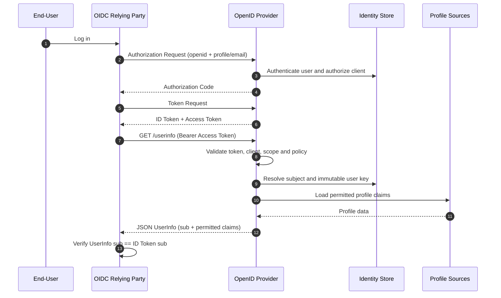
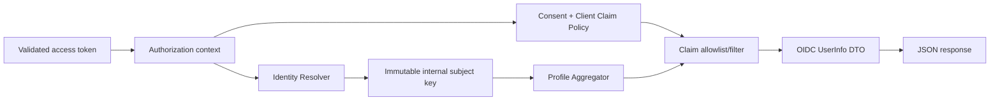
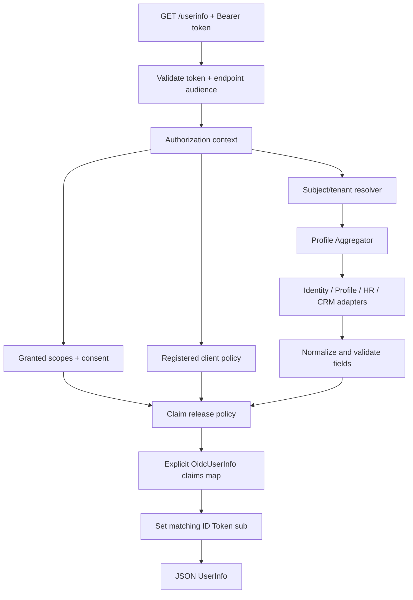
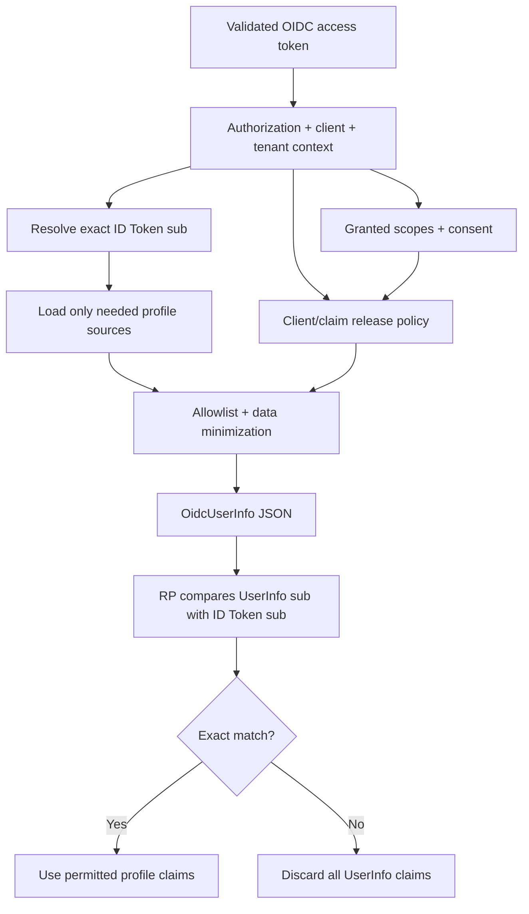

# Connecting User Profile Sources and Controlling Personal Data

## 1. Goals and Context

In the **OIDC UserInfo** chapter of the **SPRING_SECURITY_OAUTH2_OIDC_AUTHORIZATION_SERVER** module, the UserInfo Endpoint allows the OpenID Provider (OP) to provide End-User claims to an OpenID Connect Relying Party (RP) after the user has authenticated and the client holds an appropriate access token. In real-world systems, this information typically resides in an identity database, profile service, HR, CRM, preference store, or contact management system.

With **Spring Security**, **Spring Authorization Server (SAS)**, and **Spring Boot**, connecting profile sources is not merely querying a table and returning the entire object. The OP must resolve the exact subject, verify the token, respect scope/consent/claims requests, restrict data per client, and ensure UserInfo `sub` matches `sub` in the ID Token.

This lesson focuses on building a secure **profile aggregation boundary** and controlling personal data throughout the UserInfo lifecycle.

After this lesson, you will be able to:

- Distinguish between ID Token, Access Token, and UserInfo Response, and understand which data belongs to each.
- Architect UserInfo integration with identity stores, profile databases, and external data services.
- Map source data to OIDC standard claims without exposing internal models.
- Return only claims permitted by scope, consent, client policy, and claims request.
- Ensure `sub` in UserInfo matches `sub` in the ID Token exactly.
- Separate identity, profile, contact, and sensitive data.
- Design caching, timeouts, fallbacks, auditing, retention, and data deletion.
- Customize the UserInfo Endpoint in SAS using a version-appropriate mapper/provider.
- Test tenant isolation, data minimization, stale profiles, revoked tokens, and data-source failures.

**Scope:** Content is based on **OpenID Connect Core 1.0**, **Spring Authorization Server 1.x**, **Spring Security 6.x**, and **Spring Boot 3.x**. Specific APIs may vary by version. Interfaces such as `UserProfileService`, `ProfilePolicy`, and `UserInfoClaimsPolicy` in the examples are application-defined business components, not built-in SAS APIs.

## 2. What Data Does the UserInfo Endpoint Provide?

The UserInfo Endpoint is a protected resource of the OpenID Provider. The RP calls the endpoint using the access token received from the Token Endpoint. The OP verifies the access token and returns JSON claims about the End-User represented by the token.



UserInfo enables the RP to retrieve additional user information without stuffing the entire profile into the ID Token. Data may change more frequently than tokens, such as display name, locale, or avatar.

### 2.1. Distinguishing the Three Data Types

| Component | Purpose | Typical Contents | Consumer |
| --- | --- | --- | --- |
| ID Token | Proves OIDC authentication result and identifies subject | `iss`, `sub`, `aud`, `exp`, `iat`, `nonce`, authentication context | OIDC Client/RP |
| Access Token | Credential to access protected resources | Scopes, audience, expiry, subject/resource context per profile | UserInfo, API/Resource Server |
| UserInfo Response | Returns End-User profile claims | `sub`, `name`, `email`, `picture`, `locale`, `address`... | OIDC Client/RP |

The ID Token is not a general-purpose profile API. The Access Token is not profile data. The UserInfo Response is not a copy of the entire user database.

### 2.2. UserInfo Requires an OIDC-Context Access Token

Under OIDC Core, UserInfo is called with an access token bound to End-User authentication and the `openid` scope. The token must be issued for the appropriate resource/endpoint. The OP should not accept just any access token merely because its signature is valid.

Depending on the implementation, the token may be a JWT or opaque. For opaque tokens, SAS has authorization state to verify. For JWTs, the endpoint must verify the token by issuer, signature, expiry, audience/resource, and policy. Never decode a JWT and trust unverified claims.

### 2.3. `sub` Is a Mandatory Claim

The UserInfo Response **must** contain `sub`. This value must match `sub` in the ID Token of the same authentication exactly. If they do not match, the RP must discard the UserInfo claims because it cannot prove they belong to the same End-User.

Do not mint a new `sub` from email, username, or a database row on each UserInfo call. UserInfo must use the same subject mapping used when issuing the ID Token.

## 3. User Profile Sources in Real-World Systems

An OP may need to combine multiple data sources:

| Source | Typically Owned Data | Trust Level and Notes |
| --- | --- | --- |
| Identity/User Directory | Immutable user ID, account status, username, MFA/security state | Authoritative source for identity and state |
| Profile Database | Display name, language, timezone, avatar | Authoritative source for user-managed profile |
| HR/Workforce System | Employee ID, department, title, work location | Share only if purpose and policy permit |
| CRM/Customer System | Customer tier, contact preferences, relationship data | Do not automatically disclose to every RP |
| Contact Verification Service | Email/phone and verified status | Retain provenance and verification timestamp |
| Consent/Preference Store | Consent, privacy choices, claim release preferences | Policy source; does not replace OAuth scopes |
| External Profile Provider | Externally linked photos/claims | Must verify freshness, trust, and provenance |

**No single source is automatically authoritative for every claim.** For instance, HR is authoritative for department but should not dictate personal email; the Profile Database may allow changing display name but does not decide whether the account is still active.

### 3.1. Separating Identity from Profile

The identity service answers: "Which subject is this, and is it currently allowed to be used?"

The profile service answers: "Which profile attributes currently exist, and which source vouches for them?"

The consent/policy service answers: "For the current client, scopes, and request, which claims are permitted to be shared?"

This separation prevents the OP from turning UserInfo into an endpoint that dumps entire internal objects.



### 3.2. Using Adapters per Source

Do not let the UserInfo mapper call multiple repositories/HTTP clients directly. Place a service boundary:

```java
public interface UserProfileService {

    Optional<UserProfile> loadProfile(
            String immutableUserId,
            String tenantId);
}
```

`UserProfile` is an application-defined domain DTO. The underlying adapter may query SQL, call an HR API, CRM, or cache. The mapper knows only the profile contract, not table schemas or vendor response formats.

### 3.3. Separating DTOs from Entities

Do not return JPA entities directly. Entities can contain:

- Password hashes, recovery codes, or security flags.
- Internal IDs, foreign keys, and admin notes.
- Billing/HR attributes unrelated to OIDC.
- Lazy associations causing uncontrolled queries.
- Fields added in the future that accidentally leak into the response.

Use an explicit allowlist DTO. When the domain model changes, the UserInfo contract changes only through a reviewed decision.

## 4. OIDC Standard Claims and Data Sources

OIDC Core defines claim groups typically requested via scopes. These form a standard convention so RPs understand the meaning of the data.

| Scope | Example Claims | Suitable Source |
| --- | --- | --- |
| `openid` | `sub` | Identity/subject mapping service |
| `profile` | `name`, `given_name`, `family_name`, `middle_name`, `nickname`, `preferred_username`, `profile`, `picture`, `website`, `gender`, `birthdate`, `zoneinfo`, `locale`, `updated_at` | Profile service |
| `email` | `email`, `email_verified` | Verified contact source |
| `address` | `address` (object) | User-managed/verified postal address source |
| `phone` | `phone_number`, `phone_number_verified` | Verified contact source |

Not every claim in a scope must appear in every response. If data does not exist, never fabricate values or return misleading defaults.

### 4.1. Example UserInfo Response

```json
{
  "sub": "pairwise-subject-opaque",
  "name": "Nguyen Van A",
  "given_name": "Van A",
  "preferred_username": "nguyenvana",
  "locale": "vi-VN",
  "email": "user@example.com",
  "email_verified": true
}
```

This response is valid only if the token and client are permitted to receive the claims, the email was verified at an authoritative source, consent/policy permits it, and `sub` matches the ID Token.

### 4.2. The `address` Claim Is an Object

```json
{
  "sub": "pairwise-subject-opaque",
  "address": {
    "formatted": "123 Example Street, Ho Chi Minh City",
    "street_address": "123 Example Street",
    "locality": "Ho Chi Minh City",
    "region": "Ho Chi Minh City",
    "postal_code": "700000",
    "country": "VN"
  }
}
```

Return only necessary address components. Home addresses are personal data; do not release them just because the Profile DTO has that field.

### 4.3. Do Not Confuse Verified with Existing

- Having an `email` does not mean `email_verified=true`.
- Having a `phone_number` does not mean the number is verified.
- A user typing an address does not mean the address is verified.
- `updated_at` must reflect its documented source/meaning, not the time the mapper ran.

If the verification status is unknown, omit the verified claim or return false per exact contract; never mark it true by assumption.

## 5. Scope, Consent, and Claim Release Policy

OAuth scopes are the foundation for limiting UserInfo data. However, scope and consent are two related yet distinct layers:

- **Requested scopes:** what categories of data the client wants to access.
- **Granted scopes:** what permissions the AS granted to the token.
- **Consent:** what data the user agreed to share per policy/UX.
- **Client policy:** whether that client is allowed to receive that claim type.
- **Claims request:** an OIDC request may specify individual or essential claims.

A claim is released only when all relevant conditions permit it. Having the `email` scope does not grant a client access to email if consent or internal policy denies it.

### 5.1. Example Control Matrix

| Claim | Scope | Additional Consent/Policy | Client Restriction |
| --- | --- | --- | --- |
| `sub` | `openid` | Valid subject mapping | Bound to issuer/client context |
| `name` | `profile` | Profile sharing permitted | Can be restricted to first-party clients |
| `email` | `email` | Contact disclosure permitted | Not granted to clients that do not need email |
| `email_verified` | `email` | Only from verified source | Not inferred from presence of email |
| `address` | `address` | Explicit consent, necessary purpose | May be granted only to shipping service |
| `phone_number` | `phone` | Appropriate consent/verification | Only clients with contact use case |
| `department` | Custom scope/policy | HR disclosure approved | Only authorized enterprise RPs |

Custom claims such as `department` should not be arbitrarily attached to the `profile` scope without a contract and privacy review. Use dedicated scopes/custom authorization policies.

### 5.2. Consent Must Be Revocable

If a user withdraws consent, subsequent UserInfo requests must stop returning the related claims per policy. This must be checked at response generation time or via sufficiently fast cache invalidation.

Do not store consent solely in browser UI state. The OP must maintain a backend-queryable consent record/decision linked to client, user, scopes/claims, timestamp, version, and status.

### 5.3. Claims Parameter and Essential Claims

OIDC allows the RP to send a `claims` parameter to request specific claims, optionally marked `essential`. Essential does not override privacy or data protection laws.

If the implementation does not yet fully support the claims parameter, document the limitation and do not advertise unsupported capabilities. Never silently return all profile fields simply because the client sent a broad claims request.

## 6. Data Minimization: Return Only What the RP Needs

**Data minimization** is a core principle: provide only the claims required for the declared purpose. Just because the OP holds data does not mean the RP should receive it.

Examples:

- A portal displaying a name may need only `name` and `picture`.
- A newsletter service may need `email` and verified status, not birthdate or address.
- A shipping service may need `address`, but not HR department.
- A workforce application may need `department`/`employee_number` under a separate policy, without personal email.

### 6.1. Per-Client Allowlist

A policy service can decide which claims a client may receive:

```java
public interface UserInfoClaimsPolicy {

    Set<String> allowedClaims(
            String clientId,
            Set<String> grantedScopes,
            Set<String> consentedClaims,
            Set<String> requestedClaims);
}
```

This is an application-defined interface. The policy should return an **allowlist**, not a denylist of forbidden fields. An allowlist ensures newly added fields in the profile service do not automatically appear in UserInfo.

The next two adapters are also application contracts; they read consent and claims requests from the verified authorization/consent store:

```java
public interface UserConsentService {

    Set<String> consentedClaims(OAuth2Authorization authorization);
}

public interface RequestedClaimsResolver {

    Set<String> requestedClaims(OAuth2Authorization authorization);
}
```

When a request has no explicit OIDC claims parameter, the resolver should return an "no explicit request list" state per the application's contract; the policy then applies the default set of claims permitted by scope/consent/client. Never interpret an empty requested claims set as permission to release every claim.

### 6.2. Intersection of Permissions

```text
released_claims =
    available_claims
    ∩ claims_allowed_by_granted_scopes
    ∩ claims_allowed_by_consent
    ∩ claims_allowed_for_client
    ∩ claims_requested_or_permitted_by_claims_parameter
```

If the system has additional legal/contractual policies, add that condition layer. If any condition is unsatisfied, the claim is not released.

### 6.3. Do Not Return Null/Defaults to Pad the Response

If a user has no phone number, omit `phone_number` instead of returning `"unknown"`. If there is no avatar, do not synthesize an internal URL. If the user has not verified email, do not set `email_verified=true`. Missing data must follow OIDC semantics and product contracts.

## 7. Profile Aggregator Architecture

A practical design separates these steps:

1. Verify the access token and retrieve the authorization context.
2. Identify the issuer, registered client, and subject mapping.
3. Resolve the internal user/tenant from the authenticated authorization.
4. Retrieve granted scopes and consent state.
5. Evaluate client claim policy.
6. Call the necessary profile sources.
7. Normalize/validate data.
8. Filter permitted claims.
9. Attach the exact `sub`.
10. Return the response and record non-sensitive audit metadata.



### 7.1. Do Not Load Every Source on Every Request

If a client only has `profile`, there is no need to call CRM for billing details or HR for department. Determine the claim set first, then query only the required sources.

Source fetches can be grouped:

- Identity source: always needed to resolve subject and status.
- Profile source: only when profile claims are permitted.
- Contact source: only when `email`/`phone` are permitted.
- Address source: only when `address` is permitted.
- Enterprise source: only when custom claims and client policy permit.

### 7.2. Parallel Calls and Dependency Budgets

If sources are independent, they can be called in parallel within concurrency and timeout bounds. Set a latency budget for the entire UserInfo request. Never let a slow HR service block threads indefinitely across all requests.

### 7.3. Read Model for UserInfo

With multiple data sources, an event-updated read model can reduce remote calls. However, document synchronization lag: UserInfo may serve a stale profile briefly. Security/verification-related claims require a stricter freshness policy than display names.

## 8. Connecting Data Sources with Spring Boot

### 8.1. Domain DTO

```java
public record UserProfile(
        String immutableUserId,
        String displayName,
        String givenName,
        String familyName,
        String preferredUsername,
        String email,
        Boolean emailVerified,
        String locale,
        URI picture,
        Instant updatedAt) {
}
```

This DTO is an example. Include only fields genuinely needed for the OIDC contract. Never include password hashes, MFA secrets, recovery data, or internal admin notes.

### 8.2. Service Boundary

```java
public interface UserProfileService {

    Optional<UserProfile> loadProfile(
            String immutableUserId,
            String tenantId);
}
```

An implementation may use a Spring Data repository:

```java
@Service
public class DatabaseUserProfileService
        implements UserProfileService {

    private final UserProfileRepository repository;

    public DatabaseUserProfileService(
            UserProfileRepository repository) {
        this.repository = repository;
    }

    @Override
    @Transactional(readOnly = true)
    public Optional<UserProfile> loadProfile(
            String immutableUserId,
            String tenantId) {

        return repository
                .findByImmutableUserIdAndTenantId(
                        immutableUserId, tenantId)
                .map(UserProfileEntity::toProfile);
    }
}
```

Repository/entity names are application-level examples. Queries must constrain by tenant in multi-tenant systems. Never query by email/username taken from the request.

### 8.3. External Profile Service

When the source resides in another service, use an adapter with explicit timeouts and contract:

```java
public interface WorkforceProfileClient {

    Optional<WorkforceProfile> findBySubject(
            String immutableUserId);
}
```

The HTTP adapter needs TLS certificate validation, workload identity/service authentication, connect/read timeouts, response size limits, schema validation, bounded retries, circuit breaker/bulkhead if needed, and no logging of response bodies containing PII.

Never forward the RP's access token to HR/CRM. Use a dedicated service credential with least privilege.

### 8.4. Configuring Endpoint/Service Credentials

```yaml
profile:
  sources:
    workforce:
      base-url: https://workforce.internal.example
      connect-timeout: 500ms
      read-timeout: 1500ms
      enabled: true
    crm:
      base-url: https://crm.internal.example
      enabled: false

security:
  userinfo:
    cache-ttl: 30s
    max-response-claims: 30
```

This illustrates properties bound by the application. Never place API keys/passwords directly inside committed YAML. `max-response-claims` also does not replace allowlist/consent policies.

## 9. Customizing the UserInfo Endpoint in Spring Authorization Server

SAS supports the OIDC UserInfo Endpoint through the `oidc.userInfoEndpoint` DSL (exact method names depend on version). In SAS 1.x releases, the common customization point is `userInfoMapper` to convert the authentication/authorization context into `OidcUserInfo`.

DSL example:

```java
OAuth2AuthorizationServerConfigurer authorizationServer =
        OAuth2AuthorizationServerConfigurer.authorizationServer();

http
    .securityMatcher(authorizationServer.getEndpointsMatcher())
    .with(authorizationServer, server ->
            server.oidc(oidc ->
                    oidc.userInfoEndpoint(userInfo ->
                            userInfo.userInfoMapper(userInfoMapper))));
```

This is a configuration fragment for the Authorization Server `SecurityFilterChain`, not the entire application. You still need to enable OIDC and configure other SAS beans per version.

### 9.1. Role of the UserInfo Mapper

The mapper receives the context after the endpoint has authenticated the access token, then creates an `OidcUserInfo` object. The mapper should:

- Retrieve the verified authorization and access token.
- Determine the principal/immutable user ID from trusted authorization state.
- Retrieve the exact subject matching the issued ID Token.
- Retrieve granted scopes/consent/client context.
- Call the profile service with bounds.
- Apply the claim allowlist.
- Build `OidcUserInfo` with `sub` matching the ID Token.

Do not re-implement bearer token validation inside the mapper if SAS already performs it. Do not read `user_id` from a query/header to decide the profile.

### 9.2. Example Mapper Returning Only Permitted Claims

The following code is an integration skeleton using common SAS 1.x APIs. Verify exact imports and method signatures against your dependency version:

```java
@Bean
Function<OidcUserInfoAuthenticationContext, OidcUserInfo>
        userInfoMapper(
                UserProfileService profileService,
                UserInfoClaimsPolicy claimsPolicy,
                SubjectIdentityResolver identityResolver,
                UserConsentService consentService,
                RequestedClaimsResolver requestedClaimsResolver,
                RegisteredClientRepository registeredClientRepository) {

    return context -> {
        OAuth2Authorization authorization =
                context.getAuthorization();

        OAuth2Authorization.Token<OidcIdToken> idTokenHolder =
                authorization.getToken(OidcIdToken.class);

        if (idTokenHolder == null) {
            throw new OAuth2AuthenticationException(
                    new OAuth2Error(OAuth2ErrorCodes.INVALID_TOKEN));
        }

        // Use the exact subject issued in the ID Token.
        String subject =
                idTokenHolder.getToken().getSubject();

        // Resolve internal ID from the authenticated authorization.
        // Do not use email/username from the HTTP request.
        String immutableUserId =
                identityResolver.resolveImmutableUserId(authorization);

        String tenantId =
                identityResolver.resolveTenantId(authorization);

        Set<String> grantedScopes =
                context.getAccessToken().getScopes();

        Set<String> consentedClaims =
                consentService.consentedClaims(authorization);

        Set<String> requestedClaims =
                requestedClaimsResolver.requestedClaims(authorization);

        RegisteredClient registeredClient =
                registeredClientRepository.findById(
                        authorization.getRegisteredClientId());

        if (registeredClient == null) {
            throw new OAuth2AuthenticationException(
                    new OAuth2Error(OAuth2ErrorCodes.INVALID_TOKEN));
        }

        Set<String> allowedClaims =
                claimsPolicy.allowedClaims(
                        registeredClient.getClientId(),
                        grantedScopes,
                        consentedClaims,
                        requestedClaims);

        Set<String> profileClaims = Set.of(
                "name", "given_name", "family_name",
                "preferred_username", "locale", "picture", "email",
                "email_verified");

        Optional<UserProfile> profile =
                allowedClaims.stream().anyMatch(profileClaims::contains)
                        ? profileService.loadProfile(
                                immutableUserId, tenantId)
                        : Optional.empty();

        Map<String, Object> claims = new LinkedHashMap<>();
        claims.put("sub", subject);

        if (profile.isPresent()) {
            UserProfile user = profile.get();

            if (allowedClaims.contains("name")
                    && grantedScopes.contains(OidcScopes.PROFILE)
                    && user.displayName() != null) {
                claims.put("name", user.displayName());
            }

            if (allowedClaims.contains("given_name")
                    && grantedScopes.contains(OidcScopes.PROFILE)
                    && user.givenName() != null) {
                claims.put("given_name", user.givenName());
            }

            if (allowedClaims.contains("family_name")
                    && grantedScopes.contains(OidcScopes.PROFILE)
                    && user.familyName() != null) {
                claims.put("family_name", user.familyName());
            }

            if (allowedClaims.contains("preferred_username")
                    && grantedScopes.contains(OidcScopes.PROFILE)
                    && user.preferredUsername() != null) {
                claims.put(
                        "preferred_username",
                        user.preferredUsername());
            }

            if (allowedClaims.contains("locale")
                    && grantedScopes.contains(OidcScopes.PROFILE)
                    && user.locale() != null) {
                claims.put("locale", user.locale());
            }

            if (allowedClaims.contains("picture")
                    && grantedScopes.contains(OidcScopes.PROFILE)
                    && user.picture() != null) {
                claims.put("picture", user.picture().toString());
            }

            if (allowedClaims.contains("email")
                    && grantedScopes.contains(OidcScopes.EMAIL)
                    && user.email() != null) {
                claims.put("email", user.email());
                if (allowedClaims.contains("email_verified")
                        && user.emailVerified() != null) {
                    claims.put("email_verified", user.emailVerified());
                }
            }
        }

        return new OidcUserInfo(claims);
    };
}
```

`UserInfoClaimsPolicy` and `SubjectIdentityResolver` are application-defined interfaces. The code intentionally shows an explicit allowlist; production needs to add `address`/`phone` claim groups and corresponding claims parameter/consent policies.

**Note on SAS version and storage:** The example assumes the authorization stores `OidcIdToken` in `OAuth2Authorization`. If an implementation/version does not store the ID Token in that form, obtain the same subject mapping from the trusted authorization context/subject service and ensure the result matches the issued ID Token exactly. Do not use `authorization.getPrincipalName()` as the public `sub` by default.

### 9.3. When UserInfo Uses the Current Profile

UserInfo is often used to fetch the latest profile at call time, whereas the ID Token is a snapshot at authentication time. For example, if a user changes their display name after logging in, UserInfo may return the new name if policy permits, while `sub` must stay unchanged.

Claims carrying security or verification semantics (e.g., `email_verified`, `phone_number_verified`, account status) require a stricter source of truth and freshness policy than display name. Do not cache these claims for long periods just to reduce latency.

### 9.4. When Is a Custom Authentication Provider Needed?

If you need to change token validation, principal resolution, or authentication semantics of the endpoint, examine the version-appropriate provider extension point. However, if you only need to connect a profile service and filter claims, the mapper is usually the cleaner boundary.

Never write a custom provider to bypass access-token validation or allow arbitrary tokens to call UserInfo. Do not replace the response handler when you only need to change claim contents; use the mapper.

## 10. Resolving the Exact Subject and Ensuring UserInfo Consistency

### 10.1. Trusted Subject Source

Multiple identifiers may exist in a system:

- Internal immutable user ID.
- Username/email.
- Public OIDC subject.
- Pairwise OIDC subject.
- HR employee ID.
- Customer ID.

UserInfo must return the **OIDC subject** used in the ID Token, not whichever option is most convenient.

If the OP supports public and pairwise subjects, the subject resolver must receive the proper registered client/sector policy. The same user may have different pairwise `sub` values across sectors.

### 10.2. Checking via the ID Token

In SAS, the authorization can store the OIDC ID Token. Once the token object is retrieved, the issued subject can be read:

```java
OAuth2Authorization.Token<OidcIdToken> idTokenHolder =
        authorization.getToken(OidcIdToken.class);

String userInfoSubject =
        idTokenHolder.getToken().getSubject();
```

This is an API example; check for null and token state according to your version. If the token has no ID Token yet a request arrives at UserInfo, verify whether this is a valid OIDC flow and whether the access token has the `openid` scope. Never fall back to username automatically.

### 10.3. The RP Must Verify Equality

The RP must execute logic equivalent to:

```text
verified_id_token.iss == expected_issuer
verified_id_token.aud includes this_client_id
userinfo.sub == verified_id_token.sub
```

If `sub` does not match, discard all UserInfo claims. Never drop only the `sub` field and keep name/email; the remaining claims are unproven for the ID Token's subject.

## 11. Controlling Personal Data by Classification

Not all profile attributes carry the same risk. Establish a data classification before implementing UserInfo.

| Category | Examples | Recommended Controls |
| --- | --- | --- |
| Public/basic profile | Display name, public avatar | `profile` scope, client allowlist |
| Contact data | Email, phone | Verified source, consent, dedicated scope |
| Location/address | Home address, postal address | Specific purpose, explicit consent, client restriction |
| Employment | Department, employee ID, title | Enterprise contract, tenant/client restriction |
| Sensitive attributes | Health, financial, government identifiers | Excluded from default UserInfo; legal review and separate authorization |
| Security data | MFA methods, recovery status, risk score | Not released as ordinary profile claims |
| Internal operational data | Database ID, admin notes, flags | Never disclosed |

Certain sensitive data may fall into special categories under applicable law. Evaluate by jurisdiction, processing purpose, legal basis, and organizational policy; never assume logging in implies consent to share all data.

### 11.1. PII in Claims and Logs

Do not log full UserInfo JSON into application logs, API gateway logs, distributed tracing, metric labels, exception messages, analytics events, or uncontrolled support tickets.

You may log safe metadata such as authenticated client ID, released claim names, latency, source status, and correlation ID. Do not log claim values without a clear purpose and access control.

### 11.2. Controlled Auditing

An audit record may contain:

- Authenticated Client ID.
- Pseudonymous or keyed-hash subject reference.
- Claim names released, not values.
- Scope/consent decision.
- Timestamp, request correlation ID.
- Which profile sources were queried and the outcome.
- Policy version.

Restrict audit read access and retention. A subject hash can still be linkable personal data; do not treat pseudonymization as anonymization.

## 12. Consent, Access Rights, and Revocation

### 12.1. Consent Bound to Client and Purpose

Consent should be modeled by user, client, scopes/claims, and status. If a user grants `profile` to portal A, that does not automatically allow partner B to receive the same data.

Distinguish between OAuth authorized scopes, OIDC claim release consent, client contract/allowlist, organization/tenant policy, and user preference/legal basis. One layer may restrict another, never automatically expand permissions.

### 12.2. Withdrawing Consent

When a user withdraws consent:

1. Update the effective consent state.
2. Subsequent UserInfo requests must evaluate the new state.
3. Invalidate related claim caches.
4. Evaluate whether active access tokens still have permission to call UserInfo or must be revoked.
5. Record an audit event without storing profile values.
6. Notify the RP only according to contract and legal policy.

If a token remains active while profile consent has been withdrawn, the OP may return minimal `sub` or deny claims/endpoint per policy. The decision must be consistent and must not leak sensitive reasons.

### 12.3. Account Disabled or Deleted

Identity state can change after an ID Token was issued. The OP must define when disabling an account renders access tokens inactive, when UserInfo returns an error, and when it simply stops returning claims. Never use a profile service fallback to return stale data for a deleted account.

## 13. Multi-Tenancy and Data Source Authorization

In a SaaS/multi-tenant OP, the same internal user key may appear in multiple tenants or the same email may belong to different organizations.

### 13.1. Always Constrain by Tenant

Profile queries must be bound to the tenant determined from the verified authorization context:

```java
profileRepository.findByImmutableUserIdAndTenantId(
        immutableUserId,
        trustedTenantId);
```

Do not take `tenant_id` from a query parameter, caller-supplied header, or unverified claim. If the access token carries a tenant claim, use it only after verifying the token and checking the tenant against client/resource policy.

### 13.2. Client-to-Tenant Authorization

A client belonging to tenant Acme must not retrieve a Contoso tenant profile simply by swapping user IDs. Concurrently verify which tenant the client registration belongs to, which tenant context the authorization/token was issued under, which issuer/tenant owns the subject mapping, that the profile query includes a tenant predicate, and that cache keys contain tenant/issuer/client disclosure context.

### 13.3. Caches Must Not Be Cross-Tenant

Caching per internal user ID is insufficient if the same ID can exist across multiple tenants. Cache keys must bind issuer, tenant, and applicable disclosure context. Never serve the same filtered response cached for client A to client B if scope/consent/claim policies differ.

## 14. Profile Caching and Freshness

Caching reduces latency and load on data sources, but can retain PII after a user edits/deletes data or withdraws consent.

| Data Type | Suggested Starting TTL for Design | Notes |
| --- | --- | --- |
| Display name/avatar | Can be longer if staleness is acceptable | Invalidate on profile update |
| Email/phone verified | Shorter, tied to verification state | Do not cache across verification/revocation changes |
| Address | Per use case and consent | Delete/invalidate when user updates or withdraws consent |
| Employment/department | Per source sync SLA | May be stale when HR updates |
| Account status/security state | Very short or check directly | Never use stale positive to bypass disablement |
| Consent/claim policy | Invalidate when policy changes | Never use stale cache to continue releasing |

TTL intervals must be decided by SLA, risk, and source update behavior; the table does not prescribe mandatory OIDC values.

### 14.1. Caching Filtered Data

Two strategies exist:

- Cache the raw internal profile with tightly restricted access, then re-filter on every request.
- Cache the UserInfo projection per client/scope/consent/tenant and policy version.

If caching projections, keys must include every factor that changes disclosure. If caching raw profiles, never return them directly to the client; re-run the claim policy every time.

### 14.2. Invalidation

You can use events when a user updates their profile, email/phone verification changes, consent is withdrawn, client policy changes, a user is disabled/deleted, or tenant membership changes.

Event-driven invalidation requires retries, ordering, and a fallback TTL. If an event is lost, stale data could still be released; TTL serves as a vital safety bound.

## 15. Handling Data Source Failures

UserInfo may depend on multiple backends. Distinguish token errors from profile source errors.

| Scenario | Design Behavior |
| --- | --- |
| Access token invalid/expired/revoked | Reject request per UserInfo/token contract |
| Client lacks permission to call endpoint | Reject authentication/authorization |
| User lacks optional profile field | Omit that claim |
| Profile source temporarily unavailable | Per policy: fail request or return safe subset available |
| Identity/subject source unavailable | Cannot verify exact subject; fail closed |
| Consent/policy source unavailable | Do not release claims if permissions cannot be verified |
| Account disabled/deleted | Apply account policy; never arbitrarily fall back to stale data |
| Optional HR source fails while basic profile succeeds | May return HR-independent subset if policy allows |

**Never turn a policy failure into access permission.** If consent state cannot be read, do not default to allowing all claims. If tenant/subject cannot be resolved, do not fall back to searching users by email.

### 15.1. Timeouts and Bounded Retries

- Set an overall timeout for the UserInfo request.
- Give each external source connect/read timeouts.
- Retry only on transient errors and a bounded number of attempts.
- Do not retry 4xx/authorization failures as if they were network errors.
- Use circuit breakers/bulkheads to prevent one failing source from exhausting OP resources.
- Enforce a response budget so a misbehaving RP calling repeatedly cannot overload data sources.

### 15.2. Safe Fallback

If the Profile service fails, returning a recently cached subset of claims is acceptable **only when** the cache entry is still within its freshness window and the disclosure policy is still re-evaluated. Never return a stale profile snapshot after consent was withdrawn or the account was disabled.

## 16. UserInfo Response: HTTP, TLS, and Data Protection

UserInfo is a protected resource. A typical request looks like:

```http
GET /userinfo HTTP/1.1
Host: auth.example.com
Authorization: Bearer <REDACTED_ACCESS_TOKEN>
Accept: application/json
```

Illustrative response:

```http
HTTP/1.1 200 OK
Content-Type: application/json
Cache-Control: no-store
Pragma: no-cache

{
  "sub": "pairwise-subject-opaque",
  "name": "Nguyen Van A"
}
```

Use HTTPS/TLS. For PII, cache headers restricting browser/proxy storage are generally recommended; the exact policy should align with client contracts. Never let a gateway publicly cache UserInfo responses by generic URL.

### 16.1. Signed/Encrypted UserInfo

OIDC Core allows UserInfo Responses to be signed and/or encrypted per matching metadata/client configuration. However, do not assume SAS supports all response signing/encryption modes out of the box simply because it supports signed ID Tokens.

If signed/encrypted responses are required, verify your SAS version and actual extension points, negotiate algorithms via client metadata, use keys/certificates strictly for their intended purpose, validate on the RP, and test key rotation/failure behavior. Never serialize or sign JSON using ad-hoc algorithms.

## 17. UserInfo in Spring Security OIDC Client

RPs typically use OIDC client integration to call UserInfo when profile data is needed. With Spring Security, `OidcUserService` can fetch UserInfo from the endpoint published in provider metadata and merge claims per framework rules.

### 17.1. Configuring Issuer for the Client

```yaml
spring:
  security:
    oauth2:
      client:
        registration:
          portal:
            provider: corporate
            client-id: portal-web
            client-secret: ${PORTAL_CLIENT_SECRET}
            authorization-grant-type: authorization_code
            redirect-uri: "{baseUrl}/login/oauth2/code/{registrationId}"
            scope: openid,profile,email
        provider:
          corporate:
            issuer-uri: https://auth.example.com
```

This is an RP configuration, not an OP configuration. The client must be registered at the AS with the matching redirect URI, grant, authentication method, and scopes. Secrets are injected from a secret manager/environment.

### 17.2. Verifying UserInfo Subject at the RP

When using a custom `OidcUserService` or custom UserInfo client, preserve the `sub` check. Never merge UserInfo claims into the local principal if the subject does not match the ID Token.

### 17.3. Do Not Confuse UserInfo with a Custom Profile API

UserInfo is a standard OIDC contract with subject and scope semantics. A custom profile API might have pagination, business fields, roles, or administrative permissions. Do not cram those features into UserInfo merely because the client already holds an access token.

## 18. Testing UserInfo and Claim Policies

### 18.1. Unit Tests for Claim Release

Test these combinations:

- `profile` scope present, consent present, client permitted → returns allowlisted profile claims.
- `email` scope absent → does not return `email`/`email_verified`.
- Scope present but consent withdrawn → does not return withdrawn claims.
- Client not permitted to receive `address` → does not return address even if data exists in source.
- Unverified email → does not return `email_verified=true`.
- Null/blank/invalid URI field → omit or reject per contract.
- New claim added to DTO → does not appear automatically unless allowlisted.
- Claims parameter requests field outside policy → does not bypass policy.

### 18.2. Integration Tests with SAS

An integration test should:

1. Start the Authorization Server with the OIDC UserInfo endpoint.
2. Create a registered client and test user.
3. Run Authorization Code Flow with `openid` and appropriate profile scopes.
4. Obtain the ID Token and access token.
5. Call UserInfo with the access token.
6. Check HTTP status/content type and `sub`.
7. Verify UserInfo `sub` matches the ID Token.
8. Try omitting the `email` scope; email must be absent.
9. Withdraw consent and call again; withdrawn claims must be absent or endpoint rejects per policy.
10. Revoke/expire the token; UserInfo must reject.
11. Try a token with the wrong issuer/audience or tenant; no profile returned.
12. Simulate profile service failure and verify fallback/fail policy.

### 18.3. MockMvc Test Example for Subject Equality

```java
@Test
void userInfoSubjectMatchesIssuedIdToken() throws Exception {
    String idToken = tokenFixture.issuedIdToken();
    String accessToken = tokenFixture.accessTokenForUserInfo();

    String idTokenSubject =
            jwtTestDecoder.decode(idToken)
                    .getClaimAsString("sub");

    mockMvc.perform(get("/userinfo")
            .header(
                    HttpHeaders.AUTHORIZATION,
                    "Bearer " + accessToken))
        .andExpect(status().isOk())
        .andExpect(jsonPath("$.sub").value(idTokenSubject));
}
```

This is a skeleton; `jwtTestDecoder` and the token fixture are application-built test helpers. In real tests, verify the ID Token signature, not just payload decoding. You can also verify the UserInfo endpoint path published in OIDC metadata.

### 18.4. Security/Privacy Tests

| Test Case | Expected |
| --- | --- |
| Missing bearer token | 401 |
| Expired/revoked token | 401 or corresponding token error |
| Token lacks `openid`/wrong profile | Rejected per contract |
| Unmapped `sub` | Fail closed |
| UserInfo `sub` differs from ID Token | RP discards all UserInfo claims |
| Missing scope | Corresponding claim does not appear |
| Consent withdrawn | Claim is no longer released |
| Client in different tenant | Cannot retrieve profile |
| Profile entity has internal fields | Zero internal fields appear |
| Profile source returns extra field | Not automatically placed in response |
| External service timeout | Follows bounded fail/fallback policy |
| Response cached for client A used by B | No claim leak across clients |
| Raw PII in logs | Caught and eliminated by tests/log review |
| Account deleted | No unpermitted stale data returned |

## 19. Operations, Metrics, and Auditing

### 19.1. Metrics to Have

- UserInfo request count and P50/P95/P99 latency.
- Token authentication failures.
- Profile source latency/errors/timeouts.
- Claim count by group, without using claim values as labels.
- Cache hits/misses/invalidations.
- Consent/policy denial counts.
- Tenant/client policy mismatches.
- Rate of UserInfo responses missing optional profile fields.
- Circuit breaker open/close events and retry counts.

Never use `sub`, email, username, or access token as metric labels; both cardinality and privacy are at risk.

### 19.2. Auditing Release Decisions

Audits should answer which client was authenticated, which policy/consent version governed claim release, which claim groups were returned, which data sources were accessed, whether requests were rejected, and when consent/profiles changed.

Never log full UserInfo JSON into audits. If investigating a subject is needed, use a controlled pseudonymous reference with separate access rights.

### 19.3. Retention and Deletion

- Define retention times for profile caches.
- Purge caches when a user requests deletion or withdraws consent per policy.
- Never keep copies of PII indefinitely in distributed caches/backups.
- Handle data deletion at the source of truth and downstream read models.
- Set audit log retention appropriate for purpose and regulations.
- Distinguish audit data from profile data when handling deletion.

## 20. Troubleshooting Common Errors

| Symptom | Possible Cause | Resolution |
| --- | --- | --- |
| UserInfo returns 401 | Access token invalid/expired, missing client/resource binding | Check issuer, token, scopes, and authentication |
| UserInfo returns 403 | Token valid, but policy/permission disallows | Check client policy, tenant, and claim release |
| UserInfo lacks `email` | Missing scope/consent, source lacks email, or claim filter | Check grants, consent, and verified source |
| UserInfo returns unverified email as true | Wrong mapping or trusting unstandardized source boolean | Use an authoritative verification source |
| `sub` differs from ID Token | UserInfo generates separate subject or misuses access-token subject | Use the subject issued in the ID Token |
| UserInfo returns all entity fields | Direct entity serialization | Build an explicit claims map/DTO |
| Client A sees tenant B profile | Query/cache not tenant-scoped | Tenant-aware resolver, repository predicate, and cache key |
| Consent withdrawn but claim persists | Stale consent cache or mapper ignores consent | Invalidation and policy evaluation |
| User changes name but UserInfo is stale | Cache/source sync delay | Check TTL, event invalidation, and source of truth |
| Disabled user still gets profile | Account state unchecked / revocation not propagated | Identity policy, token status, and UserInfo access policy |
| HR outage hangs endpoint | Missing timeout/bulkhead | Bounded timeout, fallback subset, or fail |
| New claim appears automatically | Mapper returns entire profile map | Explicit claim allowlist |
| Client A's email leaks to client B | Cache fails to isolate disclosure context | Cache key by issuer/tenant/client/policy |
| Profile URL points to internal host | Unvalidated picture/website URI | Scheme/host allowlist, prevent SSRF on server fetches |
| UserInfo response cached at proxy | Misconfigured cache headers/edge config | no-store, inspect gateway/CDN |
| Logs contain PII/tokens | Default body/header logging | Redaction, log policy, and retention |
| SAS does not invoke custom mapper | Wrong DSL/version/wiring or OIDC disabled | Check dependencies, filter chain, and integration tests |

## 21. Production Acceptance Checklist

- [ ] UserInfo accepts only verified access tokens intended for the endpoint.
- [ ] Access token belongs to an OIDC flow with `openid` per contract.
- [ ] UserInfo Response always contains `sub`.
- [ ] `sub` matches `sub` in the ID Token exactly.
- [ ] RP checks equality and discards all UserInfo claims on mismatch.
- [ ] Internal user ID is not confused with OIDC subject.
- [ ] Data sources have a clear owner/source of truth per claim.
- [ ] Uses DTO/allowlist, never serializes entities.
- [ ] Scope, consent, client policy, and claims request are combined prior to release.
- [ ] Never emits verified email/phone unless confirmed by source.
- [ ] Sensitive claims have defined purpose, consent/authorization, and client restriction.
- [ ] Tenant is resolved from trusted authorization context and enforced in every query.
- [ ] Cache keys isolate issuer/tenant/client/disclosure context.
- [ ] Cache TTL aligns with freshness and consent revocation.
- [ ] External calls have TLS, service identity, timeouts, bounded retries, and circuit breakers.
- [ ] Identity/policy failures never fall back to releasing all claims.
- [ ] Profile source failures return subsets only when policy allows.
- [ ] Never logs raw tokens, emails, addresses, or UserInfo JSON.
- [ ] Audits record claim names/policy metadata instead of claim values.
- [ ] Retention/deletion covers profile caches and read models.
- [ ] OIDC metadata advertises only genuinely active UserInfo endpoints.
- [ ] Integration tests cover subject equality, scopes, consent, tenant, revocation, and source outages.
- [ ] Load tests, cache invalidation, and incident response are in place.

## 22. Memory Map



**UserInfo is a controlled personal-data sharing boundary between the OpenID Provider and the Relying Party.** The OP must verify the access token, identify the exact End-User, connect authoritative profile sources, and release only claims permitted by scope, consent, client policy, and purpose. In Spring Authorization Server, the mapper should construct `OidcUserInfo` from a DTO/allowlist, use the exact subject issued in the ID Token, and keep profile lookups behind a service boundary with timeouts, tenant isolation, and auditing. When data minimization, freshness, caching, and privacy are designed in from the start, UserInfo can deliver useful profile data without turning the Authorization Server into an unrestricted user-data export API.
