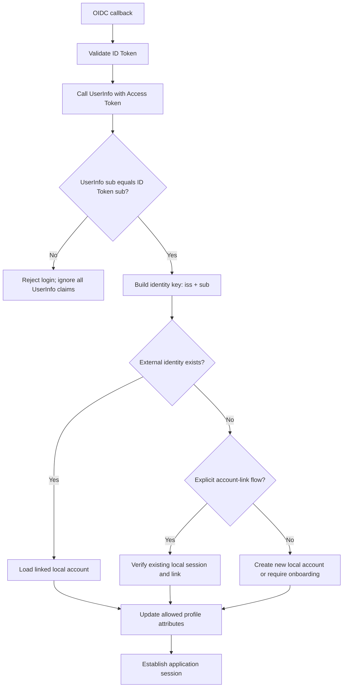

# Consistency Between UserInfo, ID Token, and Account Identity

## 1. Why Compare UserInfo with the ID Token?

In the **SPRING_SECURITY_OAUTH2_OIDC_AUTHORIZATION_SERVER** module, we learn how to design, configure, secure, test, and operate an OAuth 2.0/OpenID Connect Authorization Server with **Spring Security**, **Spring Authorization Server**, and **Spring Boot**. This lesson focuses on the relationship between the **UserInfo Response**, the **ID Token**, and **account identity** in OpenID Connect (OIDC).

After a user logs in, the OpenID Provider (OP) can issue an ID Token so the client knows the authentication result, and an Access Token so the client can call the UserInfo Endpoint to retrieve additional claims about the user. Both responses may contain overlapping information such as `sub`, `name`, `email`, or `picture`, yet they serve different purposes:

- **ID Token** is OIDC proof of the authentication event and subject identity at the issuer.
- **UserInfo Response** is a set of claims about the End-User returned through an OAuth 2.0 Protected Resource using an Access Token.
- **Account identity** in the RP application must rely on the stable identifier issued by the issuer, not on mutable display names or emails.

A serious bug occurs when a client verifies the ID Token signature without cross-checking `sub` in UserInfo. In that case, the client could pair user A's ID Token with user B's UserInfo profile. This is a form of **token substitution attack** that OIDC Core requires the RP to prevent.

<badge color="success">Mandatory Rule</badge> `sub` in the UserInfo Response **MUST** exist and **MUST** match `sub` in the ID Token exactly. If they do not match, the RP **MUST NOT** use any values in the UserInfo Response.

### Learning Outcomes

After this lesson, you will be able to:

1. Distinguish between the ID Token and UserInfo Response, understanding the origin and issuance timing of claims.
2. Explain why `sub` must match exactly between both responses.
3. Distinguish stable identity claims from mutable profile claims.
4. Design account identity using the `iss` + `sub` pair, even when the OP uses pairwise subjects.
5. Enable and customize the UserInfo Endpoint in Spring Authorization Server.
6. Verify `sub` on the RP and handle UserInfo Responses safely with Spring Security OAuth2 Login.
7. Design account linking, profile updates, caching, and token substitution tests.

## 2. Roles of the ID Token and UserInfo Response

### 2.1. ID Token Describes Identity and the Authentication Event

The ID Token is a JWT issued by the OP during an OIDC Authentication Flow. Core claims include:

| Claim | Meaning |
| --- | --- |
| `iss` | Issuer Identifier of the OP issuing the token |
| `sub` | Subject Identifier of the End-User at the issuer |
| `aud` | Client ID or audiences permitted to receive the ID Token |
| `exp` | Expiration time of the ID Token |
| `iat` | Issued-at time of the ID Token |
| `auth_time` | Time the OP authenticated the End-User, when requested or provided |
| `nonce` | Value binding the ID Token to the Authentication Request if a nonce was sent |
| `acr`, `amr` | Authentication level/method details when provided |

The RP verifies the ID Token per OIDC Core: exact issuer, audience, signature against issuer keys, expiration, and other flow-specific checks. `sub` is the subject the OP asserts was authenticated.

### 2.2. UserInfo Response Provides Claims About the End-User

The UserInfo Endpoint is an OAuth 2.0 Protected Resource. The RP calls the endpoint using the Access Token received from the OIDC Authentication Flow. Per OIDC Core, requests may use HTTP GET or POST; GET is recommended, and the Access Token must be sent as a Bearer Token. Communication must use TLS.

Example:

```http
GET /userinfo HTTP/1.1
Host: auth.example.com
Authorization: Bearer ACCESS_TOKEN_VALUE
Accept: application/json
```

Illustrative JSON response:

```json
{
  "sub": "user-1042",
  "name": "Nguyen An",
  "given_name": "An",
  "family_name": "Nguyen",
  "email": "an@example.com",
  "email_verified": true,
  "picture": "https://cdn.example.com/profiles/user-1042.jpg",
  "updated_at": 1800000000
}
```

`sub` is always required. Other profile claims may be omitted by the OP due to privacy, consent, scope, data policy, or lack of data. Not returning a requested claim is not automatically a protocol error; if a claim has no value, the OP should omit the member entirely instead of returning `null` or an empty string.

### 2.3. Same User, Two Sets of Claims

Example ID Token issued at 09:00:

```json
{
  "iss": "https://auth.example.com",
  "sub": "user-1042",
  "aud": "orders-web",
  "exp": 1800000300,
  "iat": 1800000000,
  "name": "Nguyen An",
  "email": "old-address@example.com"
}
```

At 09:05, the user changes their email and the RP calls UserInfo:

```json
{
  "sub": "user-1042",
  "name": "Nguyen An",
  "email": "new-address@example.com",
  "email_verified": false,
  "updated_at": 1800000300
}
```

Both responses remain consistent in **subject**, even though the email changed. OIDC does not require all profile claims in the ID Token and UserInfo to hold identical values at every point in time. UserInfo may reflect newer data because it is queried after the token was issued.

Therefore, "consistency" in this lesson has two layers:

1. **Identity consistency:** `sub` in UserInfo must equal `sub` in the ID Token. This is a mandatory standard requirement.
2. **Profile consistency:** claims such as email, name, and phone number can change; the application must define the data source, update timing, and claim merging rules.

Never use matching emails as a substitute for checking `sub`. Likewise, do not reject a valid UserInfo Response merely because name/email is newer than the ID Token, unless the application enforces a specific data-snapshot business rule.

## 3. OIDC Core Rules on sub and UserInfo Verification

### 3.1. UserInfo Must Always Return sub

OIDC Core 1.0 incorporating Errata Set 2 specifies:

- `sub` **MUST** always appear in the UserInfo Response.
- The RP **MUST** verify that UserInfo `sub` matches `sub` in the ID Token exactly.
- If they do not match, the RP **MUST NOT** use any values in the UserInfo Response.

This is a mandatory requirement to prevent token substitution.

Comparison must be an exact, case-sensitive string match. Do not trim, lowercase, Unicode-normalize, decode, or transform `sub` before comparing. `sub` is an opaque identifier defined by the issuer; the RP must not interpret its internal structure.

### 3.2. Token Substitution Example

Suppose two users have valid ID Tokens:

```text
ID Token A:
  iss = https://auth.example.com
  sub = subject-A
  aud = orders-web

ID Token B:
  iss = https://auth.example.com
  sub = subject-B
  aud = orders-web
```

An integration bug causes the client to use B's Access Token to call UserInfo while associating the response with ID Token A:

```text
Verified ID Token:           subject-A
UserInfo returned:           subject-B
RP does not check sub
RP creates session for subject-A with subject-B's profile
```

ID Token A's signature is still valid. Access Token B may also be valid. The problem lies in the RP pairing two responses that do not belong to the same subject. OIDC requires stopping at the `sub` comparison step, before using any profile claim.

### 3.3. Verification Flow on the RP

Safe order of operations:

1. Complete the OIDC Authentication Flow and verify the ID Token per issuer/client.
2. Send the Access Token to the UserInfo Endpoint discovered from the trusted issuer.
3. Verify the TLS server certificate and response format per registration.
4. Read `sub` from the verified ID Token and `sub` from the UserInfo Response.
5. If either is missing or they differ, refuse to use the entire UserInfo Response.
6. Only after `sub` matches should you use profile claims or perform account linking.

Do not create accounts, update emails, grant permissions, record profile audits, or put claims into the session before step 5. Comparing `sub` only after saving UserInfo to the database can still write bad data or trigger irreversible side effects.

### 3.4. Signed/Encrypted UserInfo Response

By default, the UserInfo Response is a JSON object. If Client Registration requests a signed or encrypted UserInfo Response, claims are returned in a JWT with Content-Type `application/jwt`. When signed, it must contain `iss` as the OP's issuer URL and `aud` as the RP's Client ID; the RP must verify the signature per configuration. If both signed and encrypted, the OP signs first and then encrypts.

Having a signed/encrypted response **does not eliminate** the requirement to cross-check `sub` with the ID Token. After decrypting/verifying the response per registration, the RP must still match the subject before using claims.

## 4. Stable Identifier: The iss and sub Pair

### 4.1. Why Not Use Email as the Account Key?

OIDC Core specifies that `sub` is a locally unique identifier within the issuer and must never be reassigned to another End-User. Combined with `iss`, this pair is the sole stable identifier the RP can rely on across logins. Other claims lack the same stability/uniqueness guarantees. For example, emails can change or be recycled over time; `email`, `phone_number`, `preferred_username`, and `name` **MUST NOT** be used as the End-User's unique identifier.

Example:

| Issuer | Subject | Current Email | RP Identity |
| --- | --- | --- | --- |
| `https://auth.example.com` | `user-1042` | `an@example.com` | (`https://auth.example.com`, `user-1042`) |
| `https://partner.example.net` | `user-1042` | `an@example.com` | (`https://partner.example.net`, `user-1042`) |

Two different issuers can emit the same `sub` string; they are still two distinct identities. The RP must use the **`iss` + `sub` pair**, not `sub` alone.

### 4.2. Public Subject and Pairwise Subject

OIDC defines two Subject Identifier types:

| Type | Behavior |
| --- | --- |
| `public` | The OP returns the same `sub` to all clients |
| `pairwise` | The OP returns a different `sub` per sector identifier, preventing clients from correlating user activity without permission |

The OP advertises supported types in `subject_types_supported` metadata. With pairwise subjects, the same End-User can have different `sub` values across two clients or two sector identifiers.

Example:

```text
Internal End-User: account 90017

Issuer: https://auth.example.com
  orders-web:
    sub = pairwise-7f...
  billing-web:
    sub = pairwise-b2...
```

RP `orders-web` may only use the subject received for its own registration/sector. Do not try to deduce that `pairwise-7f...` and `pairwise-b2...` belong to the same person by decoding, comparing prefixes, or calling an unauthorized internal API.

When building an OP with Spring Authorization Server, explicitly verify the subject generation strategy and metadata published by your version/implementation. Do not assume that merely enabling OIDC enables pairwise subjects. If using a custom subject strategy, the ID Token and UserInfo must use the **same subject computed for the current client/sector**.

### 4.3. Schema for Storing External Identity

A typical relational model:

```sql
CREATE TABLE external_identity (
    id              BIGINT PRIMARY KEY,
    local_user_id   BIGINT NOT NULL,
    issuer          VARCHAR(512) NOT NULL,
    subject         VARCHAR(512) NOT NULL,
    created_at      TIMESTAMP NOT NULL,
    last_seen_at    TIMESTAMP,
    CONSTRAINT uq_external_identity_issuer_subject
        UNIQUE (issuer, subject)
);
```

This is an illustrative schema. If the system uses pairwise subjects, each RP/sector sees only its own subject; linking identities across multiple clients requires an authoritative process at the OP or a user-confirmed account-linking flow.

Do not use email as a unique key on the external identity table. Email can be stored as a separate profile/contact attribute, along with verification flag and update timestamp.

### 4.4. Account Linking Not Based on Matching Email

Suppose a local account already has email `an@example.com`; a user logs in via the OP and UserInfo also returns that email. The RP must not automatically merge accounts simply because the two emails match. Emails can change, be shared in certain organizational models, or be recycled by an issuer under its own policy.

Safer linking flow:

1. The user is currently logged into their existing local account.
2. The user explicitly initiates the identity-provider linking action.
3. The RP runs OIDC login and verifies ID Token/UserInfo, including `iss` + `sub`.
4. The RP requires additional confirmation/step-up if risk or policy demands it.
5. The RP creates the external identity with unique constraint (`issuer`, `subject`) and attaches it to the current local user.
6. If the identity is already bound to another local user, reject and require a dedicated recovery/support workflow; never silently reassign the link.

If account linking is initiated from an unauthenticated session, never allow a user to take over an existing account via email match.

## 5. Consistency of Profile Claims

### 5.1. Which Claims Must Match?

Across both responses, the direct mandatory OIDC Core requirement is that `sub` in UserInfo must match `sub` in the ID Token. Other profile claims do not share the same time-invariant guarantee.

| Claim | Consistency Requirement | How to Handle on RP |
| --- | --- | --- |
| `sub` | **MUST** match exactly | Use as subject; on mismatch, discard all UserInfo |
| `iss` | ID Token must match trusted issuer; plain UserInfo JSON is not required to contain `iss` | Associate UserInfo with discovered issuer/endpoint; if response is signed, check `iss` and `aud` |
| `aud` | Belongs to ID Token; plain UserInfo JSON is not required to contain `aud` | Verify ID Token audience; if UserInfo is JWT, check `aud` per registration |
| `email` | May change or be omitted | Update as profile attribute; never use as account key |
| `email_verified` | May flip from `true` to `false` when email changes | Trust only verification status provided by issuer per trust policy |
| `name`, `picture`, `preferred_username` | May change or not be returned | Treat as display data, not identity |
| `phone_number`, `address` | May change or be hidden for privacy/consent | Store only when business-needed and permitted |
| `updated_at` | May reflect profile update timestamp | Use to gauge profile freshness, not as account key |

`iss` and `aud` are not mandatory claims in plain UserInfo JSON. If the UserInfo Response is signed, OIDC Core requires `iss` and `aud` in that JWT. Even when the response omits `iss`, the RP must know which issuer the endpoint belongs to via discovery/trust configuration and TLS.

### 5.2. Scopes Govern Claim Scope

Meaning of standard scopes:

| Scope | Typically Requested Claim Group |
| --- | --- |
| `openid` | OIDC Authentication and ID Token |
| `profile` | `name`, `family_name`, `given_name`, `picture`, `preferred_username`, `locale`, and other profile claims |
| `email` | `email`, `email_verified` |
| `address` | `address` |
| `phone` | `phone_number`, `phone_number_verified` |

The RP should request only the claim groups it actually needs. The OP may withhold some claims for privacy or lack of data. Using the `claims` request parameter, the client can request individual claims and indicate essentiality per OIDC syntax.

### 5.3. Choosing Snapshot vs Live Profile

Two ways to organize data:

**Per-login snapshot:** ID Token and UserInfo are built from the same data source or at the same point in time. This keeps overlapping data consistent within a login transaction, though UserInfo may not reflect changes occurring after token issuance.

**Live-data UserInfo:** The OP loads the profile from the data store upon each UserInfo request. Email/name/address may then be fresher than the ID Token. This is valid as long as `sub` stays unchanged and claims follow scope/consent.

If business logic needs to know when data was read, the OP can provide `updated_at` or a dedicated profile version claim. The RP can record the UserInfo receipt timestamp and source issuer for traceability. Never assume all claims were updated simultaneously.

### 5.4. Do Not Blindly Merge Claims

Some client libraries construct a composite OIDC user object from the ID Token and UserInfo. While convenient for application code, if the same claim name appears in both sources, application logic needs to know where it is reading from.

Spring Security `OidcUser` provides `getIdToken()` and `getUserInfo()` separately, while `getClaims()` is the combined map of claims from both objects. When making identity decisions, read `getIdToken().getSubject()` and `getUserInfo().getSubject()` separately, match them first, and only then use combined claims. Do not use a merged map as your subject check, as doing so can obscure the provenance of each value.

## 6. Enabling the UserInfo Endpoint in Spring Authorization Server

Spring Authorization Server exposes the UserInfo Endpoint via OIDC configuration. This endpoint is an OAuth 2.0 Protected Resource and requires an Access Token in the Bearer Authorization header. When OIDC is enabled, the framework configures resource server support to authenticate the Access Token on UserInfo requests.

### 6.1. Enabling OIDC Protocol Endpoints

Example filter chain configuration using the Spring Authorization Server 1.5.x API:

```java
package com.example.authserver;

import org.springframework.context.annotation.Bean;
import org.springframework.context.annotation.Configuration;
import org.springframework.core.annotation.Order;
import org.springframework.http.MediaType;
import org.springframework.security.config.Customizer;
import org.springframework.security.config.annotation.web.builders.HttpSecurity;
import org.springframework.security.oauth2.server.authorization.config.annotation.web.configurers.OAuth2AuthorizationServerConfigurer;
import org.springframework.security.web.SecurityFilterChain;
import org.springframework.security.web.authentication.LoginUrlAuthenticationEntryPoint;
import org.springframework.security.web.util.matcher.MediaTypeRequestMatcher;

@Configuration
public class AuthorizationServerSecurityConfig {

    @Bean
    @Order(1)
    SecurityFilterChain authorizationServerSecurityFilterChain(HttpSecurity http)
            throws Exception {

        OAuth2AuthorizationServerConfigurer authorizationServerConfigurer =
                OAuth2AuthorizationServerConfigurer.authorizationServer();

        http
            .securityMatcher(authorizationServerConfigurer.getEndpointsMatcher())
            .with(authorizationServerConfigurer, authorizationServer ->
                authorizationServer.oidc(Customizer.withDefaults())
            )
            .authorizeHttpRequests(authorize -> authorize
                .anyRequest().authenticated()
            )
            .exceptionHandling(exceptions -> exceptions
                .defaultAuthenticationEntryPointFor(
                    new LoginUrlAuthenticationEntryPoint("/login"),
                    new MediaTypeRequestMatcher(MediaType.TEXT_HTML)
                )
            );

        return http.build();
    }
}
```

This is the filter chain for protocol endpoints. The application still needs a filter chain for the login form and foundational beans such as `RegisteredClientRepository`, `OAuth2AuthorizationService`, `AuthorizationServerSettings`, `JWKSource`, and user authentication. Do not create a custom controller replacing `/userinfo`; the default endpoint filter handles access token authentication and OIDC responses.

### 6.2. Providing JwtDecoder

Spring Authorization Server documentation requires a `JwtDecoder` bean for the OIDC UserInfo Endpoint when using JWT Access Tokens:

```java
import org.springframework.context.annotation.Bean;
import org.springframework.security.oauth2.jwt.JwtDecoder;
import org.springframework.security.oauth2.server.authorization.config.annotation.web.configuration.OAuth2AuthorizationServerConfiguration;
import com.nimbusds.jose.proc.SecurityContext;
import com.nimbusds.jose.jwk.source.JWKSource;

@Bean
JwtDecoder jwtDecoder(JWKSource<SecurityContext> jwkSource) {
    return OAuth2AuthorizationServerConfiguration.jwtDecoder(jwkSource);
}
```

The example above assumes the server has a `JWKSource<SecurityContext>` for signing JWTs. In production, keys must be managed persistently with a rotation process; never regenerate random keys on every application restart.

### 6.3. Path and Discovery

Spring Authorization Server's typical default path is:

```text
/userinfo
```

The RP should retrieve `userinfo_endpoint` from the trusted issuer's OpenID Provider Configuration/Discovery, rather than assembling URLs manually or taking endpoints from user input. If changing the path or placing the server behind a reverse proxy, discovery metadata must return the public HTTPS URL with the exact issuer.

## 7. Default UserInfo Mapper and Spring Authorization Server Customization

### 7.1. Default Behavior

According to Spring Authorization Server 1.5.8 documentation, the default UserInfo response is built from the claims of the issued ID Token. Standard claims are returned according to the scopes requested and granted in the authorization request. This is a useful option when you want the ID Token and UserInfo to share the same data snapshot.

The default pipeline includes:

| Component | Responsibility |
| --- | --- |
| `OidcUserInfoEndpointFilter` | Receives UserInfo requests and writes responses |
| Internal authentication converter | Extracts authenticated authentication/principal from Security Context |
| `OidcUserInfoAuthenticationProvider` | Processes UserInfo authentication and invokes mapper |
| Default UserInfo mapper | Extracts standard claims from ID Token per granted scopes |
| Success/error handler | Writes `OidcUserInfo` or OAuth error response |

Do not write a new mapper if data from the ID Token meets requirements. Prefer the default pipeline to avoid accidentally dropping `sub`, returning claims beyond scope, or breaking Access Token verification.

### 7.2. When Is a Custom UserInfo Mapper Needed?

Customize the mapper when you need to:

- fetch the latest profile from a database or LDAP instead of the ID Token snapshot;
- filter claims by scope/consent;
- normalize certain profile attributes per API contract;
- retrieve claims from a domain service or distributed source;
- preserve `sub` from the current authorization's ID Token while loading additional profile data.

Spring Authorization Server exposes `OidcUserInfoEndpointConfigurer.userInfoMapper(...)`. The mapper receives `OidcUserInfoAuthenticationContext`, giving access to authentication, the Access Token, and `OAuth2Authorization` containing the ID Token/Access Token linked to the Bearer Token used to call the endpoint.

### 7.3. Configuring a Safe Mapper

The following example gets the subject from the ID Token in the authorization record, queries the profile by subject, and emits only granted claims:

```java
package com.example.authserver;

import java.util.LinkedHashMap;
import java.util.Map;
import java.util.Set;
import java.util.function.Function;

import org.springframework.context.annotation.Bean;
import org.springframework.context.annotation.Configuration;
import org.springframework.core.annotation.Order;
import org.springframework.security.config.Customizer;
import org.springframework.security.config.annotation.web.builders.HttpSecurity;
import org.springframework.security.oauth2.core.oidc.OidcScopes;
import org.springframework.security.oauth2.core.oidc.OidcIdToken;
import org.springframework.security.oauth2.core.oidc.OidcUserInfo;
import org.springframework.security.oauth2.server.authorization.config.annotation.web.configurers.OAuth2AuthorizationServerConfigurer;
import org.springframework.security.oauth2.server.authorization.oidc.authentication.OidcUserInfoAuthenticationContext;
import org.springframework.security.web.SecurityFilterChain;

@Configuration
public class UserInfoEndpointConfig {

    @Bean
    @Order(1)
    SecurityFilterChain authorizationServerSecurityFilterChain(
            HttpSecurity http,
            UserProfileService userProfileService) throws Exception {

        Function<OidcUserInfoAuthenticationContext, OidcUserInfo> userInfoMapper =
                context -> {
                    OidcIdToken idToken = context.getAuthorization()
                            .getToken(OidcIdToken.class)
                            .getToken();
                    String subject = idToken.getSubject();
                    Set<String> scopes = context.getAccessToken().getScopes();

                    Map<String, Object> claims = new LinkedHashMap<>();
                    claims.put("sub", subject);

                    if (scopes.contains(OidcScopes.PROFILE)) {
                        claims.putAll(userProfileService.loadProfileClaims(subject));
                    }
                    if (scopes.contains(OidcScopes.EMAIL)) {
                        claims.putAll(userProfileService.loadEmailClaims(subject));
                    }
                    if (scopes.contains(OidcScopes.PHONE)) {
                        claims.putAll(userProfileService.loadPhoneClaims(subject));
                    }
                    if (scopes.contains(OidcScopes.ADDRESS)) {
                        claims.putAll(userProfileService.loadAddressClaims(subject));
                    }

                    // Ensure data from the service cannot overwrite the subject.
                    claims.put("sub", subject);
                    return new OidcUserInfo(claims);
                };

        OAuth2AuthorizationServerConfigurer authorizationServerConfigurer =
                OAuth2AuthorizationServerConfigurer.authorizationServer();

        http
            .securityMatcher(authorizationServerConfigurer.getEndpointsMatcher())
            .with(authorizationServerConfigurer, authorizationServer ->
                authorizationServer.oidc(oidc ->
                    oidc.userInfoEndpoint(userInfo ->
                        userInfo.userInfoMapper(userInfoMapper)
                    )
                )
            )
            .authorizeHttpRequests(authorize -> authorize.anyRequest().authenticated());

        return http.build();
    }
}
```

`UserProfileService` is an application service whose methods return allowlisted claim maps. Example contract:

```java
import java.util.Map;

public interface UserProfileService {
    Map<String, Object> loadProfileClaims(String subject);
    Map<String, Object> loadEmailClaims(String subject);
    Map<String, Object> loadPhoneClaims(String subject);
    Map<String, Object> loadAddressClaims(String subject);
}
```

The configuration class in this example is a **complete variant** of the filter chain in Section 6.1 to illustrate wiring the mapper into the OIDC configurer. If you already use the filter chain bean from Section 6.1, move the mapper declaration and `userInfoMapper(...)` configuration into that bean, keeping only one filter chain for protocol endpoints. `UserProfileService` is an application dependency; methods returning claims must return only permitted fields, never password hashes, recovery codes, internal data, or sensitive attributes outside consent.

**Decision point:** `sub` is taken from the ID Token attached to the authorization being used by the Access Token. Never take the subject from a query parameter, client-sent username, or an arbitrary profile record. If the profile store uses an internal user ID, maintain a trusted mapping from the OIDC subject to the user record.

### 7.4. Customizing ID Token and UserInfo with the Same Subject

Spring Authorization Server lets you customize the ID Token using `OAuth2TokenCustomizer<JwtEncodingContext>`. If the application changes how subjects are created, ensure:

- the subject is generated according to the published issuer/client/sector policy;
- the ID Token contains the final chosen subject;
- the UserInfo mapper reads the subject from the current ID Token/authorization;
- a second subject is never minted by looking up email or username in UserInfo;
- token generators/customizers do not overwrite `sub` after the mapper has resolved it.

Spring Authorization Server documentation notes you can add standard claims to the ID Token so default UserInfo uses the same claim source. When a live profile or custom domain logic is needed, a custom mapper can fetch data directly from a service/database while still preserving the subject.

### 7.5. Do Not Return Claims Beyond Granted Permissions

Do not return all profile claims just because the Access Token is valid. Check the scopes granted in the authorization (`context.getAccessToken().getScopes()`), consent, and client policy. If the RP was granted only `openid profile`, do not include email, phone, address, or internal data in the response.

If a claim does not exist or the OP decides not to disclose it, omit the member from the JSON instead of returning `null` or an empty string. The `sub` field must always be present.

## 8. Checking UserInfo on the RP with Spring Security

### 8.1. Configuring the OIDC Client

Example Spring Boot configuration for the `orders-web` web client:

```yaml
spring:
  security:
    oauth2:
      client:
        registration:
          orders:
            provider: orders-idp
            client-id: orders-web
            client-secret: ORDERS_WEB_SECRET_FROM_SECRET_MANAGER
            authorization-grant-type: authorization_code
            redirect-uri: "{baseUrl}/login/oauth2/code/{registrationId}"
            scope:
              - openid
              - profile
              - email
        provider:
          orders-idp:
            issuer-uri: https://auth.example.com
```

`ORDERS_WEB_SECRET_FROM_SECRET_MANAGER` is a placeholder. Production must pull secrets from a secret manager or equivalent secret store, never commit real credentials to Git. Client registration needs the exact callback registered at the OP, and the issuer must be a trusted URL.

### 8.2. Enabling OAuth2 Login

```java
package com.example.ordersweb;

import org.springframework.context.annotation.Bean;
import org.springframework.context.annotation.Configuration;
import org.springframework.security.config.Customizer;
import org.springframework.security.config.annotation.web.builders.HttpSecurity;
import org.springframework.security.web.SecurityFilterChain;

@Configuration
public class WebSecurityConfig {

    @Bean
    SecurityFilterChain webSecurityFilterChain(HttpSecurity http)
            throws Exception {
        return http
                .authorizeHttpRequests(authorize -> authorize
                        .requestMatchers("/", "/health").permitAll()
                        .anyRequest().authenticated())
                .oauth2Login(Customizer.withDefaults())
                .build();
    }
}
```

When provider metadata includes `userinfo_endpoint`, the Spring Security OIDC client can use the Access Token to call the endpoint and build `OidcUser`. If you need to control post-processing of UserInfo, configure `oidcUserService(...)` on OAuth2 Login.

### 8.3. Cross-Checking sub in a Custom OidcUserService

An RP implementing or replacing `OidcUserService` must preserve the `sub` match requirement. The example below delegates loading and baseline processing to the default `OidcUserService`, then adds an explicit guard before returning the principal to the application:

```java
package com.example.ordersweb;

import org.springframework.context.annotation.Bean;
import org.springframework.context.annotation.Configuration;
import org.springframework.security.config.annotation.web.builders.HttpSecurity;
import org.springframework.security.oauth2.client.oidc.userinfo.OidcUserService;
import org.springframework.security.oauth2.client.oidc.userinfo.OAuth2UserService;
import org.springframework.security.oauth2.client.oidc.userinfo.OidcUserRequest;
import org.springframework.security.oauth2.core.OAuth2AuthenticationException;
import org.springframework.security.oauth2.core.OAuth2Error;
import org.springframework.security.oauth2.core.oidc.OidcUserInfo;
import org.springframework.security.oauth2.core.oidc.user.OidcUser;
import org.springframework.security.web.SecurityFilterChain;

@Configuration
public class OidcLoginSecurityConfig {

    @Bean
    SecurityFilterChain filterChain(HttpSecurity http) throws Exception {
        http
            .authorizeHttpRequests(authorize -> authorize
                .anyRequest().authenticated()
            )
            .oauth2Login(oauth2 -> oauth2
                .userInfoEndpoint(userInfo ->
                    userInfo.oidcUserService(oidcUserService())
                )
            );
        return http.build();
    }

    private OAuth2UserService<OidcUserRequest, OidcUser> oidcUserService() {
        OidcUserService delegate = new OidcUserService();
        return userRequest -> {
            OidcUser user = delegate.loadUser(userRequest);
            OidcUserInfo userInfo = user.getUserInfo();

            if (userInfo != null) {
                String idTokenSubject = user.getIdToken().getSubject();
                String userInfoSubject = userInfo.getSubject();

                if (idTokenSubject == null
                        || !idTokenSubject.equals(userInfoSubject)) {
                    OAuth2Error error = new OAuth2Error(
                            "invalid_user_info_response",
                            "UserInfo sub does not match ID Token sub",
                            null
                    );
                    throw new OAuth2AuthenticationException(error);
                }
            }

            return user;
        };
    }
}
```

This snippet is an extra guard for the RP; if `delegate.loadUser(...)` already rejects invalid responses in your Spring Security version, that exception is preserved. If writing a completely custom service from scratch, ensure you enforce this comparison and validate responses per OIDC Core. Never catch `OAuth2AuthenticationException` and still return a principal just to "make login work."

### 8.4. Reading ID Token and UserInfo Separately

In controllers/services, use source-specific accessors:

```java
import org.springframework.security.core.annotation.AuthenticationPrincipal;
import org.springframework.security.oauth2.core.oidc.user.OidcUser;
import org.springframework.web.bind.annotation.GetMapping;
import org.springframework.web.bind.annotation.RestController;

@RestController
public class AccountController {

    @GetMapping("/account")
    public AccountView account(@AuthenticationPrincipal OidcUser oidcUser) {
        String issuer = oidcUser.getIdToken().getIssuer().toString();
        String subject = oidcUser.getIdToken().getSubject();

        return new AccountView(
                issuer,
                subject,
                oidcUser.getUserInfo() != null
                        ? oidcUser.getUserInfo().getEmail()
                        : null
        );
    }
}
```

`AccountView` is an application DTO. This example reads email from UserInfo only after `OidcUserService` completes validation. If you need email from the ID Token, read the claim specifically from `getIdToken()` and clearly define which source takes precedence for display/update purposes.

`OidcUser.getClaims()` is the combined map of claims from both the ID Token and UserInfo. It is convenient for display, but should not be the sole source for determining subject or deciding account linking. Keep ID Token and UserInfo separate for auditing and applying data-source rules.

### 8.5. Do Not Use OAuth2 UserService Instead of OIDC UserService

`DefaultOAuth2UserService` serves generic OAuth 2.0 UserInfo and returns `OAuth2User`. When a client performs OpenID Connect login, use `OidcUserService`/`OAuth2UserService<OidcUserRequest, OidcUser>` to retain both the ID Token and UserInfo. Using only OAuth2 UserService and treating `email`/`name` as identity loses the ID Token context required to verify `sub`.

## 9. Mapping OIDC Identity to Internal Accounts

### 9.1. Building an Identity Key from Issuer and Subject

Once the ID Token and UserInfo are verified, the RP can build an identity key:

```java
public record OidcIdentityKey(String issuer, String subject) {
    public OidcIdentityKey {
        if (issuer == null || issuer.isBlank()) {
            throw new IllegalArgumentException("issuer is required");
        }
        if (subject == null || subject.isBlank()) {
            throw new IllegalArgumentException("subject is required");
        }
    }
}
```

Construct the key from the **verified ID Token**:

```java
OidcIdentityKey key = new OidcIdentityKey(
        oidcUser.getIdToken().getIssuer().toString(),
        oidcUser.getIdToken().getSubject()
);
```

If UserInfo is used to update the profile, the UserInfo subject must have already been verified against the ID Token subject. Never build the key from email or username.

### 9.2. Flow to Find or Create an Account



### 9.3. Separating Identity Records and Profile Records

Store linked identities and profile claims according to their distinct purposes:

| Data | Where Stored | Nature |
| --- | --- | --- |
| `issuer`, `subject` | External identity | Identity key from the OP |
| `local_user_id` | External identity | Linked internal account |
| `email`, `email_verified` | Profile/contact | Mutable; not a primary key |
| `name`, `picture`, `locale` | Profile/display | Display data, refreshable |
| `updated_at`, `last_synced_at` | Profile metadata | Supports freshness and auditing |
| `source_scope`, `source_issuer` | Profile provenance | Records source and permitted claim scope |

If email changes, update profile/contact per verification policy. Never create a new identity or reassign `local_user_id` just because the email changed.

### 9.4. Handling Pairwise Subjects Across Multiple Clients

If the OP uses pairwise subjects, `orders-web` and `billing-web` may see two different `sub` values for the same End-User. The RP cannot conclude on its own that two subjects belong to the same person. If the organization needs to share an internal account across multiple RPs, design account linking or federation in an authoritative component, with proper confirmation and permissions. Never break pairwise subject privacy by inferring identity from email.

### 9.5. Idempotent Profile Updates

When receiving valid UserInfo multiple times:

- update only claims that were granted and permitted by the application;
- do not overwrite user-managed internal values if policy does not treat the OP as authoritative;
- store `last_synced_at` and `updated_at` if available;
- handle email changes via a dedicated contact verification workflow;
- avoid creating a new profile whenever `sub`/email changes;
- use transactions and unique constraints to prevent concurrent callbacks from creating duplicate external identities.

## 10. Integration Errors and Diagnostics

| Symptom | Possible Cause | Resolution |
| --- | --- | --- |
| UserInfo lacks `sub` | Custom OP mapper forgot subject or mapper dropped claim | Fix mapper to always get `sub` from ID Token/authorization context |
| UserInfo `sub` differs from ID Token | Access Token and ID Token belong to different transactions/subjects; mapper looked up wrong user; token substitution | Reject response, check authorization record and token mapping |
| UserInfo `401 invalid_token` | Access Token expired, wrong issuer/audience, or rejected | Check Access Token, do not try substituting ID Token |
| UserInfo `403` | Valid token, but lacks endpoint permission/scope per policy | Check authorized scopes, consent, and endpoint policy |
| UserInfo missing email/profile | Scope not granted, consent/privacy policy, or OP lacks claim | Do not treat as error if claim is optional; handle missing profile |
| UserInfo returns stale email | Mapper pulls ID Token snapshot or stale cache | Clarify snapshot/live profile; check cache and `updated_at` |
| Email change creates a new account | RP uses email as identity key | Use `(iss, sub)` as key; migrate links under control |
| Same user has different `sub` across two clients | OP uses pairwise subjects | This may be expected behavior; do not auto-merge two subjects |
| `OidcUser.getClaims()` has confusing values | Claims from ID Token and UserInfo are merged | Read `getIdToken()` and `getUserInfo()` separately |
| UserInfo Endpoint 404 | OIDC not enabled or wrong path/discovery | Check `.oidc(...)`, endpoint settings, and metadata |
| UserInfo Endpoint fails to verify JWT | Missing `JwtDecoder` or resource server config | Configure decoder matching JWK/issuer |
| Custom mapper returns excessive data | Not filtering by scopes/consent or mapping whole entity | Use claim allowlist and scope gate |
| Login callback succeeds despite UserInfo mismatch | Custom OIDC user service swallows error | Throw `OAuth2AuthenticationException`, do not create session |
| Different nodes return different profiles | Profile store/cache out of sync | Use shared store, cache invalidation, and versioning |

### 10.1. Distinguishing Token Errors from Identity Errors

- **Invalid Access Token:** UserInfo Endpoint rejects the request, typically `401` with `invalid_token`.
- **HTTP-valid UserInfo with wrong subject:** response may be `200`, yet the RP must reject its contents because `sub` mismatches.
- **Valid UserInfo with matching subject and missing profile claims:** may be normal behavior per privacy/scope.

Do not turn every UserInfo failure into a successful login by falling back solely to the ID Token. If application policy requires UserInfo, handle endpoint errors as login/sync failures, or fall back only under a clearly designed and tested policy.

### 10.2. Unsafe Workarounds to Avoid

- Never skip the `sub` check just to "get login working."
- Never use email or `preferred_username` in place of `iss` + `sub`.
- Never accept an Access Token from a client and call an arbitrary client-specified UserInfo endpoint.
- Never allow the UserInfo mapper to take `sub` from a query parameter.
- Never dump every field of a database entity into UserInfo claims.
- Never auto-link accounts on matching email.
- Never log raw Access Tokens, ID Tokens, or full UserInfo Responses.

## 11. Consistency Test Matrix

Tests must cover the OP, RP, and account identity storage layer. In particular, negative tests must prove **zero side effects** when `sub` is wrong.

| ID | Scenario | Expected Result |
| --- | --- | --- |
| UINFO-01 | ID Token and UserInfo share the same `sub` | RP accepts UserInfo if other checks succeed |
| UINFO-02 | UserInfo missing `sub` | RP rejects entire UserInfo |
| UINFO-03 | UserInfo `sub` differs from ID Token | RP rejects; uses zero claims in response |
| UINFO-04 | `sub` differs only in letter case | RP rejects; exact match enforced |
| UINFO-05 | `sub` has extra whitespace | RP rejects; no auto-trim |
| UINFO-06 | ID Token issuer differs from configured issuer | Reject ID Token |
| UINFO-07 | UserInfo endpoint URL points to different issuer | Do not send token; discovery/trust validation prevents |
| UINFO-08 | Expired Access Token | UserInfo request rejected, typically `401 invalid_token` |
| UINFO-09 | ID Token sent instead of Access Token | Endpoint rejects |
| UINFO-10 | UserInfo lacks `email` while `sub` is valid | Accept response if email is optional per policy |
| UINFO-11 | `email` changes between ID Token and UserInfo, `sub` still matches | Accept; handle profile per freshness policy |
| UINFO-12 | `email_verified=false` after email change | Do not treat new email as verified |
| UINFO-13 | Scope has only `openid profile` | Mapper does not return email/phone/address outside policy |
| UINFO-14 | Scope has `email` and matching consent | Mapper may return permitted email claims |
| UINFO-15 | Custom mapper forgets to add `sub` | Test fails; mapper must be fixed |
| UINFO-16 | Profile service returns `sub` differing from ID Token subject | Mapper locks subject from authorization context; never returns wrong subject |
| UINFO-17 | Token substitution: Access Token B calls UserInfo B while RP pairs ID Token A | RP rejects before account linking |
| UINFO-18 | Same `sub`, different issuers | Create separate identities per `(iss, sub)` pair |
| UINFO-19 | Same email across two issuers | Do not auto-merge local accounts |
| UINFO-20 | Different pairwise subjects across two clients | Each RP keeps separate identity; do not infer shared user |
| UINFO-21 | Two concurrent duplicate callback requests | Unique constraint prevents duplicate external identity |
| UINFO-22 | Signed JWT UserInfo response with `sub` mismatch | Still rejected after signature verification |
| UINFO-23 | JWT UserInfo response with wrong `iss` or `aud` | Reject response per registration |
| UINFO-24 | Profile claim has null/empty value | OP omits claim per policy; RP handles missing data |
| UINFO-25 | UserInfo cache returns stale profile with valid `sub` | Accept identity; apply TTL/freshness policy |
| UINFO-26 | Account linking with matching email while user has not authenticated existing account | Reject automatic linking |
| UINFO-27 | Identity `(iss, sub)` already bound to another internal account | Reject and require support/recovery process |
| UINFO-28 | Mapper queries profile by request-supplied username | Security test fails; query only by verified subject |
| UINFO-29 | UserInfo endpoint missing OIDC or JwtDecoder | Startup/integration test detects non-working endpoint |
| UINFO-30 | RP customizes `OidcUserService` | Custom service still verifies `sub` before creating principal |

### 11.1. Integration Test for Token Substitution

Create a test OP with two users A and B, two valid Access Tokens, and two validly signed ID Tokens. Have the RP receive ID Token A while stubbing UserInfo to return B's `sub`. Verify:

1. RP verifies ID Token A successfully.
2. RP calls UserInfo using the test Access Token.
3. UserInfo returns a response with subject B.
4. RP throws an authentication/identity validation error.
5. No new authenticated session is created.
6. No external identity or profile update is written for A or B.

If you merely tamper with a signed JWT payload without re-signing with a test key, the test stops at signature failure and fails to prove the `sub` validator works. Use a test OP/stub that signs a valid response while intentionally placing a different subject.

### 11.2. Pairwise and Issuer Tests

Prepare two client registrations or two test issuers:

```text
issuer A + client orders-web  -> sub = pairwise-A
issuer A + client billing-web -> sub = pairwise-B
issuer B + client orders-web  -> sub = pairwise-A
```

The RP must create external identities keyed strictly by `(iss, sub)`. Never merge two identities just because the `sub` string matches or the email is identical.

### 11.3. Testing the Spring Authorization Server Mapper

- Without a custom mapper, verify UserInfo returns standard claims per granted scopes and always includes `sub`.
- With a custom mapper, verify `sub` is taken from the current authorization's ID Token.
- Test an Access Token lacking the `email` scope; the mapper does not return `email`.
- Test the profile service returning a fake `sub`; the mapper must not overwrite the subject.
- Test multiple authorizations for the same user across two clients; the mapper must not use a global subject or a cache key based solely on username.

## 12. Operations and Production Checklist

### 12.1. Protecting the UserInfo Endpoint

- Mandate TLS and verify server certificates.
- Accept only Access Tokens valid under issuer/audience/resource policies.
- Never accept an ID Token as a UserInfo credential.
- Never put Access Tokens in query strings, logs, or telemetry.
- Rate-limit by client/token context and bound request body size appropriately.
- Return claims per scope/consent and privacy policy.
- If supporting signed/encrypted UserInfo responses, manage algorithms, keys, and registrations consistently.

### 12.2. Managing Subject and Profile Lifecycle

- `sub` must be unique and never reassigned within the issuer per OIDC.
- The RP uses the `(iss, sub)` pair as the external identity key.
- If using pairwise subjects, never attempt to link across clients by inferring from the subject.
- Email/phone/name are profile claims that may change or be omitted.
- `email_verified` and `phone_number_verified` reflect verification status at the issuer and do not replace an application's own contact verification workflow if required by business rules.
- Account linking must include proof of control over the existing local account.
- Use transactions/unique constraints to prevent race conditions when creating identities.

### 12.3. Caching and Synchronizing Claims

UserInfo is usually called after login, though an application may call it again to refresh the profile. If caching:

- cache keys must include issuer, subject, and client/audience context when responses differ by client;
- TTL must match the profile freshness required by business rules;
- do not cache responses containing sensitive claims longer than policy allows;
- when receiving an email change or newer `updated_at`, apply a clear update policy;
- caching must never be used to bypass checking `sub` on fresh responses;
- if the profile service and authorization service run across multiple nodes, synchronize cache invalidation or versioning.

### 12.4. Auditing and Observability

Monitor:

- successful/failed UserInfo requests per client;
- Access Token/401 error rates;
- count of responses missing `sub` or with `sub` mismatch;
- latency of the UserInfo mapper and profile service;
- rate of claims omitted due to scope/policy;
- count of account-linking conflicts;
- delay from profile change to when the RP receives fresh data.

Never log raw ID Tokens, Access Tokens, refresh tokens, or full UserInfo Responses. On `sub` mismatch, log correlation ID, configured issuer, client registration, and outcome code; do not log unnecessary sensitive profile data.

### 12.5. Self-Check Questions

**Question 1.** Which claim is mandatory in a UserInfo Response?  
**Answer:** `sub`.

**Question 2.** If UserInfo `sub` differs from ID Token `sub` while both JWTs/tokens are valid, may the RP use the profile?  
**Answer:** No. The RP MUST NOT use any values in the UserInfo Response on subject mismatch.

**Question 3.** Can email be used as the unique key of an OIDC account?  
**Answer:** No. Emails can change or be recycled; the stable identifier is the `iss` + `sub` pair.

**Question 4.** Is a UserInfo email newer than the email in the ID Token an error?  
**Answer:** Not necessarily. Profile claims can change; the mandatory condition is that `sub` must match.

**Question 5.** Why must an Access Token be sent to the UserInfo Endpoint instead of an ID Token?  
**Answer:** UserInfo is an OAuth 2.0 Protected Resource and accepts an Access Token as a Bearer Token.

**Question 6.** Are different pairwise subjects across two clients an error?  
**Answer:** No. This is a privacy mechanism defined by OIDC; the RP must not deduce that two subjects are the same user.

**Question 7.** Should an internal account be auto-linked when the UserInfo email matches an existing email?  
**Answer:** No. There must be an authenticated and user-confirmed account linking process.

**Question 8.** Where should a custom UserInfo mapper get `sub` from?  
**Answer:** From the ID Token/authorization context bound to the Access Token calling UserInfo, not from arbitrary client-supplied input.

### 12.6. Pre-Production Checklist

- [ ] OIDC is enabled on Spring Authorization Server and UserInfo Endpoint is published in discovery metadata.
- [ ] UserInfo Endpoint accepts only valid Access Tokens via the Bearer Authorization header.
- [ ] TLS is enabled and issuer/endpoints use trusted public URLs.
- [ ] `JwtDecoder` and JWK source are configured if Access Tokens are JWTs.
- [ ] UserInfo Response always contains `sub`.
- [ ] RP verifies exact match between UserInfo `sub` and ID Token `sub` before any side effects.
- [ ] On mismatch or missing `sub`, RP discards the entire UserInfo Response.
- [ ] Internal identity key is `(iss, sub)` with a unique constraint.
- [ ] Email, username, phone, and name are never used as the unique identity key.
- [ ] Pairwise subjects are handled per client/sector; never auto-linked across RPs.
- [ ] Claims are filtered by scope, consent, and privacy policy.
- [ ] Custom mapper preserves `sub` from authorization context and prevents profile service overrides.
- [ ] Account linking requires an authenticated session or additional verification step.
- [ ] Profile updates have appropriate freshness policy, auditing, and cache TTL.
- [ ] Positive/negative tests exist for sub mismatch, different issuer, token substitution, and pairwise subjects.
- [ ] Logs contain no raw tokens or full sensitive profile claims.

### Memory Map

```text
OIDC Authentication
      |
      +--> ID Token (signed JWT)
      |       iss = OP
      |       sub = stable subject for this issuer/client context
      |       aud = RP client_id
      |
      +--> Access Token
              |
              v
       GET /userinfo
       Authorization: Bearer <access-token>
              |
              v
       UserInfo Response
       sub = same subject
       profile claims may be newer / omitted
              |
              v
       RP validates:
         1. trusted issuer + ID Token validation
         2. UserInfo TLS/response validation
         3. UserInfo.sub == IDToken.sub
              |
        +-----+------+
        |            |
      MATCH       MISMATCH
        |            |
        v            v
   Use allowed   Reject all UserInfo
   profile data  claims; no account update
        |
        v
   Identity key = (iss, sub)
   email/name/phone = mutable profile attributes
```

**Key point to remember:** The ID Token confirms the subject at the issuer; UserInfo supplements claims about the same End-User using an Access Token. OIDC Core mandates that `sub` in UserInfo match `sub` in the ID Token exactly. The durable identifier on the RP is the `iss` + `sub` pair; email, name, and profile attributes are merely mutable data. In Spring Authorization Server, the default UserInfo mapper suits snapshot claims from the ID Token; a custom mapper can fetch live profiles while preserving the subject from the authorization context and filtering claims by scope/consent.

## Official Standards for Reference

- [OpenID Connect Core 1.0 incorporating Errata Set 2](https://openid.net/specs/openid-connect-core-1_0.html): sections 5.3.1–5.3.4 (UserInfo request, successful response, validation), 5.7 (Claim Stability and Uniqueness), 8 (Subject Identifier Types), 16.11 (Token Substitution).
- [Spring Authorization Server — How-to: Customize the OpenID Connect 1.0 UserInfo response](https://docs.spring.io/spring-authorization-server/reference/guides/how-to-userinfo.html): enabling the UserInfo Endpoint, default mapper, custom mapper, and ID Token customizer.
- [Spring Authorization Server — Protocol Endpoints](https://docs.spring.io/spring-authorization-server/reference/protocol-endpoints.html): `OidcUserInfoEndpointConfigurer`, converter, provider, mapper, success/error handler.
- [Spring Authorization Server — OidcUserInfoAuthenticationProvider API](https://docs.spring.io/spring-authorization-server/reference/api/java/org/springframework/security/oauth2/server/authorization/oidc/authentication/OidcUserInfoAuthenticationProvider.html): provider and `OidcUserInfoAuthenticationContext`.
- [Spring Security — OAuth2 Login Advanced Configuration](https://docs.spring.io/spring-security/reference/servlet/oauth2/login/advanced.html): `OidcUserService`, UserInfo endpoint, and `OidcUser`.
- [Spring Security — OidcUser API](https://docs.spring.io/spring-security/reference/api/java/org/springframework/security/oauth2/core/oidc/user/OidcUser.html): `getIdToken()`, `getUserInfo()`, and combined claims.
- [RFC 6750 — OAuth 2.0 Bearer Token Usage](https://www.rfc-editor.org/rfc/rfc6750): sending Access Tokens in the Authorization header to protected resources.
