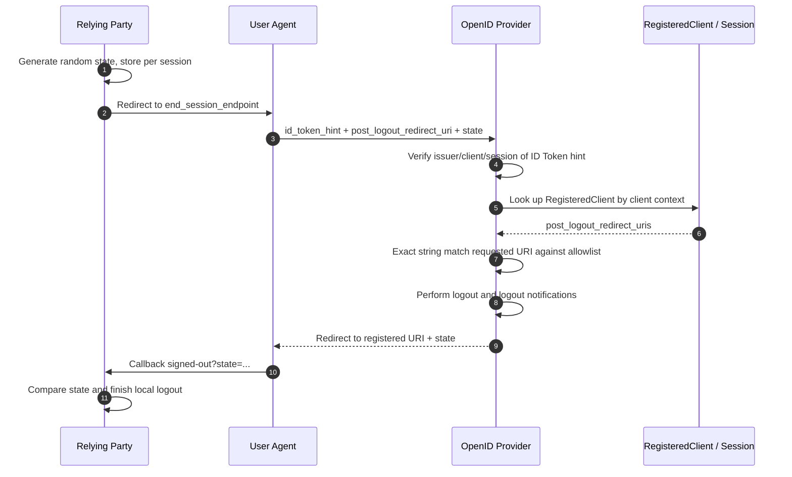

# Validating post_logout_redirect_uri Against Client Registration

## 1. Why Must the Post-Logout Redirect Address Be Validated?

In an **OAuth 2.0/OpenID Connect Authorization Server** system using **Spring Security, Spring Authorization Server, and Spring Boot**, the OpenID Provider (OP) can receive logout requests initiated by a Relying Party (RP). After processing the login session at the OP, the browser may be redirected back to the RP application to display a logged-out page.

The target address is passed via the `post_logout_redirect_uri` parameter. If the OP redirects to whatever URL the request supplies without validation, an attacker can exploit the logout endpoint as an **open redirect**:

- Users trust the OP's login domain.
- The attacker crafts a legitimate-looking logout URL with a redirect target pointing to a website they control.
- After passing through the OP, the browser leaves the trusted domain and lands on a spoofed page.
- That destination page can continue tricking the user into entering credentials, downloading malicious content, or creating a phishing flow that appears to originate from the OP.

OpenID Connect RP-Initiated Logout 1.0 solves this with the `post_logout_redirect_uris` registration metadata. The OP may redirect only when `post_logout_redirect_uri` in the logout request **matches exactly** a pre-registered URI of the right client. This check binds the redirect target to the client's identity and configuration trusted by the OP.

In the **SPRING_SECURITY_OAUTH2_OIDC_AUTHORIZATION_SERVER** module, the goal is to learn how to design, configure, secure, test, and operate an OAuth 2.0/OpenID Connect Authorization Server with Spring Security and Spring Authorization Server. This lesson belongs to the **OIDC Logout** chapter and focuses on registering and validating the post-logout redirect URI at the Logout Endpoint.

### Learning Outcomes

After this lesson, you will be able to:

1. Explain the roles of `post_logout_redirect_uri`, `post_logout_redirect_uris`, `id_token_hint`, `client_id`, and `state`.
2. Distinguish the post-logout redirect URI from the OAuth authorization `redirect_uri`.
3. Register post-logout URIs on `RegisteredClient` in Spring Authorization Server.
4. Understand OIDC's **exact string match** requirement and why wildcards, prefixes, or host suffix matching must not be used.
5. Use `OidcLogoutAuthenticationValidator` and `OidcLogoutAuthenticationProvider` to customize validation.
6. Preserve ID Token, client association, and session checks when adding a custom validator.
7. Test valid cases, unregistered URIs, missing client context, invalid ID Token hints, and logout requests without a redirect.

**Example Scope:** Spring Boot 3.x, Spring Security 6.x, and Spring Authorization Server 1.5.x on the Servlet stack. `OidcLogoutAuthenticationValidator` and the corresponding extension point have been available since Spring Authorization Server 1.4.0. If using another version, verify the API/Javadoc of your active dependency.

## 2. How Does RP-Initiated Logout Work?

### 2.1. Roles of the OP and RP

- **OpenID Provider (OP):** The Authorization Server that performs user authentication and manages OIDC login sessions.
- **Relying Party (RP):** An application that relies on the OP to log users in.
- **Logout Endpoint / End Session Endpoint:** The OP endpoint that receives logout requests from an RP.
- **Post-logout redirect URI:** The address the RP suggests the OP redirect the browser to after logout is processed.

The RP usually obtains the Logout Endpoint URL from the OP's discovery metadata `end_session_endpoint`. If the OP supports RP-Initiated Logout and Discovery, this metadata must be published; the endpoint must use HTTPS.

### 2.2. Logout Request Parameters

| Parameter | Requirement | Purpose |
| --- | --- | --- |
| `id_token_hint` | RECOMMENDED | ID Token previously issued by the OP to the RP, helping the OP identify the user/client/session logging out |
| `logout_hint` | OPTIONAL | Hint about the End-User; semantics are defined by the OP |
| `client_id` | OPTIONAL | Client Identifier; often used to identify the client when sending a post-logout URI without `id_token_hint` |
| `post_logout_redirect_uri` | OPTIONAL | URI to which the RP wants the browser returned after logout |
| `state` | OPTIONAL | Opaque value for the RP to correlate the logout request with the callback |
| `ui_locales` | OPTIONAL | UI languages the OP should prefer |

If both `client_id` and `id_token_hint` are sent, the OP **MUST** verify that `client_id` matches the client used when issuing the ID Token. When `id_token_hint` is present, the OP must verify that the OP itself is the issuer of the ID Token. If the session ID in the hint does not match a current or recent session, the OP should treat the request as suspicious and may refuse to process it.

OIDC recommends `id_token_hint` when the RP requests a post-logout redirect. If no hint is present, the OP **MUST NOT** perform post-logout redirection unless it has another means of confirming the validity of the redirect target. `client_id` combined with the registered URI list is a common way for the OP to identify the client in this situation.

### 2.3. GET and POST

The OP must support both HTTP GET and POST at the Logout Endpoint. The RP may use either:

```http
GET /connect/logout?id_token_hint=ID_TOKEN_PLACEHOLDER&post_logout_redirect_uri=https%3A%2F%2Fapp.example.com%2Fsigned-out&state=OPAQUE_STATE HTTP/1.1
Host: auth.example.com
```

Or send the parameters using form serialization:

```http
POST /connect/logout HTTP/1.1
Host: auth.example.com
Content-Type: application/x-www-form-urlencoded

id_token_hint=ID_TOKEN_PLACEHOLDER&post_logout_redirect_uri=https%3A%2F%2Fapp.example.com%2Fsigned-out&state=OPAQUE_STATE
```

The examples use placeholders only. The ID Token can appear in the GET query string; avoid writing full query strings to access logs, proxy logs, tracing, and analytics. POST can reduce putting the token into URLs, though requests must still be protected with HTTPS and redaction.

## 3. Exact Match Rules for Post-Logout Redirect URIs

### 3.1. Exact String Match

According to OIDC RP-Initiated Logout 1.0, the OP **MUST NOT** perform post-logout redirection if the submitted `post_logout_redirect_uri` value does not match an entry in the client's previously registered `post_logout_redirect_uris` list exactly.

For example, the client registered:

```text
https://app.example.com/signed-out
```

The following values do not match:

| URI in Request | Outcome | Reason |
| --- | --- | --- |
| `https://app.example.com/signed-out` | Accept | String matches registered URI |
| `https://app.example.com/signed-out/` | Reject | Different trailing `/` |
| `https://app.example.com/Signed-Out` | Reject | Path differs in letter case |
| `https://app.example.com/signed-out?next=/home` | Reject | Different and unregistered query |
| `https://app.example.com/other` | Reject | Unregistered path |
| `http://app.example.com/signed-out` | Reject | Different scheme |
| `https://evil.example/signed-out` | Reject | Different host |
| `https://app.example.com.evil.test/signed-out` | Reject | Host is not the registered host |

Perform exact string comparison on the URI value after decoding the HTTP query/form parameter. Do not arbitrarily canonicalize two strings into an equivalent URI and accept them if they do not match the registered value. Percent-encoding the entire URI when placing it in a query parameter is serialization; once the parameter is decoded, the value must match the registered string.

### 3.2. Why Is Prefix Matching Dangerous?

The following checks are unsafe:

```java
requestedUri.startsWith("https://app.example.com")
requestedUri.contains("app.example.com")
requestedUri.endsWith("/signed-out")
```

For example, `https://app.example.com.evil.test/signed-out` can bypass a loose string check. An attacker-controlled query, path, or host can also slip through if only part of the string is checked.

Do not use:

- Host wildcards such as `https://*.example.com/logout`.
- Prefix/suffix matching.
- Regexes that check only the domain while ignoring path, port, or query.
- Comparing `getHost()` and then accepting any path.
- Using the Authorization Code flow's `redirect_uri` in place of the post-logout URI list.
- Redirecting to a user-supplied `returnUrl`, `next`, or `continue` parameter.

### 3.3. Do Not Normalize URIs to Relax the Allowlist

Do not call `normalize()`, strip trailing `/`, lowercase the entire string, drop queries, or replace default ports before comparing against the allowlist. OIDC requires an exact match against the registered value.

If you want to accept multiple valid URI variants, register each URI explicitly. For example, if two callbacks with and without a trailing `/` are genuinely needed, register both under the same client after review.

### 3.4. HTTPS Scheme and Native Applications

Registered URIs should use HTTPS. OIDC permits `http` in certain confidential-client cases if the OP allows it; native applications may also use a custom URI scheme intended for application callbacks. Those cases must still be pre-registered and exact-matched.

For production web clients, prefer HTTPS. For native clients, use a redirect scheme bound to the application according to platform and OP registration rules. Do not open wildcard schemes for development convenience.

## 4. Distinguishing Authorization Redirect URI and Post-Logout Redirect URI

Both parameters have similar names, yet serve two different endpoints and two different lifecycle points:

| Attribute | `redirect_uri` | `post_logout_redirect_uri` |
| --- | --- | --- |
| Protocol | OAuth 2.0 Authorization Code / redirect-based flows | OIDC RP-Initiated Logout |
| Endpoint | Authorization Endpoint | Logout / End Session Endpoint |
| Timing | After authorization succeeds or when returning the authorization response | After the OP processes logout and related notifications |
| Registration metadata | `redirect_uris` | `post_logout_redirect_uris` |
| Spring Builder | `RegisteredClient.Builder.redirectUri(...)` | `RegisteredClient.Builder.postLogoutRedirectUri(...)` |
| Consumer | OAuth client receiving the authorization response | Browser returning to the RP after logout |

Do not automatically copy all `redirect_uris` into `post_logout_redirect_uris`. Each URI should be registered according to its specific purpose. A client may have an authorization callback without needing a post-logout callback.

## 5. Registering Post-Logout URIs in Spring Authorization Server

### 5.1. Using RegisteredClient.Builder

Spring Authorization Server stores the list of post-logout redirect URIs in `RegisteredClient.getPostLogoutRedirectUris()`. You can register URIs using `postLogoutRedirectUri(...)`:

```java
import java.util.UUID;

import org.springframework.security.oauth2.core.AuthorizationGrantType;
import org.springframework.security.oauth2.core.ClientAuthenticationMethod;
import org.springframework.security.oauth2.core.oidc.OidcScopes;
import org.springframework.security.oauth2.server.authorization.client.RegisteredClient;

RegisteredClient webClient = RegisteredClient.withId(UUID.randomUUID().toString())
        .clientId("portal-web")
        .clientSecret("{noop}development-only-secret")
        .clientAuthenticationMethod(ClientAuthenticationMethod.CLIENT_SECRET_BASIC)
        .authorizationGrantType(AuthorizationGrantType.AUTHORIZATION_CODE)
        .authorizationGrantType(AuthorizationGrantType.REFRESH_TOKEN)
        .redirectUri("https://app.example.com/login/oauth2/code/portal")
        .postLogoutRedirectUri("https://app.example.com/signed-out")
        .postLogoutRedirectUri("https://app.example.com/logout/complete")
        .scope(OidcScopes.OPENID)
        .scope(OidcScopes.PROFILE)
        .build();
```

This is a client registration example for a learning environment. Do not use `{noop}` or sample secrets in production; use an appropriate `PasswordEncoder`, a secret manager, and a client authentication policy suited to the application type. Public native/SPA clients must configure client authentication and PKCE according to their respective models.

### 5.2. Multiple Post-Logout URIs

A single client can register multiple URIs:

```java
import org.springframework.security.oauth2.core.AuthorizationGrantType;
import org.springframework.security.oauth2.core.ClientAuthenticationMethod;
import org.springframework.security.oauth2.core.oidc.OidcScopes;
import org.springframework.security.oauth2.server.authorization.client.RegisteredClient;

RegisteredClient client = RegisteredClient.withId("portal-client-registration")
        .clientId("portal")
        .clientSecret("{noop}development-only-secret")
        .clientAuthenticationMethod(ClientAuthenticationMethod.CLIENT_SECRET_BASIC)
        .authorizationGrantType(AuthorizationGrantType.AUTHORIZATION_CODE)
        .redirectUri("https://app.example.com/login/oauth2/code/portal")
        .postLogoutRedirectUri("https://app.example.com/signed-out")
        .postLogoutRedirectUri("https://app.example.com/session-ended")
        .scope(OidcScopes.OPENID)
        .build();
```

This is a sample confidential client; in production, replace the sample secret with an encoded, securely managed secret.

Each URI is a distinct allowlist string. If a request specifies an unregistered third URI, the OP must refuse to use that URI for redirection, even though the other two URIs are valid.

### 5.3. Persisting Registrations Durably

In production, `RegisteredClientRepository` typically persists clients in a database or controlled configuration source. Ensure that:

- `post_logout_redirect_uris` is persisted and read back completely.
- All AS instances use the same client registration state.
- Allowlist changes have an audit trail and approval workflow.
- Client registration caches are invalidated when a URI is removed or modified.
- Dynamic client registration does not allow clients to expand their allowlist arbitrarily without authentication/authorization and policy review.

Do not update only one node or a local cache and expect every AS instance to pick up the new allowlist immediately.

### 5.4. Dynamic Client Registration

If the OP supports OIDC Dynamic Client Registration, client metadata can contain:

```json
{
  "client_name": "Portal Web",
  "redirect_uris": [
    "https://app.example.com/login/oauth2/code/portal"
  ],
  "post_logout_redirect_uris": [
    "https://app.example.com/signed-out"
  ]
}
```

`post_logout_redirect_uris` is optional metadata. Spring Authorization Server includes an OIDC Client Registration Endpoint, though it is disabled by default. Enable it only if the deployment requires dynamic registration and already has policies protecting the endpoint, reviewing redirect URIs, client metadata, and registration lifecycle.

## 6. The Logout Endpoint in Spring Authorization Server

### 6.1. OIDC Support and Endpoint

Spring Authorization Server provides `OidcLogoutEndpointConfigurer` to handle RP-Initiated Logout. The endpoint is registered in the Authorization Server `SecurityFilterChain` when OIDC is enabled:

```java
import org.springframework.context.annotation.Bean;
import org.springframework.core.annotation.Order;
import org.springframework.security.config.Customizer;
import org.springframework.security.config.annotation.web.builders.HttpSecurity;
import org.springframework.security.oauth2.server.authorization.config.annotation.web.configurers.OAuth2AuthorizationServerConfigurer;
import org.springframework.security.web.SecurityFilterChain;

@Bean
@Order(1)
SecurityFilterChain authorizationServerSecurityFilterChain(HttpSecurity http)
        throws Exception {

    OAuth2AuthorizationServerConfigurer authorizationServerConfigurer =
            OAuth2AuthorizationServerConfigurer.authorizationServer();

    http
        .securityMatcher(authorizationServerConfigurer.getEndpointsMatcher())
        .with(authorizationServerConfigurer, authorizationServer ->
            authorizationServer.oidc(Customizer.withDefaults())
        );

    return http.build();
}
```

This snippet illustrates the Authorization Server endpoints portion. A real application also needs issuer configuration, signing JWKs, a client repository, an authorization service, login/session handling, and an application filter chain. When OIDC logout is enabled, the OP publishes `end_session_endpoint` in the OIDC Provider Configuration/Discovery metadata.

### 6.2. Logout Processing Components

| Component | Role |
| --- | --- |
| `OidcLogoutEndpointConfigurer` | Configures extension points of the Logout Endpoint |
| `OidcLogoutEndpointFilter` | Receives RP-Initiated Logout HTTP requests |
| `OidcLogoutAuthenticationConverter` | Converts the request into `OidcLogoutAuthenticationToken` |
| `OidcLogoutAuthenticationProvider` | Validates the logout request, client, ID Token/session, and performs authentication processing |
| `OidcLogoutAuthenticationValidator` | Default validator for logout parameters, including `post_logout_redirect_uri` |
| `OidcLogoutAuthenticationContext` | Provides the logout authentication token and `RegisteredClient` to the validator |
| `OidcLogoutAuthenticationSuccessHandler` | Handles successful logout and response/redirect |

Spring Authorization Server includes a default validator for `post_logout_redirect_uri`. If validation fails, the validator throws `OAuth2AuthenticationException`. It can be customized via `OidcLogoutAuthenticationProvider.setAuthenticationValidator(...)`.

### 6.3. Data in OidcLogoutAuthenticationToken

`OidcLogoutAuthenticationToken` provides:

- `getIdTokenHint()`: ID Token hint as a string.
- `getIdToken()`: ID Token converted to `OidcIdToken` if available.
- `getClientId()`: client identifier associated with the ID Token.
- `getPostLogoutRedirectUri()`: URI to which the request asks to redirect the browser.
- `getState()`: opaque state to echo back to the RP.
- `getSessionId()`: session identifier if present.
- `getPrincipal()`: End-User principal.

`OidcLogoutAuthenticationContext.getRegisteredClient()` returns the corresponding registration resolved by the provider. The validator should use this registration to look up the allowlist; do not read a client from an arbitrary query parameter and trust it directly.

## 7. Configuring the Validator While Preserving Default Checks

### 7.1. Default Validator

Spring Authorization Server 1.5.x provides `OidcLogoutAuthenticationValidator`. This validator checks `OidcLogoutAuthenticationToken.getPostLogoutRedirectUri()` against the registered client information.

Built-in API:

```java
OidcLogoutAuthenticationValidator.DEFAULT_POST_LOGOUT_REDIRECT_URI_VALIDATOR
```

This is a `Consumer<OidcLogoutAuthenticationContext>` that can be used standalone or composed with an additional validator using `andThen(...)`.

### 7.2. Adding an Exact Membership Check

The following example keeps the default validator and adds a layer verifying that the URI belongs strictly to the `RegisteredClient` allowlist:

```java
import java.util.function.Consumer;

import org.springframework.security.oauth2.core.OAuth2AuthenticationException;
import org.springframework.security.oauth2.core.OAuth2Error;
import org.springframework.security.oauth2.core.OAuth2ErrorCodes;
import org.springframework.security.oauth2.server.authorization.client.RegisteredClient;
import org.springframework.security.oauth2.server.authorization.oidc.authentication.OidcLogoutAuthenticationContext;
import org.springframework.security.oauth2.server.authorization.oidc.authentication.OidcLogoutAuthenticationToken;
import org.springframework.security.oauth2.server.authorization.oidc.authentication.OidcLogoutAuthenticationValidator;

Consumer<OidcLogoutAuthenticationContext> postLogoutRedirectValidator =
        OidcLogoutAuthenticationValidator.DEFAULT_POST_LOGOUT_REDIRECT_URI_VALIDATOR
            .andThen(context -> {
                OidcLogoutAuthenticationToken logout =
                        context.getAuthentication();
                String requestedUri = logout.getPostLogoutRedirectUri();

                // Not requesting a redirect is a valid request.
                if (requestedUri == null) {
                    return;
                }

                RegisteredClient registeredClient =
                        context.getRegisteredClient();

                if (registeredClient == null
                        || !registeredClient.getPostLogoutRedirectUris()
                                .contains(requestedUri)) {
                    OAuth2Error error =
                            new OAuth2Error(OAuth2ErrorCodes.INVALID_REQUEST);
                    throw new OAuth2AuthenticationException(error);
                }
            });
```

`Set.contains(...)` performs an exact string comparison. Do not normalize the URI before calling `contains`. This additional check is explicitly defensive; Spring's default validator remains the primary validation layer.

### 7.3. Attaching the Validator to OidcLogoutAuthenticationProvider

Spring Authorization Server allows customizing providers via `authenticationProviders(...)`:

```java
import java.util.List;
import java.util.function.Consumer;

import org.springframework.security.authentication.AuthenticationProvider;
import org.springframework.security.oauth2.core.OAuth2AuthenticationException;
import org.springframework.security.oauth2.core.OAuth2Error;
import org.springframework.security.oauth2.core.OAuth2ErrorCodes;
import org.springframework.security.oauth2.server.authorization.client.RegisteredClient;
import org.springframework.security.oauth2.server.authorization.oidc.authentication.OidcLogoutAuthenticationContext;
import org.springframework.security.oauth2.server.authorization.oidc.authentication.OidcLogoutAuthenticationProvider;
import org.springframework.security.oauth2.server.authorization.oidc.authentication.OidcLogoutAuthenticationToken;
import org.springframework.security.oauth2.server.authorization.oidc.authentication.OidcLogoutAuthenticationValidator;

private Consumer<List<AuthenticationProvider>> configureLogoutValidator() {
    return providers -> providers.forEach(provider -> {
        if (provider instanceof OidcLogoutAuthenticationProvider logoutProvider) {
            logoutProvider.setAuthenticationValidator(
                    postLogoutRedirectValidator());
        }
    });
}

private Consumer<OidcLogoutAuthenticationContext> postLogoutRedirectValidator() {
    return OidcLogoutAuthenticationValidator
            .DEFAULT_POST_LOGOUT_REDIRECT_URI_VALIDATOR
            .andThen(context -> {
                OidcLogoutAuthenticationToken logout =
                        context.getAuthentication();
                String requestedUri = logout.getPostLogoutRedirectUri();

                if (requestedUri == null) {
                    return;
                }

                RegisteredClient registeredClient =
                        context.getRegisteredClient();
                if (registeredClient == null
                        || !registeredClient.getPostLogoutRedirectUris()
                                .contains(requestedUri)) {
                    throw new OAuth2AuthenticationException(
                            new OAuth2Error(OAuth2ErrorCodes.INVALID_REQUEST));
                }
            });
}
```

Then attach it to the existing Authorization Server filter chain:

```java
@Bean
@Order(1)
SecurityFilterChain authorizationServerSecurityFilterChain(HttpSecurity http)
        throws Exception {

    OAuth2AuthorizationServerConfigurer authorizationServerConfigurer =
            OAuth2AuthorizationServerConfigurer.authorizationServer();

    http
        .securityMatcher(authorizationServerConfigurer.getEndpointsMatcher())
        .with(authorizationServerConfigurer, authorizationServer ->
            authorizationServer.oidc(oidc ->
                oidc.logoutEndpoint(logoutEndpoint ->
                    logoutEndpoint.authenticationProviders(
                            configureLogoutValidator())
                )
            )
        );

    return http.build();
}
```

The snippets above are parts of a single configuration; place them in the same `@Configuration` class and adapt them to your existing filter chain. Do not declare two `SecurityFilterChain` beans with the same matcher just to add a validator; attach the logout configuration to the existing Authorization Server chain.

### 7.4. Why Call the Default Validator First?

`setAuthenticationValidator(...)` replaces the logout parameter validator used by the provider. If you replace it with a lambda that checks only your custom condition, you can accidentally drop the default validation for `post_logout_redirect_uri`.

Composing:

```java
OidcLogoutAuthenticationValidator.DEFAULT_POST_LOGOUT_REDIRECT_URI_VALIDATOR
        .andThen(customPolicy)
```

preserves default behavior before running additional policy checks. ID Token verification, client/session association, and logout processing remain the provider's responsibility; a custom validator should not replace or bypass them.

### 7.5. When Do You Need a Custom Validator?

If your application policy only requires matching the `RegisteredClient` allowlist, Spring Authorization Server's default validator already serves that purpose. Add a custom validator only for specific needs such as:

- Blocking a registered URI during an emergency disablement.
- Allowing callbacks only for the active environment/tenant.
- Applying additional scheme policies for web clients.
- Emitting safe audit events on validation decisions without logging raw ID Tokens.

Never customize the validator merely to replace exact matching with looser rules. If multiple callbacks must be supported, register each callback.

## 8. Handling Logout Requests Without an ID Token Hint

### 8.1. Client ID Helps Identify the Registration

OIDC allows sending `client_id` when a request includes `post_logout_redirect_uri` without `id_token_hint`. The OP can use the client identifier to look up `RegisteredClient` and check the URI against the client's allowlist.

Example:

```http
GET /connect/logout?client_id=portal-web&post_logout_redirect_uri=https%3A%2F%2Fapp.example.com%2Fsigned-out&state=OPAQUE_STATE HTTP/1.1
Host: auth.example.com
```

`client_id` is an identifier, not a client secret, and does not by itself prove that the sender owns a client login session. Permitting redirection still requires the registration allowlist and a means of confirming target legitimacy per OIDC.

### 8.2. Confirming Logout at the OP Is a Separate Concern

According to OIDC RP-Initiated Logout:

- The OP should ask the End-User whether they want to log out of the OP.
- The OP **MUST** ask if `id_token_hint` is absent.
- The OP must also ask if the ID Token hint does not belong to the OP's current session with the RP and/or the currently logged-in End-User.

Therefore, verifying that `post_logout_redirect_uri` is valid does not mean the request has sufficient authority to silently terminate the OP session. The redirect allowlist verifies the **callback destination**, while ID Token hint/session validation and user confirmation handle the **logout context**.

### 8.3. Expired ID Token Hint

An ID Token hint is supporting evidence about a current/recent session, not an access token used to call an API. OIDC states that the OP should accept an ID Token hint when the RP identified by `aud` and/or `sid` has a current or recent session, even if the `exp` claim has passed.

Do not mechanically apply a rule that "an expired ID Token always causes logout request rejection." The provider must check issuer, client/audience, session, and recency per OIDC; if the session ID does not correspond, the request should be treated as suspicious and may be rejected.

### 8.4. Configuring the RP to Send the Registered Callback

On the RP side, Spring Security provides `OidcClientInitiatedLogoutSuccessHandler` to redirect to the end-session endpoint retrieved from OIDC Client Registration/Provider metadata:

```java
import org.springframework.context.annotation.Bean;
import org.springframework.security.oauth2.client.registration.ClientRegistrationRepository;
import org.springframework.security.oauth2.client.oidc.web.logout.OidcClientInitiatedLogoutSuccessHandler;
import org.springframework.security.web.authentication.logout.LogoutSuccessHandler;

@Bean
LogoutSuccessHandler oidcLogoutSuccessHandler(
        ClientRegistrationRepository clientRegistrationRepository) {

    OidcClientInitiatedLogoutSuccessHandler handler =
            new OidcClientInitiatedLogoutSuccessHandler(
                    clientRegistrationRepository);

    handler.setPostLogoutRedirectUri("{baseUrl}/signed-out");
    return handler;
}
```

Attach the handler to the RP's logout configuration:

```java
http.logout(logout -> logout
        .logoutSuccessHandler(oidcLogoutSuccessHandler));
```

The `{baseUrl}/signed-out` template is expanded by Spring Security based on the application URL. The actual value sent to the OP must match a URI registered for the client. For example, if the RP runs with base URL `https://app.example.com`, the OP must register `https://app.example.com/signed-out` exactly.

Do not use an arbitrary request host to build the callback if the application runs behind a reverse proxy without properly configured forwarded headers/trusted proxies. An incorrect base URL can produce a post-logout URI that misses the allowlist or creates an unintended redirect target.

## 9. State and Post-Logout Callback

### 9.1. State Correlates the Request

The RP can generate a random, unpredictable `state` value bound to the browser session before redirecting the user to the OP. If the request includes `state`, the OP must return that exact value when redirecting the browser to `post_logout_redirect_uri`.

Callback example:

```http
HTTP/1.1 302 Found
Location: https://app.example.com/signed-out?state=OPAQUE_STATE
```

The RP should:

- Store `state` tied to the browser session or logout transaction.
- Compare the callback `state` with the generated value.
- Remove `state` after use or upon expiration.
- Never treat `state` as a redirect URL or HTML content.
- Never place raw session identifiers, tokens, or PII inside `state`.

### 9.2. Do Not Use state as a Substitute for an Allowlist

Some applications stuff an arbitrary destination URL into `state`, such as `state=https://evil.example`. Doing so does not make that URL a valid post-logout redirect. The OP redirects only to a registered `post_logout_redirect_uri`; the RP must likewise never forward to an untrusted URL simply because that URL appears in `state`.

If the RP needs multiple post-logout landing pages, register each valid callback or use one fixed callback and perform internal navigation based on the RP's route allowlist.

## 10. Processing Flow and Failure Behavior

### 10.1. Valid Flow



### 10.2. Unregistered URI

If the URI does not match:

1. The validator throws `OAuth2AuthenticationException`.
2. The OP does not use the invalid URI for redirection.
3. The OP may display an error page or logout page according to its error handling policy.
4. The OP **MUST NOT** perform post-logout redirection to the RP when a validation error is detected.

OIDC stipulates that operations requiring invalid validated data must be aborted and that data must not be used. For logout requests, repeated requests when no current session exists are not in themselves errors; RP-Initiated Logout is designed to be idempotent. However, an invalid URI must never be used as a callback target.

### 10.3. No Post-Logout Redirect URI

If the request does not provide `post_logout_redirect_uri`, the OP can complete logout and display a result page at the OP. Do not automatically infer a URI from `Origin`, `Referer`, `Host`, cookies, or a `returnUrl` parameter.

### 10.4. No Client Context

If `post_logout_redirect_uri` is present but the OP cannot determine a `RegisteredClient` from the ID Token hint, `client_id`, or another trusted mechanism, the OP has no corresponding allowlist to check against. Do not redirect in this case.

## 11. Testing post_logout_redirect_uri

### 11.1. Test Matrix

| ID | Scenario | Expected Result |
| --- | --- | --- |
| L01 | Request URI matches a registered URI exactly | Validation succeeds |
| L02 | Unregistered URI | Throws `OAuth2AuthenticationException`, no redirect |
| L03 | URI with different path | No redirect |
| L04 | URI with different letter case in path | No redirect |
| L05 | URI with different trailing slash | No redirect |
| L06 | URI with different query string | No redirect if query is not part of the registered URI |
| L07 | URI with different port | No redirect |
| L08 | URI downgraded from HTTPS to HTTP | No redirect |
| L09 | URI with malicious host suffix | No redirect |
| L10 | URI with malicious user-info | No redirect |
| L11 | URI matching only a prefix of a registered URI | No redirect |
| L12 | URI matching only a suffix or substring | No redirect |
| L13 | Client registers two URIs; request uses the second | Validation succeeds |
| L14 | Client has no `post_logout_redirect_uris` | No redirect when request specifies a URI |
| L15 | Request has no post-logout URI | No post-logout redirect performed |
| L16 | Request has URI but `RegisteredClient` cannot be determined | No redirect |
| L17 | Valid `id_token_hint` and registered URI | Processed per session and redirect policy |
| L18 | `id_token_hint` with wrong issuer | Rejects that logout context |
| L19 | Both `client_id` and hint present, but clients mismatch | Rejects request |
| L20 | No hint, but `client_id` and registered URI present | Verifies legitimacy/confirmation per OIDC |
| L21 | No hint, no client context | No redirect |
| L22 | Expired ID Token hint, valid current/recent session | Handled per OIDC logout rules, not rejected solely for `exp` |
| L23 | `sid` does not match current/recent session | Treated as suspect, may reject |
| L24 | `state` present | Echoes exact value back to RP on valid redirect |
| L25 | Callback state differs from RP stored state | RP rejects callback as a valid logout transaction |
| L26 | State missing in callback even though RP sent it | RP detects correlation failure per policy |
| L27 | Request uses HTTP POST form serialization | Endpoint processes per OIDC |
| L28 | Request uses HTTP GET query serialization | Endpoint processes per OIDC |
| L29 | Validation fails | Invalid URI is not used to redirect |
| L30 | Repeated logout request when session is gone | Idempotent behavior per OIDC, not treated as an error itself |
| L31 | `RegisteredClient` updates URI on AS node A | Node B uses new registration state per consistency policy |
| L32 | Dynamic client registration submits `post_logout_redirect_uris` | URIs persisted and retrieved properly per policy |
| L33 | Registered native custom-scheme URI | Accepted when OP supports the scheme and exact-matches |
| L34 | Unregistered native-scheme URI | Rejected |
| L35 | Custom validator configured | Default validator still runs before custom policy |

### 11.2. Unit Test for Exact Matching

The membership policy can be unit-tested independently:

```java
import java.util.Set;

import org.junit.jupiter.api.Test;

import static org.assertj.core.api.Assertions.assertThat;

class PostLogoutRedirectPolicyTest {

    private final Set<String> registered = Set.of(
            "https://app.example.com/signed-out",
            "https://app.example.com/logout/complete");

    @Test
    void acceptsExactRegisteredValue() {
        assertThat(registered.contains(
                "https://app.example.com/signed-out")).isTrue();
    }

    @Test
    void rejectsTrailingSlashVariant() {
        assertThat(registered.contains(
                "https://app.example.com/signed-out/")).isFalse();
    }

    @Test
    void rejectsUntrustedHostSuffix() {
        assertThat(registered.contains(
                "https://app.example.com.evil.test/signed-out")).isFalse();
    }

    @Test
    void rejectsUnregisteredQueryVariant() {
        assertThat(registered.contains(
                "https://app.example.com/signed-out?next=/home")).isFalse();
    }
}
```

This test verifies the exact membership principle. Additional integration tests are needed to prove that `OidcLogoutAuthenticationProvider` actually invokes the validator, returns the proper error, and produces no redirect response when the URI is invalid.

### 11.3. Integration Test Through the Logout Endpoint

For an Authorization Server test:

1. Register a client with two fixed post-logout URIs.
2. Create a login session and an OP-signed test ID Token.
3. Send a logout request with `id_token_hint`, a valid URI, and `state`.
4. Verify the logout flow and callback to the right URI/`state`.
5. Resend the request with a wrong path/host/query URI.
6. Verify there is no `Location` header pointing to the invalid URI.
7. Check the error page/response from the error handler.
8. Repeat with a request lacking a hint but carrying `client_id`; verify the confirmation/legitimacy policy.

Do not unit-test `Set.contains(...)` alone and conclude that the entire Logout Endpoint is secure. Test the filter chain, provider, client repository, session registry, and success/error handlers together in the same flow.

## 12. Common Implementation Mistakes

| Mistake | Consequence | Fix |
| --- | --- | --- |
| Accepting whatever URL the request supplies | Open redirect/phishing | Exact-match against `post_logout_redirect_uris` |
| Using `startsWith()` | Malicious hosts/paths can slip past | Use exact string match |
| Using domain wildcards | Uncontrolled expansion of redirect targets | Register each URI individually |
| Using `redirect_uris` instead of `post_logout_redirect_uris` | Confuses two endpoints and purposes | Configure the separate field on `RegisteredClient` |
| Using `Origin`/`Referer` to infer the URI | Headers may be absent or untrusted | Use client registration |
| Checking only the host | Ignores path, port, query, and scheme | Compare the entire URI |
| Normalizing URIs before matching | Accepts unregistered variants | Do not relax exact matching |
| Dropping the default validator when customizing | Loses Spring's built-in validation | Compose with the default validator |
| Allowing redirects without client context | No known allowlist applies | Do not redirect if registration cannot be determined |
| Trusting `client_id` as proof of user session | Logout CSRF/DoS or wrong session handling | Verify hint/session and require confirmation per OIDC |
| Not checking `client_id` against `id_token_hint` | Client context confusion | Provider verifies both values match |
| Rejecting ID Token hints solely due to `exp` | Can break logout for recent sessions | Apply OIDC rules for current/recent sessions |
| Putting a target URL into `state` | Can create an open redirect at the RP | `state` is only an opaque correlation value |
| Logging ID Token hints in access logs | Leaks tokens/PII | Redact query/form fields and protect logs |
| Using HTTP for production web callbacks | Increases interception risk | Prefer HTTPS |
| Updating the allowlist on only one node | Nodes enforce inconsistent policies | Shared registration state/cache invalidation |
| Testing only validator unit logic | Leaves filter/provider/handler untested | Add endpoint integration tests |

## 13. Production Checklist

**Client registration**

- [ ] Each client has its own `post_logout_redirect_uris` list.
- [ ] URIs are explicitly registered without wildcards.
- [ ] Production web callbacks use HTTPS.
- [ ] Native custom schemes are allowed only under dedicated policy.
- [ ] `redirect_uris` are not automatically copied to the post-logout list.
- [ ] Client registration state is consistent across all AS instances.

**Logout validation**

- [ ] `post_logout_redirect_uri` is exact-matched against the right client's registration.
- [ ] No prefix, suffix, substring, or URI normalization is used.
- [ ] No redirect occurs when the URI is invalid or client context is untrusted.
- [ ] If both `client_id` and `id_token_hint` are present, verify they belong to the same client.
- [ ] ID Token hint issuer and session are verified per OIDC.
- [ ] When no hint is present, user confirmation and legitimacy policies are handled per standard.
- [ ] Custom validators preserve Spring Authorization Server's default validator.

**Callback and operations**

- [ ] `state` is opaque, unpredictable, and verified by the RP on callback.
- [ ] RP does not use `state` as an arbitrary destination URL.
- [ ] Logout Endpoint supports GET and POST.
- [ ] Logs redact `id_token_hint`, query strings, and token-bearing form bodies.
- [ ] Integration tests verify that the `Location` header never points to unregistered URIs.
- [ ] Auditing covers client redirect URI changes and cache invalidation.

## 14. References

- [OpenID Connect RP-Initiated Logout 1.0 — §2](https://openid.net/specs/openid-connect-rpinitiated-1_0-final.html#RPLogout): logout request parameters, `id_token_hint`, `client_id`, `post_logout_redirect_uri`, and `state`.
- [OpenID Connect RP-Initiated Logout 1.0 — §3](https://openid.net/specs/openid-connect-rpinitiated-1_0-final.html#RedirectionAfterLogout): exact match requirement and `post_logout_redirect_uris`.
- [OpenID Connect RP-Initiated Logout 1.0 — §4](https://openid.net/specs/openid-connect-rpinitiated-1_0-final.html#Validation): validation failure and error handling.
- [Spring Authorization Server — Protocol Endpoints](https://docs.spring.io/spring-authorization-server/reference/protocol-endpoints.html): `OidcLogoutEndpointConfigurer`, `OidcLogoutAuthenticationProvider`, and custom logout validator.
- [Spring Authorization Server API — OidcLogoutAuthenticationValidator](https://docs.spring.io/spring-authorization-server/reference/api/java/org/springframework/security/oauth2/server/authorization/oidc/authentication/OidcLogoutAuthenticationValidator.html): default post-logout redirect URI validator.
- [Spring Authorization Server API — OidcLogoutAuthenticationContext](https://docs.spring.io/spring-authorization-server/reference/api/java/org/springframework/security/oauth2/server/authorization/oidc/authentication/OidcLogoutAuthenticationContext.html): access to authentication context and `RegisteredClient`.
- [Spring Authorization Server API — OidcLogoutAuthenticationToken](https://docs.spring.io/spring-authorization-server/reference/api/java/org/springframework/security/oauth2/server/authorization/oidc/authentication/OidcLogoutAuthenticationToken.html): request parameters, client, session, and state.
- [Spring Authorization Server API — RegisteredClient.Builder](https://docs.spring.io/spring-authorization-server/reference/api/java/org/springframework/security/oauth2/server/authorization/client/RegisteredClient.Builder.html): `postLogoutRedirectUri(...)` and `postLogoutRedirectUris(...)`.
- [Spring Authorization Server — Core Model Components](https://docs.spring.io/spring-authorization-server/reference/core-model-components.html): `RegisteredClient` and client metadata.

**Conclusion:** `post_logout_redirect_uri` is a callback destination suggested by the RP, not an arbitrary URL the OP can blindly trust. OpenID Connect requires the OP to redirect only when the URI matches **exactly** one of the `post_logout_redirect_uris` registered for the right client. In Spring Authorization Server, configure the allowlist via `RegisteredClient.Builder.postLogoutRedirectUri(...)`; `OidcLogoutAuthenticationValidator` provides default validation and can be extended via `OidcLogoutAuthenticationProvider.setAuthenticationValidator(...)`. When customizing, keep the default validator, verify client/ID Token/session per OIDC, and never use an invalid URI as a redirect target.
