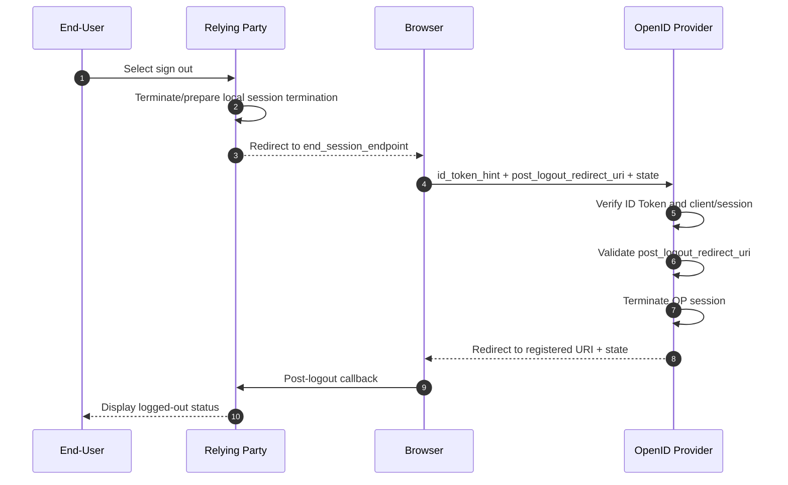
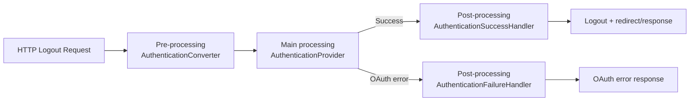

# OidcLogoutEndpointConfigurer and Customization Points

OpenID Connect RP-Initiated Logout allows a Relying Party (RP) to ask an OpenID Provider (OP) to terminate the End-User's login session at the OP. When a user chooses to sign out of an application, the RP navigates the browser to the OP's Logout Endpoint; the OP validates the request, locates the corresponding session, and performs logout according to policy.

**`OidcLogoutEndpointConfigurer` is the configuration point for the extension points of the RP-Initiated Logout Endpoint in Spring Authorization Server.** It lets you customize how requests are read, how requests are authenticated/validated, and how success or error responses are produced. Proper configuration allows an application to add business rules while preserving critical checks such as ID Token hint verification, `post_logout_redirect_uri` validation, and session management.

This lesson belongs to the **OIDC Logout** chapter of the **SPRING_SECURITY_OAUTH2_OIDC_AUTHORIZATION_SERVER** module and focuses on designing, configuring, securing, testing, and operating an OAuth 2.0/OpenID Connect Authorization Server with Spring Security and Spring Authorization Server in Spring Boot.

After this lesson, you will be able to:

- Explain RP-Initiated Logout and the role of `end_session_endpoint`.
- Understand the request parameters `id_token_hint`, `client_id`, `post_logout_redirect_uri`, and `state`.
- Enable and route the OIDC Logout Endpoint via `OidcConfigurer.logoutEndpoint`.
- Distinguish the request converter, authentication provider, success handler, and error handler.
- Customize `OidcLogoutAuthenticationProvider` and its validator while preserving default validation.
- Register post-logout redirect URIs using `RegisteredClient.Builder.postLogoutRedirectUri`.
- Configure `SessionRegistry`, `SessionRegistryImpl`, and `HttpSessionEventPublisher`.
- Test the redirect allowlist, ID Token hints, session logout, error handling, and attack scenarios.
- Distinguish OP session logout from access token/refresh token revocation and logging out at other RPs.

## 1. What Is RP-Initiated Logout?

OIDC RP-Initiated Logout 1.0 defines how an RP notifies the OP that an End-User has logged out of the RP and requests the OP to end the corresponding login session. The RP typically obtains the Logout Endpoint from discovery metadata in the `end_session_endpoint` field.

A basic flow:

1. The user chooses Logout in the application.
2. The RP terminates its local session or prepares logout state according to application design.
3. The RP directs the User Agent to the OP's `end_session_endpoint`, usually with `id_token_hint`.
4. The OP verifies the ID Token hint and identifies the associated client/session.
5. The OP validates `post_logout_redirect_uri` if present.
6. The OP ends the End-User's login session at the OP according to policy.
7. The OP redirects the browser to the registered post-logout URI and echoes `state` if sent in the request.



RP-Initiated Logout is a browser protocol. Requests are sent through the User Agent; it is not a server-to-server API for an RP to unilaterally delete a user's session without browser context.

### 1.1. Logout Endpoint and Discovery

When the OP supports RP-Initiated Logout and Discovery, the OIDC metadata advertises:

```json
{
  "issuer": "https://login.example.com",
  "authorization_endpoint": "https://login.example.com/oauth2/authorize",
  "token_endpoint": "https://login.example.com/oauth2/token",
  "end_session_endpoint": "https://login.example.com/connect/logout"
}
```

`end_session_endpoint` is the URL to which the RP directs the browser to request OP logout. Production URLs must use HTTPS. Clients should obtain the URL from metadata of a reliably configured issuer rather than constructing URLs from hostnames in incoming requests or unverified ID Tokens.

In Spring Authorization Server, the endpoint path can be configured via `AuthorizationServerSettings.oidcLogoutEndpoint(...)`:

```java
@Bean
AuthorizationServerSettings authorizationServerSettings() {
    return AuthorizationServerSettings.builder()
        .issuer("https://login.example.com")
        .oidcLogoutEndpoint("/connect/logout")
        .build();
}
```

The path in the example is an application configuration. Verify that the OIDC Provider Configuration returns the right `end_session_endpoint` after deployment, especially when the server runs behind a reverse proxy or uses a context path.

## 2. Parameters of an RP-Initiated Logout Request

OIDC RP-Initiated Logout defines several request parameters. Not all of them are mandatory.

| Parameter | Level | Role |
| --- | --- | --- |
| `id_token_hint` | RECOMMENDED | ID Token previously issued by the OP to the RP, helping the OP identify the user, client, and session to log out. |
| `logout_hint` | OPTIONAL | Custom hint for the OP to identify the End-User; semantics are determined by the OP. |
| `client_id` | OPTIONAL | Client identifier; useful when no ID Token hint is present or when identifying the client. If sent with an ID Token hint, the OP must verify that the client ID matches the client used when issuing the token. |
| `post_logout_redirect_uri` | OPTIONAL | URI to which the User Agent will be redirected after logout. The URI must be pre-registered and match exactly. |
| `state` | OPTIONAL | Opaque value used by the RP to correlate the request and post-logout callback; the OP echoes it verbatim on redirect. |
| `ui_locales` | OPTIONAL | Preferred UI languages per BCP 47. |

`id_token_hint` is recommended because it lets the OP identify the RP initiating logout and the associated user session. An ID Token hint is not an access token and must not be sent to the Token Revocation Endpoint.

OIDC RP-Initiated Logout also specifies that the OP **SHOULD** ask the End-User whether they want to log out of the OP. The OP **MUST** ask when the request lacks `id_token_hint` or when the ID Token hint does not belong to the current OP session with the RP and/or the currently logged-in user. If the End-User agrees, the OP **MUST** perform the logout. This is an important safeguard for requests lacking session-binding evidence, as a hintless logout request can be abused for denial of service.

An illustrative GET request:

```http
GET /connect/logout?id_token_hint=<ID_TOKEN>&post_logout_redirect_uri=https%3A%2F%2Fportal.example.com%2Fsigned-out&state=<OPAQUE_STATE> HTTP/1.1
Host: login.example.com
```

OIDC RP-Initiated Logout requires the OP to support both HTTP GET and POST at the Logout Endpoint. With POST, parameters are sent via form serialization:

```http
POST /connect/logout HTTP/1.1
Host: login.example.com
Content-Type: application/x-www-form-urlencoded

id_token_hint=<ID_TOKEN>&post_logout_redirect_uri=https%3A%2F%2Fportal.example.com%2Fsigned-out&state=<OPAQUE_STATE>
```

GET is convenient for browser navigation redirects, though an ID Token hint in the query string may appear in access logs, browser history, proxy logs, or telemetry. Configure masking for sensitive query parameters and consider POST when clients support it. Do not write ID Token hints or entire logout requests to logs.

### 2.1. id_token_hint and Identity Verification

When `id_token_hint` is present, the OP must verify that the OP itself issued that ID Token. The OP should accept the ID Token when the RP identified via `aud` and/or `sid` has a current or recent session, even if `exp` has passed, following RP-Initiated Logout rules.

If `sid` does not correspond to a current or recent session of the RP at the OP, the OP should treat the request as suspicious and may refuse to process it. This helps prevent attackers from using old ID Tokens or another user's token to force logout of an unrelated session.

Do not treat a client sending a JWT-shaped string as valid proof. The OP must verify signature, issuer, client/audience, and session relationship per its implementation.

### 2.2. client_id and ID Token Hint

If the request includes both `client_id` and `id_token_hint`, the OP must verify that the client identifier matches the client used when issuing the ID Token.

`client_id` does not replace ID Token verification. If a request contains only `client_id` without an ID Token hint, the OP needs another reliable means of confirming the request and post-logout redirect target before redirecting the browser.

### 2.3. post_logout_redirect_uri and state

`post_logout_redirect_uri` is used only after logout completes and must match a URI registered for the RP exactly. Do not accept wildcards, prefix matching, hostname suffix matching, or user-entered URIs.

If `post_logout_redirect_uri` is present without `id_token_hint`, the OP must not redirect back to the RP unless another mechanism confirms the validity of the redirect target. To simplify policy, a deployment may require an ID Token hint whenever a post-logout redirect is requested.

`state` is opaque data generated by the RP to correlate the callback. It is not client authentication proof and cannot replace a redirect URI allowlist. The RP should generate a random, single-use state bound to the browser session and verify it strictly upon receiving the callback.

Version note: the OIDC specification defines both `logout_hint` and `ui_locales`, whereas `OidcLogoutAuthenticationToken` in Spring Authorization Server 1.5.8 does not provide getters for those two parameters. Do not assume the default converter retains them in the authentication object; if your application needs them, check your version's implementation and add a controlled converter/context.

## 3. Enabling the OIDC Logout Endpoint in Spring Authorization Server

OIDC is disabled in a minimal OAuth Authorization Server configuration. To enable OIDC endpoints, the application calls `oidc(...)` on `OAuth2AuthorizationServerConfigurer`. When OIDC is enabled, Spring Authorization Server additionally registers the Provider Configuration, Logout, and UserInfo endpoints.

Compact configuration for Spring Authorization Server 1.5.x:

```java
@Bean
@Order(1)
SecurityFilterChain authorizationServerSecurityFilterChain(
        HttpSecurity http) throws Exception {

    OAuth2AuthorizationServerConfigurer authorizationServerConfigurer =
        OAuth2AuthorizationServerConfigurer.authorizationServer();

    http
        .securityMatcher(authorizationServerConfigurer.getEndpointsMatcher())
        .with(authorizationServerConfigurer, authorizationServer ->
            authorizationServer
                .oidc(oidc -> oidc
                    .logoutEndpoint(Customizer.withDefaults())
                )
        );

    return http.build();
}
```

This part enables the OIDC Logout Endpoint. A real application still needs the foundational Authorization Server beans, login filter chain, `RegisteredClientRepository`, `OAuth2AuthorizationService`, signing keys, and other OIDC configurations. If an Authorization Server filter chain already exists, add `logoutEndpoint(...)` to the existing configurer rather than creating a second chain with a duplicate matcher.


### 3.1. Package Differences by Version

The Java examples in this lesson use packages from **Spring Authorization Server 1.5.x**. Starting with **Spring Security 7.0**, Authorization Server APIs are integrated and the configurer package moves into the Spring Security namespace. For example:

```java
// Spring Authorization Server 1.5.x
import org.springframework.security.oauth2.server.authorization.config.annotation.web.configurers.OAuth2AuthorizationServerConfigurer;

// Spring Security 7.x
import org.springframework.security.config.annotation.web.configurers.oauth2.server.authorization.OAuth2AuthorizationServerConfigurer;
```

The extension points still follow the same converter/provider/handler model, but use the imports and DSL matching your actual BOM/dependency. Do not mix classes from both packages or copy examples across major versions without checking the API docs.


`OidcLogoutEndpointConfigurer` configures `OidcLogoutEndpointFilter` and registers that filter into the Authorization Server `SecurityFilterChain`. The default filter includes:

- `OidcLogoutAuthenticationConverter` to convert the HTTP request into `OidcLogoutAuthenticationToken`.
- `AuthenticationManager` containing `OidcLogoutAuthenticationProvider`.
- `OidcLogoutAuthenticationSuccessHandler` to handle successful logout.
- An internal failure handler returning an OAuth error response when processing throws `OAuth2AuthenticationException`.

When standard behavior is all you need, keep the default converter, provider, and handlers. Add customizers only when a specific requirement calls for a change.

## 4. Map of OidcLogoutEndpointConfigurer Extension Points

`OidcLogoutEndpointConfigurer` provides extension points across three processing phases:



| API | Role | When to Customize |
| --- | --- | --- |
| `logoutRequestConverter(...)` | Adds a converter to process requests before authentication. | When you need to support an extended request format. |
| `logoutRequestConverters(...)` | Accesses the list of default and added converters to add/remove/reorder. | When you need to adjust order or replace a specific converter. |
| `authenticationProvider(...)` | Adds a provider handling `OidcLogoutAuthenticationToken`. | When you have custom authentication/logout logic. |
| `authenticationProviders(...)` | Accesses the default provider list to add/remove/customize. | When setting a validator on the default provider or replacing a provider per policy. |
| `logoutResponseHandler(...)` | Handles successful authentication and performs logout/response. | When you need custom auditing, a response page, or a custom redirect flow. |
| `errorResponseHandler(...)` | Handles `OAuth2AuthenticationException` and builds error responses. | When you need error pages/telemetry matching your application's response standard. |

**Key point to remember:** converters, providers, and handlers do not substitute for one another.

- The converter only reads and converts the request.
- The provider validates the request and produces an authentication result.
- The success handler acts after the provider succeeds in authentication.
- The error handler formats errors after processing fails.

Replacing the success handler does not add ID Token verification. Replacing the converter does not verify redirect URIs. Every layer must uphold the protocol contract without dropping security checks.

## 5. logoutRequestConverter and logoutRequestConverters

### 5.1. Default Converter

`OidcLogoutAuthenticationConverter` reads Logout Request parameters and builds an `OidcLogoutAuthenticationToken` holding information such as:

- ID Token hint;
- principal/End-User context;
- session identifier if present;
- client ID;
- post-logout redirect URI;
- state.

This token is passed to the `AuthenticationManager` for the provider to handle. Do not construct an already-authenticated `OidcLogoutAuthenticationToken` directly from raw HTTP data.

### 5.2. Adding a Converter

You can add a converter via `logoutRequestConverter(...)`:

```java
http.with(authorizationServerConfigurer, authorizationServer ->
    authorizationServer.oidc(oidc ->
        oidc.logoutEndpoint(logout ->
            logout.logoutRequestConverter(customLogoutRequestConverter)
        )
    )
);
```

Or access the default list:

```java
.logoutRequestConverters(converters -> {
    // Keep the default OidcLogoutAuthenticationConverter.
    // Only add a converter when a defined extension request format exists.
    converters.add(0, customLogoutRequestConverter);
})
```

A custom converter should return `null` if the request does not match the format it handles, allowing the default converter to proceed. If the converter recognizes an extended request, it must validate the structure and convert it into an authentication request adhering to the contract.

Do not remove the default converter just to add one query parameter. When replacing converters, ensure standard OIDC parameters are still parsed and validation cannot be bypassed.

### 5.3. Mistakes When Writing a Converter

- Creating an authenticated token before provider validation.
- Ignoring duplicate parameters or accepting multiple values for a single-valued parameter.
- Accepting an arbitrary `post_logout_redirect_uri` from the query string.
- Taking a client ID from a browser-sent header without binding it to the ID Token hint.
- Reading an ID Token hint and trusting its decoded payload without verifying the signature.
- Altering `state` before returning it to the RP.

The converter is where the request is parsed; it is not where you decide whether a redirect URI is permitted.

## 6. authenticationProvider and authenticationProviders

### 6.1. Default Provider

`OidcLogoutAuthenticationProvider` handles `OidcLogoutAuthenticationToken`. The provider's constructor accepts:

- `RegisteredClientRepository` to query client registrations.
- `OAuth2AuthorizationService` to locate issued authorizations/ID Tokens.
- `SessionRegistry` to look up End-User session information.

The default provider performs authentication and validation for RP-Initiated Logout. When the request is valid, the authentication result is passed to the success handler to execute logout.

Do not replace the default provider just to add auditing. Auditing typically fits better in the success/error handler or an event listener after authentication succeeds.

### 6.2. Adding a Provider

`authenticationProvider(...)` adds a provider to the `AuthenticationManager`. `authenticationProviders(...)` lets you manipulate the default provider list:

```java
.authenticationProviders(providers -> {
    // Add an extension provider or configure the default provider.
    // Keep OidcLogoutAuthenticationProvider if standard handling is still used.
})
```

If adding a provider, define clearly which provider supports which `Authentication` type, provider ordering, and fallback behavior when a provider returns `null`. Two providers accepting the same authentication type can cause unpredictable behavior if ordering is uncontrolled.

### 6.3. When Do You Need a Custom Provider?

A custom provider is appropriate when the application has custom logout workflows, such as:

- Logout needing to check tenant or account status before terminating the session.
- Having an external session store system.
- Integrating step-up or user confirmation policies.
- Having additional logic for ID Token/session binding beyond default validation.

However, a custom provider must continue checking the ID Token hint, client/audience, session association, and redirect URI. Never allow logout merely because the request carries a valid `client_id` or knows a user's username.

## 7. Customizing the OidcLogoutAuthenticationProvider Validator

Spring Authorization Server provides `OidcLogoutAuthenticationProvider.setAuthenticationValidator(...)` to customize validation of request parameters. This API has been available since Spring Authorization Server 1.4.

The validator receives `OidcLogoutAuthenticationContext`, which exposes:

- `getAuthentication()` returning `OidcLogoutAuthenticationToken`.
- `getRegisteredClient()` returning the resolved client registration.
- Other context attributes depending on processing.

The validator must throw `OAuth2AuthenticationException` if validation fails.

### 7.1. What Does the Default Validator Check?

`OidcLogoutAuthenticationValidator` is the default validator. It checks the request's `post_logout_redirect_uri` against the list of URIs registered for the client. If invalid, the validator throws `OAuth2AuthenticationException`.

This is critical because the redirect URI is input supplied by the browser/client. If the server redirects to an arbitrary URI, an attacker can exploit the endpoint for an open redirect, sending users to spoofed sites or forwarding callback information.

### 7.2. Extending the Validator While Keeping Default Validation

When replacing the validator, avoid accidentally dropping the default checks. You can invoke `OidcLogoutAuthenticationValidator` first and then apply additional rules:

```java
private Consumer<List<AuthenticationProvider>> configureLogoutValidator() {
    return providers -> providers.forEach(provider -> {
        if (provider instanceof OidcLogoutAuthenticationProvider logoutProvider) {
            logoutProvider.setAuthenticationValidator(context -> {
                // Run the default post_logout_redirect_uri check first.
                new OidcLogoutAuthenticationValidator().accept(context);

                OidcLogoutAuthenticationToken request =
                    context.getAuthentication();

                // This deployment policy requires an ID Token hint
                // if the client wants to redirect after logout.
                if (request.getPostLogoutRedirectUri() != null
                        && request.getIdTokenHint() == null) {
                    throw new OAuth2AuthenticationException(
                        new OAuth2Error(
                            OAuth2ErrorCodes.INVALID_REQUEST,
                            "id_token_hint is required for post-logout redirect",
                            null
                        )
                    );
                }
            });
        }
    });
}
```

Configuring the validator:

```java
@Bean
@Order(1)
SecurityFilterChain authorizationServerSecurityFilterChain(
        HttpSecurity http) throws Exception {

    OAuth2AuthorizationServerConfigurer authorizationServerConfigurer =
        OAuth2AuthorizationServerConfigurer.authorizationServer();

    http
        .securityMatcher(authorizationServerConfigurer.getEndpointsMatcher())
        .with(authorizationServerConfigurer, authorizationServer ->
            authorizationServer.oidc(oidc ->
                oidc.logoutEndpoint(logout ->
                    logout.authenticationProviders(configureLogoutValidator())
                )
            )
        );

    return http.build();
}
```

The example shows a strict deployment policy: if an RP wants a post-logout redirect, an ID Token hint is mandatory. This is stricter than the protocol allows; the OP may use another mechanism to confirm the validity of the post-logout redirect target when no hint is present.

If a custom validator replaces the default validator without calling it, the application must implement full redirect URI validation and all other necessary rules itself. Never let a custom validator disable an existing allowlist.

### 7.3. RegisteredClient and post_logout_redirect_uri

Registering a post-logout redirect URI on a client:

```java
RegisteredClient portal = RegisteredClient.withId("portal-internal-id")
    .clientId("customer-portal")
    .clientSecret("{bcrypt}...")
    .clientAuthenticationMethod(
        ClientAuthenticationMethod.CLIENT_SECRET_BASIC)
    .authorizationGrantType(AuthorizationGrantType.AUTHORIZATION_CODE)
    .redirectUri(
        "https://portal.example.com/login/oauth2/code/portal")
    .postLogoutRedirectUri(
        "https://portal.example.com/signed-out")
    .scope("openid")
    .build();
```

`postLogoutRedirectUri(...)` adds a URI to `RegisteredClient.getPostLogoutRedirectUris()`. A client can register multiple post-logout redirect URIs.

Matching rules must be exact. The following URIs must not be treated as equivalent if only one URI is registered:

- `https://portal.example.com/signed-out`
- `https://portal.example.com/signed-out/`
- `https://portal.example.com/signed-out?next=/home`
- `https://portal.example.com.attacker.example/signed-out`

Do not use prefix or wildcard matching. If you have multiple environments, register each URI explicitly per client/environment.

### 7.4. Validation Failures

If validation fails, the validator must throw `OAuth2AuthenticationException` with an appropriate `OAuth2Error`. Do not merely log a warning and continue logging out/redirecting. If the request is invalid, the OP must not perform a post-logout redirect to that URI.

Do not include internal details such as the full redirect URI list, session IDs, or ID Token contents in error responses.

## 8. logoutResponseHandler — Handling Successful Logout

`logoutResponseHandler(...)` accepts an `AuthenticationSuccessHandler`. This handler processes the authenticated `OidcLogoutAuthenticationToken` and executes logout/response for RP-Initiated Logout.

By default, Spring Authorization Server uses `OidcLogoutAuthenticationSuccessHandler`. When no custom behavior is needed, keep the default handler to continue executing the standard logout flow.

Valid reasons to customize:

- Emitting a logout audit event.
- Rendering an OP-branded logout completion page.
- Adding correlation IDs or telemetry.
- Coordinating an internal post-processing step after the session has been verified.

### 8.1. Wrapping the Default Success Handler for Auditing

If you only need auditing, wrap the default handler and delegate logout to it:

```java
@Bean
AuthenticationSuccessHandler auditedOidcLogoutSuccessHandler(
        LogoutAuditService auditService) {

    AuthenticationSuccessHandler delegate =
        new OidcLogoutAuthenticationSuccessHandler();

    return (request, response, authentication) -> {
        OidcLogoutAuthenticationToken logout =
            (OidcLogoutAuthenticationToken) authentication;

        // Delegate logout and response first; audit only when the handler succeeds.
        delegate.onAuthenticationSuccess(
            request, response, authentication
        );

        // Do not write ID Token hints or credentials to the audit log.
        auditService.recordLogout(
            logout.getClientId(),
            logout.getSessionId()
        );
    };
}
```

Then attach the handler to the configurer:

```java
.logoutEndpoint(logout ->
    logout.logoutResponseHandler(auditedOidcLogoutSuccessHandler)
)
```

This is a structural example. `LogoutAuditService` is an application-defined service. Avoid writing ID Token hints, access tokens, refresh tokens, or sensitive identifying data to audit logs. If session IDs are stored, apply appropriate retention and access controls.

The example invokes the delegate first so auditing occurs only after the default handler finishes. If auditing must be durable and synchronized with session changes, design a transaction/outbox at the session-management layer; a success-handler wrapper does not by itself create an atomic transaction between the session store and audit store.

### 8.2. When Fully Replacing the Success Handler

If replacing the default handler, the application is responsible for preserving essential behaviors:

- Terminating the right identified OP session.
- Not terminating sessions belonging to other End-Users.
- Redirecting only to verified URIs.
- Returning `state` intact if the request included `state` and the redirect is valid.
- Handling cases without a post-logout redirect.
- Never letting an error on the landing page turn into an open redirect or skip completed logout.

Do not build redirects by concatenating query parameter strings from the request. Use the URI verified by the provider and encode it properly.

## 9. errorResponseHandler — Error Handling

`errorResponseHandler(...)` accepts an `AuthenticationFailureHandler` and handles `OAuth2AuthenticationException`. By default, the filter returns an OAuth error response based on the exception's `OAuth2Error`.

You can customize it to:

- Record metrics by error code.
- Attach a correlation ID.
- Return a friendly error page when the request is browser navigation.
- Standardize error handling across OIDC endpoints.

Do not return stack traces, tokens, session IDs, client secrets, or internal details about ID Token validation. Never redirect to `post_logout_redirect_uri` if request validation failed.

If you only need auditing, wrap the default failure handler to preserve the response contract. Failure handler constructors may vary across versions; if you do not need to change the response, keep the default handler by omitting `errorResponseHandler(...)`.

## 10. SessionRegistry and OP Session Management

OIDC Logout is not limited to validating request parameters; the OP must also locate the user session to terminate. Spring Authorization Server uses `SessionRegistry` to track authenticated sessions.

When OIDC is enabled:

- `SessionRegistry` is used by the Authorization Endpoint's default `SessionAuthenticationStrategy` to register user sessions.
- `OidcLogoutAuthenticationProvider` uses `SessionRegistry` to look up the `SessionInformation` associated with the End-User requesting logout.
- If the application does not declare a `SessionRegistry` bean, the default `SessionRegistryImpl` implementation is used.

This means the `SessionRegistry` used during login and logout must be consistent. If the application replaces `SessionRegistry` or uses concurrent session control, ensure all components share an appropriate registry.

### 10.1. Registering SessionRegistryImpl and HttpSessionEventPublisher

Example:

```java
@Bean
SessionRegistry sessionRegistry() {
    return new SessionRegistryImpl();
}

@Bean
HttpSessionEventPublisher httpSessionEventPublisher() {
    return new HttpSessionEventPublisher();
}
```

`HttpSessionEventPublisher` forwards HTTP session lifecycle events, such as session destruction, to `SessionRegistryImpl` so expired session information is removed. When registering a `SessionRegistryImpl` bean, Spring recommends also registering `HttpSessionEventPublisher`.

Imports:

```java
import org.springframework.context.annotation.Bean;
import org.springframework.security.core.session.SessionRegistry;
import org.springframework.security.core.session.SessionRegistryImpl;
import org.springframework.security.web.session.HttpSessionEventPublisher;
```

If using Spring Security Concurrent Session Control, share a single `SessionRegistry` between that feature and OIDC Logout.

### 10.2. SessionRegistry in Multi-Instance Environments

`SessionRegistryImpl` stores state in the memory of a single instance. In multi-node systems:

- A user may log in on node A while the logout request hits node B.
- Node B cannot find the session information if the registry exists only locally.
- Logout may fail to affect sessions on other nodes or yield inconsistent results.

Options:

1. Use sticky sessions to reduce the likelihood of requests hitting another node; this is only a routing measure and does not replace shared session state when failover is needed.
2. Implement a `SessionRegistry` backed by a shared data store.
3. Combine Spring Session/distributed HTTP sessions with a registry capable of querying sessions consistently.
4. Ensure session creation, refresh, expiration, and removal are synchronized across instances.

Do not assume moving HTTP sessions to Redis automatically makes `SessionRegistryImpl` distributed. The registry itself must also be shared or appropriately implemented.

### 10.3. Principal Equality and Session Identity

`SessionRegistry` associates principals with session IDs. Principals need stable `equals`/`hashCode` if the registry relies on object identity/equality for lookups. If each request constructs a distinct principal object with unstable equality, session lookups can fail.

Do not use non-unique emails or usernames as session keys if the application supports multiple tenants/realms. Identify principals accurately by the OP's subject/realm.

## 11. Distinguishing OP Logout, RP Logout, and Token Revocation

Actions commonly grouped together as "logout" have different effects:

| Action | Affected Component | Automatically Revokes Access Tokens? |
| --- | --- | --- |
| RP local logout | Session/cookie of a single RP application. | No. |
| OP RP-Initiated Logout | End-User's login session at the OP. | Not by default. |
| RP-Initiated Logout at OP | Asks the OP to end the session corresponding to the RP. | Does not revoke all access/refresh tokens by default. |
| OAuth Token Revocation | Token sent to the Revocation Endpoint and related tokens per policy. | Yes, per AS revocation semantics. |
| OIDC Back-Channel Logout | OP sends a Logout Token directly to the RP so the RP ends related sessions. | Does not automatically revoke tokens at the AS. |
| OIDC Front-Channel Logout | OP navigates/embeds the browser to the RP's logout URI via front-channel mechanism. | Does not automatically revoke tokens at the AS. |

RP-Initiated Logout terminates the login session at the OP. An already-issued JWT access token may continue to be accepted by a Resource Server until `exp` if the Resource Server verifies signatures and claims offline.

If the product requires logout to invalidate access tokens nearly immediately, add policies such as:

- Revoking refresh tokens and related tokens via the Revocation Endpoint.
- Using opaque tokens with introspection or centralized status checks.
- Using a denylist/authorization version or event-driven invalidation for JWTs.
- Limiting access token TTLs.
- Synchronizing session/token state within your SLA.

Never claim "logged out of the OP" means "all of the user's tokens across all APIs have been revoked."

## 12. Connecting Client-Side RP-Initiated Logout to the OP

On the RP side using Spring Security OAuth2 Client, `OidcClientInitiatedLogoutSuccessHandler` is the corresponding success handler for initiating RP-Initiated Logout.

A conceptual configuration:

```java
@Bean
SecurityFilterChain clientSecurityFilterChain(
        HttpSecurity http,
        ClientRegistrationRepository clientRegistrationRepository)
        throws Exception {

    OidcClientInitiatedLogoutSuccessHandler logoutSuccessHandler =
        new OidcClientInitiatedLogoutSuccessHandler(
            clientRegistrationRepository);

    logoutSuccessHandler.setPostLogoutRedirectUri(
        "{baseUrl}/");

    http
        .authorizeHttpRequests(authorize ->
            authorize.anyRequest().authenticated())
        .oauth2Login(Customizer.withDefaults())
        .logout(logout ->
            logout.logoutSuccessHandler(logoutSuccessHandler));

    return http.build();
}
```

This configuration lives on the **RP/client application**, not the Authorization Server. It illustrates how the client directs the User Agent to the OP after local logout is triggered.

The client must retain the received ID Token in its OIDC authentication so the handler can send `id_token_hint`. The post-logout callback URI must be in the `postLogoutRedirectUris` list registered at the OP.

If the RP uses a custom logout endpoint, ensure the local session is terminated and callback `state` is verified. Do not merely delete browser cookies while leaving the server-side session store intact.

## 13. Common Pitfalls and How to Fix Them

### 13.1. end_session_endpoint Not Found

Check whether OIDC is enabled via `.oidc(...)`, whether the Provider Configuration endpoint is served, whether the issuer/metadata URL is right, and whether `AuthorizationServerSettings.oidcLogoutEndpoint` is configured accurately.

### 13.2. post_logout_redirect_uri Not Accepted

Check whether the URI is registered via `RegisteredClient.postLogoutRedirectUri(...)`. Compare scheme, host, port, path, query, and trailing slash exactly. Do not use the Authorization Code flow's redirect URI in place of the post-logout redirect URI.

### 13.3. Logout Succeeds Without Redirecting Back to RP

The request may have omitted `post_logout_redirect_uri`, the ID Token hint failed verification, the URI was unregistered, the validator rejected it, or a custom success handler failed to delegate to the default handler.

Never work around this by redirecting to a raw value from the request.

### 13.4. Logout Request Without id_token_hint

OIDC allows some hintless cases, but the OP must have another way to verify the request/redirect target and consider requiring user confirmation. Deployments can enforce a strict policy requiring an ID Token hint whenever a post-logout redirect is requested.

### 13.5. Expired ID Token Hint

OIDC RP-Initiated Logout permits the OP to accept an ID Token when the RP/session is current or recent, even if `exp` has passed. Do not apply a mechanical "always reject expired tokens" rule to logout hints. Check your SAS version's behavior, authorization/session store, and OP recency policy.

### 13.6. SessionRegistry Cannot Find the Session

Check whether the Authorization Endpoint registers sessions, whether the logout provider uses the same registry bean, whether the session ID still exists, and whether principal equality is stable. In a cluster, verify that the registry shares state.

### 13.7. Logout on One Node Leaves User Logged In on Another

Check sticky sessions, distributed session store, shared `SessionRegistry`, session event publishing, and caches. A per-node in-memory `SessionRegistry` is insufficient for consistent logout in a cluster.

### 13.8. Custom Validator Accidentally Drops Default Redirect Validation

Calling `setAuthenticationValidator` with a new validator without delegating to `OidcLogoutAuthenticationValidator` replaces default logic. Call the default validator first or implement a complete exact-match allowlist yourself.

### 13.9. Replacing the Success Handler Prevents Logout from Occurring

A custom handler that only returns a redirect can skip default logout logic. Delegate to `OidcLogoutAuthenticationSuccessHandler` or fully implement session termination, redirect control, and state handling.

### 13.10. OP Logs Out Yet APIs Still Accept JWT Access Tokens

This can happen when Resource Servers verify JWTs offline. Session logout and token revocation are separate mechanisms. Use introspection, a denylist, token versioning, or short TTLs if rapid revocation is required.

### 13.11. Browser Redirected to a Spoofed Website

This signals an open redirect. Check post-logout URI validation, wildcard/prefix matching, proxy rewriting, and custom success handlers. Redirect only to exact-registered URIs.

## 14. OIDC Logout Test Matrix

| Scenario | Expected Result |
| --- | --- |
| GET logout with valid ID Token hint and registered redirect URI | OP verifies request, ends session, and redirects to exact URI. |
| POST logout with valid form parameters | Processed equivalently to GET per protocol. |
| ID Token hint issued by another OP | Rejected or does not log out per policy; no redirect. |
| ID Token hint with audience/client mismatching request | Request treated as invalid. |
| `client_id` matches ID Token hint | Validation may proceed. |
| `client_id` differs from client in ID Token hint | Request rejected. |
| `post_logout_redirect_uri` exact-matches allowlist | Redirect permitted after logout. |
| `post_logout_redirect_uri` differs by one character | Rejected; no redirect. |
| URI with attacker hostname suffix | Rejected. |
| HTTP URI when policy allows only HTTPS | Rejected per policy. |
| `post_logout_redirect_uri` present without `id_token_hint` and without other verification | No redirect. |
| `state` sent | OP returns exact value on valid redirect. |
| `state` missing | Logout still processed per policy; no fake state generated. |
| Expired ID Token hint yet recent session confirmed | Handled per RP-Initiated Logout policy; not rejected solely for `exp`. |
| `sid` not part of current/recent session | Request treated as suspect; wrong session not logged out. |
| No `post_logout_redirect_uri` | OP completes logout and displays appropriate page. |
| `SessionRegistry` holds matching session | Provider finds session and performs logout. |
| `SessionRegistry` lacks session | Does not mistakenly log out another session; handled per protocol/policy. |
| Two nodes share `SessionRegistry` | Logout reflected on the node receiving the request. |
| `SessionRegistryImpl` with `HttpSessionEventPublisher` | Session lifecycle cleaned up from registry. |
| Custom validator runs | Default redirect validation executes before additional policy. |
| Custom success handler | Default logout logic still runs if handler delegates. |
| Custom error handler | Error response leaks no tokens/sessions/stack traces. |
| User logs out of OP while access JWT remains valid | Offline Resource Server may keep accepting per TTL; test verifies token policy. |
| Client sends ID Token instead of access token to revocation endpoint | Not treated as a valid revocation operation. |

### 14.1. Integration Test with MockMvc

You can test the endpoint and validation through the real filter chain:

```java
@SpringBootTest
@AutoConfigureMockMvc
class OidcLogoutEndpointTests {

    @Autowired
    MockMvc mockMvc;

    @Test
    void rejectsUnregisteredPostLogoutRedirectUri() throws Exception {
        mockMvc.perform(get("/connect/logout")
                .param("id_token_hint", "<VALID_TEST_ID_TOKEN>")
                .param(
                    "post_logout_redirect_uri",
                    "https://attacker.example/return"))
            .andExpect(status().is4xxClientError());
    }
}
```

This is an illustrative skeleton. A real test needs a valid ID Token fixture signed by the test issuer, a session registry, and a registered client with known post-logout URIs. The exact response status/error depends on your handlers and filter chain setup; beyond status, assert that the response does not redirect to the attacker URI and the session is not logged out unintentionally.

### 14.2. Testing the Session Registry

- Log in an End-User through the Authorization Endpoint.
- Confirm the session is registered in the right `SessionRegistry`.
- Send RP-Initiated Logout with the corresponding ID Token hint.
- Confirm session information is marked/terminated per logout behavior.
- Send a follow-up request using the old session and confirm it is no longer treated as authenticated.
- Repeat on another cluster node to confirm the shared registry works.

### 14.3. Testing Against Unintended Token Expectations

After logout, call the Resource Server with an unexpired access token. The result must match your system's token policy:

- If the API verifies JWTs offline, the token may remain valid until `exp`.
- If the system uses revocation/introspection or a denylist, the token is rejected once state propagates.
- Refresh tokens must be handled under a separate revocation policy.

This test helps separate session logout from token revocation.

## 15. Operations and Observability

A production logout system needs observability across both the protocol flow and session store.

| Metric/Event | Purpose |
| --- | --- |
| Logout request count | Track logout request volume over time. |
| Logout success/failure | Detect validation errors or session store failures. |
| Invalid post-logout URI | Detect client configuration drift or open-redirect probing. |
| Invalid ID Token hint | Detect issuer/client mismatches or suspicious requests. |
| `SessionRegistry` lookup miss | Detect session registration/cluster consistency issues. |
| Redirect completion | Track whether clients receive post-logout callbacks. |
| Session cleanup delay | Detect `HttpSessionEventPublisher` or distributed store failures. |
| Token still active after logout | Validate expectations around token revocation and Resource Server caches. |

Do not log raw ID Token hints, access tokens, refresh tokens, or full logout query strings. When correlation is needed, use request IDs and normalized metadata such as client ID and validation outcome; treat session IDs as sensitive data.

### 15.1. Reverse Proxies and Issuer

If the Authorization Server runs behind a reverse proxy:

- Discovery metadata must advertise the right HTTPS `end_session_endpoint`.
- The backend must trust forwarded headers only from controlled proxies.
- Do not let clients supply `Host` or `X-Forwarded-Host` to alter redirect URLs.
- OP session cookies need `Secure`, `HttpOnly`, and `SameSite` suited to the OIDC browser flow.
- Verify GET/POST logout requests are not altered by proxy caches or WAFs stripping query/form parameters.

### 15.2. Caching and Session Lifecycle

Session logout may not be observed immediately by every node if the registry or session store is fragmented. Define SLAs for logout propagation, event delivery, cache invalidation, and handling when the session store is unavailable.

Never treat a successful redirect response as proof that all other RPs or all Resource Servers have ended their sessions/tokens. Those are separate logout/revocation flows.

## 16. Implementation Checklist

- [ ] OIDC is enabled in the Authorization Server configurer.
- [ ] Discovery metadata advertises an accurate `end_session_endpoint` over HTTPS.
- [ ] `AuthorizationServerSettings.oidcLogoutEndpoint(...)` matches the actual endpoint.
- [ ] The RP sends an `id_token_hint` matching the login session and client.
- [ ] The OP verifies that the ID Token hint was issued by the OP itself and checks client/session association.
- [ ] If both `client_id` and `id_token_hint` are present, both values are cross-checked.
- [ ] `post_logout_redirect_uri` is registered in `RegisteredClient.postLogoutRedirectUri(...)`.
- [ ] Redirect URIs are exact-matched; no wildcard/prefix matching is used.
- [ ] No redirect occurs if the target is unverified under OIDC policy.
- [ ] Opaque `state` is returned intact and verified by the RP on callback.
- [ ] Default `OidcLogoutAuthenticationValidator` is preserved or replaced with equivalent logic.
- [ ] Custom validators throw `OAuth2AuthenticationException` when validation fails.
- [ ] Custom converters do not remove/bypass the default OIDC converter unnecessarily.
- [ ] Custom providers still verify ID Token, client, session, and redirect URI.
- [ ] Success handler preserves default logout behavior or fully implements its semantics.
- [ ] Error handler exposes no tokens, session IDs, stack traces, or unverified redirect targets.
- [ ] `SessionRegistry` is shared across login, logout, and concurrent session control where needed.
- [ ] `HttpSessionEventPublisher` is registered when using a `SessionRegistryImpl` bean.
- [ ] Clusters have a shared session registry/session store; do not rely solely on per-node in-memory registries.
- [ ] RP local logout and OP logout are properly coordinated.
- [ ] Token revocation has a dedicated policy; do not assume OP logout automatically revokes all access tokens.
- [ ] Integration tests cover invalid ID Token hints, invalid redirect URIs, `state`, session lookup, custom handlers, and cluster behavior.
- [ ] Logs do not store ID Token hints, access tokens, refresh tokens, or sensitive query strings.

**Key Takeaway:** `OidcLogoutEndpointConfigurer` controls the request converter, authentication provider, success handler, and error handler of the RP-Initiated Logout Endpoint. Preserve default validation for `post_logout_redirect_uri`, redirect only to exact-registered URIs, and use a consistent `SessionRegistry` to locate the OP session to terminate. Logging out of a login session does not automatically mean revoking all access tokens or ending sessions across all RPs.

## 17. References

- [OpenID Connect RP-Initiated Logout 1.0](https://openid.net/specs/openid-connect-rpinitiated-1_0-final.html): logout request parameters, `id_token_hint`, `post_logout_redirect_uri`, state, discovery metadata, and security considerations.
- [Spring Authorization Server 1.5.8 — Protocol Endpoints](https://docs.spring.io/spring-authorization-server/reference/protocol-endpoints.html): `OidcLogoutEndpointConfigurer`, defaults, and custom authentication validator.
- [OidcLogoutEndpointConfigurer API](https://docs.spring.io/spring-authorization-server/reference/api/java/org/springframework/security/oauth2/server/authorization/config/annotation/web/configurers/OidcLogoutEndpointConfigurer.html): methods for configuring converters, providers, and handlers.
- [OidcLogoutAuthenticationProvider API](https://docs.spring.io/spring-authorization-server/reference/api/java/org/springframework/security/oauth2/server/authorization/oidc/authentication/OidcLogoutAuthenticationProvider.html): provider and `setAuthenticationValidator`.
- [OidcLogoutAuthenticationContext API](https://docs.spring.io/spring-authorization-server/reference/api/java/org/springframework/security/oauth2/server/authorization/oidc/authentication/OidcLogoutAuthenticationContext.html): authentication context and `RegisteredClient`.
- [OidcLogoutAuthenticationToken API](https://docs.spring.io/spring-authorization-server/reference/api/java/org/springframework/security/oauth2/server/authorization/oidc/authentication/OidcLogoutAuthenticationToken.html): ID Token hint, client ID, session ID, post-logout URI, and state.
- [OidcLogoutAuthenticationValidator API](https://docs.spring.io/spring-authorization-server/reference/api/java/org/springframework/security/oauth2/server/authorization/oidc/authentication/OidcLogoutAuthenticationValidator.html): default validator for post-logout redirect URIs.
- [RegisteredClient.Builder API](https://docs.spring.io/spring-authorization-server/reference/api/java/org/springframework/security/oauth2/server/authorization/client/RegisteredClient.Builder.html): `postLogoutRedirectUri(...)`.
- [Spring Authorization Server — Core Model / Components](https://docs.spring.io/spring-authorization-server/reference/core-model-components.html): `SessionRegistry`, `SessionRegistryImpl`, and `HttpSessionEventPublisher`.
- [Spring Authorization Server — Configuration Model](https://docs.spring.io/spring-authorization-server/reference/configuration-model.html): enabling OIDC endpoints and configuring `AuthorizationServerSettings`.
- [Spring Security — OIDC Client Initiated Logout](https://docs.spring.io/spring-security/reference/servlet/oauth2/login/logout.html): `OidcClientInitiatedLogoutSuccessHandler` on the RP/client side.
