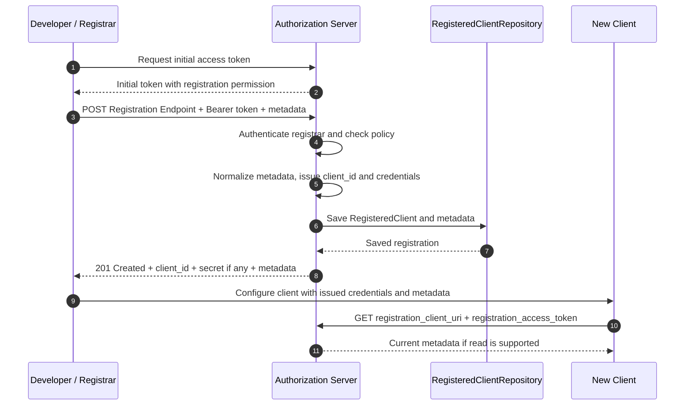

# Issuing client_id, client_secret, and Registration Metadata

## 1. What Problem Does Dynamic Client Registration Solve?

In the **Dynamic Client Registration** chapter of the **SPRING_SECURITY_OAUTH2_OIDC_AUTHORIZATION_SERVER** module, we learn how to design, configure, secure, test, and operate an OAuth 2.0/OpenID Connect Authorization Server using Spring Security and Spring Authorization Server in a Spring Boot application.

In a system with many applications, requiring an administrator to manually create every OAuth Client slows down onboarding and invites misconfiguration. **Dynamic Client Registration (DCR)** allows a client or developer to send registration metadata to the Authorization Server; the server checks policy, issues a client identifier, optionally issues a secret, persists the configuration, and returns the accepted metadata.

For example, an inventory management application wants to use the Authorization Code Flow. The application sends its client name, redirect URIs, grant types, response types, scopes, and Token Endpoint authentication method. The Authorization Server validates these values, decides whether the client may register, and issues the identifier and appropriate credentials.

Key point: **a successful registration does not mean the client is allowed to request any scope or use any grant type**. Metadata submitted by the client is a proposal. The Authorization Server must authenticate registration permissions, validate the data, enforce system limits, and return the actual accepted configuration.

After this lesson, you will be able to distinguish the credential types, issue client IDs/secrets, validate metadata, enable the Client Registration Endpoint in Spring Authorization Server, and test the registration lifecycle.

## 2. Distinguishing Three Protocols and Support Scope

### 2.1. OAuth 2.0 Dynamic Client Registration — RFC 7591

RFC 7591 defines how to dynamically register OAuth 2.0 clients. The client sends an HTTP POST with JSON metadata to the Client Registration Endpoint. On success, the Authorization Server returns HTTP 201 Created, a client ID, the registered metadata, and a client secret if the client is confidential.

An Initial Access Token in RFC 7591 is **optional per Authorization Server policy**. A server may allow open registration or require a pre-issued token so only approved parties have permission to register.

### 2.2. OAuth 2.0 Dynamic Client Registration Management — RFC 7592

RFC 7592 extends DCR with a Client Configuration Endpoint so clients can manage registrations after creation:

| HTTP method | Operation | Meaning |
| --- | --- | --- |
| GET | Read | Reads current metadata. |
| PUT | Update | Replaces registration metadata with a new configuration. |
| DELETE | Deprovision | Deregisters the client. |

These operations use the registration access token as a Bearer Token. RFC 7592 is an **Experimental** document, and not every Authorization Server supporting DCR supports all management operations.

### 2.3. OpenID Connect Dynamic Client Registration 1.0

OpenID Connect defines Client Registration for registering an OIDC Relying Party. OIDC metadata extends OAuth client properties, such as post-logout redirect URIs, ID Token signing algorithms, and other OIDC information.

Spring Authorization Server 1.5.8 has an official guide on **OpenID Connect Dynamic Client Registration 1.0**. This endpoint supports registering and reading client information; it **does not imply that all RFC 7592 PUT/DELETE operations are provided out of the box**.

### 2.4. Scope Comparison

| Feature | RFC 7591 | RFC 7592 | Spring Authorization Server 1.5.8 |
| --- | --- | --- | --- |
| Client registration | Yes | Based on RFC 7591 | Yes, per OIDC Client Registration 1.0. |
| Issue client ID | Yes | Keeps existing ID | Yes. |
| Issue client secret | If client needs a secret | Can change on read/update | Can issue for confidential clients per configuration. |
| Initial access token | Per policy | Not a per-client management credential | Spring guide requires a token with `client.create` scope. |
| Registration access token | Not mandatory in RFC 7591 | Registration management credential | Returned in the registration response in the Spring guide. |
| Read client | Does not define management endpoint | GET | Yes. |
| Update client | Out of scope | PUT | Not built into the guided endpoint. |
| Delete client | Out of scope | DELETE | Not built into the guided endpoint. |

When designing, explicitly document which protocols and operations the system supports. If the product requires RFC 7592 registration updates or deletions, implement that management layer separately and test RFC 7592 semantics.

## 3. Distinguishing Four Types of Credentials

One of the most common design mistakes is mixing up `client_secret` and `registration_access_token`. They have different purposes and different endpoints.

| Component | Who uses it? | Where is it used? | Permissions/Role |
| --- | --- | --- | --- |
| **client_id** | Client and Authorization Server | Authorization Endpoint, Token Endpoint, and protocol requests | Identifies the client; not a secret. |
| **client_secret** | Confidential OAuth Client | Primarily at the Token Endpoint | Authenticates the client when using `client_secret_basic`, `client_secret_post`, or `client_secret_jwt`. |
| **Initial Access Token** | Developer/registrar granted registration permission | Client Registration Endpoint | Authorizes creating a new registration per policy. |
| **registration_access_token** | Client/developer managing a registration | Client Configuration/Read Endpoint | Reads, updates, or deletes the registration if the server supports those operations. |

### 3.1. client_id Is a Public Identifier

`client_id` is an identifier string issued by the Authorization Server. The client sends this value in OAuth requests so the server knows which registration is being used.

`client_id`:

- Is not a password and does not need to be kept secret.
- Should be unique within the Authorization Server per issuance policy.
- Should not contain emails, usernames, client secrets, or sensitive internal information.
- Can be a UUID, a random string, or a server-managed structured ID.
- Can be used in logs/audits as an identifier, but never substitutes for authorization checks.

RFC 7591 allows an Authorization Server to issue the same `client_id` to multiple instances in some cases. Sharing an ID or issuing per-instance IDs is a decision about client model, credentials, and lifecycle.

### 3.2. client_secret Is a Confidential Client's Credential

`client_secret` is used to authenticate a confidential client at the Token Endpoint. A secret is issued only when the client type and authentication method require it.

Typical cases:

- Backend services can store secrets in a secret manager.
- Server-side web applications can store secrets in the server environment.
- Browser-based SPAs and native apps cannot protect a static shared secret; they are typically public clients and use `token_endpoint_auth_method` `none` with PKCE where appropriate.
- Clients using `private_key_jwt` or mutual TLS can authenticate with keys/certificates instead of a shared secret.

**Never embed `client_secret` in JavaScript, mobile binaries, source repositories, public container images, or logs.** If anyone can download the application, they can extract any secret embedded in it.

### 3.3. Initial Access Token Grants Registration Permission Only

The Initial Access Token is a bootstrap credential. It allows an approved party to call the Registration Endpoint. This token is not the new client's `client_secret` and is not used as a credential when the new client requests Access Tokens.

An initial token can be scoped by issuer/developer, maximum number of registrations allowed, client type, redirect URI domains, grant types, scopes, lifetime, and usage count.

### 3.4. Registration Access Token Manages One Registration

`registration_access_token` is a Bearer Token granting management permission over the corresponding registration. RFC 7592 requires this token to have high entropy, be bound to `client_id`, be protected like a credential, and not be shared across independent client instances.

This token **must not be used to call the Token Endpoint in place of `client_secret`**. If someone else obtains the management token, they can read or modify metadata and potentially delete the client if the server supports that operation.

## 4. Flow for Issuing client_id, client_secret, and Metadata

### 4.1. Overall Flow



### 4.2. Processing Steps at the Authorization Server

1. Authenticate the initial token or policy-approved registration mechanism.
2. Identify the registering party and its quota.
3. Parse JSON metadata and reject malformed payloads.
4. Validate redirect URIs, grant types, response types, token endpoint auth method, scopes, and related fields.
5. Apply server-side policy; drop or replace unacceptable values.
6. Issue `client_id`; generate `client_secret` if needed by the client.
7. Save `RegisteredClient` along with additional metadata.
8. Generate `registration_access_token` and the registration management URL if supported by the protocol.
9. Return the response containing the actual configuration accepted by the server.
10. Write an audit event without logging credentials.

The client must read the response and use the metadata returned by the server. Never assume all values from the request were kept intact.

## 5. Issuing client_id

### 5.1. ID Generation Strategies

| Strategy | Example | Remarks |
| --- | --- | --- |
| UUID | f47ac10b-58cc-4372-a567-0e02b2c3d479 | Easy to generate in a distributed setup; leaks no business info. |
| Random opaque ID | cli_8wV2... | Customizable format; needs sufficient entropy and collision checks. |
| Sequence/database ID | client-1042 | Easy to manage, but exposes registration count and ordering. |
| Tenant-scoped ID | tenant-a:app-123 | Useful internally, but exposes structure/tenant if public. |

`client_id` does not need to be secret, yet overly predictable IDs should still be avoided if they appear in registration management URLs or public logs. Guessing an ID must never grant access; authorization must rely on tokens and policies.

### 5.2. Distinguishing Internal ID and client_id

In Spring Authorization Server, `RegisteredClient` has two identifiers:

- `id`: internal key identifying the record in the repository.
- `clientId`: OAuth client identifier sent by the client in protocol requests.

Do not confuse internal `id` with public `client_id`. Both can use UUIDs, yet they serve distinct purposes.

### 5.3. Issuance Timestamp and Time Metadata

RFC 7591 defines:

- `client_id_issued_at`: timestamp when `client_id` was issued, in UTC Unix epoch seconds.
- `client_secret_expires_at`: timestamp when the secret expires, also in UTC Unix epoch seconds; if the secret does not expire, the value is `0`.

If the Authorization Server issues a `client_secret`, `client_secret_expires_at` is a required field in the response per RFC 7591.

## 6. Issuing client_secret Safely

### 6.1. Issue a Secret Only When the Auth Method Requires One

`token_endpoint_auth_method` indicates how the client will authenticate at the Token Endpoint.

| Value | Client Type | Has shared client_secret? |
| --- | --- | --- |
| `none` | Public client | No. |
| `client_secret_basic` | Confidential client | Yes. |
| `client_secret_post` | Confidential client | Yes; secret is sent in the form body. |
| `client_secret_jwt` | Confidential client | Yes; secret is used to sign client assertion JWTs. |
| `private_key_jwt` | Confidential client | No shared secret needed; uses client's private key. |
| `tls_client_auth` | Confidential client | Authenticates via TLS certificate per configuration. |

The Authorization Server should accept only methods it has implemented and operates. If a client sends `none` yet the server automatically issues a secret while still treating it as a public client, the configuration becomes confusing and can create a false sense of security.

### 6.2. Secrets Must Have High Entropy

Server-generated secrets should use a cryptographically secure random generator. For example, 32 random bytes corresponding to 256 bits of entropy before encoding:

```java
import java.security.SecureRandom;
import java.util.Base64;

public final class ClientSecretGenerator {

    private static final SecureRandom SECURE_RANDOM = new SecureRandom();

    private ClientSecretGenerator() {
    }

    public static String generate() {
        byte[] random = new byte[32];
        SECURE_RANDOM.nextBytes(random);
        return Base64.getUrlEncoder()
                .withoutPadding()
                .encodeToString(random);
    }
}
```

This is an example of a high-entropy secret policy, not a length mandated by RFC 7591. Never derive secrets from `client_id`, application name, timestamps, time-predictable UUIDs, or a static shared value.

### 6.3. Each Client Needs Its Own Secret

RFC 7591 requires `client_secret`, if issued, to be unique to each `client_id`; secrets should also differ across instances if a single client ID is shared.

Never use one shared secret across all clients. When one client's credential is leaked, the server must be able to rotate or disable that client individually.

### 6.4. Storing Secrets as Hashes

If the server only needs to verify the secret when the client authenticates, store a value encoded with `PasswordEncoder` instead of plaintext:

```java
import org.springframework.security.crypto.password.PasswordEncoder;
import org.springframework.security.crypto.factory.PasswordEncoderFactories;

PasswordEncoder passwordEncoder =
        PasswordEncoderFactories.createDelegatingPasswordEncoder();

String rawSecret = ClientSecretGenerator.generate();
String storedSecret = passwordEncoder.encode(rawSecret);
```

When building `RegisteredClient`, store `storedSecret`:

```java
RegisteredClient registeredClient = RegisteredClient.withId(internalId)
        .clientId(clientId)
        .clientSecret(storedSecret)
        .clientAuthenticationMethod(ClientAuthenticationMethod.CLIENT_SECRET_BASIC)
        .authorizationGrantType(AuthorizationGrantType.AUTHORIZATION_CODE)
        .redirectUri("https://inventory.example.com/login/oauth2/code/issuer")
        .scope("inventory.read")
        .build();
```

In Spring Authorization Server, `RegisteredClient.clientSecret` should hold a value encoded by a Spring Security `PasswordEncoder`. `OidcClientRegistrationAuthenticationProvider` also has `setPasswordEncoder(...)`; if unconfigured, the current API defaults to `PasswordEncoderFactories.createDelegatingPasswordEncoder()`.

Never use `{noop}` or plaintext secrets in production. `{noop}` appears only in simple documentation examples for illustration, not as a security configuration.

### 6.5. Plaintext Cannot Be Recovered from a Hash

A one-way hash cannot be reversed back to the original secret. Therefore:

- When creating a client, the registration response must deliver the valid secret to the client's protected storage.
- If the secret is lost, the proper procedure is to rotate/reissue the secret per policy.
- If an implementation needs to re-display an old secret, it must store an encrypted copy under controlled key management rather than only a hash; this increases risk and requires protecting the encryption key.
- Never confuse the encoded hash in the database with the raw `client_secret` the client uses to authenticate.

Spring Authorization Server documentation includes a Client Read response test checking that `client_secret` is non-null. In real deployments, verify the exact response behavior of your version and converter; never treat a hashed value stored in `RegisteredClient` as a plaintext secret usable at the Token Endpoint.

## 7. Initial Access Token and Registration Access Token

### 7.1. Initial Access Token

An Initial Access Token is issued to a registrar or developer prior to registration. It can constrain creation counts, tenant scope, software publisher, redirect domains, and lifetime.

RFC 7591 allows a server not to require an initial token. However, **open registration** can let anyone create clients, spoof names/logos, and generate spam registrations. In production, it is usually best to require an authenticated registrar with explicit permissions.

### 7.2. Registration Access Token

When supporting registration management, the server returns `registration_access_token` alongside `registration_client_uri`. This token:

- Is a high-entropy Bearer Token.
- Is bound to one specific registration.
- Is used solely for the Client Configuration Endpoint.
- Should not be shared across independent client instances.
- Must be invalidated when the registration is deprovisioned.

RFC 7592 allows the server to rotate the registration access token when a client reads or updates its registration. If a response contains a new token, the client must discard the old token immediately.

### 7.3. Three Non-Interchangeable Tokens

```text
Initial Access Token
    -> permission to create a new registration
    -> sent to the Client Registration Endpoint

registration_access_token
    -> permission to manage a specific registration
    -> sent to registration_client_uri

client_secret
    -> authenticates a confidential OAuth client
    -> sent to the Token Endpoint per registered auth method
```

Do not store these three credentials in the same field, share scopes across them, or place them under the same secret store key without clear separation.

## 8. Client Registration Metadata

### 8.1. What Does Metadata Describe?

Client metadata includes display identification and protocol parameters that the client is registered to use. The Authorization Server uses metadata to determine valid redirect URIs, constrain grant types and response types, choose the Token Endpoint client authentication method, determine scopes the client may request, display names/logos, verify public keys, and configure OIDC behavior.

### 8.2. Common Metadata Fields

| Metadata | Meaning | Security Notes |
| --- | --- | --- |
| `redirect_uris` | List of URIs receiving authorization responses. | Validate each URI; never allow arbitrary wildcards. |
| `grant_types` | OAuth grant types the client may use. | Grant only types permitted by the server. |
| `response_types` | Response types at the Authorization Endpoint. | Must be compatible with grant types. |
| `token_endpoint_auth_method` | Authentication method at the Token Endpoint. | Never issue secrets to public clients. |
| `scope` | Scopes the client intends to use. | Server must restrict per policy and resource. |
| `client_name` | Application display name. | Self-declared client data; treat as untrusted input. |
| `client_uri` | Client homepage URL. | Validate URL and how it is displayed. |
| `logo_uri` | Logo URL. | Prevent SSRF if server fetches images; sanitize on display. |
| `contacts` | Contact details. | Do not treat as proof of identity. |
| `jwks_uri` | Client's JWKS URL. | Needs SSRF protection and key validation. |
| `jwks` | Inline public JWK Set. | Never accept private key material. |
| `software_id` | Software identifier issued by publisher. | Can group multiple instances of the same product. |
| `software_version` | Software version. | Do not automatically treat as verified version proof. |
| `software_statement` | Signed JWT containing publisher-attested metadata. | Must verify issuer and trust chain. |
| `post_logout_redirect_uris` | URIs receiving redirects after OIDC logout. | Validate similarly to redirect URIs. |
| `id_token_signed_response_alg` | ID Token signing algorithm. | Accept only algorithms supported by server and allowed by policy. |

### 8.3. Redirect URI Is Sensitive Metadata

For redirect-based flows, clients must register redirect URIs. The Authorization Server must verify that the authorization request's redirect URI matches a registered URI according to protocol rules.

Never accept arbitrary domain/path wildcards, arbitrary redirect URIs sent per authorization request, or open redirectors capable of forwarding authorization responses to other domains. For remote websites, require HTTPS; exceptions like localhost loopback or custom schemes must follow appropriate native app profiles.

For public clients using the Authorization Code Flow, require PKCE per OAuth Security Best Current Practice and applicable policy. Never enable implicit or password grants simply because a client asks for them.

### 8.4. Grant Types and Response Types Must Be Consistent

| grant_types | Typical corresponding response_types |
| --- | --- |
| `authorization_code` | `code` |
| `client_credentials` | No response type needed at the Authorization Endpoint. |
| `refresh_token` | Used alongside an allowed grant context; does not create a standalone flow. |

If a request includes `authorization_code` without declaring a compatible response type, the server must reject or normalize it according to explicit rules. Never let clients self-grant arbitrary grant types merely by adding strings to JSON.

## 9. Metadata Is Untrusted Input

### 9.1. Self-Asserted Metadata

Unless verified by a trust mechanism such as a Software Statement issued by a trusted issuer, client-submitted metadata must be treated as **self-asserted**.

A client could declare the name "Official Banking App", logo, and website of another organization. Name/logo/website do not prove the client belongs to the named organization. The Authorization Server needs policies to verify publishers, domains, software statements, initial tokens, and the entire request.

### 9.2. SSRF Risks from Metadata URIs

Metadata such as `jwks_uri`, `logo_uri`, `client_uri`, or extension URIs can cause the server or UI to access client-controlled URLs.

If the server fetches resources from URLs:

- Block loopback, link-local, private networks, and cloud metadata addresses.
- Validate DNS resolution and defend against DNS rebinding.
- Limit redirects and re-validate destinations after redirects.
- Restrict schemes, ports, sizes, timeouts, and content types.
- Use an egress firewall/proxy allowlist.
- Do not fetch URLs just to display names/logos if unnecessary.

Even if metadata is only stored and sent to clients, encode/escape it properly when rendering in a UI to prevent XSS or spoofed content.

### 9.3. Software Statements Do Not Automatically Prove Identity

A Software Statement is a signed JWT containing metadata about client software. Its signature verifies the token was signed by the statement's issuer, yet the server still needs to:

1. Trust the Software Statement issuer.
2. Verify signature and algorithm.
3. Validate `iss`, `aud`, `exp`, and claims per profile.
4. Check whether the software identifier/version is approved.
5. Apply policy to the metadata inside the statement.

When metadata in a Software Statement conflicts with the JSON request, RFC 7591 specifies that metadata from the Software Statement takes precedence if the server supports this feature. Even so, the server must still evaluate both the initial access token and the entire registration request.

## 10. Spring Authorization Server 1.5.8: Enabling the Client Registration Endpoint

### 10.1. Endpoint Is Disabled by Default

Spring Authorization Server 1.5.8 disables the OpenID Connect Client Registration Endpoint by default. Official documentation guides enabling the endpoint via `OAuth2AuthorizationServerConfigurer.oidc(...).clientRegistrationEndpoint(...)`.

Configuration example:

```java
import org.springframework.context.annotation.Bean;
import org.springframework.context.annotation.Configuration;
import org.springframework.security.config.Customizer;
import org.springframework.security.config.annotation.web.builders.HttpSecurity;
import org.springframework.security.oauth2.server.authorization.config.annotation.web.configurers.OAuth2AuthorizationServerConfigurer;
import org.springframework.security.web.SecurityFilterChain;

@Configuration
public class AuthorizationServerRegistrationConfig {

    @Bean
    SecurityFilterChain authorizationServerSecurityFilterChain(
            HttpSecurity http) throws Exception {

        OAuth2AuthorizationServerConfigurer authorizationServerConfigurer =
                OAuth2AuthorizationServerConfigurer.authorizationServer();

        http
            .securityMatcher(authorizationServerConfigurer.getEndpointsMatcher())
            .with(authorizationServerConfigurer, authorizationServer ->
                authorizationServer
                    .oidc(oidc -> oidc
                        .clientRegistrationEndpoint(Customizer.withDefaults())
                    )
            )
            .authorizeHttpRequests(authorize ->
                authorize.anyRequest().authenticated()
            );

        return http.build();
    }
}
```

This handles enabling the endpoint. The application still needs normal Authorization Server beans and configuration such as `RegisteredClientRepository`, `OAuth2AuthorizationService`, token generator, issuer/JWK, filter chains, and `JwtDecoder`.

### 10.2. JwtDecoder Is Required by the Endpoint

The Client Registration Endpoint is an OAuth2 protected resource. Spring documentation requires a `JwtDecoder` bean to verify the Access Token sent in the Bearer header.

Example when the server already has an appropriate `JWKSource`:

```java
import com.nimbusds.jose.proc.SecurityContext;
import com.nimbusds.jose.jwk.source.JWKSource;
import org.springframework.context.annotation.Bean;
import org.springframework.security.oauth2.jwt.JwtDecoder;
import org.springframework.security.oauth2.server.authorization.config.annotation.web.configuration.OAuth2AuthorizationServerConfiguration;

@Bean
JwtDecoder jwtDecoder(JWKSource<SecurityContext> jwkSource) {
    return OAuth2AuthorizationServerConfiguration.jwtDecoder(jwkSource);
}
```

If the application already has a `JwtDecoder`, ensure it properly verifies issuer, signature, and expiration of the initial access token. Never create a decoder that trusts every JWT or skips signature checks just to make the registration endpoint work.

### 10.3. Registrar Client

The Spring guide uses a pre-registered client to request an initial access token. This client needs the `client_credentials` grant type, `client.create` scope to create registrations, and `client.read` scope if it needs to read registrations.

Example:

```java
import java.util.UUID;

import org.springframework.context.annotation.Bean;
import org.springframework.context.annotation.Configuration;
import org.springframework.security.crypto.password.PasswordEncoder;
import org.springframework.security.oauth2.core.AuthorizationGrantType;
import org.springframework.security.oauth2.core.ClientAuthenticationMethod;
import org.springframework.security.oauth2.server.authorization.client.RegisteredClient;
import org.springframework.security.oauth2.server.authorization.client.RegisteredClientRepository;
import org.springframework.security.oauth2.server.authorization.client.InMemoryRegisteredClientRepository;

@Configuration
public class RegistrarClientConfig {

    @Bean
    RegisteredClientRepository registeredClientRepository(
            PasswordEncoder passwordEncoder,
            RegistrarSecretSource secretSource) {

        RegisteredClient registrar = RegisteredClient
                .withId(UUID.randomUUID().toString())
                .clientId("client-registrar")
                .clientSecret(passwordEncoder.encode(secretSource.secret()))
                .clientAuthenticationMethod(
                        ClientAuthenticationMethod.CLIENT_SECRET_BASIC)
                .authorizationGrantType(AuthorizationGrantType.CLIENT_CREDENTIALS)
                .scope("client.create")
                .scope("client.read")
                .build();

        // InMemory is only suitable for examples or test environments.
        return new InMemoryRegisteredClientRepository(registrar);
    }
}
```

`RegistrarSecretSource` is an application abstraction to fetch the secret from a secret manager or secure configuration; never hardcode real secrets in source. In production, use a durable repository like JDBC or an implementation capable of storing dynamic registrations, updating, and querying consistently across nodes.

### 10.4. Initial Access Token Has Only the client.create Scope

The Spring guide requires the request for an initial token to carry only the single `client.create` scope:

```http
POST /oauth2/token HTTP/1.1
Host: auth.example.com
Authorization: Basic <base64(client-registrar:registrar-secret)>
Content-Type: application/x-www-form-urlencoded

grant_type=client_credentials&scope=client.create
```

If the token contains other scopes, the registration request is rejected per the Spring guide. The initial token can be used only once; after registration succeeds, the token is invalidated.

This is a point to distinguish from RFC 7591: the RFC lets the server choose open registration or initial token policies, whereas the Spring guide implements a registrar flow with a single-use initial token.

## 11. Sending the Registration Request and Receiving the Response

### 11.1. Example Request

After obtaining an initial access token, the registrar sends metadata:

```http
POST /connect/register HTTP/1.1
Host: auth.example.com
Authorization: Bearer <initial-access-token>
Content-Type: application/json
Accept: application/json

{
  "client_name": "inventory-server",
  "application_type": "web",
  "grant_types": [
    "authorization_code",
    "refresh_token"
  ],
  "response_types": [
    "code"
  ],
  "redirect_uris": [
    "https://inventory.example.com/login/oauth2/code/auth-server"
  ],
  "token_endpoint_auth_method": "client_secret_basic",
  "scope": "openid profile inventory.read"
}
```

This is an illustrative request. The `inventory.read` scope must be supported and permitted by the Authorization Server; sending a scope does not automatically grant new permissions. The endpoint path in the Spring guide is `/connect/register`; when integrating, read the server's actual endpoint/metadata rather than assuming all deployments use the same path.

### 11.2. Example Response

A registration response may include:

```json
{
  "client_id": "client-a8f3...",
  "client_id_issued_at": 1790000000,
  "client_secret": "<generated-secret>",
  "client_secret_expires_at": 1792592000,
  "registration_access_token": "<registration-management-token>",
  "registration_client_uri": "https://auth.example.com/connect/register/client-a8f3...",
  "client_name": "inventory-server",
  "application_type": "web",
  "grant_types": [
    "authorization_code",
    "refresh_token"
  ],
  "response_types": [
    "code"
  ],
  "redirect_uris": [
    "https://inventory.example.com/login/oauth2/code/auth-server"
  ],
  "token_endpoint_auth_method": "client_secret_basic",
  "scope": "openid profile inventory.read"
}
```

These values are examples, not usable secrets. If the client is a public client or uses an authentication method not needing a shared secret, `client_secret` may be omitted. If the server issues a secret, `client_secret_expires_at` must reflect the expiration or `0` per RFC 7591.

A successful response per RFC 7591 uses HTTP 201 Created, JSON, and anti-caching headers such as `Cache-Control: no-store` and `Pragma: no-cache`.

### 11.3. Always Use the Metadata Returned by the Server

The Authorization Server may reject a metadata field, replace a value with a safe default, normalize scope/grant lists, or assign a different redirect URI/token endpoint auth method than proposed if policy allows.

The client must inspect the response before saving configuration. Do not proceed if the server returns a `token_endpoint_auth_method` the client does not support or omits an expected redirect URI.

## 12. Reading Registration and Protecting registration_access_token

### 12.1. Reading via registration_client_uri

The Spring guide extracts `registration_access_token` and `registration_client_uri` from the response and sends a GET:

```http
GET /connect/register/client-a8f3... HTTP/1.1
Host: auth.example.com
Authorization: Bearer <registration-access-token>
Accept: application/json
```

In your application, use the exact URL in `registration_client_uri`; never construct the URL by concatenating `client_id` or guessing paths.

### 12.2. The client.read Scope

According to Spring Authorization Server documentation, a Client Read request requires an Access Token with the `client.read` scope. In Spring's flow, the Registration Access Token is used to call the Client Read Endpoint. Registrar configuration must grant read permission when the use case needs to read registrations.

### 12.3. Protecting Management Tokens

The Registration Access Token is a powerful credential. Store it in a secret manager or controlled credential vault; never place it in source code, public browser storage, logs, or support tickets; never share it across applications/instances without shared management authority; scope the token strictly to its registration; and invalidate it when the client is deprovisioned.

RFC 7592 specifies that if the server returns a new registration access token in a read/update response, the client must discard the old token immediately. The Client ID must not change during read/update.

### 12.4. How Far Does Spring Support Go?

In Spring Authorization Server 1.5.8, the Protocol Endpoints documentation describes the Client Registration Endpoint as handling Client Registration requests and Client Read requests.

The documentation does not describe built-in RFC 7592 Client Update (PUT) and Client Delete (DELETE) operations on this endpoint. If full management is required, build a controlled extension or use a solution supporting those operations; do not assume merely enabling `clientRegistrationEndpoint()` provides full CRUD.

## 13. Custom Metadata in Spring Authorization Server

### 13.1. Why Are Converters Needed?

`RegisteredClient` has standard fields such as client ID, secret, grant types, redirect URIs, scopes, client settings, and token settings. Extended metadata such as `logo_uri`, `contacts`, `software_id`, or tenant info does not always map directly to standard fields.

The Spring guide illustrates customizing two converters:

- `OidcClientRegistrationRegisteredClientConverter`: converts OIDC registration requests to `RegisteredClient`.
- `RegisteredClientOidcClientRegistrationConverter`: converts `RegisteredClient` back to OIDC registration responses.

Additional metadata can be stored in `ClientSettings` or a dedicated metadata store per the application's schema.

### 13.2. Extended Metadata Allowlist

Example of a policy supporting only `logo_uri` and `contacts`:

```java
List<String> allowedCustomMetadata =
        List.of("logo_uri", "contacts");
```

The converter must:

1. Read only claims present in the allowlist.
2. Validate data types and sizes.
3. Normalize/validate URLs, emails, or lists against a schema.
4. Save into `ClientSettings` or a metadata store.
5. Include accepted metadata back in the response.

Never automatically store arbitrary unknown JSON fields in the database. Without a schema, storage can accumulate oversized objects, sensitive data, or uncontrolled configuration.

### 13.3. Integrating with Default AuthenticationProviders

The Spring guide uses `authenticationProviders(...)` to access the default provider list and configure converters on `OidcClientRegistrationAuthenticationProvider` and `OidcClientConfigurationAuthenticationProvider`.

Configuration template:

```java
private static Consumer<List<AuthenticationProvider>>
configureRegistrationConverters() {

    return providers -> {
        CustomRegisteredClientConverter toRegisteredClient =
                new CustomRegisteredClientConverter(
                        List.of("logo_uri", "contacts"));

        CustomClientRegistrationConverter toRegistration =
                new CustomClientRegistrationConverter(
                        List.of("logo_uri", "contacts"));

        providers.forEach(provider -> {
            if (provider instanceof OidcClientRegistrationAuthenticationProvider registration) {
                registration.setRegisteredClientConverter(toRegisteredClient);
                registration.setClientRegistrationConverter(toRegistration);
            }
            if (provider instanceof OidcClientConfigurationAuthenticationProvider configuration) {
                configuration.setClientRegistrationConverter(toRegistration);
            }
        });
    };
}
```

This is an integration template using Spring's extension points. Both converters must be implemented according to your application's actual data types and schema; never use placeholder classes in production.

### 13.4. Preserving Default Validation

When customizing `AuthenticationProvider` or `AuthenticationValidator`, preserve checks for redirect URIs, post-logout redirect URIs, JWK Set URIs, and appropriate scopes. A custom validator that checks only `client_name` while accidentally replacing all default validators can open the door to dangerous redirect URIs or metadata.

Spring documentation shows chaining built-in validators with `andThen(...)`. When adding custom rules, chain them after the default checks and verify negative cases via integration tests.

## 14. Persisting RegisteredClient and Metadata

### 14.1. RegisteredClient Is the Core Model

In Spring Authorization Server, `RegisteredClient` represents a registered client. A record typically includes:

| Property | Purpose |
| --- | --- |
| `id` | Internal record ID. |
| `clientId` | OAuth client identifier. |
| `clientIdIssuedAt` | Timestamp when ID was issued. |
| `clientSecret` | Encoded secret if the client has a secret. |
| `clientSecretExpiresAt` | Secret expiration timestamp. |
| `clientName` | Display name. |
| `clientAuthenticationMethods` | Client authentication methods. |
| `authorizationGrantTypes` | Allowed grant types. |
| `redirectUris` | Registered redirect URIs. |
| `postLogoutRedirectUris` | Post-logout redirect URIs. |
| `scopes` | Scopes the client is allowed to request. |
| `clientSettings` | PKCE, consent, and additional metadata/settings. |
| `tokenSettings` | Token TTLs and formats. |

### 14.2. Production Repository

`InMemoryRegisteredClientRepository` is suitable for demos or tests. Production needs a durable repository:

- Persists client registrations across restarts.
- Has a unique constraint on `client_id`.
- Supports updating client state and credentials.
- Synchronizes across multiple Authorization Server nodes.
- Uses transactions when issuing IDs, creating secrets, saving registrations, and storing initial management tokens.
- Audits metadata change history.

Spring Authorization Server provides `JdbcRegisteredClientRepository` to store `RegisteredClient` in a database. Extended metadata should be mapped into `ClientSettings` or a dedicated table with an explicit schema.

### 14.3. Consistency During Registration

```text
RegisteredClient
    ├── client_id
    ├── encoded client_secret (if any)
    ├── grants / scopes / redirect_uris
    ├── client_settings / custom metadata
    └── token_settings

Registration management state
    ├── registration_access_token hash/state
    ├── registration_client_uri
    └── owner / tenant / registrar reference
```

If writing `RegisteredClient` succeeds but saving the registration token fails, the client may be unable to manage its registration. If the response is returned before the transaction commits, the client may receive an ID that does not yet exist. Use transactions or an appropriate saga/idempotency mechanism.

## 15. Protecting the Registration Endpoint

### 15.1. Require TLS

RFC 7591 requires the registration endpoint to use TLS; the RFC text specifies servers must support TLS 1.2. In new deployments, use current TLS configurations per your organization's security baseline, verify certificates, and never transmit initial tokens/secrets over HTTP.

### 15.2. Restrict Who Can Register

Measures:

- Disable open registration unless there is an explicit need.
- Issue initial tokens only to authenticated registrars.
- Cap registration counts per tenant/developer/software publisher.
- Restrict grant types, auth methods, scopes, redirect domains, and client lifetimes.
- Rate-limit by registrar, IP, and tenant.
- Prevent replay or reuse of initial tokens; in the Spring guide, initial tokens are invalidated after registration.
- Require an approval workflow for clients requesting elevated privileges or sensitive scopes.

### 15.3. Do Not Trust Metadata to Self-Grant Permissions

A client sending the `admin` scope does not mean it gets `admin`. A client sending a list of `grant_types` does not mean the server must accept all of them.

The server must authenticate the registrar, validate syntax, enforce server-side policy, and only then create `RegisteredClient` and return accepted metadata.

### 15.4. Preventing Name and Logo Spoofing

Client names and logos often appear on consent screens. If anyone can declare another brand's name/logo, users may be tricked into granting access to a spoofed application.

You can apply publisher verification, domain validation, Software Statements from trusted issuers, moderation for unverified logos/names, and unverified labels in the UI.

Never treat self-declared `client_name`, `logo_uri`, or `software_id` as proof of identity.

### 15.5. Auditing and Safe Logging

Record registration ID/client ID, authenticated registrar/tenant, timestamp/outcome/correlation ID, accepted grant types/auth methods/scopes, substituted/rejected metadata, and policy version.

Never log `client_secret`, Initial Access Tokens, `registration_access_token`, Authorization headers, private keys, or full Software Statements if they contain sensitive data.

## 16. Updating, Rotating Credentials, and Deprovisioning under RFC 7592

### 16.1. PUT Replaces All Metadata

Under RFC 7592, Client Update uses HTTP PUT and the request must include the metadata fields returned in the registration/read/update response. Valid values replace previous values; omitted fields may be treated as null/empty per RFC semantics.

The client must send the current `client_id`. If sending `client_secret`, the value must match the currently issued secret; the client cannot pick a new secret itself and overwrite the server's secret.

### 16.2. Secret Rotation

RFC 7592 allows the Authorization Server to return a new `client_secret` and/or a new `registration_access_token` in read/update responses. When receiving new values, the client must discard old credentials immediately.

A safe rotation workflow authenticates the request with the current registration access token, generates a new secret via a CSPRNG, stores the newly encoded secret, returns the new secret once without caching the response, and then has the client update its secret in its secret manager and retire the old secret per a cutover plan.

If the system needs an overlap between old and new secrets, that is a deployment-specific policy; do not assume the RFC automatically defines grace-period details.

### 16.3. DELETE and Deprovisioning

RFC 7592 defines DELETE to cancel a registration. On success, the server invalidates `client_id`, `client_secret`, and `registration_access_token`. The server should revoke associated authorization grants, access tokens, refresh tokens, and related tokens if possible.

When deprovisioning:

- Mark the client disabled or delete it per retention policy.
- Revoke the registration access token.
- Disable client authentication.
- Handle still-valid authorization/refresh/access tokens.
- Write an audit event and reason.
- Return HTTP 204 No Content on successful deletion per RFC 7592.

## 17. Testing Dynamic Client Registration

| Category | Test Input | Expected Result |
| --- | --- | --- |
| Happy path | Valid registrar, valid metadata. | Registration succeeds with `client_id`. |
| Confidential client | Policy-approved `client_secret_basic`. | Server issues secret and expiry metadata. |
| Public client | `token_endpoint_auth_method=none`. | No shared secret issued; PKCE and redirect policies enforced. |
| Missing initial token | No Bearer token when required by policy. | Registration rejected. |
| Invalid initial token | Expired/bad signature/wrong issuer token. | Registration rejected. |
| Reused initial token | Reuse token after successful registration in Spring guide flow. | Token is invalidated; request fails. |
| Wrong registrar scope | Token lacks `client.create`. | Client is not created. |
| Wrong read scope | Read token lacks `client.read`. | Cannot read registration. |
| Bad Redirect URI | URI outside allowlist or using disallowed wildcard. | Rejected. |
| Disallowed grant | Requesting implicit or policy-forbidden grant. | Rejected or stripped from issued metadata. |
| Conflicting response type | Inconsistent grant/response type. | Rejected. |
| Over-privileged scope | Client requests disallowed scopes. | Server does not grant out-of-policy permissions. |
| Unknown metadata | Custom fields sent without converter/schema. | Ignored or rejected per policy; never blindly persisted. |
| Metadata SSRF | `jwks_uri` points to localhost/private network. | Rejected or not fetched; no internal network access. |
| Spoofed logo | Name/logo imitating a brand. | Moderated/flagged unverified per policy. |
| Duplicate client ID | Collision during concurrent registrations. | Unique constraint protects; never overwrites another client. |
| Secret storage | Inspect database. | No raw secret if policy stores hashes. |
| Response caching | Register and read credential responses. | Has `Cache-Control: no-store` and is not cached by proxies. |
| Wrong registration token | Client A's management token used to read Client B. | Rejected. |
| Deprovisioning | Delete registration and test old tokens. | Client/management tokens invalidated per policy. |
| Multi-node | Register via node A, authenticate via node B. | Repository and key/token state are consistent. |

### 17.1. Testing the Credential Lifecycle

1. Register a confidential client and receive the secret.
2. Call the Token Endpoint with the issued secret.
3. Try a wrong secret and verify `invalid_client`.
4. Read the registration using the registration access token.
5. Verify `client_id` remains unchanged.
6. If management rotation exists, confirm new tokens/secrets work and old credentials are removed per policy.
7. Deprovision and confirm the client can no longer obtain new tokens.

### 17.2. Testing Stored Data

- `client_id` is unique.
- Secret is encoded with `PasswordEncoder`.
- Registrar tokens and registration access tokens have independent state/revocation.
- Custom metadata is stored with the right types and returned properly in responses.
- Redirect URIs and grant types in the repository match accepted values.
- No secrets/tokens appear in audits/logs.

## 18. Hands-On Exercises and Checklist

### Exercise 1 — Registering a Confidential Client

Create a registrar with `client.create` and `client.read`. Request an initial access token, register a backend client using `client_secret_basic`, capture `client_id`/`client_secret`, and verify the Token Endpoint authenticates the new client.

### Exercise 2 — Registering a Public Client

Register an SPA or native client with `token_endpoint_auth_method=none`. Explain why secrets are not issued to browser-based clients and configure appropriate PKCE/redirect URIs.

### Exercise 3 — Metadata Validation

Test wildcard redirect URIs, remote HTTP URIs, prohibited grant types, disallowed scopes, and conflicting response types. Record actual errors and response metadata.

### Exercise 4 — Registration Access Token

Use `registration_client_uri` and `registration_access_token` to read a client registration. Try using Client A's token to read Client B and confirm rejection.

### Exercise 5 — Custom Metadata

Add `logo_uri` and `contacts` via converters. Store metadata in `ClientSettings`, read it back, and verify the response preserves the validated values.

### Exercise 6 — Secret Rotation

Design a custom or RFC 7592 management operation to rotate secrets. Verify `client_id` stays unchanged, the new secret authenticates, and the old secret is invalidated as planned.

### Completion Checklist

- [ ] Distinguished RFC 7591, RFC 7592, and OIDC Dynamic Client Registration.
- [ ] Distinguished `client_id`, `client_secret`, initial access token, and `registration_access_token`.
- [ ] Know that `client_secret` is only needed for confidential clients using shared-secret auth.
- [ ] Generate secrets with a CSPRNG, high entropy, and uniqueness per client.
- [ ] Store secrets using `PasswordEncoder`, never using `{noop}` in production.
- [ ] Understand `client_secret_expires_at` and `client_id_issued_at`.
- [ ] Validate redirect URIs, grant types, response types, auth methods, and scopes.
- [ ] Treat metadata as untrusted input; control logos/URIs/software statements.
- [ ] Use initial tokens/registrars with restricted permissions and quotas.
- [ ] Protect registration access tokens as management credentials.
- [ ] Know that Spring Authorization Server 1.5.8 disables the Client Registration Endpoint by default.
- [ ] Know that the Spring guide uses only `client.create` for the initial token and that the token is single-use.
- [ ] Know that Spring 1.5.8 supports registration/read per the guide; do not assume RFC 7592 PUT/DELETE out of the box.
- [ ] Persist `RegisteredClient` and metadata in a durable repository.
- [ ] Test secrets, management tokens, metadata, reads, revocation, and multi-node setups.

## 19. References

- [RFC 7591 — OAuth 2.0 Dynamic Client Registration Protocol](https://www.rfc-editor.org/rfc/rfc7591) — client registration, metadata, client IDs, client secrets, initial access tokens, and responses.
- [RFC 7592 — OAuth 2.0 Dynamic Client Registration Management Protocol](https://www.rfc-editor.org/rfc/rfc7592) — read/update/delete registration and registration access tokens; Experimental document.
- [OpenID Connect Dynamic Client Registration 1.0](https://openid.net/specs/openid-connect-registration-1_0.html) — registering OIDC Relying Parties.
- [RFC 6749 — OAuth 2.0 Authorization Framework](https://www.rfc-editor.org/rfc/rfc6749) — client types, client authentication, and grant types.
- [RFC 9700 — OAuth 2.0 Security Best Current Practice](https://www.rfc-editor.org/rfc/rfc9700) — current OAuth security best practices.
- [RFC 8252 — OAuth 2.0 for Native Apps](https://www.rfc-editor.org/rfc/rfc8252) — redirect URIs and securing native public clients.
- [Spring Authorization Server — How-to: Register a client dynamically](https://docs.spring.io/spring-authorization-server/reference/guides/how-to-dynamic-client-registration.html) — enabling the endpoint, registrars, initial access tokens, register, and read.
- [Spring Authorization Server — Protocol Endpoints](https://docs.spring.io/spring-authorization-server/reference/protocol-endpoints.html) — `OidcClientRegistrationEndpointConfigurer`, providers, converters, and `JwtDecoder` requirements.
- [Spring Authorization Server — Core Model Components](https://docs.spring.io/spring-authorization-server/reference/core-model-components.html) — `RegisteredClient`, `RegisteredClientRepository`, `ClientSettings`, and `TokenSettings`.
- [Spring API — OidcClientRegistrationAuthenticationProvider](https://docs.spring.io/spring-authorization-server/reference/api/java/org/springframework/security/oauth2/server/authorization/oidc/authentication/OidcClientRegistrationAuthenticationProvider.html) — provider, converters, and `PasswordEncoder`.

**Conclusion:** Dynamic Client Registration issues each OAuth client a **`client_id` identifier**, a **`client_secret` credential if required by the client type**, and a set of **metadata verified and accepted by the Authorization Server**. The Initial Access Token authorizes creating a registration; `registration_access_token` manages a registration; neither replaces client credentials. In Spring Authorization Server, deliberately enable the Client Registration Endpoint, restrict registrars by scope, validate metadata, and persist `RegisteredClient` durably. When a system requires update/delete operations, explicitly implement RFC 7592 management operations rather than assuming the default registration endpoint provides the entire lifecycle.
