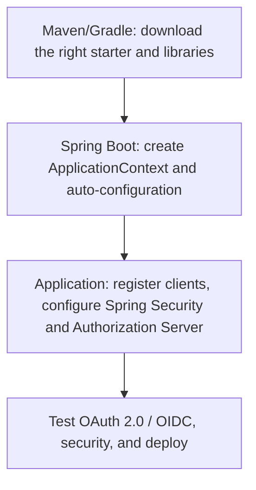

# Declaring Authorization Server Dependencies with Maven or Gradle

## 1. Objectives and Context

In the **Project Setup** chapter of the `SPRING_SECURITY_OAUTH2_OIDC_AUTHORIZATION_SERVER` module, the first task is bringing the right libraries into a Spring Boot application. This is the preparation step for learning how to **design, configure, secure, test, and operate an OAuth 2.0/OpenID Connect Authorization Server using Spring Security and Spring Authorization Server**.

**Spring Authorization Server** provides the components to implement an OAuth 2.0 Authorization Server and OpenID Connect (OIDC) capabilities. An Authorization Server application issues authorization codes/tokens, manages clients, and handles authorization flows. Its role is distinct from an application that only **logs in via an OIDC provider** (OAuth2 Client) or an API that only **verifies access tokens** (Resource Server).

After this lesson, you will be able to:

1. Choose the right dependency for an Authorization Server in a Spring Boot project.
2. Declare libraries using **Maven (`pom.xml`)** or **Gradle (`build.gradle`/`build.gradle.kts`)**.
3. Understand why you should rely on Spring Boot's version management instead of manually assigning versions to individual Spring Security libraries.
4. Verify that dependencies are resolved properly and distinguish build errors from runtime configuration errors.
5. Know which security, storage, and testing configurations still need to be implemented after adding the dependency.

> **Version scope of examples:** the complete configurations below use **Spring Boot 3.5.0**, Java **17+**, and the corresponding Gradle plugins to illustrate a concrete, easy-to-read combination. For real-world projects, prefer the latest maintained patch of the Spring Boot branch your team uses, and review compatibility notes before changing major versions. Do not assume the same configuration applies verbatim to every Spring Boot/Spring Security version.

## 2. Choosing the Right Artifact

With Spring Boot, the simplest way to get started is the **starter**:

```text
org.springframework.boot:spring-boot-starter-oauth2-authorization-server
```

A Spring Boot starter declares the required dependencies and wires in the corresponding auto-configuration. The core Spring Authorization Server library has the coordinates:

```text
org.springframework.security:spring-security-oauth2-authorization-server
```

In a typical Spring Boot project, **prefer the starter**; only declare the core artifact directly when you actively manage configuration and related libraries yourself. You do not need to declare both "just to be safe": the starter already pulls in the necessary dependencies transitively.

| Artifact | Role | When Is It Needed? |
| --- | --- | --- |
| `spring-boot-starter-oauth2-authorization-server` | Provides the Authorization Server foundation in Spring Boot | **Required per the starter choice** in this lesson |
| `spring-boot-starter-web` | Builds Servlet/HTTP applications and MVC if web endpoints and login pages are needed | Commonly used in Servlet Authorization Server applications; declare explicitly to reflect web architecture |
| `spring-boot-starter-security` | Spring Security filters and security mechanisms | The Authorization Server starter already includes related security dependencies; add explicitly if your application directly uses those APIs, without self-managing versions |
| `spring-boot-starter-test` | JUnit, AssertJ, and Spring Boot test infrastructure | Recommended in `test` scope |
| `spring-security-test` | `MockMvc`, mock users, Spring Security testing utilities | Recommended in `test` scope when testing security |
| `spring-boot-starter-actuator` | Health, metrics, and operational observability info | Optional; management endpoints must be secured |
| `spring-boot-starter-oauth2-client` | Application **acting as an OAuth2/OIDC Client** | Only add if the same application genuinely has a client role |
| `spring-boot-starter-oauth2-resource-server` | Application/API **validating Access Tokens** | Only add if the same application needs to protect resources with bearer tokens |

Similar-looking library names do not mean the same role. Adding the Authorization Server starter **does not automatically turn every API into a Resource Server**, nor does it mean OIDC is enabled or the server is production-ready out of the box.

## 3. Declaring with Maven

### 3.1. `pom.xml` Example with Spring Boot Parent

When creating a new Spring Boot application with Maven, you can use `spring-boot-starter-parent` to manage dependency and plugin versions:

```xml
<?xml version="1.0" encoding="UTF-8"?>
<project xmlns="http://maven.apache.org/POM/4.0.0"
         xmlns:xsi="http://www.w3.org/2001/XMLSchema-instance"
         xsi:schemaLocation="http://maven.apache.org/POM/4.0.0
                             https://maven.apache.org/xsd/maven-4.0.0.xsd">
    <modelVersion>4.0.0</modelVersion>

    <parent>
        <groupId>org.springframework.boot</groupId>
        <artifactId>spring-boot-starter-parent</artifactId>
        <version>3.5.0</version>
        <relativePath/>
    </parent>

    <groupId>com.example</groupId>
    <artifactId>authorization-server</artifactId>
    <version>0.0.1-SNAPSHOT</version>
    <name>authorization-server</name>

    <properties>
        <java.version>17</java.version>
    </properties>

    <dependencies>
        <!-- Starter providing the Spring Authorization Server foundation -->
        <dependency>
            <groupId>org.springframework.boot</groupId>
            <artifactId>spring-boot-starter-oauth2-authorization-server</artifactId>
        </dependency>

        <!-- Servlet/MVC layer for web application -->
        <dependency>
            <groupId>org.springframework.boot</groupId>
            <artifactId>spring-boot-starter-web</artifactId>
        </dependency>

        <!-- Testing -->
        <dependency>
            <groupId>org.springframework.boot</groupId>
            <artifactId>spring-boot-starter-test</artifactId>
            <scope>test</scope>
        </dependency>
        <dependency>
            <groupId>org.springframework.security</groupId>
            <artifactId>spring-security-test</artifactId>
            <scope>test</scope>
        </dependency>
    </dependencies>

    <build>
        <plugins>
            <plugin>
                <groupId>org.springframework.boot</groupId>
                <artifactId>spring-boot-maven-plugin</artifactId>
            </plugin>
        </plugins>
    </build>
</project>
```

Explanation of key sections:

- **`<parent>`** provides Spring Boot settings and dependency management. As a result, starters and Spring Security libraries can omit their own `<version>` tag.
- **`java.version`** specifies the target Java level for the example. Spring Boot 3.x requires Java 17 or higher; verify the actual JDK on both build and runtime machines.
- **`spring-boot-starter-oauth2-authorization-server`** is the most important dependency for this task.
- **`scope=test`** keeps testing libraries out of the application's runtime dependencies.
- **`spring-boot-maven-plugin`** helps package and run the Boot application via Maven; the plugin does not replace Authorization Server configuration steps.

**Do not manually add `<version>` to individual Spring Security libraries** when relying on the Spring Boot parent/BOM. For instance, inserting a `spring-security-core` version different from the one managed by Boot can cause class linkage errors at runtime.

### 3.2. Maven Projects Not Using the Spring Boot Parent

If your project already uses an organizational parent POM, you can still use the **Spring Boot BOM** inside `dependencyManagement`:

```xml
<properties>
    <spring-boot.version>3.5.0</spring-boot.version>
</properties>

<dependencyManagement>
    <dependencies>
        <dependency>
            <groupId>org.springframework.boot</groupId>
            <artifactId>spring-boot-dependencies</artifactId>
            <version>${spring-boot.version}</version>
            <type>pom</type>
            <scope>import</scope>
        </dependency>
    </dependencies>
</dependencyManagement>
```

Then declare dependencies as in Section 3.1, without specifying versions for BOM-managed artifacts. **Note:** importing the BOM only manages **dependency versions**; it does not copy **plugin management** and build defaults from `spring-boot-starter-parent`. In this setup, manage Maven plugin versions separately according to your project standards.

## 4. Declaring with Gradle

Spring Boot supports Gradle **Groovy DSL** (`build.gradle`) or **Kotlin DSL** (`build.gradle.kts`). Both use the same artifact coordinates; only the declaration syntax differs.

### 4.1. Groovy DSL: `build.gradle`

```groovy
plugins {
    id 'java'
    id 'org.springframework.boot' version '3.5.0'
    id 'io.spring.dependency-management' version '1.1.7'
}

group = 'com.example'
version = '0.0.1-SNAPSHOT'

java {
    toolchain {
        languageVersion = JavaLanguageVersion.of(17)
    }
}

repositories {
    mavenCentral()
}

dependencies {
    implementation 'org.springframework.boot:spring-boot-starter-oauth2-authorization-server'
    implementation 'org.springframework.boot:spring-boot-starter-web'

    testImplementation 'org.springframework.boot:spring-boot-starter-test'
    testImplementation 'org.springframework.security:spring-security-test'
    testRuntimeOnly 'org.junit.platform:junit-platform-launcher'
}

tasks.named('test') {
    useJUnitPlatform()
}
```

In this example:

- The `org.springframework.boot` plugin provides tasks to build and package the Spring Boot application.
- The `io.spring.dependency-management` plugin works with the Spring Boot plugin to apply the corresponding BOM; therefore, the `implementation` lines do not need a `version`.
- `java.toolchain` instructs Gradle to select a JDK matching the declared Java version instead of relying solely on `JAVA_HOME`; the build machine must still have or be able to provision a matching toolchain.
- `mavenCentral()` is the repository hosting public artifacts. In enterprise environments, you may need to add an internal mirror/artifact repository per company policy.

### 4.2. Kotlin DSL: `build.gradle.kts`

```kotlin
plugins {
    java
    id("org.springframework.boot") version "3.5.0"
    id("io.spring.dependency-management") version "1.1.7"
}

group = "com.example"
version = "0.0.1-SNAPSHOT"

java {
    toolchain {
        languageVersion = JavaLanguageVersion.of(17)
    }
}

repositories {
    mavenCentral()
}

dependencies {
    implementation("org.springframework.boot:spring-boot-starter-oauth2-authorization-server")
    implementation("org.springframework.boot:spring-boot-starter-web")

    testImplementation("org.springframework.boot:spring-boot-starter-test")
    testImplementation("org.springframework.security:spring-security-test")
    testRuntimeOnly("org.junit.platform:junit-platform-launcher")
}

tasks.named<Test>("test") {
    useJUnitPlatform()
}
```

Kotlin DSL here only changes the **build script language**; the application can still be written in Java. If you want to write application source code in Kotlin, additionally configure the Kotlin JVM plugin, Kotlin/Spring plugin, and corresponding Kotlin dependencies for your Spring Boot version.

### 4.3. Can You Use the Gradle BOM Directly?

Yes. If the project does not use the `io.spring.dependency-management` plugin, Gradle has a native `platform` mechanism to import a BOM:

```groovy
dependencies {
    implementation platform('org.springframework.boot:spring-boot-dependencies:3.5.0')
    implementation 'org.springframework.boot:spring-boot-starter-oauth2-authorization-server'
}
```

This is an **alternative** to the dependency-management plugin in Section 4.1, not an extra dependency to add when that plugin is already used. For multi-module projects or multiple configurations (`testImplementation`, `annotationProcessor`, ...), make sure the BOM applies to all relevant configurations and resolves version conflicts consistently. Pick **one clear version management strategy** for the entire project.

## 5. Maven vs. Gradle: Quick Comparison

| Purpose | Maven | Gradle |
| --- | --- | --- |
| Configuration file | `pom.xml` | `build.gradle` or `build.gradle.kts` |
| Adding a starter | `<dependency>` with groupId/artifactId | `implementation("group:artifact")` or Groovy syntax |
| Version management | Boot parent or Boot BOM | Boot plugin with dependency management plugin, or Gradle `platform` |
| Test dependencies | `<scope>test</scope>` | `testImplementation` |
| Inspecting dependencies | `dependency:tree` | `dependencies` or `dependencyInsight` |
| Build and test | `mvn verify` | `gradle build` |

Do not simultaneously specify a version manually for the starter while letting the BOM decide other Spring Security libraries. Spring Boot, Spring Security, and Spring Authorization Server have tight compatibility relationships; aligning them via the BOM avoids mixing versions that have never been tested together.

## 6. How to Know Your Declaration Is Correct

After saving the configuration, run it using the project's **Maven Wrapper** or **Gradle Wrapper**. Wrappers pin the build tool version and keep local development and CI environments aligned.

### Maven

```bash
./mvnw -DskipTests=false verify
./mvnw dependency:tree -Dincludes=org.springframework.boot:spring-boot-starter-oauth2-authorization-server
./mvnw dependency:tree -Dincludes=org.springframework.security:spring-security-oauth2-authorization-server
```

### Gradle

```bash
./gradlew clean build
./gradlew dependencies --configuration runtimeClasspath
./gradlew dependencyInsight --configuration runtimeClasspath --dependency spring-security-oauth2-authorization-server
```

On Windows, typically use `mvnw.cmd` or `gradlew.bat` instead of `./mvnw` and `./gradlew`. If the project does not yet have a wrapper, you can use a pre-installed Maven/Gradle of a supported version.

A proper result conceptually shows a dependency tree like:

```text
spring-boot-starter-oauth2-authorization-server
  +-- required Spring Boot / Spring Security modules
  +-- spring-security-oauth2-authorization-server
  \-- other transitive libraries
```

The exact order and branch structure vary by version. The **checks to verify** are that the starter resolves, the core Authorization Server library is on the runtime classpath, and the build has no dependency conflicts. There is no requirement for the dependency tree to match this conceptual example line-for-line.

### Application-Level Check

A minimal Spring Boot entry point class:

```java
package com.example.authorizationserver;

import org.springframework.boot.SpringApplication;
import org.springframework.boot.autoconfigure.SpringBootApplication;

@SpringBootApplication
public class AuthorizationServerApplication {
    public static void main(String[] args) {
        SpringApplication.run(AuthorizationServerApplication.class, args);
    }
}
```

From here, the application can boot up for implementing the Authorization Server configuration. **Successful compilation only confirms valid dependencies and source syntax**; it does not prove authorization flows work properly. You still need to configure clients, authentication, the security filter chain, issuer, signing keys/JWK, authorization/consent storage, and OIDC endpoints depending on your goals.

## 7. What Does the Starter Provide—and What Doesn't It?

Visualize the project configuration workflow in three layers:



The **dependency layer** is a prerequisite to have classes such as `RegisteredClient`, `RegisteredClientRepository`, `OAuth2AuthorizationServerConfigurer`, and token generators available. However, for a production-grade Authorization Server, you must at minimum decide:

- **Registered clients:** client ID, client authentication method, redirect URIs, grant types, scopes, consent.
- **Users:** authentication method, encoded passwords, MFA where appropriate, login page/session configuration.
- **Security filter chain:** rules protecting the Authorization Endpoint, Token Endpoint, login, management endpoints, CSRF, and exception handling.
- **Token signing/JWK:** configuring signing keys, publishing public keys, key lifecycle/rotation, stable issuer.
- **Storage:** `RegisteredClientRepository`, `OAuth2AuthorizationService`, `OAuth2AuthorizationConsentService` backed by persistent storage when state must survive restarts.
- **OIDC:** enabling and configuring OIDC endpoints/protocols as required; merely having the starter on the classpath does not mean discovery, UserInfo, and all OIDC features are ready.

In production environments, prioritize HTTPS, avoid hardcoding client secrets or private keys, keep tokens out of logs, protect management endpoints, and establish proper operational observability.

## 8. Common Mistakes When Declaring Dependencies

### 8.1. Starter Not Found or Artifact Cannot Be Downloaded

**Symptoms:** Maven reports `Could not find artifact`; Gradle reports `Could not find ...`.

**How to check:** verify the artifact spelling:

```text
org.springframework.boot:spring-boot-starter-oauth2-authorization-server
```

Then check the repository (Maven Central or internal mirror), network/proxy access, Boot version, and local cache state. Do not switch to a similarly named artifact just to make the error disappear; an OAuth2 Client/Resource Server starter does not replace the Authorization Server starter.

### 8.2. Missing Version or Conflicting Spring Security Versions

**Symptoms:** Maven asks for a dependency version; or runtime fails with `NoSuchMethodError`, `ClassNotFoundException` after manually bumping certain modules.

**How to fix:** verify that the Boot parent/BOM or Gradle dependency management is active, then inspect the dependency tree/insight to find which dependency overrode the version. If you must upgrade a library for a security fix, check the compatibility matrix, release notes, and vendor-supported version management.

### 8.3. Incompatible Java or Gradle Version

**Symptoms:** `UnsupportedClassVersionError`, `invalid source release`, Gradle plugin load errors.

**How to fix:** check `java -version`, `./mvnw -version`, `./gradlew --version`, and the JDK/Gradle requirements of your chosen Spring Boot release. For example, Boot 3.x requires **Java 17+**. Update the wrapper/toolchain properly instead of disabling checks.

### 8.4. Build Succeeds but OAuth2/OIDC Endpoints Do Not Work Yet

**Symptoms:** requests to `/oauth2/authorize`, `/oauth2/token`, or OIDC endpoints return `404`, `401`, `403`, or configuration errors.

**Possible causes:** the application has not registered any clients, has not initialized the Authorization Server `SecurityFilterChain`, lacks required beans, has not enabled OIDC, or the endpoint was called with the wrong HTTP method/missing parameters. Depending on the request, `401`/`403` can be **valid security enforcement**, not evidence of broken dependencies.

**How to fix:** check Authorization Server configuration, endpoint paths, filter-chain matching, issuer, and clients before concluding it is a dependency bug. Never open `permitAll()` on sensitive endpoints just to turn errors into HTTP 200.

### 8.5. Confusing Authorization Server with OAuth2 Client/Resource Server

**Example:** the application added `spring-boot-starter-oauth2-resource-server` and cannot find classes like `RegisteredClient`. The Resource Server starter is for **validating Bearer Access Tokens**; it does not issue tokens. Declare the Authorization Server starter when building the token issuer.

### 8.6. Declaring Both Starter and Core Library Together

If you add both the starter and the core library with a custom version, the dependency tree may resolve an unintended version. Start with **the single starter for the Authorization Server role** and only add other direct dependencies when there is a specific API, build, or architectural reason.

## 9. Choosing Dependencies for Development and Production Environments

| Environment / Need | Recommendation | Things to Note |
| --- | --- | --- |
| Learning exercises or proof of concept | Authorization Server, Web, Test, Security Test starters | Use local demo configs and non-sensitive data |
| Application needing durable client/authorization storage | Add appropriate data access dependencies (JDBC/JPA, database driver) | Adding JDBC alone is not enough; you must configure repositories/services and schema migrations |
| Server needing metrics/health | Add Actuator | Restrict management endpoints, enforce authorization, configure probes and metrics |
| Needing advanced security policies/testing | Security Test and appropriate integration tests | Test code/PKCE, tokens, consent, revocation, refresh, JWKS, issuer, and OIDC per enabled features |
| CI/CD and operations | Use wrappers, pin versions via BOM, scan dependencies for vulnerabilities | Manage version updates and keys/secrets securely and follow organizational baselines |

When choosing a database driver or cache, start from the statefulness design of your Authorization Server. For example, multiple instances need a shared strategy for authorization/consent state and unified key management; adding a storage library without configuring the corresponding service **will not solve** this problem.

## 10. Self-Check Exercise

**Task:** create two equivalent build configurations for a basic Servlet Authorization Server, one using Maven and one using Gradle. You do not need to implement full OAuth2/OIDC flows yet.

1. Choose a supported Spring Boot branch; set up an appropriate JDK and configure the wrapper.
2. Declare `spring-boot-starter-oauth2-authorization-server`, `spring-boot-starter-web`, and the two test dependencies in the appropriate scopes.
3. Use the Boot parent/BOM or equivalent Gradle mechanism; do not assign individual versions to Spring Security modules.
4. Run the build and verify that the dependency tree contains `spring-security-oauth2-authorization-server` via the starter.
5. Write the `@SpringBootApplication` class, start the application to verify the classpath/application context, and note the remaining Authorization Server configuration items before testing flows.
6. Try removing version management in a temporary copy of the project and observe the dependency resolution error; restore it immediately afterward. Never run this experiment on a production branch.

**Self-assessment questions:**

- Why use `spring-boot-starter-oauth2-authorization-server` instead of `spring-boot-starter-oauth2-client` when building the token issuer?
- How does a Maven parent differ from a Maven BOM beyond managing library versions?
- How does Gradle `implementation` differ from `testImplementation`?
- Is a successful build enough to claim the Token Endpoint operates securely? Why or why not?
- If the application throws `NoSuchMethodError` after manually upgrading `spring-security-core`, what do you check first?

## 11. Key Takeaways and References

**Core rule:** for a Spring Boot application acting as an **Authorization Server**, start with **`org.springframework.boot:spring-boot-starter-oauth2-authorization-server`**. Declaring via Maven or Gradle achieves the same result when using consistent dependency management. Having the library on the classpath is the **initial step**, whereas standard-compliant and secure token issuance depends on Spring Security configuration, OIDC, signing keys, state stores, and testing covered in subsequent lessons.

Official sources to consult for the version you are using:

- [Spring Authorization Server Reference](https://docs.spring.io/spring-authorization-server/reference/)
- [Spring Authorization Server — Getting Started](https://docs.spring.io/spring-authorization-server/reference/getting-started.html)
- [Spring Boot Reference Documentation](https://docs.spring.io/spring-boot/reference/)
- [Spring Boot Dependency Versions](https://docs.spring.io/spring-boot/appendix/dependency-versions/)
- [Gradle Dependency Management](https://docs.gradle.org/current/userguide/dependency_management.html)
- [Maven Introduction to Dependency Mechanism](https://maven.apache.org/guides/introduction/introduction-to-dependency-mechanism.html)
