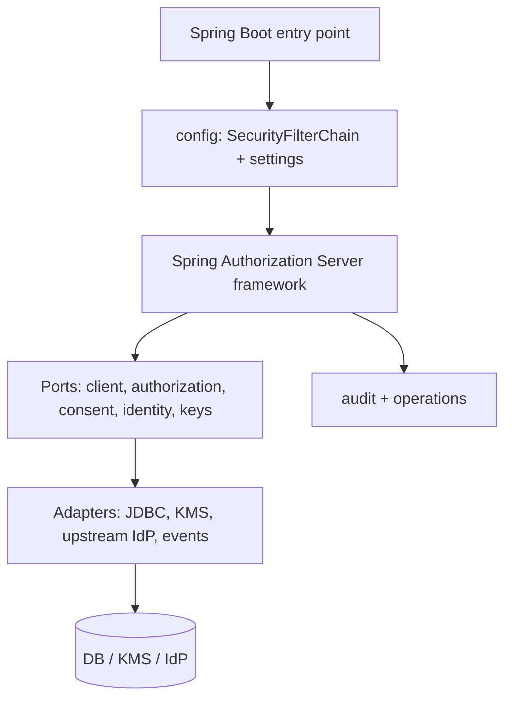
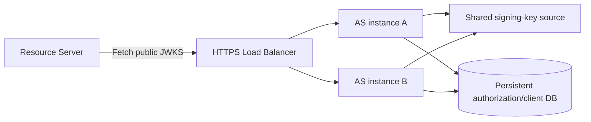

# Organizing Application Structure and Environment Profiles

## Lesson Objectives

In the **Project Setup** chapter of the **SPRING_SECURITY_OAUTH2_OIDC_AUTHORIZATION_SERVER** module, an important step before implementing OAuth 2.0/OpenID Connect (OIDC) endpoints is designing the source code structure and separating configuration by environment. For **SPRING_SECURITY_OAUTH2_OIDC_AUTHORIZATION_SERVER**, we build a Spring Boot application using Spring Security and Spring Authorization Server to issue tokens, manage clients, authenticate users, protect signing keys, and operate reliably from developer machines to production.

After this lesson, you will be able to:

- Propose a scalable package/module structure for an Authorization Server, distinguishing protocol, identity, storage, signing keys, and operations concerns.
- Organize Spring Boot configuration using `application.yml`, `application-{profile}.yml`, and externalized configuration sources.
- Understand property override precedence, how to activate `local`, `test`, `staging`, `prod`, and common pitfalls with `spring.profiles.active`.
- Manage `issuer`, databases, signing keys, client credentials, and logs per environment without exposing secrets.
- Verify configuration through tests and checklists before promoting the Authorization Server to production.

> **Core principle:** The same build artifact should run in every environment; only configuration data and truly environment-specific adapters should change. OAuth 2.0/OIDC protocol safety rules, client authentication, and authorization checks must never be casually disabled just because you are in a development environment.

## 1. Why Do Structure and Profiles Matter for an Authorization Server?

A typical CRUD API primarily deals with business data. An Authorization Server is both an identity infrastructure component and the **trusted token-issuing authority** for many other applications. Misconfigurations can impact the entire ecosystem:

- If the `issuer` in an ID Token/access token differs from OIDC metadata or does not match the Resource Server configuration, many clients will fail to validate tokens.
- If each instance generates a different signing key or generates a new key on every restart, still-valid tokens can fail verification after load balancing or a restart.
- If `RegisteredClientRepository` and `OAuth2AuthorizationService` only store data in memory, clients and authorization/token state can be lost upon redeployment.
- If staging shares databases, keys, accounts, or client secrets with production, testing activities can impact the live environment.
- If the `local` profile accidentally disables `redirect_uri` validation, CSRF, or client authentication, test results no longer reflect production behavior and create a risk of carrying weak settings into live environments.

Therefore, the purpose of environment separation is not merely changing `server.port` or log levels. We need to design **clear boundaries of responsibility and configuration governance** from the beginning.

### 1.1. Logical Components to Identify

| Component | Role | Typical Environment-Dependent Changes |
|---|---|---|
| Authorization Server protocol | Authorization endpoint, token endpoint, revocation, introspection, metadata, OIDC endpoints. | `issuer`, public base URL, proxy/routing, rate limiting. |
| Login and identity | User authentication, MFA, upstream IdP federation, account lifecycle. | Upstream sandbox/production IdP, testing policies, sample accounts. |
| Client registry and authorization state | Storing registered clients, authorizations, tokens, consents. | Database connections, appropriate seed data, backup policies. |
| Tokens and signing keys | Token generation, JWT signing, publishing JWKS, rotation. | Isolated keys; ephemeral/test keys for testing, KMS/HSM/keystore for production. |
| Authorization policies | Scopes, audience, consent, authorities, and per-tenant rules. | Per-environment clients and scopes, without lowering validation safety standards. |
| Observability and operations | Health, metrics, audit, tracing, alerting, and recovery. | Allowed endpoint access, log/metric destinations, retention levels. |

## 2. Choosing How to Organize Source Code: One Application, Clear Components

At the initial stage, it is usually best to start with **a single Spring Boot application organized by responsibility**, using one build and deploy pipeline. Split into separate deployments only when there are real requirements around ownership, scaling, or operational boundaries. Avoid creating a separate microservice for every repository or OAuth 2.0 endpoint.

An illustrative structure (package and directory names can be adapted to team conventions):

```text
authorization-server/
├── build.gradle / pom.xml
├── src/
│   ├── main/
│   │   ├── java/com/example/authserver/
│   │   │   ├── AuthorizationServerApplication.java
│   │   │   ├── config/
│   │   │   │   ├── AuthorizationServerSecurityConfig.java
│   │   │   │   ├── ApplicationSecurityConfig.java
│   │   │   │   ├── AuthorizationServerProperties.java
│   │   │   │   └── AuthorizationServerSettingsConfig.java
│   │   │   ├── identity/
│   │   │   │   ├── application/
│   │   │   │   ├── domain/
│   │   │   │   └── infrastructure/
│   │   │   ├── client/
│   │   │   │   ├── application/
│   │   │   │   ├── domain/
│   │   │   │   └── infrastructure/
│   │   │   ├── authorization/
│   │   │   │   ├── application/
│   │   │   │   └── infrastructure/
│   │   │   ├── consent/
│   │   │   ├── keys/
│   │   │   ├── audit/
│   │   │   └── operations/
│   │   └── resources/
│   │       ├── application.yml
│   │       ├── application-local.yml
│   │       ├── application-test.yml
│   │       ├── application-staging.yml
│   │       ├── application-prod.yml
│   │       └── db/migration/
│   │           ├── V1__authorization_server_schema.sql
│   │           └── V2__identity_tables.sql
│   └── test/
│       ├── java/com/example/authserver/
│       │   ├── config/
│       │   ├── integration/
│       │   └── security/
│       └── resources/
│           └── fixtures/
└── docs/
    └── adr/
```

This is a **recommended structure**, not a mandatory checklist of empty files to create before writing any features. Add packages only when there is concrete responsibility and code; a smaller application can have fewer packages.

### 2.1. Role of Each Package

| Package | Owned Responsibilities | Avoid Placing Here |
|---|---|---|
| `config` | Spring Bean wiring; filter chain configuration, issuer, property binding, adapter configuration. | Business SQL queries, lengthy account registration logic. |
| `identity` | Users, credentials, identity linking, account policies, password/MFA integration. | Rebuilding token APIs instead of using the framework. |
| `client` | Client registration/approval/revocation workflows, client policies, `RegisteredClientRepository` adapter. | Hardcoding production client secrets in Java. |
| `authorization` | `OAuth2AuthorizationService` adapter, business-level management of authorization and token state. | Token-independent UI logic, or custom non-standard JWT validation. |
| `consent` | Consent management and `OAuth2AuthorizationConsentService` adapter. | Writing consent records without an owner. |
| `keys` | Signing key source, JWKS, rotation, KMS/HSM/keystore integration, `kid` policy. | Literal private keys, committing files containing private keys. |
| `audit` | Audit events for logins, tokens, clients, permission changes, and key changes. | Printing raw access/refresh tokens or passwords. |
| `operations` | Health, metrics, operational hooks, and incident handling. | Public endpoints exposing internal state. |

Do not equate `client` in `client/` with an OAuth2 Client of a token-consuming application: this package manages **Registered Clients of the Authorization Server**. If the system also acts as an OAuth2 Client to log in via an upstream IdP, place the federation adapter in `identity/infrastructure` or a clearly named separate package.

### 2.2. Keeping the Dependency Flow Clear



The framework handles protocol mechanics; the application/domain layer enforces organization-specific rules; the infrastructure layer provides persistence and external integrations. You can implement interfaces provided by Spring Authorization Server directly without introducing extra wrapper interfaces if they add no value.

For example: implement `RegisteredClientRepository` with JDBC, use a persistent `OAuth2AuthorizationService`, and keep client approval workflows in a dedicated service. Authorization code handling remains guaranteed by the framework. Changing the database must not alter protocol details.

### 2.3. Separating Protocol and Application Filter Chains

An Authorization Server typically has two distinct URL groups:

1. **Protocol endpoints**: `/oauth2/authorize`, `/oauth2/token`, `/oauth2/jwks`, and OIDC discovery/UserInfo/Logout if enabled; Spring Authorization Server provides a dedicated configurer for them.
2. **Application and administration**: login page, user settings, client admin, health/metrics (if used), business features.

Configure `SecurityFilterChain` beans with explicit matchers and ordering so rules for `/admin/**` do not overlap token endpoints. The snippet below is an **illustrative skeleton for Spring Authorization Server 1.x / Spring Security 6.x configuration APIs**; projects on another version must consult official documentation and complete the required beans:

```java
@Configuration(proxyBeanMethods = false)
class AuthorizationServerSecurityConfig {

    @Bean
    @Order(1)
    SecurityFilterChain authorizationServerFilterChain(HttpSecurity http)
            throws Exception {

        var authorizationServer =
                OAuth2AuthorizationServerConfigurer.authorizationServer();

        http.securityMatcher(authorizationServer.getEndpointsMatcher())
            .with(authorizationServer, configurer ->
                    configurer.oidc(Customizer.withDefaults()))
            .exceptionHandling(exceptions -> exceptions
                .defaultAuthenticationEntryPointFor(
                    new LoginUrlAuthenticationEntryPoint("/login"),
                    new MediaTypeRequestMatcher(MediaType.TEXT_HTML)
                ));

        return http.build();
    }
}

@Configuration(proxyBeanMethods = false)
class ApplicationSecurityConfig {

    @Bean
    @Order(2)
    SecurityFilterChain applicationFilterChain(HttpSecurity http)
            throws Exception {
        http.authorizeHttpRequests(authorize -> authorize
                .requestMatchers("/actuator/health").permitAll()
                .requestMatchers("/admin/**").hasAuthority("AUTH_SERVER_ADMIN")
                .anyRequest().authenticated())
            .formLogin(Customizer.withDefaults());
        return http.build();
    }
}
```

This abridged snippet intentionally omits imports, `UserDetailsService`/authentication providers, `JWKSource`, `RegisteredClientRepository`, and other required beans; it is **not yet a production-ready Authorization Server**. For actuator endpoints, design security matchers and network access controls according to your actual infrastructure. Never expose all of `/actuator/**` publicly by default.

**Version note:** Spring Authorization Server has an evolution history and integrates with different Spring Security lines; package paths, configurer methods, and auto-configuration conditions may change. Pick a documented Spring Boot/Spring Security/Authorization Server version pairing and follow the documentation for your project's exact version.

## 3. Spring Profiles: Selecting Configuration and Beans

Spring Boot supports multiple configuration sources: YAML/properties inside the JAR, external files, environment variables, system properties, command-line arguments, and config data imports. A profile is a label used to select **configuration documents** and **Beans** by environment or purpose.

Examples:

| Profile | Purpose | Typical Configuration |
|---|---|---|
| `local` | Local developer workstation. | Dedicated database, localhost issuer, test keys never reused in production. |
| `test` | Integration/security tests and CI. | Dedicated test database/Testcontainers, test fixtures, test keys. |
| `staging` | Release validation, E2E integration, failover testing. | Staging public HTTPS issuer, sandbox identity source, staging database and keys. |
| `prod` | Live service. | Stable public HTTPS issuer, durable storage, keys from a secret store, metrics/audit, and HA. |

Profiles **do not necessarily correspond to four separate files**. When staging and prod differ only in hostname, credentials, and KMS keys, they can share `application.yml` and environment variable values; only create `application-{profile}.yml` when there are genuine differences that need to be expressed.

### 3.1. How Are Profiles Activated?

`spring.profiles.active` can take multiple comma-separated names:

```bash
# Example running the same JAR file with the local profile
java -jar authorization-server.jar --spring.profiles.active=local

# Same artifact, staging profile specified by the runtime environment
java -jar authorization-server.jar --spring.profiles.active=staging
```

You can set the environment variable `SPRING_PROFILES_ACTIVE=prod` in the deployment platform. **Never hardcode `prod` in source code, and never let the default profile fall back to production settings.** When no profile is set, Spring uses `default`; design the application to fail fast when required properties such as issuer/keys/database are missing, rather than silently defaulting to production configuration.

Spring allows multiple active profiles, but you need clear operational rules: `local,prod` is dangerous because properties can override one another unexpectedly. Usually choose **one environment profile** and only add supplemental profiles once compatibility is verified. Profile groups (`spring.profiles.group`) should only be used when the need is genuinely clear.

### 3.2. Override Precedence and Key Restrictions

- `application.yml` provides shared configuration; `application-prod.yml` provides overrides when `prod` is active.
- Configuration packaged in the JAR can be overridden by external files; environment variables and command-line properties can also override files according to Spring Boot's PropertySource order.
- When multiple profiles are active, later profiles can override earlier ones within the same config location group.
- `spring.profiles.active`, `spring.profiles.default`, `spring.profiles.include`, and `spring.profiles.group` **must reside in profile-unspecific documents**; do not place them inside `application-prod.yml` or YAML blocks marked with `spring.config.activate.on-profile`.
- `spring.config.location` **replaces** default config locations; `spring.config.additional-location` **adds** locations. Add `optional:` only when a missing file is acceptable behavior.
- With multiple documents in a single YAML file, use `---` and `spring.config.activate.on-profile` to select documents. For long-lived projects, it is often easier to manage one shared file and separate per-profile files when differences are substantial.

Valid multi-document YAML example:

```yaml
spring:
  application:
    name: authorization-server

---
spring:
  config:
    activate:
      on-profile: local
logging:
  level:
    com.example.authserver: DEBUG
```

Do not add `spring.profiles.active: local` to the document after `---` above. Activating a profile belongs to **runtime environment configuration**, not to the document requesting that profile.

## 4. Designing the Configuration Set for an Authorization Server

A solid configuration must ensure: minimal shared defaults, no secrets stored in the repository, startup validation, and consistent property semantics across environments.

### 4.1. Shared Configuration: `application.yml`

```yaml
spring:
  application:
    name: authorization-server
  datasource:
    url: ${DB_URL}
    username: ${DB_USERNAME}
    password: ${DB_PASSWORD}
  flyway:
    enabled: true

server:
  port: ${SERVER_PORT:9000}

app:
  authorization:
    issuer: ${AUTH_ISSUER}
    signing-key-ref: ${AUTH_SIGNING_KEY_REF}

management:
  endpoints:
    web:
      exposure:
        include: health,info
```

Explanation:

- `DB_URL`, `DB_USERNAME`, and `DB_PASSWORD` are runtime Spring DataSource values varying by environment.
- `AUTH_ISSUER` is the **public issuer**, not a JDBC hostname or an internal container-to-container URL. Clients and Resource Servers must know and be able to verify this value.
- `AUTH_SIGNING_KEY_REF` is a **custom example property** referencing a signing key managed by the `keys/` adapter. Spring Boot/Spring Authorization Server **does not automatically understand and load a key** just because this property exists; the application must define the corresponding `JWKSource`/key provider Bean.
- `${SERVER_PORT:9000}` falls back to 9000 if `SERVER_PORT` is missing. Sensitive and mandatory values **should not have silent defaults**.
- Enabling migrations keeps the schema versioned; the application DB account should not automatically have DDL privileges in production. Flyway can run as a separate release job with dedicated credentials if required by the deployment process.

This example illustrates configuration structure; database setup, token signing, OIDC endpoints, logout, and access control still must be fully implemented.

### 4.2. Local: `application-local.yml`

```yaml
spring:
  datasource:
    url: ${DB_URL:jdbc:postgresql://localhost:5432/auth_local}
    username: ${DB_USERNAME:auth_local}
    password: ${DB_PASSWORD}

app:
  authorization:
    issuer: ${AUTH_ISSUER:http://localhost:9000}
    signing-key-ref: ${AUTH_SIGNING_KEY_REF:local-ephemeral}

logging:
  level:
    com.example.authserver: DEBUG
```

The example chooses **local PostgreSQL** to avoid SQL/JDBC behavioral differences compared to the primary runtime environment. If using H2 to speed up local development, accept that migrations, transactions, data types, and locks may differ from PostgreSQL and require dedicated integration tests against the real target database.

`local-ephemeral` here is an application-defined convention instructing the local adapter to **generate an in-memory test key**; it is not a built-in framework value. After a restart, the key may change and previously issued tokens may fail verification—acceptable only locally. Never allow this temporary key configuration to be used in staging/prod.

For public redirect URIs, `http://localhost` can be used for development within applicable rules; in staging/prod you must use HTTPS and enforce exact registered URI matching. Never use wildcard redirects for "testing convenience."

### 4.3. Test: `application-test.yml`

```yaml
spring:
  datasource:
    url: ${TEST_DB_URL}
    username: ${TEST_DB_USERNAME}
    password: ${TEST_DB_PASSWORD}

app:
  authorization:
    issuer: https://issuer.test.invalid
    signing-key-ref: test-ephemeral
```

The test environment can receive `TEST_DB_*` from CI or use Testcontainers with `@DynamicPropertySource` to provide `spring.datasource.*` directly. The test database must be created/torn down independently; never let tests connect to production merely because an environment variable is missing.

Tests must use dedicated **client, account, and key fixtures**, never borrowing real client secrets. `.invalid` is a domain reserved for illustrative/testing purposes; it is not used as a public endpoint in real E2E flows. If tests run full discovery or authorization redirects, use an issuer matching the test server or an accessible test environment.

### 4.4. Staging: `application-staging.yml`

```yaml
logging:
  level:
    root: INFO
    com.example.authserver: INFO

management:
  endpoint:
    health:
      probes:
        enabled: true
```

Staging should receive `AUTH_ISSUER=https://auth.staging.example.com` (for example) and connect to a **staging-dedicated** database, upstream IdP, and KMS/keystore. There is no need to repeat `issuer` in this file since it is read from the environment variable in `application.yml`.

Staging should closely mirror production in topology, TLS, proxies, database, key storage, and replica count to catch production issues; however, the accounts and identities used must be appropriate test data.

### 4.5. Production: `application-prod.yml`

```yaml
spring:
  config:
    import: "configtree:/run/secrets/auth-server/"

logging:
  level:
    root: INFO

management:
  endpoint:
    health:
      probes:
        enabled: true
```

The example above assumes the deployment platform **mounts a secret directory** at `/run/secrets/auth-server/`. Depending on how it is mounted, each file in the config tree supplies one property, such as `DB_PASSWORD` or `AUTH_SIGNING_KEY_REF`. If the system uses Vault, KMS, Kubernetes Secrets, or another secret provider, adjust the import mechanism accordingly; `configtree` is not mandatory.

The `optional:` prefix is omitted here so the application **fails to start if the required volume is absent**. Verify secret file names and property precedence against the actual deployment.

For production, the issuer configuration must be a stable public HTTPS endpoint, such as `https://auth.example.com`. Do not set the issuer to a pod host, database hostname, random port, or instance-dependent URL. If a reverse proxy is present, process forwarded headers only from trusted proxies; consider `server.forward-headers-strategy=framework` or the infrastructure-appropriate equivalent. Never trust `Forwarded`/`X-Forwarded-*` headers sent arbitrarily by Internet clients.

### 4.6. Table of Values to Control

| Property | Local | Test | Staging | Production |
|---|---|---|---|---|
| `app.authorization.issuer` | `http://localhost:9000` | Dedicated test issuer | Staging HTTPS | Stable public HTTPS |
| Database | Local container | Testcontainers/test DB | Staging DB | Production DB with backup/HA |
| Signing key | Ephemeral test key | Ephemeral fixture | Centrally managed staging key | Persistent key protected by secret manager/KMS/HSM as appropriate |
| Registered clients | Limited demo clients | Client fixtures | Staging E2E clients | Real clients with provisioning/revocation process |
| Upstream IdP | Mock/sandbox | Stub/test issuer | Sandbox enterprise IdP | Real enterprise IdP |
| Logging | Controlled debug | Collect logs on test failure | INFO, centralized audit | INFO, audit/metrics/alerting |
| Health/readiness | Local | Per test needs | Protected probes | Probes, SLO/alerting |
| User data | Mocked | Fixtures | Valid test/non-prod data | Real data with access controls |

Regardless of environment, never log raw tokens, authorization codes, private keys, session cookies, passwords, or client secrets. Even `DEBUG` level for application packages must avoid recording this data.

## 5. Binding and Validating Configuration with `@ConfigurationProperties`

When managing multiple variables such as issuer, key location, token lifetimes, and client policies, avoid scattering `@Value("${...}")` across dozens of classes. Group related properties into a typed configuration class to catch errors early and simplify testing.

### 5.1. Validated Configuration Bean

```java
package com.example.authserver.config;

import jakarta.validation.constraints.NotBlank;
import org.springframework.boot.context.properties.ConfigurationProperties;
import org.springframework.validation.annotation.Validated;

@Validated
@ConfigurationProperties(prefix = "app.authorization")
public record AuthorizationServerProperties(
        @NotBlank String issuer,
        @NotBlank String signingKeyRef
) {}
```

Register scanning on the application:

```java
package com.example.authserver;

import org.springframework.boot.SpringApplication;
import org.springframework.boot.autoconfigure.SpringBootApplication;
import org.springframework.boot.context.properties.ConfigurationPropertiesScan;

@SpringBootApplication
@ConfigurationPropertiesScan
public class AuthorizationServerApplication {

    public static void main(String[] args) {
        SpringApplication.run(AuthorizationServerApplication.class, args);
    }
}
```

The `record` sample above assumes runtime support for Java records and that the project declares a Bean Validation provider/`spring-boot-starter-validation`. Without a validation provider on the classpath, do not assume `@NotBlank` will be enforced.

### 5.2. Explicit Issuer Configuration

```java
package com.example.authserver.config;

import org.springframework.context.annotation.Bean;
import org.springframework.context.annotation.Configuration;
import org.springframework.security.oauth2.server.authorization.settings.AuthorizationServerSettings;

@Configuration(proxyBeanMethods = false)
class AuthorizationServerSettingsConfig {

    @Bean
    AuthorizationServerSettings authorizationServerSettings(
            AuthorizationServerProperties properties) {

        return AuthorizationServerSettings.builder()
                .issuer(properties.issuer())
                .build();
    }
}
```

This example follows the `AuthorizationServerSettings` API of Spring Authorization Server 1.x. **There is no requirement to specify every endpoint in this class** if the defaults are appropriate. Explicitly configuring the issuer prevents inferring the issuer from internal requests, especially when running behind a proxy or across multiple replicas.

`signingKeyRef` must be consumed by the adapter in `keys/` to construct a `JWKSource` and handle rotation; without an actual Bean provided, signing/JWKS functionality is incomplete. Other components such as `RegisteredClientRepository`, `OAuth2AuthorizationService`, `OAuth2AuthorizationConsentService`, and user authentication configuration must also be wired with full Beans.

### 5.3. Validating Values Beyond `@NotBlank`

Non-blank values alone are not safe enough. At startup, verify:

- `issuer` is an absolute URI; staging/prod use HTTPS; no improper fragments/queries; trailing slash normalized according to the system's issuer contract.
- The signing key reference points to a valid source, the service account has permission to fetch/read the key, and the algorithm and `kid` are verified as supported by the system.
- In staging/prod, disallow `local-ephemeral`, `test-ephemeral`, `localhost` issuers, or test endpoints.
- The database/authorization store exists, migrations are at a compatible version, and storage can read/write as required.
- `issuer` matches discovery metadata, ID Tokens, access tokens when carrying the claim, and Resource Server trust configuration.

You can implement validators per profile/runtime policy, **but never use profiles to bypass signature checks or protocol validation**. Failing fast at startup with messages clearly naming the offending property reduces the risk of booting with the wrong environment configuration.

## 6. Managing Signing Keys, Secrets, and Persistent State

### 6.1. Separating Public Configuration, Secrets, and Critical Assets

Three categories of data require different handling:

| Category | Examples | Management Approach |
|---|---|---|
| Public configuration | Issuer URL, endpoint paths, application name, non-secret feature toggles. | Standard YAML or external config; version-controlled and reviewed. |
| Secrets | DB password, client secret, private signing key, IdP connection credentials. | Secret manager/KMS/HSM/keystore/secret volume; restrict human and process access; audit rotation. |
| Persistent state | Registered clients, authorizations/consents, user identity, key metadata, audit trail. | Database/storage with migrations, backups, access control, retention, and recovery testing. |

**Never commit** private keys, plaintext passwords, or real secrets into `application-prod.yml`, Java source, SQL seeds, Dockerfiles, logs, or fixtures. Public keys can be published via JWKS; **private signing keys must never be published**.

### 6.2. Key Consistency Across Multiple Replicas



In staging/prod, both instances must reference the same valid key set for the active issuer, or follow a distributed rotation strategy ensuring both publish the required public keys. Never generate a new RSA key pair in each instance's constructor and issue production tokens with it; a token signed by A may fail verification when JWKS is served by B.

Key rotation needs a lifecycle: generate a new key, publish the public JWK, start signing with the new `kid`, retain the old public key long enough for still-valid tokens, and finally unpublish and destroy the old key per policy. All of this must be rehearsed before a key-compromise incident occurs.

### 6.3. Never Use In-Memory Stores in Production

In-memory implementations work for demos/testing, but many authorization flows depend on state:

- Authorization codes are typically single-use and must be consistent across requests that may hit two different replicas.
- Refresh tokens and authorization state must be updated/revoked according to a defined lifecycle.
- Saved consents and client registrations must survive restarts.
- When logout/sessions or upstream IdP connections are involved, session persistence and shared state may require dedicated architecture.

Spring Authorization Server provides abstractions and JDBC implementations for certain store types. Design schema, migrations, indexes, transactions, and backups for your database version and driver; do not treat sample SQL or default JDBC beans as complete for every traffic profile.

## 7. When to Use `@Profile` on Beans?

There are two distinct needs:

1. **Changing runtime values** (issuer, hostname, pool size, log level): prefer `application.yml`, profile-specific configs, and externalized configuration.
2. **Swapping environment-specific implementations** (local key source vs. production KMS, fake test gateway vs. real provider): you can use `@Profile`, `@ConditionalOnProperty`, or interface-based DI.

Example organization:

```text
keys/
├── SigningKeySourceConfiguration.java
├── LocalEphemeralSigningKeyConfiguration.java   # Local/test only
├── ManagedSigningKeyConfiguration.java          # Staging/prod
└── SigningKeyRotationService.java
```

In a real deployment, local/test configuration generates ephemeral test keys or uses fixtures; staging/prod fetch keys from a managed source. The two implementations **must never both create a `JWKSource`** in the same context; lacking an appropriate implementation should cause startup to fail.

An example of labeling Beans by profile:

```java
@Configuration(proxyBeanMethods = false)
@Profile({"local", "test"})
class EphemeralSigningKeyConfiguration {
    // @Bean JWKSource<SecurityContext> ... using test keys
}

@Configuration(proxyBeanMethods = false)
@Profile({"staging", "prod"})
class ManagedSigningKeyConfiguration {
    // @Bean JWKSource<SecurityContext> ... connecting to KMS/keystore
}
```

This illustrates the wiring pattern; comments intentionally omit key generation logic because that must be implemented and verified independently. Never use `@Profile("prod")` as the **sole** condition enabling CSRF checks, HTTPS enforcement, OAuth client policies, or token validation—these controls should be designed consistently. High-risk differences should be reviewed as security changes.

## 8. Testing Profiles and Deploying the Same Artifact

### 8.1. Testing Applied Configuration

There are at least three layers of verification:

- **Static checks:** parse YAML, verify valid property keys, ensure no committed secrets, ensure no profile activation inside profile-specific documents.
- **Context startup:** run `@SpringBootTest` with the test profile, verifying the issuer, injected Beans, signing source, and test DB.
- **Integration / E2E:** verify the discovery document, JWKS, authorization code + PKCE, token endpoint, client authentication, database state, and failover.

Example verifying the issuer Bean after context startup succeeds:

```java
@SpringBootTest
@ActiveProfiles("test")
class AuthorizationServerProfileTest {

    @Autowired
    AuthorizationServerSettings settings;

    @Test
    void usesTestIssuer() {
        assertThat(settings.getIssuer())
                .isEqualTo("https://issuer.test.invalid");
    }
}
```

The test snippet above is abridged and omits imports; it assumes the test environment has a validly configured database, signing source, registry, and minimal Beans. Do not test only which profile name is active: the goal is ensuring **actual critical values and implementations** match that environment.

### 8.2. Minimum Verification Checklist in Staging

| Check | Expected Result |
|---|---|
| Access discovery metadata and JWKS over public HTTPS URL. | `issuer` and endpoints return the exact public URL; JWKS does not leak private keys. |
| Authorization Code + PKCE with registered redirect URI. | Code exchanges for a token exactly once; requests without/with wrong PKCE are rejected per policy. |
| API JWT verification. | Resource Server rejects bad signatures, wrong `iss`, `aud`, expired tokens, or insufficient scopes. |
| Load balancing across replicas. | Tokens and authorization state remain valid; no isolated per-instance signing keys. |
| Restart / rolling deployment. | Clients, consents, authorization state, and required public JWKs persist. |
| DB outage or KMS/secret provider error. | Application surfaces appropriate readiness/failure status, never silently falling back to weak defaults. |
| Signing key rotation. | Still-valid tokens from the old key continue to verify during the planned overlap window. |
| Actuator/admin access. | Sensitive endpoints are blocked from unauthorized networks/roles. |

### 8.3. Release and Environment Promotion Flow


This model prevents "staging build differs from production build" drift and establishes clear evidence of the tested artifact. The pipeline can use artifact digests and release manifests; switching environments only changes parameters, secrets, access rights, and connection targets. Never put production secrets in pipeline logs, command-line arguments, or build artifacts.

If database migrations are required, coordinate how multiple replicas execute migrations during rollout. Migrations can be run as a dedicated job with appropriate privileges before scaling up replicas, while designing schemas compatible with rolling deployments.

## 9. Common Configuration Errors and How to Fix Them

| Symptom | Common Cause | How to Check/Fix |
|---|---|---|
| `invalid issuer` or Resource Server rejects JWT. | `issuer` in token/discovery differs from API config or is inferred from an internal hostname. | Set a fixed issuer per environment; verify metadata/token/Resource Server over public URLs. |
| Tokens verify on only some requests. | Replicas A and B have different key pairs or stale JWKS caching. | Use a centrally managed key source; test rotation and caching. |
| Boot reports invalid profile configuration. | `spring.profiles.active` placed in `application-prod.yml` or a document with `on-profile`. | Move activation to environment variables/CLI or a profile-unspecific document. |
| Tests accidentally hit the real DB. | Tests inherit `DB_URL` from the environment/CI or lack isolation. | Provision a dedicated test DB, check host/credentials on startup, use Testcontainers. |
| App runs locally but fails behind a reverse proxy. | Forwarded headers, public issuer, TLS termination, and cookies/redirects are misaligned. | Inspect real requests through ingress; configure trusted proxies and HTTPS issuer. |
| Restart loses clients or breaks refresh tokens. | In-memory repositories, ephemeral signing keys, or non-persistent sessions. | Use shared persistence for staging/prod, managed keys, and proper session strategy. |
| A secret is not injected yet the app still starts. | Placeholder has an unsafe default or `optional:` config import. | Remove sensitive defaults; fail fast and test startup when secrets are missing. |
| Cannot reach login page after splitting filter chains. | Matcher/order/entry point misconfigured or second chain blocks URL. | Check request matchers, login entry point, and `authorizeHttpRequests` rules. |
| `prod` profile cannot expose Actuator health. | Health endpoint sits behind a security chain or ingress route is unconfigured. | Design dedicated operations endpoint/port, allowing probes only from trusted networks. |
| Enabling `DEBUG` exposes tokens/secrets. | Filters, HTTP wire logs, or custom auditing log full requests/responses. | Disable sensitive logging, redact data, and audit log retention policies. |

## 10. Structural Decision Examples by Scale

**Case A — Learning / PoC Project:** one Spring Boot module, local PostgreSQL, two filter chains, test `RegisteredClientRepository`, ephemeral local key, `application-local.yml`. The goal is understanding endpoints and authentication chains; never treat the local profile as production configuration.

**Case B — Internal Multi-API System:** still keep one dedicated Authorization Server module, integrating user directory/SSO, persistent database, client management with approval and admin roles, separate staging/prod environments, centralized keys, metrics, and on-call support. Business APIs run as independent Resource Servers.

**Case C — Multi-Tenant Platform:** add boundaries for tenant onboarding, external identity mapping, per-tenant client/consent policies, auditing, and admin access. Evaluate the issuer model, domains, audience, key strategy, and tenant isolation before deciding between a single issuer for all tenants or multiple issuers/instances. This is an architectural decision requiring interoperability testing; it cannot be solved merely by adding profiles like `tenant-a`, `tenant-b`.

A common mistake is equating environment profiles with tenants or customers: **profiles govern how the application runs in a given environment; tenants are data and authorization boundaries for consumers of the service**. Never create a Spring profile per customer when the number of tenants can grow large or change dynamically.

## 11. Checklist Before Completing Project Setup

- [ ] Package structure clearly separates protocol, identity, client/authorization/consent, signing keys, and operations.
- [ ] Single Spring Boot entry point; two security filter chain groups have explicit matchers and access rules.
- [ ] Shared configuration contains no real passwords, private keys, or client secrets.
- [ ] Runtime profile activation strategy chosen; `spring.profiles.active` is not placed in profile-specific documents.
- [ ] Per-environment issuer defined, especially public HTTPS issuers for staging/prod.
- [ ] Token signing source defined per environment with a production key sharing/rotation plan.
- [ ] Staging/prod use persistent storage, migrations, backups, and recovery procedures.
- [ ] Test and staging do not share databases, signing keys, client secrets, or real prod data.
- [ ] Required configuration is validated at startup with no dangerous fallback defaults.
- [ ] Metadata, JWKS, PKCE, token validation, restarts/rolling deploys, and operational endpoints have been verified.
- [ ] The same artifact is promoted across staging/prod with secrets injected at deploy time.
- [ ] Ownership of configuration, config changes, key rotation, auditing, and rollback is documented.

## Summary

Well-structured Authorization Server setup starts with **keeping protocol handling cleanly bounded**, **externalizing environment configuration**, and **treating the issuer, private keys, and authorization state as critical platform assets**. Spring Profiles help select appropriate configurations and adapters, but they do not replace a sound security model, integration testing, or operational processes.

When these principles are established right from project setup, subsequent lessons on client registration, token issuance, OIDC, revocation/introspection, MFA, testing, and production deployment will stand on a foundation that requires far less rework.

## References

1. [Spring Boot — Profiles](https://docs.spring.io/spring-boot/reference/features/profiles.html): profile activation, profile groups, and restrictions on `spring.profiles.active`.
2. [Spring Boot — Externalized Configuration](https://docs.spring.io/spring-boot/reference/features/external-config.html): config sources, override precedence, profile-specific files, config imports, and config trees.
3. [Spring Boot — Properties and Configuration](https://docs.spring.io/spring-boot/how-to/properties-and-configuration.html): multi-document configuration and `spring.config.activate.on-profile`.
4. [Spring Authorization Server — Configuration Model (1.x)](https://docs.spring.io/spring-authorization-server/reference/configuration-model.html): security filter chains, `AuthorizationServerSettings`, endpoints, and issuer.
5. [Spring Security — Authorization Server Configuration](https://docs.spring.io/spring-security/reference/servlet/oauth2/authorization-server/configuration-model.html): reference documentation for the Spring Security line with integrated Authorization Server.
6. [Spring Security — OAuth 2.0 Resource Server JWT](https://docs.spring.io/spring-security/reference/servlet/oauth2/resource-server/jwt.html): issuer/JWT validation and Resource Server configuration.
