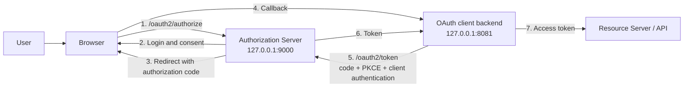

# Minimal Configuration to Boot an Authorization Server

In the **Project Setup** chapter, the goal is to stand up an **OAuth 2.0/OpenID Connect Authorization Server** using **Spring Boot, Spring Security, and Spring Authorization Server** in a development environment. The server must be able to start up, publish OIDC/JWKS metadata, accept authorization requests, authenticate users, and have all components needed to issue tokens to a registered OAuth client.

This lesson provides a Java configuration you can use as a starting point, explains the role of each bean, and walks through running and verifying the endpoints. The accounts, signing keys, and data stores in this example are strictly for **local development on a personal machine**; the final section explains what must change before real-world operation.

## 1. Test Setup and Expected Results

An Authorization Server is not just a login screen. It holds registered client information, authenticates users, enforces authorization conditions, and issues authorization codes/tokens.



We will configure the following concrete values:

| Component | Demo Value | Role |
| --- | --- | --- |
| Authorization Server | `http://127.0.0.1:9000` | Login, authorization, token issuance, and metadata endpoints. |
| Issuer | `http://127.0.0.1:9000` | Issuer identifier; must match `issuer` in metadata/tokens. |
| OAuth client | `demo-client` | Confidential web client, assuming a backend holds the secret. |
| Registered callback | `http://127.0.0.1:8081/login/oauth2/code/demo-client` | Destination receiving the authorization code; requires an actual client app on port 8081 to complete the flow. |
| Demo account | `alice` | Test user logging in via the Authorization Server's form login. |
| Scopes | `openid`, `profile`, `message.read` | Two OIDC scopes and one example API permission. |
| Grant type | `authorization_code`, `refresh_token` | Issues tokens via Authorization Code; refresh token is issued only if related conditions are satisfied. |
| PKCE | Required, `S256` | Binds the authorization code request to the token exchange request. |

**Note:** the server on port 9000 can run standalone, but executing the **entire** Authorization Code Flow requires an OAuth client on port 8081 (or changing the registered callback to the real callback of your test tool). You do not need to build an API/Resource Server just to verify metadata and AS startup.

## 2. Preparing the Spring Boot Project

The example uses **Java 17 or higher, Spring Boot 3.x compatible with Spring Authorization Server 1.x**, and the modern `SecurityFilterChain` configuration API (`HttpSecurity.with(...)`). When creating a real project, choose a still-supported patch in the same version line and let the **Spring Boot BOM** manage starter versions; do not manually mix Spring Security and Authorization Server versions.

Create a Maven project from Spring Initializr with:

- Group: `com.example`, Artifact: `auth-server`, package: `com.example.authserver`.
- Dependencies: **Spring Web**, **Spring Security**, **OAuth2 Authorization Server**.
- Packaging: Jar; Java 17+.

The `dependencies` section of `pom.xml` (inside the project generated by Spring Initializr) includes:

```xml
<dependencies>
    <dependency>
        <groupId>org.springframework.boot</groupId>
        <artifactId>spring-boot-starter-web</artifactId>
    </dependency>
    <dependency>
        <groupId>org.springframework.boot</groupId>
        <artifactId>spring-boot-starter-security</artifactId>
    </dependency>
    <dependency>
        <groupId>org.springframework.boot</groupId>
        <artifactId>spring-boot-starter-oauth2-authorization-server</artifactId>
    </dependency>
</dependencies>
```

The Authorization Server starter pulls in the required protocol components. Do **not** add `spring-boot-starter-oauth2-client` just because the project issues tokens: OAuth2 Client is a separate role for applications that log in/authorize via an AS. Likewise, this example does not yet require a database or Redis.

Illustrative file structure:

```text
auth-server/
├── pom.xml
└── src/main/
    ├── java/com/example/authserver/
    │   ├── AuthServerApplication.java
    │   └── SecurityConfig.java
    └── resources/
        └── application.yml
```

If using a newer Spring Boot/Spring Security line with a different configuration API, consult the documentation for that **exact version line**. The Java sample below is written for Boot 3.x/Spring Authorization Server 1.x supporting `OAuth2AuthorizationServerConfigurer.authorizationServer()` and `HttpSecurity.with(...)`.

## 3. Configuring the Port and Environment Secrets

Create `src/main/resources/application.yml`:

```yaml
spring:
  application:
    name: auth-server

server:
  port: 9000

demo:
  client-secret: ${DEMO_CLIENT_SECRET}
  user-password: ${DEMO_USER_PASSWORD}
```

The two required environment variables must be set before running. This avoids putting passwords and client secrets directly into source code. Values in the demo should only be used on a local machine.

**Windows PowerShell:**

```powershell
$env:DEMO_CLIENT_SECRET = "local-dev-client-secret-change-me"
$env:DEMO_USER_PASSWORD = "local-dev-user-password-change-me"
.\mvnw.cmd spring-boot:run
```

**macOS/Linux:**

```bash
export DEMO_CLIENT_SECRET='local-dev-client-secret-change-me'
export DEMO_USER_PASSWORD='local-dev-user-password-change-me'
./mvnw spring-boot:run
```

If `mvnw`/`mvnw.cmd` is not present, use an installed Maven (`mvn spring-boot:run`). By default this only tests over loopback. The HTTP issuer configuration in this lesson is **not intended for public environments**.

## 4. Spring Boot Entry Point

Create `AuthServerApplication.java`:

```java
package com.example.authserver;

import org.springframework.boot.SpringApplication;
import org.springframework.boot.autoconfigure.SpringBootApplication;

@SpringBootApplication
public class AuthServerApplication {

    public static void main(String[] args) {
        SpringApplication.run(AuthServerApplication.class, args);
    }
}
```

`@SpringBootApplication` scans `@Configuration` classes and beans in the same package/subpackages. In this example, `SecurityConfig` is placed in the same package so it is picked up automatically.

## 5. Minimal Complete Authorization Server Configuration

Create `SecurityConfig.java` with these beans: two `SecurityFilterChain`s, `RegisteredClientRepository`, `UserDetailsService`, `PasswordEncoder`, `JWKSource`, `JwtDecoder`, and `AuthorizationServerSettings`.

```java
package com.example.authserver;

import java.security.KeyPair;
import java.security.KeyPairGenerator;
import java.security.NoSuchAlgorithmException;
import java.security.interfaces.RSAPrivateKey;
import java.security.interfaces.RSAPublicKey;
import java.util.UUID;

import com.nimbusds.jose.jwk.JWKSet;
import com.nimbusds.jose.jwk.RSAKey;
import com.nimbusds.jose.jwk.source.JWKSource;
import com.nimbusds.jose.proc.SecurityContext;

import org.springframework.beans.factory.annotation.Value;
import org.springframework.context.annotation.Bean;
import org.springframework.context.annotation.Configuration;
import org.springframework.core.annotation.Order;
import org.springframework.http.MediaType;
import org.springframework.security.config.Customizer;
import org.springframework.security.config.annotation.web.builders.HttpSecurity;
import org.springframework.security.core.userdetails.User;
import org.springframework.security.core.userdetails.UserDetails;
import org.springframework.security.core.userdetails.UserDetailsService;
import org.springframework.security.crypto.factory.PasswordEncoderFactories;
import org.springframework.security.crypto.password.PasswordEncoder;
import org.springframework.security.oauth2.core.AuthorizationGrantType;
import org.springframework.security.oauth2.core.ClientAuthenticationMethod;
import org.springframework.security.oauth2.core.oidc.OidcScopes;
import org.springframework.security.oauth2.jwt.JwtDecoder;
import org.springframework.security.oauth2.server.authorization.client.InMemoryRegisteredClientRepository;
import org.springframework.security.oauth2.server.authorization.client.RegisteredClient;
import org.springframework.security.oauth2.server.authorization.client.RegisteredClientRepository;
import org.springframework.security.oauth2.server.authorization.config.annotation.web.configurers.OAuth2AuthorizationServerConfigurer;
import org.springframework.security.oauth2.server.authorization.config.annotation.web.configuration.OAuth2AuthorizationServerConfiguration;
import org.springframework.security.oauth2.server.authorization.settings.AuthorizationServerSettings;
import org.springframework.security.oauth2.server.authorization.settings.ClientSettings;
import org.springframework.security.provisioning.InMemoryUserDetailsManager;
import org.springframework.security.web.SecurityFilterChain;
import org.springframework.security.web.authentication.LoginUrlAuthenticationEntryPoint;
import org.springframework.security.web.util.matcher.MediaTypeRequestMatcher;

@Configuration(proxyBeanMethods = false)
public class SecurityConfig {

    // Filter chain 1 handles only the endpoints belonging to the Authorization Server.
    @Bean
    @Order(1)
    SecurityFilterChain authorizationServerSecurityFilterChain(
            HttpSecurity http) throws Exception {

        OAuth2AuthorizationServerConfigurer authorizationServerConfigurer =
                OAuth2AuthorizationServerConfigurer.authorizationServer();

        http
            .securityMatcher(authorizationServerConfigurer.getEndpointsMatcher())
            .with(authorizationServerConfigurer, authorizationServer ->
                authorizationServer.oidc(Customizer.withDefaults())
            )
            .authorizeHttpRequests(authorize ->
                authorize.anyRequest().authenticated()
            )
            .exceptionHandling(exceptions ->
                exceptions.defaultAuthenticationEntryPointFor(
                    new LoginUrlAuthenticationEntryPoint("/login"),
                    new MediaTypeRequestMatcher(MediaType.TEXT_HTML)
                )
            )
            // Supports Bearer JWT verification at the OIDC UserInfo endpoint.
            .oauth2ResourceServer(resourceServer ->
                resourceServer.jwt(Customizer.withDefaults())
            );

        return http.build();
    }

    // Filter chain 2 handles the login UI and remaining requests.
    @Bean
    @Order(2)
    SecurityFilterChain applicationSecurityFilterChain(
            HttpSecurity http) throws Exception {

        http
            .authorizeHttpRequests(authorize ->
                authorize.anyRequest().authenticated()
            )
            .formLogin(Customizer.withDefaults());

        return http.build();
    }

    // Register an OAuth client running on a separate backend on port 8081.
    @Bean
    RegisteredClientRepository registeredClientRepository(
            PasswordEncoder passwordEncoder,
            @Value("${demo.client-secret}") String clientSecret) {

        RegisteredClient client = RegisteredClient
            .withId(UUID.randomUUID().toString())
            .clientId("demo-client")
            .clientSecret(passwordEncoder.encode(clientSecret))
            .clientAuthenticationMethod(
                ClientAuthenticationMethod.CLIENT_SECRET_BASIC
            )
            .authorizationGrantType(
                AuthorizationGrantType.AUTHORIZATION_CODE
            )
            .authorizationGrantType(
                AuthorizationGrantType.REFRESH_TOKEN
            )
            .redirectUri(
                "http://127.0.0.1:8081/login/oauth2/code/demo-client"
            )
            .scope(OidcScopes.OPENID)
            .scope(OidcScopes.PROFILE)
            .scope("message.read")
            .clientSettings(ClientSettings.builder()
                .requireProofKey(true)
                .requireAuthorizationConsent(true)
                .build())
            .build();

        return new InMemoryRegisteredClientRepository(client);
    }

    // Account used to test form login on a development machine.
    @Bean
    UserDetailsService userDetailsService(
            PasswordEncoder passwordEncoder,
            @Value("${demo.user-password}") String userPassword) {

        UserDetails alice = User.withUsername("alice")
            .password(passwordEncoder.encode(userPassword))
            .roles("USER")
            .build();

        return new InMemoryUserDetailsManager(alice);
    }

    @Bean
    PasswordEncoder passwordEncoder() {
        // Encodes with bcrypt by default, including the {bcrypt} prefix
        // so DelegatingPasswordEncoder recognizes the algorithm.
        return PasswordEncoderFactories.createDelegatingPasswordEncoder();
    }

    // Generates an RSA JWK for JWT signing; each startup generates a new key.
    @Bean
    JWKSource<SecurityContext> jwkSource() {
        KeyPair keyPair = generateRsaKey();

        RSAKey rsaKey = new RSAKey.Builder(
                (RSAPublicKey) keyPair.getPublic())
            .privateKey((RSAPrivateKey) keyPair.getPrivate())
            .keyID(UUID.randomUUID().toString())
            .build();

        JWKSet jwkSet = new JWKSet(rsaKey);
        return (jwkSelector, securityContext) ->
            jwkSelector.select(jwkSet);
    }

    @Bean
    JwtDecoder jwtDecoder(JWKSource<SecurityContext> jwkSource) {
        return OAuth2AuthorizationServerConfiguration.jwtDecoder(jwkSource);
    }

    @Bean
    AuthorizationServerSettings authorizationServerSettings() {
        return AuthorizationServerSettings.builder()
            .issuer("http://127.0.0.1:9000")
            .build();
    }

    private static KeyPair generateRsaKey() {
        try {
            KeyPairGenerator generator = KeyPairGenerator.getInstance("RSA");
            generator.initialize(2048);
            return generator.generateKeyPair();
        } catch (NoSuchAlgorithmException ex) {
            throw new IllegalStateException("Cannot generate RSA key", ex);
        }
    }
}
```

**Scope of the sample:** the configuration above uses APIs and imports from Spring Authorization Server 1.x corresponding to Spring Security 6.x. Projects on another version line may need API adjustments. Never copy `SecurityFilterChain` configurations from multiple different Spring Security versions into the same class.

### 5.1. Why Do We Need Two `SecurityFilterChain`s?

- `@Order(1)` and `securityMatcher(authorizationServerConfigurer.getEndpointsMatcher())` restrict the first chain to Authorization Server endpoints (authorize, token, JWK, related metadata/OIDC). This chain enables OIDC support and redirects unauthenticated browser requests to login.
- `@Order(2)` handles requests that do not match the first chain, notably `GET /login` and `POST /login`. `formLogin()` renders the default login UI and processes authentication against `UserDetailsService`.
- `authorizeHttpRequests(...authenticated())` is the default policy in each chain. Protocol endpoints that must be publicly accessible when needed (such as metadata/JWKS) are configured by the Authorization Server configurer's own mechanism.
- `oauth2ResourceServer(...jwt())` in the AS chain supports OIDC endpoints that process Bearer tokens, such as UserInfo. It does **not** turn this application into a business API.
- Do not disable CSRF globally with `csrf.disable()`. Spring Authorization Server handles protocol requests appropriately; form login and browser requests must keep CSRF protection enabled by default.

If you remove the second chain or omit the `/login` path, users may be redirected to a login page with no filter handling it. If you put all endpoints into a single chain without proper endpoint matchers, ordering and security mechanisms can break.

### 5.2. What Is `RegisteredClientRepository` Responsible For?

A `RegisteredClient` is a **record trusted by the Authorization Server** describing a client. It holds the client authentication method, granted grant types, callbacks, scopes, and PKCE/consent settings.

In the sample:

- `CLIENT_SECRET_BASIC` is how the backend client authenticates when calling `/oauth2/token`; `demo-client` is just the identifier, not the secret.
- `passwordEncoder.encode(clientSecret)` produces a string prefixed like `{bcrypt}...` so Spring Security can verify the secret properly. Never store plaintext secrets in the client configuration store.
- `requireProofKey(true)` requires a code challenge/verifier when using Authorization Code. The backend client must derive the challenge from the verifier and retain the verifier for that transaction.
- `requireAuthorizationConsent(true)` can display a scope consent screen to the user. This is the step of granting permissions to the client, separate from user authentication.
- The callback URI must match a registered URI; never accept arbitrary redirects from browser-supplied URLs.
- `InMemoryRegisteredClientRepository` loses state across restarts; internal IDs are regenerated on each boot. It is suitable only for demos/testing.

If the target is an **SPA/native app**, you must register a separate **public client** (for example `ClientAuthenticationMethod.NONE`) with Authorization Code + PKCE; never embed a confidential client secret in JavaScript or user-distributed binaries.

### 5.3. How Does `UserDetailsService` Differ from `RegisteredClientRepository`?

`UserDetailsService` stores and looks up **logging-in users** (here `alice`). `RegisteredClientRepository` stores **OAuth applications** (here `demo-client`). User authentication and client authentication are two independent actions:

| Action | Identity Verified | Component |
| --- | --- | --- |
| Logging in at `/login` | User `alice` and password | Spring Security form login + `UserDetailsService` |
| Exchanging authorization code at `/oauth2/token` | `demo-client` and client secret | Spring Authorization Server client authentication |
| Validating authorization code | Code validity, client ownership, PKCE, and valid redirect | Spring Authorization Server |
| Using access token to read an API | Token, issuer, audience, scopes, and data permissions | Separate Resource Server |

In real systems, users may live in a database, LDAP, AD, or an upstream Identity Provider. The client registry is also typically persisted in a database and operated through a controlled client registration workflow.

### 5.4. Why Are `JWKSource` and `JwtDecoder` Needed?

`JWKSource<SecurityContext>` supplies keys for JWT signing/issuance. With RSA, only the public key is published via JWKS; the private key is used internally for signing. `JwtDecoder` provides the JWT verification capability needed by AS OIDC features such as UserInfo.

The sample generates a **new 2048-bit RSA key on every startup** to avoid needing a pre-created keystore. Consequence: tokens signed before a restart can no longer be verified against the new key set. In real deployments, you must use durably stored and managed keys (KMS/HSM/keystore), configure JWKS distribution, and plan safe key rotation lifecycles.

**Separate the two concepts:** `JwtDecoder` verifies JWTs; `JWKSource` supplies keys. Publishing JWKS never allows clients to retrieve the RSA private key as long as the system properly serves only public key parameters.

### 5.5. Why Must `issuer` Be Explicitly Declared?

`AuthorizationServerSettings.builder().issuer(...)` defines the issuer identity. The exact same issuer must remain consistent across discovery metadata, the `iss` claim in tokens, and client/Resource Server configurations.

`http://127.0.0.1:9000` and `http://localhost:9000` are **two different issuer strings** under exact string matching. Therefore, the example consistently uses `127.0.0.1`. When deployed behind a reverse proxy, declare the issuer as the real **public HTTPS** address, not an internal container address or internal bind port. Only process forwarded headers from trusted proxies.

## 6. Starting Up and Running Smoke Tests

After setting the two environment variables and running Maven, check the logs to confirm the application starts on port 9000. You can access it via a browser or `curl`.

### 6.1. Checking OIDC Discovery

```bash
curl -i http://127.0.0.1:9000/.well-known/openid-configuration
```

Expected result: HTTP `200` and JSON containing fields similar to:

```json
{
  "issuer": "http://127.0.0.1:9000",
  "authorization_endpoint": "http://127.0.0.1:9000/oauth2/authorize",
  "token_endpoint": "http://127.0.0.1:9000/oauth2/token",
  "jwks_uri": "http://127.0.0.1:9000/oauth2/jwks"
}
```

This is an **abridged example** of core fields, not the entire actual discovery response.

In practice, clients should use discovery metadata to determine endpoints and advertised capabilities rather than assuming every Authorization Server uses identical paths.

### 6.2. Checking the Public Key Set

```bash
curl -i http://127.0.0.1:9000/oauth2/jwks
```

Expected result: HTTP `200` and a `keys` JSON array containing a key with `kty` set to `RSA`, `kid`, and public parameters such as `n` and `e`. Private parameters like `d` must never appear in the public JWKS.

### 6.3. Checking the Login Page

Open `http://127.0.0.1:9000/login`. The application should display the default form login page. When prompted to authenticate during an authorize flow, use:

- Username: `alice`.
- Password: the value set in `DEMO_USER_PASSWORD`.

Visiting `/login` directly and signing in only checks the form authentication mechanism; it **does not prove** a client received an access token. Issuing codes/tokens requires a valid OAuth authorization request.

### 6.4. Testing Full Authorization Code + PKCE with an OAuth Client

Once an actual client application is running at the registered callback, the client generates a random `code_verifier`, computes `code_challenge = BASE64URL(SHA256(ASCII(code_verifier)))`, and creates an unpredictable `state`. The client initiates the flow by redirecting the browser to an equivalent URL:

```text
http://127.0.0.1:9000/oauth2/authorize
  ?response_type=code
  &client_id=demo-client
  &redirect_uri=http%3A%2F%2F127.0.0.1%3A8081%2Flogin%2Foauth2%2Fcode%2Fdemo-client
  &scope=openid%20profile%20message.read
  &state=<RANDOM_STATE>
  &code_challenge=<ACTUAL_S256_CHALLENGE>
  &code_challenge_method=S256
  &nonce=<RANDOM_NONCE>
```

This is a **line-wrapped illustrative URL**. In real usage, assemble it into a single valid URL and replace every placeholder with a random value generated by the client; do not type literal `<...>` brackets.

After the user authenticates and consents, the AS redirects to the callback with `code` and `state`. The client must verify `state` matches the initiated transaction, and then the backend sends the code exchange request:

```http
POST /oauth2/token HTTP/1.1
Host: 127.0.0.1:9000
Authorization: Basic <BASE64_OF_DEMO_CLIENT_COLON_CLIENT_SECRET>
Content-Type: application/x-www-form-urlencoded

grant_type=authorization_code
&code=<AUTHORIZATION_CODE_FROM_CALLBACK>
&redirect_uri=http%3A%2F%2F127.0.0.1%3A8081%2Flogin%2Foauth2%2Fcode%2Fdemo-client
&code_verifier=<VERIFIER_CORRESPONDING_TO_CHALLENGE>
```

These lines illustrate the request for learning the protocol; Basic Auth must only be sent over TLS in real deployments. If authorization and the request are valid, the token response contains an access token; when the `openid` scope is present, OIDC also issues an ID token per specification. Never use an ID token as an access token for APIs.

**If no OAuth client is running on 8081 yet**, redirecting to the callback will result in a connection error in the browser. That does not mean the AS is broken; it indicates the callback receiver is missing. In that case, stop after the metadata/JWKS/login smoke tests, then add a client to run end-to-end.

## 7. Self-Testing Rejection Behaviors

A configuration that starts successfully still needs negative-path testing. With the registered demo client, expect:

| Scenario | Expected Outcome |
| --- | --- |
| Non-existent `client_id` | No authorization code/token issued. |
| Changing `redirect_uri` to an unregistered domain or port | AS rejects the request and never redirects codes to an unknown address. |
| Missing `code_challenge` when the client requires PKCE | Authorization rejected due to invalid request. |
| Exchanging code with wrong `code_verifier` | Token endpoint returns an error, no token issued. |
| Sending wrong client secret at token endpoint | Client authentication fails, no token issued. |
| Reusing an already-exchanged authorization code | Code is rejected because it is single-use. |
| Calling an API with only an ID token | API must reject if an access token is required. |
| Restarting the demo and using a token signed with the previous key | Old token may fail verification because the in-memory signing key changed. |

Verifying `state` is the responsibility of the **OAuth client** when handling the callback; verifying scopes/audience/subject permissions on an API belongs to the **Resource Server**. Do not assign every check to the Authorization Server.

## 8. Common Setup Errors

### Startup Fails Due to Missing Environment Variables

If Spring reports it cannot resolve `demo.client-secret` or `demo.user-password`, set `DEMO_CLIENT_SECRET` and `DEMO_USER_PASSWORD` **in the exact terminal running Maven**, then re-run. Never replace them with hardcoded secrets committed to Git just to bypass the error.

### `/login` Returns 404 or Redirects in a Loop

Verify `applicationSecurityFilterChain` includes `formLogin(Customizer.withDefaults())` and has `@Order(2)`; the first chain only matches AS endpoints. If another custom filter chain exists in the application, ordering and matchers may cause `/login` to be handled improperly.

### `invalid_client` When Exchanging Code

Check that `client_id` is `demo-client`, the secret matches the environment variable, the client authentication method is HTTP Basic, and the encoded secret includes its algorithm prefix. Do not confuse `alice`'s password with the OAuth client secret.

### `invalid_grant` or Callback Rejection

Verify the code has not expired/been used, `redirect_uri` matches the exact URI used when issuing the code, and `code_verifier` matches the original challenge. An authorization code cannot be exchanged multiple times or exchanged with a verifier from another transaction.

### Client/Resource Server Reports Issuer Mismatch

Check the exact issuer at `/.well-known/openid-configuration` and the configuration on the token-verifying side. Never mix `localhost` with `127.0.0.1` or HTTP with HTTPS, even when both URLs point to the same machine.

### JWKS Changes After Restart

This is the expected behavior of `generateRsaKey()`. Do not use this approach in environments that require tokens to remain valid across restarts or run multiple replicas.

### Calling the Token Endpoint Directly Only Returns HTTP Errors

`/oauth2/token` is not an endpoint for users to "log in with username/password" in this lesson. It requires a valid grant, client credentials (for confidential clients), an authorization code, and a PKCE verifier. Hitting the endpoint with GET or an invalid body will be rejected; that is correct protocol behavior.

## 9. Mandatory Changes Before Going Beyond the Demo

| Aspect | In the Local Example | Production Deployment Direction |
| --- | --- | --- |
| Protocol and issuer | HTTP loopback, fixed issuer | HTTPS/TLS and canonical public issuer; trusted proxy/header forwarding. |
| Users | `InMemoryUserDetailsManager` | Appropriate database/IdP, MFA when needed, account lockout and security policies. |
| Client registration | `InMemoryRegisteredClientRepository` | Durable storage, lifecycle protection and management for clients/secrets and redirect URIs. |
| Authorization/consent | In-memory defaults, sufficient for demo | Durable `OAuth2AuthorizationService` / `OAuth2AuthorizationConsentService`, transactions, and expiration/cleanup strategy. |
| JWT keys | Random RSA generated on boot | KMS/HSM/keystore, private storage, public JWKS, overlapping key rotation plan. |
| Tokens | Basic flow | Configure TTLs, refresh token rotation/revocation as appropriate, per-API audiences, scope policies. |
| Clients | Single confidential web client | Separate registration per client, proper public/confidential type, PKCE, least-privilege principle. |
| Operability | Single dev JVM | Log/metric/audit observability, rate limiting, backups, HA, secret protection, and security testing. |

For production deployments, never use sample passwords from documentation, never expose client secrets or RSA private keys, never log tokens/codes, and never allow arbitrary callbacks. HTTP and loopback callbacks here are strictly for local testing; public applications must use HTTPS and appropriate security policies.

## 10. Summary of What Must Work

A minimal Authorization Server requires the **protocol starter**, **endpoint-matched security filters**, a **user login mechanism**, **OAuth client registration**, an **authorization state store**, **JWT signing keys**, a **`JwtDecoder` for OIDC features that verify JWTs**, and an **exact issuer**. Some default infrastructure may be initialized by Spring Authorization Server in the demo; in real operations, storage and governance must be explicitly configured.

After completing this lesson, you should be able to answer:

1. Why are both `RegisteredClientRepository` and `UserDetailsService` needed?
2. Why does `/oauth2/authorize` require a browser and user session, whereas `/oauth2/token` requires proof of the client and authorization code?
3. How are the two filter chains matched, and why is form login not inside the AS endpoint chain?
4. Where is the JWT private key kept, what data does the AS publish via JWKS, and what happens after a restart?
5. What do metadata, JWKS, and login smoke tests verify; what test actually proves the complete Authorization Code + PKCE flow?

**References:** Spring Authorization Server Reference (Getting Started, Configuration Model, Core Model and Components), Spring Security Reference (OAuth2 Client, Resource Server, and Form Login), OAuth 2.0 RFC 6749, PKCE RFC 7636, OAuth 2.0 Security Best Current Practice RFC 9700, and OpenID Connect Core/Discovery 1.0.
