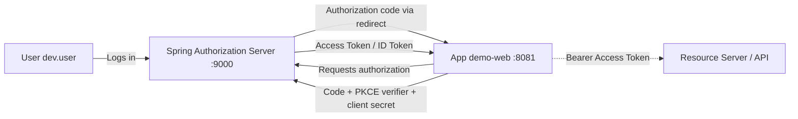

# Creating Development Accounts and Sample Clients

## 1. Lesson Objectives

In the **Project Setup** chapter of the **SPRING_SECURITY_OAUTH2_OIDC_AUTHORIZATION_SERVER** module, we prepare two entities to test OAuth 2.0/OpenID Connect (OIDC) flows using **Spring Security**, **Spring Authorization Server**, and **Spring Boot**:

1. **Test user account**: represents a person logging into the Authorization Server to authenticate and grant consent.
2. **Sample OAuth client**: represents an application registered with the Authorization Server that can request an authorization code, exchange the code for tokens, and use those tokens within granted scopes.

After this lesson, you will be able to create these two entities, explain key settings on `RegisteredClient`, test the **Authorization Code Flow with PKCE**, inspect responses, and spot common mistakes. This also forms the foundation for upcoming lessons on designing, configuring, securing, testing, and operating an Authorization Server.

**Example scope:** runs locally under the `dev` profile using in-memory storage and mock accounts. Passwords and client secrets appearing in this lesson are **strictly educational data** and must never be reused in real deployment environments. This lesson does not require registering accounts at Google, GitHub, or an external OAuth service: we are **building our own Authorization Server**, so we manage our own sample users and clients.

### 1.1. Distinguishing the Two Identity Types Properly

| Attribute | Development User Account | Sample OAuth Client |
| --- | --- | --- |
| Represents | Human user logging in via browser | Application requesting access |
| Example identifier | `dev.user` | `demo-web` (`client_id`) |
| Authentication proof | Password, login session, or another user authentication method | Client secret or appropriate client authentication method |
| Where stored in the example | `InMemoryUserDetailsManager` | `InMemoryRegisteredClientRepository` |
| Stages involved | Login, scope consent, attaching identity to OIDC | Initiating authorization requests and exchanging codes at the token endpoint |

`UserDetailsService` is not `RegisteredClientRepository`. Creating the `dev.user` account **does not automatically create** an OAuth client; conversely, registering the `demo-web` client **does not automatically log in** any user. Also distinguish a **client developer account** (an administrative account used to register clients if the system has a developer portal) from a **user account**: in this minimal example, client registration is done in Spring startup code without building an admin portal for developers.

## 2. Diagram and Parameters for the Practice Environment



In the diagram, the Resource Server is a component integrated in later steps; to create accounts and verify the token endpoint in this lesson, you **do not yet need** to deploy a separate API.

| Value | Setting Used in This Lesson |
| --- | --- |
| Authorization Server URL/issuer | `http://localhost:9000` |
| Spring Boot profile | `dev` |
| Test username | `dev.user` |
| Test user password | `dev-pass-only-123` |
| `client_id` | `demo-web` |
| Sample client secret | `demo-web-secret-only-123` |
| Client type | *Confidential client* (backend application capable of keeping a secret) |
| Client authentication method | `client_secret_basic` |
| Grant types | `authorization_code`, `refresh_token` |
| Redirect URI | `http://127.0.0.1:8081/login/oauth2/code/demo-web` |
| Scopes | `openid`, `profile`, `api.read` |
| PKCE | Required, using `S256` |
| Consent | Enabled for the sample client |

Note: `localhost:9000` is a local address solely for hands-on practice. An Authorization Server deployed outside local environments must use a stable issuer over **HTTPS**, valid certificates, and controlled redirect URIs. The client redirect endpoint on port `8081` may not exist yet during manual testing; in that case, the browser may report a connection failure after redirecting, yet we can still inspect the callback URL in a learning environment.

## 3. Preparing the Spring Boot Application

The example assumes an existing Spring Boot project running on the **Servlet stack**, using a compatible combination of Spring Boot/Spring Security/Spring Authorization Server versions. For the Spring Boot 3.x and Spring Authorization Server 1.x ecosystem supporting the APIs in this lesson, Maven dependencies typically include:

```xml
<dependencies>
    <dependency>
        <groupId>org.springframework.boot</groupId>
        <artifactId>spring-boot-starter-web</artifactId>
    </dependency>
    <dependency>
        <groupId>org.springframework.boot</groupId>
        <artifactId>spring-boot-starter-security</artifactId>
    </dependency>
    <dependency>
        <groupId>org.springframework.boot</groupId>
        <artifactId>spring-boot-starter-oauth2-authorization-server</artifactId>
    </dependency>
</dependencies>
```

The example assumes the project already has `spring-boot-starter-parent` or compatible Spring Boot dependency management, so individual dependencies do not declare separate versions. If using a different Spring Boot/Spring Security version, check the documentation for your **actual version** before copying configuration APIs; some APIs change across version lines.

Create development configuration in `src/main/resources/application-dev.yml`:

```yaml
server:
  port: 9000

logging:
  level:
    org.springframework.security: INFO
```

Then run the application with the `dev` profile, for example on Windows PowerShell:

```powershell
$env:SPRING_PROFILES_ACTIVE = "dev"
.\mvnw.cmd spring-boot:run
```

On Linux/macOS, you can use:

```bash
SPRING_PROFILES_ACTIVE=dev ./mvnw spring-boot:run
```

Only run these commands after adding the Java configuration in the next section. Restricting sample beans with `@Profile("dev")` prevents test accounts and mock client secrets from automatically appearing in production profiles.

## 4. Creating User Accounts and Clients in Java Configuration

### 4.1. Complete Configuration for Local Practice

Create a Java class, for example `com.example.authorizationserver.config.DevAuthorizationServerConfig`. The code below sets up **one confidential client**, an in-memory user account, an RSA key pair generated on application startup, and two `SecurityFilterChain`s for protocol/login handling.

```java
package com.example.authorizationserver.config;

import com.nimbusds.jose.jwk.JWKSet;
import com.nimbusds.jose.jwk.RSAKey;
import com.nimbusds.jose.jwk.source.JWKSource;
import com.nimbusds.jose.proc.SecurityContext;
import org.springframework.context.annotation.Bean;
import org.springframework.context.annotation.Configuration;
import org.springframework.context.annotation.Profile;
import org.springframework.core.annotation.Order;
import org.springframework.http.MediaType;
import org.springframework.security.config.Customizer;
import org.springframework.security.config.annotation.web.builders.HttpSecurity;
import org.springframework.security.config.annotation.web.configuration.EnableWebSecurity;
import org.springframework.security.core.userdetails.User;
import org.springframework.security.core.userdetails.UserDetailsService;
import org.springframework.security.crypto.factory.PasswordEncoderFactories;
import org.springframework.security.crypto.password.PasswordEncoder;
import org.springframework.security.oauth2.core.AuthorizationGrantType;
import org.springframework.security.oauth2.core.ClientAuthenticationMethod;
import org.springframework.security.oauth2.core.oidc.OidcScopes;
import org.springframework.security.oauth2.jwt.JwtDecoder;
import org.springframework.security.oauth2.server.authorization.client.InMemoryRegisteredClientRepository;
import org.springframework.security.oauth2.server.authorization.client.RegisteredClient;
import org.springframework.security.oauth2.server.authorization.client.RegisteredClientRepository;
import org.springframework.security.oauth2.server.authorization.config.annotation.web.configuration.OAuth2AuthorizationServerConfiguration;
import org.springframework.security.oauth2.server.authorization.config.annotation.web.configurers.OAuth2AuthorizationServerConfigurer;
import org.springframework.security.oauth2.server.authorization.settings.AuthorizationServerSettings;
import org.springframework.security.oauth2.server.authorization.settings.ClientSettings;
import org.springframework.security.oauth2.server.authorization.settings.TokenSettings;
import org.springframework.security.provisioning.InMemoryUserDetailsManager;
import org.springframework.security.web.SecurityFilterChain;
import org.springframework.security.web.authentication.LoginUrlAuthenticationEntryPoint;
import org.springframework.security.web.util.matcher.MediaTypeRequestMatcher;

import java.security.KeyPair;
import java.security.KeyPairGenerator;
import java.security.interfaces.RSAPrivateKey;
import java.security.interfaces.RSAPublicKey;
import java.time.Duration;
import java.util.UUID;

@Configuration(proxyBeanMethods = false)
@EnableWebSecurity
@Profile("dev")
public class DevAuthorizationServerConfig {

    @Bean
    @Order(1)
    SecurityFilterChain authorizationServerSecurityFilterChain(HttpSecurity http)
            throws Exception {
        OAuth2AuthorizationServerConfigurer authorizationServerConfigurer =
                OAuth2AuthorizationServerConfigurer.authorizationServer();

        http.securityMatcher(authorizationServerConfigurer.getEndpointsMatcher())
                .with(authorizationServerConfigurer,
                        authorizationServer -> authorizationServer.oidc(Customizer.withDefaults()))
                .authorizeHttpRequests(authorize -> authorize.anyRequest().authenticated())
                .exceptionHandling(exceptions -> exceptions.defaultAuthenticationEntryPointFor(
                        new LoginUrlAuthenticationEntryPoint("/login"),
                        new MediaTypeRequestMatcher(MediaType.TEXT_HTML)));

        return http.build();
    }

    @Bean
    @Order(2)
    SecurityFilterChain applicationSecurityFilterChain(HttpSecurity http)
            throws Exception {
        http.authorizeHttpRequests(authorize -> authorize.anyRequest().authenticated())
                .formLogin(Customizer.withDefaults());
        return http.build();
    }

    @Bean
    PasswordEncoder passwordEncoder() {
        return PasswordEncoderFactories.createDelegatingPasswordEncoder();
    }

    @Bean
    UserDetailsService userDetailsService(PasswordEncoder encoder) {
        return new InMemoryUserDetailsManager(
                User.withUsername("dev.user")
                        .password(encoder.encode("dev-pass-only-123"))
                        .roles("USER")
                        .build());
    }

    @Bean
    RegisteredClientRepository registeredClientRepository(PasswordEncoder encoder) {
        RegisteredClient demoWeb = RegisteredClient.withId(UUID.randomUUID().toString())
                .clientId("demo-web")
                .clientSecret(encoder.encode("demo-web-secret-only-123"))
                .clientAuthenticationMethod(ClientAuthenticationMethod.CLIENT_SECRET_BASIC)
                .authorizationGrantType(AuthorizationGrantType.AUTHORIZATION_CODE)
                .authorizationGrantType(AuthorizationGrantType.REFRESH_TOKEN)
                .redirectUri("http://127.0.0.1:8081/login/oauth2/code/demo-web")
                .scope(OidcScopes.OPENID)
                .scope(OidcScopes.PROFILE)
                .scope("api.read")
                .clientSettings(ClientSettings.builder()
                        .requireProofKey(true)
                        .requireAuthorizationConsent(true)
                        .build())
                .tokenSettings(TokenSettings.builder()
                        .accessTokenTimeToLive(Duration.ofMinutes(15))
                        .refreshTokenTimeToLive(Duration.ofHours(2))
                        .reuseRefreshTokens(false)
                        .build())
                .build();

        return new InMemoryRegisteredClientRepository(demoWeb);
    }

    @Bean
    JWKSource<SecurityContext> jwkSource() {
        RSAKey rsaKey = newRsaKey();
        JWKSet jwkSet = new JWKSet(rsaKey);
        return (selector, context) -> selector.select(jwkSet);
    }

    @Bean
    JwtDecoder jwtDecoder(JWKSource<SecurityContext> jwkSource) {
        return OAuth2AuthorizationServerConfiguration.jwtDecoder(jwkSource);
    }

    @Bean
    AuthorizationServerSettings authorizationServerSettings() {
        return AuthorizationServerSettings.builder()
                .issuer("http://localhost:9000")
                .build();
    }

    private static RSAKey newRsaKey() {
        try {
            KeyPairGenerator generator = KeyPairGenerator.getInstance("RSA");
            generator.initialize(2048);
            KeyPair keyPair = generator.generateKeyPair();
            return new RSAKey.Builder((RSAPublicKey) keyPair.getPublic())
                    .privateKey((RSAPrivateKey) keyPair.getPrivate())
                    .keyID(UUID.randomUUID().toString())
                    .build();
        } catch (Exception ex) {
            throw new IllegalStateException("Unable to create local RSA signing key", ex);
        }
    }
}
```

The snippet illustrates configuration with APIs supporting `OAuth2AuthorizationServerConfigurer.authorizationServer()` and `HttpSecurity.with(...)`. If your project uses a newer Spring Security version or another product line, cross-check the APIs and bean declarations against that version's documentation. Do not mix configuration snippets from multiple versions and assume they are equivalent.

### 4.2. Key Points in the Code

**`UserDetailsService` creates the development account.** When the browser hits `/login`, Spring Security authenticates `dev.user` against the in-memory user store. Calling `encoder.encode(...)` stores an **appropriate hash value** instead of a plaintext password in `UserDetails`; the mock password still sits in the example code, so restrict it to the development profile.

**`RegisteredClientRepository` creates the sample client.** Each `RegisteredClient` has an internal `id` and a `clientId` used by external applications. `.withId(UUID.randomUUID().toString())` identifies the record inside the registry; do not confuse this internal UUID with `client_id=demo-web`. The in-memory repository loses data when the process restarts.

**`.clientAuthenticationMethod(CLIENT_SECRET_BASIC)` requires the client to send credentials** via HTTP Basic when calling `/oauth2/token`. The server compares against the hashed client secret in the repository. This client must be a backend application capable of keeping secrets; public browser JavaScript frontends cannot protect a client secret.

**`.authorizationGrantType(...)` restricts allowed grants.** `AUTHORIZATION_CODE` is used for initial token issuance after redirect; `REFRESH_TOKEN` allows exchanging a refresh token if one was issued and remains valid. The client is not granted `client_credentials` or password grants by default.

**`.redirectUri(...)` declares the valid callback destination.** This is a specific pre-registered URL. When sending authorization and code exchange requests, the client must send a redirect URI matching the configuration; changing `127.0.0.1` to `localhost`, changing the port, or changing the path will cause the protocol to reject it. Never use broad wildcards or user-supplied arbitrary callbacks.

**Scopes** define the permissions/data groups requested by the client:

- `openid`: enables OpenID Connect; when the OIDC flow succeeds, the client can receive an ID Token.
- `profile`: requests profile information according to OIDC policy and configured claims.
- `api.read`: an application-defined example scope; it **does not grant access automatically** on the Resource Server. The API still needs to validate scopes and its own access rules.

**`ClientSettings`** enables PKCE and requires consent. With `requireProofKey(true)`, the client must generate a `code_challenge` before receiving an authorization code and send `code_verifier` when exchanging the code. With `requireAuthorizationConsent(true)`, the user is prompted to approve requested scopes based on current consent state. Logging in alone does not automatically grant the client full token access.

**`TokenSettings`** bounds token lifetimes. The example sets the Access Token to 15 minutes, the Refresh Token to 2 hours, and disables refresh token reuse during rotation. Short lifetimes are only one layer of control; clients must also store tokens securely, handle expiration, and reject tokens unsuitable for their intended purpose.

**Two security chains** separate protocol endpoints from the login page. The `@Order(1)` chain applies to Authorization Server/OIDC endpoints, while the `@Order(2)` chain handles application requests and provides the default form login. Misconfigured login, wrong matchers, or wrong chain ordering can break `/oauth2/authorize` and `/login` behavior.

**`JWKSource`, `JwtDecoder`, and `issuer`** complete the foundation for token signing and OIDC endpoints. Generating a new RSA key pair **on every startup** is suitable only for demos: tokens signed before a restart can no longer be verified. Real systems require stable keys, private key protection, planned rotation, and a consistent HTTPS issuer URL across all clients and Resource Servers.

## 5. Client Registration Models and Choosing Application Types

Not every OAuth client uses a client secret. Choose a registration model based on the client's ability to keep credentials confidential and how it receives redirects:

| Application Type | Can Keep a Client Secret? | Typical Registration | PKCE |
| --- | --- | --- | --- |
| Backend web app / BFF | Yes, when the secret exists only on the server | `client_secret_basic` or suitable client authentication method | Recommended, as in the `demo-web` example. |
| Pure browser SPA | No | Public client with `ClientAuthenticationMethod.NONE` and Authorization Code Flow | Mandatory as the primary protection mechanism. |
| Mobile/desktop app distributed to users | Cannot guarantee embedded secrets stay hidden | Public client, platform-appropriate redirect URI | Use `S256` PKCE. |
| Machine-to-machine service | Possible, with a secure secret store or private key | Confidential client, `client_credentials` grant when needed | PKCE does not apply since there is no Authorization Code Flow. |

In this lesson, `demo-web` is a **confidential client** expected to run a backend on port `8081`. Do not put `demo-web-secret-only-123` into a React/Vue/Angular bundle or a mobile app. If you want a pure browser SPA, register a **separate client** with `ClientAuthenticationMethod.NONE`, `requireProofKey(true)`, and an SPA redirect URI; do not try to "work around" it by omitting the Basic header on a client registered with `CLIENT_SECRET_BASIC`.

### 5.1. Which Properties Can Change in a Real Project?

In development configuration, you can freely vary usernames, ports, scopes, redirect URIs, and token lifetimes for exercises. When moving to staging/production, these values must become **governed configuration policies**: developers register clients through an administrative workflow; client secrets are issued via secure channels; redirect URIs follow strict allowlists; scopes are approved and tied to API policies; and the Authorization Server logs registration events and critical changes.

## 6. Testing the Authorization Code Flow with PKCE

### 6.1. Checking Endpoints and Public Metadata

Start the application with the `dev` profile, then run:

```powershell
curl.exe -i http://localhost:9000/.well-known/openid-configuration
curl.exe -i http://localhost:9000/oauth2/jwks
```

The discovery endpoint must return OIDC metadata with `issuer` set to `http://localhost:9000` and details of supported endpoints. JWKS must publish the **public key** used to verify token signatures. Never expose private key material through JWKS or copy private keys from live config into logs.

If OIDC is not enabled, `JwtDecoder` is missing, or endpoint configuration is incomplete, some of these URLs may return errors; inspect startup logs and `SecurityFilterChain`s before proceeding.

### 6.2. Preparing `state` and PKCE

For straightforward manual testing, you can use the **public test values from RFC 7636**:

```text
code_verifier:
dBjftJeZ4CVP-mB92K27uhbUJU1p1r_wW1gFWFOEjXk

code_challenge (S256):
E9Melhoa2OwvFrEMTJguCHaoeK1t8URWbuGJSstw-cM
```

This pair is fixed and **intended only for learning how requests are formed**. Real clients must generate a fresh verifier using a cryptographically secure random generator per transaction, typically 43–128 characters long, and compute:

```text
code_challenge = BASE64URL_NO_PADDING(SHA256(ASCII(code_verifier)))
```

At the same time, the client must generate a random `state`, bind it to the request session, and match it when the browser returns to the callback. In a PowerShell test session, construct the URL as follows:

```powershell
$verifier = 'dBjftJeZ4CVP-mB92K27uhbUJU1p1r_wW1gFWFOEjXk'
$challenge = 'E9Melhoa2OwvFrEMTJguCHaoeK1t8URWbuGJSstw-cM'
$state = [guid]::NewGuid().ToString('N')
$redirectUri = [uri]::EscapeDataString('http://127.0.0.1:8081/login/oauth2/code/demo-web')

$authorizeUrl = "http://localhost:9000/oauth2/authorize" +
    "?response_type=code&client_id=demo-web" +
    "&redirect_uri=$redirectUri" +
    "&scope=openid%20profile%20api.read" +
    "&state=$state" +
    "&code_challenge=$challenge&code_challenge_method=S256"

Start-Process $authorizeUrl
```

In the browser, log in with username `dev.user` and password `dev-pass-only-123`, then approve permissions if the consent screen appears. The Authorization Server redirects the browser to the registered redirect URI with `code` and `state` in query parameters.

```http
HTTP/1.1 302 Found
Location: http://127.0.0.1:8081/login/oauth2/code/demo-web?code=<authorization-code>&state=<same-state>
```

Before using the code, **verify that the returned `state` matches the original `$state`**. Authorization codes are short-lived and single-use. If a real `demo-web` application is running on port `8081`, that app will receive and normally exchange the code itself; do not take an already-used code and try it again with curl.

If testing manually without an application listening on `127.0.0.1:8081`, the browser will report that it cannot open the callback page. In a **local environment using mock data**, you can inspect the redirect URL in the address bar/devtools and extract `code` to test the token endpoint. Never use manual code copying from URLs as a real operational workflow and never share URLs containing codes.

### 6.3. Exchanging the Authorization Code for Tokens

Once you have an unused code, assign it to `$code` and send the token request. The Windows PowerShell example uses `curl.exe` (to avoid confusion with the `curl` alias in some PowerShell versions):

```powershell
$code = '<authorization-code-from-callback>'

curl.exe -sS -X POST 'http://localhost:9000/oauth2/token' `
  -u 'demo-web:demo-web-secret-only-123' `
  -H 'Content-Type: application/x-www-form-urlencoded' `
  --data-urlencode 'grant_type=authorization_code' `
  --data-urlencode "code=$code" `
  --data-urlencode 'redirect_uri=http://127.0.0.1:8081/login/oauth2/code/demo-web' `
  --data-urlencode "code_verifier=$verifier"
```

The `-u` flag sends the client ID and client secret using **HTTP Basic authentication**. Base64 inside Basic auth is not encryption: in real products, the token endpoint must use HTTPS.

A successful response looks roughly like this (illustrative placeholders, not real tokens):

```json
{
  "access_token": "<access-token>",
  "token_type": "Bearer",
  "expires_in": 900,
  "refresh_token": "<refresh-token>",
  "scope": "openid profile api.read",
  "id_token": "<id-token>"
}
```

`access_token` is used to call APIs within the granted scopes/audience; `id_token` is issued in OIDC flows so the client can verify user identity; `refresh_token` obtains new tokens per policy. **Never use an ID Token as an Access Token**, and do not assume a signed JWT's payload is encrypted. The Resource Server must validate signature, issuer, audience, expiration, and permissions before accepting an Access Token.

### 6.4. Testing Refresh Tokens (If Returned)

```powershell
$refreshToken = '<refresh-token-from-response>'

curl.exe -sS -X POST 'http://localhost:9000/oauth2/token' `
  -u 'demo-web:demo-web-secret-only-123' `
  -H 'Content-Type: application/x-www-form-urlencoded' `
  --data-urlencode 'grant_type=refresh_token' `
  --data-urlencode "refresh_token=$refreshToken"
```

Because the example configures `reuseRefreshTokens(false)`, on a successful refresh the server may issue a new refresh token under rotation policy; the client must safely replace the old value. Do not reuse an old refresh token after rotation, and never write refresh tokens into logs, source code, or URLs.

## 7. Verifying Intentional Failure Scenarios

A complete OAuth exercise must prove that **valid requests succeed and unsafe requests are rejected**. Here are the core checks:

| Test | Expected Result and Takeaway |
| --- | --- |
| Log in with wrong password for `dev.user` | Form login rejects; no valid authenticated user session is created. |
| Send an unregistered `client_id` | Authorization Server rejects the authorization request or client authentication accordingly. |
| Send wrong client secret at `/oauth2/token` | OAuth error response, typically `invalid_client`. |
| Omit `code_challenge` when requesting an authorization code | Rejected because the client requires PKCE. |
| Send wrong `code_verifier` when exchanging the code | Rejected, typically returning `invalid_grant` due to PKCE proof mismatch. |
| Exchange an already-used authorization code again | Rejected: authorization codes are single-use. |
| Change port/path/hostname of `redirect_uri` | Rejected due to mismatch with registered redirect URI or transaction. |
| Request an unregistered scope, e.g., `admin` | Not granted scopes beyond what the client is registered for. |
| Call `/oauth2/token` with `grant_type=client_credentials` | Disallowed because the client is registered only for `authorization_code` and `refresh_token`. |
| Restart the server and verify an old token | Can fail because signing keys and in-memory state were regenerated. |

Exact HTTP status codes and error names may vary by endpoint, version, or rejection reason. When testing, inspect status codes, OAuth error JSON bodies, and server logs; do not diagnose failures solely from a `400` or `401` status.

### 7.1. Troubleshooting Order When Errors Occur

1. **Cannot reach `/login`:** check that the application is running with the `dev` profile, has the `@Order(2)` application chain, and enables `formLogin()`.
2. **Authorize page does not redirect to login/consent:** check the endpoint matcher, `@Order`, client registration, and `redirect_uri`.
3. **`invalid_client`:** verify `client_id`, client secret, and `client_secret_basic` method; never pass raw secrets in URLs.
4. **`invalid_grant`:** check whether the code expired/was already used, and verify `code_verifier`, `redirect_uri`, and client match the code-issuance session.
5. **No `id_token` returned:** check that the request included `scope=openid`, OIDC is enabled, and proper JWT/JWK beans exist.
6. **Token has wrong issuer/URL:** check `AuthorizationServerSettings.issuer`, hostname, port, reverse proxy, and the URL the client uses.
7. **Tokens stop working after restart:** remember that RSA keys, authorizations, and client repositories in this example are for local testing and are not persisted.

## 8. When to Move from Demo Config to Real Config?

`InMemoryUserDetailsManager` and `InMemoryRegisteredClientRepository` are convenient for lessons because they require no database or separate registration system. However, they do not satisfy requirements for long-term operations, user governance, auditing, or sharing state across multiple instances.

| Area | In the Practice Example | In Staging/Production |
| --- | --- | --- |
| User accounts | Single hardcoded user `dev.user` | Real user store/identity provider, appropriate password/MFA policies, and account lifecycle management. |
| Registered clients | Registered on startup, in-memory | Durable repository, client provisioning/revocation workflows, and redirect/scope review processes. |
| Client secrets | Mock string in source code | Issued and stored in a secret manager or proper secret store; rotated with restricted access. |
| Token signing keys | Random RSA generated on every restart | Keystore/KMS/HSM as required, controlled rotation, and JWKS publishing appropriate public keys. |
| OAuth authorizations/consents | Stored in memory by default | Durable storage, concurrency handling, and appropriate expiration/cleanup strategy. |
| Issuer and connectivity | `http://localhost:9000` | Stable public hostname over HTTPS; controlled reverse proxy/forwarded headers. |
| Logging/observability | Minimal development logs | Selective auditing, metrics, and traces with secrets/tokens/authorization codes scrubbed. |
| Testing | Manual via browser and `curl.exe` | Automated tests for happy paths, consent, PKCE, redirects, token validation, and rejection cases. |

A real system needs to separate **user management**, **client management**, **key/token management**, and **infrastructure operations** into clear areas of responsibility. Never turn a public controller into a "self-service client registration" endpoint without administrative authentication, authorization approval, and proper client constraints. OIDC Dynamic Client Registration is a distinct specification feature requiring careful policy consideration and is not needed for this lesson.

## 9. Self-Check Exercises

### Exercise 1: Add a Second Development User

Extend `InMemoryUserDetailsManager` with a new user and role `USER` (or an appropriate role). Log in as both users and compare the `sub` claim in their ID Tokens. Explain why `demo-web`'s `client_id` **does not change** when the user changes.

### Exercise 2: Change the Redirect URI

Change `demo-web`'s redirect URI to another port in configuration, restart the application, and try authorizing with the old URL. Explain why the server rejects it and the difference between a **registered redirect URI** and the URL sent by a client in a single request.

### Exercise 3: Test PKCE and Scopes

Run a valid request and then try exchanging the code with a wrong verifier. Next, initiate a new request adding an unregistered scope and observe the outcome. Write down the independent roles of `code_challenge`, `code_verifier`, `state`, and scopes.

### Exercise 4: Plan a Multi-Instance Deployment

Assume two Authorization Server instances run behind a load balancer. Explain why generating independent random RSA key pairs and using in-memory repositories in each instance breaks token verification, authorization code state, or consent. Propose using a shared data store and shared key management service under an appropriate trust model.

### Completion Checklist

- [ ] Can log in as `dev.user` via the Authorization Server's form login.
- [ ] Can distinguish a user account from an OAuth `RegisteredClient`.
- [ ] Understand `client_id`, `client_secret`, `redirect_uri`, grant types, scopes, PKCE, and consent.
- [ ] Can access discovery metadata and public JWKS with OIDC enabled.
- [ ] Can execute the authorize → login → consent → callback → token flow with a valid code and verifier.
- [ ] Can explain how Access Tokens, ID Tokens, and Refresh Tokens serve different purposes.
- [ ] Verified that the server rejects reused codes, wrong verifiers, wrong secrets, or unregistered callbacks.
- [ ] Understand why accounts, secrets, RSA keys, and repositories in the example are strictly for development environments.

## 10. References

- [Spring Authorization Server Reference](https://docs.spring.io/spring-authorization-server/reference/) — core model, `RegisteredClient`, endpoints, client settings, token settings, and OIDC.
- [Spring Security Reference](https://docs.spring.io/spring-security/reference/) — `UserDetailsService`, `PasswordEncoder`, servlet security, and `SecurityFilterChain` configuration.
- [Spring Boot Reference](https://docs.spring.io/spring-boot/reference/) — dependency management, application configuration, and Spring profiles.
- [RFC 6749 — The OAuth 2.0 Authorization Framework](https://www.rfc-editor.org/rfc/rfc6749) — client registration, authorization codes, token endpoint, and refresh tokens.
- [RFC 7636 — Proof Key for Code Exchange](https://www.rfc-editor.org/rfc/rfc7636) — PKCE, verifier format, and the `S256` transformation.
- [RFC 9700 — Best Current Practice for OAuth 2.0 Security](https://www.rfc-editor.org/rfc/rfc9700) — recommendations for securing modern OAuth flows.
- [OpenID Connect Core 1.0](https://openid.net/specs/openid-connect-core-1_0.html) — `openid`, ID Tokens, claims, and client-side verification requirements.

**Next step:** once you can create a development user and a sample OAuth client yourself, you can proceed to configuring real clients, persistent storage, token policies, key management, and security testing for your Authorization Server.
