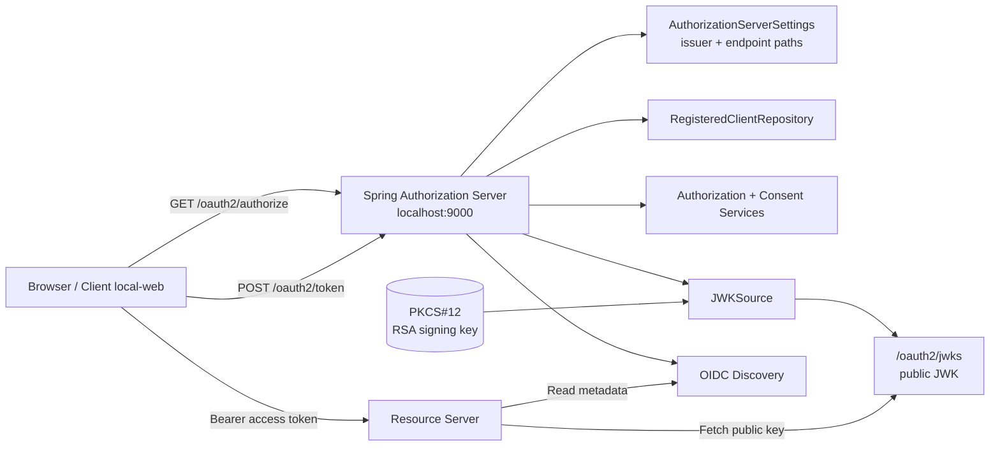
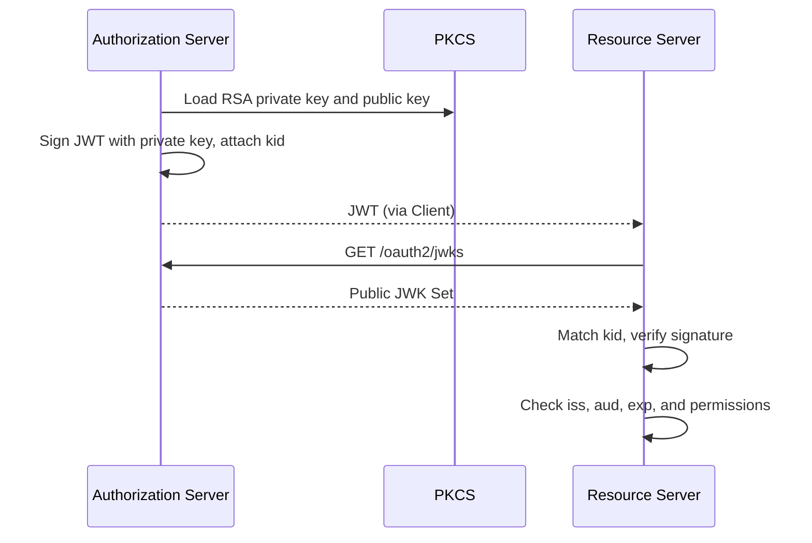
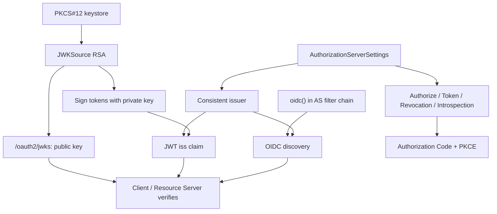

# Preparing Signing Keys, Issuer, and Endpoint Configuration for Local Environments

## 1. Objectives

In the **Project Setup** chapter of the **Spring Security OAuth2 OIDC Authorization Server** module, this step establishes the foundation for a **Spring Boot + Spring Authorization Server (SAS)** application to issue tokens, publish public keys, and expose OAuth 2.0/OpenID Connect (OIDC) configuration metadata. The goal is understanding how to design, configure, secure, and test a local environment before deploying to a live operational environment.

Three configurations must align with one another:

- **Signing key:** the Authorization Server (AS) holds a private key to sign JWTs; clients or Resource Servers use the public key from the JWK Set (JWKS) to verify them.
- **Issuer:** the URI identifying the AS, published in discovery metadata and in the `iss` claim of JWTs.
- **Endpoints:** paths for authorization, token, JWK Set, metadata, revocation, introspection, and enabled OIDC features.

This lesson uses a consistent set of addresses:

| Component | Local Value | Purpose |
| --- | --- | --- |
| Authorization Server | `http://localhost:9000` | HTTP server run by Spring Boot. |
| Issuer | `http://localhost:9000` | Value matched during token verification. |
| Authorization | `http://localhost:9000/oauth2/authorize` | Login/consent to issue an authorization code. |
| Token | `http://localhost:9000/oauth2/token` | Exchanges codes or executes allowed grants. |
| JWKS | `http://localhost:9000/oauth2/jwks` | Publishes public signing keys. |
| OIDC discovery | `http://localhost:9000/.well-known/openid-configuration` | Describes the issuer and OIDC endpoints. |
| Sample OAuth2 client | `local-web` | Client registered on the AS. |
| Client redirect URI | `http://127.0.0.1:8080/login/oauth2/code/local-web` | Client receives the callback after authorization. |

**Sample version:** Java snippets illustrate APIs commonly found in **Spring Security 6.x / Spring Authorization Server 1.x** within the **Spring Boot 3.x** ecosystem. In newer generations, packages or configuration styles may change; use dependencies and APIs compatible with your chosen project version. Do not hardcode an SAS version from a different Spring Security generation.

## 2. Component Map



The AS may start up yet still fail at the protocol level if any piece drifts: using a different issuer hostname; signing with a key that has no matching public key in JWKS; changing an endpoint without updating the client; or `/login` not being handled by the application filter chain.

To make local exercises repeatable, we use an **RSA key stored in PKCS#12**. Generating a fresh RSA key in memory on every run works for a short demo, but causes the signing key to change on restart and prevents earlier tokens from verifying.

## 3. Preparing the Signing Key Pair

### 3.1. Private Key, Public Key, `kid`

For JWTs signed with RS256:

1. **Private RSA key** is known only to the AS and used to create digital signatures.
2. **Public RSA key** is represented as a JWK and published at `/oauth2/jwks` so verifiers can check signatures.
3. The JWT header carries `kid` so verifiers pick the right key in the JWK Set; `kid` must uniquely correspond to a key pair within an active usage period.
4. A public RSA JWK can contain `kty=RSA`, `kid`, `n`, `e`, and `alg=RS256`; it must never contain private parameters such as `d`, `p`, or `q`.



**A JWT signing key is not a TLS certificate.** The self-signed certificate inside the keystore below is simply a container storing the public key alongside the private key; it does not configure HTTPS for Spring Boot's HTTP port.

### 3.2. Creating a Local Keystore with `keytool`

On Windows PowerShell, use `keytool` bundled with the JDK:

```powershell
$keyDir = Join-Path $env:USERPROFILE ".oauth2-local"
New-Item -ItemType Directory -Force -Path $keyDir | Out-Null
$keyStore = Join-Path $keyDir "as-signing.p12"

keytool -genkeypair -alias as-signing -keyalg RSA -keysize 3072 -sigalg SHA256withRSA -storetype PKCS12 -keystore $keyStore -validity 365 -dname "CN=localhost,OU=Learning,O=Local,C=VN"

keytool -list -v -storetype PKCS12 -keystore $keyStore -alias as-signing
```

Key generation prompts for a PKCS#12 password; the example uses that password to open the keystore and retrieve the private key under alias `as-signing`. If a file already exists with this alias, avoid accidentally overwriting an in-use key.

| Parameter | Why It Is Needed |
| --- | --- |
| `-keyalg RSA`, `-keysize 3072` | Generates an RSA pair strong enough for practice exercises; production policy must follow specific security requirements. |
| `-sigalg SHA256withRSA` | Certificate signing algorithm used by `keytool`; the JWT signing algorithm is declared separately as `RS256`. |
| `-storetype PKCS12` | File format storing the key pair and certificate. |
| `-alias as-signing` | Entry name so Java retrieves the right key. |
| `-validity 365` | Self-signed certificate lifetime, **not** the JWT lifetime. |

Store `as-signing.p12` **outside the repository**, granting read permissions only to the account running the AS. Never commit private keys, passwords, client secrets, or access tokens to Git, even in learning projects.

### 3.3. Passing Secret Configuration Locally

Set environment variables in the PowerShell session that will run Spring Boot:

```powershell
$env:LOCAL_AS_KEYSTORE = $keyStore

function Read-LocalSecret([string]$prompt) {
    $secure = Read-Host -Prompt $prompt -AsSecureString
    $handle = [Runtime.InteropServices.Marshal]::SecureStringToBSTR($secure)
    try {
        return [Runtime.InteropServices.Marshal]::PtrToStringBSTR($handle)
    } finally {
        [Runtime.InteropServices.Marshal]::ZeroFreeBSTR($handle)
    }
}

$env:LOCAL_AS_KEYSTORE_PASSWORD = Read-LocalSecret "PKCS12 password"
$env:LOCAL_AS_CLIENT_SECRET = Read-LocalSecret "Local client secret"
$env:LOCAL_AS_USER_PASSWORD = Read-LocalSecret "Local user password"
```

Environment variables remain plaintext data inside the process, so this approach is strictly for local use. Passwords are entered without echoing characters on screen or appearing as literals in command history. You can substitute IDE secret settings or a secret management tool. On Linux/macOS, the commands to set environment variables differ while variable names remain the same.

## 4. Pinning the Issuer and Endpoint Paths

### 4.1. `application.yml`

In `src/main/resources/application.yml`, create the illustrative configuration:

```yaml
server:
  port: 9000

app:
  auth:
    issuer: ${LOCAL_AS_ISSUER:http://localhost:9000}
    key-store: ${LOCAL_AS_KEYSTORE}
    key-store-password: ${LOCAL_AS_KEYSTORE_PASSWORD}
    key-alias: as-signing
    key-id: local-rsa-v1
    local-client-secret: ${LOCAL_AS_CLIENT_SECRET}
    local-user-password: ${LOCAL_AS_USER_PASSWORD}
```

Note: if `LOCAL_AS_ISSUER` is unset, it defaults to `http://localhost:9000` via the default expression. The remaining variables have no defaults; the application must refuse to start if required credentials/keystores are missing.

**Rules for `issuer`:**

- `issuer` is an **absolute URI**, such as `http://localhost:9000`, not `localhost` or `http://localhost:9000/oauth2/token`.
- Discovery metadata and the `iss` claim in JWTs must match the issuer exactly, including scheme, hostname, port, and path if present.
- `http://localhost:9000` and `http://127.0.0.1:9000` are **two different issuers as strings** even though both point to loopback.
- The client callback `http://127.0.0.1:8080/...` belongs to client configuration, **not the issuer**.
- When the AS runs behind a reverse proxy, the issuer must be the stable public URL (usually HTTPS). Forwarded headers should only be trusted from a controlled gateway/proxy.

### 4.2. The `AuthorizationServerSettings` Bean

Standard OAuth2/OIDC endpoints are implemented by SAS; no custom controllers are required:

```java
@Bean
AuthorizationServerSettings authorizationServerSettings(
        @Value("${app.auth.issuer}") String issuer) {

    return AuthorizationServerSettings.builder()
            .issuer(issuer)
            .authorizationEndpoint("/oauth2/authorize")
            .tokenEndpoint("/oauth2/token")
            .jwkSetEndpoint("/oauth2/jwks")
            .tokenRevocationEndpoint("/oauth2/revoke")
            .tokenIntrospectionEndpoint("/oauth2/introspect")
            .build();
}
```

These paths are the familiar defaults, declared explicitly here so learners can inspect them. Changing any path requires updating clients/gateways/tests and re-checking metadata. Enabling OIDC in security config activates the framework-supported OIDC endpoints per configuration.

### 4.3. Endpoint List and Responsibilities

| Endpoint | Primary Method | Role | Access / Configuration Level |
| --- | --- | --- | --- |
| `/oauth2/authorize` | GET | Authenticates user, collects consent, issues authorization code | Validates registered client, redirect URI, scopes, PKCE; typically involves browser/login. |
| `/oauth2/token` | POST | Exchanges authorization codes or executes other grants | Requires client verification and policy-compliant grants. |
| `/oauth2/jwks` | GET | Serves the **public** JWK Set | Requires `JWKSource<SecurityContext>`; never exposes private keys. |
| `/.well-known/oauth-authorization-server` | GET | OAuth 2.0 metadata | Publishes matching issuer/endpoints when supported. |
| `/.well-known/openid-configuration` | GET | OIDC Provider Discovery | Requires OIDC to be enabled. |
| `/oauth2/revoke` | POST | Revokes tokens per RFC 7009 | Only for authorized clients; not a public page accepting arbitrary tokens. |
| `/oauth2/introspect` | POST | Queries token state per RFC 7662 | Requires caller authentication/authorization. |
| `/userinfo` | GET/POST per config | Returns OIDC user claims | Requires an appropriate access token and OIDC enabled. |
| `/connect/logout` | Per config | OIDC logout | Involves sessions and logout/redirect policy. |
| `/oauth2/device_authorization`, `/oauth2/device_verification` | Per protocol | Device grant | Only when supported by client and SAS version. |
| `/connect/register` | POST | OIDC Dynamic Client Registration | Sensitive; do not enable by default merely because OIDC is enabled. |

Checking only that a request returns HTTP 200 is insufficient: metadata must contain the right issuer and endpoint URLs; tokens must be signed with the key matching JWKS; and endpoints must enforce protocol rules.

## 5. Configuring Spring Security for the AS and Login

The code below shows the beans to place inside `LocalAuthorizationServerConfig` annotated with `@Configuration(proxyBeanMethods = false)` and `@EnableWebSecurity`. Imports are omitted to focus on relationships between configurations; your IDE can add imports matching your compatible dependencies.

### 5.1. Two `SecurityFilterChain`s

```java
@Configuration(proxyBeanMethods = false)
@EnableWebSecurity
public class LocalAuthorizationServerConfig {

    @Bean
    @Order(1)
    SecurityFilterChain authorizationServerChain(HttpSecurity http)
            throws Exception {

        OAuth2AuthorizationServerConfigurer authorizationServer =
                OAuth2AuthorizationServerConfigurer.authorizationServer();

        http
            .securityMatcher(authorizationServer.getEndpointsMatcher())
            .with(authorizationServer, configurer ->
                    configurer.oidc(Customizer.withDefaults()))
            .authorizeHttpRequests(authorize ->
                    authorize.anyRequest().authenticated())
            .exceptionHandling(exceptions ->
                    exceptions.defaultAuthenticationEntryPointFor(
                            new LoginUrlAuthenticationEntryPoint("/login"),
                            new MediaTypeRequestMatcher(MediaType.TEXT_HTML)))
            .oauth2ResourceServer(oauth2 ->
                    oauth2.jwt(Customizer.withDefaults()));

        return http.build();
    }

    @Bean
    @Order(2)
    SecurityFilterChain applicationChain(HttpSecurity http)
            throws Exception {

        http
            .authorizeHttpRequests(authorize ->
                    authorize.anyRequest().authenticated())
            .formLogin(Customizer.withDefaults());

        return http.build();
    }

    // Place the @Beans from the following sections in this class.
}
```

**Why two chains?** `/oauth2/authorize` belongs to the AS chain; `/login` typically belongs to the application chain. When a user is unauthenticated, the AS redirects the browser to the login page provided by the application. If matchers or `@Order` are wrong, the browser may hit 404/403 or a redirect loop. `oauth2ResourceServer().jwt()` supports OIDC features that process Bearer tokens, such as UserInfo.

Do not disable CSRF globally to avoid errors: form login and consent involve browser interactions that require proper CSRF protection.

### 5.2. Loading an RSA Key from a Keystore into `JWKSource`

Add to the same configuration class:

```java
@Bean
JWKSource<SecurityContext> jwkSource(
        @Value("${app.auth.key-store}") String path,
        @Value("${app.auth.key-store-password}") String password,
        @Value("${app.auth.key-alias}") String alias,
        @Value("${app.auth.key-id}") String keyId) throws Exception {

    KeyStore store = KeyStore.getInstance("PKCS12");

    try (InputStream stream = Files.newInputStream(Path.of(path))) {
        store.load(stream, password.toCharArray());
    }

    Key key = store.getKey(alias, password.toCharArray());
    Certificate cert = store.getCertificate(alias);

    if (!(key instanceof RSAPrivateKey) ||
            cert == null ||
            !(cert.getPublicKey() instanceof RSAPublicKey)) {
        throw new IllegalStateException(
                "Key alias must contain a matching RSA key pair");
    }

    RSAKey rsaJwk = new RSAKey.Builder(
            (RSAPublicKey) cert.getPublicKey())
            .privateKey((RSAPrivateKey) key)
            .keyID(keyId)
            .keyUse(KeyUse.SIGNATURE)
            .algorithm(JWSAlgorithm.RS256)
            .build();

    JWKSet keySet = new JWKSet(rsaJwk);
    return (selector, context) -> selector.select(keySet);
}

@Bean
JwtDecoder jwtDecoder(JWKSource<SecurityContext> jwkSource) {
    return OAuth2AuthorizationServerConfiguration.jwtDecoder(jwkSource);
}
```

**Required imports:**

- Java: `java.io.InputStream`, `java.nio.file.Files`, `java.nio.file.Path`, `java.security.Key`, `java.security.KeyStore`, `java.security.cert.Certificate`, `java.security.interfaces.RSAPublicKey`, `java.security.interfaces.RSAPrivateKey`.
- Nimbus: `com.nimbusds.jose.JWSAlgorithm`, `com.nimbusds.jose.jwk.KeyUse`, `com.nimbusds.jose.jwk.RSAKey`, `com.nimbusds.jose.jwk.JWKSet`, `com.nimbusds.jose.jwk.source.JWKSource`, `com.nimbusds.jose.proc.SecurityContext`.
- Spring: `org.springframework.security.oauth2.jwt.JwtDecoder`, `org.springframework.security.oauth2.server.authorization.config.annotation.web.configuration.OAuth2AuthorizationServerConfiguration`.

Inside the application, `JWKSource` is allowed to hold the private key for signing JWTs; however, the **JWKS response only publishes public members**. Avoid writing a custom REST controller that returns the entire RSA JWK object directly, as doing so can accidentally expose private key material.

Add the `AuthorizationServerSettings` bean from Section 4.2 to this class. In a real project, never register two conflicting settings beans.

### 5.3. Client, User, and State for the Practice Exercise

Completing Authorization Code + PKCE requires a user source, client registration, and services for storing authorizations/consents. These beans also go inside the configuration class:

```java
@Bean
PasswordEncoder passwordEncoder() {
    return new BCryptPasswordEncoder();
}

@Bean
UserDetailsService userDetailsService(
        PasswordEncoder encoder,
        @Value("${app.auth.local-user-password}") String password) {

    UserDetails user = User.withUsername("alice")
            .password(encoder.encode(password))
            .roles("USER")
            .build();

    return new InMemoryUserDetailsManager(user);
}

@Bean
RegisteredClientRepository registeredClientRepository(
        PasswordEncoder encoder,
        @Value("${app.auth.local-client-secret}") String secret) {

    RegisteredClient localClient = RegisteredClient
            .withId(UUID.randomUUID().toString())
            .clientId("local-web")
            .clientSecret(encoder.encode(secret))
            .clientAuthenticationMethod(
                    ClientAuthenticationMethod.CLIENT_SECRET_BASIC)
            .authorizationGrantType(
                    AuthorizationGrantType.AUTHORIZATION_CODE)
            .authorizationGrantType(
                    AuthorizationGrantType.REFRESH_TOKEN)
            .redirectUri(
                    "http://127.0.0.1:8080/login/oauth2/code/local-web")
            .scope(OidcScopes.OPENID)
            .scope(OidcScopes.PROFILE)
            .clientSettings(ClientSettings.builder()
                    .requireProofKey(true)
                    .requireAuthorizationConsent(true)
                    .build())
            .build();

    return new InMemoryRegisteredClientRepository(localClient);
}

@Bean
OAuth2AuthorizationService authorizationService() {
    return new InMemoryOAuth2AuthorizationService();
}

@Bean
OAuth2AuthorizationConsentService authorizationConsentService() {
    return new InMemoryOAuth2AuthorizationConsentService();
}
```

These classes come from Spring Security/SAS, including `RegisteredClient`, `RegisteredClientRepository`, `InMemoryRegisteredClientRepository`, `ClientSettings`, `AuthorizationGrantType`, `ClientAuthenticationMethod`, `OidcScopes`, `OAuth2AuthorizationService`, and `OAuth2AuthorizationConsentService`.

In this configuration:

- `local-web` is a **confidential client**, so the client authenticates at the token endpoint via HTTP Basic with its client ID and secret.
- `requireProofKey(true)` enforces PKCE on the Authorization Code Flow; `S256` should be used.
- `requireAuthorizationConsent(true)` requires user consent before granting the corresponding scopes.
- The `openid` scope signals an OIDC request; `profile` is the user profile scope group.
- `InMemory*` serves local development. Active authorization codes/consents are lost on restart; multi-instance deployments require shared persistence.
- The `alice` account and secret must use demo data, passed via environment variables, never hardcoded real credentials.

Thus, the **key/issuer/endpoints** layer can be tested independently via metadata/JWKS; the full authorization flow requires a client callback running on port 8080.

## 6. Checking Issuer and JWKS After Startup

On PowerShell, use `curl.exe` to avoid `curl` resolving to the `Invoke-WebRequest` alias.

### 6.1. OIDC Discovery

```powershell
curl.exe -i http://localhost:9000/.well-known/openid-configuration
curl.exe -i http://localhost:9000/.well-known/oauth-authorization-server
```

When OIDC is enabled and configured properly, a portion of the JSON metadata looks like this (other fields omitted):

```json
{
  "issuer": "http://localhost:9000",
  "authorization_endpoint": "http://localhost:9000/oauth2/authorize",
  "token_endpoint": "http://localhost:9000/oauth2/token",
  "jwks_uri": "http://localhost:9000/oauth2/jwks"
}
```

Compare the **actual values** in metadata against `app.auth.issuer` and the configured endpoints. Additional fields such as `response_types_supported`, `grant_types_supported`, `id_token_signing_alg_values_supported`, and others may appear.

### 6.2. JWKS Public Key

```powershell
curl.exe -i http://localhost:9000/oauth2/jwks
```

Illustrative response:

```json
{
  "keys": [
    {
      "kty": "RSA",
      "kid": "local-rsa-v1",
      "use": "sig",
      "alg": "RS256",
      "n": "PUBLIC_MODULUS_BASE64URL",
      "e": "AQAB"
    }
  ]
}
```

`n` in the example is shortened for illustration, not a real value. Verify:

- `kid` matches `app.auth.key-id` and the key ID in subsequent JWT headers.
- `kty=RSA` and the public parameters are usable by verifiers.
- None of `d`, `p`, `q`, `dp`, `dq`, `qi`, or any private parameters appear.

If you restart the application and fetch JWKS again, the public key for the same keystore and alias must remain unchanged. Changing `kid` without rotating the key pair does not constitute key rotation.

## 7. Testing Authorization Code + PKCE with OIDC

Create or run an OAuth2/OIDC client `local-web` at `http://127.0.0.1:8080`. Configure that client to use issuer `http://localhost:9000`, the matching client secret, and the registered redirect URI. If no client is running yet, limit checks to discovery/JWKS and the HTTP response from authorize; the callback will have no receiving application.

You can generate `code_verifier` and `code_challenge` manually in PowerShell to understand PKCE:

```powershell
$bytes = New-Object byte[] 32
[System.Security.Cryptography.RandomNumberGenerator]::Create().GetBytes($bytes)

$verifier = [Convert]::ToBase64String($bytes).TrimEnd('=').Replace('+','-').Replace('/','_')
$sha256 = [System.Security.Cryptography.SHA256]::Create()
$hash = $sha256.ComputeHash([System.Text.Encoding]::ASCII.GetBytes($verifier))
$challenge = [Convert]::ToBase64String($hash).TrimEnd('=').Replace('+','-').Replace('/','_')

$state = [guid]::NewGuid().ToString('N')
$nonce = [guid]::NewGuid().ToString('N')
$redirect = [uri]::EscapeDataString(
    "http://127.0.0.1:8080/login/oauth2/code/local-web")

$url = "http://localhost:9000/oauth2/authorize?response_type=code&client_id=local-web&redirect_uri=$redirect&scope=openid%20profile&state=$state&nonce=$nonce&code_challenge=$challenge&code_challenge_method=S256"
Start-Process $url
```

Expected flow:

1. The browser opens the authorize endpoint; the AS validates `local-web`, redirect URI, scopes, and PKCE requirement.
2. If not logged in, the AS redirects to `/login` handled by the application filter chain.
3. Demo user `alice` logs in; the AS displays consent if required.
4. Once approved, the AS redirects to the callback carrying `code` and `state`.
5. The client verifies the saved `state` and uses the `code_verifier` matching the code challenge to exchange the code at the token endpoint.
6. With the `openid` scope, a successful response can include an ID token alongside the access token; a refresh token depends on policy.

If a client library generates `state`/PKCE itself, use **exclusively the values managed by that client**. Do not take `verifier` from the PowerShell snippet and pair it with a code from a different authorization request.

To inspect the token endpoint with a manual request (in the same PowerShell session holding this flow's `verifier`):

```powershell
$code = Read-Host "Authorization code"

curl.exe --user local-web --data-urlencode "grant_type=authorization_code" --data-urlencode "code=$code" --data-urlencode "redirect_uri=http://127.0.0.1:8080/login/oauth2/code/local-web" --data-urlencode "code_verifier=$verifier" http://localhost:9000/oauth2/token
```

`--user local-web` causes `curl.exe` to prompt for the client secret interactively instead of putting the secret directly on the command line. The code is **single-use** and short-lived. Tokens, authorization codes, and client secrets should never be printed to logs or sent to external services.

**Cases to test:** missing `code_verifier`, wrong verifier, `redirect_uri` differing from the registered value, wrong client secret, and an already-used code. The server must reject and issue no token when validation fails. Never disable PKCE or redirect URI validation just to make a test request succeed.

## 8. Connecting a Resource Server to the Issuer

A Resource Server is typically an API in a separate process or port. With JWT access tokens and Spring Security Resource Server, initial configuration on the API is:

```yaml
spring:
  security:
    oauth2:
      resourceserver:
        jwt:
          issuer-uri: http://localhost:9000
```

Spring Security can fetch metadata/JWKS to verify the signature and configured issuer. The Resource Server must still validate **audience** (`aud`) and **scopes/authorities** specific to that API; a valid signature does not mean a token is valid for every API. If the AS issues opaque tokens, consider introspection instead of offline JWT signature verification.

**Docker note:** `localhost:9000` inside a container refers to the container's own loopback, not automatically the host machine. When bridging host/containers or adding a reverse proxy, configure transport routing properly **while keeping the issuer in metadata and JWTs consistent**.

## 9. Common Errors

| Symptom | Possible Cause | How to Check |
| --- | --- | --- |
| Startup fails due to keystore | Wrong path, alias, password, or read permissions | Check environment variables, `keytool -list` output, and filesystem permissions. |
| `/oauth2/jwks` returns 404 | Missing `JWKSource`, path changed, or AS chain did not match | Cross-check settings and filter chains. |
| OIDC discovery returns 404 | OIDC not enabled or endpoint unsupported per config | Check `oidc(Customizer.withDefaults())` and paths. |
| Login redirects in a loop | Incorrect application chain, session, or entry point | Check `@Order` ordering and `/login` requests. |
| Authorize returns `invalid_request` | Invalid client, redirect URI, scope, or PKCE | Compare request parameters against `RegisteredClient`; avoid redirect wildcards. |
| Token returns `invalid_client` | Client authentication method or secret mismatch | Check `CLIENT_SECRET_BASIC` and configured secret. |
| Token returns `invalid_grant` | Expired/used code, wrong verifier, or redirect URI mismatch | Start a fresh flow, verify S256 PKCE, never reuse codes. |
| Resource Server reports invalid issuer | `iss` differs from `issuer-uri` in hostname/scheme/port | Compare token `iss` with metadata `issuer` and API config. |
| Invalid signature after restart | Private key changed or stale JWKS cache | Ensure the same keystore is used; on rotation, update `kid` and publish public keys properly. |
| Metadata advertises internal URLs behind proxy | Misconfigured issuer or trusted forwarded headers | Set issuer to the public URL and configure proxy headers properly. |
| `/userinfo` returns 401 | Invalid token or missing resource server JWT/OIDC handling | Check bearer token, scopes, and `oauth2ResourceServer().jwt()`. |

Distinguish **OAuth2 protocol** errors from HTTP security errors: `invalid_client` and `invalid_grant` are token endpoint errors; `404` may come from filter matchers/paths; redirect loops may come from session or login chain configuration. Pinpoint the failing stage before modifying related beans.

## 10. Moving Beyond Local Environments

| Item | Local | Production |
| --- | --- | --- |
| Network protocol | HTTP loopback | HTTPS public hostname, TLS, and trusted proxies. |
| Signing key | PKCS#12 outside the repository | Managed key store, KMS/HSM if required, safe rotation and backups. |
| Issuer | `http://localhost:9000` | Fixed HTTPS URL matching metadata/JWTs and verifier configuration. |
| Client/authorization data | `InMemory*` | Persistent repositories shared across instances. |
| Users | Demo `alice` | Identity store, password policy, MFA, sessions, and auditing. |
| Operations | Curl and local testing | Metrics, error monitoring, access restrictions, logs with tokens/secrets redacted. |

For **key rotation**, you cannot simply change `kid` in a YAML file. You must generate a new key pair with a new `kid`; switch signing to the new key; continue publishing the old public key during an overlap window so valid old tokens still verify; and only remove the old public key after existing tokens and caches expire. When multiple AS instances run concurrently, all must share compatible key, issuer, and authorization state configurations.

### Acceptance Checklist

- [ ] AS runs on port 9000 with fixed issuer `http://localhost:9000`.
- [ ] PKCS#12 keystore exists outside Git, alias and password are correct, and RSA private key loads cleanly.
- [ ] OIDC discovery returns the exact `issuer`, `authorization_endpoint`, `token_endpoint`, and `jwks_uri`.
- [ ] JWKS returns a public RSA JWK with `kid=local-rsa-v1` and no private parameters.
- [ ] Authorization endpoint directs the browser to login and consent according to client configuration.
- [ ] Token endpoint issues tokens for valid code/PKCE/client credentials and rejects invalid codes.
- [ ] Resource Server validates issuer/signature and enforces its own audience/scope policies.
- [ ] Restarting the AS continues to publish the exact same public key from the same keystore.
- [ ] No client secrets, private keys, codes, or real tokens are stored in Git or logs.

## 11. Memory Map



The three configurations—**signing keys – issuer – endpoints**—form a unified set. Once metadata, JWKS, and the Authorization Code + PKCE flow all operate properly, your local environment provides a solid base for diving deeper into client design, consent, token lifecycle, security testing, and operating an Authorization Server with Spring Security and Spring Authorization Server.
