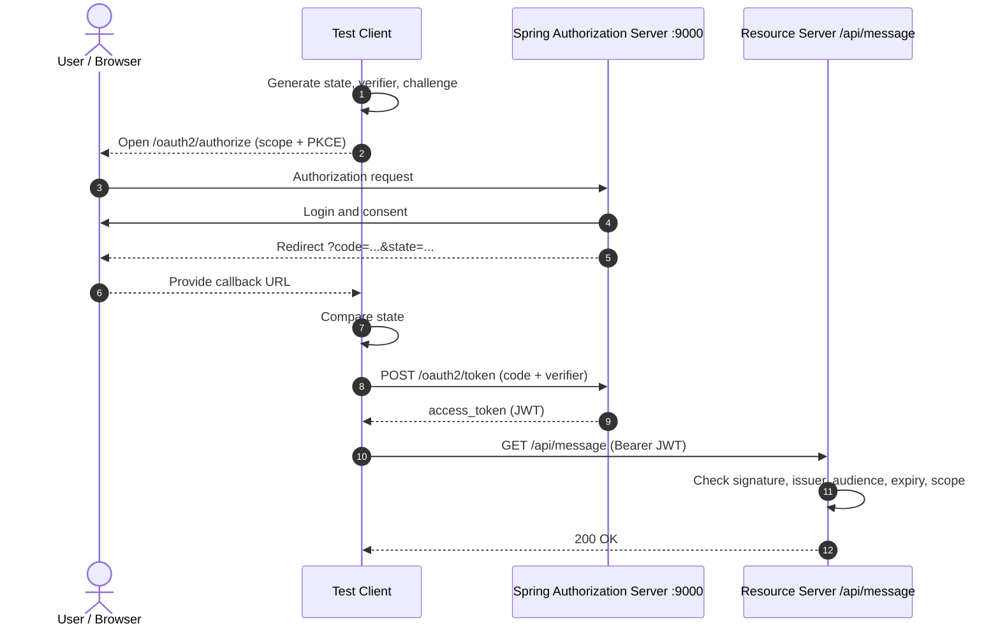

# Running an Authorization Code Round Trip and Verifying Your First Token

## 1. Objectives and Expected Outcomes

This hands-on lesson belongs to the **Project Setup** chapter of the **SPRING_SECURITY_OAUTH2_OIDC_AUTHORIZATION_SERVER** module. The goal is to manually configure an **OAuth 2.0 Authorization Server** with **Spring Security**, **Spring Authorization Server**, and **Spring Boot**, complete one full **Authorization Code Flow with PKCE**, and then **verify that the access token is genuinely accepted** when calling an API.

By the end of this lesson, you will be able to:

1. Run an Authorization Server on `http://localhost:9000` and log in using a test account.
2. Register a client permitted to use `authorization_code` with a redirect URI, scopes, and PKCE.
3. Generate `state`, `code_verifier`, and `code_challenge`, then send an authorization request via the browser.
4. Receive an `authorization code`, verify `state`, and exchange the code for an access token at the token endpoint.
5. Verify the JWT signature, issuer, audience, expiration, and scopes using **Spring Security Resource Server** in an illustrative API.
6. Inspect token status via introspection and distinguish an access token from an OpenID Connect (OIDC) ID Token.

To keep steps concise, the example places the **Authorization Server** and the **sample API (Resource Server)** in the **same Spring Boot application**. This is a lab layout for immediately verifying your first token; real deployments usually separate the two roles into independent services.

### Observable Outcomes

| Step | Endpoint / Action | Success Indicator |
| --- | --- | --- |
| Configuration discovery | `GET /.well-known/openid-configuration` | JSON declaring `issuer` and endpoints |
| Authorization request | `GET /oauth2/authorize` | Login/consent screen; redirect with `code` and `state` |
| Code-to-token exchange | `POST /oauth2/token` | JSON containing `access_token`, `token_type: Bearer` |
| Token verification | `GET /api/message` with Bearer token | HTTP `200` and subject details |
| Token check at AS | `POST /oauth2/introspect` | JSON with `"active": true` while the token is valid |



## 2. Preparing the Environment

This lesson uses **Java 17+**, **Maven 3.9+**, a browser, and **PowerShell** with `curl.exe` (Windows). The configuration code below uses **Spring Boot 3.5.7** as a concrete practice baseline; Boot's starters manage compatible versions of Spring Security and Spring Authorization Server. If using a different Boot version, check the corresponding documentation before changing configuration APIs.

Fixed addresses to avoid confusion:

| Component | Value in This Lesson |
| --- | --- |
| Issuer/Authorization Server | `http://localhost:9000` |
| Authorization endpoint | `http://localhost:9000/oauth2/authorize` |
| Token endpoint | `http://localhost:9000/oauth2/token` |
| Client Redirect URI | `http://127.0.0.1:8080/callback` |
| Client ID | `demo-client` |
| Client secret | `demo-secret`, for learning only |
| Resource Owner account | `alice / password`, for learning only |
| API access scope | `demo.read` |
| Access token audience | `demo-api` |
| API used to verify token | `http://localhost:9000/api/message` |

**Important:** keep `localhost:9000` and `127.0.0.1:8080` exactly as shown. The redirect URI must **match the registered URI exactly**. There is no web app listening on port 8080 in this lesson, so upon redirect the browser will show a connection error; **the URL in the address bar still contains `code` and `state`** for manual copying. Use this technique only in a local test environment.

### Directory Structure

```text
auth-server-demo/
├── pom.xml
└── src/main/
    ├── java/com/example/authserver/
    │   ├── AuthServerApplication.java
    │   ├── SecurityConfig.java
    │   └── MessageController.java
    └── resources/
        └── application.yml
```

## 3. Creating a Spring Boot Application with an Authorization Server

### 3.1. Creating `pom.xml`

```xml
<?xml version="1.0" encoding="UTF-8"?>
<project xmlns="http://maven.apache.org/POM/4.0.0"
         xmlns:xsi="http://www.w3.org/2001/XMLSchema-instance"
         xsi:schemaLocation="http://maven.apache.org/POM/4.0.0 https://maven.apache.org/xsd/maven-4.0.0.xsd">
    <modelVersion>4.0.0</modelVersion>
    <parent>
        <groupId>org.springframework.boot</groupId>
        <artifactId>spring-boot-starter-parent</artifactId>
        <version>3.5.7</version>
        <relativePath/>
    </parent>
    <groupId>com.example</groupId>
    <artifactId>auth-server-demo</artifactId>
    <version>0.0.1-SNAPSHOT</version>
    <properties>
        <java.version>17</java.version>
    </properties>
    <dependencies>
        <dependency>
            <groupId>org.springframework.boot</groupId>
            <artifactId>spring-boot-starter-web</artifactId>
        </dependency>
        <dependency>
            <groupId>org.springframework.boot</groupId>
            <artifactId>spring-boot-starter-security</artifactId>
        </dependency>
        <dependency>
            <groupId>org.springframework.boot</groupId>
            <artifactId>spring-boot-starter-oauth2-authorization-server</artifactId>
        </dependency>
        <dependency>
            <groupId>org.springframework.boot</groupId>
            <artifactId>spring-boot-starter-oauth2-resource-server</artifactId>
        </dependency>
    </dependencies>
    <build>
        <plugins>
            <plugin>
                <groupId>org.springframework.boot</groupId>
                <artifactId>spring-boot-maven-plugin</artifactId>
            </plugin>
        </plugins>
    </build>
</project>
```

- `spring-boot-starter-oauth2-authorization-server` provides OAuth 2.0/OIDC endpoints and the token issuance model.
- `spring-boot-starter-security` provides login, filter chains, and access control.
- `spring-boot-starter-oauth2-resource-server` enables the API to validate issued Bearer JWTs.
- Do not declare an explicit version for Spring Authorization Server when using Spring Boot dependency management.

### 3.2. Main Class

```java
package com.example.authserver;

import org.springframework.boot.SpringApplication;
import org.springframework.boot.autoconfigure.SpringBootApplication;

@SpringBootApplication
public class AuthServerApplication {
    public static void main(String[] args) {
        SpringApplication.run(AuthServerApplication.class, args);
    }
}
```

### 3.3. Configuring Port and Application Name

Create `src/main/resources/application.yml`:

```yaml
server:
  port: 9000

spring:
  application:
    name: auth-server-demo
```

In this lesson, the issuer is configured directly via `AuthorizationServerSettings` in the next step. The **issuer** is the identifier that clients and Resource Servers must trust and match; do not accidentally switch to a different hostname while testing.

### 3.4. Security Configuration, Client Registration, and JWT Signing

Create `SecurityConfig.java`:

```java
package com.example.authserver;

import com.nimbusds.jose.jwk.JWKSet;
import com.nimbusds.jose.jwk.RSAKey;
import com.nimbusds.jose.jwk.source.ImmutableJWKSet;
import com.nimbusds.jose.jwk.source.JWKSource;
import com.nimbusds.jose.proc.SecurityContext;
import org.springframework.context.annotation.Bean;
import org.springframework.context.annotation.Configuration;
import org.springframework.core.annotation.Order;
import org.springframework.http.MediaType;
import org.springframework.security.config.Customizer;
import org.springframework.security.config.annotation.web.builders.HttpSecurity;
import org.springframework.security.core.userdetails.User;
import org.springframework.security.core.userdetails.UserDetails;
import org.springframework.security.core.userdetails.UserDetailsService;
import org.springframework.security.crypto.bcrypt.BCryptPasswordEncoder;
import org.springframework.security.crypto.password.PasswordEncoder;
import org.springframework.security.oauth2.core.AuthorizationGrantType;
import org.springframework.security.oauth2.core.ClientAuthenticationMethod;
import org.springframework.security.oauth2.core.DelegatingOAuth2TokenValidator;
import org.springframework.security.oauth2.core.OAuth2Error;
import org.springframework.security.oauth2.core.OAuth2TokenValidator;
import org.springframework.security.oauth2.core.OAuth2TokenValidatorResult;
import org.springframework.security.oauth2.core.oidc.OidcScopes;
import org.springframework.security.oauth2.jwt.Jwt;
import org.springframework.security.oauth2.jwt.JwtDecoder;
import org.springframework.security.oauth2.jwt.JwtValidators;
import org.springframework.security.oauth2.jwt.NimbusJwtDecoder;
import org.springframework.security.oauth2.server.authorization.OAuth2TokenType;
import org.springframework.security.oauth2.server.authorization.client.InMemoryRegisteredClientRepository;
import org.springframework.security.oauth2.server.authorization.client.RegisteredClient;
import org.springframework.security.oauth2.server.authorization.client.RegisteredClientRepository;
import org.springframework.security.oauth2.server.authorization.config.annotation.web.configuration.OAuth2AuthorizationServerConfiguration;
import org.springframework.security.oauth2.server.authorization.config.annotation.web.configurers.OAuth2AuthorizationServerConfigurer;
import org.springframework.security.oauth2.server.authorization.settings.AuthorizationServerSettings;
import org.springframework.security.oauth2.server.authorization.settings.ClientSettings;
import org.springframework.security.oauth2.server.authorization.token.JwtEncodingContext;
import org.springframework.security.oauth2.server.authorization.token.OAuth2TokenCustomizer;
import org.springframework.security.oauth2.server.resource.web.BearerTokenAuthenticationEntryPoint;
import org.springframework.security.web.SecurityFilterChain;
import org.springframework.security.web.authentication.LoginUrlAuthenticationEntryPoint;
import org.springframework.security.web.util.matcher.MediaTypeRequestMatcher;

import java.security.KeyPair;
import java.security.KeyPairGenerator;
import java.security.interfaces.RSAPrivateKey;
import java.security.interfaces.RSAPublicKey;
import java.util.List;
import java.util.UUID;

@Configuration
public class SecurityConfig {
    private static final String ISSUER = "http://localhost:9000";

    // Separate chain for OAuth 2.0 and OIDC endpoints.
    @Bean
    @Order(1)
    SecurityFilterChain authorizationServerSecurityFilterChain(HttpSecurity http)
            throws Exception {
        OAuth2AuthorizationServerConfigurer as =
                OAuth2AuthorizationServerConfigurer.authorizationServer();

        http
            .securityMatcher(as.getEndpointsMatcher())
            .with(as, configurer -> configurer.oidc(Customizer.withDefaults()))
            .authorizeHttpRequests(auth -> auth.anyRequest().authenticated())
            .exceptionHandling(ex -> ex.defaultAuthenticationEntryPointFor(
                    new LoginUrlAuthenticationEntryPoint("/login"),
                    new MediaTypeRequestMatcher(MediaType.TEXT_HTML)))
            .oauth2ResourceServer(rs -> rs.jwt(Customizer.withDefaults()));

        return http.build();
    }

    // Chain for the login form and sample API in the same application.
    @Bean
    @Order(2)
    SecurityFilterChain applicationSecurityFilterChain(HttpSecurity http)
            throws Exception {
        http
            .authorizeHttpRequests(auth -> auth
                    .requestMatchers("/api/**").hasAuthority("SCOPE_demo.read")
                    .anyRequest().authenticated())
            .formLogin(Customizer.withDefaults())
            .oauth2ResourceServer(rs -> rs.jwt(Customizer.withDefaults()))
            .exceptionHandling(ex -> ex.defaultAuthenticationEntryPointFor(
                    new BearerTokenAuthenticationEntryPoint(),
                    request -> request.getRequestURI().startsWith("/api/")));

        return http.build();
    }

    @Bean
    PasswordEncoder passwordEncoder() {
        return new BCryptPasswordEncoder();
    }

    @Bean
    UserDetailsService users(PasswordEncoder encoder) {
        UserDetails alice = User.withUsername("alice")
                .password(encoder.encode("password"))
                .roles("USER")
                .build();
        return new org.springframework.security.provisioning.InMemoryUserDetailsManager(alice);
    }

    @Bean
    RegisteredClientRepository registeredClients(PasswordEncoder encoder) {
        RegisteredClient client = RegisteredClient.withId(UUID.randomUUID().toString())
                .clientId("demo-client")
                .clientSecret(encoder.encode("demo-secret"))
                .clientAuthenticationMethod(ClientAuthenticationMethod.CLIENT_SECRET_BASIC)
                .authorizationGrantType(AuthorizationGrantType.AUTHORIZATION_CODE)
                .authorizationGrantType(AuthorizationGrantType.REFRESH_TOKEN)
                .redirectUri("http://127.0.0.1:8080/callback")
                .scope("demo.read")
                .scope(OidcScopes.OPENID)
                .scope(OidcScopes.PROFILE)
                .clientSettings(ClientSettings.builder()
                        .requireProofKey(true)
                        .requireAuthorizationConsent(true)
                        .build())
                .build();
        return new InMemoryRegisteredClientRepository(client);
    }

    // Ephemeral RSA key: restarting generates a new key pair.
    @Bean
    JWKSource<SecurityContext> jwkSource() throws Exception {
        KeyPairGenerator generator = KeyPairGenerator.getInstance("RSA");
        generator.initialize(2048);
        KeyPair keyPair = generator.generateKeyPair();

        RSAKey rsaKey = new RSAKey.Builder((RSAPublicKey) keyPair.getPublic())
                .privateKey((RSAPrivateKey) keyPair.getPrivate())
                .keyID(UUID.randomUUID().toString())
                .build();

        return new ImmutableJWKSet<>(new JWKSet(rsaKey));
    }

    // Attach audience to access token so the API verifies the intended recipient.
    @Bean
    OAuth2TokenCustomizer<JwtEncodingContext> tokenCustomizer() {
        return context -> {
            if (OAuth2TokenType.ACCESS_TOKEN.equals(context.getTokenType())) {
                context.getClaims().audience(List.of("demo-api"));
            }
        };
    }

    // Validate signature, issuer, expiration, and audience for JWTs.
    @Bean
    JwtDecoder jwtDecoder(JWKSource<SecurityContext> jwkSource) {
        NimbusJwtDecoder decoder = (NimbusJwtDecoder)
                OAuth2AuthorizationServerConfiguration.jwtDecoder(jwkSource);

        OAuth2TokenValidator<Jwt> issuerAndTime =
                JwtValidators.createDefaultWithIssuer(ISSUER);
        OAuth2TokenValidator<Jwt> correctAudience = jwt ->
                jwt.getAudience().contains("demo-api")
                    ? OAuth2TokenValidatorResult.success()
                    : OAuth2TokenValidatorResult.failure(
                            new OAuth2Error("invalid_token",
                                    "Required audience demo-api", null));

        decoder.setJwtValidator(
                new DelegatingOAuth2TokenValidator<>(issuerAndTime, correctAudience));
        return decoder;
    }

    @Bean
    AuthorizationServerSettings authorizationServerSettings() {
        return AuthorizationServerSettings.builder()
                .issuer(ISSUER)
                .build();
    }
}
```

**Reading the configuration by function:**

- `@Order(1)` selects the filter chain handling the Authorization Server; `@Order(2)` handles the login page and `/api/**`. This separates endpoints within a single application.
- `RegisteredClientRepository` describes what the client is allowed to do; `requireProofKey(true)` requires the client to supply PKCE, and `requireAuthorizationConsent(true)` enables the consent step when applicable.
- `UserDetailsService` creates the Resource Owner account `alice`. Client secrets and user passwords are **two independent credentials**.
- `JWKSource` generates an RSA key pair: the **private key** signs JWTs on the AS; the **public key** is published via JWKS so verifiers can check signatures.
- `OAuth2TokenCustomizer` sets `aud=demo-api` in the **access token**. `JwtDecoder` in the example verifies the signature, `iss`, expiration, and `aud`; the `SCOPE_demo.read` rule checks API access permission.
- `oidc(Customizer.withDefaults())` enables OpenID Connect support. The first run still uses plain OAuth 2.0 with the `demo.read` scope so you can inspect the access token cleanly.

### 3.5. Creating an API to Verify the Access Token

Create `MessageController.java`:

```java
package com.example.authserver;

import org.springframework.security.core.annotation.AuthenticationPrincipal;
import org.springframework.security.oauth2.jwt.Jwt;
import org.springframework.web.bind.annotation.GetMapping;
import org.springframework.web.bind.annotation.RestController;

import java.util.Map;

@RestController
public class MessageController {
    @GetMapping("/api/message")
    public Map<String, Object> message(@AuthenticationPrincipal Jwt jwt) {
        return Map.of(
                "message", "Bearer token has been verified",
                "subject", jwt.getSubject(),
                "issuer", jwt.getIssuer().toString(),
                "audience", jwt.getAudience());
    }
}
```

**Why is this API needed?** Simply decoding a JWT's payload does not prove the token is trustworthy. With the configuration above, before the controller is invoked, Spring Security validates the signature and required claims via `JwtDecoder`, and checks the `SCOPE_demo.read` authority. An HTTP 200 response from the API is observable proof that **the token passed verification** on the sample Resource Server.

## 4. Starting Up and Checking Metadata

In the directory containing `pom.xml`, run:

```powershell
mvn spring-boot:run
```

Keep this process running. Open a **second** PowerShell terminal and check discovery/JWKS:

```powershell
curl.exe -sS http://localhost:9000/.well-known/openid-configuration
curl.exe -sS http://localhost:9000/oauth2/jwks
```

In the metadata, verify:

```json
{
  "issuer": "http://localhost:9000",
  "authorization_endpoint": "http://localhost:9000/oauth2/authorize",
  "token_endpoint": "http://localhost:9000/oauth2/token",
  "jwks_uri": "http://localhost:9000/oauth2/jwks"
}
```

This is an **excerpt of fields to look for**, not the entire actual JSON. JWKS must contain a public JWK, typically with `kty=RSA`, `kid`, `n`, and `e`; **no private key**. If `issuer` in metadata is not `http://localhost:9000`, re-check the configuration and the address used to access it.

## 5. Generating PKCE and Sending the Authorization Request

### 5.1. Generating `code_verifier`, `code_challenge`, and `state`

In the second PowerShell terminal, run the **entire block**:

```powershell
function ConvertTo-Base64Url([byte[]] $bytes) {
    return [Convert]::ToBase64String($bytes).TrimEnd('=').Replace('+', '-').Replace('/', '_')
}

$rng = [System.Security.Cryptography.RandomNumberGenerator]::Create()
$verifierBytes = New-Object byte[] 32
$stateBytes = New-Object byte[] 16
$rng.GetBytes($verifierBytes)
$rng.GetBytes($stateBytes)
$rng.Dispose()

$verifier = ConvertTo-Base64Url $verifierBytes
$state = ConvertTo-Base64Url $stateBytes

$sha = [System.Security.Cryptography.SHA256]::Create()
$hash = $sha.ComputeHash([System.Text.Encoding]::ASCII.GetBytes($verifier))
$sha.Dispose()
$challenge = ConvertTo-Base64Url $hash

$authorizeUrl = "http://localhost:9000/oauth2/authorize?" +
    "response_type=code&client_id=demo-client" +
    "&redirect_uri=http%3A%2F%2F127.0.0.1%3A8080%2Fcallback" +
    "&scope=demo.read&state=$state" +
    "&code_challenge=$challenge&code_challenge_method=S256"

Write-Output "Authorization URL: $authorizeUrl"
Start-Process $authorizeUrl
```

When copying commands, keep `$verifier` and `$state` **in the same PowerShell session** so you can exchange the code for a token next. The script generates:

```text
code_verifier   = random string kept private by the client
code_challenge  = BASE64URL_NO_PADDING(SHA256(ASCII(code_verifier)))
state           = random value binding the callback to the request session
```

The browser authorization request sends only the **challenge**, never `code_verifier` or the client secret:

```http
GET /oauth2/authorize?response_type=code&client_id=demo-client&redirect_uri=http%3A%2F%2F127.0.0.1%3A8080%2Fcallback&scope=demo.read&state=...&code_challenge=...&code_challenge_method=S256 HTTP/1.1
Host: localhost:9000
```

`response_type=code` specifies the authorization response type; the subsequent token request uses `grant_type=authorization_code`.

### 5.2. Logging In, Consenting, and Receiving the Code

The browser opens the Authorization Server's login page. Use the learning account `alice` / `password`; if prompted for consent, approve the `demo.read` scope. Next, the browser redirects to a URL like:

```text
http://127.0.0.1:8080/callback?code=ISSUED_CODE&state=SENT_STATE
```

Because no client application is running on port 8080, the browser will show a connection error. **Copy `code` and `state` from the URL**, not the placeholder values in the example. An authorization code is short-lived and can only be exchanged for a token **once**; do not wait too long before the next step.

In the PowerShell session **still holding `$verifier` and `$state`**, enter:

```powershell
$code = Read-Host "Paste code value from callback URL"
$returnedState = Read-Host "Paste state value from callback URL"

if ($returnedState -cne $state) {
    throw "State mismatch: rejecting authorization response"
}
if ([string]::IsNullOrWhiteSpace($code)) {
    throw "No authorization code received"
}
```

A real client application must store and compare `state` against the initiating session automatically; doing it manually here makes `state`'s role clear. If the callback contains `error=access_denied` instead of a code, the user denied consent or the authorization request failed; handle the error and do not send a token request with an empty code.

## 6. Exchanging the Authorization Code for an Access Token

Send a **Token Request** to `/oauth2/token` via HTTP POST. This client is **confidential**, so it must authenticate using `client_secret_basic`. Unlike the authorization request, this step involves no browser redirect:

```powershell
$tokenJson = curl.exe -sS `
    -u "demo-client:demo-secret" `
    -H "Content-Type: application/x-www-form-urlencoded" `
    --data-urlencode "grant_type=authorization_code" `
    --data-urlencode "code=$code" `
    --data-urlencode "redirect_uri=http://127.0.0.1:8080/callback" `
    --data-urlencode "code_verifier=$verifier" `
    "http://localhost:9000/oauth2/token"

$tokenResponse = $tokenJson | ConvertFrom-Json
if (-not $tokenResponse.access_token) {
    throw "Token request failed: $tokenJson"
}
$accessToken = $tokenResponse.access_token
$tokenResponse | Select-Object token_type, expires_in, scope
```

Example token response structure:

```json
{
  "access_token": "eyJhbGciOiJSUzI1NiIsImtpZCI6Ii4uLiJ9...",
  "token_type": "Bearer",
  "expires_in": 300,
  "scope": "demo.read",
  "refresh_token": "..."
}
```

Token values and lifetimes in the example are illustrative; actual responses depend on token issuance configuration. `refresh_token` may appear for confidential clients permitted to use refresh tokens, though it is not guaranteed for every client. When requesting only `demo.read`, **there is no `id_token`** because OIDC was not requested.

The AS simultaneously validates: client credentials, registered grant type, valid/unused/unexpired code, matching redirect URI, and that `code_verifier` hashes to the `code_challenge` stored in the previous step. Once a code is exchanged for a token, **the same code cannot be exchanged again**.

## 7. Verifying Your First Token

### 7.1. Inspecting Claims to Understand the Token (Not Yet Verification)

By default, the access token issued by the configuration above is a three-part **JWT** (`header.payload.signature`). You can inspect the payload locally with PowerShell:

```powershell
function ConvertFrom-Base64Url([string] $value) {
    $base64 = $value.Replace('-', '+').Replace('_', '/')
    switch ($base64.Length % 4) {
        0 { }
        2 { $base64 += '==' }
        3 { $base64 += '=' }
        default { throw "Invalid JWT segment" }
    }
    return [System.Text.Encoding]::UTF8.GetString(
        [Convert]::FromBase64String($base64))
}

$parts = $accessToken.Split('.')
if ($parts.Length -ne 3) { throw "Access token is not in JWT format" }
$claims = ConvertFrom-Base64Url $parts[1] | ConvertFrom-Json
$claims | Select-Object iss, sub, aud, scope, iat, exp
```

Notable claims:

| Claim | Expected Value | Meaning |
| --- | --- | --- |
| `iss` | `http://localhost:9000` | Authorization Server that issued the token |
| `sub` | Authorized identity, typically `alice` | Subject of the token |
| `aud` | Contains `demo-api` | Intended API recipient of the token |
| `scope` | Contains `demo.read` | Granted permissions |
| `iat` | Issued-at timestamp (Unix time) | Used for time validation |
| `exp` | Expiration timestamp (Unix time) | Token is invalid after this time |

**Decoding the payload does not verify the signature**: anyone can craft a string that looks like a JWT. Never rely on decoded `sub`, `scope`, or `aud` values for authorization decisions until a trusted verifier checks the signature and claims.

### 7.2. Calling the Resource Server for Real Verification

In the same terminal holding `$accessToken`, call the API:

```powershell
curl.exe -i `
    -H "Authorization: Bearer $accessToken" `
    "http://localhost:9000/api/message"
```

If the token is valid, the response looks like:

```http
HTTP/1.1 200 OK
Content-Type: application/json

{
  "message": "Bearer token has been verified",
  "subject": "alice",
  "issuer": "http://localhost:9000",
  "audience": ["demo-api"]
}
```

Inside Spring Security, the execution path is:

1. `BearerTokenAuthenticationFilter` extracts the token from the `Authorization` header.
2. `JwtAuthenticationProvider` invokes `JwtDecoder`; the decoder uses the matching RSA key from `JWKSource` to **verify the signature**, then runs validators for expiration, `iss`, and `aud`.
3. `JwtAuthenticationConverter` maps scopes to authorities such as `SCOPE_demo.read` by default.
4. The `hasAuthority("SCOPE_demo.read")` rule permits calling `MessageController` if the required scope is present.

Thus, HTTP 200 from `/api/message` proves the token **is verified and authorized** in the sample system. It does not mean every other API should accept the token; each Resource Server must validate its own issuer, audience, and permissions.

### 7.3. Checking Token Status via Introspection

Spring Authorization Server also provides an OAuth 2.0 Token Introspection Endpoint. An authorized client authenticates to the AS to ask whether a token is still active:

```powershell
curl.exe -sS `
    -u "demo-client:demo-secret" `
    -H "Content-Type: application/x-www-form-urlencoded" `
    --data-urlencode "token=$accessToken" `
    "http://localhost:9000/oauth2/introspect"
```

A successful response for a currently valid token may include:

```json
{
  "active": true,
  "scope": "demo.read",
  "client_id": "demo-client",
  "token_type": "Bearer"
}
```

That is an **excerpt**; the actual claims returned depend on AS policy. Introspection queries token state at the Authorization Server, which is especially useful for opaque tokens or when checking whether a token has been revoked. With JWTs, a Resource Server can verify signatures and claims locally via JWKS, but if immediate revocation is required, you must design an appropriate strategy (introspection, short token lifetimes, or session/token state tracking).

### 7.4. Testing Critical Failure Paths

| Test | How to Perform | Expected Outcome |
| --- | --- | --- |
| Missing access token | Call `/api/message` without sending a Bearer token | Blocked from API; example configuration returns `401` |
| Modify one character in the JWT signature | Tamper with the token before calling the API | `401 invalid_token` or authentication rejection |
| Reuse an authorization code a second time | Repeat the token request with the same `code` | `invalid_grant` |
| Wrong PKCE | Use a different `code_verifier` on the **first** code exchange | `invalid_grant` |
| Wrong client secret | Change `-u` to an incorrect secret | `invalid_client`; typically HTTP `401` |
| Wrong redirect URI | Token request specifies a different URI from the initial request | `invalid_grant` |
| Wrong `state` on callback | Intentionally alter `state` before client comparison | Client must reject and not exchange the code |
| Token lacking `demo.read` | Use a valid token missing the required scope | `403 Forbidden` at the Resource Server |

**Note when testing PKCE errors:** each authorization code is single-use. To specifically test a wrong PKCE verifier, initiate **a brand-new authorization request** and intentionally send a mismatched verifier on the first token request; otherwise you are only testing code reuse.

## 8. Extension: Obtaining an ID Token via OpenID Connect

Spring Authorization Server in the example already enables OIDC, and the `RegisteredClient` permits `openid` and `profile`. To run another round with OIDC sign-in, generate a **new PKCE pair and state**, then change `scope=demo.read` in the authorization URL to:

```text
scope=openid%20profile%20demo.read
```

With OIDC, you can also send a random `nonce` and verify the `nonce` claim in the ID Token after a successful token request. The token response will additionally include `id_token` for a valid OIDC request:

```json
{
  "access_token": "...",
  "token_type": "Bearer",
  "scope": "openid profile demo.read",
  "id_token": "eyJhbGciOiJSUzI1NiIs...",
  "expires_in": 300
}
```

Distinguish clearly:

- **Access token**: used when calling `/api/message` or other Resource Servers; must validate audience and scopes appropriate for the API.
- **ID Token**: intended for the **OAuth/OIDC client (Relying Party)** to prove the authentication result; the client must verify signature, `iss`, `aud` (client ID), expiration, and `nonce` if sent. **Never use an ID Token in place of an access token when calling APIs.**
- **Authorization code**: a single-use intermediate code exchanged by the client for tokens; it is not a token permitted to call APIs.

A production OIDC client typically uses Spring Security OAuth2 Client or a dedicated OIDC library to automate the flow and validate ID Tokens, instead of copying codes and decoding JWTs manually as in a lab.

## 9. Step-by-Step Troubleshooting

| Symptom | Possible Cause | Where to Check |
| --- | --- | --- |
| `/oauth2/authorize` returns a redirect error | Redirect URI does not match registration | Identical URI in `RegisteredClient` and authorize URL |
| Login page does not appear or redirects loop | Filter chain or endpoint matcher misconfigured | Order of `@Order(1)`/`@Order(2)`, `/login` URL |
| Token endpoint returns `invalid_client` | Wrong Basic auth client ID/secret or method | `clientAuthenticationMethod`, `-u` in `curl.exe` |
| Token endpoint returns `invalid_grant` | Expired/reused code, wrong verifier, wrong redirect URI | Start a fresh flow; keep the original verifier |
| Token endpoint returns `unauthorized_client` | Client is not registered for the grant | `authorizationGrantType(AUTHORIZATION_CODE)` |
| `/api/message` returns `401` | Invalid signature, expired, wrong issuer/audience | JWT decoder, JWKS, `iss`, `aud`, `exp` |
| `/api/message` returns `403` | Valid token missing `demo.read` | `SCOPE_demo.read` rule and actual scopes |
| Tokens from before restart stop working | RSA keys, tokens/consents, and clients live in memory | Re-run the flow after each demo restart |
| `/.well-known/openid-configuration` or `/oauth2/jwks` missing | OIDC/Authorization Server incompletely configured or wrong port | AS filter chain, issuer, starter dependency |

When analyzing failures, inspect the HTTP status, OAuth error code, and server logs at an appropriate level. **Never write raw access tokens, refresh tokens, authorization codes, code verifiers, client secrets, or passwords into logs, issue trackers, or screenshots.**

## 10. From Lab Exercise to Real System Design

This practice exercise deliberately uses a simplified configuration to observe one complete protocol round trip. Before deploying an Authorization Server to a real environment:

1. **HTTPS is mandatory**: replace HTTP localhost with HTTPS for browser redirects, token requests, metadata/JWKS, and API calls.
2. **Persistent storage**: replace `InMemoryRegisteredClientRepository` and in-memory authorization/consent services with durable storage such as JDBC; test restarts and multi-instance setups.
3. **Key management**: do not generate new signing keys on every production startup; store private keys securely, publish public keys via JWKS, and manage `kid`, rotation, and overlap lifetimes for older tokens.
4. **Secret management**: never hardcode client secrets or user passwords; use a secret manager, proper encoding, and authentication policies. Public clients must never be assumed capable of hiding a client secret.
5. **Protecting the Authorization Code Flow**: use `S256` PKCE; verify `state`; strictly register and match redirect URIs; enforce consent and least-privilege scopes.
6. **Separating Resource Servers**: each API verifies token signature, issuer, audience, expiration, and required permissions. If immediate token revocation is needed, define a dedicated strategy.
7. **Security testing**: test code reuse, invalid PKCE, CSRF/state, unregistered redirects, unregistered clients/grants, forged tokens, wrong scopes, key rotation, and expired tokens.

### Lesson Completion Checklist

- [ ] Application starts on port 9000 and discovery reports the exact issuer.
- [ ] JWKS publishes the public key and does not expose the private key.
- [ ] The authorize page allows logging in as `alice`; callback receives `code` and `state`.
- [ ] Client verifies `state` matches before calling the token endpoint.
- [ ] Token request sends proper `grant_type=authorization_code`, `code_verifier`, redirect URI, and client authentication.
- [ ] Token response includes `access_token`; payload contains `iss`, `aud=demo-api`, and `scope=demo.read`.
- [ ] `GET /api/message` with a valid Bearer token returns HTTP 200.
- [ ] Introspection returns `active=true` for an unexpired token.
- [ ] Tampered tokens or reused codes are rejected.

**Key takeaway:** the authorization request goes through the browser to obtain an **authorization code**; the token request uses that code and the PKCE verifier to exchange for an **access token**; the Resource Server accepts an access token only after verifying its signature, issuer, audience, expiration, and permissions. This is the minimal sequence to independently verify your first Authorization Server built with Spring Security and Spring Authorization Server.

## References

- [Spring Authorization Server Reference](https://docs.spring.io/spring-authorization-server/reference/) — Authorization Server configuration, endpoints, `RegisteredClient`, OIDC.
- [Spring Security Reference — OAuth 2.0 Resource Server JWT](https://docs.spring.io/spring-security/reference/servlet/oauth2/resource-server/jwt.html) — JWT decoder, claim validation, and scope authorities.
- [RFC 6749 — OAuth 2.0 Authorization Framework](https://www.rfc-editor.org/rfc/rfc6749) — Authorization Code Grant, authorization requests, and token requests.
- [RFC 7636 — Proof Key for Code Exchange (PKCE)](https://www.rfc-editor.org/rfc/rfc7636) — generating and verifying verifiers/challenges.
- [RFC 7662 — OAuth 2.0 Token Introspection](https://www.rfc-editor.org/rfc/rfc7662) — querying token status.
- [OpenID Connect Core 1.0](https://openid.net/specs/openid-connect-core-1_0.html) — ID Tokens and OIDC authentication.
