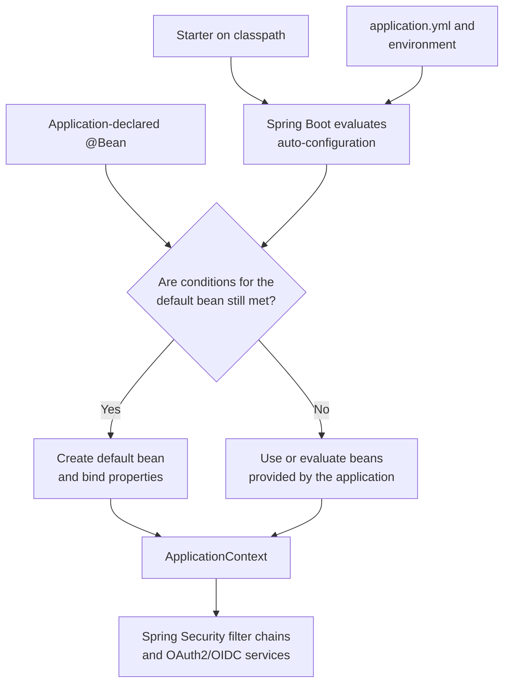
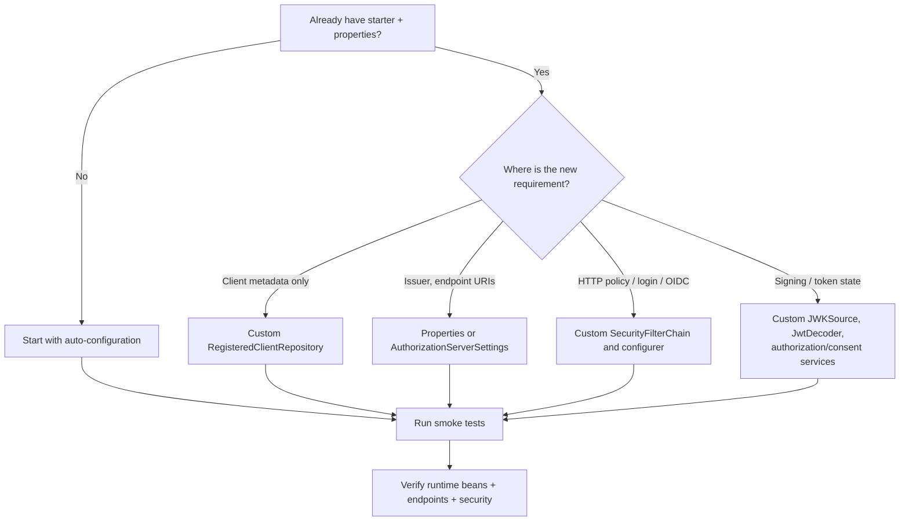

# Distinguishing Spring Boot Auto-Configuration from Explicitly Declared Beans

## 1. Context and Objectives

When setting up a **Spring Security OAuth2/OIDC Authorization Server** with Spring Boot and Spring Authorization Server, there are two common ways to bring security components into the application:

1. **Spring Boot auto-configuration:** add the starter and declare properties in `application.yml`/`application.properties`; Boot evaluates conditions and registers the appropriate beans.
2. **Explicit declaration:** the developer provides `@Configuration` classes and `@Bean` methods to dictate how OAuth clients, the issuer, signing keys, endpoints, or `SecurityFilterChain`s are configured.

These two approaches **can work together**, but you must understand the scope each custom bean affects. Otherwise, a project can run into situations where YAML settings appear ignored, the Authorization Endpoint returns 404, the Token Endpoint misbehaves, or tokens are signed with an unexpected key.

After this lesson, you should be able to answer:

- Which beans are created automatically by Spring Boot; which beans are supplied by Spring Authorization Server or Spring Security through default configuration?
- When does declaring a `@Bean` cause the corresponding auto-configuration to **back off** (stop creating the default bean)?
- Why does declaring your own `SecurityFilterChain` differ from declaring your own `RegisteredClientRepository`?
- How should you progress from minimal configuration to production-grade configuration, and how do you verify which beans are actually active?

This article targets a **Servlet-based Authorization Server** in Spring Boot. Java examples follow the **Spring Boot 3.5 / Spring Authorization Server 1.5** approach; for Spring Boot 4.x / Spring Security 7.x, verify the APIs and packages of your exact version. To let Boot manage compatible versions, prefer Spring Boot's dependency management/BOM rather than manually mixing Spring Security or Spring Authorization Server versions.

## 2. How Does Auto-Configuration Work?

### 2.1. Core Concepts

- **Auto-configuration**: a set of Spring Boot configuration classes with conditions based on the classpath, application type, properties, and existing beans. The goal is providing sensible defaults so an application starts quickly.
- **Bean**: an object inside the Spring `ApplicationContext`, whether registered automatically by Boot, declared by the framework, or declared by your application via `@Bean` or another bean registration mechanism.
- **Conditional/back off**: for instance, `@ConditionalOnMissingBean` lets auto-configuration skip creating a bean when the context already contains a matching bean. **Actual conditions vary across configurations and versions**; do not assume every bean behaves identically.
- **Configuration properties**: Boot binds `spring.*` keys from YAML or the environment to Java configuration objects. A property only takes effect when a component actually **reads** it and translates it into a runtime bean or setting.



An important practical rule: **having YAML entries does not guarantee every default bean will always be created**. For example, if you provide your own JDBC-backed `RegisteredClientRepository`, entries under `spring.security.oauth2.authorizationserver.client.*` are no longer necessarily the registration source for that repository. Look at the actual active beans, not just the config file.

### 2.2. Layers of Responsibility

| Layer | What Does It Do? | Examples |
| --- | --- | --- |
| **Spring Boot** | Reads properties, evaluates conditions, supplies default beans when appropriate. | Creates `InMemoryRegisteredClientRepository` from YAML, sets up certain Authorization Server support beans. |
| **Spring Authorization Server / Spring Security** | Defines protocol mechanics, endpoint filters, authentication providers, token services, domain models, and configurers. | `RegisteredClient`, `OAuth2AuthorizationServerConfigurer`, `OAuth2AuthorizationService`. |
| **Your application** | Enforces security policy, production data, authentication, signing keys, persistence, and integrations. | `JdbcRegisteredClientRepository` bean, custom `AuthorizationServerSettings`, and filter chains. |

**Distinguish "Boot did not auto-create a bean" from "Spring Authorization Server cannot work."** When part of auto-configuration backs off, the remaining components can still be provided by Boot or Spring Security as long as their conditions are satisfied. Conversely, declaring only a few functional beans does not automatically assemble a complete OAuth/OIDC login flow.

## 3. Approach A — Starting with Auto-Configuration and YAML

### 3.1. Minimal Dependencies and Configuration

For a Spring Boot project using Gradle:

```groovy
dependencies {
    implementation 'org.springframework.boot:spring-boot-starter-oauth2-authorization-server'
    testImplementation 'org.springframework.boot:spring-boot-starter-test'
}
```

Or Maven:

```xml
<dependency>
    <groupId>org.springframework.boot</groupId>
    <artifactId>spring-boot-starter-oauth2-authorization-server</artifactId>
</dependency>
```

The following `application.yml` example is for **local development**. Never reuse accounts/secrets from this example in production:

```yaml
server:
  port: 9000

spring:
  security:
    user:
      name: dev-user
      password: dev-password-only
    oauth2:
      authorizationserver:
        issuer: http://127.0.0.1:9000
        client:
          portal:
            registration:
              client-id: portal
              client-secret: "{noop}dev-client-secret-only"
              client-authentication-methods:
                - client_secret_basic
              authorization-grant-types:
                - authorization_code
                - refresh_token
              redirect-uris:
                - http://127.0.0.1:8080/login/oauth2/code/portal
              scopes:
                - openid
                - profile
            require-authorization-consent: true
```

With the right classpath and conditions, Boot registers the components needed to start using the Authorization Server without pre-writing the corresponding beans. For example, clients under `spring.security.oauth2.authorizationserver.client.*` are used to build an in-memory repository. The rest of the application and how OIDC extensions are enabled still depend on the version and security configuration.

**Sensitive data warning:** `{noop}` is included in this learning example only to illustrate the `PasswordEncoder` storage prefix format. In a real system, store values properly hashed with an appropriate encoder (such as `{bcrypt}`), sourced from a secret manager or protected config; never commit production client secrets or passwords. TLS encryption and public issuer configuration must match the real address users reach.

### 3.2. What Does Boot Create, and What Shouldn't Rely on Defaults?

According to the Spring Boot Reference, key Authorization Server customization points include:

| Component | Role | Auto-configuration / Customization Point |
| --- | --- | --- |
| `RegisteredClientRepository` | Stores `client_id`, client authentication methods, grants, redirect URIs, scopes. | Boot can create `InMemoryRegisteredClientRepository` from client properties; declare your own bean to use JDBC or another store. |
| `AuthorizationServerSettings` | Defines the issuer and relative URLs of protocol endpoints. | Boot reads corresponding properties; can be replaced with your own bean. |
| `SecurityFilterChain` | Connects HTTP requests to filters and security rules, including OAuth/OIDC endpoints. | When declaring your own, you must deliberately account for both the Authorization Server chain and the login/application chain. |
| `JWKSource<SecurityContext>` | Provides signing/public keys for tokens and the JWK Set Endpoint when using JWTs. | Can provide your own bean to control keys, rotation, and secure storage. |
| `JwtDecoder` | Decodes and validates JWTs in flows requiring a decoder, especially with OIDC. | Can customize the bean; must match the key set and issuer. |
| `OAuth2AuthorizationService` | Persists authorization state: authorization codes, access tokens, refresh tokens, etc. | Review the persistence provided by the framework/configuration; production usually requires durable storage. |
| `OAuth2AuthorizationConsentService` | Persists user-granted consents. | Configure appropriate storage when long-lived consent persistence is required. |

The first five rows are the **override points explicitly documented by Spring Boot** for Authorization Server. The last two rows highlight critical **Spring Authorization Server** services to review when moving to production; never assume that defining `JdbcRegisteredClientRepository` automatically switches authorizations and consents to JDBC as well.

**Auto-configuration is designed for getting started quickly.** In-memory storage, default accounts, or signing keys scoped to a single process lifetime must be re-evaluated when running multiple instances, supporting token revocation/lookup, preserving logins across restarts, or meeting audit requirements.

## 4. Approach B — Replacing a Single Bean with Explicit Configuration

This is often the cleanest path once a project already runs with YAML and you want to upgrade piece by piece. Suppose client registrations must live in a database so they can be administered and updated without editing config files.

### 4.1. Registering `RegisteredClientRepository` with JDBC

Add the JDBC dependency and database driver, configure `DataSource`, and prepare the schema matching your exact Spring Authorization Server version. Then declare:

```java
import org.springframework.context.annotation.Bean;
import org.springframework.context.annotation.Configuration;
import org.springframework.jdbc.core.JdbcTemplate;
import org.springframework.security.oauth2.server.authorization.client.JdbcRegisteredClientRepository;
import org.springframework.security.oauth2.server.authorization.client.RegisteredClientRepository;

@Configuration(proxyBeanMethods = false)
public class ClientPersistenceConfiguration {

    @Bean
    RegisteredClientRepository registeredClientRepository(JdbcTemplate jdbcTemplate) {
        return new JdbcRegisteredClientRepository(jdbcTemplate);
    }
}
```

**Effect:** the `RegisteredClientRepository` bean in the application context is now the JDBC implementation you supplied. YAML client registrations are no longer turned by Boot into a parallel in-memory repository to "fill in" missing clients. For the `portal` client to work, a corresponding record must exist in the database, including grants, redirect URIs, scopes, and client authentication settings.

Do not expect this configuration to automatically run migrations, create tables, migrate YAML registrations, create resource owner accounts, or persist `OAuth2Authorization` and consents to the database. Those pieces must be implemented separately per your data model and production requirements.

### 4.2. Customizing the Issuer with `AuthorizationServerSettings`

If you need to change endpoints or load the issuer from a custom configuration class, declare:

```java
import org.springframework.context.annotation.Bean;
import org.springframework.context.annotation.Configuration;
import org.springframework.security.oauth2.server.authorization.settings.AuthorizationServerSettings;

@Configuration(proxyBeanMethods = false)
public class IssuerConfiguration {

    @Bean
    AuthorizationServerSettings authorizationServerSettings() {
        return AuthorizationServerSettings.builder()
                .issuer("https://auth.example.com")
                .tokenEndpoint("/oauth2/token")
                .build();
    }
}
```

Once you define this bean yourself, **do not assume Boot still binds every issuer/endpoint property onto it**. The final values are whatever you pass to the builder or your own code. Every related party—OIDC discovery, the `iss` claim, OAuth clients, Resource Servers, and reverse proxies—must agree on the public issuer. Never let the issuer drift dynamically based on the Host header or internal addresses across instances.

Again, **replacing the repository** and **replacing settings** are independent decisions. You can replace either one alone, or both.

### 4.3. Keeping a Single Source of Truth for Configuration

Example of mismatched expectations:

```yaml
spring:
  security:
    oauth2:
      authorizationserver:
        client:
          portal:
            registration:
              client-id: portal
              # ...
```

While the application already has:

```java
@Bean
RegisteredClientRepository registeredClientRepository(JdbcTemplate jdbcTemplate) {
    return new JdbcRegisteredClientRepository(jdbcTemplate);
}
```

In this situation, treat the database as the authoritative source of registrations rather than expecting Boot to silently merge YAML records into JDBC. If you want to bootstrap sample data, use controlled migration/seed scripts or an appropriate idempotent initialization routine.

## 5. Approach C — Declaring `SecurityFilterChain` Yourself: Broader Impact

### 5.1. Why Is This an Important Boundary?

Spring Security uses `FilterChainProxy` and one or more `SecurityFilterChain` beans to protect HTTP requests. If you declare a filter chain yourself to restrict `/admin/**`, Boot's default web security configuration may back off. For an Authorization Server, you must ensure **a chain actually applies `OAuth2AuthorizationServerConfigurer` and matches the protocol endpoints**, alongside a chain serving user login.

For example, having only:

```java
@Bean
SecurityFilterChain applicationChain(HttpSecurity http) throws Exception {
    http.authorizeHttpRequests(authorize ->
            authorize.anyRequest().authenticated());
    return http.build();
}
```

is **not enough to conclude** that the Authorization Server exposes endpoints like `/oauth2/authorize` and `/oauth2/token`. This chain only applies an access rule; it does not activate the OAuth2 protocol configurer. Depending on auto-configuration results, endpoints may not exist or requests may hit the wrong chain.

### 5.2. Complete Illustrative Configuration of Both Chains

The example below uses APIs corresponding to Spring Authorization Server 1.5/Spring Security 6.x and assumes `RegisteredClientRepository` and other required components already exist. Put `@Order(1)` on protocol endpoints and `@Order(2)` on the login/application chain.

```java
import org.springframework.context.annotation.Bean;
import org.springframework.context.annotation.Configuration;
import org.springframework.core.annotation.Order;
import org.springframework.http.MediaType;
import org.springframework.security.config.Customizer;
import org.springframework.security.config.annotation.web.builders.HttpSecurity;
import org.springframework.security.oauth2.server.authorization.config.annotation.web.configurers.OAuth2AuthorizationServerConfigurer;
import org.springframework.security.web.SecurityFilterChain;
import org.springframework.security.web.authentication.LoginUrlAuthenticationEntryPoint;
import org.springframework.security.web.util.matcher.MediaTypeRequestMatcher;

@Configuration(proxyBeanMethods = false)
public class AuthorizationServerSecurityConfiguration {

    @Bean
    @Order(1)
    SecurityFilterChain authorizationServerSecurityFilterChain(HttpSecurity http)
            throws Exception {
        OAuth2AuthorizationServerConfigurer authorizationServer =
                OAuth2AuthorizationServerConfigurer.authorizationServer();

        http
                .securityMatcher(authorizationServer.getEndpointsMatcher())
                .with(authorizationServer, as ->
                        as.oidc(Customizer.withDefaults()))
                .authorizeHttpRequests(authorize ->
                        authorize.anyRequest().authenticated())
                .exceptionHandling(exceptions -> exceptions
                        .defaultAuthenticationEntryPointFor(
                                new LoginUrlAuthenticationEntryPoint("/login"),
                                new MediaTypeRequestMatcher(MediaType.TEXT_HTML)));

        return http.build();
    }

    @Bean
    @Order(2)
    SecurityFilterChain applicationSecurityFilterChain(HttpSecurity http)
            throws Exception {
        http
                .authorizeHttpRequests(authorize -> authorize
                        .requestMatchers("/assets/**").permitAll()
                        .anyRequest().authenticated())
                .formLogin(Customizer.withDefaults());

        return http.build();
    }
}
```

Meaning:

1. `securityMatcher(authorizationServer.getEndpointsMatcher())` scopes the first chain to the protocol endpoints managed by the configurer. This chain has **higher priority** than the application chain.
2. `with(authorizationServer, ...)` wires the filters/providers handling OAuth2; `oidc(Customizer.withDefaults())` enables corresponding OIDC endpoints/features when dependency conditions are met.
3. `LoginUrlAuthenticationEntryPoint("/login")` directs unauthenticated users to the login page for appropriate HTML requests.
4. The second chain provides form login and handles application requests outside the Authorization Server endpoints. A login page does not appear automatically unless a login mechanism is enabled or implemented.

**Do not disable CSRF application-wide** just to "fix" POST errors on the token endpoint. The Spring Authorization Server configurer knows its protocol endpoints and handles related protections accordingly. For application forms and browser sessions, CSRF protection should remain active along the proper flows.

**Avoid overlapping configurations:** never define multiple chains that all match every URL, never accidentally let the general chain run before the Authorization Server chain, and do not treat `@Order` as cosmetic. Spring Security picks the **first chain whose matcher matches the request**, so ordering and matchers have direct impact.

### 5.3. Do You Have to Declare Every Bean Yourself?

No. Declaring `SecurityFilterChain` yourself does not force you to immediately write custom `RegisteredClientRepository`, `JWKSource`, `AuthorizationServerSettings`, and service beans, as long as the required beans exist in the context. However, custom configuration makes you **responsible for verifying** those dependencies. The mere presence of a `@Configuration` class does not prove the entire Authorization Server works properly.

## 6. Choosing the Level of Intervention for Each Requirement

| Requirement | Preferred Approach | What Must Be Verified |
| --- | --- | --- |
| Build a quick OAuth/OIDC demo | Starter + Boot properties | Issuer, endpoint discovery, login, client registration. |
| Register a few fixed clients for test environments | YAML under the Authorization Server prefix | Environment-appropriate redirect URIs and secrets. |
| Manage clients in a database | Custom `RegisteredClientRepository` | Schema, seed data, credential rules, no longer relying on YAML registrations. |
| Change issuer or endpoints | Custom `AuthorizationServerSettings` or Boot properties if sufficient | Discovery and external issuer match expected values; never configure two conflicting sources. |
| Customize form login, consent, authorization rules | Custom `SecurityFilterChain` / configurer | Matchers, chain order, CSRF, request authentication, and login handling. |
| Use centrally managed signing keys with rotation | Custom `JWKSource`, review `JwtDecoder` | Keys survive restarts, JWK Set Endpoint, `kid`, JWT validation. |
| Preserve authorizations and consents across restarts | Custom authorization/consent services | Durable storage, transactions, concurrency, token revocation. |

Quick decision flow:



## 7. Common Confusions When Using YAML and `@Bean`

| Misconception | What Actually Happens and How to Handle It |
| --- | --- |
| "As long as I put it in YAML, Boot will use it." | Auto-configuration conditions must pass; user-defined beans can make defaults back off. Inspect active beans and config sources. |
| "`@Bean` always safely overrides a bean with the same name." | Bean overriding by name may be rejected; Spring Boot backs off via **conditions**, not arbitrary name overriding. Never enable overriding to mask conflicting config. |
| "Adding `@Primary` replaces auto-configuration." | `@Primary` helps disambiguate injection by type, but it does not remove other beans or fix `SecurityFilterChain` ordering. |
| "Using a JDBC repository means consents/tokens also go to JDBC." | Client repository, authorization service, and consent service are separate responsibilities. |
| "Writing a single `anyRequest().authenticated()` chain is enough." | That chain may not attach the Authorization Server configurer and will not expose protocol endpoints. |
| "All Spring Security configuration must be written in Java." | Boot properties work well for simple setups; custom beans make sense when you need policies or infrastructure beyond properties. |
| "Installing the starter automatically gives production accounts." | Default user configuration is only for getting started; production needs real authentication, credential management, and access control. |
| "`spring.security.oauth2.client.registration` registers clients on the Authorization Server." | That configures an **OAuth2 Client in a consuming app**, unlike `spring.security.oauth2.authorizationserver.client.*`, which manages clients **registered at the AS**. |
| "Changing the signing key on restart has no impact." | If keys are unstable, previously issued tokens fail verification; you need proper rotation and key publishing. |

### Distinguishing Three Easily Confused Namespaces

```text
# This application is an Authorization Server and manages clients allowed to receive tokens
spring.security.oauth2.authorizationserver.client.*

# This application is an OAuth2 Client logging in through another provider/Authorization Server
spring.security.oauth2.client.registration.*

# This application is a Resource Server and verifies access tokens
spring.security.oauth2.resourceserver.jwt.*
```

A single Spring Boot process *can* play multiple roles, yet these namespaces still serve distinct responsibilities. Clearly identify which role you are configuring before editing YAML.

## 8. Runtime Verification: Gather Evidence Instead of Guessing

### 8.1. Reading the Condition Evaluation Report

Run the application with Spring Boot's debug flag (only in authorized environments):

```bash
java -jar authorization-server.jar --debug
```

Or set an appropriate log level for `org.springframework.boot.autoconfigure`. In the **Condition Evaluation Report**, look for auto-configuration entries related to OAuth2 Authorization Server and why they matched or did not match. Class/condition names can change across versions; read the condition messages instead of relying on fixed class names.

If using Spring Boot Actuator, `/actuator/conditions` can also help investigate, but enable and protect it only in appropriate administrative environments. Never expose diagnostic endpoints that could reveal application structure or configuration publicly.

### 8.2. Inspecting the Active Beans

Check the application context in tests or during diagnostics. Example with Spring Boot Test:

```java
import org.junit.jupiter.api.Test;
import org.springframework.beans.factory.annotation.Autowired;
import org.springframework.boot.test.context.SpringBootTest;
import org.springframework.security.oauth2.server.authorization.client.RegisteredClientRepository;

import static org.assertj.core.api.Assertions.assertThat;

@SpringBootTest
class ClientRepositoryWiringTest {

    @Autowired
    RegisteredClientRepository repository;

    @Test
    void clientRepositoryIsAvailable() {
        assertThat(repository).isNotNull();
        // If the project uses JDBC, add an assertion for the matching implementation:
        // assertThat(repository).isInstanceOf(JdbcRegisteredClientRepository.class);
    }
}
```

The test above only verifies a repository is present; to verify **registered clients**, follow up with `repository.findByClientId("portal")` according to your test environment and fixtures. With multiple implementations or bean wrappers/decorators, behavioral testing is more reliable than checking class types alone.

### 8.3. Endpoint Smoke Tests

When OIDC is enabled and the issuer matches configuration, check discovery metadata:

```bash
curl -i http://127.0.0.1:9000/.well-known/openid-configuration
```

Verify the metadata response contains `issuer`, `authorization_endpoint`, `token_endpoint`, and `jwks_uri` matching the environment. When using HTTPS/reverse proxies, test via the **public URL** rather than only `localhost`.

Send an invalid token request to verify the endpoint is actually handled; the following example is **not expected to return a token**:

```bash
curl -i -X POST http://127.0.0.1:9000/oauth2/token \
  -H "Content-Type: application/x-www-form-urlencoded" \
  --data "grant_type=client_credentials"
```

With missing client credentials, expect an appropriate **OAuth error** (typically a client authentication error); do not treat 401/400 as proof the system is broken. Conversely, a 404 or HTML login page on a token request indicates the endpoint is not registered or the request matched the wrong security chain. Cross-check HTTP status, body, security logs, and the condition report before drawing conclusions.

### 8.4. Scenario-Based Verification

| Scenario | PASS Indicator |
| --- | --- |
| No custom repository declared | Context has an appropriate repository and finds clients defined in YAML. |
| Custom JDBC repository declared | Context uses the application-supplied repository and loads clients from the seeded database. |
| Custom Authorization Server chain declared | Authorization, token, and metadata endpoints match properly; form login still works. |
| `issuer` modified | Discovery and issued tokens reflect the exact issuer; Resource Server verifies valid tokens successfully. |
| Restart or multi-instance scaling | Signing keys, authorization state, and consents persist per business requirements. |
| Invalid client or redirect | Request is rejected; no codes/tokens are issued outside registered bounds. |

## 9. Real-World Scenario: From Demo to Production

Suppose a development team starts with `spring-boot-starter-oauth2-authorization-server`, one YAML-configured OAuth client, and a demo account. It works, but later they need to manage hundreds of partners, run multiple instances, and rotate signing keys periodically.

A reasonable roadmap:

1. **Keep verifiable configurations:** pin the public issuer, client authentication methods, redirect URIs, and grant types; verify metadata and login paths.
2. **Separate client management:** introduce `JdbcRegisteredClientRepository` or a dedicated repository; establish clear migrations/seeds; stop treating YAML client registrations as the source of truth.
3. **Persist state durably:** select database-backed `OAuth2AuthorizationService` and `OAuth2AuthorizationConsentService`; ensure transactions, expired token cleanup, and revocation support.
4. **Manage signing keys:** supply `JWKSource` from a secure key store, support rotation, protect private keys, and publish public keys via JWKS with stable `kid`s.
5. **Control protocol and login:** customize `SecurityFilterChain` or endpoint configurers only for concrete needs; maintain proper ordering and matchers, considering MFA, CSRF, sessions, and consent.
6. **Add operational verification:** context startup tests, OAuth/OIDC smoke tests, restart/scale tests, monitoring for `invalid_client`/`invalid_grant`, and logging without leaking credentials/tokens.

At each step, change **one intentional responsibility**, verify runtime beans, and only then move forward. There is no benefit in copying all default configurations into Java before you need to change them; equally, you should not stay on in-memory defaults once production requirements outgrow them.

## 10. Key Takeaways

| Question to Answer | Practical Rule |
| --- | --- |
| "Who creates this bean?" | Distinguish Boot auto-configuration, Spring Security/Authorization Server default beans, and application beans. |
| "Does YAML still apply?" | Identify which component reads the property; inspect conditions and active beans. |
| "Does declaring one bean disable all of Boot?" | There is no blanket rule like that. Effects depend on **conditions and bean types**, while `SecurityFilterChain` affects all HTTP security matching. |
| "When should I write Java?" | When you need persistence, custom endpoint/login policies, complex issuers, signing keys, or integrations beyond properties. |
| "How do I know it is right?" | Rely on the condition report, context beans, OAuth/OIDC discovery, request/response behavior, and negative-path rejection tests. |

## 11. References

- [Spring Boot 3.5 — Spring Security, Authorization Server auto-configuration](https://docs.spring.io/spring-boot/3.5/reference/web/spring-security.html): list of beans that can replace default configuration and notes on `InMemoryRegisteredClientRepository`.
- [Spring Boot — OAuth2/Authorization Server](https://docs.spring.io/spring-boot/reference/security/oauth2.html#security.oauth2.authorization-server): examples of client configuration and customizable components in current Boot documentation.
- [Spring Boot 3.5 — Common Application Properties](https://docs.spring.io/spring-boot/3.5/appendix/application-properties/index.html): list of `spring.security.oauth2.authorizationserver.*` properties, including issuer and endpoint paths.
- [Spring Authorization Server 1.5 — Getting Started](https://docs.spring.io/spring-authorization-server/reference/getting-started.html): examples of using the starter and transitioning to full bean declarations.
- [Spring Authorization Server 1.5 — Configuration Model](https://docs.spring.io/spring-authorization-server/reference/configuration-model.html): `OAuth2AuthorizationServerConfigurer`, `AuthorizationServerSettings`, and integration points.
- [Spring Security 7 — Getting Started](https://docs.spring.io/spring-security/reference/servlet/oauth2/authorization-server/getting-started.html): API cross-reference when upgrading to newer Spring Security versions.

**The most important mindset when setting up Spring Authorization Server:** auto-configuration is a set of conditional decisions; an explicit `@Bean` is how you take ownership of one or more of those decisions. Clearly document who owns each critical bean, which configuration remains active, and which tests prove the system runs as designed.
