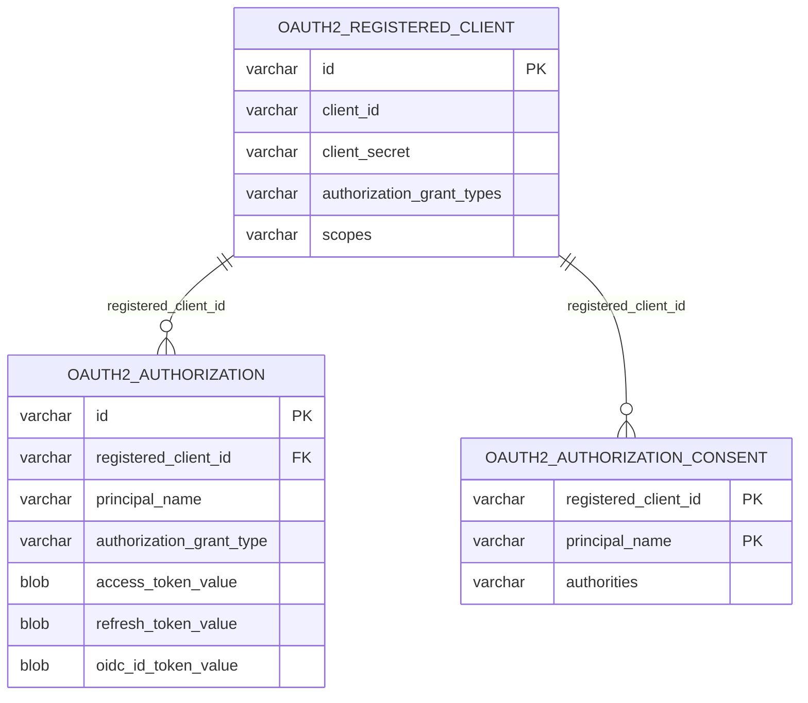
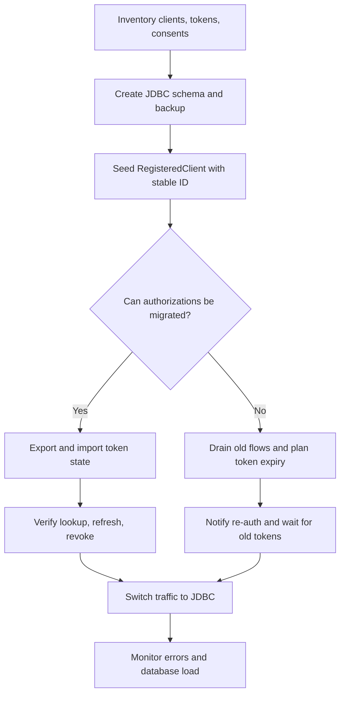

# Migrating from In-Memory Components to Persistent Storage

Spring Authorization Server needs to store client, authorization, and consent state throughout the OAuth 2.0/OpenID Connect lifecycle. When using in-memory implementations, data only exists in process memory. After an application restart, nodes do not share state with each other and active authorizations can no longer be looked up. This causes errors when requests switch nodes, refresh tokens, perform introspection, or handle revocation.

For stable deployment, move the core components to JDBC and use a shared database. Spring Authorization Server provides three JDBC implementations:

- `JdbcRegisteredClientRepository` stores OAuth client registrations;
- `JdbcOAuth2AuthorizationService` stores authorizations along with tokens and metadata;
- `JdbcOAuth2AuthorizationConsentService` stores consents granted by users to clients.

These three implementations use `JdbcOperations` and come with SQL schemas bundled in the library. They enable a quick transition from in-memory to a database without writing custom repositories. However, the Spring Authorization Server documentation describes them as simple JDBC implementations; in particular, `JdbcOAuth2AuthorizationService` may not meet the needs of systems requiring very high throughput. Evaluate queries, data types, transactions, and actual load before deploying to production.

This lesson belongs to the **JDBC Persistence** chapter in the **SPRING_SECURITY_OAUTH2_OIDC_AUTHORIZATION_SERVER** module. The goal is to migrate in-memory components to persistent storage, manage schemas using migrations, preserve links between clients and authorizations, test state recovery, and operate the database safely.

## 1. Why Is Persistent Storage Needed?

### 1.1. Limitations of Process Memory

An in-memory implementation keeps objects in the heap of a single JVM. When the application stops, the data disappears. When running two instances, each instance has an independent copy.

For example: Authorization Server A issues an access token and stores the authorization in A's memory. The next introspection or refresh token request is routed by the load balancer to Server B. B cannot find the corresponding authorization and may reject the token even though it was validly issued by A.

Common issues include:

- Restarts lose dynamically created client registrations;
- Issued authorization codes no longer have state to exchange for tokens;
- Opaque access tokens no longer have records for introspection;
- Refresh tokens no longer have records to validate and rotate;
- Revocation on one node is not visible to other nodes;
- Consents stored in memory are lost after a restart;
- Rolling deployments create periods where nodes hold different states.

In-memory is suitable for demos, unit tests, or short-lived development environments. A production Authorization Server requires a shared and persistent state store.

### 1.2. What Needs to Be Migrated to JDBC

| Component | Responsibility | JDBC implementation |
|---|---|---|
| Client registry | Look up clients, secrets, grants, redirect URIs, scopes, and settings | `JdbcRegisteredClientRepository` |
| Authorization store | Store authorizations, authorization codes, access/refresh tokens, ID Tokens, device codes, and metadata | `JdbcOAuth2AuthorizationService` |
| Consent store | Store authorities/scopes a user has approved for each client | `JdbcOAuth2AuthorizationConsentService` |

`RegisteredClientRepository` is a **required** component of the core model. `OAuth2AuthorizationService` and `OAuth2AuthorizationConsentService` are optional components in framework configuration and may default to in-memory implementations if the application does not provide replacement beans.

Therefore, migrating only the client registry to JDBC is not enough. If the authorization service or consent service remains in-memory, the system will still lose the corresponding state on restart or when requests are routed to another node.

### 1.3. JDBC Does Not Mean All Application State Is Persistent

The three JDBC tables of Spring Authorization Server do not automatically store:

- User accounts, password hashes, or MFA state;
- User login HTTP sessions;
- Signing keys/JWK private keys;
- Issuer configuration, domains, redirect policies, or infrastructure secrets;
- Rate limits, caches, or Resource Server business state.

Those components have their own lifecycles and storage mechanisms. For example, if you need to share HTTP sessions across multiple instances, evaluate Spring Session JDBC/Redis. If you need stable signing keys, use a separately managed key store such as a keystore, KMS, or HSM. Do not confuse the three authorization-server tables with a storage solution for the entire application.

## 2. Understanding the Stored Data

### 2.1. RegisteredClient

`RegisteredClient` describes a registered OAuth 2.0 client. Key fields include:

- Unique internal ID of the registration;
- Public `clientId`;
- Encoded `clientSecret`;
- Secret issuance and expiration timestamps;
- Client authentication methods;
- Authorization grant types;
- Redirect URIs and post-logout redirect URIs;
- Scopes;
- Client settings, such as requiring PKCE or consent;
- Token settings, such as TTL and access-token format.

`JdbcRegisteredClientRepository` maps this object to the `oauth2_registered_client` table. Collections such as grant types, redirect URIs, and scopes are stored as strings; settings are serialized into JSON data by the framework's mapper.

**Keep the internal ID of RegisteredClient stable.** The authorization table stores `registered_client_id` referencing `RegisteredClient.id`, which is not always the user-facing `client_id`. When migrating data, preserve the exact internal ID so existing authorizations can still resolve their registration.

### 2.2. OAuth2Authorization

`OAuth2Authorization` represents the authorization state granted to a client. It contains:

- Authorization ID;
- Registered client ID;
- Principal name of the resource owner or client;
- Authorization grant type;
- Authorized scopes;
- Issued tokens and accompanying metadata;
- Attributes related to the authorization request or principal.

Depending on the grant type, an authorization may contain an authorization code, access token, refresh token, OIDC ID Token, device code, and user code. Tokens have issued-at and expires-at timestamps, token type, scopes, and metadata.

`JdbcOAuth2AuthorizationService` stores the object in the `oauth2_authorization` table. The default schema uses a relatively flat structure: dedicated columns for each token type and LOB columns for metadata/attributes. This allows the default implementation to look up records by token type without designing a custom relational model.

An authorization is not merely a “user has logged in” record. It is protocol state required to process subsequent requests such as refresh, introspection, revocation, and device authorization.

### 2.3. OAuth2AuthorizationConsent

`OAuth2AuthorizationConsent` records a resource owner's decision for a client. A consent is identified by the pair:

- `registered_client_id`;
- `principal_name`.

It contains the set of granted authorities. Authorities can represent scopes or permissions/claims that the user has approved.

For example, a user allows client `portal-bff` to read `profile` and `email`. The consent store holds that decision so subsequent authorization requests can inspect it and display the appropriate consent prompt. Revoked or changed consent must be updated in the shared store so every instance sees the same state.

### 2.4. Relationships Between the Three Data Groups



The diagram illustrates conceptual relationships; the FK label represents a logical link and does not assert that the default SQL schema creates physical foreign-key constraints. Actual column names and types must follow the schema for the exact version of Spring Authorization Server and the database management system in use.

## 3. Choosing the Right Implementation

### 3.1. Using the Built-In JDBC Implementations

Use the three built-in JDBC implementations when:

- You want to migrate quickly from in-memory;
- The framework's standard data model meets your requirements;
- Request volume and authorization count fit within database capacity;
- You do not need complex business queries over individual claims/tokens;
- You can use a schema compatible with the default JDBC mappers.

The advantage is reducing custom code to maintain. Mappers, serialization, and basic queries are already provided by the framework.

### 3.2. When Is a Custom Implementation Needed?

Consider implementing custom services or extending mappers when:

- Throughput is high and token lookups become a bottleneck;
- Partitioning/sharding by tenant or issuer is needed;
- Custom auditing, retention, or archiving policies are required;
- Token lookup via hash/index is needed instead of storing token values in LOB columns;
- Data modeling must conform to a specific database engine or internal data standard;
- Custom transaction and concurrency semantics are needed.

The primary interfaces to replace are:

- `RegisteredClientRepository`;
- `OAuth2AuthorizationService`;
- `OAuth2AuthorizationConsentService`.

When implementing them yourself, preserve the framework's contract, including lookup, save, and remove methods. `OAuth2AuthorizationService.findByToken` is especially critical: introspection, revocation endpoints, and token-handling grants may rely on finding an authorization by credential and token type.

### 3.3. Do Not Switch to JPA Just Because the Application Already Uses JPA

Spring Authorization Server provides official JDBC implementations. If you want to use JPA, you must fully map domain objects, serialize attributes/settings/metadata, and implement the three corresponding services/repositories. The Spring Authorization Server documentation provides a JPA guide as a starting point, but that implementation is the application's responsibility.

Do not create JPA entities with only a few columns and omit token metadata or grant types not yet used in a demo. When enabling device authorization, token exchange, or OIDC later, the schema and mappers must still be able to persist the state of those flows.

## 4. Preparing Dependencies and DataSource

### 4.1. JDBC Dependencies

With Spring Boot, you need the JDBC starter and the database driver. PostgreSQL example:

```xml
<dependency>
    <groupId>org.springframework.boot</groupId>
    <artifactId>spring-boot-starter-jdbc</artifactId>
</dependency>

<dependency>
    <groupId>org.postgresql</groupId>
    <artifactId>postgresql</artifactId>
    <scope>runtime</scope>
</dependency>
```

The application also needs a Spring Authorization Server dependency compatible with the Spring Boot/Spring Security version in use. Manage versions through the project's BOM or dependency management; avoid mixing incompatible versions of Spring Security and Authorization Server.

### 4.2. Configuring the DataSource

Example configuration:

```yaml
spring:
  datasource:
    url: jdbc:postgresql://db.internal:5432/auth_server
    username: auth_server_app
    password: DB_PASSWORD_FROM_SECRET_STORE
    hikari:
      maximum-pool-size: 20
      minimum-idle: 5
      connection-timeout: 3000
      validation-timeout: 1000
```

The database name, account, and pool size are examples only. Secrets must be supplied from a secret manager or secure runtime configuration mechanism. Never commit passwords to source control or log JDBC URLs containing credentials.

Spring Boot typically auto-configures `DataSource` and `JdbcTemplate` when the JDBC starter, driver, and datasource properties are present. `JdbcTemplate` implements `JdbcOperations`, which is the dependency required by the three JDBC services.

### 4.3. Sharing the DataSource

Normally, the three services should share the same DataSource and transaction manager of the Authorization Server. This keeps protocol operations accessing the same database and allows the application to define consistent transaction boundaries.

If separating the client registry, authorizations, and consents into different databases, you must explicitly design routing, transactions, and consistency. The default JDBC implementations accept `JdbcOperations`; they do not automatically handle distributed transactions across multiple databases.

## 5. Creating the Schema with Migrations

### 5.1. Three Official SQL Resources

Spring Authorization Server provides three SQL resources on the classpath:

| Component | Resource |
|---|---|
| Registered clients | `org/springframework/security/oauth2/server/authorization/client/oauth2-registered-client-schema.sql` |
| Authorizations | `org/springframework/security/oauth2/server/authorization/oauth2-authorization-schema.sql` |
| Authorization consents | `org/springframework/security/oauth2/server/authorization/oauth2-authorization-consent-schema.sql` |

The JDBC implementations require the corresponding exact table definitions. For instance, `JdbcRegisteredClientRepository` requires `oauth2_registered_client`; `JdbcOAuth2AuthorizationService` requires `oauth2_authorization`; `JdbcOAuth2AuthorizationConsentService` requires `oauth2_authorization_consent`.

Extract the schemas from the exact artifact version the application runs. Do not copy an SQL file from the main branch or another version and assume column structures have not changed.

### 5.2. Managing with Flyway or Liquibase

In production, put the schema into versioned migrations managed alongside source code. Example with Flyway:

```text
src/main/resources/
└── db/
    └── migration/
        └── V1__authorization_server_jdbc_schema.sql
```

The migration file contains the contents of the three schema resources after adjusting them for the target database. Table creation must run before the JDBC beans are used.

Migrations help you:

- Track applied schema versions;
- Deploy consistently across dev, staging, and production;
- Review schema changes in pull requests;
- Control rollbacks/forward-fixes;
- Avoid each instance creating differing schemas at startup.

Do not rely on default automatic schema initialization by the application to create production tables. Schema changes for authorization data must be planned as controlled database migrations.

### 5.3. Table Creation Order

You can create tables in this order:

1. `oauth2_registered_client`;
2. `oauth2_authorization`;
3. `oauth2_authorization_consent`.

Both authorizations and consents hold the internal ID of RegisteredClient. Creating the client table first gives logical constraints and seed data a clear order.

### 5.4. Schema Is Not Auto-Configured

Adding `spring-boot-starter-jdbc` does not automatically create all three tables in every configuration. Likewise, declaring `JdbcOAuth2AuthorizationService` does not run migrations. Ensure migrations have been applied successfully to the target environment's database before shifting traffic.

## 6. Adapting the Schema to the Database Engine

### 6.1. PostgreSQL and BLOB Columns

The default authorization schema has `blob` columns to store attributes, token values, and metadata. PostgreSQL does not support the `blob` type syntax used in the sample schema. Spring Authorization Server schema documentation advises changing columns declared as `blob` to `text` when using PostgreSQL.

When creating a PostgreSQL schema, adjust the DDL before running the migration:

| Column in authorization schema | Type in sample schema | Replacement type for PostgreSQL |
|---|---|---|
| `attributes` | `blob` | `text` |
| `authorization_code_value`, `authorization_code_metadata` | `blob` | `text` |
| `access_token_value`, `access_token_metadata` | `blob` | `text` |
| `oidc_id_token_value`, `oidc_id_token_metadata` | `blob` | `text` |
| `refresh_token_value`, `refresh_token_metadata` | `blob` | `text` |
| `user_code_value`, `user_code_metadata` | `blob` | `text` |
| `device_code_value`, `device_code_metadata` | `blob` | `text` |

Do not run the raw DDL with `blob` types on PostgreSQL and try to `ALTER` them afterward; fix the column types in the migration before creating the tables. Compare the entire schema file of the version in use so no LOB columns are missed.

### 6.2. Timestamp Types

Timestamp fields store token issuance and expiration times. Check how the driver and database handle `Instant`, timezones, and `timestamp` types. With PostgreSQL, consider `timestamptz` and consistent timezone settings; with MySQL, check Connector/J guidance on preserving time instants. Test round-trips across multiple timezones rather than only on a developer machine.

### 6.3. Column Lengths

Sample schemas use limits such as `varchar(500)`, `varchar(1000)`, or `varchar(2000)` for certain fields. Values such as scope lists, redirect URI lists, client settings, token settings, attributes, and metadata can grow depending on configuration.

When column length is exceeded, errors may only surface when registering a new client or when a particular grant generates large metadata. Evaluate realistic data limits and expand the schema if needed; if changing column types, verify that the JDBC mappers still read and write properly.

### 6.4. Constraints and Indexes

The default schema includes primary keys. In real deployments, also verify:

- `client_id` must be unique;
- `registered_client_id` must point to an existing registration;
- Consent has a composite primary key on client ID and principal name;
- Lookup queries align with existing indexes and column types;
- Query plans hold up when the number of authorizations grows large.

Do not mechanically add indexes on LOB columns. Some databases do not support indexing LOBs directly or enforce index size limits. For workloads requiring high-speed token lookups, you may need a dedicated hash/index column and a corresponding custom service implementation. That is a custom persistence design and is not provided automatically by the default JDBC service.

## 7. Declaring the Three JDBC Services

### 7.1. RegisteredClientRepository

`JdbcRegisteredClientRepository` accepts a `JdbcOperations`:

```java
import org.springframework.context.annotation.Bean;
import org.springframework.context.annotation.Configuration;
import org.springframework.jdbc.core.JdbcOperations;

import org.springframework.security.oauth2.server.authorization.client.JdbcRegisteredClientRepository;
import org.springframework.security.oauth2.server.authorization.client.RegisteredClientRepository;

@Configuration(proxyBeanMethods = false)
public class AuthorizationServerPersistenceConfiguration {

    @Bean
    RegisteredClientRepository registeredClientRepository(
            JdbcOperations jdbcOperations) {
        return new JdbcRegisteredClientRepository(jdbcOperations);
    }
}
```

This bean replaces the in-memory client registry implementation. When the framework needs to authenticate a client or process a grant, the repository reads the registration from the database.

### 7.2. OAuth2AuthorizationService

`JdbcOAuth2AuthorizationService` requires both `JdbcOperations` and `RegisteredClientRepository`:

```java
import org.springframework.security.oauth2.server.authorization.JdbcOAuth2AuthorizationService;
import org.springframework.security.oauth2.server.authorization.OAuth2AuthorizationService;

@Bean
OAuth2AuthorizationService authorizationService(
        JdbcOperations jdbcOperations,
        RegisteredClientRepository registeredClientRepository) {

    return new JdbcOAuth2AuthorizationService(
            jdbcOperations,
            registeredClientRepository);
}
```

The client repository is passed in so the service can reconstruct an authorization and link it to its corresponding registration. Consequently, the client record must exist before loading an authorization that references it.

### 7.3. OAuth2AuthorizationConsentService

The consent service also takes `JdbcOperations` and `RegisteredClientRepository`:

```java
import org.springframework.security.oauth2.server.authorization.JdbcOAuth2AuthorizationConsentService;
import org.springframework.security.oauth2.server.authorization.OAuth2AuthorizationConsentService;

@Bean
OAuth2AuthorizationConsentService authorizationConsentService(
        JdbcOperations jdbcOperations,
        RegisteredClientRepository registeredClientRepository) {

    return new JdbcOAuth2AuthorizationConsentService(
            jdbcOperations,
            registeredClientRepository);
}
```

Once all three beans are declared, client, authorization, and consent data are persisted through the same database connection configuration.

### 7.4. Complete Configuration in One Class

All three beans can be placed in a single class:

```java
package example.authserver.persistence;

import org.springframework.context.annotation.Bean;
import org.springframework.context.annotation.Configuration;
import org.springframework.jdbc.core.JdbcOperations;

import org.springframework.security.oauth2.server.authorization.JdbcOAuth2AuthorizationConsentService;
import org.springframework.security.oauth2.server.authorization.JdbcOAuth2AuthorizationService;
import org.springframework.security.oauth2.server.authorization.OAuth2AuthorizationConsentService;
import org.springframework.security.oauth2.server.authorization.OAuth2AuthorizationService;
import org.springframework.security.oauth2.server.authorization.client.JdbcRegisteredClientRepository;
import org.springframework.security.oauth2.server.authorization.client.RegisteredClientRepository;

@Configuration(proxyBeanMethods = false)
public class AuthorizationServerPersistenceConfiguration {

    @Bean
    RegisteredClientRepository registeredClientRepository(
            JdbcOperations jdbcOperations) {
        return new JdbcRegisteredClientRepository(jdbcOperations);
    }

    @Bean
    OAuth2AuthorizationService authorizationService(
            JdbcOperations jdbcOperations,
            RegisteredClientRepository registeredClientRepository) {
        return new JdbcOAuth2AuthorizationService(
                jdbcOperations, registeredClientRepository);
    }

    @Bean
    OAuth2AuthorizationConsentService authorizationConsentService(
            JdbcOperations jdbcOperations,
            RegisteredClientRepository registeredClientRepository) {
        return new JdbcOAuth2AuthorizationConsentService(
                jdbcOperations, registeredClientRepository);
    }
}
```

This snippet assumes Spring Boot has already configured `DataSource` and `JdbcOperations`. If the application has multiple DataSources, specify the exact bean with `@Qualifier` so Authorization Server data is not accidentally written into a business database.

## 8. Wiring Persistence Services into Authorization Server

### 8.1. Using OAuth2AuthorizationServerConfigurer

With Spring Authorization Server 1.5.x, components can be configured directly on `OAuth2AuthorizationServerConfigurer`:

```java
import org.springframework.context.annotation.Bean;
import org.springframework.core.annotation.Order;
import org.springframework.security.config.Customizer;
import org.springframework.security.config.annotation.web.builders.HttpSecurity;
import org.springframework.security.oauth2.server.authorization.OAuth2AuthorizationConsentService;
import org.springframework.security.oauth2.server.authorization.OAuth2AuthorizationService;
import org.springframework.security.oauth2.server.authorization.config.annotation.web.configurers.OAuth2AuthorizationServerConfigurer;
import org.springframework.security.oauth2.server.authorization.client.RegisteredClientRepository;
import org.springframework.security.web.SecurityFilterChain;

@Bean
@Order(1)
SecurityFilterChain authorizationServerSecurityFilterChain(
        HttpSecurity http,
        RegisteredClientRepository registeredClientRepository,
        OAuth2AuthorizationService authorizationService,
        OAuth2AuthorizationConsentService authorizationConsentService)
        throws Exception {

    OAuth2AuthorizationServerConfigurer authorizationServerConfigurer =
            OAuth2AuthorizationServerConfigurer.authorizationServer();

    http
        .securityMatcher(authorizationServerConfigurer.getEndpointsMatcher())
        .with(authorizationServerConfigurer, authorizationServer -> authorizationServer
            .registeredClientRepository(registeredClientRepository)
            .authorizationService(authorizationService)
            .authorizationConsentService(authorizationConsentService)
            .oidc(Customizer.withDefaults()))
        .authorizeHttpRequests(authorize -> authorize
            .anyRequest().authenticated());

    return http.build();
}
```

This configures the protocol chain. The application still needs other configurations such as the login chain, issuer, JWK source, token generator, and exception handling according to its use case.

### 8.2. Verifying Which Beans Are Actually Used

When an application has multiple configurations or multiple beans implementing the same interface, ensure the protocol chain receives the right JDBC beans. Creating a JDBC bean without wiring it into the configurer will not switch persistence automatically.

You can verify by checking:

- Startup logs and the bean condition report;
- Integration tests booting the context against a real database;
- Calling `findByClientId` after seeding a client;
- Creating an authorization and verifying the record appears in the database;
- Restarting the application and performing the lookup again.

Do not treat successful context startup as proof that persistence is working. The beans might be created while migrations have not run, or the configurer might still be using another in-memory implementation.

## 9. Registering Clients in the Database

### 9.1. Creating a Registration with a Stable ID

Example of creating a confidential client:

```java
RegisteredClient portal = RegisteredClient
        .withId("portal-bff-registration-v1")
        .clientId("portal-bff")
        .clientSecret(passwordEncoder.encode(
                System.getenv("PORTAL_BFF_CLIENT_SECRET")))
        .clientAuthenticationMethod(
                ClientAuthenticationMethod.CLIENT_SECRET_BASIC)
        .authorizationGrantType(
                AuthorizationGrantType.AUTHORIZATION_CODE)
        .authorizationGrantType(
                AuthorizationGrantType.REFRESH_TOKEN)
        .redirectUri(
                "https://portal.example.com/login/oauth2/code/central")
        .scope(OidcScopes.OPENID)
        .scope(OidcScopes.PROFILE)
        .scope(OidcScopes.EMAIL)
        .clientSettings(ClientSettings.builder()
                .requireProofKey(true)
                .requireAuthorizationConsent(true)
                .build())
        .build();

registeredClientRepository.save(portal);
```

`passwordEncoder` must be a PasswordEncoder properly configured for client secrets. Do not use `{noop}` or store plaintext secrets in production. The secret in this example is read from the runtime environment; in practice, obtain it from a secret manager.

### 9.2. Seed Once, Do Not Create a New Client on Every Restart

If you use `UUID.randomUUID()` for the ID on every startup, each deployment may create a new registration and leave old clients behind. Use a stable ID and an existence-checking bootstrap mechanism:

```java
if (registeredClientRepository.findByClientId("portal-bff") == null) {
    registeredClientRepository.save(portal);
}
```

This snippet only illustrates initial registration creation. When you need to update client settings, redirect URIs, scopes, or secrets, use a controlled client administration workflow. Do not assume every repository implementation automatically upserts when `save` is called again.

### 9.3. Protecting the Client Lifecycle

Client registrations are critical security configuration. Control who can:

- Create or disable a client;
- Change redirect URIs;
- Add grant types or scopes;
- Change client authentication methods;
- Rotate secrets;
- Change access token format or TTL.

Do not allow ordinary users to modify these fields via an administration endpoint lacking authorization. Record audit events for registration changes.

## 10. Migrating Data from In-Memory

### 10.1. Registered Clients

Client registrations can usually be recreated from configuration/bootstrap or exported from the legacy system. When importing into the database:

1. Preserve `RegisteredClient.id` if existing authorizations reference that ID;
2. Preserve `clientId`;
3. Preserve authentication methods, grant types, redirect URIs, post-logout URIs, and scopes;
4. Preserve client settings/token settings;
5. Encode the client secret with the appropriate PasswordEncoder;
6. Check secret rotation and secret expiry.

If changing the internal ID, update every authorization record referencing the old ID via a tested migration. Never change IDs arbitrarily and leave existing authorizations pointing to a non-existent registration.

### 10.2. Active Authorizations and Tokens

Authorizations residing in `InMemoryOAuth2AuthorizationService` do not automatically appear in the new database. The JDBC service cannot read the heap of the old process.

There are two strategies:

- **Migrate active state:** export full authorizations, token values, issued/expiry timestamps, metadata, attributes, and client associations. Serialization semantics must be preserved, and lookup/refresh/revoke must be verified after import.
- **Controlled cutover:** stop issuing new grants on the legacy system, wait for in-flight flows/authorization codes to complete or expire, notify users to re-authenticate when needed, and let old tokens expire or revoke them according to plan.

Do not copy only the access token string and consider migration complete. Refresh tokens, revocation state, authorization codes, device codes, token metadata, and registered client associations must also remain consistent.

### 10.3. Differences Between JWT and Opaque Access Tokens

A Resource Server can validate a self-contained JWT access token by signature, issuer, audience, and expiration without querying the authorization database on every request. Therefore, an already issued JWT may continue to be accepted until expiry if the signing key and validation policy remain valid.

However, offline JWT validation does not mean the Authorization Server has migrated state. Refresh, introspection, revocation, consent, and flows depending on the authorization store still require records. For opaque/reference tokens, looking up the authorization store is essential.

When not migrating active authorizations, plan for old tokens: wait out their TTL, revoke them per policy, or require clients to obtain new tokens. Do not shut down the old store before understanding the impact on valid tokens.

### 10.4. Consents Remaining in Memory

Consents can be reconstructed from user/client data or by prompting users to consent again. If exporting them, preserve the exact pair of registered client ID and principal name along with the granted authorities.

Do not automatically convert every requested scope into a user-approved scope. Consent is a decision of the resource owner; only import data with valid provenance and evidence.

### 10.5. Sample Cutover Plan



The drain duration must be based on the actual TTLs of authorization codes, access tokens, refresh tokens, and device codes in the system. Do not use a fixed waiting period across all deployments.

## 11. Transactions and Consistency

### 11.1. Using the Same Transaction Manager

When the services share the same DataSource, Spring can participate in JDBC transactions via the corresponding transaction manager. Clearly define transaction boundaries for administrative operations, bootstrapping, migrations, and custom business logic.

Do not assume every step of an authorization flow always runs inside a single transaction just because repositories share a DataSource. Verify the implementation and transaction semantics of the running version, especially when custom providers or event listeners perform additional writes.

### 11.2. Concurrent Requests

Multiple requests may concurrently refresh, revoke, or update the same authorization. Verify:

- Whether two concurrent refresh requests can use the same refresh token;
- Refresh token reuse/rotation policy;
- How concurrent updates are handled;
- Database isolation levels and locking behavior;
- Retries when encountering deadlocks or optimistic conflicts;
- Consistency between authorizations and consents.

Do not handle concurrency errors by retrying indefinitely. Token rotation must ensure old tokens cannot be reused in violation of policy.

### 11.3. Idempotency and Duplicate Registrations

Client bootstrapping may run simultaneously across multiple instances. If two nodes concurrently see that a client does not exist and both insert it, a unique constraint may cause one node to receive a duplicate key error. Use a one-time migration/seed before opening traffic, or design idempotent bootstrapping with conflict handling.

Do not rely on “check-then-insert” logic as a sole distributed synchronization mechanism when multiple instances may execute concurrently.

## 12. Running Multiple Authorization Server Instances

### 12.1. Sharing State

When running multiple nodes, instances must share:

- Database containing registered clients;
- Database containing authorizations;
- Database containing consents;
- Consistent issuer and endpoint configuration;
- Compatible signing keys/JWK set;
- User store and required policies.

When one node issues an authorization, other nodes must be able to find the record to handle refresh, introspection, or revocation.

### 12.2. Signing Keys Must Be Stable

The three JDBC services do not automatically store private signing keys. If each application restart generates a new key, previously signed JWTs may no longer verify on a new node or after deployment.

Manage signing keys separately, maintain key rotation with appropriate overlap, and publish an accurate JWK Set. Never store private keys in the authorization table or logs. For production, consider KMS/HSM or a secret store matching your operational model.

### 12.3. HTTP Sessions Are a Separate Concern

JDBC authorization state does not automatically share login HTTP sessions across nodes. If the login form, consent UI, or browser session needs to survive when requests switch nodes, you need sticky sessions or an appropriate distributed session store. Spring Session JDBC is a separate option; it does not replace the three Authorization Server JDBC services.

## 13. Token Lookup, Revocation, and Introspection

### 13.1. Authorization Service as the Protocol State Source

`OAuth2AuthorizationService` is used across many protocol flows: authorization grant processing, client authentication, token introspection, token revocation, and related operations. Persisting authorizations enables the server to look up tokens and invalidation state after restarts or across other nodes.

### 13.2. Storing Token State

An authorization can hold token values and metadata such as issued-at, expires-at, token type, scopes, claims, and invalidated state. When a token is revoked, the framework updates the relevant state in the authorization. Resource Servers using introspection or corresponding state checks will see the result according to policy.

### 13.3. Do Not Delete Records Too Early

Deleting an authorization immediately after its access token expires can affect refresh token validation, revocation, auditing, or historical queries. Retention must account for all related tokens and audit requirements. For expired tokens, a separate cleanup job can run after a safe retention window.

### 13.4. Opaque Tokens vs. JWTs

| Characteristic | Opaque/reference access token | JWT/self-contained access token |
|---|---|---|
| Verification at Resource Server | Usually requires introspection or lookup | Can verify signature/claims offline |
| Authorization store dependency | High for lookup/introspection/revocation | Depends on revocation mechanism and policy |
| Size | Usually short | Usually larger |
| Immediate revocation | Possible via state/introspection | Requires denylist/introspection or short TTL |
| Persistence at Authorization Server | Must store token record for lookup | Still must store state for refresh, revoke, introspection, and management |

Do not interpret JWT as “no database needed.” The Authorization Server still needs to persist protocol state as well as clients and consents.

## 14. Securing Data in the Database

### 14.1. Treating the Authorization Table as Sensitive Data

The authorization table may contain access tokens, refresh tokens, authorization codes, device codes, ID Tokens, and attributes. Anyone who can read the database may gain access to sensitive credentials or metadata.

Apply:

- TLS between the application and the database;
- A dedicated database account for the Authorization Server;
- Least privilege for SELECT/INSERT/UPDATE/DELETE;
- Encryption at rest and backup encryption;
- Restricted DBA privileges and production read access;
- Auditing access to and changes of sensitive data;
- Never logging SQL bind parameters containing tokens;
- Never exporting databases to dev environments without masking.

### 14.2. Client Secrets

`JdbcRegisteredClientRepository` does not encode client secrets automatically for the application. Secrets must be encoded prior to calling `save` using an appropriate PasswordEncoder. When rotating secrets, manage overlap windows and expiry according to client policy.

Do not confuse one-way encoding of secrets with token encryption. Client secrets are verified using a PasswordEncoder; token values in the authorization store are sensitive protocol data that must be protected at the database and infrastructure layers.

### 14.3. Backup and Restore

Backups must be encrypted, access-controlled, and periodically restore-tested. Restoring a database to an earlier point in time can resurrect refresh tokens or authorizations that were revoked after the backup timestamp. Therefore, restores must be coordinated with key state, token revocation policies, and incident processes.

Do not only check that “the database restore succeeded.” Verify client registrations, consents, token status, and issuer keys after restoring.

### 14.4. Retention and Data Deletion

Define retention periods for:

- Expired authorizations;
- Revoked refresh tokens;
- Used/expired authorization codes;
- Revoked consents;
- Decommissioned client registrations;
- Audit records.

Do not delete a RegisteredClient row that is still referenced by active authorizations. You can disable the client per policy and retain the record until related authorizations reach the end of their lifecycle.

## 15. Performance and Scalability

### 15.1. Built-In JDBC Implementations Are a Starting Point

Spring describes the JDBC services as simple implementations usable in production, but with performance limitations, especially under high throughput. Benchmark with:

- Number of client registrations;
- Access token issuance rate;
- Refresh rate;
- Introspection/revocation ratio;
- Token and metadata size;
- Number of concurrent authorizations;
- Number of nodes and connection pool size.

Do not assume an H2 setup or a few thousand test requests reflect production load.

### 15.2. Database Observability

Monitor:

- Query latency p50/p95/p99;
- Connection pool active/idle/pending counts;
- Lock waits and deadlocks;
- Table/index sizes;
- Disk IOPS and transaction log growth;
- Query plans for token/client/principal lookups;
- Connection error and timeout rates;
- Backup/restore duration.

### 15.3. Designing Token Lookup at Large Scale

Token value columns in the default schema may be LOBs. Not every database can index those columns directly and efficiently. When token queries become a bottleneck, you can design an auxiliary lookup table containing a normalized token hash alongside the authorization ID and token type, and then look up the authorization by ID.

If taking this approach, ensure:

- A stable and sufficiently strong hash algorithm;
- Raw tokens are never written to logs;
- Token types are distinguished;
- Inserts/updates/revocations/deletions stay synchronized with the authorization;
- Collisions are handled via credential verification;
- Transactions maintain consistency between the lookup index and the authorization record.

This is a custom architecture. Do not add an auxiliary table and expect the default JDBC service to use it automatically; a custom service or appropriate extension is required.

### 15.4. Cleanup and Archiving

Expired authorizations can accumulate rapidly. Schedule cleanup in batches, limiting rows per run and avoiding large table locks. If auditing is required, move data to be retained into an archive with a clear policy before deleting operational records.

Do not delete records based solely on access token expiry if the authorization still holds a valid refresh token or other active token.

## 16. Testing Persistence

### 16.1. Repository Round-Trip Tests

For RegisteredClient:

- Save the registration;
- Find by client ID;
- Find by internal ID;
- Restart the context or open a new connection;
- Verify client settings, token settings, redirect URIs, grants, and scopes remain intact.

For authorization:

- Save the authorization;
- Find by authorization ID;
- Find by each supported token type;
- Verify issued-at, expires-at, scopes, metadata, and invalidation state;
- Update/revoke and read back to verify state.

For consent:

- Save the consent;
- Find by registered client ID and principal name;
- Verify authorities;
- Remove consent and verify the record is gone.

### 16.2. Protocol Flow Integration Tests

Test against the same database type as production whenever possible. H2 can speed up tests, but differences in LOBs, timestamps, SQL dialects, and indexes can hide bugs that surface when moving to PostgreSQL/MySQL.

Flows to test depending on configuration:

| Flow/endpoint | What to verify |
|---|---|
| Authorization Code + PKCE | Code is stored, exchangeable for a token, and single-use |
| Client Credentials | Client registry and authorization state work |
| Refresh Token | Refresh token is retrieved and rotated/reused per policy |
| Token Introspection | Token status is read from the authorization store |
| Token Revocation | Invalidated state is stored and observed |
| OIDC | ID Token and authorization metadata persist |
| Device Authorization | Device/user codes are stored if the flow is enabled |
| Consent | Consent persists across restarts and applies to subsequent requests |

### 16.3. Restart Testing

A key test is:

1. Start the Authorization Server;
2. Register or load a client;
3. Complete an authorization flow and issue tokens;
4. Stop the context;
5. Start a new context against the same database;
6. Verify client, authorization, and consent can still be read;
7. Attempt refresh/introspection/revocation using the issued tokens.

This test proves data was actually persisted to the database rather than remaining only in beans or caches.

### 16.4. Multi-Instance Testing

Run two instances pointing to the same database and using the same key material:

- Instance A issues an authorization;
- Instance B looks up the token or processes a refresh;
- Instance B revokes the token;
- Instance A re-checks the state;
- Verify client disablement/secret rotation takes effect per policy.

If using a separate session store, test browser login and consent UI across both instances as well. Database sharing tests do not prove HTTP sessions are shared.

### 16.5. Migration and Restore Testing

On a test database:

- Run migrations from an empty schema;
- Re-run migrations to confirm the migration tool recognizes the version;
- Import sample data;
- Check unique constraints;
- Test backup restoration;
- Check encoding, LOBs, timestamps, and token lookups;
- Test rollback/forward-fix following your team's process.

Never run destructive migrations directly in production “to see if anything breaks.”

## 17. Common Pitfalls

| Symptom | Possible cause | Resolution |
|---|---|---|
| Table `oauth2_registered_client` not found | Migrations not run or schema in wrong database | Check DataSource and migration history |
| Error on table `oauth2_authorization` | Missing authorization schema | Apply the schema resource matching the exact version |
| PostgreSQL reports missing `blob` type | Used raw DDL intended for another database | Change blob columns to text as documented |
| Data too long write error | Insufficient varchar column size | Evaluate and expand the schema |
| Client exists but authorization fails to load | `registered_client_id` does not match `RegisteredClient.id` | Restore internal ID or migrate associations |
| Client secret always fails | Secret stored in plaintext or incompatible encoding | Use an appropriate PasswordEncoder and rotate per policy |
| Duplicate clients created after restart | Bootstrap generates a new ID on every run | Use a stable ID and idempotent seeding |
| Refresh token stops working after deploy | Old authorization only existed in memory or was lost | Migrate token state or perform cutover/re-auth |
| JWT still calls APIs after revocation | Resource Server validates JWT offline | Use introspection/denylist or suitable TTL and revocation policy |
| One node sees token, another does not | Nodes point to different databases or misconfigured | Share the same DataSource and issuer config |
| Slow JDBC queries | Full scan/LOB lookup or load exceeds built-in service capacity | Inspect query plan, optimize schema, or write custom service |
| Deadlock during concurrent refresh | Inappropriate transaction/locking behavior | Review concurrency and bounded retries |
| Consent reappears after revocation | Consent store still in-memory or another node holds stale state | Move consent to JDBC and check all instances |
| Old tokens fail validation after restart | Signing key changed | Use persistent keys and a proper rotation process |
| Login loses session on node switch | HTTP sessions are not shared | Use sticky sessions or separate Spring Session |
| Backup restore revives revoked tokens | Backup predates revocation | Coordinate restore with revocation/incident policies |

### 17.1. Distinguishing Persistence Errors from Signature Errors

If a Resource Server rejects a JWT due to signature or issuer mismatch, check the key set, issuer, and clock. If introspection cannot find a token, check the authorization store, token type, and migration data. These two error groups have distinct root causes even when both appear after a deployment.

### 17.2. Do Not Modify Tokens Arbitrarily via SQL

Token values and metadata have serialization structures expected by JDBC mappers. Editing a few columns directly to “unlock” a token can leave token state inconsistent. For revocation, use the appropriate protocol endpoint/service; for migrations, write tested scripts with backups.

## 18. Production Deployment Workflow

A controlled transition should include these steps:

1. Inventory client registrations, active authorizations, consents, token formats, and TTLs.
2. Select database, driver, connection pool, access permissions, and encryption policies.
3. Extract the three SQL schemas from the exact dependency version.
4. Adapt schemas for the database vendor, especially LOBs and timestamps.
5. Create versioned migrations and verify on an empty database.
6. Create JDBC beans and wire them explicitly into the Authorization Server configurer.
7. Seed client registrations with stable internal IDs and encoded secrets.
8. Decide whether to migrate active authorizations or cut over old tokens.
9. Test restarts, refresh, introspection, revocation, consent, and multiple instances.
10. Deploy in stages while monitoring query latency, connection pools, and protocol errors.
11. Verify backup/restore, retention, and cleanup.
12. Decommission the old in-memory store only after confirming traffic has shifted to JDBC and old tokens are handled per plan.

Database migrations can run before deploying the new application version. For backward-compatible schema changes, prefer expand-migrate-contract: add new structures, deploy compatible code, migrate data, and remove old columns in a later release.

## 19. Hands-On Exercise

**Scenario:** A Spring Boot Authorization Server currently uses the three in-memory components. It has a `portal-bff` client supporting Authorization Code + PKCE, Refresh Token, and OIDC. You need to migrate to PostgreSQL to run two instances behind a load balancer.

**Requirements:**

1. Add the JDBC starter and compatible PostgreSQL driver.
2. Configure the DataSource using runtime secrets.
3. Create a Flyway migration from the three SQL resources of the exact Spring Authorization Server version.
4. Adapt the authorization schema's BLOB columns to types suitable for PostgreSQL.
5. Create a `JdbcRegisteredClientRepository` bean.
6. Create a `JdbcOAuth2AuthorizationService` bean with `RegisteredClientRepository`.
7. Create a `JdbcOAuth2AuthorizationConsentService` bean with `RegisteredClientRepository`.
8. Wire all three services into `OAuth2AuthorizationServerConfigurer`.
9. Seed `portal-bff` with a stable internal ID and an encoded secret.
10. Test saving and reading clients, authorizations, and consents.
11. Issue tokens, restart the server, and verify refresh/introspection/revocation according to policy.
12. Run two instances against the same database and signing key to verify shared state.
13. Build a plan for active tokens in the legacy in-memory store.
14. Review logs, backups, retention, and database access permissions.

**Acceptance Criteria:** After a restart or when requests switch to another instance, client registrations, authorization state, and consents are still looked up accurately; refresh, introspection, and revocation reflect stored state; the database contains no plaintext secrets; signing keys and HTTP sessions are managed by their own appropriate persistence mechanisms.

## 20. Self-Assessment Questions

1. Why do in-memory repositories cause failures when running multiple Authorization Server instances?
2. Which three core components need to be migrated to JDBC?
3. Which component is REQUIRED: RegisteredClientRepository or OAuth2AuthorizationService?
4. Why does JdbcOAuth2AuthorizationService require RegisteredClientRepository?
5. What ID does registered_client_id in an authorization reference?
6. Which pair of data fields identifies a consent?
7. At what classpath paths are the three default SQL resources located?
8. Why does PostgreSQL require adjusting blob columns?
9. Why should schemas be managed with Flyway/Liquibase?
10. Why should you not create a new RegisteredClient with a new UUID on every restart?
11. Does authorization data currently in memory move automatically to JDBC?
12. Under what conditions can a self-contained JWT continue to be verified by a Resource Server after cutover?
13. Why does offline JWT validation not replace an authorization store for refresh and revocation?
14. Are signing keys stored by the three JDBC services?
15. Does JDBC authorization persistence automatically share HTTP sessions?
16. What risks arise when deleting a RegisteredClient still referenced by authorizations?
17. What must be verified when running two instances against the same database?
18. Why might the built-in JDBC authorization service be unsuitable for very high throughput?
19. How can token lookup be optimized if token value columns are LOBs?
20. What tests prove persistence still works after a restart?

## 21. Official References

- [Spring Authorization Server — Core Model / Components](https://docs.spring.io/spring-authorization-server/reference/core-model-components.html): roles of RegisteredClientRepository, OAuth2AuthorizationService, OAuth2AuthorizationConsentService, and in-memory vs. JDBC implementations.
- [Spring Authorization Server — JdbcRegisteredClientRepository API](https://docs.spring.io/spring-authorization-server/reference/api/java/org/springframework/security/oauth2/server/authorization/client/JdbcRegisteredClientRepository.html): constructor, JdbcOperations, schema requirements, and notes on secret encoding.
- [Spring Authorization Server — JdbcOAuth2AuthorizationService API](https://docs.spring.io/spring-authorization-server/reference/api/java/org/springframework/security/oauth2/server/authorization/JdbcOAuth2AuthorizationService.html): authorization persistence, schema requirements, token lookup, and throughput limits.
- [Spring Authorization Server — JdbcOAuth2AuthorizationConsentService API](https://docs.spring.io/spring-authorization-server/reference/api/java/org/springframework/security/oauth2/server/authorization/JdbcOAuth2AuthorizationConsentService.html): consent persistence, constructor, and schema requirements.
- [Spring Authorization Server — How-to: Implement Multitenancy](https://docs.spring.io/spring-authorization-server/reference/guides/how-to-multitenancy.html): example DataSource configuration and the three schema resources.
- [Spring Authorization Server — How-to: Implement core services with JPA](https://docs.spring.io/spring-authorization-server/reference/guides/how-to-jpa.html): reference when implementing custom persistence services with JPA.
- [PostgreSQL Documentation — Character Types](https://www.postgresql.org/docs/current/datatype-character.html): text and varchar string types in PostgreSQL.
- [MySQL Connector/J — Preserving Time Instants](https://dev.mysql.com/doc/connector-j/en/connector-j-time-instants.html): driver configuration for storing time values consistently.
- [Spring Framework — JDBC](https://docs.spring.io/spring-framework/reference/data-access/jdbc.html): JdbcTemplate, JdbcOperations, and transaction integration.

**Key Takeaway:** Migrating Authorization Server persistence means migrating the client registry, authorization state, and consents together. The JDBC services use JdbcOperations and require the exact three corresponding schemas. Keep RegisteredClient.id stable, encode client secrets before saving, manage DDL with migrations, and test token state after restarts. The database does not automatically store signing keys or HTTP sessions; those components need separate mechanisms. The built-in JDBC services are a good starting point, though large workloads may require specialized schemas, indexes, and implementations.
