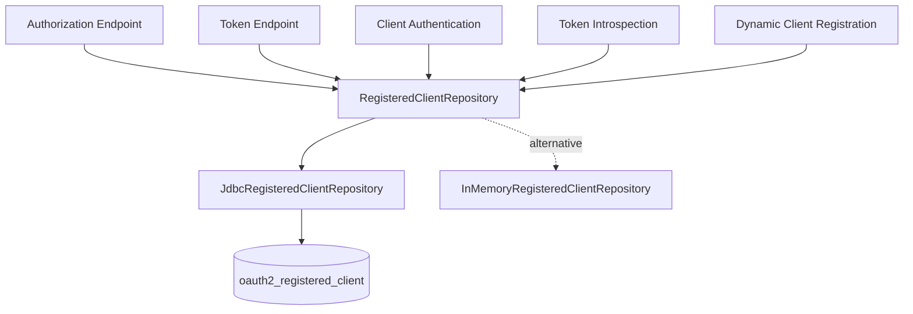

# JdbcRegisteredClientRepository and the Client Schema

## 1. Why Does an Authorization Server Need to Store Client Registrations in a Database?

An OAuth 2.0 Authorization Server must know which client is sending a request, which grant types the client is allowed to use, which redirect URIs are valid, which scopes are permitted, and how the client authenticates at the Token Endpoint. That set of information is modeled in Spring Authorization Server as a **RegisteredClient**.

In small examples, an application can declare clients with `InMemoryRegisteredClientRepository`. However, in-memory data is lost when the process restarts and is not automatically shared across multiple instances. In production, client registrations usually need to be persisted in a database to:

- Preserve client IDs, redirect URIs, grants, scopes, and settings across restarts.
- Allow multiple Authorization Server instances to look up the same set of clients.
- Manage the client lifecycle through migrations, admin workflows, and auditing.
- Connect client registrations with authorizations, consents, and protocol endpoints.

Spring Authorization Server provides **JdbcRegisteredClientRepository**, an implementation of `RegisteredClientRepository` that uses Spring JDBC to save and query `RegisteredClient` instances. This repository depends on the **oauth2_registered_client** table with the schema bundled in the library.

This lesson belongs to the **JDBC Persistence** chapter of the `SPRING_SECURITY_OAUTH2_OIDC_AUTHORIZATION_SERVER` module. The overall goal of the module is to **learn how to design, configure, secure, test, and operate an OAuth 2.0/OpenID Connect Authorization Server using Spring Security and Spring Authorization Server in a Spring Boot application**.

### Learning Objectives

After this lesson, you will be able to:

1. Explain the role of `RegisteredClientRepository` in protocol flows.
2. Distinguish the internal registration ID from the public `client_id`.
3. Read and implement the `oauth2_registered_client` schema.
4. Configure `JdbcRegisteredClientRepository` using `JdbcTemplate`/`JdbcOperations`.
5. Map collection fields and JSON settings in `RegisteredClient`.
6. Protect client secrets and registration data in the database.
7. Organize schemas with Flyway/Liquibase and adapt them to the database vendor.
8. Test `save`/`findById`/`findByClientId`, migrations, constraints, and boundary data.
9. Recognize the performance limits of the default JDBC implementation and when a custom repository is needed.

> **Version Scope:** Examples use Spring Authorization Server 1.5.8 and Spring Security 6.x. Sample schemas are taken from Spring Authorization Server's `oauth2-registered-client-schema.sql` resource. If using a different version, cross-check the resource bundled with your exact dependency because schemas and APIs may change. The assigned `SPECIAL_NOTE` for this lesson is blank.

## 2. Where Does RegisteredClientRepository Fit in the Architecture?

`RegisteredClientRepository` is the central component for registering new clients and querying existing ones. Protocol components use the repository whenever they need to identify the client executing a flow.



For example:

- The Authorization Endpoint looks up the client to validate redirect URIs, grants, and scopes.
- Client Authentication looks up the client to verify the client ID, secret, or authentication method.
- The Token Endpoint looks up the client to verify allowed grant types and token settings.
- Introspection or Dynamic Client Registration may need the repository to look up or update clients per the protocol.

`RegisteredClientRepository` is a **required** component of the Authorization Server. Spring Authorization Server provides two basic implementations:

| Repository | Storage | Usage scope |
| --- | --- | --- |
| `InMemoryRegisteredClientRepository` | JVM memory | Development and testing |
| `JdbcRegisteredClientRepository` | Database via `JdbcOperations` | JDBC persistence for applications |

Spring documentation recommends `InMemoryRegisteredClientRepository` **only for development/testing**. `JdbcRegisteredClientRepository` is a simple implementation suitable for production, though the documentation also warns that it has performance limits and may not fit high-throughput systems.

### 2.1. RegisteredClient Is Not OAuth2Authorization

The two domain objects serve different responsibilities:

| Domain object | Contents |
| --- | --- |
| `RegisteredClient` | Client registration: client ID, secret, grants, scopes, redirect URIs, client/token settings |
| `OAuth2Authorization` | A granted authorization: principal, grant, authorized scopes, authorization code, access token, refresh token, ID Token, device code, and related metadata |
| `OAuth2AuthorizationConsent` | Resource owner consent for a client and the set of approved authorities |

The `oauth2_registered_client` table **does not store access tokens, refresh tokens, authorization codes, or consents**. That data belongs to `OAuth2AuthorizationService` and `OAuth2AuthorizationConsentService`, which have their own schemas.

If you only configure `JdbcRegisteredClientRepository`, client registrations survive restarts while authorization/token state may still reside elsewhere. A complete JDBC system usually requires choosing appropriate persistence for all three core services.

## 3. What Fields Does RegisteredClient Have?

`RegisteredClient` represents a client registration in the Authorization Server. The model has 13 main fields:

| Field | Java Type | Meaning |
| --- | --- | --- |
| `id` | `String` | Internal unique ID for the registration |
| `clientId` | `String` | Client identifier sent by the client in protocol requests |
| `clientIdIssuedAt` | `Instant` | Timestamp when the client ID was issued |
| `clientSecret` | `String` or `null` | Encoded secret if it is a confidential client |
| `clientSecretExpiresAt` | `Instant` or `null` | Timestamp when the secret expires |
| `clientName` | `String` | Descriptive client name, which may be shown on the consent page |
| `clientAuthenticationMethods` | `Set<ClientAuthenticationMethod>` | Methods the client is allowed to use to authenticate |
| `authorizationGrantTypes` | `Set<AuthorizationGrantType>` | Allowed grant types |
| `redirectUris` | `Set<String>` | Registered redirect URIs |
| `postLogoutRedirectUris` | `Set<String>` | URIs allowed to return to after OIDC logout |
| `scopes` | `Set<String>` | Scopes the client is allowed to request |
| `clientSettings` | `ClientSettings` | Client settings such as PKCE, authorization consent, JWK Set URL, signing algorithm |
| `tokenSettings` | `TokenSettings` | Token TTLs, refresh token reuse, token format, ID Token signing algorithm, and related settings |

### 3.1. Distinguishing id and clientId

These are two identifiers with distinct purposes:

- **id** is the internal registration key used by the application to link persistence data.
- **clientId** is the public OAuth identifier sent by the client in authorization requests or client authentication.

Example:

```java
RegisteredClient registeredClient = RegisteredClient.withId(
                "reg-7f8b3a")
        .clientId("orders-web")
        .clientSecret(encodedSecret)
        .clientAuthenticationMethod(
                ClientAuthenticationMethod.CLIENT_SECRET_BASIC)
        .authorizationGrantType(AuthorizationGrantType.AUTHORIZATION_CODE)
        .redirectUri("https://orders.example.com/login/oauth2/code/issuer")
        .scope("openid")
        .scope("orders.read")
        .build();
```

Here, `reg-7f8b3a` is the internal registration ID; `orders-web` is the `client_id` sent in the OAuth protocol. Do not mistakenly call `findById("orders-web")` when you need to look up a client by its client ID.

### 3.2. Collection Fields

A client can have multiple authentication methods, grant types, redirect URIs, post-logout redirect URIs, and scopes. In Java, these are represented as `Set`s to prevent duplicate elements.

Example:

```java
RegisteredClient registeredClient = RegisteredClient.withId(UUID.randomUUID().toString())
        .clientId("orders-web")
        .clientSecret(encodedSecret)
        .clientAuthenticationMethod(ClientAuthenticationMethod.CLIENT_SECRET_BASIC)
        .authorizationGrantType(AuthorizationGrantType.AUTHORIZATION_CODE)
        .authorizationGrantType(AuthorizationGrantType.REFRESH_TOKEN)
        .redirectUri("https://orders.example.com/callback")
        .postLogoutRedirectUri("https://orders.example.com/signed-out")
        .scope("openid")
        .scope("orders.read")
        .build();
```

Do not write custom SQL joining these `Set`s via arbitrary string concatenation. The default parameters mapper is responsible for converting `RegisteredClient` into database columns; `RowMapper` converts the data back into objects.

### 3.3. ClientSettings and TokenSettings

The two settings fields contain structured configuration:

- `ClientSettings` can store requirements for PKCE, authorization consent, JWK Set URL, token endpoint authentication signing algorithm, X.509 certificate subject DN, and other client settings.
- `TokenSettings` can store lifetimes for authorization codes/access tokens/refresh tokens/device codes, refresh token reuse, access token format, and ID Token signing algorithm.

Do not detach these settings from the registration if the application still relies on SAS reading them during protocol processing. If you change the JSON structure or mapper, ensure existing data remains readable.

## 4. Standard oauth2_registered_client Schema

`JdbcRegisteredClientRepository` depends on the table definition located on the classpath:

```text
org/springframework/security/oauth2/server/authorization/client/
oauth2-registered-client-schema.sql
```

Standard schema in SAS 1.5.x:

```sql
CREATE TABLE oauth2_registered_client (
    id varchar(100) NOT NULL,
    client_id varchar(100) NOT NULL,
    client_id_issued_at timestamp DEFAULT CURRENT_TIMESTAMP NOT NULL,
    client_secret varchar(200) DEFAULT NULL,
    client_secret_expires_at timestamp DEFAULT NULL,
    client_name varchar(200) NOT NULL,
    client_authentication_methods varchar(1000) NOT NULL,
    authorization_grant_types varchar(1000) NOT NULL,
    redirect_uris varchar(1000) DEFAULT NULL,
    post_logout_redirect_uris varchar(1000) DEFAULT NULL,
    scopes varchar(1000) NOT NULL,
    client_settings varchar(2000) NOT NULL,
    token_settings varchar(2000) NOT NULL,
    PRIMARY KEY (id)
);
```

This is the default schema used by the JDBC repository. When deploying, use the exact resource file from your version-locked dependency; do not copy a schema from another version without comparing them.

### 4.1. Mapping Between RegisteredClient and SQL Columns

| RegisteredClient | Database column | Role |
| --- | --- | --- |
| `id` | `id` | Primary key of the registration |
| `clientId` | `client_id` | OAuth client identifier |
| `clientIdIssuedAt` | `client_id_issued_at` | Timestamp when ID was issued |
| `clientSecret` | `client_secret` | Encoded secret |
| `clientSecretExpiresAt` | `client_secret_expires_at` | Secret expiration |
| `clientName` | `client_name` | Display name |
| `clientAuthenticationMethods` | `client_authentication_methods` | Authentication methods |
| `authorizationGrantTypes` | `authorization_grant_types` | Grant types |
| `redirectUris` | `redirect_uris` | Redirect URIs |
| `postLogoutRedirectUris` | `post_logout_redirect_uris` | Post-logout redirect URIs |
| `scopes` | `scopes` | Allowed scopes |
| `clientSettings` | `client_settings` | Client JSON settings |
| `tokenSettings` | `token_settings` | Token JSON settings |

### 4.2. Why Are Many Columns VARCHAR?

The default JDBC schema stores collections and settings in string columns:

- Collections are serialized into a text representation.
- `ClientSettings` and `TokenSettings` are serialized into JSON.
- `RowMapper` reads the strings and reconstructs the `Set`/settings objects.

This is a compact implementation for a general-purpose repository, though it is not an optimally normalized model for every system. Do not query JSON settings under the assumption of a fixed internal structure unless the application controls the version/mapper.

### 4.3. The Default Schema Only Declares Primary Key id

The standard DDL declares a `PRIMARY KEY` for `id`. In production, add a **unique constraint/index on `client_id`** so the database enforces client identifier uniqueness even under race conditions across multiple instances or registration flows.

Illustrative SQL example:

```sql
CREATE UNIQUE INDEX ux_oauth2_registered_client_client_id
    ON oauth2_registered_client (client_id);
```

Before adding a unique index to a running database, find and resolve any duplicate `client_id` data. Index syntax and constraint declarations may vary across PostgreSQL, MySQL, Oracle, and SQL Server.

Do not rename columns or tables while still using the default `JdbcRegisteredClientRepository`. If the schema must differ, a corresponding custom repository/SQL is required.

## 5. Column Sizes and Data Limits

The default schema uses bounded lengths:

| Column | Sample length | Content that may grow |
| --- | ---: | --- |
| `id`, `client_id` | 100 | Registration ID and client identifier |
| `client_secret` | 200 | Password hash/encoded secret |
| `client_name` | 200 | Client name |
| `client_authentication_methods` | 1000 | Multiple authentication methods |
| `authorization_grant_types` | 1000 | Multiple grant types |
| `redirect_uris` | 1000 | Multiple long redirect URIs |
| `post_logout_redirect_uris` | 1000 | Multiple logout URIs |
| `scopes` | 1000 | Many scopes |
| `client_settings` | 2000 | JSON settings |
| `token_settings` | 2000 | JSON settings |

### 5.1. Do Not Let Data Exceed Column Length

A client with many redirect URIs, grant types, or scopes can make the serialized string exceed 1000 characters. A client using a long JWK Set URL, certificate subject DN, or extended settings can push JSON settings past 2000 characters.

Errors may appear as SQL data truncation, value too long, or database constraint violations on save.

Mitigations:

1. Define business metadata limits per client.
2. Measure serialized lengths on realistic registrations.
3. Increase column lengths or use an appropriate text type if needed.
4. Ensure the mapper/driver handles the new column types compatibly.
5. Write integration tests with metadata at maximum limits.

Do not mechanically bump every column to MAX or CLOB. Choose data types based on queries, indexes, database limits, and data size.

### 5.2. client_secret Must Be Encoded Before Saving

`JdbcRegisteredClientRepository` does not encrypt or encode client secrets automatically. The `RegisteredClientRepository` API expects the application to encode sensitive data outside the implementation.

Example:

```java
String encodedSecret = passwordEncoder.encode(rawClientSecret);

RegisteredClient registeredClient = RegisteredClient.withId(UUID.randomUUID().toString())
        .clientId("billing-worker")
        .clientSecret(encodedSecret)
        .clientAuthenticationMethod(ClientAuthenticationMethod.CLIENT_SECRET_BASIC)
        .authorizationGrantType(AuthorizationGrantType.CLIENT_CREDENTIALS)
        .scope("billing.read")
        .build();

registeredClientRepository.save(registeredClient);
```

Never store raw secrets. During client authentication, Spring Security uses an appropriate `PasswordEncoder` to match the incoming value against the stored hash.

### 5.3. Controlling Database Read Access

Client secret hashes remain sensitive data. Restrict `SELECT` permissions on the table for database users, admin consoles, reporting, and backup operators. Do not log `RegisteredClient` objects by printing full secrets/settings. Encrypt backups and govern database access as part of credential management.

## 6. Initializing the Schema with Migrations

Do not rely on an SQL file happening to run in a local environment. The client schema is part of the database contract and should be managed via Flyway, Liquibase, or a controlled migration workflow.

### 6.1. Using Flyway

An example migration:

```text
src/main/resources/db/migration/
    V1_0_0__create_oauth2_registered_client.sql
```

The migration content is the standard DDL adapted for the database vendor in use. PostgreSQL example:

```sql
CREATE TABLE oauth2_registered_client (
    id varchar(100) PRIMARY KEY,
    client_id varchar(100) NOT NULL,
    client_id_issued_at timestamptz NOT NULL DEFAULT CURRENT_TIMESTAMP,
    client_secret varchar(200),
    client_secret_expires_at timestamptz,
    client_name varchar(200) NOT NULL,
    client_authentication_methods varchar(1000) NOT NULL,
    authorization_grant_types varchar(1000) NOT NULL,
    redirect_uris varchar(1000),
    post_logout_redirect_uris varchar(1000),
    scopes varchar(1000) NOT NULL,
    client_settings varchar(2000) NOT NULL,
    token_settings varchar(2000) NOT NULL,
    CONSTRAINT ux_oauth2_registered_client_client_id UNIQUE (client_id)
);
```

This is a PostgreSQL variant with a unique constraint and timestamp with time zone; it is not the byte-for-byte original content of the schema resource. If the project needs compatibility with the standard schema, keep column names and mappings intact.

### 6.2. Using Liquibase

Liquibase can describe tables/columns/indexes in XML, YAML, or SQL changelogs. What matters is that the migration must:

- Create all 13 columns expected by the repository.
- Preserve exact column names.
- Use data types compatible with the JDBC mapper.
- Add constraints/indexes required for deployment.
- Have an appropriate rollback or forward-fix plan.

Do not let Hibernate auto-modify the production schema from entities if the application uses `JdbcRegisteredClientRepository`. The JDBC repository does not read JPA annotations.

### 6.3. Verifying the Schema Before Starting the Server

The deployment pipeline should run migrations before routing traffic to the Authorization Server. Verify:

- The table and required columns exist.
- The unique constraint/index on `client_id` is active.
- The application database user has the necessary `SELECT`/`INSERT` permissions.
- Timestamp and JSON/text types match the driver.
- Migrations have run at the right version across all environments.

## 7. Configuring JdbcRegisteredClientRepository

`JdbcRegisteredClientRepository` accepts a `JdbcOperations`. `JdbcTemplate` implements this interface and is normally created from the `DataSource` configured by Spring Boot.

Example:

```java
@Configuration
class RegisteredClientPersistenceConfiguration {

    @Bean
    RegisteredClientRepository registeredClientRepository(
            JdbcTemplate jdbcTemplate) {
        return new JdbcRegisteredClientRepository(jdbcTemplate);
    }
}
```

Ensure the JDBC dependency and database driver are present in the application. For example, with Spring Boot, the JDBC starter provides `JdbcTemplate` and `DataSource` auto-configuration when valid datasource properties are configured.

### 7.1. Configuring the DataSource

PostgreSQL example:

```yaml
spring:
  datasource:
    url: jdbc:postgresql://db.example.internal:5432/authorization
    username: auth_server
    password: DB_PASSWORD_FROM_SECRET_STORE
    driver-class-name: org.postgresql.Driver
```

This is an illustrative configuration. In production, inject passwords via a secret manager or secure environment; enable TLS for database connections if infrastructure supports it and restrict database user privileges.

### 7.2. Wiring the Repository into Authorization Server

When using `OAuth2AuthorizationServerConfigurer`:

```java
@Bean
@Order(1)
SecurityFilterChain authorizationServerSecurityFilterChain(
        HttpSecurity http,
        RegisteredClientRepository registeredClientRepository)
        throws Exception {

    OAuth2AuthorizationServerConfigurer authorizationServer =
            OAuth2AuthorizationServerConfigurer.authorizationServer();

    http
        .securityMatcher(authorizationServer.getEndpointsMatcher())
        .with(authorizationServer, server ->
            server.registeredClientRepository(registeredClientRepository)
        )
        .authorizeHttpRequests(authorize ->
            authorize.anyRequest().authenticated());

    return http.build();
}
```

If `RegisteredClientRepository` is already registered as a bean under default configuration mechanics, the framework can pick up that bean to configure the core service. Explicit configuration is helpful when the application has multiple repositories or multiple issuers.

## 8. Creating and Saving RegisteredClient

Example registering a confidential web client:

```java
RegisteredClient ordersWeb = RegisteredClient.withId(UUID.randomUUID().toString())
        .clientId("orders-web")
        .clientIdIssuedAt(Instant.now())
        .clientSecret(passwordEncoder.encode(rawSecret))
        .clientSecretExpiresAt(Instant.now().plus(365, ChronoUnit.DAYS))
        .clientName("Orders Web")
        .clientAuthenticationMethod(ClientAuthenticationMethod.CLIENT_SECRET_BASIC)
        .authorizationGrantType(AuthorizationGrantType.AUTHORIZATION_CODE)
        .authorizationGrantType(AuthorizationGrantType.REFRESH_TOKEN)
        .redirectUri("https://orders.example.com/login/oauth2/code/company")
        .postLogoutRedirectUri("https://orders.example.com/signed-out")
        .scope(OidcScopes.OPENID)
        .scope(OidcScopes.PROFILE)
        .scope("orders.read")
        .clientSettings(ClientSettings.builder()
                .requireProofKey(true)
                .requireAuthorizationConsent(true)
                .build())
        .tokenSettings(TokenSettings.builder()
                .accessTokenTimeToLive(Duration.ofMinutes(10))
                .refreshTokenTimeToLive(Duration.ofHours(8))
                .reuseRefreshTokens(false)
                .build())
        .build();

registeredClientRepository.save(ordersWeb);
```

This is an illustrative example. Choose TTLs, consent, PKCE, and refresh token policies based on your risk model. For public clients, do not generate or store a client secret as if a browser application could keep a secret.

### 8.1. IDs Should Be Stable

The registration ID is an internal key. When creating a new client, a random UUID is a common choice. When updating metadata via an admin workflow, keep the same ID if it is still the same registration. Changing the ID can break foreign keys from authorization/consent records or other domain relationships.

### 8.2. Do Not Register Clients with Duplicate client_id

Before creating a new client, check:

```java
RegisteredClient existing =
        registeredClientRepository.findByClientId("orders-web");

if (existing != null) {
    throw new IllegalStateException("client_id already registered");
}

registeredClientRepository.save(ordersWeb);
```

This is only a friendly pre-insert check. Two concurrent requests can still both see no existing record; a unique constraint in the database is the final safeguard against duplicate `client_id` entries.

## 9. findByClientId and findById

`RegisteredClientRepository` has three main methods:

| Method | Input | Result |
| --- | --- | --- |
| `save(registeredClient)` | `RegisteredClient` | Saves the registration |
| `findById(id)` | Internal ID | `RegisteredClient` or `null` |
| `findByClientId(clientId)` | Client identifier | `RegisteredClient` or `null` |

Example:

```java
RegisteredClient byClientId =
        registeredClientRepository.findByClientId("orders-web");

RegisteredClient byRegistrationId =
        registeredClientRepository.findById("reg-7f8b3a");
```

The two queries are not equivalent. `findByClientId` looks up by the OAuth client identifier; `findById` looks up by the internal registration ID.

### 9.1. Returning null When Not Found

The repository API returns `null` if no matching registration exists. Application services may translate this into a domain exception or an optional result depending on design, but a missing client must never be treated as a default client.

### 9.2. save Does Not Replace an Admin Lifecycle API

The `RegisteredClientRepository` interface only defines `save`, `findById`, and `findByClientId`. It does not define dedicated update or delete methods. `JdbcRegisteredClientRepository` is a simple implementation, not a full client administration toolkit.

If you need to rotate secrets, change redirect URIs, disable clients, or delete registrations, design a controlled and transactional admin service/repository. When modifying a registration, evaluate existing authorizations/consents, issued tokens, caches, and auditing. Do not assume calling `save` is an upsert mechanism or automatically revokes old tokens.

## 10. Mappers: Converting RegisteredClient to SQL Parameters and Back

`JdbcRegisteredClientRepository` uses two mappers:

1. **RegisteredClientParametersMapper**: converts a `RegisteredClient` into a list of `SqlParameterValue`s to write to the database.
2. **RegisteredClientRowMapper**: reads a `ResultSet` and builds a `RegisteredClient`.

The two default mappers handle collections, enum-like values, and JSON settings. When custom representations are needed, the repository allows replacing the mappers.

### 10.1. Default Mapper Configuration

Normally, you do not need to create custom mappers:

```java
JdbcRegisteredClientRepository repository =
        new JdbcRegisteredClientRepository(jdbcTemplate);
```

If customization is needed:

```java
JdbcRegisteredClientRepository repository =
        new JdbcRegisteredClientRepository(jdbcTemplate);

repository.setRegisteredClientParametersMapper(customParametersMapper);
repository.setRegisteredClientRowMapper(customRegisteredClientRowMapper);
```

Custom mappers must be fully schema-compatible and preserve data integrity. If the parameters mapper writes a different representation, the row mapper must read that exact representation. When rolling out a new version, ensure legacy data can still be read or provide a conversion migration.

### 10.2. JSON Settings Require Appropriate Jackson Modules

`ClientSettings` and `TokenSettings` can hold Spring Security/Spring Authorization Server types such as `Duration`, algorithms, and `OAuth2TokenFormat`. If creating a custom `ObjectMapper` for a custom mapper, register the necessary Jackson modules to serialize and deserialize these types properly.

Do not use a bare `ObjectMapper` and expect all settings to deserialize automatically. Test round-trips with realistic configurations such as:

- `requireProofKey` and `requireAuthorizationConsent`.
- `accessTokenTimeToLive` and `refreshTokenTimeToLive`.
- `reuseRefreshTokens`.
- `accessTokenFormat`.
- `idTokenSignatureAlgorithm`.
- token endpoint authentication signing algorithm.

### 10.3. Do Not Manually Edit Representations in the Database

Collection strings and JSON settings are representations produced by the mappers. Editing them directly via SQL without knowing the format can produce records that `RowMapper` cannot read or cause settings to be lost.

If data migration is needed, write a conversion script with round-trip tests and take a backup before running in production.

## 11. Database Vendors and Timestamp Data Types

The standard schema uses `timestamp` columns for `Instant` fields. How the database/driver interprets `timestamp` depends on the vendor and session timezone.

### 11.1. PostgreSQL

PostgreSQL supports both `timestamp without time zone` and `timestamp with time zone` (`timestamptz`). For Java `Instant` fields representing absolute points in time, `timestamptz` is generally the better choice to avoid misinterpreting timestamps based on session timezone.

In a PostgreSQL migration, you can change the columns:

- `client_id_issued_at`
- `client_secret_expires_at`

from `timestamp` to `timestamptz`. Verify how existing data migration converts timezones before altering column types.

### 11.2. MySQL

With MySQL Connector/J, check connection timezone settings and `preserveInstants` configuration per the driver documentation when preserving `Instant` values is required. For example, the URL may include options such as:

```text
preserveInstants=true
connectionTimeZone=UTC
forceConnectionTimeZoneToSession=true
```

These properties must be verified against your Connector/J version and server configuration. Do not copy a URL straight into production without testing the driver.

### 11.3. Testing Timezones

Tests should write an `Instant` with a non-UTC offset, read it back from the database, and assert the same absolute instant. Do not compare formatted display strings alone because databases may format timezones differently.

## 12. Performance and Limitations of JdbcRegisteredClientRepository

SAS documentation describes `JdbcRegisteredClientRepository` as a simple JDBC implementation suitable for production, though it may not satisfy high-throughput systems.

Contributing factors:

- Client authentication and token flows may look up registrations frequently.
- Client metadata contains several collection/JSON settings.
- Each lookup goes through JDBC/database.
- Multiple instances query the same table simultaneously.
- Database connection pooling and network latency.

### 12.1. Optimize the Database First

Common measures include:

1. Unique index on `client_id`.
2. Primary key index on `id`.
3. Connection pool sized for actual concurrency.
4. Query plan inspection for `findByClientId`/`findById`.
5. Database latency, lock wait, and pool saturation metrics.
6. Bounding registration metadata to avoid oversized rows.

Do not index every long text column. Only index columns used in predicates/joins that fit the database's collation and length limits.

### 12.2. When Is a Custom Repository Needed?

If database lookups become a bottleneck, the application can implement a custom `RegisteredClientRepository` or add caching with proper invalidation.

A custom repository must preserve exact semantics:

- `findByClientId` returns the correct registration by client ID.
- `findById` uses the internal registration ID.
- `save` does not create duplicate registrations.
- Secrets are encoded before persisting.
- Settings/collections round-trip completely.
- Cache invalidation occurs when an admin modifies a client.
- Multiple instances observe updates according to the chosen consistency model.

Do not cache indefinitely if admins can disable or rotate clients. A revoked client with a still-valid cache entry could continue authenticating on a node.

### 12.3. Caching Does Not Replace Persistence

Caching can reduce read latency, but the database remains the persistent source of truth. On restart, caches must be warmed/reloaded or recover automatically. When changing a secret or redirect URI, invalidate by registration ID/client ID across all nodes.

## 13. Securing RegisteredClient Data

Client registrations contain information that can directly impact authorization:

- Client secret hashes.
- Redirect URIs and post-logout redirect URIs.
- Client authentication methods.
- Grant types and scopes.
- JWK Set URLs or X.509 subject DNs.
- Token lifetime and token format settings.

Principles:

1. Encode client secrets with a `PasswordEncoder` before calling `save`.
2. Never log raw secrets or entire `RegisteredClient` objects.
3. Restrict database permissions following least privilege.
4. Protect backups, snapshots, and replicas.
5. Audit all registration changes.
6. Validate redirect URIs strictly; avoid wildcards/open redirects.
7. Validate metadata URLs to mitigate SSRF if the server fetches them.
8. Use TLS between the application and the database.
9. Rotate credentials on a schedule and monitor `client_secret_expires_at`.
10. Lock down admin APIs capable of modifying grants/scopes/authentication methods.

### 13.1. Secret Hashes and PasswordEncoder

`JdbcRegisteredClientRepository` stores whatever `clientSecret` value `RegisteredClient` provides. If the application passes a raw secret into the builder, the repository may write the raw secret to the database.

Therefore:

```java
String encoded = passwordEncoder.encode(rawSecret);
RegisteredClient client = RegisteredClient.withId(UUID.randomUUID().toString())
        .clientId("service-client")
        .clientSecret(encoded)
        .clientAuthenticationMethod(ClientAuthenticationMethod.CLIENT_SECRET_BASIC)
        .authorizationGrantType(AuthorizationGrantType.CLIENT_CREDENTIALS)
        .scope("service.read")
        .build();
```

Never use `NoOpPasswordEncoder` in production. Choose a suitable `PasswordEncoder` and ensure newly generated client secrets are displayed/delivered securely once according to onboarding policy.

### 13.2. Disabling Clients and Issued Tokens

`RegisteredClientRepository` is not an authorization revocation service. If an admin disables a client, determine how to:

- Block new client authentications.
- Handle already issued access/refresh tokens.
- Revoke authorizations or block tokens per policy.
- Handle related consents and sessions.
- Synchronize caches across instances.

Do not assume deleting a `RegisteredClient` row automatically deletes all `OAuth2Authorization` records or issued tokens. Use the corresponding authorization/revocation management services.

## 14. Testing JdbcRegisteredClientRepository

Tests should run against a real database or Testcontainers matching the production vendor. H2 can speed up tests, but it does not guarantee that SQL dialects, timestamps, collations, JSON/text handling, and indexes match PostgreSQL/MySQL.

### 14.1. Basic Round-Trip Test

JUnit pseudocode:

```java
RegisteredClient client = createRegisteredClient();
repository.save(client);

RegisteredClient byId = repository.findById(client.getId());
RegisteredClient byClientId = repository.findByClientId(client.getClientId());

assertThat(byId).isNotNull();
assertThat(byClientId).isNotNull();
assertThat(byId.getClientId()).isEqualTo(client.getClientId());
assertThat(byClientId.getId()).isEqualTo(client.getId());
assertThat(byId.getScopes()).containsExactlyInAnyOrderElementsOf(client.getScopes());
assertThat(byId.getRedirectUris()).containsExactlyInAnyOrderElementsOf(client.getRedirectUris());
assertThat(byId.getClientSettings()).isEqualTo(client.getClientSettings());
assertThat(byId.getTokenSettings()).isEqualTo(client.getTokenSettings());
```

This is illustrative pseudocode; `createRegisteredClient` and assertion helpers belong to the application's test suite.

### 14.2. Test Matrix

| Test case | Data/condition | Expected result |
| --- | --- | --- |
| Schema migration | Fresh database | Table and 13 columns created |
| Repository bean | Valid `JdbcTemplate`/`DataSource` | Bean initializes successfully |
| Save client | Valid registration | Record persisted |
| Find by ID | Existing internal ID | Reads the right registration |
| Find by client ID | Existing client ID | Reads the right registration |
| Different ID and client ID | Distinct values | Both methods query the right column |
| Missing client | Unknown ID/client ID | Returns `null` |
| Duplicate ID | Existing ID | Database rejects |
| Duplicate client ID | Unique index enabled | Database rejects |
| Client secret | Encoded secret | Database holds no raw secret |
| Public client | No secret | Reads back `clientSecret` as `null` |
| Secret expiration | Non-null `Instant` | Timestamp round-trips accurately |
| Collection fields | Multiple auth methods/grants/scopes/URIs | All entries read back intact |
| Post-logout redirect | Multiple URIs | Round-trips accurately |
| Client settings | PKCE/consent/JWK URL | JSON parsed accurately |
| Token settings | TTL/refresh reuse/format | JSON parsed accurately |
| Long client name | Exceeds limit | Validation/DB error handled clearly |
| Long redirect URI set | Exceeds 1000-char column | Test catches overflow |
| Large settings JSON | Exceeds 2000-char column | Test catches overflow |
| PostgreSQL timestamp | `timestamptz` | `Instant` round-trips accurately |
| MySQL timezone | Connector/J config | `Instant` has no offset drift |
| Application restart | Database retains data | Client still found |
| Database restart | Durable data | Registration remains intact |
| Multi-instance lookup | Two nodes sharing DB | Both nodes read the same registration |
| Concurrent duplicate save | Two requests with same client ID | Only one record exists |
| Secret rotation | Updated via admin repository | Authentication uses new secret per policy |
| Cache invalidation | Cache layer present | Nodes observe registration updates |
| DB unavailable | Disconnect database | Error observed, no silent fallback to in-memory |
| DB permissions | User missing `INSERT`/`SELECT` | Deploy/test catches missing privileges |
| Migration upgrade | Schema from older version | Legacy data remains readable |

### 14.3. Testing Database Unavailability

Do not automatically fall back to `InMemoryRegisteredClientRepository` when JDBC fails. Falling back can cause instances to see different client sets and alter authorization policies. Fail startup or fail requests cleanly according to your availability design.

## 15. Troubleshooting

| Symptom | Possible cause | Resolution |
| --- | --- | --- |
| Table `oauth2_registered_client` does not exist | Migrations have not run | Check Flyway/Liquibase before startup |
| Unknown column | Schema version mismatch | Compare against the dependency's SQL resource |
| SQL value too long | `VARCHAR` column too short | Measure serialized lengths and expand columns/migration |
| Duplicate key on `id` | Duplicate registration ID | Generate stable/unique IDs |
| Duplicate client ID | Missing unique constraint or onboarding race | Add unique index and handle conflicts |
| `findByClientId` returns `null` | Queried wrong client ID or uncommitted record | Check transaction/column mapping |
| `findById` returns `null` | Confused internal `id` with `client_id` | Pass the right identifier |
| Client authentication fails after restart | Data not persisted or wrong secret hash | Check DB, `PasswordEncoder`, and migrations |
| Settings deserialization error | Incompatible Jackson modules/representation | Check mappers and JSON data |
| Redirect URIs lost | Incorrect collection mapping/schema | Check `RowMapper` and `ParametersMapper` |
| `Instant` hour offset | Timestamp/timezone driver mismatch | Use `timestamptz` or UTC/driver settings |
| DB connection pool exhausted | Slow lookups or undersized pool | Analyze latency/query/pool metrics |
| One node sees client, another does not | Inconsistent cache or DB | Check datasource, replica lag, and invalidation |
| Secret appears in logs | Logged full object/request | Mask sensitive data and audit logs |
| `save` does not update registration | Interface lacks an update method | Use an admin repository/custom persistence service |

Investigation order: **schema/migration → DataSource/JdbcTemplate → mappers → registration data → unique constraint → PasswordEncoder → cache/replica → authorization flow**.

## 16. End-to-End Scenario: Moving Client Registrations from Memory to JDBC

An Authorization Server initially has two clients declared in code:

- `orders-web` using Authorization Code + Refresh Token.
- `billing-worker` using Client Credentials.

When deploying two instances, the team realizes every change requires modifying source code and client registrations could diverge across nodes.

Transition steps:

1. Create a migration for `oauth2_registered_client` matching the exact SAS schema version.
2. Add a unique constraint on `client_id` after checking for duplicate data.
3. Create a `JdbcTemplate` from the shared `DataSource`.
4. Register a `JdbcRegisteredClientRepository` bean.
5. Seed the two initial `RegisteredClient` records via migration or an idempotent bootstrap service.
6. Encode client secrets with `PasswordEncoder` before calling `save`.
7. Switch the Authorization Server to the JDBC repository.
8. Run integration tests for `findByClientId`, `findById`, and token flows.
9. Deploy the first node and verify lookups; then bring up the second node.
10. Monitor DB latency, pool usage, duplicate registrations, and secret authentication.

Once complete, both nodes share a single source of client registrations. Authorizations/tokens/consents still require their respective persistence services; migrating `RegisteredClientRepository` does not automatically migrate those tables.

## 17. Pre-Production Checklist

- [ ] Using the exact schema resource from the running Spring Authorization Server dependency.
- [ ] Migrations managed by Flyway/Liquibase or an equivalent versioned process.
- [ ] Table contains all 13 columns required by the repository.
- [ ] `id` is the primary key and `client_id` has a unique constraint/index.
- [ ] Timestamp types verified with the database vendor and JDBC driver.
- [ ] `VARCHAR` lengths match actual registration data sizes.
- [ ] `client_secret` is encoded with `PasswordEncoder` before persisting.
- [ ] Raw secrets or full registration objects are never logged.
- [ ] `JdbcRegisteredClientRepository` is built from `JdbcOperations`/`JdbcTemplate` on the right datasource.
- [ ] Repository is wired into the Authorization Server configuration.
- [ ] `findById` and `findByClientId` are used for their intended purposes.
- [ ] `ClientSettings`/`TokenSettings` round-trip accurately with Jackson modules.
- [ ] Duplicate client ID and concurrent registration tests are in place.
- [ ] Backup/restore tests exist for client registrations.
- [ ] Database user follows least privilege and connections are protected with TLS.
- [ ] Metrics exist for query latency, connection pools, and database errors.
- [ ] Cache invalidation plan exists if caching is used.
- [ ] Separate persistence exists for `OAuth2Authorization` and `OAuth2AuthorizationConsent` when needed.
- [ ] Admin process exists to disable/rotate clients and handle issued tokens.

## 18. Summary

`JdbcRegisteredClientRepository` enables Spring Authorization Server to store `RegisteredClient` instances over JDBC. Key points:

1. `RegisteredClientRepository` is a required core component for an Authorization Server to manage clients.
2. `JdbcRegisteredClientRepository` uses `JdbcOperations` and depends on the `oauth2_registered_client` schema.
3. The schema stores 13 `RegisteredClient` fields; collections and settings are converted by mappers between Java objects and database representations.
4. `id` is the internal registration ID; `client_id` is the public OAuth identifier.
5. Client secrets must be encoded before saving; the repository does not encode secrets automatically.
6. The default schema only has primary key `id`; production deployments should enforce `client_id` uniqueness via a database constraint.
7. Adjust column lengths, timestamps, and mappers to match the database vendor and actual workload.
8. The default JDBC implementation is simple; high-throughput systems may need a custom repository/cache with consistent invalidation.
9. Client registrations, authorization/token state, and consents are three distinct data groups requiring their respective persistence mechanisms.

Treat the client schema as part of the protocol contract between Spring Authorization Server and the database. Keep column names/mappings intact, manage versioned migrations, protect credentials, and verify round-trips on a production-compatible database before operating the Authorization Server.

### References

- [Spring Authorization Server 1.5.8 — Core Model / Components](https://docs.spring.io/spring-authorization-server/reference/core-model-components.html)
- [Spring Authorization Server 1.5.8 — JdbcRegisteredClientRepository API](https://docs.spring.io/spring-authorization-server/reference/api/java/org/springframework/security/oauth2/server/authorization/client/JdbcRegisteredClientRepository.html)
- [Spring Authorization Server 1.5.8 — RegisteredClientRepository API](https://docs.spring.io/spring-authorization-server/reference/api/java/org/springframework/security/oauth2/server/authorization/client/RegisteredClientRepository.html)
- [Spring Authorization Server 1.5.8 — RegisteredClient API](https://docs.spring.io/spring-authorization-server/reference/api/java/org/springframework/security/oauth2/server/authorization/client/RegisteredClient.html)
- [Spring Authorization Server 1.5.8 — JdbcRegisteredClientRepository RegisteredClientParametersMapper API](https://docs.spring.io/spring-authorization-server/reference/api/java/org/springframework/security/oauth2/server/authorization/client/JdbcRegisteredClientRepository.RegisteredClientParametersMapper.html)
- [Spring Authorization Server 1.5.8 — Configuration Model](https://docs.spring.io/spring-authorization-server/reference/configuration-model.html)
- [Spring Authorization Server 1.5.8 — How-to: Implement Core Services with JPA](https://docs.spring.io/spring-authorization-server/reference/guides/how-to-jpa.html)
