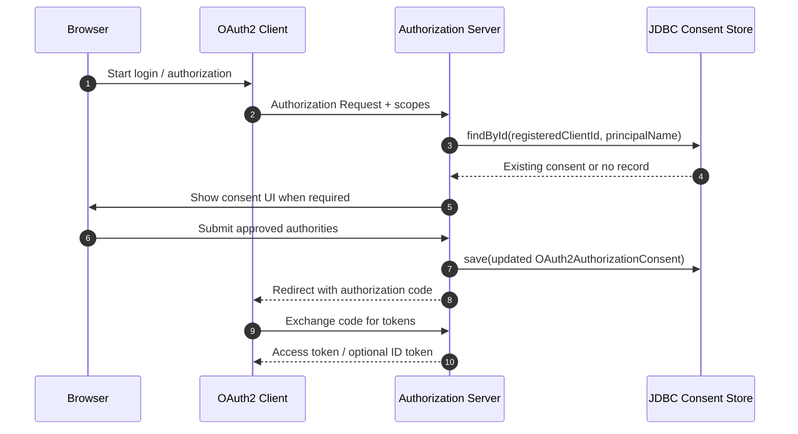
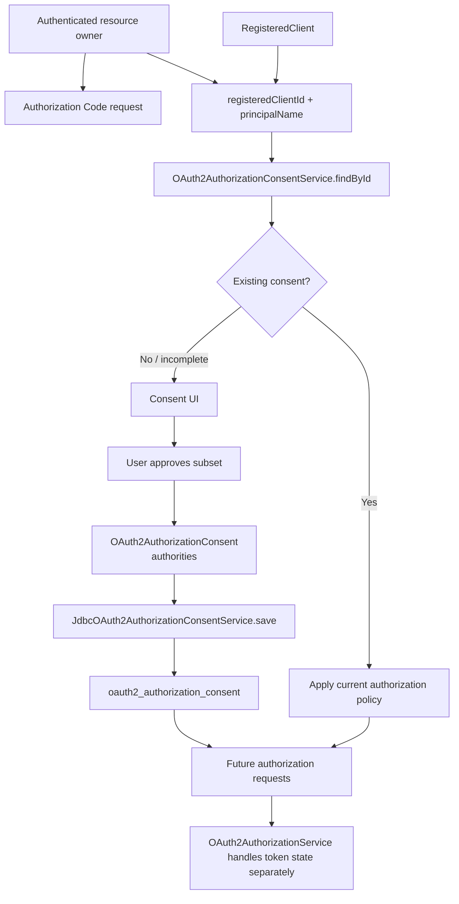

# JdbcOAuth2AuthorizationConsentService and the Consent Schema

## 1. Goal and Context

In the **JDBC Persistence** chapter of the **SPRING_SECURITY_OAUTH2_OIDC_AUTHORIZATION_SERVER** module, the Authorization Server must remember the authorization decisions a user made when an OAuth 2.0 client requests access to resources. This decision is called **authorization consent**. In Spring Authorization Server (SAS), the consent model is represented by `OAuth2AuthorizationConsent` and managed via `OAuth2AuthorizationConsentService`.

SAS provides two primary implementations:

- `InMemoryOAuth2AuthorizationConsentService`: stores consents in memory, suitable for development and testing.
- `JdbcOAuth2AuthorizationConsentService`: stores consents in a database through Spring JDBC.

This lesson focuses on implementing JDBC consent with `JdbcOAuth2AuthorizationConsentService`, understanding the default schema, integrating with `RegisteredClientRepository` and the Authorization Server, managing the consent lifecycle, and operating the consent table safely in production.

After this lesson, you will be able to:

- Explain what consent stores and why consent is identified by client registration together with principal.
- Distinguish `OAuth2AuthorizationConsent` from `OAuth2Authorization` and token state.
- Read the `oauth2_authorization_consent` schema and understand its composite primary key.
- Configure `JdbcOAuth2AuthorizationConsentService` using `JdbcOperations` and `RegisteredClientRepository`.
- Wire the consent service into `OAuth2AuthorizationServerConfigurer`.
- Create, read, update, and delete consents through the domain API.
- Design stable principal names, handle multi-tenancy, and avoid identity reuse.
- Deploy the schema with Flyway/Liquibase and manage transactions, backups, and migrations.
- Test consent persistence, revocation, restarts, multiple instances, and database failures.
- Determine when the default JDBC implementation needs to be replaced by a custom implementation.

**Version Scope:** Examples target **Spring Authorization Server 1.5.x**, **Spring Security 6.x**, and **Spring Boot 3.x**. Specific APIs may vary across versions. The schema is presented according to the standard `oauth2-authorization-consent-schema.sql` resource bundled with SAS 1.5.x. Always cross-check the actual dependency before altering the schema or custom mappers.

## 2. What Is Authorization Consent?

Consent is the resource owner's decision about which permissions a client is allowed to use in the context of an OAuth 2.0 authorization flow. In the Authorization Code Flow, a client may request several scopes while the user approves only a subset.

For example, client `portal-web` requests:

```text
openid
profile
email
orders.read
orders.write
```

The user might only approve:

```text
openid
profile
orders.read
```

The AS needs to persist this decision so subsequent authorizations can determine which permissions were already approved, whether the consent screen needs to be shown, and which permissions can be used in the authorization flow.

### 2.1. Consent Is Not an Access Token

Consent is a **persistent grant decision** per client and principal pair. An access token is a time-bounded credential issued within a specific authorization.

| Component | Role | Typical data |
| --- | --- | --- |
| `OAuth2AuthorizationConsent` | Stores user-approved decisions for a client | Registered client ID, principal name, granted authorities |
| `OAuth2Authorization` | Stores state of a specific authorization | Client, principal, grant type, scopes, authorization code, access/refresh tokens, and metadata |
| `OAuth2AccessToken` | Credential for accessing resources | Token value, issued/expiry, scopes, token type |
| `RegisteredClient` | Metadata of a registered client | Client ID, auth methods, grants, redirect URIs, scopes, settings |

Consent can outlive an access token. A stored consent does not mean an old access token is still valid; an expired access token does not automatically delete the consent either.

### 2.2. Consent Is Typically Used in the Authorization Code Flow

When a client is configured to require authorization consent, the AS displays a confirmation page to the user. After the user selects permissions, SAS builds or updates an `OAuth2AuthorizationConsent` and saves it via `OAuth2AuthorizationConsentService`.

The consent service is used primarily in components handling authorization request flows, such as the Authorization Code Grant. This is why the consent table is a separate part of the persistence layer.

### 2.3. Consent Can Hold Multiple Authority Types

The `authorities` field is not restricted solely to OAuth scopes. A `GrantedAuthority` can represent:

- A scope such as `SCOPE_profile` or `SCOPE_orders.read`.
- A claim permitted to be shared.
- A permission or role per application policy.
- A custom privilege that the AS needs to persist in the consent model.

For scopes, SAS uses the `SCOPE_` prefix. `OAuth2AuthorizationConsent.getScopes()` extracts scopes from authorities; `getAuthorities()` returns the full authority set.

## 3. OAuth2AuthorizationConsent Data Model

The domain object has three core properties:

```java
public final class OAuth2AuthorizationConsent implements Serializable {

    private final String registeredClientId;
    private final String principalName;
    private final Set<GrantedAuthority> authorities;

    // ...
}
```

Meaning:

| Property | Meaning | Value source |
| --- | --- | --- |
| `registeredClientId` | Internal ID uniquely identifying a `RegisteredClient` | `RegisteredClient.getId()` |
| `principalName` | Identifier of the principal who granted consent | `Authentication.getName()` per the identity model |
| `authorities` | Set of authorities approved by the principal for the client | Consent decision/policy |

**Common Pitfall:** `registeredClientId` is `RegisteredClient.getId()`, not the OAuth `client_id` sent by the client in protocol requests. `RegisteredClient` has both an internal ID and a Client Identifier; the consent schema links to the internal ID.

### 3.1. Logical Key of Consent

A consent is identified by the pair:

```text
(registeredClientId, principalName)
```

Example:

| RegisteredClient ID | Client ID | Principal name | Consent |
| --- | --- | --- | --- |
| `rc-001` | `portal-web` | `user-42` | `openid, profile` |
| `rc-002` | `portal-mobile` | `user-42` | `openid, email` |
| `rc-001` | `portal-web` | `user-84` | `openid` |

The same user can have different consents for each client. The same client can have separate consents for each user.

### 3.2. Why Must the Principal Name Be Stable?

SAS uses `principalName` as part of the consent identifier. If `Authentication.getName()` is a mutable email or username, once the user changes their email/username, the AS may fail to find the existing consent and prompt for consent again.

A more serious risk arises if an old username/email is reassigned to another person. In that case, reusing a principal name could mistakenly attach old consent data to the new user.

Best practices:

- Use an immutable internal user ID or stable subject identifier as the principal name.
- Do not use display names, mutable emails, or phone numbers as the key.
- Never reassign a deleted principal ID to another user.
- In multi-tenant setups, include the tenant namespace in the principal identifier when identities need isolation.
- Maintain identical canonicalization rules across all AS nodes.

### 3.3. Tenant and Issuer Boundaries

The default schema has no separate tenant or issuer column. If one database serves multiple issuers/tenants, ensure `principalName` or `registeredClientId` isolates the data scope.

Example namespaced principal names:

```text
tenant:acme:user:01J4ABC...
tenant:contoso:user:01J4XYZ...
```

Only use a tenant ID verified from the authentication context. Never take a tenant namespace directly from query parameters or untrusted input. If a complex multi-tenant model needs queries/reports by tenant, design a dedicated repository/schema instead of packing metadata into the principal name.

## 4. Default SAS Consent Schema

`JdbcOAuth2AuthorizationConsentService` depends on the `oauth2_authorization_consent` table. The SQL resource bundled with the library defines:

```sql
CREATE TABLE oauth2_authorization_consent (
    registered_client_id varchar(100) NOT NULL,
    principal_name varchar(200) NOT NULL,
    authorities varchar(1000) NOT NULL,
    PRIMARY KEY (registered_client_id, principal_name)
);
```

This is the standard schema that must exist in the database before the service operates.

### 4.1. Meaning of Each Column

| Column | Default type | Meaning |
| --- | --- | --- |
| `registered_client_id` | `varchar(100) NOT NULL` | ID of the `RegisteredClient` |
| `principal_name` | `varchar(200) NOT NULL` | Principal name owning the consent |
| `authorities` | `varchar(1000) NOT NULL` | Representation of the `GrantedAuthority` set |

Composite primary key:

```sql
PRIMARY KEY (registered_client_id, principal_name)
```

This key guarantees that one registration and one principal have at most one consent record at a time.

### 4.2. No Separate ID Column Needed

Because the `(registered_client_id, principal_name)` pair already uniquely identifies a consent, the default schema needs no surrogate ID column. When querying, the service uses these two values to locate the consent.

### 4.3. The authorities Column Is Not a JSON Document

In the SAS model, authorities are a `Set<GrantedAuthority>`. The JDBC implementation uses mappers to convert this set into data stored in the `authorities` column and back when reading.

Do not write arbitrary JSON into this column expecting the default row mapper to understand it. If a different storage format is required, replace the corresponding mappers consistently for both writes and reads.

### 4.4. Length Limits

The default schema specifies:

- Registered client ID up to 100 characters.
- Principal name up to 200 characters.
- Serialized authorities up to 1000 characters.

If the application has long principal IDs, tenant namespaces, or custom authorities, check actual lengths before deployment. Increasing column sizes requires a controlled migration and testing with the JDBC mappers. Never truncate strings to fit columns, as that can cause collisions or drop authorities.

### 4.5. The Schema Does Not Define a Foreign Key

The default DDL creates only the composite primary key and does not declare a foreign key to the registered client table. At the domain level, `registered_client_id` must reference an existing registration.

If adding a foreign key in a custom schema, design the behavior when a client is deleted: delete consents first, use an appropriate cascade, or apply soft deletes. Do not let a new constraint break existing deprovisioning workflows.

## 5. Configuring JdbcOAuth2AuthorizationConsentService

Main constructor in SAS 1.5.x:

```java
JdbcOAuth2AuthorizationConsentService(
        JdbcOperations jdbcOperations,
        RegisteredClientRepository registeredClientRepository)
```

Two dependencies:

- `JdbcOperations`: executes SQL statements and maps results.
- `RegisteredClientRepository`: looks up the registration matching `registeredClientId`.

`JdbcTemplate` implements `JdbcOperations`, so you can inject either `JdbcTemplate` or the `JdbcOperations` interface.

### 5.1. Declaring the Bean

```java
@Configuration(proxyBeanMethods = false)
public class AuthorizationConsentPersistenceConfig {

    @Bean
    OAuth2AuthorizationConsentService authorizationConsentService(
            JdbcOperations jdbcOperations,
            RegisteredClientRepository registeredClientRepository) {

        return new JdbcOAuth2AuthorizationConsentService(
                jdbcOperations,
                registeredClientRepository);
    }
}
```

This configuration assumes `DataSource`, `JdbcTemplate`/`JdbcOperations`, and `RegisteredClientRepository` already exist. Do not create a separate DataSource for consents if the system needs the same transaction manager and persistence boundary.

### 5.2. RegisteredClientRepository Must Be Consistent

`JdbcOAuth2AuthorizationConsentService` accepts `RegisteredClientRepository` to map consents back to their corresponding registrations. Therefore:

- Registered clients must be saved before consents are used.
- Internal registration IDs must remain stable across restarts.
- All AS nodes must access the same registration repository.
- Do not use a separate in-memory client repository in production while consents live in JDBC.

If a consent row exists after its registration was deleted, reading the consent may fail to reconstruct the full domain object. Client deletion handling must coordinate with consent records.

## 6. Wiring the Consent Service into Authorization Server

SAS provides an extension point on `OAuth2AuthorizationServerConfigurer` to configure `OAuth2AuthorizationConsentService`.

```java
@Configuration(proxyBeanMethods = false)
@EnableWebSecurity
public class AuthorizationServerSecurityConfig {

    @Bean
    @Order(1)
    SecurityFilterChain authorizationServerSecurityFilterChain(
            HttpSecurity http,
            OAuth2AuthorizationConsentService authorizationConsentService)
            throws Exception {

        OAuth2AuthorizationServerConfigurer authorizationServer =
                OAuth2AuthorizationServerConfigurer.authorizationServer();

        http
            .securityMatcher(authorizationServer.getEndpointsMatcher())
            .with(authorizationServer, server ->
                    server.authorizationConsentService(
                            authorizationConsentService))
            .authorizeHttpRequests(authorize ->
                    authorize.anyRequest().authenticated());

        return http.build();
    }

    @Bean
    @Order(2)
    SecurityFilterChain applicationSecurityFilterChain(
            HttpSecurity http) throws Exception {

        http
            .authorizeHttpRequests(authorize ->
                    authorize.anyRequest().authenticated())
            .formLogin(Customizer.withDefaults());

        return http.build();
    }
}
```

This is a configuration skeleton for the Authorization Server. The application also needs other beans such as `RegisteredClientRepository`, `OAuth2AuthorizationService`, a key source, user authentication, and `AuthorizationServerSettings`.

### 6.1. Why Explicit Wiring Matters

`OAuth2AuthorizationConsentService` is an optional component. If unconfigured, SAS defaults to `InMemoryOAuth2AuthorizationConsentService`. Merely declaring a JDBC bean in the application context should not be assumed to automatically replace the default service in every configuration. Wire it via the configurer and verify which bean is actually used.

### 6.2. Consent Service Differs from Authorization Service

Configuring:

```java
server.authorizationConsentService(authorizationConsentService);
```

only replaces where **consent decisions** are stored. Token/code state still belongs to `OAuth2AuthorizationService` and requires its own persistence if the entire Authorization Server must survive restarts.

A production setup usually has at least:

```text
RegisteredClientRepository
    -> client registrations

OAuth2AuthorizationService
    -> authorization code, access token, refresh token,
       ID token metadata, and authorization state

OAuth2AuthorizationConsentService
    -> resource owner consent decisions
```

## 7. How Is Consent Created and Read?

### 7.1. Creating Consent with the Builder

Domain object example:

```java
OAuth2AuthorizationConsent consent =
        OAuth2AuthorizationConsent.withId(
                    registeredClient.getId(),
                    principalName)
                .scope("openid")
                .scope("profile")
                .scope("orders.read")
                .build();

authorizationConsentService.save(consent);
```

`scope(...)` creates a `SimpleGrantedAuthority` with the `SCOPE_` prefix. For example, scope `orders.read` is stored as authority `SCOPE_orders.read`.

`principalName` in this example must be a stable principal identifier, typically matching `Authentication.getName()` in the AS's identity model.

### 7.2. Reading Consent

```java
OAuth2AuthorizationConsent consent =
        authorizationConsentService.findById(
                registeredClient.getId(),
                principalName);

if (consent == null) {
    // No consent exists yet for this client/principal pair.
} else {
    Set<String> grantedScopes = consent.getScopes();
    Set<GrantedAuthority> authorities = consent.getAuthorities();
}
```

`findById` returns `null` when no record exists. Do not confuse a `null` result with a database error; connection or mapping failures are normally thrown as exceptions.

### 7.3. Custom Authorities

In addition to scopes, extra authorities can be stored if domain policies require them:

```java
OAuth2AuthorizationConsent consent =
        OAuth2AuthorizationConsent.withId(
                    registeredClient.getId(),
                    principalName)
                .scope("openid")
                .authority(
                        new SimpleGrantedAuthority("CLAIM_email"))
                .authority(
                        new SimpleGrantedAuthority("PERMISSION_orders.read"))
                .build();
```

Custom authorities must have clear naming conventions, semantics, and enforcement policies. Never use consent to store passwords, secrets, access tokens, or full profile data.

### 7.4. Empty Consent

The builder requires at least one `GrantedAuthority`. If a user denies all permissions, do not attempt to construct an empty consent using the default builder. Handle it via the authorization flow: deny the grant, remove any prior consent if the user actively revoked everything, or return an appropriate denial response.

## 8. Updating and Revoking Consent

Consent can change as a user grants additional permissions or revokes existing ones.

### 8.1. Granting Additional Scopes

Suppose the user previously granted:

```text
openid
profile
```

Next time, the client also requests `email`. If the user agrees, the new authority set must reflect all current permissions:

```java
OAuth2AuthorizationConsent updatedConsent =
        OAuth2AuthorizationConsent.withId(
                    registeredClient.getId(),
                    principalName)
                .scope("openid")
                .scope("profile")
                .scope("email")
                .build();

authorizationConsentService.save(updatedConsent);
```

Construct the final authority set from existing consent plus new selections according to your authorization flow logic. Do not assume calling `save` automatically merges old and new scopes in the business-desired manner.

### 8.2. Partial Revocation

If the user unchecks `profile` while keeping `openid` and `email`, save the consent with the remaining approved authorities:

```java
OAuth2AuthorizationConsent updatedConsent =
        OAuth2AuthorizationConsent.withId(
                    registeredClient.getId(),
                    principalName)
                .scope("openid")
                .scope("email")
                .build();

authorizationConsentService.save(updatedConsent);
```

Do not just add new authorities and forget to drop revoked ones.

### 8.3. Full Revocation

Use `remove` to delete the consent record:

```java
OAuth2AuthorizationConsent consent =
        authorizationConsentService.findById(
                registeredClient.getId(),
                principalName);

if (consent != null) {
    authorizationConsentService.remove(consent);
}
```

This operation deletes the consent decision. It **does not automatically equate** to revoking all previously issued access tokens or refresh tokens. If policy requires revoking tokens, handle it additionally via `OAuth2AuthorizationService`/revocation flows and matching token validation mechanisms.

### 8.4. Consent Removal and Token Revocation Are Two Separate Operations

| Operation | Effect |
| --- | --- |
| Remove consent | Removes stored approvals for future authorization requests |
| Revoke refresh token | Prevents the refresh token from issuing new access tokens |
| Invalidate authorization | Marks tokens/codes belonging to an authorization as inactive per implementation |
| Disable client | Stops the client from operating per AS policy |

When a user revokes consent, explicitly decide whether existing tokens remain usable until expiry or must be revoked immediately. With offline JWTs, Resource Servers may still accept issued tokens until expiration unless introspection/denylists or status-update mechanisms are in place.

## 9. How Does the JDBC Implementation Work?

`JdbcOAuth2AuthorizationConsentService` implements the `OAuth2AuthorizationConsentService` interface with these operations:

| API | Purpose |
| --- | --- |
| `findById(registeredClientId, principalName)` | Reads consent by composite key |
| `save(authorizationConsent)` | Saves consent |
| `remove(authorizationConsent)` | Deletes consent |
| `setAuthorizationConsentRowMapper(...)` | Replaces `ResultSet` → domain object mapper |
| `setAuthorizationConsentParametersMapper(...)` | Replaces domain object → SQL parameters mapper |

### 9.1. JdbcOperations

`JdbcOperations` abstracts JDBC operations. `JdbcTemplate` provides the standard implementation, handling `PreparedStatement`, parameter binding, exception translation, and result mapping.

Never concatenate SQL strings with principal names or client IDs. Use JDBC parameter binding to prevent SQL injection and handle data types correctly.

### 9.2. RowMapper

The default `OAuth2AuthorizationConsentRowMapper` reads rows and builds `OAuth2AuthorizationConsent`. Its constructor accepts `RegisteredClientRepository` to link the consent with its corresponding registration.

If customizing the schema, verify that the mapper reads the right column names/types and can reconstruct `RegisteredClient`. Never alter the schema on one side while forgetting the row mapper.

### 9.3. ParametersMapper

The default `OAuth2AuthorizationConsentParametersMapper` converts the consent object into a list of SQL parameters. You can replace it via `setAuthorizationConsentParametersMapper` if using a custom schema or serialization format.

If replacing mappers, guarantee compatibility between new and already-stored data, SQL parameter order, and JDBC types. Changing a mapper is a persistence contract change requiring migrations and round-trip tests.

### 9.4. Do Not Query or Mutate the Table Directly in Business Flows

Application code should call `OAuth2AuthorizationConsentService` rather than writing raw SQL inserts/updates/deletes in controllers. The service preserves the domain contract and allows swapping implementations later.

Direct SQL remains useful for migrations, cleanup, audit queries, or controlled reporting, but should not become an uncoordinated parallel write path alongside SAS.

## 10. Deploying the Schema with Flyway

Do not rely on running the library schema automatically at every production startup. Use versioned migrations to create the table once and track change history.

Example file:

```text
src/main/resources/db/migration/V2026_01_01_01__create_oauth2_authorization_consent.sql
```

Contents:

```sql
CREATE TABLE oauth2_authorization_consent (
    registered_client_id varchar(100) NOT NULL,
    principal_name varchar(200) NOT NULL,
    authorities varchar(1000) NOT NULL,
    PRIMARY KEY (registered_client_id, principal_name)
);
```

The migration name is just an example. Follow your repository's naming/versioning conventions.

### 10.1. Migration Order

When a schema includes related tables, the usual deployment order is:

1. Registered client table.
2. Authorization consent table.
3. Authorization/token state table.
4. Additional application indexes, foreign keys, or constraints.
5. Data migrations if principal naming or authority formats change.

The default consent schema does not require a foreign key, yet the application must still ensure the client registration is created and exists before consent is used.

### 10.2. Database Dialects

The `varchar` types and composite primary key in the default script are compatible with many relational databases. Still, check:

- Collation/case sensitivity rules for `principal_name`.
- Database index length limits.
- Character encoding.
- Transaction and isolation behavior.
- Migration rules for PostgreSQL, MySQL, MariaDB, SQL Server, or Oracle.
- JDBC driver compatibility.

If using a database with a case-insensitive collation, two principal names differing only in letter case could be treated as the same key. This is especially important if principal names carry case-sensitive semantics.

### 10.3. Expanding the Schema

If increasing column lengths, deploy the migration before the application version that produces longer data. During rolling deployments, prefer expand-and-contract:

1. Expand the schema in a backward-compatible way.
2. Deploy the new application.
3. Verify data and indexes.
4. Shrink/remove old structures only after every node has transitioned.

Do not alter column types directly during peak hours without assessing locks, table rewrites, and replication lag.

## 11. Transactions and Consistency

A consent update is usually a single persistence operation, though it may accompany audit events, account state, or application-owned records.

### 11.1. Using the Same DataSource and Transaction Manager

If you need to atomically save consent alongside another business change, use the same transaction manager and database transaction boundary. Example:

```java
@Service
public class ConsentAdministrationService {

    private final OAuth2AuthorizationConsentService consentService;
    private final ConsentAuditRepository auditRepository;

    public ConsentAdministrationService(
            OAuth2AuthorizationConsentService consentService,
            ConsentAuditRepository auditRepository) {
        this.consentService = consentService;
        this.auditRepository = auditRepository;
    }

    @Transactional
    public void revoke(
            RegisteredClient registeredClient,
            String principalName,
            String actor) {

        OAuth2AuthorizationConsent consent =
                consentService.findById(
                        registeredClient.getId(),
                        principalName);

        if (consent != null) {
            consentService.remove(consent);
            auditRepository.recordRevocation(
                    registeredClient.getId(),
                    principalName,
                    actor);
        }
    }
}
```

`ConsentAuditRepository` is an application-built component. The example assumes both repositories share the same `DataSource`/transaction manager. If auditing lives in another system, use an outbox/event pattern or distributed consistency workflow.

### 11.2. Do Not Hold Transactions Open While Waiting on the User

Never open a database transaction and wait for user interaction on the consent page. A transaction should wrap only the processing and saving of the decision after the user submits their choices. Long-lived transactions cause lock contention and exhaust the connection pool.

### 11.3. Concurrent Consent Updates

Two browser tabs or two concurrent requests can update the same client/principal pair. The composite primary key prevents duplicate rows, but does not automatically prevent business lost updates.

For high-concurrency applications, consider optimistic versioning, locking, or a custom service using atomic upsert/transactions. Define the policy when two consent decisions happen concurrently: last-write-wins, permission merging, or prompting the user to confirm again.

### 11.4. Controlled Retries

Retries may be appropriate for transient errors like connection resets or failovers. Never blindly retry constraint or data-mapping errors. For `save`/`remove`, evaluate idempotency and current state before retrying.

## 12. Securing Consent Data

Consent records do not contain access tokens, yet they remain sensitive data because they reveal the relationship between a user and a client along with approved permissions.

### 12.1. Least Privilege for Database Accounts

The AS database account only needs the privileges required on the relevant persistence tables. Separate migration accounts from runtime accounts:

- Migration identity has DDL privileges.
- Runtime AS identity has required `SELECT`/`INSERT`/`UPDATE`/`DELETE` privileges.
- Reporting identity reads only approved views/replicas.
- Never use a database owner/superuser for application runtime.

### 12.2. Protecting Principal Names

`principalName` may be a pseudonymous ID or PII depending on the system. Do not assume it is harmless. Restrict table read permissions, redact query logs, and never place principal names into metric labels.

### 12.3. Protecting Authorities

Authorities indicate which scopes/claims/permissions a user approved. This data can reveal service relationships or data-processing purposes. Restrict exports, backup access, and ad-hoc queries.

### 12.4. Encryption and Backups

- Use TLS between the application and the database.
- Enable encryption at rest per database/storage capabilities.
- Protect backups and snapshots as production data.
- Manage restore permissions separately.
- Define retention for consent records and audit history.
- Never write raw consent payloads to application logs.

If you need an audit trail of consent grants and withdrawals, maintain a separate append-only audit table with explicit retention and access policies. The current consent table represents only the latest saved state, not full history.

## 13. Consent, Privacy, and Legal Requirements

OAuth2 consent is an authorization decision within the protocol. It does not automatically substitute for every legal basis or consent under personal data protection laws.

Distinguish between:

- The user allowing a client to access scopes/claims in an OAuth flow.
- The user consenting to data processing under a privacy notice or applicable law.
- The client being technically authorized by the AS to request a scope.
- The AS actually releasing data per policy, consent, and claim rules.

A stored `email` scope does not prove the organization holds a complete legal basis for every email-processing activity. Connect OAuth consent with privacy governance, without conflating the two concepts.

### 13.1. Revoking Consent

When a user revokes consent through a portal or account settings:

1. Authenticate the user and verify authorization to act.
2. Identify the exact `RegisteredClient` and principal.
3. Update or remove the consent per user choice.
4. Apply token revocation if policy requires.
5. Record an appropriate audit event.
6. Clear related caches if any exist.
7. Notify downstream systems when needed.

Never allow a client to delete another user's consent using only a client ID.

### 13.2. Scoped Consent Is Not Global Consent

Consent is tied to one client registration and one principal. A user approving `profile` for `portal-web` does not automatically grant the same permission to `partner-app`. This is an important boundary when designing consent UIs and data sharing.

## 14. Integrating Consent with the Authorization Code Flow

Simple flow:



### 14.1. requireAuthorizationConsent

A `RegisteredClient` can be configured as:

```java
RegisteredClient registeredClient =
        RegisteredClient.withId(UUID.randomUUID().toString())
                .clientId("portal-web")
                .clientAuthenticationMethod(
                        ClientAuthenticationMethod.CLIENT_SECRET_BASIC)
                .authorizationGrantType(
                        AuthorizationGrantType.AUTHORIZATION_CODE)
                .redirectUri(
                        "https://portal.example.com/login/oauth2/code/portal")
                .scope("openid")
                .scope("profile")
                .scope("email")
                .clientSettings(
                        ClientSettings.builder()
                                .requireAuthorizationConsent(true)
                                .build())
                .build();
```

This configuration requires consent per the client setting. Pair it with the application's consent-handling UI/endpoint and the configured service. Do not assume every authorization request must display a screen if the client setting does not require it or policy already accepts prior consent.

### 14.2. User Approves Only a Subset

If the client requests `openid profile email` but the user selects only `openid profile`, the AS must issue the authorization based on the approved permissions per the flow. Consent persistence records this exact choice so policy can re-evaluate it next time.

Do not record all client-requested scopes as if the user had approved all of them.

### 14.3. Updating Consent and Previously Issued Tokens

Consent changes during a new authorization do not automatically alter claims/scopes inside an old access token. Old tokens carry their own authorized scopes. Use token revocation/expiry policies to ensure consent changes take effect at the desired time.

## 15. Multi-Instance and Production Operations

### 15.1. Shared Database

If the Authorization Server runs multiple replicas, every node must share the same consent store. If each node had its own in-memory consent service:

- Node A saves consent, but Node B cannot see it.
- Users are repeatedly prompted for consent when requests land on another replica.
- Revocation decisions become inconsistent.
- Node restarts wipe in-memory data.

Shared JDBC persistence lets all nodes read the same consent state.

### 15.2. Connection Pooling

Consent reads typically occur during the Authorization Code Flow. Monitor:

- Active/idle connections.
- Connection acquisition latency.
- Query latency and error rates.
- Pool exhaustion.
- Database failover/recovery.
- Slow queries and lock waits.

Do not size the pool overly large based mechanically on thread counts; base it on database limits and real concurrency.

### 15.3. Indexes and Query Plans

The composite primary key on `(registered_client_id, principal_name)` supports lookups by those exact two values. Inspect query plans against a real database with production-scale data.

If an admin screen searches consents by principal across all clients, a secondary index on `principal_name` may be helpful. Only add indexes when actual query patterns require them; every index increases write overhead and storage.

### 15.4. Backup and Restore

The consent store must be backed up in sync with the registrations it references. When restoring:

- Restore client registrations first or from a transactionally consistent snapshot.
- Verify client IDs still exist.
- Verify principal naming version.
- Verify authorities deserialize cleanly.
- Run an authorization/consent smoke test.
- Check caches and replication lag after restore.

Restoring consents without the matching registered clients can prevent the service from mapping records.

## 16. When Is a Custom OAuth2AuthorizationConsentService Needed?

`JdbcOAuth2AuthorizationConsentService` is a simple implementation built on JDBC and a fixed schema. SAS documentation notes it can be used in production but has performance limitations; high-throughput systems may require a custom implementation.

Consider a custom service when:

- Consent read/write volume is very high.
- Sharding by tenant or region is needed.
- You must store consent versions, sources, policy versions, timestamps, or audit state.
- Optimistic locking or specific concurrency semantics are required.
- Special field/authority encryption is needed.
- Queries/reports by principal/client require custom indexes.
- Consent must integrate with a data governance service.

### 16.1. Implementing the Interface

The core interface has only three operations:

```java
public interface OAuth2AuthorizationConsentService {

    void save(OAuth2AuthorizationConsent authorizationConsent);

    void remove(OAuth2AuthorizationConsent authorizationConsent);

    OAuth2AuthorizationConsent findById(
            String registeredClientId,
            String principalName);
}
```

A custom implementation must preserve domain object semantics and ensure consistency with authorization flows. Do not alter the meaning of `registeredClientId` or `principalName`.

### 16.2. Preserving Compatibility

When migrating from the JDBC service to a custom implementation:

1. Inspect the current schema and serialization.
2. Write mappers compatible with legacy data.
3. Run planned dual-reads or migrations.
4. Test that existing consents remain intact.
5. Switch bean/service wiring.
6. Monitor consent lookup misses after rollout.
7. Maintain a rollback plan in case the custom mapper misreads data.

Do not change principal naming and authority formats at the same time without a clear migration.

## 17. Testing JdbcOAuth2AuthorizationConsentService

### 17.1. Database Integration Tests

Use a production-compatible test database (such as Testcontainers) to verify schema and JDBC behavior. H2 can speed up tests, though it does not replace testing real dialects/constraints if production uses PostgreSQL, MySQL, or SQL Server.

Skeleton example:

```java
@SpringBootTest
@Transactional
class JdbcAuthorizationConsentServiceTests {

    @Autowired
    OAuth2AuthorizationConsentService consentService;

    @Autowired
    RegisteredClientRepository registeredClientRepository;

    @Test
    void savesAndLoadsConsent() {
        RegisteredClient client = registeredClientRepository
                .findByClientId("portal-web");

        String principalName = "user-42";

        OAuth2AuthorizationConsent consent =
                OAuth2AuthorizationConsent.withId(
                            client.getId(),
                            principalName)
                        .scope("openid")
                        .scope("profile")
                        .build();

        consentService.save(consent);

        OAuth2AuthorizationConsent loaded =
                consentService.findById(
                        client.getId(),
                        principalName);

        assertThat(loaded).isNotNull();
        assertThat(loaded.getScopes())
                .containsExactlyInAnyOrder("openid", "profile");
    }
}
```

This is a skeleton; tests require real registration fixtures and schema migrations. `@Transactional` rolls back test data when the transaction manager manages the same datasource.

### 17.2. Required Test Matrix

| Test case | Expected result |
| --- | --- |
| `findById` with non-existent key pair | Returns `null` |
| Save new consent | Persists right client/principal/authorities |
| `findById` after save | Reads back all authorities intact |
| Save same key pair with new authority set | Consent state reflects new decision |
| Remove consent | Record is gone |
| Two clients, one principal | Two independent consents |
| One client, two principals | Two independent consents |
| Non-existent `RegisteredClient` ID | Handles mapping error per contract, never returns wrong consent |
| Principal name longer than column | Migration/validation prevents data errors |
| Authorities longer than column | No truncation; error observed and handled |
| Database unavailable | Authorization flow does not pretend consent was saved |
| AS restart | Consent persists |
| Node A writes, Node B reads | Sees the same consent |
| User changes username while keeping immutable principal | Consent is still found |
| Reused username | Does not inherit old user's consent |
| Remove consent while token is valid | Token behavior follows separate revocation policy |

### 17.3. Testing Consent and Token Revocation Separately

Integration tests must prove two independent facts:

1. Removing consent causes consent lookup to return `null` or removes the granted permissions.
2. Previously issued tokens follow their own revocation/expiry policy.

Never use a consent-removal test as proof that an old access token was invalidated.

### 17.4. Multi-Instance Testing

Start two Authorization Server instances pointing to the same `DataSource`. Grant consent on Node A, then send an authorization request through Node B. Node B must read the corresponding consent. This test catches accidental `InMemory` configuration or unshared databases/schemas.

## 18. Troubleshooting

| Symptom | Possible cause | What to check |
| --- | --- | --- |
| Table does not exist | Migrations not run | Check Flyway/Liquibase and schema |
| SQL error when saving consent | Wrong column/table name or DB privileges | Compare with SAS schema |
| Duplicate primary key error | Concurrent requests creating same consent or insert/update path | Check transactions/concurrency |
| Consent not found after restart | Still using `InMemory` service or wrong datasource | Check configurer wiring and beans |
| User repeatedly prompted for consent | `principalName` changes across logins | Use an immutable principal ID |
| User A sees User B's consent | Principal name reused or faulty mapping | Check identity uniqueness and tenant |
| Consent attached to wrong client | Used `client_id` instead of `registeredClient.getId()` | Check key when building/finding |
| Consent lost on client deletion | Deprovisioning deletes registration/consent uncoordinatedly | Design cleanup/FK policies |
| Authorities fail to read back properly | Incompatible mapper/serialization | Check row mapper and parameters mapper |
| Authorities length exceeded | Many custom authorities or column too short | Measure lengths and migrate schema |
| Other nodes do not see consent | Local DB/`InMemory` or replica lag | Check shared store and read routing |
| Consent revoked but old token still works | Consent and authorization tokens are two separate stores | Revoke authorization/tokens per policy |
| Slowness on authorization page | DB latency, connection pool, or query contention | Metrics, pool, query plans |
| Database restore lost consents | Out-of-sync backup snapshots | Restore registrations + consents from the same point |
| Custom authority missing from scopes | Authority lacks `SCOPE_` prefix | Use `getAuthorities` or normalize scopes |
| Direct SQL update causes errors | Serialization does not match default mapper | Use service API or mapper contract |

## 19. Production Acceptance Checklist

- [ ] Consent is understood as a grant decision, not an access token.
- [ ] `OAuth2AuthorizationConsent` is distinguished from `OAuth2Authorization`.
- [ ] `registeredClientId` comes from `RegisteredClient.getId()`.
- [ ] `principalName` is a stable identifier, not based on mutable emails/usernames.
- [ ] Principal names are properly namespaced if multi-tenant.
- [ ] `oauth2_authorization_consent` table has been migrated.
- [ ] Composite primary key has exact column order.
- [ ] Column lengths fit realistic data.
- [ ] `JdbcOperations` and `RegisteredClientRepository` use the right DataSource/repository.
- [ ] `JdbcOAuth2AuthorizationConsentService` is wired via the configurer.
- [ ] Production does not use the `InMemory` consent service.
- [ ] All AS replicas access the same consent store.
- [ ] Consent updates save the accurate authority set after user decisions.
- [ ] Consent removal is not confused with token revocation.
- [ ] Transaction boundaries and concurrency semantics have been tested.
- [ ] Runtime DB user has minimal privileges.
- [ ] TLS, encryption at rest, backups, and restores have been verified.
- [ ] PII/authorities are not written to logs or metric labels.
- [ ] Separate audit exists if consent history is required.
- [ ] Cleanup exists when a `RegisteredClient` is disabled/deleted.
- [ ] Integration tests exist on the production database dialect.
- [ ] Monitoring covers query latency, connection pools, errors, and lookup misses.
- [ ] Custom service/performance plan exists if throughput exceeds default implementation capacity.

## 20. Memory Map



**`JdbcOAuth2AuthorizationConsentService` is the persistence layer for user consent decisions in Spring Authorization Server.** The standard schema uses a composite primary key `(registered_client_id, principal_name)` and stores the `authorities` set. Properly configure `JdbcOperations`, `RegisteredClientRepository`, migrations, and the Authorization Server configurer, while keeping `principalName` stable and distinguishing consent from token state. When schemas, transactions, identities, backups, and revocation policies are managed consistently, consents persist reliably across restarts and multiple Authorization Server instances while maintaining strict permission boundaries between each client and user.

## 21. References

- [Spring Authorization Server 1.5.8 — Core Model / Components](https://docs.spring.io/spring-authorization-server/reference/core-model-components.html)
- [JdbcOAuth2AuthorizationConsentService — API 1.5.8](https://docs.spring.io/spring-authorization-server/reference/api/java/org/springframework/security/oauth2/server/authorization/JdbcOAuth2AuthorizationConsentService.html)
- [OAuth2AuthorizationConsentService — API 1.5.8](https://docs.spring.io/spring-authorization-server/reference/api/java/org/springframework/security/oauth2/server/authorization/OAuth2AuthorizationConsentService.html)
- [OAuth2AuthorizationConsent.Builder — API 1.5.8](https://docs.spring.io/spring-authorization-server/reference/api/java/org/springframework/security/oauth2/server/authorization/OAuth2AuthorizationConsent.Builder.html)
- [oauth2-authorization-consent-schema.sql — Spring Security source](https://github.com/spring-projects/spring-security/blob/main/oauth2/oauth2-authorization-server/src/main/resources/org/springframework/security/oauth2/server/authorization/oauth2-authorization-consent-schema.sql)
- [How-to: Implement core services with JPA](https://docs.spring.io/spring-authorization-server/reference/guides/how-to-jpa.html)
