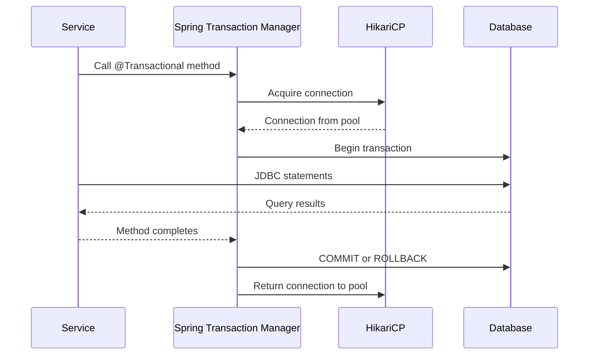

# Transactions, Connection Pools, and Database Error Handling

## 1. Why Do Transactions and Connection Pools Matter?

In the **JDBC Persistence** chapter of the **SPRING_SECURITY_OAUTH2_OIDC_AUTHORIZATION_SERVER** module, we learn how to design, configure, secure, test, and operate an OAuth 2.0/OpenID Connect Authorization Server using Spring Security and Spring Authorization Server in a Spring Boot application.

An Authorization Server persists several states that directly affect security: registered clients, authorization requests, authorization codes, access tokens, refresh tokens, consents, and related metadata. A token issuance operation may need to read a client, validate a grant, update authorization state, and write data. If related updates are not managed properly, the system can leave partial state or allow the same credential to be processed concurrently multiple times.

A JDBC connection pool solves a different problem: opening and closing physical database connections per request is expensive. The pool maintains open connections, lends a connection to a request when needed, and reclaims it once work completes. A pool that is too small causes waiting; a pool that is too large can overload the database.

Three layers of responsibility must work together:

1. **Transactions** define which group of database operations must commit or roll back together.
2. **Connection pools** bound and distribute the number of concurrent connections.
3. **Error handling** determines which errors are retryable, which requests must be rejected, and how to recover when the database is disrupted.

### Learning Objectives

After this lesson, you will be able to:

- Define transaction boundaries for operations that persist authorization state.
- Use Spring transaction management properly with `JdbcTemplate` and Spring Authorization Server.
- Choose propagation and isolation levels suited to business needs.
- Understand connection lifecycles inside transactions and how HikariCP manages pools.
- Calculate pool sizes from the database's connection budget and application load.
- Categorize database errors and design bounded retries, backoff, and idempotency.
- Monitor connection acquisition, pool saturation, query latency, and lock contention.
- Test rollbacks, concurrent token usage, database outages, and recovery.

## 2. Authorization Server JDBC Data

Spring Authorization Server provides these common JDBC components:

| Component | Data |
| --- | --- |
| `JdbcRegisteredClientRepository` | Client ID, encoded client secret, grant types, redirect URIs, scopes, and settings. |
| `JdbcOAuth2AuthorizationService` | Authorization, authorization code, access token, refresh token, ID Token, and related metadata. |
| `JdbcOAuth2AuthorizationConsentService` | Resource owner consent for a client. |

These services use JDBC operations to read/write data matching Spring Authorization Server's schemas. When using them, ensure schemas match the library version and database engine.

Do not assume that merely using JDBC repositories places an entire OAuth flow inside a single business transaction. A single SQL statement may be executed atomically by the database, but a use case involving multiple reads/writes or updating additional application tables needs an explicit transaction boundary at the service layer.

For example: an internal workflow creates a registration, writes an audit record, and creates an onboarding entry. If all three operations must succeed together, wrap them in a suitable transaction. If the audit record goes to an external system outside the database, consider a transactional outbox instead of making network calls while holding a transaction.

### 2.1. Data Model and Consistency

```text
HTTP request
    |
    v
Application / domain service
    |
    +-- Transaction boundary
    |      |
    |      +-- RegisteredClientRepository
    |      +-- OAuth2AuthorizationService
    |      +-- OAuth2AuthorizationConsentService
    |      +-- Application-owned tables
    |
    v
DataSource -> Connection pool -> JDBC connection -> Database
```

A transaction covers only operations participating in the same transaction manager and transactional resource. Calling another REST API, publishing to a message broker, or writing to a second database does not automatically become part of the current JDBC transaction.

### 2.2. Sensitive Data in the Database

Authorization state can contain credentials or token material. Therefore:

- Protect the database with network isolation, authentication, and least privilege.
- Encrypt storage/backups per organizational policy.
- Never write raw authorization codes, access tokens, refresh tokens, or client secrets to logs.
- Use a `PasswordEncoder` for client secrets as required by Spring Authorization Server.
- Restrict read privileges on authorization and consent tables.
- Establish retention and deletion policies aligned with token/client lifecycles.

Transactions ensure data consistency; they do not replace protections for stored data.

## 3. Choosing Transaction Boundaries

### 3.1. One Business Operation, One Transaction

Transaction boundaries should reflect a unit of business work that must be atomic. For instance, a client administration service might:

1. Validate the tenant and permission to create clients.
2. Check that the client ID does not yet exist.
3. Save `RegisteredClient`.
4. Save tenant metadata and an audit outbox event.

If step 3 succeeds while step 4 fails, inconsistent state can result. Placing these database operations inside the same transaction lets the database commit all or roll back all.

```java
import org.springframework.stereotype.Service;
import org.springframework.transaction.annotation.Transactional;

@Service
public class ClientProvisioningService {

    private final RegisteredClientRepository registeredClients;
    private final ClientTenantRepository tenantRepository;
    private final OutboxRepository outboxRepository;

    public ClientProvisioningService(
            RegisteredClientRepository registeredClients,
            ClientTenantRepository tenantRepository,
            OutboxRepository outboxRepository) {
        this.registeredClients = registeredClients;
        this.tenantRepository = tenantRepository;
        this.outboxRepository = outboxRepository;
    }

    @Transactional
    public void provision(
            RegisteredClient client,
            String tenantId,
            String eventId) {

        registeredClients.save(client);
        tenantRepository.attachClient(tenantId, client.getClientId());
        outboxRepository.insertClientRegistered(eventId, client.getClientId());
    }
}
```

The repositories in this example must share the same `DataSource` and transaction manager. Secondary repository names are illustrative application abstractions, not built-in Spring Authorization Server classes.

### 3.2. Never Hold Transactions Longer Than Necessary

A long-lived transaction holds a connection and may hold row locks or snapshots longer than needed. Avoid doing the following inside a transaction:

- Making HTTP calls to external services.
- Waiting for users to enter OTPs or confirm consent.
- Sending emails or calling notification systems synchronously.
- Fetching logos, JWKS, or documents from external URLs.
- Running heavy computations that do not need a database connection.
- Waiting on an async task or external message.

Instead, perform validation outside the transaction when possible, open a short transaction to write state, and emit side effects via an outbox or independent retry mechanism.

### 3.3. Transactions for OAuth Authorization State

Authorization codes and refresh tokens are lifecycle-bound credentials. For multi-step custom operations, design so that:

- Grant and token states are written consistently.
- Consuming an authorization code succeeds only once.
- Refresh token rotation prevents two concurrent requests from using the same refresh token in violation of policy.
- Consent updates do not leave incompatible authorization state behind.
- Database write failures prevent returning a success response as if tokens were saved.

Do not blindly wrap every method of the default JDBC services in a large transaction without understanding call flows and connection hold times. Measure actual transactions and place boundaries on business services requiring atomicity.

## 4. Spring Transaction Management with JDBC

### 4.1. Transaction Managers

Spring JDBC typically uses one of the `DataSource`-backed transaction managers:

- `DataSourceTransactionManager`.
- `JdbcTransactionManager` in Spring Framework versions providing this implementation.

Spring Boot can auto-configure an appropriate transaction manager when the application has JDBC and a single `DataSource`. If declaring multiple `DataSource`s or multiple transaction managers, specify which manager each service uses via `@Transactional(transactionManager = "...")`.

JDBC operations must participate in the same transaction manager and `DataSource` to commit/roll back together. Two distinct `DataSource`s do not form a distributed transaction merely by sitting inside one `@Transactional` method.

### 4.2. Using @Transactional

Example:

```java
@Transactional(
        transactionManager = "transactionManager",
        timeout = 5
)
public void saveAuthorizationState(AuthorizationRecord record) {
    authorizationRepository.save(record);
    auditOutboxRepository.insert(record.id(), "AUTHORIZATION_SAVED");
}
```

When the method is invoked through a Spring proxy, a transaction opens before the method runs. If the method finishes normally, Spring commits. If an exception matching rollback rules occurs, Spring rolls back.

Key points to remember:

- By default, runtime exceptions and errors trigger transaction rollback.
- Checked exceptions do not trigger rollback by default; use `rollbackFor` if business rules require it.
- `timeout` limits transaction duration per transaction manager/database capabilities; it does not replace query timeouts or socket timeouts.
- `readOnly = true` is a hint to the transaction manager/driver/database; do not treat it as a security barrier blocking all writes.
- If a method calls another method on the same object (self-invocation), that call usually bypasses the proxy, so `@Transactional` on the callee may not apply.
- In proxy mode, place `@Transactional` on methods called from other beans with appropriate visibility.

If you catch and swallow an exception inside a transaction, the transaction may still commit unless marked rollback-only. Only catch when a clear business recovery exists; if the operation failed and data is no longer consistent, rethrow or mark rollback.

### 4.3. How Does JdbcTemplate Participate in Transactions?

`JdbcTemplate` uses a connection-acquisition mechanism compatible with Spring transactions. When a transaction binds a connection to the thread, JDBC operations using the same `DataSource` can share that connection.

Example:

```java
@Repository
public class AuthorizationStateRepository {

    private final JdbcTemplate jdbcTemplate;

    public AuthorizationStateRepository(JdbcTemplate jdbcTemplate) {
        this.jdbcTemplate = jdbcTemplate;
    }

    public void insert(String id, String state) {
        jdbcTemplate.update(
                "insert into app_authorization_state (id, state) values (?, ?)",
                id,
                state
        );
    }
}
```

Never call `dataSource.getConnection()` directly and assume that connection participates in Spring's transaction. In manual JDBC code, use `JdbcTemplate` or `DataSourceUtils` to acquire and release connections properly.

### 4.4. Thread-Bound Transactions in Imperative JDBC

Spring transaction management for imperative JDBC normally binds the connection to the current thread. Do not assume transactions propagate automatically across:

- `@Async` or another executor thread.
- Callbacks running on a different thread.
- Work dispatched to a message broker.
- Separate HTTP requests.

If an async worker needs a transaction, the worker must start its own transaction. Reactive transaction management uses a different context mechanism; do not mix imperative `JdbcTemplate` with reactive transactions expecting a single automatic transaction.

## 5. Transaction Propagation

Propagation determines whether a method joins an existing transaction or starts a new one.

| Propagation | Behavior | When to consider |
| --- | --- | --- |
| `REQUIRED` | Joins an existing transaction; creates a new one if none exists. | Default choice for most business services. |
| `REQUIRES_NEW` | Suspends the current transaction and opens an independent transaction. | Writing data that must commit independently, after assessing connections and semantics. |
| `NESTED` | Uses a savepoint inside the current transaction if supported by manager/driver. | Rolling back part of JDBC work inside a larger transaction. |
| `SUPPORTS` | Joins if active; otherwise executes non-transactionally. | Queries that can run inside or outside a transaction. |
| `MANDATORY` | Requires caller to already have an active transaction. | Methods valid only inside a larger unit of work. |
| `NOT_SUPPORTED` | Suspends the current transaction and executes non-transactionally. | Tasks that should not hold an active transaction open. |
| `NEVER` | Rejects execution if caller has an active transaction. | Ensuring an operation never runs inside a transaction. |

### 5.1. Be Careful with REQUIRES_NEW

`REQUIRES_NEW` may require a second connection while the outer transaction still holds its own connection. If many requests concurrently hold outer connections while waiting for inner connections, the pool can exhaust and deadlock in a cascading wait.

Do not use `REQUIRES_NEW` merely to “make sure it saves.” Clearly identify which data truly needs independent commits, connection hold durations, and what happens if the outer transaction rolls back after the inner transaction has committed.

### 5.2. NESTED Is Not a Distributed Transaction

`NESTED` usually relies on JDBC savepoints. It only allows rolling back to a savepoint within the current transaction; the final commit still depends on the outer transaction. Support depends on the transaction manager and JDBC driver. Not all databases or transaction managers support it identically.

## 6. Isolation and Handling Concurrent Access

### 6.1. Isolation Levels

| Isolation | General characteristics | Notes |
| --- | --- | --- |
| `DEFAULT` | Uses the database's default isolation. | Behavior depends on DB engine and configuration. |
| `READ_UNCOMMITTED` | Can read uncommitted data. | Rarely suitable for sensitive OAuth state. |
| `READ_COMMITTED` | Reads only committed data; two reads may observe different results. | Common, though race conditions still require handling. |
| `REPEATABLE_READ` | Keeps read data stable within a transaction per DB semantics. | Phantom prevention and locking vary by engine. |
| `SERIALIZABLE` | Requires results equivalent to serial execution. | Can increase contention and trigger serialization failures. |

No single isolation level is optimal for all databases. `DEFAULT` might be `READ_COMMITTED` on one engine and a different level on another. Read your database's documentation and test under realistic load.

### 6.2. Never Use High Isolation as a Substitute for Constraints

If `client_id` must be unique, define a unique constraint in the database. Checking existence before inserting cannot stop two concurrent requests:

```text
Request A: SELECT client_id -> not found
Request B: SELECT client_id -> not found
Request A: INSERT -> succeeds
Request B: INSERT -> duplicate
```

A unique constraint is the final safeguard. The application catches `DuplicateKeyException`/`DataIntegrityViolationException` and returns an appropriate error instead of assuming the `SELECT` locked the data.

### 6.3. Use Conditional Updates for One-Time Credentials

In a custom state machine, a conditional update ensures only one request transitions state successfully:

```sql
UPDATE app_authorization_code
SET status = 'CONSUMED',
    consumed_at = CURRENT_TIMESTAMP
WHERE code_hash = ?
  AND status = 'ACTIVE'
  AND expires_at > CURRENT_TIMESTAMP;
```

Then inspect the affected row count:

- `1`: this request consumed the code successfully.
- `0`: code does not exist, is expired, or was already consumed.

This is a pattern for an application-managed state table; it is not Spring Authorization Server's default SQL schema. Do not modify the framework's internal tables following this example without designing matching migrations and repositories.

### 6.4. Optimistic and Pessimistic Locking

When multiple requests update the same authorization record:

- **Optimistic locking** uses a version column or version predicate to detect lost updates.
- **Pessimistic locking** uses row locks on read/write if supported by the DB and query.
- **Unique constraints** enforce uniqueness invariants.
- **Conditional updates** enforce single-execution state transitions.

Choose the mechanism based on contention and semantics. Overly broad row locks or long transactions reduce throughput; optimistic locking can produce conflicts requiring controlled retries.

## 7. JDBC Connection Lifecycle

### 7.1. From Pool to Transaction



With `JdbcTemplate`, connections are acquired and released through transaction-aware mechanisms. When the transaction ends, the connection returns to the pool for another request; the physical socket is not necessarily closed.

### 7.2. Do Not Hold Connections Manually

With raw JDBC APIs, you must close `ResultSet`s, `Statement`s, and return connections properly. Prefer `JdbcTemplate` because it manages resources and translates `SQLException` into Spring `DataAccessException`.

Never store a connection in a singleton service field, pass connections across requests, cache connections, or use one connection concurrently from multiple threads.

### 7.3. Never Make Network Calls While Holding a Connection

If a transaction opens a connection and then makes a 3-second HTTP call, the connection stays held for the entire wait. Under heavy load, many such requests can exhaust the pool even when database queries are fast.

Separate the steps:

1. Perform necessary queries/validations.
2. Commit the short transaction.
3. Dispatch side effects via an outbox or worker.
4. If a side effect fails, retry independently using an event ID/idempotency key.

## 8. Connection Pools and HikariCP

### 8.1. What Does the Pool Do?

A connection pool manages the number of physical database connections the application can use concurrently. When a thread needs a connection:

1. The pool returns an idle connection if available.
2. If below the maximum limit, the pool may create a new connection.
3. If already at maximum and none are idle, the thread waits up to the acquisition timeout.
4. When the transaction ends, the connection is returned to the pool.

A pool does not make slow queries faster and does not replace database capacity planning. A pool only regulates connection contention on the application side.

### 8.2. Key HikariCP Parameters

| Property | Meaning | How to choose |
| --- | --- | --- |
| `maximumPoolSize` | Maximum number of connections in the pool. | Calculate from the system-wide connection budget. |
| `minimumIdle` | Target idle connection count. | Allow pool scaling or match max for steady loads. |
| `connectionTimeout` | Max wait time to acquire a connection. | Align with the request latency budget. |
| `validationTimeout` | Max time to validate a connection. | Must be smaller than connection timeout. |
| `idleTimeout` | Time after which an idle connection can be evicted when scaling down. | Meaningful only when minimum idle is less than maximum. |
| `maxLifetime` | Maximum lifetime of a connection in the pool. | Set lower than timeouts enforced by DB/proxy/network. |
| `keepaliveTime` | Interval to test/keep idle connections alive. | Use when infrastructure may close idle connections; must be smaller than max lifetime. |
| `leakDetectionThreshold` | Threshold to warn on connections held too long. | Diagnostic aid only; does not auto-reclaim connections. |

Exact property names and bounds depend on HikariCP/Spring Boot versions. Check documentation for your running version before applying production configurations.

### 8.3. Illustrative Spring Boot Configuration

```yaml
spring:
  datasource:
    url: jdbc:postgresql://db.internal:5432/authorization_server
    username: ${DB_USERNAME}
    password: ${DB_PASSWORD}
    hikari:
      pool-name: authorization-server-pool
      maximum-pool-size: 16
      minimum-idle: 4
      connection-timeout: 2000
      validation-timeout: 1000
      idle-timeout: 300000
      max-lifetime: 1500000
      keepalive-time: 120000
```

These numbers are illustrative starting points, not drop-in recommendations. Measure acquisition latency, transaction duration, database capacity, and replica counts before finalizing. Inject username/password via a secret manager or environment variables; never commit real credentials into source control.

### 8.4. Pool Size Is a System-Wide Budget

Suppose:

| Component | Instance count | Max pool per instance | Max total |
| --- | ---: | ---: | ---: |
| Authorization Server | 4 | 16 | 64 |
| Admin API | 2 | 5 | 10 |
| Worker | 3 | 4 | 12 |
| Migration/monitoring reserve | — | — | 8 |
| **Total potential usage** | | | **94** |

If the database permits only 100 connections and requires reserving 15 for administration, monitoring, or failover, this example configuration already exceeds budget. Sum pools across all replicas and workloads, not just a single application instance.

One way to estimate load is Little's Law:

```text
Concurrent DB connections (estimated)
    ≈ DB operations per second
      × average connection hold time (seconds)
```

For example, 120 DB operations/second with an average hold time of 0.05 seconds:

```text
120 × 0.05 = 6 busy connections on average
```

This is an average. Sizing must account for peak traffic, bursts, long transactions, lock waits, replica counts, and database limits. Never grow the pool merely to mask a slow query or transactions holding connections too long.

### 8.5. Why Can an Oversized Pool Slow the System Down?

More concurrent connections force the database to manage more sessions, memory, locks, and runnable queries. Once CPU or I/O is saturated, enlarging the pool worsens context switching and contention.

A good pool size is large enough for the database to handle concurrent load efficiently, with headroom for spikes, without starving other workloads.

## 9. Timeouts Must Be Designed Together

A request can traverse multiple timeouts:

| Timeout | Limit |
| --- | --- |
| HTTP/request deadline | Total time the request is allowed to run. |
| Connection acquisition timeout | Time waiting for a connection from the pool. |
| Transaction timeout | Duration a transaction is allowed to live per the transaction manager. |
| Query timeout | Duration a single SQL statement is allowed to run. |
| Socket/network timeout | Time waiting for a response from the database/network. |

Limits must align with one another. For instance, if the request deadline is 3 seconds while connection acquisition waits 5 seconds, the request has no chance of finishing on time. A query timeout longer than the entire request deadline is also meaningless to the caller.

Set acquisition timeout short enough to detect pool saturation early and fail fast cleanly. Set query timeouts based on query characteristics and SLAs; do not set a value so low that legitimate queries are routinely aborted.

## 10. Optimizing Queries and Connection Hold Time

### 10.1. Find Slow Queries Before Growing the Pool

Track query latency p50/p95/p99, round-trips per request, execution plans, index usage, lock waits, deadlocks, rows scanned/returned, and transaction durations.

An authorization token lookup query can sit on the hot request path. Inspect indexes on the lookup columns provided by the framework schema; do not add duplicate indexes or alter schemas without measuring first.

### 10.2. Keep Transactions Short

Avoid unnecessary N+1 queries, never load the entire registration table to find one client, and never hold a transaction while awaiting a remote API. Use prepared statements/parameter binding; never concatenate request data into SQL strings.

### 10.3. Avoid Lock Contention

Lock contention typically rises when multiple requests update the same authorization record or metadata row. Reduce contention by keeping transactions short, updating only the needed rows, using appropriate indexes, ordering multi-table updates consistently, using optimistic concurrency when conflicts are rare, and setting suitable timeouts.

## 11. Categorizing Database Errors

Spring JDBC translates `SQLException` into the `DataAccessException` hierarchy. This allows services to handle errors by category rather than depending purely on vendor-specific exceptions.

| Error group | Examples | Action |
| --- | --- | --- |
| Constraint/integrity | Unique key, foreign key, not-null violations | Usually do not retry as-is; return business or conflict error. |
| Transient concurrency | Deadlocks, serialization failures, lock timeouts | May retry the whole transaction if idempotent and retry budget remains. |
| Connection/resource | DB unavailable, connection reset, pool acquisition timeout | Fail request safely, alert, and recover per health policy. |
| Query timeout | SQL exceeded limit | Investigate query/locks; retry only if transient and operation is safe. |
| SQL/schema/configuration | Wrong column, missing migration, wrong DB privileges | Do not retry repeatedly; fix config/schema/permissions. |
| Unknown commit outcome | Connection dropped during commit | Uncertain whether DB committed; requires idempotency/reconciliation. |

### 11.1. Common Spring Exceptions

- `DuplicateKeyException`: unique key or duplicate key violation.
- `DataIntegrityViolationException`: data constraint violation.
- `TransientDataAccessException`: group of potentially transient errors.
- `CannotAcquireLockException`: failed to acquire a lock within the allowed time.
- `DataAccessResourceFailureException`: failure accessing the database resource.
- `QueryTimeoutException`: query timeout translated into the corresponding exception.

Exact mapping depends on the driver, SQLState, vendor error code, and Spring version. Do not rely on exception class names alone to decide retries without verifying the semantics of your database engine.

### 11.2. Do Not Turn Every Error into a Generic HTTP 500

At the API boundary, classify errors by root cause:

- Client sent duplicate or invalid metadata: return an appropriate client error.
- Client authentication failed: return the corresponding protocol error.
- Database temporarily unavailable: return a server/service unavailable error aligned with the endpoint and retry policy.
- Programming/schema bug: return a server error, log the correlation ID, and alert operations.

Never expose SQL statements, internal table names, connection strings, or stack traces to callers.

## 12. Bounded Retries and Idempotency

### 12.1. When Can You Retry?

Retrying can suit deadlocks, serialization failures, or transient connection errors, but only when the error is classified as transient, the prior transaction rolled back or its commit outcome is known, the entire unit of work is safe to re-execute, and retry budget remains.

Never retry validation errors, unique constraints from duplicate input, schema mismatches, or missing database privileges.

### 12.2. Retry the Entire Transaction

If an error occurs mid-transaction, the current transaction may already be marked rollback-only or the connection may no longer be usable. Never execute additional SQL inside a broken transaction. Let the transaction finish, then start a fresh transaction for the next attempt.

A clean structure places a retry facade outside the transactional bean:

```java
@Service
public class RetryingClientProvisioningFacade {

    private final TransactionalClientProvisioner worker;

    public RetryingClientProvisioningFacade(TransactionalClientProvisioner worker) {
        this.worker = worker;
    }

    public void provision(ClientRequest request) {
        int maxAttempts = 3;

        for (int attempt = 1; ; attempt++) {
            try {
                worker.provisionOnce(request);
                return;
            } catch (TransientDataAccessException ex) {
                if (attempt >= maxAttempts) {
                    throw ex;
                }
                backoffWithJitter(attempt);
            }
        }
    }

    private void backoffWithJitter(int attempt) {
        // Use a bounded scheduler/backoff policy in a real application.
    }
}

@Service
public class TransactionalClientProvisioner {

    @Transactional
    public void provisionOnce(ClientRequest request) {
        // Each call through the Spring proxy opens a fresh transaction.
        // Create/save client and metadata in the same unit of work.
    }
}
```

This example illustrates the retry/transaction boundary. In production, backoff needs maximum bounds, jitter, metrics, and cancellation tied to request deadlines. The two classes must be separate Spring beans so `worker.provisionOnce()` passes through the transaction proxy.

### 12.3. Why Is Idempotency Needed?

A connection can drop immediately after the database commits but before the application receives the acknowledgment. The application cannot know for sure whether the operation succeeded. Retrying a client-creation call without idempotency could create a duplicate registration.

Idempotency design:

- The registrar sends a unique idempotency key per registration request.
- The database stores the key along with the outcome or registration ID.
- A unique constraint guarantees the key is processed only once.
- Retries with the same key return the stored result or in-progress status.
- Reusing the same key with a different payload must be rejected.

For OAuth authorization codes/refresh tokens, do not automatically retry the whole flow as an idempotent request. The credential may already have been consumed. Determine the actual state or require the client to initiate a fresh flow per protocol.

### 12.4. Retries Do Not Replace Load Shedding

When the database is overloaded, continuous retries amplify request volume and worsen the outage. Apply bounded retries, exponential backoff, jitter, concurrency limits, and circuit breakers where appropriate. Circuit breakers must fail closed for state-issuing/verifying operations requiring the database; never treat a stale cache as authoritative state.

## 13. Error Handling in Authorization Flows

### 13.1. Database Failures When Issuing Tokens

If authorization state cannot be saved, the Authorization Server must not return a response pretending tokens were issued successfully. The client should receive an appropriate error and retry the flow per protocol.

Never issue tokens based on in-memory-only data hoping the database will catch up later. For stateful authorizations, the database is the authoritative source of truth.

### 13.2. Database Failures When Reading Clients

If `RegisteredClient` cannot be read, the server cannot reliably verify client policies, redirect URIs, grant types, or auth methods. Reject the request safely and alert; never fall back to a stale client cache lacking a clear consistency strategy.

### 13.3. Database Failures During Refresh Token Flows

Refresh token rotation typically involves reading the current authorization, validating the token, and saving the new token/old state. When the update fails, never return new tokens without knowing the persisted state. Test concurrent refreshes and ensure reuse-detection policies cannot be bypassed by retries.

### 13.4. Never Swallow Persistence Errors

A dangerous anti-pattern:

```java
try {
    authorizationService.save(authorization);
} catch (DataAccessException ex) {
    log.warn("Could not persist authorization", ex);
    // Continues returning tokens as if persistence succeeded.
}
```

This can hand out credentials that the Authorization Server cannot subsequently look up or revoke. Let the error propagate to the proper error handler, roll back the transaction, and never report success when persistence fails.

## 14. Multiple DataSources, Outbox, and Side Effects

### 14.1. Multiple DataSources Are Not Automatically Atomic

If `RegisteredClient` is saved in database A while audits are saved in database B, `@Transactional` bound to manager A does not guarantee database B rolls back together. XA/JTA can be used when distributed transactions are genuinely needed and operational overhead is acceptable; many web systems choose outbox/saga patterns to reduce coupling.

### 14.2. Transactional Outbox

When events must be emitted after saving a client/authorization:

1. Within a single JDBC transaction, save the domain record and the outbox event.
2. Commit both.
3. A worker reads unsent events and publishes them to the broker.
4. Mark the event as sent.
5. If the worker crashes after publishing but before marking, the event may be re-sent; consumers must be idempotent by event ID.

An outbox guarantees the event is recorded in the same transaction as primary data. It does not guarantee at-most-once delivery across all scenarios.

### 14.3. Never Publish Messages Inside an Open Transaction

Calling a broker synchronously while holding a JDBC transaction increases connection hold time and introduces dual-write hazards. Writing to an outbox and publishing after commit keeps database transactions short and allows independent retries.

## 15. Health, Metrics, and Alerting

### 15.1. Metrics to Monitor

For HikariCP, track the relevant metrics:

| Metric | Meaning when elevated |
| --- | --- |
| Active connections | Many connections currently in use. |
| Idle connections | Free connections sitting in the pool. |
| Pending threads | Requests waiting to acquire a connection. |
| Connection acquisition time | Pool is slow to hand out connections. |
| Connection usage time | Connections are being held for a long time. |
| Connection timeout count | Requests failed to acquire a connection in time. |
| Pool total | Total open connections. |

Combine with DB metrics: active sessions, query latency, lock waits, deadlocks, CPU, IOPS, transaction age, and connection limits.

### 15.2. Distinguishing Pool Exhaustion from Database Saturation

- **Pool exhaustion:** active hits max, pending rises; may stem from long transactions, connection leaks, or an undersized pool.
- **Database saturation:** high CPU/I/O/lock waits; enlarging the pool may worsen the issue.
- **Network issue:** acquisition or connection-creation timeouts despite available DB capacity.
- **Slow query:** high usage time, poor execution plans, or lock waits.

Diagnose using both application and database metrics rather than inspecting active connection count alone.

### 15.3. Readiness and Liveness

If the Authorization Server requires the database to serve protocol requests, readiness should reflect reachability of this critical dependency. When the database is unavailable, instances can be removed from traffic rotation. Liveness should detect genuinely wedged or broken processes; do not let the orchestrator restart every instance continuously merely because the database is undergoing maintenance.

Health checks must not run heavy queries or open connections continuously. Use appropriate timeouts and intervals.

### 15.4. Leak Detection

HikariCP leak detection warns when a connection is held longer than a threshold. This is an investigation signal, not an auto-closing mechanism for leaked connections. Inspect acquisition stack traces, transaction durations, manual JDBC code, and exception paths that fail to release resources.

## 16. Database Outages and Recovery

### 16.1. When the Database Loses Connectivity

The application should:

- Stop receiving traffic requiring the database if readiness fails.
- Return appropriate server errors instead of serving stale authorization data.
- Bound retries and prevent retry storms.
- Log correlation IDs and sanitized SQLState/vendor codes.
- Monitor pool pending/timeouts and database recovery.
- Avoid draining pools or restarting all services continuously while the DB is still down.

### 16.2. When the Database Recovers

The connection pool can evict broken connections and open fresh ones per configuration. Still, verify that DNS/networking stabilized, credentials remain valid, schemas/migrations match, the pool creates fresh connections, in-flight requests terminated safely, and retries do not produce duplicates or repeated side effects.

### 16.3. Never Fall Back to Memory for Authoritative Data

Do not temporarily switch `RegisteredClientRepository` or `OAuth2AuthorizationService` to an in-memory store when the DB is down and keep issuing tokens. Instances will diverge in state, data disappears on restart, and tokens accepted on one node will go unrecognized on others.

## 17. Migrations and Rolling Deployments

JDBC schemas must remain compatible with running code. When deploying multiple instances:

1. Use an expand/contract strategy for impactful schema changes.
2. Add compatible columns/tables before new code begins writing.
3. Deploy code capable of reading both old and new states when required.
4. Backfill data in bounded batches.
5. Drop old columns/schemas only after every instance has transitioned.

Run migrations through a controlled process rather than letting every application replica execute migrations concurrently at startup. Migration accounts may need higher privileges than runtime accounts; separate the two roles.

Never modify Spring Authorization Server's default schemas arbitrarily. If adding custom indexes/columns, document migrations, version compatibility, rollback/forward-fix plans, and test on the real database engine.

## 18. Testing Transactions, Pools, and Database Errors

| Test group | How to execute | Expected outcome |
| --- | --- | --- |
| Commit | Write multiple tables in one transaction. | All data commits together. |
| Rollback | Intentionally throw an exception after the first write. | No partial state remains. |
| Checked exception | Throw a checked exception inside a transactional method. | Rolls back per configured `rollbackFor`. |
| Self invocation | Call a transactional method on `this`. | Test demonstrates proxy semantics; refactor if boundary is skipped. |
| `REQUIRED` | Call a child service inside an outer transaction. | Joins the same transaction by design. |
| `REQUIRES_NEW` | Child transaction commits, then outer transaction rolls back. | Child data persists; evaluate intentional semantics. |
| Unique race | Two concurrent requests create the same client ID. | One succeeds, the other gets a conflict; DB has no duplicate. |
| One-time code | Two requests consume the same code concurrently. | Only one transition succeeds. |
| Concurrent refresh | Two requests use the same refresh token. | Outcome adheres to rotation/reuse policy. |
| Pool saturation | Set a small pool limit and apply concurrent load. | Pending/timeouts observed; requests fail cleanly. |
| Leak investigation | Hold a connection past the threshold in a test. | Leak detection logs a warning. |
| Query timeout | Run a query exceeding the timeout. | Transaction rolls back/fails per policy. |
| DB outage | Stop the database or block connections. | Readiness and protocol errors behave properly; no memory fallback. |
| Recovery | Restore the database. | Pool reconnects, new requests succeed, no duplicates. |
| Commit uncertainty | Drop connection around commit time. | Idempotency/reconciliation avoids duplicate records. |
| Migration | Upgrade schema across multiple app versions. | Rolling deployment stays compatible as planned. |

### 18.1. Use a Real Database in Integration Tests

H2 or in-memory databases are handy for fast tests, yet do not always replicate the SQL dialect, locking, isolation, JSON columns, indexes, and constraints of production DBs. For critical transaction/concurrency behaviors, run integration tests against the same engine and compatible version, such as with Testcontainers.

### 18.2. Watch Out for Auto-Rolling-Back Tests

Test methods annotated with `@Transactional` normally roll back on completion. That helps isolate tests, yet can hide errors occurring at actual commit time or when transactions finish on another thread.

To verify real commits/rollbacks, use `TransactionTemplate`, separate transaction boundaries, or read from another connection/transaction after the transaction commits.

## 19. Common Troubleshooting

| Symptom | Possible cause | Investigation path |
| --- | --- | --- |
| Connection is not available | Pool exhausted or DB refuses new connections. | Inspect active/idle/pending, usage time, and DB session limits. |
| Slow requests despite fast queries | Waiting for a connection or transaction holding connection too long. | Measure acquisition time and transaction duration. |
| Pool stays active near max | High load, slow queries, lock waits, or leaks. | Compare DB CPU/lock waits against connection usage. |
| Deadlock | Two transactions lock resources in opposite order. | Inspect deadlock graph, standardize update ordering, bound retries. |
| Duplicate client | Only checked existence before insert; missing unique constraint/idempotency. | Add constraint and handle conflicts. |
| Token returned yet authorization not found | Persistence error swallowed or commit failed. | Fail closed; inspect transaction and error paths. |
| Surge of connection errors after DB restart | Stale connections closed, pool re-establishing. | Check network, credentials, `maxLifetime`, and recovery. |
| `@Transactional` does not roll back | Self-invocation, checked exception, or wrong transaction manager. | Check proxy calls, rollback rules, and `DataSource`. |
| `REQUIRES_NEW` causes timeouts | Outer transaction holds connection while inner waits for another. | Reduce nested usage or re-evaluate pool capacity. |
| Retries create duplicate records | Non-idempotent retry or unknown commit outcome. | Use idempotency keys and unique constraints. |
| Migration fails during rolling deploy | Code/schema incompatibility across versions. | Apply expand/contract and verify deployment order. |

## 20. Hands-On Exercises and Checklist

### Exercise 1 — Transaction Boundary

Build a service writing `RegisteredClient`, a tenant mapping table, and an outbox event. Intentionally fail the third step and verify the first two roll back. Then remove `@Transactional` to observe partial state in a test environment.

### Exercise 2 — Pool Sizing

Suppose a database allows 120 connections and needs 20 reserved for administration and other workloads. Authorization Server runs 5 replicas, each with a max pool of 12. Calculate remaining connections and propose pool sizes if additional workers are added.

### Exercise 3 — Connection Hold Time

Create a test endpoint with a transaction wrapping a query and a slow HTTP call. Measure active connection/usage time. Refactor so the network call runs outside the transaction and compare.

### Exercise 4 — Concurrent One-Time Code

Fire two concurrent requests consuming the same authorization code in a custom state table. Use a conditional update and verify only one request consumes it successfully.

### Exercise 5 — Transient Failures and Retries

Simulate a deadlock/serialization failure. Retry the whole transaction with bounded backoff and verify no duplicate data. Repeat the scenario with a unique constraint error and confirm the application does not retry fruitlessly.

### Exercise 6 — DB Outage and Recovery

Stop the database in a test environment. Verify readiness, protocol errors, pool metrics, and behavior once the database recovers. Confirm the Authorization Server never issues tokens backed by unsaved state.

### Completion Checklist

- [ ] Transaction boundaries defined around atomic business units.
- [ ] Understand how `JdbcTemplate` joins Spring transactions via `DataSource`.
- [ ] Correct transaction manager used for each `DataSource`.
- [ ] Understand `REQUIRED`, `REQUIRES_NEW`, and `NESTED` propagation.
- [ ] Isolation levels chosen according to database and concurrency needs.
- [ ] Unique constraints/conditional updates protect invariants.
- [ ] Connections are never held across HTTP calls or user waits.
- [ ] HikariCP configured within the system-wide connection budget.
- [ ] Acquisition, transaction, query, and network timeouts aligned.
- [ ] Transient, integrity, resource, and schema errors classified cleanly.
- [ ] Full-transaction retries use backoff, jitter, and idempotency.
- [ ] Fail closed whenever authorization state cannot be read or written.
- [ ] Pool metrics, query latency, lock waits, and database capacity monitored.
- [ ] Commits, rollbacks, concurrency, pool saturation, outages, and recovery tested on a suitable DB.
- [ ] Migrations deployed compatibly with rolling deployments.

## 21. References

- [Spring Framework — Transaction Management](https://docs.spring.io/spring-framework/reference/data-access/transaction.html) — transaction abstraction, declarative transactions, and propagation.
- [Spring Framework — JDBC](https://docs.spring.io/spring-framework/reference/data-access/jdbc.html) — `JdbcTemplate`, exception translation, and `DataSource` integration.
- [Spring Boot — SQL Databases](https://docs.spring.io/spring-boot/reference/data/sql.html) — `DataSource`, JDBC, transaction managers, and connection pool configuration.
- [Spring Authorization Server — Core Model Components](https://docs.spring.io/spring-authorization-server/reference/core-model-components.html) — `RegisteredClient`, authorization service, and consent service.
- [Spring Authorization Server — Getting Started](https://docs.spring.io/spring-authorization-server/reference/getting-started.html) — persistence configuration and JDBC schemas.
- [HikariCP — Configuration](https://github.com/brettwooldridge/HikariCP#configuration-knobs-baby) — pool sizing, timeouts, lifetimes, and leak detection.
- [PostgreSQL — Transaction Isolation](https://www.postgresql.org/docs/current/transaction-iso.html) — PostgreSQL isolation semantics.
- [PostgreSQL — Explicit Locking](https://www.postgresql.org/docs/current/explicit-locking.html) — row/table locks and deadlocks.
- [Testcontainers for Java](https://java.testcontainers.org/) — integration tests with real database engines.

**Conclusion:** Transactions determine which data must commit or roll back together; connection pools bound concurrent database connections; error handling dictates how the system fails and recovers. For an Authorization Server, keep transactions short, protect single-use state transitions with constraints/conditional updates, size pools within the entire system's budget, and retry transient errors only when the whole operation can safely re-run. When persistence is unavailable, fail safely and never issue tokens based on unpersisted state.
