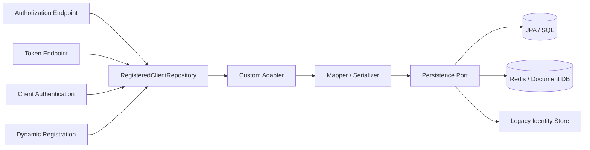

# Designing RegisteredClientRepository for Custom Data Sources

## 1. The Problem: When Do You Need a Custom Repository?

Spring Authorization Server (SAS) provides `RegisteredClientRepository` to store and look up client registrations. For small applications, `InMemoryRegisteredClientRepository` may suffice for development/testing; for standard JDBC persistence, `JdbcRegisteredClientRepository` is the built-in choice. However, a real-world system might need to store clients in JPA, Redis, MongoDB, an identity management service, a legacy database, or a multi-tenant data store.

In such cases, the application must implement **RegisteredClientRepository** itself to convert between Spring Authorization Server's domain model and the system's storage model.

The main challenge does not lie in writing three queries. This repository sits on the OAuth/OIDC processing path: the Authorization Endpoint uses the client registration to validate requests; the Token Endpoint uses it to authenticate the client and validate grants; other endpoints also need to look up clients. A mapping bug or stale data can alter the permissions a client is allowed to use.

This lesson guides you on how to design an adapter for a custom data source, preserve the SAS contract, choose a data structure, handle mapping, protect secrets, enforce tenant isolation, and test the repository.

This lesson belongs to the **Custom Persistence** chapter of the **SPRING_SECURITY_OAUTH2_OIDC_AUTHORIZATION_SERVER** module. The overall goal of the module is **to learn how to design, configure, secure, test, and operate an OAuth 2.0/OpenID Connect Authorization Server with Spring Security and Spring Authorization Server in a Spring Boot application**.

### Learning Objectives

After this lesson, you will be able to:

- Explain the three-method contract of `RegisteredClientRepository`.
- Design a custom persistence model to store the complete `RegisteredClient`.
- Write an adapter to convert between the domain model and the entity.
- Store collections, `ClientSettings`, and `TokenSettings` safely with versioning.
- Configure JPA or Redis as the storage backend.
- Distinguish between registration ID and client ID.
- Handle unique constraints, transactions, concurrency, and cache invalidation.
- Design a repository for multiple issuers/tenants without cross-tenant data leaks.
- Write contract tests and integration tests for the adapter.

> **Version Scope:** Examples are based on Spring Authorization Server 1.5.8 and Spring Security 6.x. APIs and models may change in other versions. The assigned SPECIAL_NOTE for this lesson is left blank.

## 2. RegisteredClientRepository Is an Authorization Server Port

`RegisteredClientRepository` is the central component for registering new clients and querying existing ones. SAS uses the repository when handling protocol flows such as client authentication, authorization grant processing, token introspection, and dynamic client registration.

The interface has three methods:

```java
public interface RegisteredClientRepository {

    void save(RegisteredClient registeredClient);

    RegisteredClient findById(String id);

    RegisteredClient findByClientId(String clientId);
}
```

This is an intentionally small contract:

| Method | Meaning | Result Convention |
| --- | --- | --- |
| save(registeredClient) | Persist the registration | Throw an exception if saving fails; do not silently ignore errors |
| findById(id) | Find by internal registration ID | Return `RegisteredClient` or `null` if not found |
| findByClientId(clientId) | Find by OAuth client identifier | Return `RegisteredClient` or `null` if not found |

Both find methods return `null` when no record exists. Do not return a default `RegisteredClient` or a dummy client to mask errors.

### 2.1. The Interface Is Not a Full CRUD Service

`RegisteredClientRepository` does not have dedicated methods for listing, searching, deleting, disabling, rotating secrets, or updating metadata. If the application needs client administration, build a separate application service with appropriate authorization, auditing, validation, and transactions.

The `save` method only states that the repository persists a `RegisteredClient`. The interface does not prescribe every insert/update/upsert strategy. A custom implementation must choose consistent semantics and document them clearly:

- A new ID creates a new registration.
- For an existing ID, decide whether to allow updates or return a conflict.
- A `clientId` colliding with a different ID must be rejected.
- Determine whether changing grants, redirect URIs, or secrets affects already-issued authorizations.

Do not assume `save` is a safe client-management API for every kind of mutation.

### 2.2. RegisteredClientRepository Does Not Store Tokens or Consents

`RegisteredClient` describes a **client registration**: client ID, secret, grants, scopes, redirect URIs, and settings. It is distinct from:

- `OAuth2Authorization`: the state of a specific authorization, including authorization codes, access tokens, refresh tokens, ID Tokens, device codes, and metadata.
- `OAuth2AuthorizationConsent`: the consent/authorities that a resource owner has granted to a client.

If you replace the storage backend for `RegisteredClient`, the other core services still need appropriate persistence. Do not merge authorization/token state into `RegisteredClient` just because both reference a client.

## 3. Adapter Architecture for Custom Data Sources

Keep Spring Authorization Server's domain model at the adapter boundary. Internal business/persistence layers can use their own entities, documents, or records.



Read flow:

1. SAS calls `findByClientId` or `findById`.
2. The adapter queries the persistence port.
3. The mapper converts the entity/document into a `RegisteredClient`.
4. SAS receives the fully constructed domain object.

Write flow:

1. SAS or an application service calls `save`.
2. The adapter validates the input and persistence policy.
3. The mapper converts `RegisteredClient` into an entity/document.
4. The persistence layer stores the data within an appropriate transaction.

### 3.1. Do Not Let JPA Entities Enter the Protocol Layer

Do not return a JPA entity or Redis document directly to SAS. `RegisteredClient` is the domain type the framework understands; the entity is a storage detail. Separating the two models enables you to:

- Swap JPA for Redis without changing protocol configuration.
- Change the schema without changing OAuth handling code.
- Control the serialization of settings.
- Write mapper tests independently of the database.
- Avoid exposing internal fields such as tenant metadata, audit columns, or database version fields.

### 3.2. The Adapter Must Fail Closed

If the database fails, JSON settings are corrupted, or the tenant cannot be determined, the adapter must raise a clear error. Do not return `null` as if the client does not exist when storage is actually failing; that hampers troubleshooting and can cause inconsistent behavior across nodes.

Return `null` only when the query succeeds and no registration is found.

## 4. Designing the Persistence Model for RegisteredClient

`RegisteredClient` has 13 main fields. A custom store must preserve all fields that the application uses.

| RegisteredClient field | Content | Suggested Storage |
| --- | --- | --- |
| id | Internal registration ID | Primary key |
| clientId | OAuth client identifier | Dedicated column, unique index |
| clientIdIssuedAt | ID issuance timestamp | Timestamp/Instant |
| clientSecret | Encoded secret or null | Column protected as a credential |
| clientSecretExpiresAt | Secret expiration timestamp | Nullable timestamp |
| clientName | Display name | String |
| clientAuthenticationMethods | Set of authentication methods | JSON or child table |
| authorizationGrantTypes | Set of grant types | JSON or child table |
| redirectUris | Set of redirect URIs | JSON or child table |
| postLogoutRedirectUris | Set of post-logout URIs | JSON or child table |
| scopes | Set of scopes | JSON or child table |
| clientSettings | ClientSettings | JSON/versioned document |
| tokenSettings | TokenSettings | JSON/versioned document |

### 4.1. Both Identifiers Must Be Stored Separately

`id` is the internal key of the registration. `clientId` is the OAuth client identifier sent in protocol requests. Do not use `clientId` in place of `id` if other authorization/consent tables link via the registration ID.

You should create:

- A primary key on `id`.
- A unique constraint on `clientId` scoped to the appropriate issuer/tenant.
- Indexes for the columns actually queried.

In a multi-tenant system, the unique key can be `(tenant_id, client_id)` if client IDs only need to be unique within each tenant. If client IDs must be globally unique across the system, the constraint must reflect that rule.

### 4.2. Storing Collections: JSON or Relational Tables?

There are two common approaches:

| Storage Approach | Advantages | Trade-offs |
| --- | --- | --- |
| JSON column/document | Simple, round-trips the entire `Set`, fits the adapter well | Harder to query individual elements; requires serializer and versioning |
| Normalized child tables | Easier to query/index individual grants, scopes, or URIs | More tables, joins, and complex transactions |

Avoid joining values with commas if the data might contain commas or require escaping. For example, a redirect URI can contain a query string; a naive delimiter serializer easily produces data that cannot round-trip accurately.

With JSON, serialize `Set`s into JSON arrays. With child tables, use a foreign key to the registration ID and a unique constraint on each element.

### 4.3. ClientSettings and TokenSettings Are Structured Configurations

Do not simply store these two objects as `toString` strings. They contain multiple key/value pairs and may hold `Duration`, token formats, JWS algorithms, or Spring Security types.

Choose one of the following strategies:

- JSON with Jackson modules compatible with Spring Security and SAS.
- Dedicated typed columns if the internal schema is stable and querying is needed.
- A document structure with a schema version.

If you create your own `ObjectMapper`, register the required modules such as `SecurityJackson2Modules` and `OAuth2AuthorizationServerJackson2Module`. Test deserialization after restarts and across version upgrades.

## 5. Mapping Rules Must Preserve Semantics

Mapping is not just copying fields. Some fields are sets of values, some are nullable, and some contain custom values.

### 5.1. Preserve Extended Grant Types and Authentication Methods

`AuthorizationGrantType` and `ClientAuthenticationMethod` can represent extended values. When reading data, do not only recognize a narrow list of standard constants and discard unknown values.

You can reconstruct them by value:

```java
AuthorizationGrantType grantType =
        new AuthorizationGrantType(storedGrantTypeValue);

ClientAuthenticationMethod authenticationMethod =
        new ClientAuthenticationMethod(storedAuthenticationMethodValue);
```

This ensures custom grant/authentication methods still round-trip properly. However, successfully persisting a value does not mean SAS already has a provider supporting it. Protocol support must be configured separately.

### 5.2. Preserve Nulls and Default Values

Fields such as `clientSecret` and `clientSecretExpiresAt` can be `null`. Do not automatically replace `null` with an empty string or the current time. `ClientSettings` and `TokenSettings` must be reconstructed with all persisted settings intact to avoid falling back to unintended defaults.

### 5.3. Do Not Mutate Collections from Persistence

`RegisteredClient` typically exposes collections that should not be mutated by the adapter. The mapper should create new collections and avoid holding mutable references from an entity or cache.

### 5.4. Version JSON Payloads

When settings gain new fields in newer framework versions, older JSON data must remain readable. You can store an extra `schema_version` or use a compatible migration strategy:

1. Read the document according to its version.
2. Apply migration/normalization if needed.
3. Build `ClientSettings`/`TokenSettings`.
4. Only write back in the new version inside a controlled transaction.

Do not strip unrecognized keys if the application relies on custom settings.

## 6. JPA Example: Custom Entity and Repository

Spring Authorization Server provides an official guide demonstrating how to implement core services with JPA. The basic structure consists of an entity storing `RegisteredClient` fields, a Spring Data repository looking up by `id`/`clientId`, and an adapter implementing `RegisteredClientRepository`.

Condensed entity example:

```java
@Entity
@Table(
    name = "oauth2_client",
    uniqueConstraints = @UniqueConstraint(
        name = "uk_oauth2_client_client_id",
        columnNames = "client_id"
    )
)
class ClientEntity {

    @Id
    @Column(length = 100)
    private String id;

    @Column(name = "client_id", nullable = false, length = 100)
    private String clientId;

    private Instant clientIdIssuedAt;
    private String clientSecret;
    private Instant clientSecretExpiresAt;
    private String clientName;

    @Lob
    private String clientAuthenticationMethodsJson;

    @Lob
    private String authorizationGrantTypesJson;

    @Lob
    private String redirectUrisJson;

    @Lob
    private String postLogoutRedirectUrisJson;

    @Lob
    private String scopesJson;

    @Lob
    private String clientSettingsJson;

    @Lob
    private String tokenSettingsJson;

    // Constructors, getters and setters omitted.
}
```

This is an illustrative example. `@Lob` behavior and text/JSON mapping depend on the JPA provider/database. With PostgreSQL, you can use `jsonb` via appropriate mapping; with other databases, you can use `text`/`CLOB`. Always verify actual schema migrations instead of relying on auto-generated DDL in production.

Spring Data repository:

```java
interface ClientEntityRepository
        extends JpaRepository<ClientEntity, String> {

    Optional<ClientEntity> findByClientId(String clientId);
}
```

A database unique constraint is the final safeguard against duplicate `clientId` values. Pre-checking with `findByClientId` helps return a friendly business error, but it does not replace the constraint because two requests can execute concurrently.

## 7. Configuring ObjectMapper for Spring Security Settings

`ClientSettings` and `TokenSettings` can contain Spring Security/SAS data types. Do not use a default `ObjectMapper` without registering the required modules.

Configuration example similar to the official JPA guide:

```java
import com.fasterxml.jackson.databind.Module;
import com.fasterxml.jackson.databind.ObjectMapper;
import java.util.List;
import org.springframework.security.jackson2.SecurityJackson2Modules;
import org.springframework.security.oauth2.server.authorization.jackson2.OAuth2AuthorizationServerJackson2Module;

ObjectMapper objectMapper = new ObjectMapper();
ClassLoader classLoader = getClass().getClassLoader();

List<Module> securityModules =
        SecurityJackson2Modules.getModules(classLoader);

objectMapper.registerModules(securityModules);
objectMapper.registerModule(
        new OAuth2AuthorizationServerJackson2Module());
```

In a Spring application, manage `ObjectMapper` as a centrally configured dependency rather than instantiating a new one on every repository call. If you use a dedicated custom `ObjectMapper` for the adapter, document its modules and test payloads serialized by previous versions.

### 7.1. Serializing Settings

```java
String writeSettings(Map<String, Object> settings) {
    try {
        return objectMapper.writeValueAsString(settings);
    } catch (JsonProcessingException ex) {
        throw new IllegalStateException(
                "Cannot serialize RegisteredClient settings", ex);
    }
}
```

### 7.2. Deserializing Settings

```java
Map<String, Object> readSettings(String json) {
    try {
        return objectMapper.readValue(
                json,
                new TypeReference<Map<String, Object>>() {});
    } catch (JsonProcessingException ex) {
        throw new DataRetrievalFailureException(
                "Cannot deserialize RegisteredClient settings", ex);
    }
}
```

Do not catch the exception and return an empty map. If the settings cannot be read, the adapter cannot guarantee the client's policy; it must throw an error so the data or migration can be fixed.

## 8. Implementing JpaRegisteredClientRepository

The adapter needs to implement the three operations and convert between the entity and `RegisteredClient`.

```java
final class JpaRegisteredClientRepository
        implements RegisteredClientRepository {

    private final ClientEntityRepository repository;
    private final RegisteredClientMapper mapper;

    JpaRegisteredClientRepository(
            ClientEntityRepository repository,
            RegisteredClientMapper mapper) {
        Assert.notNull(repository, "repository cannot be null");
        Assert.notNull(mapper, "mapper cannot be null");
        this.repository = repository;
        this.mapper = mapper;
    }

    @Override
    public void save(RegisteredClient registeredClient) {
        Assert.notNull(registeredClient,
                "registeredClient cannot be null");
        repository.save(mapper.toEntity(registeredClient));
    }

    @Override
    public RegisteredClient findById(String id) {
        Assert.hasText(id, "id cannot be empty");
        return repository.findById(id)
                .map(mapper::toDomain)
                .orElse(null);
    }

    @Override
    public RegisteredClient findByClientId(String clientId) {
        Assert.hasText(clientId, "clientId cannot be empty");
        return repository.findByClientId(clientId)
                .map(mapper::toDomain)
                .orElse(null);
    }
}
```

This is a skeleton for the adapter. `RegisteredClientMapper` is responsible for serializing/deserializing all fields; it should not contain authorization policy or HTTP logic. Register the adapter once via `@Bean` or component scanning; do not use both mechanisms simultaneously for the same implementation.

### 8.1. Mapping Entity to RegisteredClient

Outline:

```java
RegisteredClient toDomain(ClientEntity entity) {
    Set<String> methods = readStringSet(entity.getClientAuthenticationMethodsJson());
    Set<String> grants = readStringSet(entity.getAuthorizationGrantTypesJson());
    Set<String> redirects = readStringSet(entity.getRedirectUrisJson());
    Set<String> postLogouts = readStringSet(entity.getPostLogoutRedirectUrisJson());
    Set<String> scopes = readStringSet(entity.getScopesJson());

    return RegisteredClient.withId(entity.getId())
            .clientId(entity.getClientId())
            .clientIdIssuedAt(entity.getClientIdIssuedAt())
            .clientSecret(entity.getClientSecret())
            .clientSecretExpiresAt(entity.getClientSecretExpiresAt())
            .clientName(entity.getClientName())
            .clientAuthenticationMethods(values ->
                    methods.forEach(value ->
                            values.add(new ClientAuthenticationMethod(value))))
            .authorizationGrantTypes(values ->
                    grants.forEach(value ->
                            values.add(new AuthorizationGrantType(value))))
            .redirectUris(values -> values.addAll(redirects))
            .postLogoutRedirectUris(values -> values.addAll(postLogouts))
            .scopes(values -> values.addAll(scopes))
            .clientSettings(ClientSettings.withSettings(
                    readSettings(entity.getClientSettingsJson())).build())
            .tokenSettings(TokenSettings.withSettings(
                    readSettings(entity.getTokenSettingsJson())).build())
            .build();
}
```

The illustrative snippet assumes `readStringSet`/`readSettings` helpers are implemented and the entity has the corresponding accessors. Reconstructing grant types and authentication methods by value preserves custom values as well.

### 8.2. Mapping RegisteredClient to Entity

Outline:

```java
ClientEntity toEntity(RegisteredClient client) {
    ClientEntity entity = new ClientEntity();
    entity.setId(client.getId());
    entity.setClientId(client.getClientId());
    entity.setClientIdIssuedAt(client.getClientIdIssuedAt());
    entity.setClientSecret(client.getClientSecret());
    entity.setClientSecretExpiresAt(client.getClientSecretExpiresAt());
    entity.setClientName(client.getClientName());

    entity.setClientAuthenticationMethodsJson(
            writeStringSet(client.getClientAuthenticationMethods().stream()
                    .map(ClientAuthenticationMethod::getValue)
                    .collect(Collectors.toSet())));
    entity.setAuthorizationGrantTypesJson(
            writeStringSet(client.getAuthorizationGrantTypes().stream()
                    .map(AuthorizationGrantType::getValue)
                    .collect(Collectors.toSet())));
    entity.setRedirectUrisJson(writeStringSet(client.getRedirectUris()));
    entity.setPostLogoutRedirectUrisJson(
            writeStringSet(client.getPostLogoutRedirectUris()));
    entity.setScopesJson(writeStringSet(client.getScopes()));
    entity.setClientSettingsJson(
            writeSettings(client.getClientSettings().getSettings()));
    entity.setTokenSettingsJson(
            writeSettings(client.getTokenSettings().getSettings()));
    return entity;
}
```

This is also an outline. Check your project's actual builder/entity and use a consistent serializer in both directions. Do not omit `postLogoutRedirectUris`, `clientSettings`, or `tokenSettings`.

## 9. Implementing with Redis or a Document Store

With Redis, you can store a dedicated entity for `RegisteredClient`, mark `clientId` as an indexed field, and create a Spring Data repository to look up by `clientId`.

Example:

```java
@RedisHash("oauth2_registered_client")
class OAuth2RegisteredClientDocument {

    @Id
    private String id;

    @Indexed
    private String clientId;

    private Instant clientIdIssuedAt;
    private String clientSecret;
    private Instant clientSecretExpiresAt;
    private String clientName;
    private Set<String> clientAuthenticationMethods;
    private Set<String> authorizationGrantTypes;
    private Set<String> redirectUris;
    private Set<String> postLogoutRedirectUris;
    private Set<String> scopes;
    private Map<String, Object> clientSettings;
    private Map<String, Object> tokenSettings;
}

interface OAuth2RegisteredClientDocumentRepository
        extends CrudRepository<OAuth2RegisteredClientDocument, String> {

    OAuth2RegisteredClientDocument findByClientId(String clientId);
}
```

Then create a `RedisRegisteredClientRepository` adapter similar to the JPA adapter:

- `save`: map `RegisteredClient` to the document and persist it.
- `findById`: read the document by `id` and map it to `RegisteredClient`.
- `findByClientId`: query the indexed `clientId` and map it to `RegisteredClient`.

This is the pattern illustrated in the SAS Redis guide. Configure Redis durability, replication, persistence, ACL/TLS, and backups according to your requirements. Do not treat a purely volatile Redis cache as a durable registration source if client registrations must survive restarts.

### 9.1. Do Not Set an Arbitrary TTL on Registrations

`RegisteredClient` does not expire on the access token TTL schedule. If a Redis document has a TTL, the client registration can vanish while authorizations/tokens still reference it. Only set a TTL when it is an explicit business requirement accompanied by handling for related authorizations, tokens, and audits.

## 10. Registering the Custom Repository with the Authorization Server

The custom implementation must be registered as a `RegisteredClientRepository` bean and used by the Authorization Server.

Example:

```java
@Configuration
class CustomClientPersistenceConfiguration {

    @Bean
    RegisteredClientRepository registeredClientRepository(
            ClientEntityRepository entityRepository,
            RegisteredClientMapper mapper) {
        return new JpaRegisteredClientRepository(entityRepository, mapper);
    }
}
```

If the application has only one `RegisteredClientRepository` bean, SAS can pick up that bean through Spring configuration mechanisms. You can also configure it explicitly on `OAuth2AuthorizationServerConfigurer` when needed:

```java
OAuth2AuthorizationServerConfigurer authorizationServer =
        OAuth2AuthorizationServerConfigurer.authorizationServer();

http.with(authorizationServer, server ->
        server.registeredClientRepository(registeredClientRepository));
```

Avoid registering multiple beans of the same type without clear qualifiers/`@Primary`. If SAS accidentally picks up an `InMemory` repository while the application expects the custom store, nodes may see different sets of clients.

## 11. Multi-Tenancy: The Interface Does Not Pass tenantId

`RegisteredClientRepository` only accepts `id` or `clientId`; it has no tenant parameter. If each issuer has its own set of clients, the adapter must resolve the tenant from a trusted security/protocol context.

SAS provides a multi-tenancy guide that uses `AuthorizationServerContextHolder` to obtain the current issuer and then delegates to the repository registered for that issuer.

There are two common storage models:

| Model | Isolation Mechanism |
| --- | --- |
| Separate database/schema per tenant | Each issuer has its own repository/`DataSource` |
| Shared table | Every query must include `tenant_id`; unique keys and indexes are tenant-scoped |

### 11.1. Issuer-Based Delegating Repository

Conceptual flow:

```java
RegisteredClientRepository repositoryForCurrentIssuer() {
    AuthorizationServerContext context =
            AuthorizationServerContextHolder.getContext();

    if (context == null || !StringUtils.hasText(context.getIssuer())) {
        throw new IllegalStateException("Issuer context is required");
    }

    RegisteredClientRepository repository =
            approvedIssuerRegistry.get(context.getIssuer());

    if (repository == null) {
        throw new IllegalStateException("Issuer is not configured");
    }
    return repository;
}
```

This is illustrative pseudocode. The registry must use allowlisted canonical issuers; do not accept an arbitrary tenant from a client-supplied query parameter or header. If the issuer/repository cannot be resolved, fail closed.

### 11.2. Shared Tables Require a Tenant Predicate in All Three Methods

With a shared table:

- `save` must write `tenant_id` from a trusted context.
- `findById` must filter by both `tenant_id` and `id`.
- `findByClientId` must filter by both `tenant_id` and `client_id`.
- The unique constraint is typically `(tenant_id, client_id)`.

Do not filter by tenant only in `findByClientId` and forget `findById`. Authorization objects may reference registrations by internal ID; if an ID can be looked up across tenants, a data leak risk remains.

### 11.3. Background Jobs Need an Explicit Tenant Context

Client seeding, secret rotation, or audit jobs may run outside an HTTP request where `AuthorizationServerContextHolder` has no issuer. For such jobs, pass the tenant/issuer explicitly to the administration service and invoke the tenant-specific repository; do not fall back to a default tenant.

## 12. Transactions, Uniqueness, and Concurrency

Client registrations can be created concurrently by Dynamic Client Registration, an admin service, or deployment automation. Checking existence before calling `save` is not enough to prevent race conditions.

Safeguards:

1. Unique constraint/index on `clientId` or `(tenantId, clientId)`.
2. A transaction wrapping the persist operation.
3. Translating duplicate-key exceptions into clear conflict errors.
4. Generating internal IDs that are stable and unique.
5. If `save` behaves as an upsert, defining update rules and optimistic locking.
6. Preventing two concurrent requests from writing different versions of a client without a conflict policy.

### 12.1. Save Should Have Clear Semantics

JPA repository `save` typically has persist/merge semantics depending on entity state. Mongo/Redis have different semantics. `RegisteredClientRepository` does not prescribe conflict-handling details, so a custom adapter should establish consistent rules:

- DCR creating a new client: reject an already-existing `clientId`.
- Admin update: go through a separate application service with permission and version checks.
- Secret rotation: record version/rotation metadata and audit logs.

If the application intentionally allows `save` to update an existing ID, prevent `clientId` mutation or tightly control `clientId` changes.

### 12.2. Transactions with Authorization Data

`RegisteredClient` is referenced by `OAuth2Authorization` and `OAuth2AuthorizationConsent` via the registration ID. When modifying or deleting a client, consider related records:

- Are there still active authorizations?
- Are there refresh tokens that need to be revoked?
- Should consents be kept or deleted?
- Are client registrations cached on other nodes?

Do not delete a client entity in isolation if the system needs to handle related tokens/consents within a coordinated transaction or workflow.

## 13. Protecting Client Secrets and Sensitive Data

The `RegisteredClientRepository` API expects sensitive values such as `clientSecret` to be encoded outside the implementation. The adapter should not assume whether a received string is a raw secret or an encoded secret.

### 13.1. Encode the Secret Before Calling Save

Example in a client-creation service:

```java
String encodedSecret = passwordEncoder.encode(rawSecret);

RegisteredClient client = RegisteredClient.withId(UUID.randomUUID().toString())
        .clientId("orders-service")
        .clientSecret(encodedSecret)
        .clientAuthenticationMethod(
                ClientAuthenticationMethod.CLIENT_SECRET_BASIC)
        .authorizationGrantType(AuthorizationGrantType.CLIENT_CREDENTIALS)
        .scope("orders.read")
        .build();

registeredClientRepository.save(client);
```

Never store raw client secrets. Never use `NoOpPasswordEncoder` in production. During client authentication, the appropriate `PasswordEncoder` matches the submitted secret against the encoded value.

### 13.2. Do Not Log the Entire RegisteredClient

`RegisteredClient` can contain `clientSecret`, JWK Set URLs, and settings. Avoid logging the full object or logging unmasked DCR requests/responses. Audit logs should record `clientId`, registration ID, actor, tenant, changes to grants/scopes/redirect URIs, and correlation ID—never credentials.

### 13.3. Encryption at Rest and Backups

Hashing secrets does not protect other sensitive data such as internal URIs, tenant metadata, or private configuration. Restrict database permissions, use TLS, enable encryption at rest, and protect backups/replicas. If storing a reference to a secret manager, store only the reference ID; never place the actual secret in the document.

## 14. Caching and Cross-Instance Consistency

`RegisteredClient` is frequently looked up on the token/authorization processing path. Caching can reduce latency, but registration changes must become visible consistently.

If caching:

- Key the cache by issuer/tenant and `clientId`/`id`.
- Use an appropriate TTL and an invalidation mechanism on update/disable.
- Broadcast invalidation events to other nodes.
- Do not cache `null` for long periods, which could hide newly created clients.
- Do not retain a stale client after its secret, grants, or redirect URIs change.
- Monitor cache hit/miss rates and stale reads.

In multi-node deployments, local caches do not synchronize automatically. Use a distributed cache or an appropriate event bus/invalidation mechanism. If reliable invalidation cannot be guaranteed, consider reading directly from the source of truth.

## 15. Performance and Choosing a Data Source

| Data Source | When Suitable | Things to Check |
| --- | --- | --- |
| JPA/Relational DB | Existing transactional database, need constraints and admin queries | Indexes, transactions, JSON serialization, N+1 queries, and connection pool |
| Redis | Fast lookup, document/key-value data, shared store needed | Durability, indexes, TTL, backups, serialization |
| MongoDB/document DB | Flexible metadata, schema evolution | Unique indexes, consistency, document size, atomic updates |
| Legacy identity store | Client registry already exists in another system | API latency, availability, mapping, versioning, and retries |
| Configuration service | Clients are centrally managed and released by version | Caching, rollouts, rollbacks, availability, and stale config |

### 15.1. Avoid Uncontrolled Remote Service Calls per Request

`RegisteredClientRepository` can be called multiple times within a single protocol flow. If every `findByClientId` calls an external REST service, the Authorization Server's latency and availability depend directly on that service.

If a remote store must be used:

- Set explicit timeouts and limit retries.
- Avoid non-idempotent retries on `save`.
- Use connection pooling.
- Cache with invalidation if policy allows.
- Implement appropriate circuit breaking/failure handling.
- Do not return `null` when the remote service times out.

### 15.2. Index Only Lookup Fields

The two primary queries are by `id` and `clientId`. Create the corresponding indexes. With multi-tenancy, indexes and unique constraints must include the tenant. Do not index every JSON field or scope if the application does not query by them.

## 16. Separating RegisteredClientRepository from the Admin Lifecycle

A system often needs additional use cases beyond the interface's three methods:

| Use Case | Component That Should Handle It |
| --- | --- |
| Create client from onboarding | Admin/registration service calling `repository.save` after validation |
| Change redirect URI | Admin service with approval, audit, and validation |
| Rotate client secret | Credential service + `PasswordEncoder`/secret manager + repository |
| Disable client | Client lifecycle service and status-checking policy |
| Delete client | Admin workflow checking authorizations/consents/tokens first |
| List clients | Separate admin query service/repository with pagination |
| Change history | Audit store/event log |

Do not expose a REST CRUD API directly over `RegisteredClientRepository`. Administrative operations can alter authentication and token issuance capabilities, so they must have dedicated authorization and auditing.

### 16.1. Disabling a Client Must Be Enforced in Lookup/Authentication

If the internal model has an `ACTIVE`/`DISABLED` status, the adapter should not silently hide disabled clients from every query if doing so breaks policy-driven handling of existing authorizations/tokens. Decide:

- Should a disabled client be rejected from new authentication attempts?
- Can already-issued tokens still be introspected/refreshed?
- Can pending authorization codes still be exchanged?
- Does discovery metadata still advertise clients? (Normally discovery describes server capabilities, not a client listing.)

You can store the status in the domain store and integrate policy checks at the appropriate layer. Do not cram custom status into `RegisteredClient` if the framework has no corresponding field and no reliable access mechanism.

## 17. Testing the Custom Repository

Do not test only the mapper. Test the `RegisteredClientRepository` contract with the same dataset through the real adapter.

### 17.1. Contract Test Matrix

| Test | Expected Result |
| --- | --- |
| `save` then `findById` | Reads back the exact registration |
| `save` then `findByClientId` | Reads the exact registration by `clientId` |
| Unknown `id` | Returns `null` |
| Unknown `clientId` | Returns `null` |
| Null input | Explicitly rejected |
| Empty `id`/`clientId` | Explicitly rejected |
| Duplicate `clientId` | Unique constraint/conflict handled |
| `clientId` distinct from `id` | Both lookups do not get confused |
| Multiple grant types | Complete round-trip |
| Custom grant type | Value preserved |
| Multiple auth methods | Complete round-trip |
| Custom auth method | Value preserved |
| Redirect URI with query/comma | Serialized/deserialized without data loss |
| Post-logout URI | Complete round-trip |
| Scopes | Complete round-trip |
| `ClientSettings` | PKCE/consent/JWK settings preserved |
| `TokenSettings` | TTL, format, and refresh policy preserved |
| Nullable secret/expiry | `null` preserved |
| Secret encoding | Raw secret does not appear in storage |
| Legacy JSON | Readable according to schema version/migration |
| Corrupted JSON | Raises persistence error; does not return empty settings |

### 17.2. Integration Tests with a Real Database

For JPA, use Testcontainers or a production-compatible database. Verify:

- The unique constraint actually exists.
- Transactions roll back when the mapper/database fails.
- Concurrent creation with the same `clientId` yields only one registration.
- JSON/CLOB columns store sufficient data.
- Application restarts can still read registrations.
- Registration changes are visible to other instances.

For Redis, verify the `clientId` index, serialization converters, restart/recovery, replication, and behavior when keys expire or Redis loses connectivity.

### 17.3. Multi-Tenant Tests

Create two issuers with the same `clientId` but different metadata:

- `findByClientId` on issuer A must return registration A.
- `findByClientId` on issuer B must return registration B.
- `findById` must not read registrations belonging to another tenant.
- Missing issuer context must fail closed.
- An issuer outside the allowlist must be rejected.

This is data-security testing, not merely routing testing.

## 18. Troubleshooting

| Symptom | Possible Cause | Resolution |
| --- | --- | --- |
| Client exists but `findByClientId` returns `null` | Querying wrong field or wrong index/tenant predicate | Check mapper and query |
| `findById` cannot find client | Passing `clientId` instead of registration ID | Check both identifiers |
| Custom grant lost | Mapper only recognizes standard constants | Construct `AuthorizationGrantType` from stored value |
| Unknown auth method dropped | Mapper uses a hardcoded whitelist | Preserve `ClientAuthenticationMethod` value and support policy |
| Settings revert to defaults after restart | Incorrect JSON module/deserialization | Register Spring Security/SAS Jackson modules |
| Redirect URI partially lost | Stored with unescaped delimiter | Use JSON array or child table |
| Duplicate `clientId` | Missing unique constraint | Add tenant-scoped unique key |
| Node A sees client, node B does not | Local cache or unshared store | Check invalidation/replication |
| Tenant A reads client B | Query missing tenant predicate | Isolate all methods by issuer/tenant |
| Storage timeout treated as missing client | Adapter catches error and returns `null` | Propagate storage errors |
| `save` creates duplicate rows | Missing transaction/unique constraint | Handle conflict at database level |
| Disabled client still usable | Stale cache or policy not enforced | Invalidate cache and verify auth flow |
| Newer JSON settings unreadable | Missing schema version/compatibility | Write migration and backward-compatible reader |
| Database fails but server falls back to in-memory | Uncontrolled fallback bean/behavior | Fail closed or implement intentional degraded mode |

Investigation order: **issuer/tenant context → repository bean → lookup key → persistence query → mapper/serializer → unique constraint → transaction → cache → client authentication flow**.

## 19. Capstone Scenario: Migrating RegisteredClient from JDBC to JPA

An organization is using `JdbcRegisteredClientRepository` and wants to store registrations in a shared JPA schema alongside onboarding and audit data.

Process:

1. Define the three-method contract of `RegisteredClientRepository`.
2. Design `ClientEntity` with all 13 domain fields and a unique `clientId`.
3. Choose JSON arrays for collections and JSON settings for `ClientSettings`/`TokenSettings`.
4. Create `ClientEntityRepository` with `findByClientId`.
5. Write a bidirectional `RegisteredClientMapper`, preserving custom grants/auth methods.
6. Configure `ObjectMapper` with Spring Security/SAS modules.
7. Implement the `JpaRegisteredClientRepository` adapter.
8. Encode client secrets before calling `save`.
9. Register the custom repository bean and remove the old JDBC bean to avoid miswiring.
10. Run contract tests, migration tests, concurrency tests, and end-to-end OAuth flows.
11. Migrate data with record counts and field-by-field reconciliation.
12. Deploy with a rollback strategy; do not allow both repositories to write to the same client set during cutover without bidirectional sync.

After migration, the Authorization Endpoint and Token Endpoint continue using the `RegisteredClient` domain model. Only the adapter/persistence implementation changes.

## 20. Pre-Production Checklist

- [ ] Adapter implements `save`, `findById`, and `findByClientId`.
- [ ] Does not return `null` when storage fails.
- [ ] Stores all 13 `RegisteredClient` fields in use.
- [ ] `id` and `clientId` are clearly separated.
- [ ] Unique constraint exists on `clientId` scoped by issuer/tenant.
- [ ] Collections serialize without data loss or delimiter collisions.
- [ ] `ClientSettings`/`TokenSettings` serialize with compatible modules.
- [ ] Custom grant/authentication methods are preserved.
- [ ] `clientSecret` is encoded before persistence.
- [ ] Raw secrets and full `RegisteredClient` objects are never logged.
- [ ] Transaction and concurrency behavior is defined.
- [ ] Migrations/schema versioning and backups are in place.
- [ ] Cache invalidation is configured if caching is used.
- [ ] Multi-tenant lookups fail closed and enforce tenant checks in all methods.
- [ ] Admin lifecycle lives in a separate service with authorization and auditing.
- [ ] Contract tests and integration tests run against real storage.
- [ ] End-to-end OAuth/OIDC flows work after swapping the repository.

## 21. Summary

Designing `RegisteredClientRepository` for a custom data source means building an adapter between Spring Authorization Server's domain model and your application's persistence model.

1. The contract consists only of `save`, `findById`, and `findByClientId`; understand the semantics of all three methods before implementing.
2. Persist the complete `RegisteredClient`, including collections, `ClientSettings`, and `TokenSettings`.
3. Use a bidirectional mapper and a serializer with compatible modules; avoid ad-hoc string concatenation.
4. Preserve custom grant/authentication methods and nullable fields.
5. Encode client secrets outside the repository before saving.
6. Use unique constraints, transactions, and a concurrency policy to protect registrations.
7. For multi-tenancy, resolve the repository from a trusted issuer or always apply a tenant predicate.
8. Separate admin lifecycle, auditing, and token revocation from the narrow repository interface.
9. Test round-trips, storage errors, caching, tenant isolation, and real OAuth flows.

Keep `RegisteredClientRepository` small and stable while keeping schemas, entities, serializers, and storage technologies behind the adapter. When swapping JPA for Redis or a custom service, the protocol layer continues working with the same domain model and stays unaware of persistence details.

### References

- [Spring Authorization Server 1.5.8 — Core Model / Components](https://docs.spring.io/spring-authorization-server/reference/core-model-components.html)
- [Spring Authorization Server 1.5.8 — RegisteredClientRepository API](https://docs.spring.io/spring-authorization-server/reference/api/java/org/springframework/security/oauth2/server/authorization/client/RegisteredClientRepository.html)
- [Spring Authorization Server 1.5.8 — RegisteredClient API](https://docs.spring.io/spring-authorization-server/reference/api/java/org/springframework/security/oauth2/server/authorization/client/RegisteredClient.html)
- [Spring Authorization Server 1.5.8 — How-to: Implement Core Services with JPA](https://docs.spring.io/spring-authorization-server/reference/guides/how-to-jpa.html)
- [Spring Authorization Server 1.5.8 — How-to: Implement Core Services with Redis](https://docs.spring.io/spring-authorization-server/reference/guides/how-to-redis.html)
- [Spring Authorization Server 1.5.8 — How-to: Implement Multitenancy](https://docs.spring.io/spring-authorization-server/reference/guides/how-to-multitenancy.html)
- [Spring Security — Jackson Modules](https://docs.spring.io/spring-security/reference/servlet/integrations/jackson.html)
