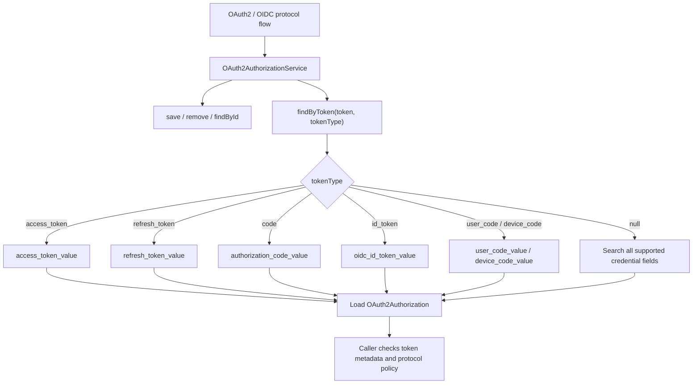

# Implementing OAuth2AuthorizationService and Token-Type Lookup

## 1. Objectives and Context

In the **Custom Persistence** chapter of the **SPRING_SECURITY_OAUTH2_OIDC_AUTHORIZATION_SERVER** module, the Authorization Server must persist the state of created authorizations and retrieve that state throughout OAuth 2.0/OpenID Connect flows. This state includes the client, principal, grant type, scopes, authorization code, access token, refresh token, ID Token, device code, user code, metadata, and related attributes.

Spring Authorization Server (SAS) encapsulates that data in the `OAuth2Authorization` domain object and delegates persistence responsibility to the `OAuth2AuthorizationService` interface. An implementation can store data via JDBC, JPA, Redis, a document database, or a distributed data store, provided it preserves the framework's contract and semantics.

This lesson focuses on two things you must get right when implementing the service yourself:

1. Saving, updating, deleting, and reconstructing a complete `OAuth2Authorization`.
2. Finding the exact authorization from a token credential and `OAuth2TokenType`, including when no token type is provided.

After this lesson, you will be able to:

- Explain the structure of `OAuth2Authorization` and the role of `OAuth2AuthorizationService`.
- Distinguish between an authorization record, token object, grant type, and token type.
- Implement the four operations: `save`, `remove`, `findById`, and `findByToken`.
- Handle lookups for access tokens, refresh tokens, authorization codes, ID Tokens, user codes, device codes, and state.
- Understand the meaning of `tokenType == null` and how to handle unsupported token types.
- Use `JdbcOAuth2AuthorizationService`, default mappers, and the SAS schema.
- Design a custom JPA or repository implementation following Spring's guide.
- Optimize token lookups with indexes or a dedicated lookup table.
- Protect token values, metadata, and serialized attributes.
- Maintain consistency across token issuance, refresh, revocation, multi-instance deployments, and expired-data cleanup.
- Test contract compliance using integration tests and a real database.

**Version Scope:** The illustrated APIs target **Spring Authorization Server 1.5.x**, **Spring Security 6.x**, and **Spring Boot 3.x**. The current Spring documentation at the time of writing is SAS 1.5.8. Cross-check your project's dependency versions, as schemas, Jackson integration, and some APIs may change across major/minor releases. The custom entities/repositories in this lesson are architectural examples, not complete implementations to copy into production without adaptation.

## 2. Where Does OAuth2AuthorizationService Fit?

`OAuth2AuthorizationService` is the central component for persisting new authorizations and querying existing ones. Protocol components call the service whenever they need to retrieve prior state, for example:

- Client authentication and authorization grant processing.
- Exchanging an authorization code for tokens.
- Refreshing an access token.
- Token introspection and token revocation.
- Device Authorization Grant.
- OpenID Connect and extended flows.
- Dynamic Client Registration or custom grants when integrating with authorization state.

If the service returns the wrong authorization, a request could associate a token with the wrong client/principal, fail to recognize an invalidated token, or fail to complete a grant flow.

### 2.1. The Interface Contract

The interface has four primary operations:

```java
public interface OAuth2AuthorizationService {

    void save(OAuth2Authorization authorization);

    void remove(OAuth2Authorization authorization);

    OAuth2Authorization findById(String id);

    OAuth2Authorization findByToken(
            String token,
            OAuth2TokenType tokenType);
}
```

| Method | Meaning | Result |
| --- | --- | --- |
| `save(authorization)` | Persist a new authorization or updated state | No return value |
| `remove(authorization)` | Delete an authorization by identifier | No return value |
| `findById(id)` | Find an authorization by internal ID | Object or `null` |
| `findByToken(token, tokenType)` | Find an authorization containing the provided token/credential | Object or `null` |

`findByToken` accepts a nullable `tokenType`. Therefore, implementations must support both type-specific lookups and lookups without a specified type.

### 2.2. Default Services

SAS provides two main implementations:

| Implementation | Storage Mechanism | Purpose |
| --- | --- | --- |
| `InMemoryOAuth2AuthorizationService` | Process memory | Development and testing |
| `JdbcOAuth2AuthorizationService` | JDBC via `JdbcOperations` | Relational persistence |

If no custom service is configured, this component may default to `InMemoryOAuth2AuthorizationService`. This is easy to overlook: the application appears to work during testing, yet authorization state vanishes when the process stops or a request hits another instance.

`JdbcOAuth2AuthorizationService` is a straightforward implementation suitable for some production deployments, but the SAS documentation warns that it has performance limitations and may not suit high-throughput environments. When optimization for load, database characteristics, token format, or distributed models is needed, the application can supply its own implementation.

## 3. The OAuth2Authorization Model

`OAuth2Authorization` represents an authorization granted to a client by a resource owner, or by the client itself in the case of `client_credentials`.

Key properties:

| Property | Meaning |
| --- | --- |
| `id` | Unique ID of the authorization record |
| `registeredClientId` | Internal ID of the `RegisteredClient` |
| `principalName` | Principal name of the resource owner or client |
| `authorizationGrantType` | Grant type that created the authorization |
| `authorizedScopes` | Authorized scopes |
| `tokens` | The `OAuth2Token` instances along with grant-specific metadata |
| `attributes` | Additional attributes such as principal, authorization request, and flow state |

A single authorization can hold multiple tokens of different types. For example, an Authorization Code Flow with OIDC may contain an authorization code, access token, refresh token, and ID Token. A Device Authorization Grant may contain a device code and user code before an access token is issued.

### 3.1. Tokens Wrapped with Metadata

SAS stores each token in `OAuth2Authorization.Token<T>`. This wrapper holds the token object and metadata, such as:

- Whether the token has been invalidated.
- Whether the token has expired.
- Whether the token is active or before its valid-from timestamp.
- Token claims if the token supports `ClaimAccessor`.
- Custom metadata attached to the token.

Example of accessing a token:

```java
OAuth2Authorization.Token<OAuth2AccessToken> accessToken =
        authorization.getAccessToken();

if (accessToken != null && accessToken.isActive()) {
    String value = accessToken.getToken().getTokenValue();
}
```

Do not store only the raw token value and drop the metadata. When reconstructing an authorization, you must restore issued-at, expires-at, scopes, claims, and invalidation state so providers behave correctly.

### 3.2. One Authorization Record Does Not Equal One Token

An authorization can have multiple tokens sharing a lifecycle. Removing an authorization deletes all token state stored in the record. Conversely, invalidating one token may only mark that token inactive while another token in the same authorization remains active.

For instance, a refresh flow may invalidate the old refresh token or replace tokens under a rotation policy while keeping the authorization record to hold the new access token and new refresh token.

### 3.3. Internal ID vs. Client ID

`registeredClientId` is `RegisteredClient.getId()`, not the public `client_id` sent over the protocol. When reconstructing an authorization, the service must look up the `RegisteredClient` by internal ID and attach the registration object to the builder.

If the registration no longer exists, do not synthesize a fake client from the ID string. Throw a clear data error (such as `DataRetrievalFailureException`) to surface deprovisioning bugs or inconsistent referential data.

## 4. Token Types and Token Lookup

`findByToken(token, tokenType)` is the most critical part when implementing a custom service. The second parameter specifies which type of credential to look up so the repository queries the right field.

### 4.1. Token Type Is Not Grant Type

These are two distinct concepts:

- **Grant type** describes how the authorization was created, such as `authorization_code`, `client_credentials`, `refresh_token`, or `urn:ietf:params:oauth:grant-type:device_code`.
- **Token type** describes the credential or value being looked up, such as `access_token`, `refresh_token`, `code`, `id_token`, `user_code`, or `device_code`.

Do not pass `AuthorizationGrantType.AUTHORIZATION_CODE` into `findByToken`. This method accepts `OAuth2TokenType`.

### 4.2. Common Lookup Values

`OAuth2TokenType` in SAS defines two standard constants:

- `OAuth2TokenType.ACCESS_TOKEN` with value `access_token`.
- `OAuth2TokenType.REFRESH_TOKEN` with value `refresh_token`.

Other types are represented by `OAuth2TokenType` constructed from the corresponding value, such as `new OAuth2TokenType(OAuth2ParameterNames.CODE)` or `new OAuth2TokenType(OidcParameterNames.ID_TOKEN)`.

Mapping table across common authorization fields:

| `tokenType.getValue()` | Value | Storage Field | Context |
| --- | --- | --- | --- |
| `access_token` | Access token | `access_token_value` | Introspection, resource access, revocation |
| `refresh_token` | Refresh token | `refresh_token_value` | Refresh grant, revocation |
| `code` | Authorization code | `authorization_code_value` | Exchanging code for tokens |
| `id_token` | OIDC ID Token | `oidc_id_token_value` | OIDC/logout or related lookup |
| `user_code` | Device user code | `user_code_value` | User confirming device |
| `device_code` | Device code | `device_code_value` | Polling token endpoint in device flow |
| `state` | Authorization state | `state` | Flow lookup by state when needed by a caller |

`state` is a state parameter from the authorization request, not an OAuth token. Nevertheless, JDBC/JPA implementations may support looking it up through the same method for related flows.

### 4.3. Lookup by Specific Type

When `tokenType` is non-null, the implementation should query the corresponding column:

```java
OAuth2Authorization authorization =
        authorizationService.findByToken(
                presentedAccessToken,
                OAuth2TokenType.ACCESS_TOKEN);
```

For an authorization code:

```java
OAuth2TokenType authorizationCodeType =
        new OAuth2TokenType(OAuth2ParameterNames.CODE);

OAuth2Authorization authorization =
        authorizationService.findByToken(
                code,
                authorizationCodeType);
```

For an OIDC ID Token:

```java
OAuth2TokenType idTokenType =
        new OAuth2TokenType(OidcParameterNames.ID_TOKEN);

OAuth2Authorization authorization =
        authorizationService.findByToken(
                idTokenValue,
                idTokenType);
```

Using a specific token type lets the query leverage a dedicated index, avoid scanning multiple columns, and avoid mistaking a colliding value in another column.

### 4.4. When tokenType Is Null

When `tokenType == null`, the caller has not specified the credential type. The implementation must search across all token/credential types that the service supports. In the standard SAS model, consider:

- `state`
- Authorization code
- Access token
- OIDC ID Token
- Refresh token
- User code
- Device code

Both the JDBC implementation and the SAS JPA guide demonstrate this broad lookup. If the application adds a custom token type, decide how it is looked up both when the type is specified and when the type is `null`.

Never search only access tokens when receiving `null`. That breaks flows that call the service without knowing beforehand which column holds the credential.

### 4.5. Unsupported Token Types

If given an `OAuth2TokenType` that the custom implementation cannot map, the appropriate behavior is to return `null`/not found, unless the application has an explicitly registered extended token type.

Do not fall back every unknown type to access token. Doing so easily causes credentials to be queried in the wrong column and masks configuration mistakes.

### 4.6. Example Token Type Classification Function

```java
private static String resolveLookupField(OAuth2TokenType tokenType) {
    if (tokenType == null) {
        return "ANY";
    }

    String value = tokenType.getValue();

    if (OAuth2TokenType.ACCESS_TOKEN.getValue().equals(value)) {
        return "ACCESS_TOKEN";
    }
    if (OAuth2TokenType.REFRESH_TOKEN.getValue().equals(value)) {
        return "REFRESH_TOKEN";
    }
    if (OAuth2ParameterNames.CODE.equals(value)) {
        return "AUTHORIZATION_CODE";
    }
    if (OidcParameterNames.ID_TOKEN.equals(value)) {
        return "ID_TOKEN";
    }
    if (OAuth2ParameterNames.USER_CODE.equals(value)) {
        return "USER_CODE";
    }
    if (OAuth2ParameterNames.DEVICE_CODE.equals(value)) {
        return "DEVICE_CODE";
    }
    if (OAuth2ParameterNames.STATE.equals(value)) {
        return "STATE";
    }

    return "UNSUPPORTED";
}
```

This is an illustrative helper for dispatch logic. In a real repository, use an enum/strategy or fixed query methods; never concatenate column names directly from input into SQL.

## 5. findByToken Returns an Authorization, Not a Verified Token

`findByToken` returns the `OAuth2Authorization` containing a credential with a matching value. This method does not assert that the token is active, unexpired, unrevoked, or valid with respect to audience/issuer.

After lookup, the caller/provider must inspect the token wrapper and protocol conditions.

Example:

```java
OAuth2Authorization authorization =
        authorizationService.findByToken(
                tokenValue,
                OAuth2TokenType.ACCESS_TOKEN);

if (authorization == null) {
    // No authorization found containing the token.
    return;
}

OAuth2Authorization.Token<OAuth2AccessToken> token =
        authorization.getToken(tokenValue);

if (token == null || !token.isActive()) {
    // Token is expired, invalidated, or no longer active.
    return;
}
```

`OAuth2Authorization.Token.isActive()` evaluates the token's status based on timestamps and invalidation metadata. Endpoints must also enforce appropriate validation: client binding, audience/resource, scopes, signatures for JWTs, and business policies.

Do not arbitrarily embed an "only return active tokens" filter inside `findByToken`. Some flows need to retrieve the record of an invalidated or expired token to handle revocation, auditing, refresh, or cleanup.

## 6. save, remove, and findById

### 6.1. save: Insert or Update

During the SAS lifecycle, the same authorization can be saved multiple times as token state evolves. For example:

1. Generate an authorization code and save the authorization.
2. Exchange the code for an access token/refresh token.
3. Update metadata or invalidation state.
4. Refresh the token and store new tokens.
5. Revoke a token and persist the invalidated state.

Thus `save` must handle both new records and existing records. The default JDBC implementation looks up by ID and then inserts or updates. A custom service should use an upsert or transaction to avoid a race between existence checking and insertion.

### 6.2. remove: Deleting the Entire Authorization Record

`remove` deletes the record by `authorization.getId()`. This is typically used when an authorization must be purged from the store or when the application implements a deprovisioning policy.

Do not confuse removing an authorization with invalidating a single token. If audit history must be preserved or other tokens in the same authorization must remain usable, you may need to update metadata/invalidation rather than deleting the record.

### 6.3. findById: Lookup by Internal ID

`findById` is used when another component already knows the authorization ID. It is not a lookup by token or client ID.

The ID must be unique, stable, and persisted with the record. It can be generated using a UUID or a random identifier with sufficient entropy. Never use a token value as the authorization ID.

### 6.4. Authorization Update Pattern

The `OAuth2Authorization.from` builder creates a builder initialized from an existing authorization. On refresh/revocation, you can build an updated copy preserving required properties:

```java
OAuth2Authorization updated =
        OAuth2Authorization.from(existingAuthorization)
                .invalidate(oldRefreshToken)
                .token(newAccessToken)
                .token(newRefreshToken)
                .build();

authorizationService.save(updated);
```

This snippet illustrates the concept; only invalidate old tokens when required by the flow/policy, and preserve valid metadata/tokens. Do not generate a brand-new authorization on every update if doing so severs the link to the prior grant, principal, or token state.

## 7. SAS Default JDBC Schema

`JdbcOAuth2AuthorizationService` uses the `oauth2_authorization` table defined by the SQL resource:

```text
classpath:org/springframework/security/oauth2/server/authorization/oauth2-authorization-schema.sql
```

The schema is designed as a flattened record: one row represents one authorization and contains columns for each token type.

### 7.1. Core Column Groups

| Group | Typical Columns |
| --- | --- |
| Identity | `id`, `registered_client_id`, `principal_name`, `authorization_grant_type` |
| Authorization context | `authorized_scopes`, `attributes`, `state` |
| Authorization code | `authorization_code_value`, `authorization_code_issued_at`, `authorization_code_expires_at`, `authorization_code_metadata` |
| Access token | `access_token_value`, `access_token_issued_at`, `access_token_expires_at`, `access_token_metadata`, `access_token_type`, `access_token_scopes` |
| OIDC ID Token | `oidc_id_token_value`, `oidc_id_token_issued_at`, `oidc_id_token_expires_at`, `oidc_id_token_metadata` |
| Refresh token | `refresh_token_value`, `refresh_token_issued_at`, `refresh_token_expires_at`, `refresh_token_metadata` |
| Device user code | `user_code_value`, `user_code_issued_at`, `user_code_expires_at`, `user_code_metadata` |
| Device code | `device_code_value`, `device_code_issued_at`, `device_code_expires_at`, `device_code_metadata` |

The primary key is `id`. The schema does not create a separate table for each token; each authorization holds the tokens corresponding to its grant type.

### 7.2. Token and Metadata Data Types

Token values, attributes, and metadata can exceed typical short string lengths, especially when access tokens are JWTs or attributes hold authorization requests/principals. The default script uses LOB types such as `BLOB` for several columns.

Do not mechanically replace LOB columns with `varchar(255)`. Truncated tokens or metadata will cause lookup, deserialization, or signature validation failures.

### 7.3. Database Dialect Differences

The SAS schema documentation notes database-specific adjustments:

- For PostgreSQL, change `blob` columns to an appropriate type such as `text`; change `timestamp` to `timestamptz` to store instants accurately.
- For MySQL, configure the JDBC URL/driver to preserve instants/time zones properly according to the MySQL Connector/J guidance.
- For Oracle, SQL Server, or other databases, verify LOB types, timestamps, indexes, and length limits according to the dialect.

Custom schemas must be tested against the actual production JDBC driver and database. Do not infer full PostgreSQL/MySQL compatibility just because H2 passes.

## 8. Configuring JdbcOAuth2AuthorizationService

Common constructor in SAS 1.5.8:

```java
JdbcOAuth2AuthorizationService(
        JdbcOperations jdbcOperations,
        RegisteredClientRepository registeredClientRepository)
```

There is also an overload accepting a `LobHandler` for handling large objects.

### 8.1. Bean Declaration

```java
@Configuration(proxyBeanMethods = false)
public class AuthorizationPersistenceConfiguration {

    @Bean
    OAuth2AuthorizationService authorizationService(
            JdbcOperations jdbcOperations,
            RegisteredClientRepository registeredClientRepository) {

        return new JdbcOAuth2AuthorizationService(
                jdbcOperations,
                registeredClientRepository);
    }
}
```

This configuration assumes a datasource, JDBC operations, and registered client repository are already available. The schema table must be created before the service operates.

### 8.2. Wiring into the Configurer

`OAuth2AuthorizationService` is an optional component and SAS may default to an in-memory service. Configure it explicitly on the Authorization Server:

```java
@Bean
@Order(1)
SecurityFilterChain authorizationServerSecurityFilterChain(
        HttpSecurity http,
        OAuth2AuthorizationService authorizationService)
        throws Exception {

    OAuth2AuthorizationServerConfigurer authorizationServer =
            OAuth2AuthorizationServerConfigurer.authorizationServer();

    http
        .securityMatcher(authorizationServer.getEndpointsMatcher())
        .with(authorizationServer, server ->
                server.authorizationService(authorizationService))
        .authorizeHttpRequests(authorize ->
                authorize.anyRequest().authenticated());

    return http.build();
}
```

This covers the persistence-related configuration; the application still needs beans for registered clients, consent, token generators, JWKs, user authentication, and Authorization Server settings.

### 8.3. RowMapper and ParametersMapper

`JdbcOAuth2AuthorizationService` exposes two extension points:

- `setAuthorizationRowMapper(...)`: converts a `ResultSet` into an `OAuth2Authorization`.
- `setAuthorizationParametersMapper(...)`: converts an `OAuth2Authorization` into a list of SQL parameters.

By default, the SAS mappers handle token values, timestamps, metadata, attributes, and the `RegisteredClient` association. If you customize the schema, you must update both directions and run round-trip tests.

Do not simply rename SQL columns and keep the default mappers if the storage structure is no longer compatible.

### 8.4. Performance Limitations

The default JDBC implementation uses a flattened table and general-purpose query logic. The SAS API documentation notes that this implementation may not meet performance requirements in high-throughput environments.

When optimization is needed, measure:

- `findByToken` latency per token type.
- Row counts and LOB sizes.
- Query plans, index usage, and database I/O.
- Frequency of saves/updates to the same authorization.
- Connection pool usage, lock waits, and transaction durations.
- Token lookup hit/miss ratios per endpoint.

Only replace the implementation when metrics show the bottleneck is in the persistence layer.

## 9. Designing Custom Persistence with JPA

The official SAS JPA guide demonstrates implementing core services using an entity, a Spring Data repository, and a mapper between the entity and domain object. This is a starting point for schema customization, not a mandatory model for every application.

### 9.1. Authorization Entity

A flattened entity may include these fields:

```java
@Entity
@Table(name = "oauth2_authorization")
public class AuthorizationEntity {

    @Id
    private String id;

    private String registeredClientId;
    private String principalName;
    private String authorizationGrantType;

    @Column(length = 1000)
    private String authorizedScopes;

    @Lob
    private String attributes;

    private String state;

    @Lob
    private String authorizationCodeValue;
    private Instant authorizationCodeIssuedAt;
    private Instant authorizationCodeExpiresAt;
    @Lob
    private String authorizationCodeMetadata;

    @Lob
    private String accessTokenValue;
    private Instant accessTokenIssuedAt;
    private Instant accessTokenExpiresAt;
    @Lob
    private String accessTokenMetadata;
    private String accessTokenType;
    @Column(length = 1000)
    private String accessTokenScopes;

    @Lob
    private String refreshTokenValue;
    private Instant refreshTokenIssuedAt;
    private Instant refreshTokenExpiresAt;
    @Lob
    private String refreshTokenMetadata;

    @Lob
    private String oidcIdTokenValue;
    private Instant oidcIdTokenIssuedAt;
    private Instant oidcIdTokenExpiresAt;
    @Lob
    private String oidcIdTokenMetadata;
    @Lob
    private String oidcIdTokenClaims;

    @Lob
    private String userCodeValue;
    private Instant userCodeIssuedAt;
    private Instant userCodeExpiresAt;
    @Lob
    private String userCodeMetadata;

    @Lob
    private String deviceCodeValue;
    private Instant deviceCodeIssuedAt;
    private Instant deviceCodeExpiresAt;
    @Lob
    private String deviceCodeMetadata;
}
```

This is a condensed entity to illustrate structure. You must add getters/setters, constructors, column mappings, dialect-specific LOB types, and any remaining fields required by your authorization model/version. Do not copy the illustrative JPA schema and assume its column types match the default JDBC resource identically.

### 9.2. Repository

You can define query methods per token field:

```java
public interface AuthorizationRepository
        extends JpaRepository<AuthorizationEntity, String> {

    Optional<AuthorizationEntity> findByState(String state);

    Optional<AuthorizationEntity> findByAuthorizationCodeValue(String value);

    Optional<AuthorizationEntity> findByAccessTokenValue(String value);

    Optional<AuthorizationEntity> findByRefreshTokenValue(String value);

    Optional<AuthorizationEntity> findByOidcIdTokenValue(String value);

    Optional<AuthorizationEntity> findByUserCodeValue(String value);

    Optional<AuthorizationEntity> findByDeviceCodeValue(String value);

    Optional<AuthorizationEntity>
    findByStateOrAuthorizationCodeValueOrAccessTokenValueOrRefreshTokenValueOrOidcIdTokenValueOrUserCodeValueOrDeviceCodeValue(
            String value);
}
```

The final `OR` method supports the case where no token type is passed. At large data volumes, consider replacing the derived query with JPQL/native queries or a separately indexed token index table.

### 9.3. Custom Service Skeleton

```java
@Service
public class JpaOAuth2AuthorizationService
        implements OAuth2AuthorizationService {

    private final AuthorizationRepository repository;
    private final RegisteredClientRepository registeredClients;

    public JpaOAuth2AuthorizationService(
            AuthorizationRepository repository,
            RegisteredClientRepository registeredClients) {
        this.repository = repository;
        this.registeredClients = registeredClients;
    }

    @Override
    public void save(OAuth2Authorization authorization) {
        repository.save(toEntity(authorization));
    }

    @Override
    public void remove(OAuth2Authorization authorization) {
        repository.deleteById(authorization.getId());
    }

    @Override
    public OAuth2Authorization findById(String id) {
        return repository.findById(id)
                .map(this::toObject)
                .orElse(null);
    }

    @Override
    public OAuth2Authorization findByToken(
            String token, OAuth2TokenType tokenType) {

        Optional<AuthorizationEntity> result =
                findEntityByToken(token, tokenType);

        return result.map(this::toObject).orElse(null);
    }

    private Optional<AuthorizationEntity> findEntityByToken(
            String token, OAuth2TokenType tokenType) {
        // Dispatch by tokenType as shown in the next section.
        throw new UnsupportedOperationException("Implement lookup");
    }

    private AuthorizationEntity toEntity(
            OAuth2Authorization authorization) {
        // Map domain object, tokens, metadata, and attributes.
        throw new UnsupportedOperationException("Implement mapping");
    }

    private OAuth2Authorization toObject(
            AuthorizationEntity entity) {
        // Resolve RegisteredClient and reconstruct domain object.
        throw new UnsupportedOperationException("Implement mapping");
    }
}
```

The skeleton above shows the boundary and the four interface methods. Neither mapper can be skipped in a real implementation: `toEntity` must preserve all required tokens/metadata, and `toObject` must faithfully restore the domain object.

## 10. Implementing findByToken Dispatch in JPA

This is the core logic for querying the right token column:

```java
private Optional<AuthorizationEntity> findEntityByToken(
        String token, OAuth2TokenType tokenType) {

    Assert.hasText(token, "token cannot be empty");

    if (tokenType == null) {
        return repository
                .findByStateOrAuthorizationCodeValueOrAccessTokenValueOrRefreshTokenValueOrOidcIdTokenValueOrUserCodeValueOrDeviceCodeValue(
                        token);
    }

    String type = tokenType.getValue();

    if (OAuth2ParameterNames.STATE.equals(type)) {
        return repository.findByState(token);
    }
    if (OAuth2ParameterNames.CODE.equals(type)) {
        return repository.findByAuthorizationCodeValue(token);
    }
    if (OAuth2TokenType.ACCESS_TOKEN.getValue().equals(type)) {
        return repository.findByAccessTokenValue(token);
    }
    if (OidcParameterNames.ID_TOKEN.equals(type)) {
        return repository.findByOidcIdTokenValue(token);
    }
    if (OAuth2TokenType.REFRESH_TOKEN.getValue().equals(type)) {
        return repository.findByRefreshTokenValue(token);
    }
    if (OAuth2ParameterNames.USER_CODE.equals(type)) {
        return repository.findByUserCodeValue(token);
    }
    if (OAuth2ParameterNames.DEVICE_CODE.equals(type)) {
        return repository.findByDeviceCodeValue(token);
    }

    return Optional.empty();
}
```

This snippet covers the token types commonly stored by SAS core persistence. If the application adds custom token types, add columns/indexes or token index records along with dispatch branches. When `tokenType` is `null`, the broad query must also search custom tokens if the service commits to supporting broad lookups for them.

### 10.1. Why Not Use a Single Ad-Hoc Query?

A `WHERE token_value = ?` query across multiple tables or fields can be difficult to optimize, and a single authorization has multiple token columns. Querying explicitly by token type lets the database use the right index.

When the type is `null`, broad lookup is required, so you must ensure token values do not collide across authorizations or credential types. Token values should have high entropy and have uniqueness enforced at the persistence layer.

### 10.2. Collisions and Uniqueness

If a value appears in two columns or two authorizations, a lookup without a type becomes ambiguous. In a custom system, you should:

- Generate random credentials with high entropy.
- Create unique indexes for each token column where supported by the database.
- If using a token index table, place a unique constraint on digest and type; consider a global uniqueness constraint if lookups omit the type.
- Treat multiple matches as an integrity error rather than silently picking the first row.

Never use a short, sequential, or predictable token as an authorization code or device code.

## 11. Reconstructing OAuth2Authorization from an Entity

Once the repository finds an entity, the custom service must restore the domain object. The process typically involves:

1. Resolving `RegisteredClient` by `entity.getRegisteredClientId()`.
2. Restoring ID, principal name, grant type, and authorized scopes.
3. Deserializing attributes.
4. Restoring `state` if present.
5. Reconstructing each token object by type.
6. Restoring metadata for each token.
7. Attaching the tokens to the builder and building the authorization.

Example builder initialization:

```java
RegisteredClient registeredClient =
        registeredClients.findById(entity.getRegisteredClientId());

if (registeredClient == null) {
    throw new DataRetrievalFailureException(
            "RegisteredClient not found: "
                    + entity.getRegisteredClientId());
}

OAuth2Authorization.Builder builder =
        OAuth2Authorization.withRegisteredClient(registeredClient)
                .id(entity.getId())
                .principalName(entity.getPrincipalName())
                .authorizationGrantType(
                        resolveGrantType(entity.getAuthorizationGrantType()))
                .authorizedScopes(parseScopes(entity.getAuthorizedScopes()));
```

For an access token, for example:

```java
if (entity.getAccessTokenValue() != null) {
    OAuth2AccessToken accessToken = new OAuth2AccessToken(
            OAuth2AccessToken.TokenType.BEARER,
            entity.getAccessTokenValue(),
            entity.getAccessTokenIssuedAt(),
            entity.getAccessTokenExpiresAt(),
            parseScopes(entity.getAccessTokenScopes()));

    builder.token(accessToken, metadata ->
            metadata.putAll(
                    parseMap(entity.getAccessTokenMetadata())));
}
```

Other tokens must be reconstructed using their exact classes:

- `OAuth2AuthorizationCode` for authorization codes.
- `OAuth2RefreshToken` for refresh tokens.
- `OidcIdToken` for ID Tokens, including claims.
- `OAuth2UserCode` for user codes.
- `OAuth2DeviceCode` for device codes.

Do not reconstruct every credential as an `OAuth2AccessToken`. The token class determines how providers handle the credential.

### 11.1. Restoring Token Metadata

When writing the entity, use `authorization.getToken(TokenClass.class)` to obtain the wrapper and persist both the token and its metadata. When reading, pass the metadata into the builder:

```java
builder.token(token, metadata ->
        metadata.putAll(parsedMetadata));
```

If metadata holds an invalidated flag and the mapper ignores it, a revoked token can be reconstructed as an active token. This is a critical security flaw.

### 11.2. Serializing Attributes Safely

`OAuth2Authorization.getAttributes()` can contain `Authentication` objects, authorization requests, and other framework objects. Do not use a default JSON mapper without Spring Security/SAS modules.

The SAS JPA guide illustrates registering them:

```java
ClassLoader classLoader =
        JpaOAuth2AuthorizationService.class.getClassLoader();

List<Module> securityModules =
        SecurityJackson2Modules.getModules(classLoader);

objectMapper.registerModules(securityModules);
objectMapper.registerModule(
        new OAuth2AuthorizationServerJackson2Module());
```

This is the approach for the Jackson 2 stack matching the guide's version. Use modules aligned with your framework version, configure strict type handling, and only deserialize data produced by trusted system components. Do not enable broad polymorphic default typing on database payloads that could be tampered with externally.

## 12. Storing Token Values: Raw, Encrypted, or Hashed?

Token values are credentials. If the database is read without authorization, an attacker can use still-valid tokens if they are stored raw without additional protection.

There are three common design approaches:

| Storage Approach | Advantages | Trade-offs |
| --- | --- | --- |
| Raw token value | Easy to reconstruct authorization; compatible with JDBC mapper | DB leak can expose bearer credentials |
| Encrypted token value | Can recover raw token when needed; protects data at rest | Requires key management, rotation, and decryption cost |
| One-way digest/index | Fast equality lookup without directly exposing raw tokens | Cannot reconstruct token object without raw token elsewhere |

### 12.1. Storing Only a Hash May Not Be Enough

`OAuth2AuthorizationService` is not merely a token lookup index. `findById` needs to reconstruct the authorization, and flows may require the token object with its value/metadata. If only a one-way hash is stored, the service cannot recover the raw token from the database.

A better architecture when token exposure must be minimized:

- Store encrypted authorization payloads/token values using envelope encryption.
- Create a separate lookup digest to locate records without scanning/decrypting the entire table.
- Use HMAC-SHA-256 with a key managed in KMS/HSM for the lookup digest if the threat model requires protection against offline guessing.
- Store the key version to support rotation.
- Keep raw tokens only in request memory; never log them.

For high-entropy tokens, a SHA-256 digest is also hard to brute-force, though HMAC adds stronger protection if token format/entropy varies. The choice must weigh key rotation, index migration, and performance.

### 12.2. Token Index Table

An auxiliary table can map digest + type to an authorization ID:

```sql
CREATE TABLE oauth2_authorization_token_index (
    token_digest varbinary(32) NOT NULL,
    token_type varchar(40) NOT NULL,
    authorization_id varchar(100) NOT NULL,
    PRIMARY KEY (token_digest, token_type),
    INDEX idx_token_index_authorization (authorization_id)
);
```

This DDL is illustrative; binary types and index syntax must be adapted to your database. If `tokenType` is `null`, query by digest across all types and handle multiple results. If global uniqueness is desired, you can define a unique key on digest alone, accounting for whether token types could collide and compatibility requirements.

### 12.3. Never Log Tokens

Never log intact access tokens, refresh tokens, authorization codes, device codes, user codes, registration credentials, or ID Tokens in logs, traces, metrics, or exception messages. Use authorization IDs/correlation IDs and truncated digests only when controlled investigation requires it.

## 13. Indexing and Optimizing Token Lookup

Token lookup frequently sits on the critical path of introspection, revocation, refresh, and grant processing. A table scan can rapidly degrade latency as authorization records accumulate.

### 13.1. Indexing by Token Column

If storing raw tokens in individual columns and the database supports indexing those types, consider indexes on:

- `access_token_value`
- `refresh_token_value`
- `authorization_code_value`
- `oidc_id_token_value`
- `user_code_value`
- `device_code_value`
- `state` when the workload actually queries by state

LOB/BLOB columns often have indexing restrictions. Do not create indexes directly on BLOB columns if unsupported by the database or if prefix indexing compromises uniqueness.

### 13.2. Token Digest Index

With a token index table, queries can run as:

```sql
SELECT authorization_id
FROM oauth2_authorization_token_index
WHERE token_digest = ?
  AND token_type = ?;
```

Then load the authorization by primary key. This separates the lookup index from large payloads, which is especially helpful when authorization attributes/claims are large.

### 13.3. Avoid Loading Large Payloads Prematurely

When you only need to check whether a token exists, querying the index first helps. However, because the service contract returns `OAuth2Authorization`, you ultimately still need to build the full object.

An implementation can optimize internal projections, caching, or lazy loading, but must avoid returning an object missing tokens or metadata that callers expect. Never alter the interface semantics just to save I/O.

### 13.4. Caching

Caching authorizations can reduce DB reads, but entries must be invalidated when:

- A token is revoked or invalidated.
- Refresh token rotation occurs.
- An authorization is updated.
- A client is disabled or its registration changes.
- An authorization is deleted.

Cache keys should be tied to the authorization ID or digest + token type. Do not cache active status longer than acceptable if revocations must take effect promptly. With multiple instances, use distributed invalidation or an appropriate TTL.

## 14. Wiring the Service into Protocol Flows

`OAuth2AuthorizationService` is invoked at multiple points. Each flow depends on looking up the right token type.

| Flow/Endpoint | Credential Looked Up | Typical Token Type |
| --- | --- | --- |
| Authorization Code token exchange | Authorization code | `code` |
| Access token introspection | Access token | `access_token` |
| Token revocation | Access/refresh token depending on request | Matching type or broad lookup depending on implementation |
| Refresh Token Grant | Refresh token | `refresh_token` |
| Device Authorization Grant | Device code/user code | `device_code` / `user_code` |
| OIDC flows involving ID Token | ID Token | `id_token` |
| Lookup with unknown type | Any supported credential | `null` |

This table describes common lookup patterns. The actual token type passed is determined by the provider/endpoint implementation; when integrating custom grants or endpoints, inspect the code path of your specific version.

### 14.1. Authorization Code Flow

When authorization succeeds, the AS creates an authorization record and stores the authorization code. When the client exchanges the code, the provider calls the service to find the authorization by code. After validating the client, redirect URI, and code state, the flow updates the record with access/refresh tokens and code invalidation metadata.

If a custom service only searches access tokens, authorization code exchange will fail.

### 14.2. Refresh Token Grant

The refresh provider locates the authorization via the refresh token. It needs token metadata to verify whether the token is active, which client owns the authorization, and what the original principal/scopes were.

If rotation is enabled, the service must persist the new state and invalidation of the old refresh token atomically. Concurrent refresh requests require concurrency control to prevent issuing two token branches outside policy.

### 14.3. Introspection and Revocation

Introspection looks up the access token to return active/inactive status and claims according to policy. Revocation may receive an access token or refresh token; a `token_type_hint` can speed up lookup, but the server must not treat the hint as proof that the token belongs to that type.

Do not confuse `token_type_hint` in RFC 7009 with grant type. When no match is found for the hinted type, the endpoint implementation may perform a broad lookup per protocol semantics. Custom services must follow the provider's actual invocation behavior.

### 14.4. Device Authorization Grant

Device flow must store both `device_code` and `user_code`. The device code is polled by the client at the Token Endpoint; the user code is entered by the user in a browser to approve the device.

If these two values are not persisted or only access tokens are looked up, the device flow cannot complete after a process restart or when polling hits another instance.

## 15. Transactions, Concurrency, and Consistency

### 15.1. Save Must Be Safe for Updates

The default JDBC implementation checks for an existing authorization by ID and then inserts or updates. If two requests both see the record as absent, an insert race can occur. A custom service must pick an appropriate strategy:

- Database-native conditional upsert.
- Optimistic locking/version column.
- Transactions with unique primary keys and bounded retries.
- Pessimistic locking when justified and contention has been measured.

Never catch a duplicate-key exception and ignore it without reloading the latest record.

### 15.2. Token Rotation Requires Atomicity

During refresh token rotation, marking the old token as invalidated and attaching the new tokens must happen in the same transaction. If saved in two separate steps and the process crashes in between, the system might accept the old token or lose the new token in an inconsistent state.

Define transaction boundaries at the authorization provider/service layer. If the authorization repository and token index table live in the same database, update both within the same transaction.

### 15.3. Versioning and Lost Updates

You can add a version column to the JPA entity:

```java
@Version
private long version;
```

Optimistic locking detects when two instances update the same authorization concurrently. On conflict, do not overwrite the latest token state; reload and handle according to grant/replay policy.

### 15.4. Idempotency and Retries

Database timeouts can occur after commit but before the application receives the response. Retrying `save` must not create duplicate authorizations or duplicate token index entries. Use stable authorization IDs, unique constraints, and upsert logic to keep retries safe.

## 16. Security and Protecting Authorization Data

The authorization store holds bearer credentials and principal/client identifiers. It is a high-security data store.

### 16.1. Database Access Controls

- Use a dedicated runtime database account with least-privilege permissions.
- Separate the DDL/migration user from the runtime user.
- Use TLS between the application and database.
- Enable encryption at rest for data files, snapshots, and backups.
- Restrict read access on token tables for admins/support.
- Audit queries that retrieve token payloads.

### 16.2. Encrypting Tokens and Attributes

Token values can be encrypted at rest if required by architecture. Attributes may hold authentication details or authorization requests; do not assume they are harmless data.

If using envelope encryption:

- Encrypt with an environment-specific data encryption key.
- Manage the key encryption key in KMS/HSM.
- Store the key version to decrypt older data.
- Maintain a key rotation/re-encryption procedure.
- Never store keys in the database alongside ciphertext.
- Test backup restores after keys have been rotated.

### 16.3. Do Not Blindly Trust Deserialized Data

Authorization attributes are typically serialized as JSON. Databases can be modified by operational errors or unauthorized access. Only deserialize types allowed by the framework/modules; do not enable broad polymorphic deserialization and do not treat database JSON as inherently trusted input.

### 16.4. Principal and Client Isolation

Every authorization must preserve its exact registered client ID, principal name, grant type, and scopes. Token queries must not bypass client/tenant constraints if your application model requires additional isolation.

Never return the full authorization object to administrative APIs when callers only need a summary status. Build safe projections for dashboards instead of serializing token values.

## 17. Cleanup, Expiry, and Retention

An authorization record can contain multiple tokens with different lifetimes. Do not delete the record merely because the access token expired if the refresh token is still active or the flow still requires state.

### 17.1. Cleanup Criteria

A cleanup policy may evaluate:

- Authorization code expired and already used/invalidated.
- Access token expired or revoked.
- Refresh token expired/revoked.
- Device/user code expired or device flow completed.
- No active tokens remain in the authorization.
- Retention window needed for auditing, troubleshooting, and incident response.

### 17.2. Do Not Delete Token State Prematurely

If an authorization is deleted as soon as the access token expires while its refresh token is still valid, the refresh flow will fail to find the authorization. Deleting the code immediately after exchange may lose data needed for replay checks or policy-mandated audits.

Define retention rules per grant type and token lifecycle.

### 17.3. Batch Cleanup

Cleanup should run in bounded batches using indexes on expiry columns, avoiding full-table locks. At high scale, consider time-based partitioning or archiving expired authorizations. Deleting token index entries must stay synchronized with authorization payloads.

### 17.4. Offline JWT Validation

JWT access tokens can be verified offline by Resource Servers without calling introspection. That does not make the authorization store unnecessary: SAS may still need state for refresh, revocation, introspection, grant processing, and auditing.

If immediate JWT revocation is required, Resource Servers must have a state-checking mechanism (introspection/denylist/events) or use suitably short access token TTLs.

## 18. Multi-Instance Deployments and Disaster Recovery

### 18.1. Shared Persistent Store

All Authorization Server instances must read and write the same authorization state or use a consistent synchronization mechanism. If each node uses a separate InMemory service:

- A code generated on node A cannot be exchanged on node B.
- Refresh tokens may work inconsistently depending on which node handles the request.
- Revocation on node A does not propagate to node B.
- Restarts lose all state.

Production requires an appropriate shared database/cache with tested transaction and consistency semantics.

### 18.2. Read Replicas

Read replicas can serve certain queries, but token state usually requires read-after-write consistency. A newly issued authorization code may be exchanged immediately; if a replica lags, the code will not be found.

Do not route latency-sensitive lookups to eventually consistent replicas without a fallback/consistency strategy.

### 18.3. Backup and Restore

Backups must include the authorization table, token index, and related registered client records. When restoring, verify:

- Registered clients are restored with their exact IDs.
- Authorization records point to existing clients.
- Token metadata/claims deserialize cleanly.
- Encryption keys can still decrypt records.
- Token lookup indexes match payloads.
- Timestamps/time zones are preserved accurately.
- Caches have been flushed or rebuilt.

## 19. Testing Custom OAuth2AuthorizationService

### 19.1. Contract Unit Tests

Minimum test coverage:

- `save` persists a new authorization.
- `save` updates an existing record.
- `findById` returns the exact authorization or `null`.
- `remove` deletes the record.
- `findByToken` finds the matching token type.
- `findByToken` with `null` searches all supported token types.
- Unknown token types return not found.
- Missing registered client raises a clear data error.
- Invalidation metadata survives a round-trip.

### 19.2. Token Type Matrix

| Test | Stored Data | Lookup | Expected |
| --- | --- | --- | --- |
| Access token | `access_token_value` | `ACCESS_TOKEN` | Exact authorization |
| Refresh token | `refresh_token_value` | `REFRESH_TOKEN` | Exact authorization |
| Authorization code | `authorization_code_value` | `code` | Exact authorization |
| ID Token | `oidc_id_token_value` | `id_token` | Exact authorization |
| User code | `user_code_value` | `user_code` | Exact authorization |
| Device code | `device_code_value` | `device_code` | Exact authorization |
| State | `state` | `state` | Exact authorization |
| Broad lookup | Any supported field | `null` | Record found |
| Non-existent token | No matching value | Any type | `null` |
| Unknown type | No mapping | Unknown custom type | `null`/empty |
| Same token in two types | Simulated collision data | `null` | Ambiguity detected per policy |

### 19.3. Database Integration Tests

Use Testcontainers or a production-compatible database to test:

- Schema and LOB types.
- Indexes and query plans.
- Save/read round-trips for authorization code, access/refresh tokens, and ID Token.
- Device/user code persistence.
- Token metadata invalidation.
- Transaction rollback when a write step fails.
- Concurrent saves/refreshes.
- Node A writes and node B reads.
- Cleanup does not delete authorizations with active refresh tokens.
- Restore/deserialization from persisted data.

H2 is useful for fast tests, but it does not replace testing against your production dialect when using PostgreSQL, MySQL, or SQL Server.

### 19.4. Example Access Token Lookup Test

```java
@Test
void findByTokenUsesRequestedTokenType() {
    OAuth2Authorization authorization =
            authorizationFixture.withAccessToken("access-123");

    authorizationService.save(authorization);

    OAuth2Authorization found =
            authorizationService.findByToken(
                    "access-123",
                    OAuth2TokenType.ACCESS_TOKEN);

    assertThat(found).isNotNull();
    assertThat(found.getId()).isEqualTo(authorization.getId());
}
```

The fixture must build a valid `RegisteredClient` and valid token metadata. This is a skeleton; also test the remaining token types and `null` lookup.

### 19.5. Broad Lookup Test

```java
@Test
void findByTokenWithoutTypeSearchesSupportedTokenFields() {
    OAuth2Authorization authorization =
            authorizationFixture.withRefreshToken("refresh-456");

    authorizationService.save(authorization);

    OAuth2Authorization found =
            authorizationService.findByToken("refresh-456", null);

    assertThat(found).isNotNull();
    assertThat(found.getId()).isEqualTo(authorization.getId());
}
```

This test catches faulty implementations where `tokenType == null` searches only access tokens.

## 20. Troubleshooting

| Symptom | Possible Cause | Resolution |
| --- | --- | --- |
| Authorization code exchange returns `invalid_grant` | Code not looked up or lost after restart | Check `code` dispatch, persistence, and schema |
| Access token introspection returns inactive despite fresh token | Wrong column lookup, row mapper bug, or read replica lag | Check access token index and read-after-write consistency |
| Refresh token not found | Refresh token not persisted or wrong type dispatch | Check `refresh_token` mapping |
| Device flow fails to complete | Missing `user_code`/`device_code` persistence | Check both columns and token types |
| ID Token metadata lost | Mapper fails to store claims/metadata | Run round-trip tests for ID Token |
| Revoked token still active after restart | Invalidation metadata not persisted | Check mapper and transactions |
| Token value truncated | Token column too short | Use appropriate LOB/column type |
| `findByToken(token, null)` returns `null` | Searches only access token or omits types | Search all supported token fields |
| Custom token type always returns `null` | Missing dispatch/index | Add explicit persistence mapping |
| `RegisteredClient` not found | Registration deleted or wrong ID mapping | Synchronize registered client lifecycle |
| JPA deserialization error | Missing Security/SAS Jackson modules or schema format drift | Use a version-compatible mapper |
| `save` hits duplicate key | Insert race or `save` is not upsert-safe | Use transactions, unique constraints, and optimistic locking |
| Slow DB lookups | Missing indexes, full-scan OR queries, or large payloads | Use token index table and inspect query plans |
| Another node cannot see token | InMemory/local database | Use shared persistent store |
| Old token stays active after refresh rotation | Non-atomic update or stale cache | Use transactions and cache invalidation |
| Cleanup deletes authorizations with valid refresh tokens | Retention based solely on access token expiry | Check all tokens in the record |
| PostgreSQL blob type error | LOB schema not adapted to supported type | Adjust migration to database dialect |
| Raw tokens appear in logs | Missing HTTP/JDBC log redaction | Mask tokens and restrict logging |

## 21. Production Acceptance Checklist

- [ ] `OAuth2AuthorizationService` is explicitly wired into the Authorization Server configurer.
- [ ] Production does not use the InMemory authorization service.
- [ ] `save` safely supports both inserts and updates.
- [ ] `remove` deletes by authorization ID and aligns with retention policy.
- [ ] `findById` restores the complete domain object.
- [ ] `findByToken` supports specific `tokenType` values.
- [ ] `findByToken` with `null` searches state/code/access/ID/refresh/user/device codes within supported scope.
- [ ] Unknown token types do not fall back to the wrong column.
- [ ] Token type is not confused with grant type.
- [ ] Token metadata, invalidation state, claims, and timestamps round-trip cleanly.
- [ ] `RegisteredClient` is resolved using a stable `registeredClientId`.
- [ ] Schema LOB/timezone types match the database dialect.
- [ ] Indexes support token lookup and cleanup.
- [ ] Token values are protected at rest and never appear in logs.
- [ ] Jackson serialization/deserialization uses compatible modules and safe type handling.
- [ ] Refresh rotation and revocation update within appropriate transactions.
- [ ] Concurrency/race conditions are tested.
- [ ] Multi-instance deployments use a shared store with read-after-write consistency.
- [ ] Cleanup does not delete authorizations with active tokens.
- [ ] Backup/restore covers registrations, authorizations, token indexes, and encryption keys.
- [ ] Metrics exist for lookup latency, misses, DB errors, and connection pool health.
- [ ] Integration tests run against the production database dialect.
- [ ] Runbooks exist for token lookup failures, database outages, key rotation, and restore.

## 22. Mind Map



**`OAuth2AuthorizationService` is the central state store of an OAuth 2.0/OpenID Connect Authorization Server.** A correct implementation must persist authorizations along with full token metadata, reconstruct domain objects, and locate tokens in the right field based on `OAuth2TokenType`. When `tokenType` is `null`, the service must search across all credential types supported by the system; when a specific type is provided, it should query the exact corresponding column/index. With SAS, `JdbcOAuth2AuthorizationService` and the JPA guide are solid reference points, though high-throughput systems or custom storage needs require careful design for indexing, serialization, transactions, encryption, cleanup, and consistency. When this contract is upheld, authorization code exchange, refresh, introspection, revocation, and device flows operate consistently across restarts and multiple Authorization Server instances.

## 23. References

- [Spring Authorization Server 1.5.8 — Core Model / Components](https://docs.spring.io/spring-authorization-server/reference/core-model-components.html)
- [OAuth2AuthorizationService — API 1.5.8](https://docs.spring.io/spring-authorization-server/reference/api/java/org/springframework/security/oauth2/server/authorization/OAuth2AuthorizationService.html)
- [OAuth2Authorization — API 1.5.8](https://docs.spring.io/spring-authorization-server/reference/api/java/org/springframework/security/oauth2/server/authorization/OAuth2Authorization.html)
- [OAuth2TokenType — API 1.5.8](https://docs.spring.io/spring-authorization-server/reference/api/java/org/springframework/security/oauth2/server/authorization/OAuth2TokenType.html)
- [JdbcOAuth2AuthorizationService — API 1.5.8](https://docs.spring.io/spring-authorization-server/reference/api/java/org/springframework/security/oauth2/server/authorization/JdbcOAuth2AuthorizationService.html)
- [How-to: Implement core services with JPA](https://docs.spring.io/spring-authorization-server/reference/guides/how-to-jpa.html)
- [oauth2-authorization-schema.sql — Spring Security source](https://github.com/spring-projects/spring-security/blob/main/oauth2/oauth2-authorization-server/src/main/resources/org/springframework/security/oauth2/server/authorization/oauth2-authorization-schema.sql)
