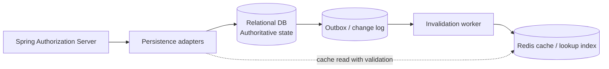
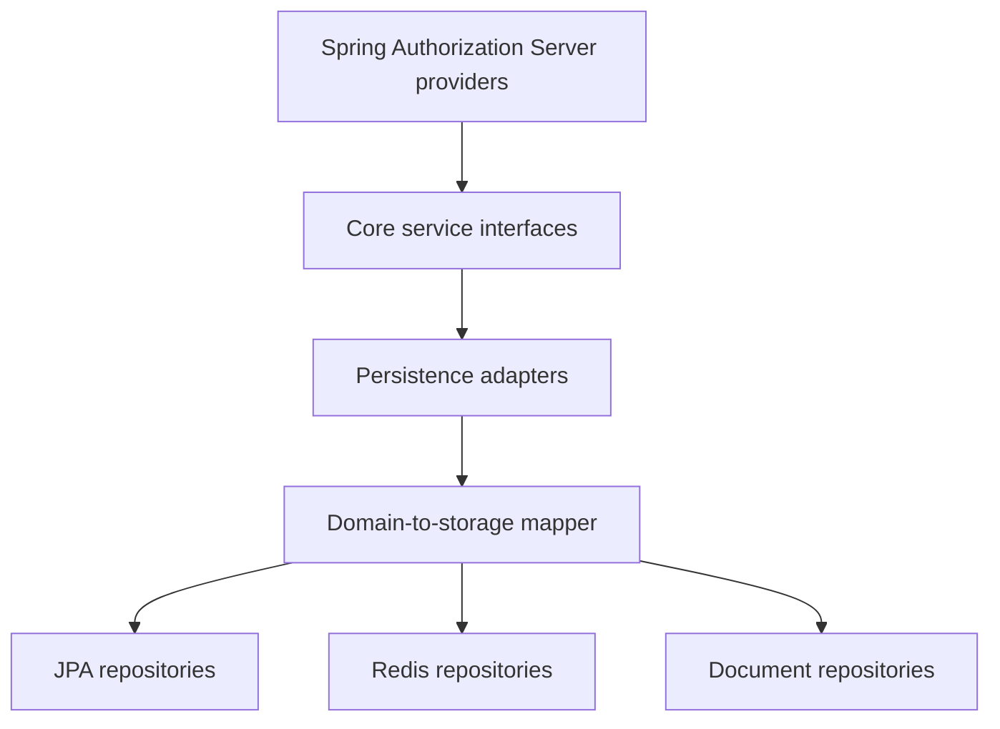
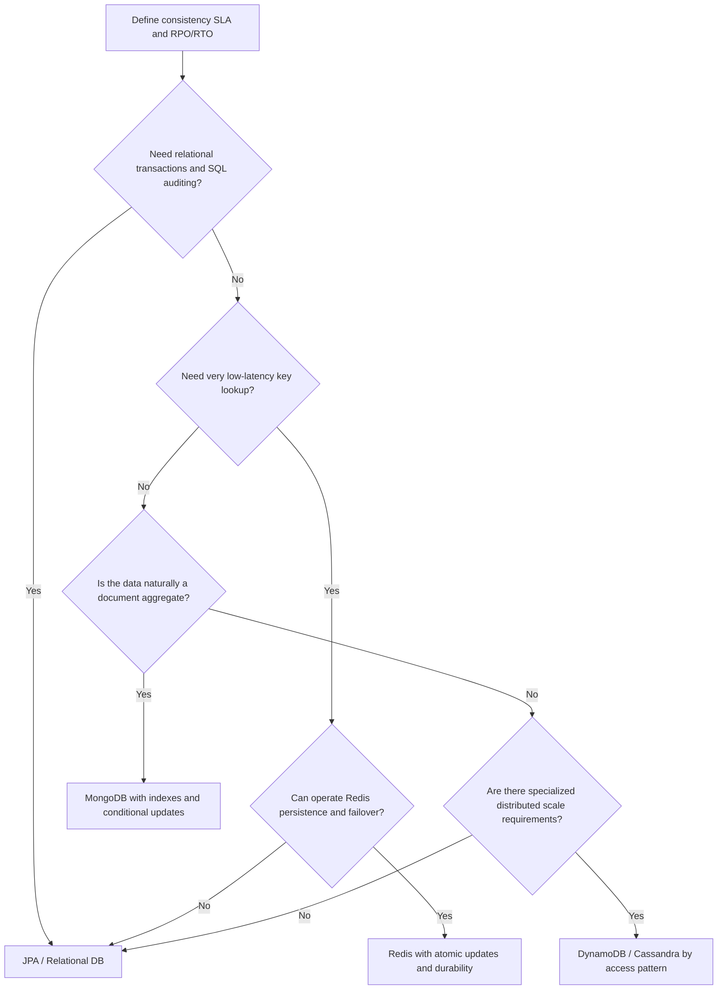

# Choosing JPA, Redis, or Other Data Stores Based on Consistency Requirements

Persistence in Spring Authorization Server is not just choosing where to write objects. Each authorization can contain an authorization code, access token, refresh token, ID Token, device code, invalidation state, scopes, and metadata. When a token is refreshed or revoked, instances must observe the new state in a timely manner. A fast store that allows a node to read stale state can cause a revoked token to remain accepted; a durable store that cannot look up tokens by the keys required by the protocol fails the Authorization Server contract as well.

Spring Authorization Server defines three core persistence services: `RegisteredClientRepository`, `OAuth2AuthorizationService`, and `OAuth2AuthorizationConsentService`. The framework provides JDBC implementations; official guides also demonstrate implementing these services with JPA and Redis. The JPA/Redis guides are starting points for building adapters, not a one-size-fits-all default database choice for every workload and consistency requirement. <https://docs.spring.io/spring-authorization-server/reference/guides/how-to-jpa.html> <https://docs.spring.io/spring-authorization-server/reference/guides/how-to-redis.html>

This lesson belongs to the **Custom Persistence** chapter of the **SPRING_SECURITY_OIDC_AUTHORIZATION_SERVER** module. The goal is to choose JPA, Redis, or another data store based on consistency, durability, latency, scalability, and operational requirements, and then design adapters so every implementation preserves OAuth 2.0/OpenID Connect semantics.

**Example Scope:** The illustrated APIs are based on Spring Authorization Server 1.5.8 and compatible Spring Security releases. Cross-check your project's actual dependencies before copying code, as packages, configuration APIs, and models may change across versions.

## 1. Start from the Spring Authorization Server Contract

### 1.1. Three Services with Three Distinct Responsibilities

| Service | Responsibility | Core Operations |
|---|---|---|
| `RegisteredClientRepository` | Manage registered client metadata and configuration | `save`, `findById`, `findByClientId` |
| `OAuth2AuthorizationService` | Persist and look up authorization and token state | `save`, `remove`, `findById`, `findByToken` |
| `OAuth2AuthorizationConsentService` | Persist a resource owner's consent decisions for a client | `save`, `remove`, `findById` |

`RegisteredClientRepository` is a required component. The other two services may default to in-memory implementations if the application does not provide replacement beans. In production, you must explicitly decide where all three services are stored and which service is the authoritative source of truth. <https://docs.spring.io/spring-authorization-server/reference/core-model-components.html>

### 1.2. RegisteredClientRepository Contract

`RegisteredClient` holds security-critical information:

- Internal ID and public `clientId`;
- Encoded client secret and expiration timestamp;
- Authentication methods;
- Grant types;
- Redirect URIs and post-logout redirect URIs;
- Scopes;
- Client settings, such as requiring PKCE or consent;
- Token settings, such as TTLs, access-token format, and refresh-token reuse.

Implementations must support lookups by both internal ID and client ID. Authorizations reference the internal ID; the public client ID is used in the protocol and client authentication. Never generate a new internal ID when updating a registration still referenced by existing authorizations.

### 1.3. OAuth2AuthorizationService Contract

`OAuth2Authorization` is the state aggregate for a grant. Depending on the grant type, it may contain:

- Registered client ID, principal name, grant type, and authorized scopes;
- Authorization request attributes and `state`;
- Authorization code;
- Access token and token type;
- Refresh token;
- OIDC ID Token and claims;
- Device code and user code;
- Per-token metadata, including issued-at, expires-at, claims, and invalidated state.

The methods must preserve exact semantics:

- `save(authorization)` persists a new state or updates an existing authorization;
- `remove(authorization)` deletes an authorization per system policy;
- `findById(id)` restores the authorization;
- `findByToken(token, tokenType)` finds the authorization containing the corresponding credential or state.

`findByToken` is a critical access path. When `tokenType` is specified, the implementation must query the exact token type. Types can include state, authorization code, access token, refresh token, ID Token, user code, and device code. When `tokenType` is `null`, lookups must cover the set of tokens/state required by the contract of the framework version in use.

Do not implement lookup only for access tokens while ignoring refresh tokens, codes, or device codes if the application enables those grants. Missing a lookup branch can break introspection, revocation, token exchange, or device authorization.

### 1.4. OAuth2AuthorizationConsentService Contract

Consent is identified by the `(registeredClientId, principalName)` pair. The service must store and retrieve the set of authorities approved by the user, and delete consent when the user revokes it or the application removes it per policy.

Consent is security state. If a node processes an authorization request immediately after a user revokes consent but reads a stale copy, that node may continue acting as if consent were still valid.

### 1.5. Every Implementation Must Restore the Same Domain Object

A database entity, Redis hash, or document is merely a storage representation. When the service reads data, it must reconstruct the object the framework expects with complete tokens, metadata, scopes, attributes, and invalidation state.

Never return an `OAuth2Authorization` containing only the access token value while dropping the refresh token or token metadata. An incomplete object may pass simple lookup tests yet fail in refresh, introspection, revocation, or OIDC flows.

## 2. Define Consistency Before Choosing Technology

### 2.1. Consistency Levels to Evaluate

| Requirement | Meaning for the Authorization Server | Verification Question |
|---|---|---|
| Read-after-write | Nodes read state that was just written | After issuing a token, will the immediate next request find the authorization? |
| Atomic update | A state transition is observed as a single unit | Can both the old token and the new token appear active at the same time? |
| Strong/linearizable read | Reads reflect completed writes in guaranteed order | After a successful revoke, can introspection still return active? |
| Eventual consistency | Replicas may converge after a delay | Can the system tolerate a brief window where another node sees stale state? |
| Durability | Confirmed writes survive crashes/failovers within committed bounds | Does a power loss or primary failover lose a newly issued authorization? |
| Isolation/concurrency control | Concurrent requests do not corrupt state | Can two refresh requests using the same token both succeed? |

Not every operation needs the same consistency level. For instance, a client statistics dashboard may tolerate data delayed by a few seconds. Token revocation, refresh-token rotation, and client authentication usually require stricter behavior.

### 2.2. Security Invariants

Before designing a schema, write down the invariants the system must uphold:

1. One client ID maps to a single valid registration.
2. Authorizations always reference the exact internal ID of a `RegisteredClient`.
3. A token marked invalidated/revoked must not be returned as active.
4. A rotated refresh token must not succeed again if policy forbids reuse.
5. Revoked consent must be enforced across nodes within the published SLA.
6. A token lookup must identify the exact token type and exact authorization.
7. Authorization codes, device codes, and user codes must be handled according to their own state and lifetimes.
8. Claims, attributes, and metadata must be restored without altering their meaning.

These invariants are the criteria for evaluating JPA, Redis, or a document store. If a solution cannot uphold them under concurrency or failover, low latency does not compensate.

### 2.3. Define Consistency per Operation

| Operation | Recommended Level | Rationale |
|---|---|---|
| Reading `RegisteredClient` during client authentication | Consistent reads; cached with explicit invalidation | Redirect URIs, grants, and authentication methods are security configuration |
| Updating client registration | Durable write with controlled rollout | Prevent other nodes from trusting stale configuration indefinitely |
| Saving a new authorization | Atomic write and read-after-write | Token responses should only be returned after required state is persisted |
| Looking up an authorization code | Consistent read with single-use consumption control | Prevent code replay or two requests exchanging the same code |
| Refresh token rotation | Atomic compare-and-update | Prevent two concurrent requests from rotating the same refresh token |
| Revocation | Durable write with new state propagated within a tight SLA | Revoked tokens must not continue being accepted beyond the defined window |
| Introspection | Read state consistent with revocation guarantees | Resource Servers must receive active/inactive per policy |
| Consent save/remove | Read-after-write per principal/client | Subsequent requests must reflect the user's decision |
| Dashboards/analytics | Eventual consistency acceptable | Does not decide token acceptance |

## 3. JPA and Relational Databases

### 3.1. When Is JPA the Right Choice?

JPA fits when the system needs an authoritative data store with transactions, unique constraints, relational integrity, and administrative queries. It is typically the easiest option to reason about when the Authorization Server must ensure updates across authorizations, tokens, and consents commit within relational database transactions.

Suitable scenarios:

- Already operating HA PostgreSQL, MySQL, or another relational database;
- Need transactions and data constraints;
- Need reporting, auditing, or queries by client, principal, and time;
- Need to update multiple tables in a single transaction;
- Need concurrency control via optimistic/pessimistic locking;
- Can accept database query latency and optimize with indexes/pools.

JPA does not automatically make a service thread-safe or protocol-atomic. Transaction boundaries, lock strategies, and repository queries still must be carefully designed.

### 3.2. Data Model

The three domain objects can map to three core aggregates/entities:

| Entity | Key/Lookup | Data |
|---|---|---|
| Client | Primary key internal ID; unique index on client ID | Authentication methods, grant types, URIs, scopes, settings |
| Authorization | Primary key authorization ID; indexes on token/state and token type | Principal, client ID, grant, scopes, token values/metadata, attributes |
| Consent | Composite key client ID + principal name | Approved authorities |

Authorizations can be stored in two ways:

- **Flattened aggregate:** one row holds columns for each token and its metadata. Token lookups can use dedicated indexes, though the table is wide with many nullable columns.
- **Normalized aggregate:** a parent authorization table with a child token table. Easier to extend with new token types, though writes/deletes require transactions and queries may require joins.

The official Spring Authorization Server JPA guide illustrates a simple model with a flattened authorization entity. The documentation also warns that default column lengths may be insufficient for tokens, metadata, settings, or claims; test and adjust them before production. <https://docs.spring.io/spring-authorization-server/reference/guides/how-to-jpa.html>

### 3.3. Indexes for findByToken

Do not index only the authorization ID. Design queries for all token types the service supports:

- Authorization code;
- Access token;
- Refresh token;
- OIDC ID Token;
- Device code;
- User code;
- State or device state.

If storing token values directly, consider index size limits and database characteristics. For long tokens or sensitive data, you can store encrypted values alongside an indexed lookup digest. The service then hashes the incoming token the same way, locates the matching record, and still reconstructs the full domain object.

A lookup digest does not replace token validation. It is purely a lookup key; the framework/provider must still verify expiration, invalidation status, and protocol conditions.

### 3.4. Transactions and Concurrent Locking

A refresh flow can be triggered concurrently by two requests hitting different instances. If both read the authorization before one updates the refresh token, both may think the old token is still valid.

With JPA, you can use:

- `@Version` to detect optimistic update conflicts;
- Pessimistic locking on the authorization row when updates must be serialized;
- Unique constraints on the token index;
- Transactions wrapping state reading, verification, and authorization updates.

Illustrative repository example:

```java
import java.util.Optional;

import org.springframework.data.jpa.repository.JpaRepository;
import org.springframework.data.jpa.repository.Lock;
import org.springframework.data.jpa.repository.Query;
import org.springframework.data.repository.query.Param;

import jakarta.persistence.LockModeType;

public interface AuthorizationRepository
        extends JpaRepository<AuthorizationEntity, String> {

    Optional<AuthorizationEntity> findByRefreshTokenHash(String tokenHash);

    @Lock(LockModeType.PESSIMISTIC_WRITE)
    @Query("select a from AuthorizationEntity a where a.id = :id")
    Optional<AuthorizationEntity> findByIdForUpdate(@Param("id") String id);
}
```

This illustrates a locking point; `AuthorizationEntity` is an application-defined entity. Declare appropriate transactions and inspect the SQL generated by your JPA provider. If using optimistic locking, handle `OptimisticLockException`/concurrency conflicts with a clear policy—never blindly retry in a way that lets an old refresh token succeed twice.

### 3.5. Keep All Changes Inside the Transaction

Pseudocode for refresh-token rotation:

```java
@Transactional
public OAuth2Authorization rotateRefreshToken(String rawRefreshToken) {
    AuthorizationEntity entity = repository
            .findByRefreshTokenHash(hash(rawRefreshToken))
            .orElseThrow(this::invalidGrant);

    assertNotExpired(entity);
    assertNotInvalidated(entity);

    OAuth2Authorization current = mapper.toDomain(entity);
    OAuth2Authorization updated = tokenIssuer.rotate(current);

    repository.save(mapper.toEntity(updated));
    return updated;
}
```

`hash`, `tokenIssuer`, `mapper`, and `assert...` are illustrative application components. Protocol providers still orchestrate the OAuth grant flow. The key point is that reading state, verifying, invalidating the old token, and saving the new token must have concurrency control. If the transaction fails, no new token may be issued to the client.

### 3.6. Serializing Settings and Attributes Safely

`RegisteredClient` has map-based client/token settings. `OAuth2Authorization` has attributes and token metadata. Define stable serialization:

- Use a JSON mapper with the required Spring Security and Spring Authorization Server modules;
- Do not enable overly broad polymorphic typing for untrusted data;
- Version payload schemas when domain objects evolve;
- Preserve data types for `Instant`, `Set`, claims, and token-specific metadata;
- Test reading back payloads created by previous application versions.

The official JPA guide registers `SecurityJackson2Modules` and `OAuth2AuthorizationServerJackson2Module` on the mapper. This is an essential detail because a default `ObjectMapper` may fail to deserialize Spring Security types properly. <https://docs.spring.io/spring-authorization-server/reference/guides/how-to-jpa.html>

### 3.7. Risks of JPA

- Authorization entities have many large fields; eager loading or uncontrolled serialization can increase heap usage.
- Token queries lacking indexes can trigger full table scans.
- Long-held pessimistic locks can reduce throughput.
- Optimistic conflicts increase when many refresh requests update the same record concurrently.
- Fixed column lengths can break `save` as claims/metadata grow.
- Changing schemas or serialization without versioning can make older data unreadable.

JPA fits well when the team has strong database expertise and needs clear consistency. It still requires load testing with realistic token payloads and production-like concurrency.

## 4. Redis and Key-Value Stores

### 4.1. When Does Redis Fit?

Redis fits when low latency, key-based lookups, and high throughput are priorities. The key-value/hash model is also useful for short-lived authorizations, device codes, or states needing automatic expiration.

Suitable scenarios:

- Token/state lookup is a heavy workload with clear keys;
- Secondary indexes can be designed per token type;
- The team already operates Redis HA, backups, and monitoring;
- Persistence can be configured within acceptable data-loss bounds;
- An atomic update strategy exists for refresh/revocation;
- Read-after-write guarantees can be maintained across primary, replicas, and application nodes.

Redis should not be chosen merely for speed. If Redis serves as the sole data store, you must enable and verify persistence, replication, failover, backups, and recovery. Redis can run without persistence, in which case restarts can lose data. <https://redis.io/docs/latest/operate/oss_and_stack/management/persistence/>

For read paths that decide whether a token is still active, read from the primary or a topology with matching read-after-write guarantees. Do not read from an asynchronous replica right after revocation/refresh and assume convergence. If replica lag is permitted, measure that window and factor it into your revocation SLA.

### 4.2. Key Model

A conceptual model may include:

| Key Pattern | Content |
|---|---|
| `client:{clientId}` | Serialized `RegisteredClient` |
| `authorization:{authorizationId}` | Authorization aggregate |
| `token-index:{tokenType}:{tokenDigest}` | Pointer to authorization ID |
| `consent:{clientId}:{subjectKey}` | Principal's consent for the client |

This is an illustrative naming convention. When using Redis Cluster, multiple keys updated in the same Lua script/transaction must reside in the same hash slot. If the index and aggregate sit in different slots, you cannot assume a single multi-key atomic operation covers them all.

Another option is storing authorizations by grant type with the needed indexes. The official Spring Authorization Server Redis guide illustrates separate entities for authorization code, client credentials, device code, OIDC authorization code, and token exchange. This clarifies which fields need indexing per flow, though it increases the number of converters and mappers to maintain. <https://docs.spring.io/spring-authorization-server/reference/guides/how-to-redis.html>

### 4.3. Secondary Indexes Are Part of Protocol Data

If you store the authorization aggregate at one key while `findByToken` looks up by token, you need an index mapping the token digest to the authorization ID. When saving or updating an authorization:

1. Compute a digest of the token using a deterministic algorithm;
2. Write the authorization aggregate;
3. Write index entries for every lookupable token/state;
4. Delete stale index entries when a token is replaced or the authorization is removed;
5. Ensure related operations are atomic or have a recovery mechanism if a partial write fails.

If you update only the aggregate and forget the index, the token exists yet `findByToken` cannot find it. If you delete the index before the aggregate is updated and the subsequent step fails, state becomes unreachable.

### 4.4. Atomicity with Redis

Redis supports `MULTI`, `EXEC`, `DISCARD`, and Lua scripting. Spring Data Redis provides `SessionCallback` to execute operations on the same connection. However, `RedisTemplate` does not participate in Spring-managed transactions by default; transaction support must be enabled explicitly on the template. <https://docs.spring.io/spring-data/redis/reference/redis/transactions.html>

A Redis transaction is not a general SQL transaction that rolls back arbitrary side effects. Design operations as an atomic Redis batch and handle command errors, timeouts, retries, and partial execution according to Redis semantics. For refresh token rotation, a Lua script or compare-and-set operation can check the old state and transition to the new state in a single execution.

Pseudocode illustrating compare-and-set:

```lua
-- Pseudocode: key layout and field names must be designed
-- to fit Redis Cluster hash slots.
if redis.call("HGET", authorizationKey, "refreshTokenDigest") ~= oldDigest then
    return 0
end

if redis.call("HGET", authorizationKey, "refreshTokenInvalidated") == "true" then
    return 0
end

redis.call("HSET", authorizationKey,
    "refreshTokenDigest", newDigest,
    "refreshTokenInvalidated", "false")

return 1
```

This is not a drop-in production script: exact keys, TTLs, token metadata, index updates, error handling, and cluster slots must be designed. The goal is to illustrate compare-and-set so only one request wins when multiple refresh requests race on the old state.

### 4.5. TTL Must Follow the Entire Authorization Lifecycle

An authorization can hold a short-lived access token and a long-lived refresh token. If you set the aggregate's TTL to the access token's expiry, Redis may delete an otherwise valid refresh token. If you set no TTL, expired keys can accumulate.

One design sets the aggregate TTL to the latest expiration among active credentials plus any retention needed for cleanup/auditing. When a refresh token is rotated, recalculate the TTL and update indexes. Consents and client registrations typically should not share token TTLs.

Never delete an authorization solely because one child token expired if the authorization holds other tokens or needs to retain state for revocation/introspection.

### 4.6. Durability and Failover

Redis offers persistence options:

- **RDB:** point-in-time snapshots at configured intervals; fast restores and compact files, but writes since the last snapshot can be lost.
- **AOF:** logs every write command; the `fsync` policy controls the data-loss window and performance cost.
- **RDB + AOF:** combines snapshots and an append-only log.

Per Redis documentation, AOF with `appendfsync everysec` may lose roughly one second of writes during a crash; `appendfsync always` increases durability at a performance cost. Replication improves availability but does not replace persistence and backups. Check your actual Redis service configuration, as managed Redis offerings expose different options. <https://redis.io/docs/latest/operate/oss_and_stack/management/persistence/>

For token revocation or refresh rotation, explicitly determine: if the primary fails right after acknowledging a write but before the replica receives it, what can the system tolerate? If a revoked token becoming valid again after failover is unacceptable, configure persistence and topology to meet that durability/consistency bar, or choose a relational database as the authoritative store.

### 4.7. Redis Does Not Automatically Share Spring Transactions with JPA

If authorizations live in PostgreSQL while token indexes/caches live in Redis, JPA `@Transactional` does not commit both systems atomically. Spring Data Redis can participate in certain transaction configurations when enabled, yet that does not turn two independent datastores into a safe distributed transaction.

In a hybrid model, use an outbox, write-through with recovery, or a repeatable invalidation workflow. Avoid succeeding on the database write while failing on the Redis index without a repair path; likewise, avoid letting stale cache entries decide whether a token is active.

## 5. Options Beyond JPA and Redis

### 5.1. MongoDB / Document Store

MongoDB fits when you want to store an authorization as a flexible document aggregate. One document can hold the client ID, principal, grant, scopes, token subdocuments, metadata, and attributes.

Advantages:

- The aggregate can be read/written in a single document;
- Flexible schema as token metadata evolves;
- Indexes can cover token digests and principal/client fields;
- Single-document updates are atomic at the document level.

Design considerations:

- Token lookups across multiple token types require secondary indexes;
- Unique indexes must prevent duplicate client IDs or token digests;
- If data spans multiple documents/collections, transactions and supported deployment topologies are required;
- Read preference, read concern, and write concern must match revocation/refresh SLAs;
- Large documents increase read/write overhead and require payload limits.

MongoDB does not solve refresh concurrency automatically. Use conditional updates/version fields or transactions so only one request can transition the old token state.

### 5.2. DynamoDB or Cloud Key-Value Stores

DynamoDB fits workloads with well-defined access patterns, stable partition keys, and managed scaling needs. Design must start from the service queries:

- Get client by client ID;
- Get client by internal ID;
- Get authorization by ID;
- Look up by token type and token digest;
- Get/remove consent by client ID and principal;
- Conditional update on refresh or revocation.

Use conditional writes or transactional writes for once-only transitions. Note that Global Secondary Indexes can be eventually consistent; if `findByToken` requires strict read-after-write, do not rely on an eventually consistent GSI without an appropriate read/routing strategy. Verify strong-read capabilities for the exact table/index and service transaction limits.

### 5.3. Cassandra or Wide-Column Stores

Cassandra fits large distributed workloads needing explicit partitioning and query-driven data modeling. However, it is not a drop-in replacement for a relational database:

- Must denormalize per lookup pattern;
- Partition keys must avoid hotspots and oversized partitions;
- Read/write consistency levels govern cross-node write visibility;
- Lightweight transactions (LWT) enable compare-and-set at a latency cost;
- Do not assume multi-partition ACID transactions like JPA.

Choose Cassandra only when the team understands data modeling, consistency levels, repairs, compaction, and cluster operations. Without clear scale or topology drivers, complexity may outweigh benefits.

### 5.4. High-Level Comparison

| Criterion | JPA / Relational DB | Redis | MongoDB | DynamoDB / Cassandra |
|---|---|---|---|---|
| Model | Relational and transactional | Key/hash/set with self-managed secondary indexes | Document aggregate | Partition/query-oriented |
| Token lookup | Index/SQL queries | Fast key index | Indexes on token fields | Partition key/GSI or denormalized tables |
| Atomic update | Transactions, locks, versions | `MULTI`/`EXEC` or Lua, with topology limits | Atomic document updates; multi-document transactions per config | Conditional/transactional writes or LWT |
| Durability | Depends on DB commits, replication, and backups | Depends on AOF/RDB, fsync, replication, and backups | Write concern, journaling/replication, and backups | Depends on consistency/write settings and service |
| Schema evolution | Explicit migrations | Versioned payloads/keys | Flexible schema, still requires versioning | Often requires changing access patterns/indexes |
| Admin/audit | Easy SQL querying | Needs separate export/indexing | Document/index queries | Requires dedicated audit tables/partitions |
| Best suited for | Authoritative data source, transactions | Low-latency key lookups with configured durability | Flexible aggregates | Large distributed systems with known access patterns |

This table is an architectural selection guide, not a benchmark. Real-world performance and consistency depend on versions, configuration, topology, drivers, workload, and adapter implementation.

## 6. Choosing an Authoritative Data Source

### 6.1. Single-Store Model

For many systems, the easiest model to control is having all three core services share one datastore with clear transactions or consistency semantics. For example:

- Registered clients in PostgreSQL;
- Authorizations in the same PostgreSQL;
- Consents in the same PostgreSQL.

This simplifies consistency across clients, authorizations, and consents, and keeps coordinated updates under a single transaction manager.

### 6.2. Hybrid Model

A relational database can act as the source of truth with Redis as a cache/index:



Key rules:

- The database is authoritative on whether a token is active/revoked;
- Redis cache must never return active if authoritative data is invalidated;
- Cache misses fall back to the source of truth;
- Cache invalidation must have retries and observability;
- When Redis is unavailable, have an appropriate fallback or fail closed on sensitive operations;
- Never issue a new token if the authoritative authorization write failed.

If using Redis as a token lookup index, the index must stay consistent with the database record. An outbox event can rebuild/repair indexes after failures, but you must define the eventual-consistency window and how the protocol behaves during it.

### 6.3. Avoid Arbitrarily Splitting the Three Services Across Three Databases

Storing `RegisteredClient` in PostgreSQL, `Authorization` in Redis, and `Consent` in MongoDB is technically possible, yet adds substantial complexity:

- No shared transactions;
- A client registration can be deleted while authorizations still reference it;
- Consents and authorizations can drift apart;
- A single request can observe different versions across three stores;
- Backups/restores must coordinate across multiple datastores;
- Incident response struggles to identify the final state source.

Split only with a clear architectural justification and cross-store consistency mechanisms. For most systems, starting with a single source of truth and adding controlled caching is far easier to operate.

## 7. Designing Persistence Adapters

### 7.1. Keep the Domain Contract Separate from Storage Technology

Do not let protocol providers depend directly on JPA entities, Redis hashes, or Mongo documents. Adapters handle translation:



Multiple adapters may exist in a codebase, but at runtime one implementation must be explicitly selected as the data source for each service. Avoid competing beans for the same interface or having some endpoints hit in-memory while others hit the persistent store.

### 7.2. RegisteredClientRepository Adapter

The adapter must:

- Map all `RegisteredClient` fields;
- Preserve the internal ID;
- Store the encoded client secret;
- Serialize client settings/token settings;
- Look up by ID and client ID;
- Enforce unique client IDs;
- Support controlled client update/disable workflows.

Never cache client registrations without invalidation when redirect URIs, secrets, or grant types change.

### 7.3. OAuth2AuthorizationService Adapter

The adapter must:

- Map the complete authorization aggregate;
- Retain token values or a representation sufficient to restore tokens;
- Retain issued-at, expires-at, scopes, type, claims, and metadata;
- Preserve invalidated state;
- Index state/code/access/refresh/ID/device/user tokens;
- Support `findById`, `findByToken`, `save`, and `remove`;
- Handle concurrent updates and token rotation;
- Support cleanup aligned with the lifetimes of all tokens in the aggregate.

Do not create a table/key solely for access tokens. One authorization can hold multiple tokens and metadata tied to the same grant.

### 7.4. OAuth2AuthorizationConsentService Adapter

The adapter must:

- Use the exact composite key of client ID and principal name;
- Serialize authorities deterministically;
- Support save, find, and remove;
- Ensure consent removals are visible to other nodes;
- Never turn requested scopes into granted consent.

### 7.5. Serialization and Versioning

For JPA, Redis, or document stores, serialized payloads must be versioned. When changing classes or serialization modules:

1. Identify the payload version;
2. Write mappers capable of reading older versions;
3. Optionally write the new version after reading;
4. Test data before and after upgrades;
5. Maintain a rollback or forward-migration plan.

Never deserialize arbitrary objects from a modifiable data source. Use appropriate mappers and type allowlists; never enable unrestricted default typing just to store principals/attributes.

## 8. Protecting Tokens and Sensitive Data

### 8.1. Tokens Are Bearer Credentials

Anyone who obtains a bearer token can exercise its permissions. Authorization tables or Redis keys holding tokens must be protected like credential stores:

- TLS between application and datastore;
- Encryption at rest and backup encryption;
- Least privilege;
- Never log raw tokens or bind parameters;
- Never include tokens in metric labels;
- Mask data when exporting for dev/test;
- Restrict DBA/operator access.

### 8.2. Store Raw Tokens or Digests?

There are two common approaches:

- **Store protected token values:** easy to restore framework objects and supports direct lookup; requires protection at rest.
- **Store digests for lookup:** reduces direct usability of stolen records, though the adapter still needs a safe way to restore the token representation and metadata required by the domain object.

One design stores an encrypted token value alongside an indexed digest. When `findByToken` receives a raw token, the adapter computes the digest to locate the record and decrypts the token value when constructing the domain object. Do not store a digest into `OAuth2Authorization`'s token value field if doing so alters token semantics.

Digests must use a strong algorithm and consistent encoding. Do not use weak hashes or random salts without a lookup mechanism.

### 8.3. Client Secrets

Client secrets must be encoded with a `PasswordEncoder` before storage and cannot be reversed from the hash. Secret rotation must update both the registration and caches per policy. Do not confuse client secret hashes with access/refresh tokens; they have different lifecycles and uses.

## 9. Testing Consistency and Failure Modes

### 9.1. Shared Contract Test Suite for All Adapters

Run the same contract test suite against JPA, Redis, and document adapters:

| Test | Expected Behavior |
|---|---|
| Save/find `RegisteredClient` | All fields and settings restore accurately |
| Lookup client by ID/client ID | Exact registration returned; client ID unique |
| Save/find authorization | Full grant, scopes, tokens, metadata, and attributes restored |
| `findByToken` per type | Finds exact authorization for code/access/refresh/ID/device/user code/state |
| Remove authorization | No longer found by ID or token |
| Save/find/remove consent | Composite key and authorities accurate |
| Serialization round-trip | Data types and claims remain unchanged |
| Schema/payload upgrade | Older-version data stays readable or migrates cleanly |
| Concurrent refresh | Only one request succeeds per reuse/rotation policy |
| Revoke then introspect | Inactive state observed within SLA |
| Restart/failover | Committed data recovers per durability contract |

### 9.2. Multi-Instance Tests

Run at least two Authorization Server instances sharing the persistence configuration:

1. Instance A issues an authorization and tokens.
2. Instance B looks up the authorization by access token or refresh token.
3. Instance B performs revocation.
4. Instance A introspects or looks it up again.
5. Verify neither node keeps returning active beyond the committed consistency window.
6. Trigger datastore failover right after a write is acknowledged.
7. Verify data integrity after primary/replica recovery.

These tests uncover bugs that single-node repository unit tests miss, such as stale caches, replica lag, missing indexes, or failovers dropping writes.

### 9.3. Concurrent Refresh and Authorization Code Replay Tests

Send two concurrent requests using the same refresh token. Expectations must match token settings and reuse policy:

- If refresh token rotation is enabled, only one request may consume the old token;
- The other request must be rejected or handled per reuse detection policy;
- The old token must be marked invalidated;
- The new token and metadata must be saved together;
- No new token is returned if save/commit fails.

Repeat with authorization codes to verify single-use consumption. Test under load across two separate instances.

### 9.4. Revocation Consistency Tests

Revoke a token, then send introspection or Resource Server requests across multiple nodes. Measure:

- Time from revocation success response until all nodes see inactive;
- Number of requests still accepted during that window;
- Behavior when caches have not invalidated;
- Behavior when the primary datastore fails;
- Behavior during replica lag or network partitions.

Set a clear SLA for revocation propagation. If immediate enforcement is required, do not rely on an eventually consistent read path without an authoritative check.

### 9.5. Durability Tests

After the service confirms `save`:

- Restart the application;
- Restart the datastore;
- Perform failover;
- Restore from backup;
- Read back clients, authorizations, and consents;
- Verify tokens invalidated before the incident do not become active again.

A backup restore can roll the system back prior to a revocation. Therefore, disaster recovery must coordinate with a revocation ledger or post-restore token policy rather than merely checking record counts.

## 10. Technology Selection Matrix

### 10.1. Choosing by Requirements

| Priority Need | Starting Choice | Mandatory Conditions |
|---|---|---|
| Strong transactions, clear consistency, SQL admin/audit | JPA with relational DB | Indexes, locks/versioning, migrations, HA, and backups |
| High-speed key lookups, short-lived state | Redis | AOF/RDB, failover policy, atomic updates, indexes, and clear read paths |
| Flexible authorization aggregates in documents | MongoDB | Unique/secondary indexes, conditional updates, write/read concerns |
| Distributed scale for fixed access patterns | DynamoDB/Cassandra | Partition design, consistency levels, conditional writes/LWT, specialized ops |
| Reduce DB load while keeping consistency | Relational DB + Redis cache | DB authoritative, outbox/invalidation, cache-miss fallback |

### 10.2. Decision Tree



The decision tree gives only an initial selection. Before finalizing, run contract tests and load tests on a realistic topology. Never choose a technology based on a simple key-value benchmark alone, because protocol workloads also involve serialization, indexing, transactions, concurrency, and failover.

## 11. Recommended Architectures by Context

### 11.1. Enterprise Authorization Server

If the organization requires auditing, client administration, consent management, revocation, and clear transactions, a relational DB with JPA is the easiest choice to govern. Redis can be added as a cache or secondary index once specific bottlenecks are measured.

### 11.2. Low-Latency Systems

Redis can act as the source of truth if the operations team accepts and properly configures durability. Test AOF/RDB, replica failover, read-after-write, and concurrent token rotation. If losing an acknowledged revocation write is unacceptable, persistence and topology must meet that RPO.

### 11.3. Multi-Region Systems

Never assume a distributed cache or multi-region replica automatically provides strong consistency. Define where authoritative writes occur, how tokens are read in each region, replication lag, and partition handling. If two regions can rotate the same refresh token concurrently, implement a global serialization/conditional-update mechanism or regional token/session ownership.

### 11.4. Hybrid Systems

Start with an authoritative database. Add Redis for read caching or lookup indexing only when:

- Metrics prove the need;
- An event/outbox or durable invalidation mechanism exists;
- Cache misses can fall back cleanly;
- Revocation does not depend on stale cache entries;
- Dashboards track lag and reconciliation;
- A procedure exists to rebuild the entire index from the source of truth.

## 12. Implementation Workflow

1. List all enabled grant types and token types.
2. Define SLAs for read-after-write, revocation, refresh rotation, consent, and client updates.
3. Set RPO/RTO targets for crashes, failovers, and backup restores.
4. Select a datastore matching consistency needs and operational capability.
5. Design models for `RegisteredClient`, `OAuth2Authorization`, and `OAuth2AuthorizationConsent`.
6. Design lookups/indexes for every `findByToken` branch.
7. Define transaction/locking or atomic compare-and-set behavior.
8. Version serialization payloads and schemas.
9. Secure tokens/secrets with TLS, encryption at rest, and access controls.
10. Write a shared contract test suite for adapters.
11. Run concurrent refresh, code replay, revocation, and multi-instance tests.
12. Benchmark with realistic token/claim sizes and production-like load.
13. Test backups, restores, failovers, and cache/index rebuilds.
14. Roll out in phases while monitoring consistency lag and protocol errors.
15. Shift traffic completely only after verifying all security invariants.

## 13. Practical Exercise

**Context:** An Authorization Server runs three instances. Currently, core services use in-memory implementations. The system must support Authorization Code + PKCE, Refresh Token, OIDC, Device Authorization, and Token Introspection. The team is evaluating PostgreSQL/JPA and Redis.

**Requirements:**

1. List the methods of the three core services and the token types `findByToken` must support.
2. Define consistency SLAs for client registration, authorization writes, refresh rotation, revocation, and consent.
3. Sketch a JPA data model for clients, authorizations, and consents.
4. Propose a Redis key/index model for client IDs, authorization IDs, token digests, and consents.
5. Design compare-and-set for two concurrent refresh requests.
6. Specify how Redis manages TTLs when an authorization holds an access token and refresh token with different expirations.
7. Choose AOF/RDB and replication policies matching the defined RPO.
8. Identify when JPA should serve as the source of truth with Redis as a cache/index.
9. Write a shared contract test suite for both JPA and Redis adapters.
10. Test revoking on instance A and introspecting on instance B.
11. Simulate failover right after an authorization/revocation write is acknowledged.
12. Verify serialization across a Spring Authorization Server version upgrade.

**Acceptance Criteria:** Every adapter restores complete domain objects and supports all required lookups; refresh rotation/code consumption is race-free; revocation and consent removal meet verified consistency SLAs; committed data recovers per RPO; caches/indexes never allow a revoked token to become active again.

## 14. Self-Assessment Questions

1. What are the three core persistence services of Spring Authorization Server?
2. Why is `RegisteredClient.id` different from the public `clientId`?
3. Which token/state types must `OAuth2AuthorizationService.findByToken` support?
4. Why can you not store only the access token value and discard token metadata?
5. How do read-after-write and eventual consistency differ during token issuance?
6. Why does revocation require stricter consistency than a dashboard?
7. What mechanisms does JPA use to handle transactions and concurrency?
8. When are `@Version` and pessimistic locking appropriate?
9. Why does a JPA authorization entity need indexes by token type?
10. Why are Spring Security Jackson modules needed when serializing domain objects?
11. How do Redis RDB and AOF differ in durability?
12. Why does Redis replication not replace backups and persistence?
13. Why does `RedisTemplate` not participate in Spring transactions by default?
14. How does Lua compare-and-set prevent refresh-token races?
15. Why must an aggregate's TTL account for the refresh token?
16. How does Redis Cluster affect multi-key atomic operations?
17. When is a MongoDB document aggregate a good fit?
18. Why can eventually consistent GSIs cause issues for token lookups?
19. Why should you avoid splitting the three core services across three datastores without a consistency design?
20. How do you prove an adapter remains safe after failover?

## 15. Official References

- [Spring Authorization Server — Core Model / Components](https://docs.spring.io/spring-authorization-server/reference/core-model-components.html): contracts for `RegisteredClientRepository`, `OAuth2AuthorizationService`, and `OAuth2AuthorizationConsentService`.
- [Spring Authorization Server — How-to: Implement core services with JPA](https://docs.spring.io/spring-authorization-server/reference/guides/how-to-jpa.html): data model, JPA entities, repositories, mapping, and service implementations.
- [Spring Authorization Server — How-to: Implement core services with Redis](https://docs.spring.io/spring-authorization-server/reference/guides/how-to-redis.html): Redis entities, token indexes, converters, and core service implementations.
- [Spring Data Redis — Redis Transactions](https://docs.spring.io/spring-data/redis/reference/redis/transactions.html): `MULTI`/`EXEC`, `SessionCallback`, and transaction integration.
- [Redis — Persistence](https://redis.io/docs/latest/operate/oss_and_stack/management/persistence/): RDB, AOF, fsync policies, backups, and durability.
- [Spring Data JPA — Locking](https://docs.spring.io/spring-data/jpa/reference/jpa/locking.html): optimistic/pessimistic locking in repositories.
- [MongoDB — Transactions](https://www.mongodb.com/docs/manual/core/transactions/): transactions and deployment considerations.
- [Amazon DynamoDB — Read Consistency](https://docs.aws.amazon.com/amazondynamodb/latest/developerguide/HowItWorks.ReadConsistency.html): eventual/strong consistency and secondary index limitations.
- [Apache Cassandra — Tunable Consistency](https://cassandra.apache.org/doc/latest/cassandra/architecture/dynamo.html): consistency levels and distributed model.

**Takeaway:** Choose persistence based on protocol invariants. JPA fits when you need transactions and manageable consistency; Redis fits fast key lookups when durability, failover, indexing, and atomic updates are cleanly designed; MongoDB and distributed key-value stores fit when access patterns and topology justify them. Every adapter must uphold the contract of the three core services, restore full authorization/token metadata, and prevent race conditions. Caches only assist the source of truth; they must never alter revocation or refresh-token rotation outcomes.
