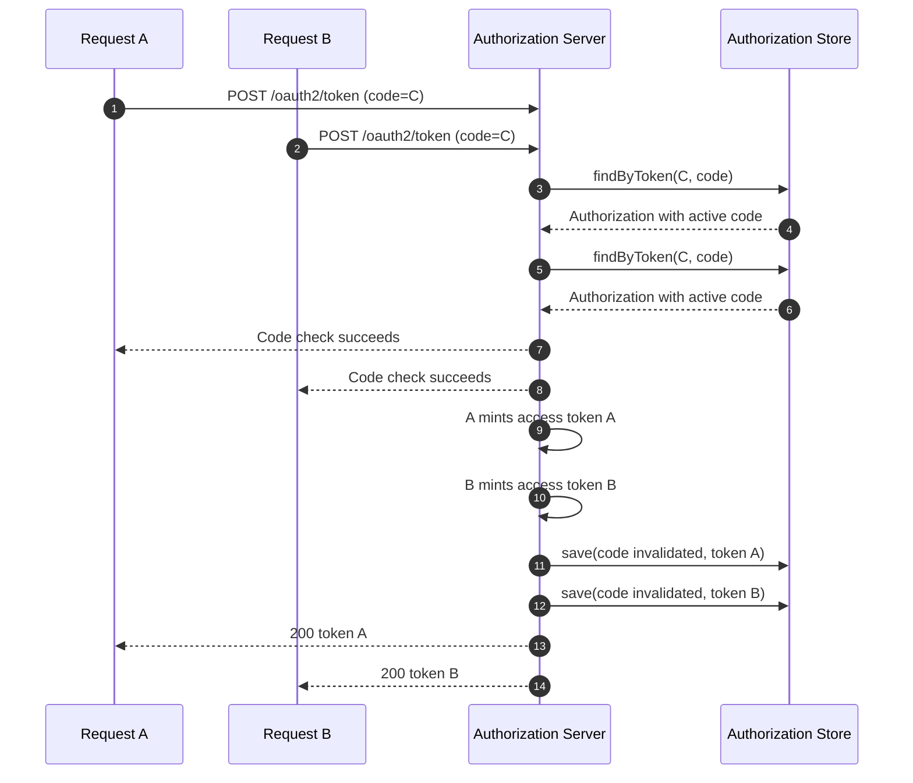
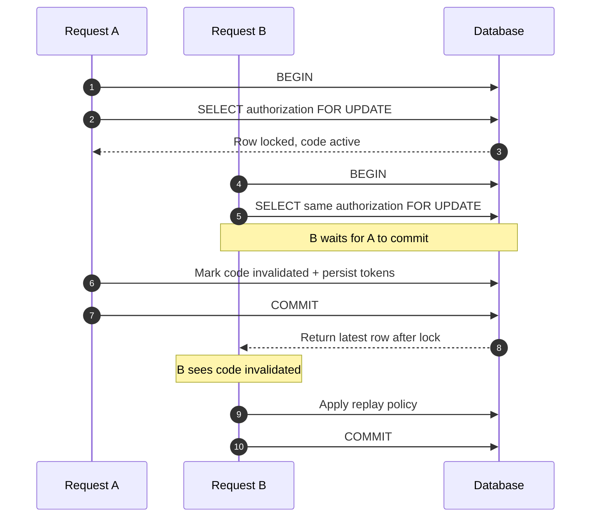

# Controlling Concurrency When Exchanging Codes or Refreshing Tokens

## 1. The Problem: One Token Sent to Two Requests Simultaneously

The Authorization Server receives a valid authorization code at the Token Endpoint. Due to network retries, double-clicks by a user, two client threads, or two backend instances, the exact same code can arrive nearly simultaneously. Both requests read the code state as active, both pass validation, and both mint access tokens.

A similar situation occurs with refresh tokens. Two refresh requests using the same old token can hit two different nodes. If each request reads state before the other writes its result, both can issue new access tokens or new refresh tokens from the same initial state.

This is a **race condition in the OAuth token lifecycle**. Validating token syntax, verifying signatures, enforcing PKCE, authenticating the client, or setting short lifetimes does not by itself solve race conditions. The Authorization Server must ensure single-use token consumption or token rotation executes atomically in shared storage.

This lesson analyzes how Spring Authorization Server (SAS) handles authorization codes and refresh tokens, the limits of the default persistence contract, how to apply transactions/row locks/optimistic locking, and how to test under concurrent requests and multiple instances.

This lesson belongs to the **Custom Persistence** chapter of the **SPRING_SECURITY_OAUTH2_OIDC_AUTHORIZATION_SERVER** module. The overall goal of the module is **to learn how to design, configure, secure, test, and operate an OAuth 2.0/OpenID Connect Authorization Server with Spring Security and Spring Authorization Server in a Spring Boot application**.

### Learning Objectives

After this lesson, you will be able to:

1. Explain why a two-step check-then-update flow can accept the same token multiple times.
2. Distinguish authorization code replay from two concurrent refresh requests.
3. Describe how SAS stores token state in `OAuth2Authorization` and `OAuth2AuthorizationService`.
4. Understand the meaning of token invalidation and `TokenSettings.reuseRefreshTokens`.
5. Design transactions spanning grant validation, token issuance, and state persistence.
6. Apply `SELECT FOR UPDATE`, conditional updates, or optimistic locking.
7. Combine client-side single-flight with server-side concurrency control.
8. Design refresh token families and RFC 9700 replay responses when needed.
9. Test contention across concurrent requests on the same database and multiple Authorization Server instances.

> **Version Scope:** This lesson uses Spring Authorization Server 1.5.8 and Spring Security 6.x. Class/API names in examples follow the 1.5.x line. Storage and transaction behavior must be verified against the application's actual implementation. The assigned SPECIAL_NOTE for this lesson is left blank.

## 2. Two Flows with Single-Use State

Both authorization codes and refresh tokens are stored in `OAuth2Authorization`, yet their semantics differ:

| Characteristic | Authorization code | Refresh token |
| --- | --- | --- |
| Purpose | Exchange End-User-granted permission for tokens | Obtain a new access token after the old access token expires |
| Lifecycle | Short-lived, single-use | Longer-lived, reusable or rotated per policy |
| Binding | Client, redirect URI, PKCE verifier if applicable | Client issued the token, consented scopes and resources |
| When reused | Replay of authorization grant; may require revoking tokens issued from the code | Could be legitimate concurrent requests, retries, or a stolen refresh token |
| Primary control | Atomic consume/invalidate | Atomic rotation or reuse/sender-constraint control |

One key point: **exchanging an authorization code must be a single-use operation**. A refresh token may be configured for reuse or rotated to a new token. Therefore, the policies and test expectations for the two flows are not identical.

## 3. How Does a Race Condition Happen?

Suppose authorization code `C` is active in the database. Two requests `A` and `B` call the Token Endpoint simultaneously.



The diagram depicts storage that performs plain reads followed by writes without locking or version checking. Both requests read the same active state before either persists the new state. Both subsequently writing code invalidation cannot undo the response or prevent losing the token returned to the earlier request.

### 3.1. Validation Does Not Mean Atomic Consumption

A handler structured like:

```java
OAuth2Authorization authorization =
        authorizationService.findByToken(code, CODE);

if (authorization == null
        || !authorization.getToken(OAuth2AuthorizationCode.class).isActive()) {
    throw invalidGrant();
}

OAuth2Authorization updated = invalidateCodeAndIssueTokens(authorization);
authorizationService.save(updated);
```

does not guarantee only one request wins. Two threads can pass the `if` condition simultaneously before either calls `save`.

This is the difference between:

- **Check-then-act:** read state, check it, then write state.
- **Atomic consume:** check and transition state in one operation that another request cannot interleave into.

To guarantee single-use semantics, the server must make token consumption atomic at the transaction/database level or via a distributed lock with appropriate fencing.

## 4. Authorization Code: Single-Use Requirement and Replay Response

RFC 6749 specifies that authorization codes must be short-lived and single-use. If an Authorization Server observes multiple attempts to redeem the same code, the server SHOULD attempt to revoke all access tokens already issued based on the compromised code. If the client can be authenticated, the server must authenticate the client and ensure the code was issued to that exact client.

### 4.1. Checks Performed by SAS

In the Authorization Code Grant, `OAuth2AuthorizationCodeAuthenticationProvider` uses `OAuth2AuthorizationService` to locate the authorization by code and then checks conditions such as:

- The authorization exists.
- The code is active, unexpired, and not invalidated.
- The current client matches the client that initiated the authorization request.
- `redirect_uri` in the token request matches the stored redirect URI if the initial request included it.
- Client authentication and PKCE verifier checks match the client type/flow.

After minting the access token, refresh token (if allowed), and ID Token (if `openid` scope is present), the provider marks the authorization code invalidated and calls `authorizationService.save(...)`.

If a later request sees the code is already invalidated, the provider treats it as a replay, may invalidate access tokens/refresh tokens issued from that authorization, and returns an `invalid_grant` error. This behavior is critical for limiting the blast radius when a code is reused.

### 4.2. PKCE Does Not Replace Atomic Consumption

PKCE binds the authorization code to the client's `code_verifier`. It reduces the risk of an attacker who steals the code exchanging it without the verifier.

However, PKCE does not lock the authorization record and does not stop two legitimate requests from the same client sending the same `code_verifier` concurrently. The server still needs atomic consumption.

### 4.3. Client Binding and Redirect URI Are Not Concurrency Locks Either

Client authentication, client binding, exact redirect URI matching, and PKCE are protocol validations. They determine whether a request is authorized to redeem a code; they do not arbitrate which of two equally valid concurrent requests wins.

## 5. Refresh Tokens: Reuse and Rotation

Spring Authorization Server provides `TokenSettings.reuseRefreshTokens(boolean)`:

- `true`: reuse the existing refresh token when returning the access token response.
- `false`: issue a new refresh token upon a successful refresh.

The default in SAS 1.5.8 is **`true`**. This is a refresh token lifecycle setting, not a concurrency locking mechanism.

Example:

```java
RegisteredClient client = RegisteredClient.withId(UUID.randomUUID().toString())
        .clientId("orders-web")
        .clientSecret(passwordEncoder.encode(rawSecret))
        .clientAuthenticationMethod(ClientAuthenticationMethod.CLIENT_SECRET_BASIC)
        .authorizationGrantType(AuthorizationGrantType.AUTHORIZATION_CODE)
        .authorizationGrantType(AuthorizationGrantType.REFRESH_TOKEN)
        .redirectUri("https://orders.example.com/login/oauth2/code/issuer")
        .scope("openid")
        .scope("orders.read")
        .tokenSettings(TokenSettings.builder()
                .reuseRefreshTokens(false)
                .build())
        .build();
```

When `reuseRefreshTokens(false)` is set, the new token replaces the old refresh token in the authorization. Once the rotation commits, resending the old token fails to find an active refresh token and is rejected.

### 5.1. Reuse=true: Two Requests Can Both Succeed

If the refresh token is retained, two sequential or concurrent requests can both use it while it remains active. The server may issue two distinct access tokens for the same authorization. This aligns with the reuse setting, though clients should still avoid firing multiple concurrent refresh requests for the same session.

### 5.2. Reuse=false: Rotation Still Requires Atomicity

Suppose `R0` is the current refresh token. Requests `A` and `B` both read `R0` as active. Both mint new access and refresh tokens:

- `A` creates `A1` and `R1`.
- `B` creates `A2` and `R2`.

If the two saves are not serialized, both responses may succeed while only one new refresh token survives in the authorization. The client holding the overwritten token will hit `invalid_grant` on its next refresh.

With a row lock or compare-and-set:

1. `A` locks the authorization, verifies `R0` is active, issues `R1`, and commits.
2. `B` waits for `A` to finish.
3. `B` reads the updated state; `R0` has already been replaced, so `B` receives `invalid_grant`.

Only one request exchanges the old refresh token.

### 5.3. Public Clients and Refresh Tokens

The official SAS 1.5.8 guide states that Spring Authorization Server **does not issue refresh tokens to public clients**. For public clients, prefer Authorization Code + PKCE and consider the Backend-for-Frontend pattern if refresh credentials must remain server-side.

RFC 9700 requires Authorization Servers to use sender-constrained refresh tokens or refresh token rotation for replay detection on public clients if refresh tokens are issued. With rotation, the server must maintain the lineage between tokens in the same grant/family; when an old token is reused, the server must revoke the active refresh token in that family per the specification's recommendation.

Do not equate setting `reuseRefreshTokens(false)` with a complete replay detection system. If your system requires detecting predecessor reuse and revoking the entire token family, persist token lineage/replay state separately and test that behavior.

## 6. Spring Authorization Server Persistence Contract

`OAuth2AuthorizationService` persists authorizations and looks up existing ones. The interface provides:

```java
public interface OAuth2AuthorizationService {

    void save(OAuth2Authorization authorization);

    void remove(OAuth2Authorization authorization);

    OAuth2Authorization findById(String id);

    OAuth2Authorization findByToken(String token, OAuth2TokenType tokenType);
}
```

The interface has no `consumeAuthorizationCodeAtomically`, `rotateRefreshTokenAtomically`, or `compareAndSet` methods. Therefore, the storage adapter must implement its own atomic mechanisms if concurrency guarantees are required.

### 6.1. OAuth2Authorization Holds Tokens and Metadata

`OAuth2Authorization` holds tokens such as authorization codes, access tokens, refresh tokens, ID Tokens, device codes, and user codes along with their metadata. Token metadata includes an invalidated flag representing whether a token has been invalidated.

The builder can mark a token invalidated:

```java
OAuth2Authorization updated = OAuth2Authorization.from(authorization)
        .invalidate(authorizationCode)
        .build();

authorizationService.save(updated);
```

This snippet illustrates domain state. It **does not automatically guarantee atomicity** when reading and saving authorizations across concurrent requests.

### 6.2. JdbcOAuth2AuthorizationService

SAS provides `JdbcOAuth2AuthorizationService` using `JdbcOperations` and the `oauth2-authorization-schema.sql` schema. The service includes mappers to turn `OAuth2Authorization` into SQL parameters and read `ResultSet` rows back into domain objects.

SAS documentation describes this as a straightforward JDBC implementation suitable for production, though it has performance limitations and may not fit high-throughput systems.

Important for concurrency:

- The `OAuth2AuthorizationService` contract does not provide compare-and-set operations.
- Do not assume a `findByToken` followed by `save` across concurrent requests automatically becomes an atomic consume.
- Verify transaction boundaries, isolation levels, and SQL locking in your running implementation.
- If strict guarantees are required, add a custom persistence/transaction strategy and test against your production database.

### 6.3. @Transactional on Individual Methods Is Not Enough

The following pattern fails to wrap the entire grant processing flow if both methods run in independent transactions:

```java
@Transactional
public OAuth2Authorization findByToken(String token, OAuth2TokenType tokenType) {
    // query
}

@Transactional
public void save(OAuth2Authorization authorization) {
    // update
}
```

If `findByToken`'s transaction ends right after reading, the row lock is released before the provider validates the code, mints tokens, and saves. Another request can read the exact same active state during that gap.

The transaction must begin before the provider calls `findByToken` and remain open until `save` completes.

## 7. Pessimistic Locking: SELECT FOR UPDATE

Pessimistic locking locks the authorization row while a request validates and updates state. With JDBC, a query can use `SELECT ... FOR UPDATE`. With JPA, you can use `@Lock(LockModeType.PESSIMISTIC_WRITE)`.

Flow:



### 7.1. Find Authorization by Token and Lock the Exact Row

A custom `OAuth2AuthorizationService` can implement `findByToken` for authorization codes and refresh tokens using a locking query:

```sql
SELECT *
FROM oauth2_authorization
WHERE authorization_code_value = :code
FOR UPDATE;
```

Or for a refresh token:

```sql
SELECT *
FROM oauth2_authorization
WHERE refresh_token_value = :refreshToken
FOR UPDATE;
```

The SQL above is illustrative. Lock syntax and waiting behavior depend on database vendor and isolation level. Add indexes on token lookup columns to keep lock durations short.

If token values are encrypted in the database, store an additional lookup digest/HMAC to locate the row. Preserve how tokens are reconstructed inside `OAuth2Authorization` and protect the key used to compute digests.

### 7.2. Hold the Lock Within the Same Transaction

The custom service must ensure:

1. The transaction starts before calling `findByToken`.
2. The query acquires the row lock.
3. The provider validates token state, client binding, redirect URI, scopes, and PKCE.
4. The provider mints new tokens and calls `save`.
5. The database commits before the Token Endpoint returns the response.

If the lock is acquired in a short transaction wrapping only the query, it does not protect token issuance and saving.

### 7.3. Lock per Authorization Rather Than the Whole Table

Locking the row by authorization ID serializes requests for the same grant while allowing other clients and users to proceed concurrently.

Never use a single global lock across the entire Token Endpoint. That turns a localized race condition into a throughput bottleneck for the entire Authorization Server.

## 8. Wrapping Transactions Around Grant-Processing Providers

SAS provides the `OAuth2TokenEndpointConfigurer.authenticationProviders(...)` extension point to access the default `AuthenticationProvider` list. One integration approach is wrapping default providers with `TransactionTemplate` so a transaction spans the `authenticate` call, covering both `findByToken` and `save`.

### 8.1. Transaction Wrapper

Skeleton example:

```java
final class TransactionalAuthenticationProvider
        implements AuthenticationProvider {

    private final AuthenticationProvider delegate;
    private final TransactionTemplate transactionTemplate;

    TransactionalAuthenticationProvider(
            AuthenticationProvider delegate,
            TransactionTemplate transactionTemplate) {
        this.delegate = delegate;
        this.transactionTemplate = transactionTemplate;
    }

    @Override
    public Authentication authenticate(Authentication authentication) {
        return transactionTemplate.execute(status ->
                delegate.authenticate(authentication));
    }

    @Override
    public boolean supports(Class<?> authentication) {
        return delegate.supports(authentication);
    }
}
```

This is an illustrative wrapper. `TransactionTemplate` must use the transaction manager governing the same datasource as the custom `OAuth2AuthorizationService`. Never open a transaction on a different transaction manager than the one storing authorizations.

### 8.2. Wrapping the Two Providers Requiring Control

You can replace the providers in the default list with the wrapper:

```java
authorizationServer.tokenEndpoint(tokenEndpoint ->
    tokenEndpoint.authenticationProviders(providers -> {
        for (int i = 0; i < providers.size(); i++) {
            AuthenticationProvider provider = providers.get(i);
            boolean stateChangingGrant =
                    provider instanceof OAuth2AuthorizationCodeAuthenticationProvider
                    || provider instanceof OAuth2RefreshTokenAuthenticationProvider;

            if (stateChangingGrant) {
                providers.set(i,
                        new TransactionalAuthenticationProvider(
                                provider, transactionTemplate));
            }
        }
    })
);
```

This example keeps the default providers to retain SAS protocol validations while adding a transaction boundary. It solves only the transaction scope; the custom `OAuth2AuthorizationService` must still perform `SELECT FOR UPDATE` or optimistic CAS.

Inspect the configuration after building `SecurityFilterChain` to confirm the unwrapped default provider is not still registered alongside the wrapper. Never add a duplicate provider for the same authentication type without defining ordering and behavior.

### 8.3. Why Must the Transaction Commit Before the Response?

If the Token Endpoint returns an access token before the database commits, the client could receive a token whose authorization state was never saved or whose transaction later rolls back.

The wrapper above only returns the `Authentication` result after `TransactionTemplate` completes its commit. If commit fails, the token response is not returned as a success.

## 9. Optimistic Locking and Compare-and-Set

Pessimistic locking fits when requests on the same authorization row must be serialized. In high-concurrency systems with low contention per authorization, optimistic locking can reduce lock hold times.

Add a `version` column:

```sql
ALTER TABLE oauth2_authorization
    ADD COLUMN version bigint NOT NULL DEFAULT 0;
```

Read the authorization along with version `v`. When updating, execute:

```sql
UPDATE oauth2_authorization
SET authorization_code_metadata = :newMetadata,
    access_token_value = :accessToken,
    refresh_token_value = :refreshToken,
    version = version + 1
WHERE id = :authorizationId
  AND version = :expectedVersion;
```

If the updated row count is `0`, another request modified the authorization first. The current request lost the race and must not return its newly minted tokens.

### 9.1. Version Must Travel with the Domain Object

`OAuth2Authorization` has no standard `version` field. Custom persistence can:

- Put the version into a dedicated attribute when mapping from the database.
- Track the version inside a wrapper/context in the persistence adapter.
- Use a dedicated aggregate entity with a version and map it to `OAuth2Authorization`.

When saving, use the exact `expectedVersion` from the initial read. Never re-query the latest version right before updating and pass that value, as doing so defeats compare-and-set.

### 9.2. Handling Optimistic Lock Failures

When an update affects `0` rows:

- Do not return the newly generated access token/refresh token.
- Roll back the transaction if still inside one.
- Return an appropriate grant error such as `invalid_grant` to the losing request.
- Record metrics and an audit event such as `token-replay`/`concurrency-conflict` without logging raw tokens.

Do not blindly retry token issuance inside the same request after an optimistic lock failure. Retrying is safe only if the request reloads the latest state and re-runs all protocol validations.

## 10. Atomic Consumption Using a Dedicated Token State Table

Another pattern stores single-use token state in a dedicated table:

```sql
CREATE TABLE oauth2_one_time_token (
    token_hash varchar(128) PRIMARY KEY,
    authorization_id varchar(100) NOT NULL,
    token_type varchar(40) NOT NULL,
    expires_at timestamp NOT NULL,
    consumed_at timestamp NULL,
    created_at timestamp NOT NULL
);
```

Consume via a conditional update:

```sql
UPDATE oauth2_one_time_token
SET consumed_at = CURRENT_TIMESTAMP
WHERE token_hash = :tokenHash
  AND token_type = 'code'
  AND consumed_at IS NULL
  AND expires_at > CURRENT_TIMESTAMP;
```

Only the request receiving a row count of `1` may proceed. Requests receiving `0` rows must stop with `invalid_grant`.

### 10.1. Token Consumption and Token Issuance Must Share a Transaction

Consuming the code, saving the invalidated `OAuth2Authorization`, and persisting the new tokens must occur in the same transaction. If consumption succeeds yet saving tokens fails, rollback must restore the unconsumed state. If another transaction already consumed the token, the current request must not issue tokens.

### 10.2. Keep Dedicated Token State Synchronized with OAuth2Authorization

If the application has both a token state table and `OAuth2Authorization`, use one transaction manager and one consistent data source. Never write token state to Redis and authorization state to SQL without a deliberately designed atomic/distributed transaction or outbox/reconciliation mechanism.

If two stores are used, define handling for half-completed states and test crashes between steps.

## 11. Refresh Token Families and Replay Detection

Rotation issues a new token and renders the old one unusable. To detect when a rotated-out token is reused later, the server must retain lineage across tokens belonging to the same grant.

A family record can store:

| Field | Meaning |
| --- | --- |
| `family_id` | Identifier for the refresh token chain belonging to a grant |
| `authorization_id` | Associated `OAuth2Authorization` |
| `token_hash` | Digest of the token |
| `parent_token_hash` | Predecessor token |
| `issued_at` | Issuance timestamp |
| `replaced_at` | Timestamp when the token was replaced |
| `revoked_at` | Timestamp when the family/token was revoked |
| `sender_key_thumbprint` | Binding key if using sender-constrained tokens |

Rotation flow:

1. Client sends `R0`.
2. Server authenticates the client and verifies `R0` belongs to the authorization/family.
3. Server locks the family/authorization.
4. Server marks `R0` replaced, creates `R1`, and records the `R0 → R1` link.
5. Server persists the new access token and commits.
6. Server returns `R1`.
7. If `R0` reappears later, the server detects replay and revokes the family's active refresh token per policy.

### 11.1. You Cannot Always Identify the Attacker

If both the legitimate client and a thief possess `R0`, the server only knows an old token was reused; it cannot always tell which request is the attacker. Revoking the family's active token may force the legitimate client to re-authenticate. This is the security trade-off described in RFC 9700.

### 11.2. Sender-Constrained Refresh Tokens

Sender constraints bind a refresh token to a specific client instance/key. For example, DPoP or mTLS lets the server verify the caller holds the matching proof. When using sender constraints, verify the proof and key binding on every refresh, not only at initial issuance.

Rotation and sender constraints are distinct anti-replay approaches; choose based on client type, threat model, and key-management capabilities.

## 12. Client-Side Single-Flight

The server must protect persistence, yet clients should also avoid creating race conditions themselves.

A client can trigger concurrent refreshes from:

- Two HTTP requests simultaneously noticing an expired access token.
- Two threads in a backend service.
- Multiple browser tabs sharing a session.
- Multiple processes/workers sharing a refresh token.
- Automatic retry logic after a timeout.

Single-flight design:

1. Each token family has a refresh mutex/lock.
2. The first request acquires the lock and executes the refresh.
3. Other requests wait for the result instead of sending the same refresh token.
4. Upon response, atomically store the new access token and refresh token.
5. Release the lock; subsequent requests read the newest credentials.

### 12.1. An In-Process Lock Is Not Enough Across Multiple Instances

If multiple backend nodes share a refresh token, an in-JVM `synchronized` block only locks one node. Use a shared session store, a distributed lock with fencing, or a single token broker to coordinate refreshes.

Client-side locking never replaces server-side atomicity: an attacker can bypass the client implementation and call the Token Endpoint directly.

### 12.2. Never Blindly Retry an Old Refresh

If a refresh request times out, the client does not know whether the server committed the rotation. When rotation committed yet the response was lost, the old token is no longer valid and the client lacks the new token.

The client should:

- Never fire multiple concurrent retries with the same token.
- Distinguish pre-send timeouts from timeouts after the server may have processed the request.
- Fall back to recovery/re-authentication when no current refresh token remains.
- Never log refresh tokens for debugging.

## 13. Configuring Refresh Token Rotation in SAS

Confidential client configuration example:

```java
RegisteredClient registeredClient = RegisteredClient.withId(
                UUID.randomUUID().toString())
        .clientId("orders-backend")
        .clientSecret(passwordEncoder.encode(rawSecret))
        .clientAuthenticationMethod(
                ClientAuthenticationMethod.CLIENT_SECRET_BASIC)
        .authorizationGrantType(AuthorizationGrantType.AUTHORIZATION_CODE)
        .authorizationGrantType(AuthorizationGrantType.REFRESH_TOKEN)
        .redirectUri("https://orders.example.com/login/oauth2/code/issuer")
        .scope("openid")
        .scope("orders.read")
        .tokenSettings(TokenSettings.builder()
                .reuseRefreshTokens(false)
                .refreshTokenTimeToLive(Duration.ofDays(14))
                .build())
        .build();
```

This example only illustrates policy. Set TTLs based on sensitivity, client type, user activity, and re-authentication requirements. Setting `reuseRefreshTokens(false)` does not automatically create locks or a token-family replay ledger.

### 13.1. Refresh Scopes Must Not Expand

During a refresh, the client must not request scopes beyond those granted by the resource owner. If the request omits scopes, the server uses the originally authorized scopes. Preserve this check in custom providers or persistence; never let a client escalate permissions through a refresh request.

### 13.2. Bind Refresh Tokens to the Client

A refresh token must stay bound to the client it was issued to. For confidential clients, authenticate the client at the Token Endpoint and verify the authorization's `registeredClientId`. Never look up a refresh token and issue tokens to whichever client presents it.

## 14. Transaction Wrapper for the Token Endpoint

The configuration snippet below illustrates wrapping the two default providers to keep a transaction around `authenticate`:

```java
OAuth2AuthorizationServerConfigurer authorizationServer =
        OAuth2AuthorizationServerConfigurer.authorizationServer();

authorizationServer.tokenEndpoint(tokenEndpoint ->
    tokenEndpoint.authenticationProviders(providers -> {
        for (int i = 0; i < providers.size(); i++) {
            AuthenticationProvider provider = providers.get(i);
            boolean stateChangingGrant =
                    provider instanceof OAuth2AuthorizationCodeAuthenticationProvider
                    || provider instanceof OAuth2RefreshTokenAuthenticationProvider;

            if (stateChangingGrant) {
                providers.set(i,
                        new TransactionalAuthenticationProvider(
                                provider, transactionTemplate));
            }
        }
    })
);
```

The transaction wrapper alone does not create row locks. Combine it with a custom `OAuth2AuthorizationService` performing `SELECT FOR UPDATE` or optimistic CAS. Inspect the exact provider list for your dependency version and confirm only one provider exists per authentication type.

### 14.1. Do Not Use a Transaction Manager for the Wrong Datasource

If `OAuth2AuthorizationService` persists authorizations in database A while `TransactionTemplate` manages database B, the transaction does not protect the save. All related reads, consumptions, and saves must participate in the same transaction manager or use a purpose-built distributed consistency mechanism.

### 14.2. Preserve the Default Provider's Protocol Validations

Default providers perform many checks including client binding, active code verification, redirect URI matching, scopes, and token generation. If writing a custom provider, replicate all OAuth/OIDC validations and error handling faithfully. Only replace providers when there is a clear technical reason and equivalent test coverage.

## 15. Error Scenarios and Handling

| Scenario | Expected Behavior |
| --- | --- |
| Code expired | `invalid_grant` |
| Code already consumed | `invalid_grant`; apply replay response |
| Two concurrent code exchanges | One succeeds; the other observes updated state and is rejected |
| Code belongs to another client | `invalid_grant` |
| `redirect_uri` mismatch | `invalid_grant` |
| Wrong PKCE verifier | Token request rejected |
| Refresh token expired/revoked | `invalid_grant` |
| Refresh token belongs to another client | `invalid_grant` |
| Requested scope exceeds authorized scope | `invalid_scope` |
| Two refresh requests with rotation on same token | One succeeds; the other must not receive an orphaned refresh token |
| Two refresh requests with `reuse=true` | Both may succeed sequentially; client needs single-flight |
| Token family predecessor replayed | Revoke active token of the family per policy |
| Database rollback | No success token returned |
| Commit failure | Never return unpersisted tokens |
| Response lost after commit | Client uses new tokens if received; if new refresh token lost, trigger recovery/re-authentication |

Never expose detailed database errors, SQL, or token values to clients. OAuth error responses should use standard error codes; internal logs should use correlation IDs and protected fingerprints.

## 16. Concurrency Test Matrix

Tests must run against a real database or Testcontainers matching the production database engine. H2 alone cannot prove PostgreSQL/MySQL/Oracle row locking, isolation levels, or SQL concurrency.

| Test Case | How to Execute | Expected Result |
| --- | --- | --- |
| Sequential single-use code | Exchange code once, then resend | First succeeds; second returns `invalid_grant` |
| Concurrent code exchange | Two threads send the same code synchronized by a barrier | Only one consumption succeeds |
| Multi-node concurrent code exchange | Two instances sharing a database | Never two successful token responses from the same code state |
| Replay after success | Exchange code successfully, then replay | `invalid_grant` and revoke policy applied to issued tokens |
| Client mismatch | Client B exchanges code issued to A | `invalid_grant` |
| Redirect URI mismatch | Valid code with wrong redirect URI | `invalid_grant` |
| PKCE mismatch | Wrong `code_verifier` | Token request rejected |
| Code expired | Exchange code after TTL | `invalid_grant` |
| Rollback when token generator fails | Simulate generator throwing an exception | Code is not left partially consumed |
| Rollback when DB update fails | Force authorization update failure | No success token returned |
| Sequential rotation | `reuseRefreshTokens(false)`, refresh `R0`, then replay `R0` | First succeeds; replay returns `invalid_grant` |
| Concurrent rotation | Two threads refresh same `R0` | One wins; only one new refresh token active |
| Multi-node rotation | Two nodes refresh same `R0` | Never two valid successor refresh tokens |
| `reuse=true` | Two requests refresh same token | Matches reuse policy; access state not overwritten |
| Scope escalation | Refresh requests un-authorized scope | `invalid_scope` |
| Client binding | Another client presents refresh token | `invalid_grant` |
| Family replay | Reuse predecessor token after rotation | Active family token revoked per policy |
| Sender constraint | Proof/key mismatch | Refresh rejected |
| Client single-flight | Two app requests need refresh simultaneously | Only one HTTP refresh request sent |
| Lock timeout | DB lock exceeds timeout | Request fails cleanly; no tokens issued |
| Deadlock | Create two flows locking in opposite orders | Retry/rollback per policy; never return two successes |
| Lost response | Commit succeeds but response is dropped | Client recovery does not blindly retry old token |
| Node crash before commit | Kill process mid-transaction | Transaction rolls back |
| Node crash after commit | Kill process post-commit pre-response | Token state consistent; client recovery tested |
| Replay audit | Resend code/refresh predecessor | Event recorded without logging raw credentials |

### 16.1. Example Test for Two Concurrent Code Exchanges

Pseudocode:

```java
CountDownLatch ready = new CountDownLatch(2);
CountDownLatch start = new CountDownLatch(1);

Callable<TokenResponse> exchange = () -> {
    ready.countDown();
    start.await();
    return tokenClient.exchangeAuthorizationCode(code, verifier);
};

Future<TokenResponse> first = executor.submit(exchange);
Future<TokenResponse> second = executor.submit(exchange);

ready.await();
start.countDown();

// Assert one successful exchange and one invalid_grant outcome.
```

This is pseudocode. A real test must capture both OAuth error responses and verify the database: the code is invalidated, only one token issuance succeeded, and the replay response enforced the revocation policy.

### 16.2. Rotation Tests Must Check More Than HTTP Status

After two concurrent refresh requests finish, query storage to verify:

- Only one active refresh token exists in the authorization when `reuse=false`.
- Any token returned to a losing request does not exist as an active token.
- The old token is invalidated/removed per the storage model.
- Family state reflects predecessor/successor accurately.
- If a predecessor was replayed, the active family token is revoked per policy.

## 17. Operational Observability

Metrics to track:

- Count of `invalid_grant` responses by grant type.
- Count of detected code/refresh replays.
- Count of optimistic-lock conflicts.
- Count of long `SELECT FOR UPDATE` waits.
- Database lock waits, deadlocks, and transaction rollbacks.
- Count of concurrent refresh requests on the same authorization.
- Count of revoked refresh token families.
- Refresh failure rate and re-authentication rate.

Never use tokens or client secrets as metric labels. Use only safely categorized client IDs/issuers, grant types, error codes, and bounded-cardinality dimensions.

### 17.1. Auditing Without Exposing Credentials

You can record:

- Internal authorization ID.
- Client ID.
- Grant type.
- Issuer/tenant.
- Consume/rotation outcome.
- One-way token fingerprint if correlation is needed.
- Correlation ID and timestamp.

Never log raw authorization codes, refresh tokens, access tokens, client secrets, or PKCE verifiers.

## 18. Troubleshooting

| Symptom | Possible Cause | Resolution |
| --- | --- | --- |
| Both code exchange requests return 200 | Read-check-write without locking/CAS | Check transaction boundaries and atomic consume |
| Code invalidated yet token state not saved | Split transaction or commit failed | Combine consume and save in one transaction |
| Refresh rotation returns two different tokens | Two requests both read old token as active | Use row locks/version CAS and test multi-node |
| Client receives an unusable refresh token | Losing request's response overwritten | Never return tokens if CAS fails |
| Old refresh replay does not revoke family | Token lineage not persisted | Add a refresh token family ledger |
| `@Transactional` does not hold locks | Proxy/transaction manager does not wrap provider | Wrap `authenticate` or establish transaction boundary at token endpoint |
| One node locks, another node still succeeds | In-JVM local lock | Use DB/shared locks and a shared source of truth |
| H2 passes while PostgreSQL fails | Lock/isolation/SQL dialect differences | Test against Testcontainers production database |
| Token generator succeeds yet save fails | Missing rollback/response boundary | Return responses only after commit |
| Sudden spike in `invalid_grant` | Parallel client refreshes or token replay | Check single-flight, retries, and audit fingerprints |
| Deadlock during refresh | Locking multiple records in inconsistent order | Standardize lock ordering and shorten transactions |
| Prolonged row locks | Calling remote services while holding locks | Never make external network calls inside critical sections |

Investigation sequence: **client retry/single-flight → provider authenticate → findByToken → transaction boundary → row lock/CAS → authorization save → commit → response handler → token family state**.

## 19. Pre-Production Checklist

- [ ] Authorization codes follow short-lived, single-use semantics.
- [ ] Code consumption/invalidation is persisted atomically.
- [ ] Client binding, redirect URI, and PKCE are still verified.
- [ ] Code replay enforces token revocation policy per RFC 6749.
- [ ] Refresh tokens are bound to the exact client, scopes, and resources.
- [ ] Reuse/rotation policy is explicitly set per `RegisteredClient`.
- [ ] Public clients do not receive refresh tokens under default SAS config; custom issuance enforces sender constraints or rotation.
- [ ] Transactions wrap find, validate, issue, and save.
- [ ] Locks/CAS operate on shared storage across all instances.
- [ ] CAS conflicts never return newly minted tokens.
- [ ] Refresh rotation leaves no orphaned successor tokens.
- [ ] A token family/replay ledger exists if family revocation on predecessor reuse is required.
- [ ] Client-side refresh uses single-flight and updates credentials atomically.
- [ ] Database indexes cover token and authorization ID lookups.
- [ ] Lock timeouts, transaction timeouts, and deadlock policies are configured.
- [ ] Concurrent integration tests run on a production-compatible database.
- [ ] Tests cover node crashes before/after commit and lost responses.
- [ ] Audits/metrics contain no raw tokens or secrets.
- [ ] A recovery path exists when a client loses the response after tokens were committed.

## 20. Capstone Scenario: Two Nodes Handling a Refresh Token Simultaneously

A backend application runs two instances. As the access token nears expiration, two business requests simultaneously trigger a refresh with the same refresh token `R0`. The two requests land on different nodes.

**If only an in-JVM client-side lock is used:** each node has its own lock, so both still send `R0` to the Authorization Server.

**If the Authorization Server only reads and writes:** both nodes may see `R0` as active, issue two new token pairs, and overwrite each other's state.

**Controlled design:**

1. The backend uses shared single-flight or a token broker to curb duplicate requests.
2. The Token Endpoint wrapper starts a transaction before invoking the refresh provider.
3. The custom `OAuth2AuthorizationService` locks the authorization row when looking up `R0`.
4. The provider checks client, grant, token active state, and scopes.
5. The provider mints an access token and refresh token `R1` per `reuse=false`.
6. The updated authorization is saved within the same transaction.
7. The transaction commits before the response is sent.
8. The other request acquires the row lock after commit, sees `R0` was replaced, and receives `invalid_grant`.
9. If `R0` appears again later, the token-family ledger detects predecessor replay and revokes `R1` per policy.

The client receiving the new token must write `R1` to the shared credential store before allowing another request to refresh. If the response is lost after commit, the backend needs recovery/re-authentication because `R0` is no longer the active token.

## 21. Summary

Controlling concurrency when exchanging authorization codes or refreshing tokens is fundamentally an OAuth authorization state-consistency problem:

1. Authorization codes must be short-lived and single-use; PKCE/client authentication does not replace atomic consumption.
2. SAS marks codes invalidated and saves `OAuth2Authorization`, yet the `OAuth2AuthorizationService` contract does not provide atomic consume/CAS.
3. Two requests can both read active state unless transactions/locks span reading, validation, and saving.
4. Use `SELECT FOR UPDATE` or optimistic compare-and-set in shared storage.
5. Transactions must wrap provider `authenticate` and commit before the Token Endpoint returns a response.
6. `reuseRefreshTokens(true)` retains the current token; `false` issues a new one. Rotation also requires atomicity to prevent two competing successors.
7. For public clients, RFC 9700 requires sender-constrained refresh tokens or rotation; if predecessor replay detection and family revocation are required, maintain token lineage.
8. Client-side single-flight reduces duplicate requests, yet the server must still defend itself against replays and multiple instances.
9. Test with production-compatible databases, concurrent requests, multiple nodes, rollbacks, crashes, and lost responses.

Treat code exchange and token refresh as atomic state transitions. Once a token is consumed or rotated, only one new state may become the source of truth; every losing request must be rejected without returning invalid credentials.

### References

- [RFC 6749 — The OAuth 2.0 Authorization Framework, Section 4.1.2 and 10.5](https://www.rfc-editor.org/rfc/rfc6749)
- [RFC 6749 — Refresh Token Grant, Section 6 and 10.4](https://www.rfc-editor.org/rfc/rfc6749)
- [RFC 9700 — Best Current Practice for OAuth 2.0 Security, Section 4.14](https://www.rfc-editor.org/rfc/rfc9700)
- [RFC 7636 — Proof Key for Code Exchange by OAuth Public Clients](https://www.rfc-editor.org/rfc/rfc7636)
- [Spring Authorization Server 1.5.8 — Core Model / Components](https://docs.spring.io/spring-authorization-server/reference/core-model-components.html)
- [Spring Authorization Server 1.5.8 — OAuth2AuthorizationService API](https://docs.spring.io/spring-authorization-server/reference/api/java/org/springframework/security/oauth2/server/authorization/OAuth2AuthorizationService.html)
- [Spring Authorization Server 1.5.8 — JdbcOAuth2AuthorizationService API](https://docs.spring.io/spring-authorization-server/reference/api/java/org/springframework/security/oauth2/server/authorization/JdbcOAuth2AuthorizationService.html)
- [Spring Authorization Server 1.5.8 — OAuth2AuthorizationCodeAuthenticationProvider API](https://docs.spring.io/spring-authorization-server/reference/api/java/org/springframework/security/oauth2/server/authorization/authentication/OAuth2AuthorizationCodeAuthenticationProvider.html)
- [Spring Authorization Server 1.5.8 — OAuth2RefreshTokenAuthenticationProvider API](https://docs.spring.io/spring-authorization-server/reference/api/java/org/springframework/security/oauth2/server/authorization/authentication/OAuth2RefreshTokenAuthenticationProvider.html)
- [Spring Authorization Server 1.5.8 — TokenSettings.Builder API](https://docs.spring.io/spring-authorization-server/reference/api/java/org/springframework/security/oauth2/server/authorization/settings/TokenSettings.Builder.html)
- [Spring Authorization Server 1.5.8 — How-to: Authenticate using a Single Page Application with PKCE](https://docs.spring.io/spring-authorization-server/reference/guides/how-to-pkce.html)
- [Spring Authorization Server source — OAuth2AuthorizationCodeAuthenticationProvider](https://github.com/spring-attic/spring-authorization-server/blob/main/oauth2-authorization-server/src/main/java/org/springframework/security/oauth2/server/authorization/authentication/OAuth2AuthorizationCodeAuthenticationProvider.java)
- [Spring Authorization Server source — OAuth2RefreshTokenAuthenticationProvider](https://github.com/spring-attic/spring-authorization-server/blob/main/oauth2-authorization-server/src/main/java/org/springframework/security/oauth2/server/authorization/authentication/OAuth2RefreshTokenAuthenticationProvider.java)
